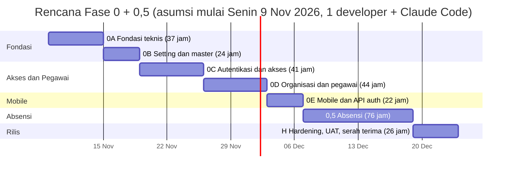

# Implementasi_Plan — PAKIS ONE Fase 0 + 0,5

Dokumen kendali utama. **Setiap sesi AI agent dimulai dengan membaca `CLAUDE.md` lalu §6 dokumen ini**, kemudian melanjutkan dari status terakhir.

## 1. Tujuan

Membangun fondasi PAKIS ONE untuk CV Pakis Jaya Abadi, yaitu:
- core organisasi & pegawai,
- akun & hak akses dinamis,
- site setting,
- autentikasi lengkap,
- audit,
- absensi lewat Pakis Pro.

Semua daftar memakai standar paging, pencarian, filter, dan sort yang ditegakkan test.

## 2. Fase & Exit Gate

| Fase | Tujuan | Task | Deliverable yang bisa didemokan | Exit gate (semua harus terpenuhi) |
|---|---|---|---|---|
| **0A Fondasi teknis** | Kerangka, CI, standar listing, ekspor, audit | T-001–T-007 | Halaman demo listing, audit log tampil | CI hijau (gitleaks, audit, Larastan, Pest). `ListingContractTest` aktif dan menolak route tanpa standar. Trigger audit append-only teruji |
| **0B Setting & master** | Semua dinamis | T-008–T-012 | Halaman Pengaturan (semua grup), penomoran, referensi, wilayah | Registri = `08` §2 (test). `/api/v1/config` hanya kunci publik. Test konkurensi penomoran lulus |
| **0C Autentikasi & akses** | Login aman, password, MFA, role, scope, pengguna | T-013–T-020 | Login + lupa/ubah password + MFA + kelola role & pengguna | SEC-001–SEC-009 teruji. Matriks permission identik `06` §4. Harness IDOR siap |
| **0D Organisasi & pegawai** | Data pegawai rapi | T-021–T-029 | Lokasi, departemen, jabatan, pegawai, mutasi, offboarding, impor Excel, notifikasi | Semua listing lolos test kontrak. NIK tidak pernah plaintext. Offboarding mencabut akses (test). Impor idempoten |
| **0E Mobile & API auth** | Pakis Pro bisa login dengan perangkat terikat | T-030–T-032 | APK debug: login, MFA, perangkat menunggu, lupa/ubah password | Token terikat perangkat teruji. Gerbang versi jalan. `flutter analyze` bersih |
| **0,5 Absensi** | Absen selfie+GPS, offline, koreksi, rekap | T-033–T-045 | Absen dari HP (online & offline), rekap, koreksi, dasbor | BR-060–BR-070 teruji. MOB-01–MOB-09 lulus. Retensi selfie jalan |
| **H Hardening & rilis** | Siap dipakai Pakis | T-046–T-048 | Staging + produksi, UAT, manual | Checklist `09` §7.2 lengkap. Uji restore tercatat. UAT diparaf. OQ-002/006/009/012 terjawab |

## 3. Urutan Eksekusi (mengikuti dependensi)

1. **0A:** T-001 → T-002 → T-003 → T-004 → T-005 → T-006 → T-007
2. **0B:** T-008 → T-009 → T-010 → T-011 → T-012
3. **0C:** T-013 → T-014 → T-015 → T-017 → T-018 → T-016 → T-019 → T-020
4. **0D:** T-021 → T-022 → T-023 → T-024 → T-025 → T-029 → T-027 → T-028
5. **0E (+ sisa 0D):** T-030 → T-031 → **T-026** → T-032
6. **0,5:** T-033 → T-034 → T-035 → T-036 → T-037 → T-038 → T-039 → T-040 → T-041 → T-042 → T-043 → T-044 → T-045
7. **H:** T-046 → T-047 → T-048

Task yang boleh paralel bila ada dua sesi agent: T-030 (Flutter) bisa mulai setelah T-008 berjalan bersamaan dengan Fase 0C–0D. T-033/T-034 bisa paralel dengan T-030–T-032.

Total ±270 jam efektif ≈ **8–9 minggu kerja** (±6,5 jam efektif/hari). Belum termasuk menunggu jawaban OQ dan jadwal UAT di pihak Pakis.

## 4. Risiko Pelaksanaan

| Risiko | Dampak | Mitigasi |
|---|---|---|
| Dependency belum kompatibel PHP 8.5 | Tertunda di T-001 | Fallback PHP 8.4 (ADR-003) |
| HP pegawai sangat lama / GPS buruk di area sawah | Absen gagal, keluhan | Uji lapangan MOB-10 di awal Fase 0,5, sesuaikan `max_accuracy_m` & radius lewat setting |
| Pegawai belum punya email | Lupa password tidak bisa mandiri | Reset oleh admin (FR-007). Kanal WA setelah OQ-004 |
| Data Excel pegawai sangat berantakan | Impor lama | Pemetaan kolom + profil + berkas galat. Uji dengan sampel asli yang disamarkan (OQ-001) di staging |
| Resistensi pegawai terhadap selfie/GPS | Adopsi rendah | Pemberitahuan tertulis (OQ-009), lokasi hanya saat absen, sosialisasi oleh Owner |
| Lingkup bertambah di tengah jalan | Molor | Perubahan masuk `12-OPEN-QUESTIONS.md` dan task baru, tidak disisipkan diam-diam |

## 5. Kebutuhan dari Pakis Sebelum/Selama Pelaksanaan

- Jawaban OQ-001, OQ-002, OQ-006, OQ-008, OQ-009, OQ-011, OQ-012 (lihat `docs/12-OPEN-QUESTIONS.md`).
- Contoh Excel daftar pegawai (data disamarkan) untuk menyetel impor.
- Titik koordinat setiap kantor/gudang/toko (bisa dari tautan Google Maps).
- Satu orang HRD dan satu kepala lokasi sebagai penguji UAT.

## 6. Status Progres (diperbarui agent setiap task selesai)

### 6.1 Ringkasan

| Fase | Total task | Selesai | Sedang | Blocked |
|---|---|---|---|---|
| 0A | 7 | 0 | 0 | 0 |
| 0B | 5 | 0 | 0 | 0 |
| 0C | 8 | 0 | 0 | 0 |
| 0D | 9 | 0 | 0 | 0 |
| 0E | 3 | 0 | 0 | 0 |
| 0,5 | 13 | 0 | 0 | 0 |
| H | 3 | 0 | 0 | 0 |
| **Total** | **48** | **0** | **0** | **0** |

### 6.2 Sedang dikerjakan
- (kosong)

### 6.3 Blocker aktif
- (kosong)

### 6.4 Log

| Tanggal | Task | Status | Commit | Catatan |
|---|---|---|---|---|
| 2026-11-03 | — | Paket dokumen v1.0 dibuat | — | Siap mulai T-001 |
| 2026-11-14 | — | Persiapan lingkungan | — | Root repo dipindah ke `D:\program\pakis` + `git init`. Keputusan: MariaDB 11.8 (ADR-012 direvisi, OQ-014 baru), driver `database` lokal, OQ-003 terjawab (`konsep/region.sql`) |

### 6.5 Catatan untuk sesi berikutnya
- Mulai dari T-001. Baca `CLAUDE.md` §2 untuk perintah dan `docs/03-ARCHITECTURE.md` §5 untuk versi.
- Lingkungan lokal (dicek 14 Nov 2026): PHP 8.5.12 XAMPP (ekstensi lengkap kecuali `redis`, `sodium`), MariaDB 11.8.9 di `127.0.0.1:3307` user `root` tanpa password, Node 22.21.1, npm 10.9.4, Composer 2.9.5, Git 2.52. Installer `laravel` belum ada → pakai `composer create-project laravel/react-starter-kit backend`. Flutter/FVM belum terpasang (baru perlu di T-030).
- `.env.example` T-001: `DB_CONNECTION=mariadb`, `DB_PORT=3307`, `CACHE_STORE=database`, `QUEUE_CONNECTION=database`, `SESSION_DRIVER=database`.
- Sumber master wilayah untuk T-012: `konsep/region.sql` (pemetaan di OQ-003).
