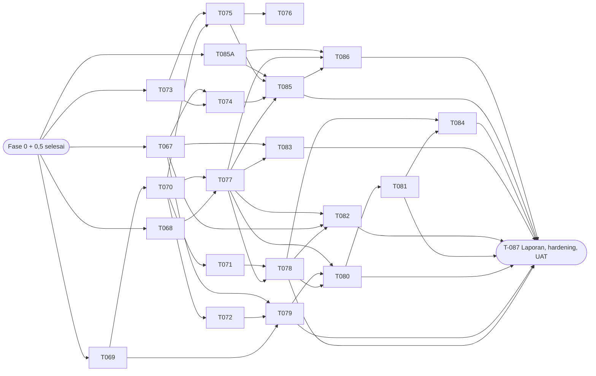

# TASKS — Paket A: Master & Gudang (T-067–T-087, + T-085A)

Revisi 16 Nov 2026 (repo): menerapkan keputusan PA-1, PA-3, PA-5–PA-8, PA-10–PA-24 dari `docs/12-OPEN-QUESTIONS.md` (termasuk task baru T-085A) + PF-3 sisi A (`PeriodGuard` di T-077), kontrak payload event `14` §7 (**15** §11.4).

> Siap eksekusi **setelah** Fase 0 + 0,5 selesai (exit gate `Implementasi_Plan.md`, T-041–T-045) dan checklist penyelarasan `docs/15-PAKET-A-MASTER-GUDANG.md` §0 dicentang. Format sama dengan `TASKS.md`. Spesifikasi sumber: `docs/15-PAKET-A-MASTER-GUDANG.md` (disingkat **15**), kerangka `docs/14-ROADMAP-LENGKAP.md` (**14**). Path relatif ke `backend/`.
>
> **Aturan khusus paket ini**
> - **Nama berkas halaman & komponen frontend mengikuti konvensi repo** (kebab-case huruf kecil, mis. `pages/sales/orders/form.tsx`); path PascalCase di task ini indikatif (**15** §0 S-3).
> - Domain baru: `app/Domain/{Approval,Catalog,Customer,Pricing,Purchasing,Inventory,Fleet}` dengan struktur sama seperti Fase 0 (`Models/`, `Actions/`, `Policies/`, `Enums/`, `Events/`, `Listings/`).
> - Uang & qty memakai value object `App\Support\Money\{Money,Qty,UnitCost}` berbasis `brick/math`. Dependency baru paket ini **hanya** `brick/math` `^1.0` (langsung, T-069; sudah terpasang 1.0.0 tidak langsung), dicatat di `03` §5. Tanpa `leaflet`/tile peta (PA-20). Dependency lain → berhenti dan tanyakan.
> - Ekspor selalu pola Fase 0: listing `implements ExportableListing` + kunci `config/pakis.php` `exports` + `StartExport` (**15** §5). Tidak ada kelas `*Export` sendiri.
> - Unggahan berkas selalu lewat `app/Support/Upload/` (diekstrak T-070, SEC-109). Galat domain di rute web lewat jalur Inertia yang ditetapkan T-067 (**15** §11.3); kode baru masuk tabel "khusus web" `05` §2.4a (PA-32) + `ErrorCode` oleh task yang pertama memakainya.
> - Notifikasi baru = case `NotificationKind` + kunci `notification.on_<jenis>` (default `[]`) + `08` §2.5 oleh task pemilik (**15** §9.1).
> - Setiap tabel di **15** §4 dibuat oleh task yang disebut di judul sub-bagiannya. Kolom yang tidak ada di **15** tidak boleh ditambahkan tanpa mencatat di **15** dulu.
> - Setiap listing baru: kelas listing + `#[UsesListing]` + `DataTable` + kunci di `07` §3.4 + `tests/Fixtures/listing_catalog.php` (**15** §7.3).
> - Setiap setting baru: `SettingRegistry` + `08` §2 + test registri (**15** §9).
> - Setiap permission baru sudah dibuat T-067. Task lain hanya memakai, tidak menambah.
> - Setiap Action yang memanggil `AccountingOutbox::record()` memanggil `App\Domain\Accounting\Period\PeriodGuard` dengan tanggal bisnis dokumen (dibuat T-077, `PeriodGuardArchTest`), mengisi kualifier payload, dan menguji kasus "tidak dipancarkan" miliknya (**15** §11.4).

| Ringkasan | Nilai |
|---|---|
| Task | 22 (T-067–T-087 + T-085A) |
| Estimasi | 172 jam (rentang 147–212) |
| Exit gate | **15** §10.2 checklist rilis + UAT-A01–A21 lulus + `ReconcileStockLedger` = 0 selisih di data UAT |

## Urutan & dependensi

Jalur kritis: T-069 → T-070 → T-077 → T-080 → T-081 → T-087. T-067, T-068, T-073, dan T-085A (hanya bergantung Fase 0) bisa paralel di awal (perhatikan file bersama: `app/Domain/Access/Support/{PermissionCatalog,RoleCatalog}.php`, `listing_catalog.php`, `routes/admin.php`, `SettingRegistry`, `Implementasi_Plan.md`).

---

### T-067 — Mesin approval generik + role & permission Paket A
- Paket: A | Prioritas: P0 | Estimasi: 10 jam
- Memenuhi: FR-A01, FR-A02, BR-153, SEC-101, SEC-110 (aturan & delegasi), ADR-105
- Dependensi: Fase 0 (T-025 penugasan & atasan, T-021 lokasi, T-029 notifikasi, T-008 setting)
- Konteks wajib: **15** §4.2, §4.2.1, §5 (baris `approvals`, `approval-rules`, `approval-delegations`), §6.1–§6.5, §8.2 BR-153, §9 (intro tipe/penanda, `approval.*`), §9.1 (jenis `approval_*`), §10.2 SEC-101, §11.2–§11.3; **14** §4 ADR-105; `06` §2–§5; `05` §2.2–§2.3
- File: migrations `approval_rules`, `approval_rule_steps`, `approval_requests`, `approval_steps`, `approval_delegations`; migrasi data idempoten `add_paket_a_permissions_to_builtin_roles` (hanya menambah sel ✅/🔸 **15** §6.4 ke role bawaan yang sudah ada + `mfa_required=true` untuk `supervisor`); `app/Domain/Approval/{Models/*,Enums/{ApprovalStatus,StepStatus,ApproverType},Contracts/Approvable.php,ApprovalEngine.php,ApproverResolver.php,RuleMatcher.php,Actions/{RequestApproval,DecideApprovalStep,CancelApproval,SaveApprovalRule,PreviewApprovalChain,CreateDelegation,RevokeDelegation},Events/*,Listings/{ApprovalListing,ApprovalRuleListing,ApprovalDelegationListing},Policies/*}`; `app/Http/Controllers/Admin/{ApprovalController,ApprovalRuleController,ApprovalDelegationController}.php`; `app/Console/Commands/EscalateApprovals.php`; `database/seeders/{PaketARoleSeeder,ApprovalRuleSeeder}.php`; `app/Domain/Access/Support/PermissionCatalog.php` (+55) dan `app/Domain/Access/Support/RoleCatalog.php` (4 role baru; `administrator` & `hrd` jadi daftar eksplisit; `supervisor` MFA; deskripsi `kepala_lokasi`); `app/Domain/Settings/{SettingType,SettingDefinition,SettingRegistry}.php` (tipe `decimal`/`int_list`/`money`, penanda `locked`/`one_way`, grup `approval`); `app/Domain/Notification/Enums/NotificationKind.php` (+ `approval_requested`, `approval_decided`, `approval_escalated`); penanganan `ApiError` untuk request Inertia di `bootstrap/app.php` (atau handler yang dirujuknya); `resources/js/pages/Approvals/{Index,Show}.tsx`, `resources/js/pages/Settings/ApprovalRules/{Index,Form}.tsx`, `resources/js/pages/Approvals/Delegations.tsx`, `components/pakis/ApprovalTimeline.tsx` (dialog reauth memakai `confirm-password-dialog.tsx` yang ada); `tests/Feature/Approval/*`, `tests/Feature/Access/PaketAMatrixTest.php`, test izin baru default ❌, test migrasi data, test galat Inertia, test registri setting; update `05` §2.3 (sub-tabel khusus web), `06` §2–§4 & §8, `08` §2 (+ §2.5)
- Deskripsi: Bangun kontrak `Approvable` (method `approvalDocumentType()`, `approvalAmount()`, `approvalSummary()`, `approvalContext()`, `approvalScopeLocationId()`, `approvalScopeEmployeeId()`, `onApproved()`, `onRejected()`, `creatorUserId()`). `ApprovalEngine::request(Approvable, User)` memilih aturan, membuat snapshot, mengaktifkan langkah 1; `decide()` mengunci baris permintaan (`lockForUpdate`), memvalidasi calon penyetuju & maker-checker, memajukan langkah, memanggil `onApproved/onRejected` di transaksi yang sama. `direct_supervisor` = atasan pada penugasan **utama** (BR-153(3)); scope `permission` memakai definisi lokasi Fase 0 (utama + rangkap + dikepalai, **15** §6.2). Eskalasi memakai **jam kalender** dan hanya menambah penyetuju (BR-153(6)). Reauth nominal lewat `PasswordConfirmation::isRecent()` (bukan middleware). Kotak masuk "Menunggu saya" dihitung dari langkah `pending` yang calon penyetujunya termasuk pengguna (via permission + scope, atasan, kepala lokasi, delegasi aktif, atau eskalasi). Seed 4 role baru, 55 permission, matriks **15** §6.4 (Owner = semua, terkunci; BR-031), dan aturan default **15** §4.2.1. `administrator` dan `hrd` diubah dari pola "semua kecuali" ke **daftar izin eksplisit** (isi Fase 0 tetap), lalu migrasi data idempoten menambahkan sel Paket A ke role bawaan instalasi yang sudah berjalan tanpa mencabut izin buatan pengguna (PA-11). `supervisor` dan `admin_penjualan` `mfa_required = true` (PA-12). Tetapkan satu jalur galat domain Inertia: `ApiError` → `back()->withErrors()`/toast berisi pesan dari kode galat, endpoint JSON tetap format `05` §2.2 (PA-16). Tambah tipe & penanda setting (PA-19). Tambahkan menu **15** §6.5 (grup tampil hanya bila ada item).
- Kriteria penerimaan:
  - [x] Given aturan PO `<25 jt` dan `≥25 jt`, When PO Rp 24.999.999,99 dan Rp 25.000.000 diajukan, Then masing-masing memakai aturan 1 langkah dan 2 langkah (batas bawah inklusif, atas eksklusif)
  - [x] Given tidak ada aturan cocok dan `approval.auto_approve_when_no_rule=false`, Then `422 APPROVAL_RULE_MISSING`
  - [x] Pengaju, pembuat dokumen, dan delegasi pengaju tidak bisa memutuskan (`403 APPROVAL_SELF_DECISION`) — test BR-153(4)
  - [x] Langkah `direct_supervisor` tanpa atasan langsung → langsung `escalated`, pemegang `escalation_permission` bisa memutuskan
  - [x] Dua request approve bersamaan pada langkah yang sama → tepat satu sukses, satu `409 STATE_CONFLICT`
  - [x] Owner yang mengajukan/membuat dokumen tidak bisa memutuskannya (maker-checker berlaku untuk Owner); Owner tetap memegang semua izin dan role-nya terkunci
  - [x] Langkah `direct_supervisor` memakai atasan penugasan utama walau penugasan rangkap punya atasan lain
  - [x] Eskalasi terjadi setelah N jam kalender (termasuk malam/libur) dan tidak pernah menyetujui otomatis
  - [x] Perubahan aturan setelah permintaan dibuat tidak mengubah rantai permintaan itu (snapshot)
  - [x] Delegasi di luar tanggal berlaku tidak memberi hak; delegasi ke diri sendiri ditolak
  - [x] Pengguna yang sudah memutuskan langkah 1 tidak bisa memutuskan langkah 2 pada permintaan yang sama (BR-153(11))
  - [x] Nominal ≥ `approval.reauth_amount` mewajibkan konfirmasi password (`PasswordConfirmation::isRecent()`); di bawah ambang tidak
  - [x] `PaketAMatrixTest` memverifikasi setiap sel ✅/❌ **15** §6.4 untuk 10 role (data-driven); `PermissionMatrixTest` Fase 0 tetap hijau
  - [x] Keempat role baru Paket A memegang `dashboard.view` (**15** §6.4 catatan): login web pengguna ber-role itu mendarat di `/dasbor` dengan 200, bukan 403 (test per role)
  - [x] Test "izin baru default ❌ untuk semua role selain `owner`/`super_admin`": izin uji yang ditambahkan ke katalog tidak jatuh ke `administrator`/`hrd`/role lain
  - [x] Migrasi data idempoten: dijalankan dua kali hasilnya sama; izin yang ditambah/dicabut pengguna di role bawaan tidak berubah; hanya sel Paket A yang ditambah
  - [x] `supervisor` dan `admin_penjualan` `mfa_required = true` (instalasi baru & lewat migrasi data untuk `supervisor` yang ada)
  - [x] `ApiError` pada request Inertia menghasilkan redirect back + galat/toast berisi pesan kode galat (bukan pesan exception, bukan 500); request JSON tetap format `05` §2.2
  - [x] Tipe `decimal`/`int_list`/`money` dan penanda `locked` (hanya `super_admin`, konfirmasi password, audit) & `one_way` (`false → true` ditolak) teruji di test registri
  - [x] Kunci `notification.on_approval_*` (default `[]`) ada di registri & `08` §2.5 (test dua arah)
  - [x] 3 listing lulus `ListingContractTest`; audit tercatat untuk simpan aturan & delegasi
- Verifikasi: `php artisan test --filter=Approval` · `php artisan test --filter='PaketAMatrix|PermissionMatrix|RoleSeeder|SettingRegistry'` · `php artisan test tests/Contract` · `./vendor/bin/phpstan`
- Di luar lingkup: dokumen yang memakai engine (task masing-masing); notifikasi WhatsApp

### T-068 — Lokasi stok, rak, kendaraan minimal
- Paket: A | Prioritas: P0 | Estimasi: 6 jam
- Memenuhi: FR-A03, FR-A04, FR-A05, ADR-106 (dimensi stok), ADR-107
- Dependensi: T-021 (lokasi Fase 0), T-067 (permission)
- Konteks wajib: **15** §4.3, §5 (`stock-locations`, `stock-bins`, `vehicles`), §6.2 (dimensi stok), §7.3 (`stock_locations`, `stock_bins`, `vehicles`); **14** ADR-106, ADR-107
- File: migrations `vehicles`, `stock_locations`, `stock_bins` + seeder `TransitStockLocationSeeder`; `app/Domain/Inventory/{Models/{StockLocation,StockBin},Enums/{StockLocationType,BinZone},Actions/{SaveStockLocation,SaveStockBin},Listings/{StockLocationListing,StockBinListing},Policies/*}`; `app/Domain/Fleet/{Models/Vehicle,Actions/SaveVehicle,Listings/VehicleListing,Policies/VehiclePolicy}`; `app/Domain/Access/DataScope.php` (tambah `forStock()`); controllers `Admin/{StockLocationController,StockBinController,VehicleController}`; lookup `stock_locations`, `stock_bins`; pages `StockLocations/*`, `Vehicles/*`; tests
- Deskripsi: CRUD lokasi stok (warehouse/store terikat lokasi Fase 0; vehicle dibuat otomatis saat kendaraan ditandai canvas; `TRANSIT` sistem). Bin karantina `Q-01` dibuat otomatis untuk warehouse/store. `DataScope::forStock(User, Builder, column)` sesuai **15** §6.2: lokasi pengguna = definisi Fase 0 lewat `OrgStructure` (penugasan utama + tambahan/rangkap + lokasi yang dikepalai).
- Kriteria penerimaan:
  - [x] CHECK `sl_type_chk` menolak kombinasi tidak valid (test DB langsung)
  - [x] `TRANSIT` tidak bisa diubah/nonaktif/hapus (403)
  - [x] Kendaraan `is_canvas=true` → tepat satu lokasi stok `vehicle`; dinonaktifkan → lokasi stok ikut nonaktif bila saldo 0, ditolak bila saldo > 0 (setelah T-077, test ditandai `->todo()` sampai T-077) — test aktif sejak T-077 (`LedgerStockBalanceProbe`)
  - [x] Plat dinormalisasi huruf besar tanpa spasi, unik
  - [x] Staf gudang scope `location` hanya melihat lokasi stok lokasinya (termasuk lokasi penugasan rangkap); akses ID lain → 404 (IDOR)
  - [x] 3 listing lulus kontrak
- Verifikasi: `php artisan test --filter='StockLocation|StockBin|Vehicle'`
- Di luar lingkup: data armada (Paket D), stok (T-077)

### T-069 — Kategori produk, satuan & konversi
- Paket: A | Prioritas: P0 | Estimasi: 5 jam
- Memenuhi: FR-A06, FR-A07, BR-150, BR-151 (kategori), ADR-101, ADR-102
- Dependensi: T-010 (referensi), T-067
- Konteks wajib: **15** §4.1 (grup `unit`, `formulation`), §4.4 (`product_categories`, `product_units`), §8.2 BR-150, BR-151; **14** ADR-101, ADR-102
- File: `composer require brick/math:^1.0` (sudah terpasang 1.0.0 tidak langsung; jadikan langsung, API 1.x `RoundingMode` enum; catat di `03` §5); seeder referensi (`unit` dengan meta `integer_only`, `formulation`); migration `product_categories`; `app/Support/Money/{Money,Qty,UnitCost}.php` (belum ada di repo); `app/Domain/Catalog/{Models/ProductCategory,Enums/CategoryKind,Actions/SaveProductCategory,Listings/ProductCategoryListing,Policies/*,Units/UnitConverter.php}`; controller `Admin/ProductCategoryController`; page `ProductCategories/Index.tsx` (form di dialog); `components/pakis/QtyInput.tsx`; tests `tests/Unit/Support/{QtyTest,MoneyTest}.php`, `tests/Unit/Catalog/UnitConverterTest.php`, arch test `NoFloatInDomainTest`
- Deskripsi: Kategori bertingkat (maks 3 level) dengan `kind` dan penanda perilaku. `UnitConverter::toBase(Qty, ProductUnit)` dan `fromBase()`, pembulatan half-up 3 desimal, validasi `integer_only`. `QtyInput` menampilkan "= 240 botol" di bawah input. Tabel `product_units` dibuat di T-070 (butuh `products`); converter diuji dengan model in-memory.
- Kriteria penerimaan:
  - [x] `Qty::of('2.5')->times('24')` = `60.000` tanpa float (arch test: tidak ada tipe `float` di `App\Domain\{Catalog,Inventory,Pricing,Purchasing}`)
  - [x] Satuan `integer_only` menolak `1,5` (`422 QTY_NOT_INTEGER`)
  - [x] Kategori level 4 ditolak; kategori dengan produk tidak bisa dihapus (nonaktif saja)
  - [x] Listing `product_categories` lulus kontrak
- Verifikasi: `php artisan test --filter='Qty|Money|UnitConverter|ProductCategory'`
- Di luar lingkup: produk (T-070)

### T-070 — Produk, satuan produk, barcode
- Paket: A | Prioritas: P0 | Estimasi: 10 jam
- Memenuhi: FR-A07 (per produk), FR-A08, FR-A09, BR-112 (penanda), BR-150, BR-151, SEC-109 (komponen unggahan bersama + foto)
- Dependensi: T-069
- Konteks wajib: **15** §4.4 (`products`, `product_units`, `product_barcodes`), §5 (`products.*`, paragraf Ekspor), §7.1 (detail bertab), §7.2, §7.3 (`products`), §8.1 BR-112, §8.2 BR-150–151, §9 (`product.sku_mode`, `upload.*`), §10.2 SEC-109; `backend/CLAUDE.md` "Ekspor (T-006)"
- File: `app/Support/Upload/*` (diekstrak dari `app/Domain/Attendance/Support/CorrectionAttachment.php` & `app/Domain/Access/Support/AvatarStore.php`: deteksi isi berkas, allowlist JPG/PNG/WEBP/PDF, buang metadata, batas dari setting `upload.max_image_kb`/`upload.max_pdf_kb`, grup `upload` di registri + `08` §2); migrations `products`, `product_units`, `product_barcodes`; sequence `product`; `app/Domain/Catalog/{Models/{Product,ProductUnit,ProductBarcode},Enums/ProductStatus,Actions/{CreateProduct,UpdateProduct,SaveProductUnit,AddBarcode,RemoveBarcode},Listings/ProductListing (implements ExportableListing),Policies/ProductPolicy,Resources/ProductResource}`; kunci `products` di `config/pakis.php` `exports`; controller `Admin/ProductController`, `Admin/ProductUnitController`, `Admin/ProductBarcodeController`; lookup `products`, `product_units`; pages `Products/{Index,Form,Show}.tsx` (tab memakai `page-tabs.tsx`); tests `tests/Unit/Support/Upload/*` + produk
- Deskripsi: Ekstrak komponen unggahan bersama `app/Support/Upload/` (PA-22) yang dipakai semua unggahan Paket A (T-071, T-074, T-080, T-083, T-084); test unggahan Fase 0 yang ada tetap hijau. Produk dengan penanda yang disalin dari kategori (BR-151). Satuan dasar dibuat otomatis. Barcode unik global, pencarian listing mendukung scan barcode exact. Foto produk di disk publik ter-resize (thumbnail 400 px) — **bukan** data pribadi; tetap lewat `app/Support/Upload/`. Ekspor `admin.products.export` (`products.view`) lewat pola Fase 0. Tab "Harga" dan "Stok" di halaman detail diisi placeholder komponen yang diisi T-075/T-087.
- Kriteria penerimaan:
  - [x] SKU mode `auto` memakai `NumberGenerator('product')`; mode `manual` validasi unik huruf besar `[A-Z0-9-]{3,30}`
  - [x] Melonggarkan penanda kategori tanpa alasan ditolak; dengan alasan tercatat audit
  - [x] Faktor satuan yang sudah dipakai PO/mutasi → `409 UNIT_FACTOR_LOCKED` (test memakai fixture baris PO setelah T-079; sebelumnya `->todo()`) — test aktif 17 Nov 2026 (fixture baris PO T-079)
  - [x] Maks satu default jual & satu default beli per produk
  - [x] Barcode duplikat ditolak; pencarian listing `q=<barcode>` menemukan produk
  - [x] Listing `products` + ekspor (`ExportableListing`) lulus kontrak; ekspor escape formula
  - [x] `app/Support/Upload/`: berkas berekstensi `.jpg` berisi skrip/HTML ditolak (deteksi dari isi), WEBP & PDF diterima, EXIF/lokasi foto dibuang, batas mengikuti `upload.max_*_kb`; test unggahan Fase 0 lama hijau
- Verifikasi: `php artisan test --filter=Product`
- Di luar lingkup: izin edar (T-071), prinsipal FK (T-072), harga (T-075)

### T-071 — Izin edar produk
- Paket: A | Prioritas: P0 | Estimasi: 5 jam
- Memenuhi: FR-A10, BR-152, SEC-109
- Dependensi: T-070
- Konteks wajib: **15** §4.4 (`product_registrations`), §5 (`product-registrations`), §7.3, §7.4 (widget izin), §8.2 BR-152, §9 (`inventory.registration_reminder_days`), §9.1 (`registration_expiring`), §11.1 (`RefreshRegistrationStatus`)
- File: migrations `product_registrations`, `reminder_logs` (**15** §4.1); `app/Domain/Catalog/{Models/ProductRegistration,Enums/RegistrationStatus,Actions/{SaveRegistration,RevokeRegistration},Queries/ActiveRegistration.php,Listings/ProductRegistrationListing}`; command `catalog:refresh-registrations` + jadwal (`->timezone(DisplayTime::timezone())`); case `NotificationKind::RegistrationExpiring` + kunci `notification.on_registration_expiring` (registri + `08` §2.5); controller; pages `ProductRegistrations/Index.tsx`, tab izin di `Products/Show.tsx`; dashboard widget; tests
- Deskripsi: `ActiveRegistration::for(Product, date)` dipakai FEFO (T-078). Berkas izin (PDF/JPG) diunggah lewat `app/Support/Upload/` (T-070), disimpan di disk privat, akses signed URL 5 menit. Pengingat via notifikasi in-app Fase 0 sekali per izin per ambang.
- Kriteria penerimaan:
  - [x] Izin `valid_until` kemarin → job → `expired`; produk wajib izin tanpa izin `active` → `ActiveRegistration` null
  - [x] Perpanjangan (izin baru) membuat produk berlaku lagi tanpa mengubah izin lama
  - [x] Pengingat H-60/30/7/0 tidak terkirim dua kali walau job dijalankan berulang
  - [x] Filter `registration_status=expiring` benar pada batas hari ke-60
- Verifikasi: `php artisan test --filter=Registration`
- Di luar lingkup: blokir alokasi (diuji di T-078)

### T-072 — Prinsipal & supplier
- Paket: A | Prioritas: P1 | Estimasi: 5 jam
- Memenuhi: FR-A11, SEC-108
- Dependensi: T-070
- Konteks wajib: **15** §4.5, §5 (`principals`, `suppliers`), §7.3, §10.2 SEC-108
- File: migrations `principals`, `suppliers`, `supplier_products`, alter `products` add FK `principal_id`; `app/Domain/Purchasing/{Models/{Principal,Supplier,SupplierProduct},Actions/*,Listings/{PrincipalListing,SupplierListing},Policies/*}`; controllers; lookup `principals`, `suppliers`; pages `Principals/Index.tsx`, `Suppliers/{Index,Form,Show}.tsx`; tests
- Deskripsi: Supplier dengan syarat bayar default, rekening terenkripsi & termasking, daftar produk dipasok (harga beli terakhir diperbarui saat penerimaan, lead time).
- Kriteria penerimaan:
  - [x] Rekening tidak pernah muncul plaintext di respons/log/audit; `reveal-account` mencatat `sensitive_data_viewed`
  - [x] Supplier nonaktif tidak muncul di lookup PO
  - [x] 2 listing lulus kontrak
- Verifikasi: `php artisan test --filter='Supplier|Principal'`
- Di luar lingkup: faktur & pembayaran supplier (Paket F)

### T-073 — Area penjualan, kios inti & penugasan
- Paket: A | Prioritas: P0 | Estimasi: 6 jam
- Memenuhi: FR-A12, FR-A13 (data inti), FR-A17, BR-166(1) (normalizer bersama), BR-167, ADR-106 (dimensi pelanggan), SEC-108 (HP di ekspor)
- Dependensi: T-025 (penugasan pegawai), T-067
- Konteks wajib: **15** §4.1 (`customer_type`, sequence `customer`), §4.6 (`sales_areas`, `sales_area_districts`, `customers`, `customer_assignments`), §5 (`sales-areas`, `customers.index/create/store/edit/update/reassign/export`), §6.2, §7.2 (`LocationPointInput`, komponen yang ada), §7.3, §8.2 BR-166(1)/(3), BR-167, §9 (`customer.default_term_days`, `customer.code_mode`); `TASKS.md` T-020 (addendum `users.phone`), T-021 (pola lokasi tautan Google Maps), T-038 (`LocationDiagram`)
- File: migrations; **pindah** `app/Domain/Employee/Support/PhoneNormalizer.php` → `app/Support/Phone/PhoneNormalizer.php` (perbarui pemakai: `EmployeeRequest`, `EmployeeListing`, `Employee/Import/RowNormalizer`, test `EmployeeSupportTest`; perilaku sama); addendum T-020: `app/Http/Requests/Access/UserRequest.php` menormalisasi `users.phone` lewat `PhoneNormalizer` + migrasi data kecil yang menormalisasi `users.phone` yang ada; `app/Domain/Customer/{Models/{SalesArea,Customer,CustomerAssignment},Enums/CustomerStatus,Actions/{SaveSalesArea,CreateCustomer,UpdateCustomer,ReassignCustomers},Listings/{SalesAreaListing,CustomerListing (implements ExportableListing)},Policies/*}`; kunci `customers` di `config/pakis.php` `exports`; `DataScope::forCustomer()`; command `customers:apply-assignments`; controllers; lookup `sales_areas`, `customers`; pages `SalesAreas/Index.tsx`, `Customers/{Index,Form,Show}.tsx`; `components/pakis/location-point-input.tsx` (tanpa library: tempel tautan Google Maps atau tombol "Ambil lokasi HP" lewat Geolocation API) + tampilan `location-diagram.tsx` yang ada; HP termasking memakai `masked-value.tsx`; tests
- Deskripsi: Data kios inti tanpa verifikasi (T-074 menambah verifikasi, kontak, duplikat, HP, limit). Status awal `prospect`, `credit_limit_active=false`. `PhoneNormalizer` dipindah ke `app/Support/Phone/` dan dipakai Employee, akun (`users.phone`), dan Customer (PA-6/PA-23); tidak ada normalizer kedua. Pengalihan massal ≤ 500 kios. Titik kios **tanpa Leaflet, tanpa tile, tanpa mengubah CSP** (PA-20, pola T-021/T-038): diisi dari tautan Google Maps atau Geolocation API browser, ditampilkan dengan `LocationDiagram`. Ekspor `admin.customers.export` hanya untuk `customers.export`, HP termasking (PA-3, SEC-108).
- Kriteria penerimaan:
  - [x] Unik satu penugasan aktif (test DB); pengalihan menutup lama & membuka baru dalam satu transaksi
  - [x] Pengalihan bertanggal masa depan diterapkan job pada hari H
  - [x] Supervisor (scope team) hanya melihat kios area yang ia supervisi atau milik timnya; Sales (Paket B) belum ada — test memakai role uji `self`
  - [x] IDOR: kios di luar scope → 404 di show/edit/update
  - [x] CSP tidak berubah (`img-src 'self' data: blob:`, `SecurityHeaders`); tidak ada dependency npm baru; titik dari tautan Google Maps dan dari Geolocation API tersimpan benar
  - [x] `App\Support\Phone\PhoneNormalizer` menggantikan kelas lama tanpa perubahan perilaku (test Employee/impor pegawai lama hijau); tidak ada `PhoneNormalizer` lain di `app/`
  - [x] `users.phone` baru tersimpan `62…`; migrasi data menormalisasi nilai lama (`0812…` → `62812…`), nilai tak sah dibiarkan dan dilaporkan
  - [x] Ekspor `customers`: tanpa `customers.export` → 403; HP termasking (SEC-108)
  - [x] 2 listing + ekspor `customers` lulus kontrak
- Verifikasi: `php artisan test --filter='SalesArea|Customer|PhoneNormalizer|EmployeeSupport|User'`
- Di luar lingkup: verifikasi & limit (T-074), price list FK (T-075)

### T-074 — Verifikasi kios, duplikat, ganti HP, limit
- Paket: A | Prioritas: P0 | Estimasi: 10 jam
- Memenuhi: FR-A13 (lengkap), FR-A14, FR-A15, FR-A16, FR-A18, BR-125, BR-126, BR-165, BR-166, SEC-105, SEC-108 (HP), SEC-109
- Dependensi: T-073, T-067
- Konteks wajib: **15** §4.6 (`customer_contacts`, `customer_verifications`), §4.2.1 (`customer_*`), §5 (`customers.duplicates/verify/otp/change-phone/credit-limit/merge`, `customer-verifications`), §8.1 BR-125–126, §8.2 BR-165–166, §9 (`customer.*`, `auth.otp_length`), §9.1 (`customer_phone_changed`), §10.2 SEC-105, SEC-109, §11.3; **14** §12 `WhatsAppChannel` (bagian A); kerangka OTP Fase 0 (`TASKS.md` T-015: `App\Domain\Notification\Otp\{OtpService,OtpManager,OtpChannel}`, `config/otp.php`) dan `WhatsAppSender` + `ChannelGuard` (T-029)
- File: migrations `customer_contacts`, `customer_verifications`, `customer_otp_codes` (CHECK `customers_active_limit_chk` sudah dibuat T-073); `app/Domain/Customer/{Actions/{SubmitVerification,RecordOfficeCall,SendCustomerOtp,CheckCustomerOtp,RequestPhoneChange,RequestCreditLimit,RequestMerge},Approvables/{CustomerActivation,CustomerPhoneChange,CustomerCreditLimit,CustomerMerge},Duplicates/DuplicateFinder.php,Otp/CustomerOtpService.php,Listings/CustomerVerificationListing}` (`CustomerOtpService`: kirim lewat `OtpManager`/`OtpChannel` Fase 0 kanal `whatsapp` saja, simpan hash & hitung percobaan di `customer_otp_codes`; `OtpService` tidak dipakai karena per-`User` & khusus lupa password; **tidak** ada kontrak `WhatsAppChannel` baru); kunci setting `customer.otp_*` (**15** §9); case `NotificationKind::CustomerPhoneChanged` + kunci `notification.on_customer_phone_changed`; unggahan foto toko & dokumen kelayakan lewat `app/Support/Upload/` (T-070); controllers; pages `Customers/Verify.tsx` (OTP memakai `otp-code-input.tsx`, titik memakai `location-point-input.tsx` T-073), `CustomerVerifications/Index.tsx`, dialog duplikat; tests
- Deskripsi: Implementasi BR-165/166 lengkap dengan engine approval T-067. `DuplicateFinder` memakai normalisasi nama + `similar_text` (tanpa dependency baru) + jarak Haversine. HP kios dibandingkan dengan `employees.phone` pegawai aktif **dan** `users.phone` akun aktif setelah normalisasi bersama `App\Support\Phone\PhoneNormalizer` (T-073). OTP: lewat kerangka OTP Fase 0, **hanya kanal WhatsApp** ke `owner_phone` (Telegram/email tidak membuktikan kepemilikan nomor, jadi tidak ditawarkan); panjang `auth.otp_length`, berlaku, percobaan, dan throttle per nomor/per pengguna dari kunci `customer.otp_*` (bukan konstanta); kode disimpan hash. Selama driver WhatsApp nyata belum ada (OQ-004), `customer.otp_enabled=false` dan jalur telepon kantor (BR-165b) yang dipakai. Pesan notifikasi kios lain (bukan OTP) lewat `WhatsAppSender` + `ChannelGuard`. Galat domain lewat jalur Inertia T-067; `admin.customers.duplicates` membalas JSON format `05` §2.2.
- Kriteria penerimaan:
  - [x] `credit_limit_active=true` tanpa `verified_at` ditolak DB (CHECK) dan Policy
  - [x] HP sama dengan kios aktif → `CUSTOMER_PHONE_DUPLICATE`; HP pegawai aktif **atau** HP akun pengguna aktif (termasuk yang diketik `08…`) → `PHONE_BELONGS_TO_EMPLOYEE`
  - [x] Nama "Toko Tani Makmur" vs "TANI MAKMUR" berjarak 120 m → kandidat duplikat; simpan tanpa konfirmasi "bukan duplikat" ditolak
  - [x] `customer.otp_enabled=false` atau kanal WhatsApp tidak tersedia → endpoint OTP `503 CHANNEL_UNAVAILABLE`; jalur telepon kantor oleh pengguna ≠ pengaju berhasil; oleh pengaju ditolak; kanal Telegram/email tidak pernah dipakai untuk OTP kios — aktivasi: telepon kantor boleh dipilih walau OTP tersedia (PA-49); ganti HP: dicatat pengaju sendiri (PA-57a); uji kanal WA nyata menunggu driver (OQ-004)
  - [x] OTP salah melebihi `customer.otp_max_attempts` atau kirim melebihi `customer.otp_send_per_*_hour` → `429 RATE_LIMITED`; angka diambil dari setting (test mengubah nilai setting); kode tidak pernah muncul di log aplikasi, `audit_logs`, `security_events`, maupun notifikasi (pesan log memakai nomor termasking "6281•••789"). Pengecualian satu-satunya: driver OTP `log` Fase 0 (`LogOtpChannel`, hanya lokal/staging, ditolak di produksi) yang memang menulis kode ke log `otp` untuk pengembangan
  - [x] Ganti HP butuh approval Owner; notifikasi Owner (`customer_phone_changed`) berisi nomor termasking; audit nilai lama/baru
  - [x] Foto toko & dokumen kelayakan ditolak bila bukan JPG/PNG/WEBP/PDF menurut isi berkas (`app/Support/Upload/`)
  - [x] Gabung kios: sumber `merged` + `merged_into_id`, listing default tidak menampilkan `merged`
  - [x] Limit ≥ ambang memakai rantai 2 langkah — pengaju cukup `customers.manage`; izin khusus di langkah persetujuan (PA-56f)
- Verifikasi: `php artisan test --filter='CustomerVerification|CustomerDuplicate|CustomerPhone|CreditLimit|CustomerOtp'`
- Di luar lingkup: kelayakan pembeli terbatas dipakai di dokumen jual (Paket B); driver WhatsApp nyata untuk kerangka OTP Fase 0 (Paket C, OQ-004)

### T-075 — Price list berversi
- Paket: A | Prioritas: P0 | Estimasi: 8 jam
- Memenuhi: FR-A19, BR-168, SEC-106, ADR-108
- Dependensi: T-070, T-073, T-067
- Konteks wajib: **15** §4.7 (`price_lists`, `price_list_versions`, `price_list_items`), §5 (`price-lists.*`), §7.3, §8.2 BR-168, §9 (`pricing.*`), §10.2 SEC-106, §11.1 (`ActivatePriceVersions`); **14** ADR-108
- File: migrations + FK `customers.price_list_id` + trigger `price_list_items_lock`; `app/Domain/Pricing/{Models/*,Enums/PriceVersionStatus,Actions/{SavePriceList,CreatePriceVersion,UpsertPriceItems,SubmitPriceVersion},Approvables/PriceListPublish,PriceResolver.php,Data/ResolvedPrice.php,Listings/{PriceListListing,PriceListItemListing (implements ExportableListing)}}`; kunci `price_list_items` di `config/pakis.php` `exports` (rute `admin.price-lists.items.export`, `prices.view`); command `pricing:activate-versions`; controllers; pages `PriceLists/{Index,Show,Items}.tsx`; tests
- Deskripsi: Versi baru bisa kosong, salin versi lain, atau salin dengan persen naik/turun (dibulatkan sesuai `pricing.rounding`). Editor item: tabel dengan input harga per satuan dan baris tier `min_qty`. `PriceResolver` mengembalikan `ResolvedPrice{price, price_list_version_id, source_list_kind, min_qty}`.
- Kriteria penerimaan:
  - [x] Ubah item versi `published` ditolak di Policy **dan** trigger DB (`PRICE_VERSION_LOCKED`)
  - [x] Resolusi 4 tingkat (store→kios→area→default) dengan fallback per produk (test tabel kasus)
  - [x] `min_qty` 1/10/50: qty 49 → harga tier 10
  - [x] Versi berlaku besok tidak dipakai hari ini; job men-supersede versi lama tepat waktu
  - [x] Penerbitan oleh pemegang `prices.publish` langsung terbit; pengguna lain → approval
  - [x] 2 listing + ekspor `price_list_items` (`ExportableListing`) lulus kontrak
- Verifikasi: `php artisan test --filter='Price'`
- Di luar lingkup: snapshot di dokumen jual (Paket B)

### T-076 — Promo
- Paket: A | Prioritas: P1 | Estimasi: 8 jam
- Memenuhi: FR-A20, BR-169
- Dependensi: T-075
- Konteks wajib: **15** §4.7 (`promotions`, `promotion_targets`, `promotion_scopes`, `promotion_tiers`), §5 (`promotions.*`), §7.3, §8.2 BR-169, §11.1 (`EndPromotions`)
- File: migrations; `app/Domain/Pricing/{Models/Promotion*,Enums/{PromotionType,PromotionStatus},Actions/{SavePromotion,SubmitPromotion,EndPromotion},Approvables/PromotionActivate,PromotionEngine.php,Data/{PricedLine,AppliedPromotion}.php,Listings/PromotionListing}`; controller + `simulate`; pages `Promotions/{Index,Form,Simulate}.tsx`; tests
- Deskripsi: Lima tipe promo. `PromotionEngine::apply()` murni (tanpa side effect) agar bisa dipakai simulasi, Paket B (web), dan C (offline — logika yang sama diporting ke Dart; sediakan fixture kasus uji JSON `tests/Fixtures/promotion_cases.json` yang dipakai kedua sisi).
- Kriteria penerimaan:
  - [x] Fixture ≥ 15 kasus (tiap tipe, stackable vs tidak, prioritas, harga tidak negatif, pembulatan) lulus
  - [x] Promo dana prinsipal wajib `principal_id`; `shared` wajib `principal_share_pct`
  - [x] Promo lewat `ends_at` → `ended` oleh job; promo `active` tidak bisa diubah selain diakhiri
  - [x] Simulasi tidak menulis apa pun ke DB (test query log)
- Verifikasi: `php artisan test --filter=Promotion`
- Di luar lingkup: pemakaian anggaran & bonus barang (Paket B)

### T-077 — Inti stok: StockLedger, batch, mutasi, reservasi, HPP, outbox
- Paket: A | Prioritas: P0 | Estimasi: 14 jam (12 + 2 untuk `PeriodGuard`, arch test lintas domain, tipe setting `date`)
- Memenuhi: FR-A21, BR-101, BR-114, BR-154, BR-155, BR-159, SEC-102, NFR-A02, NFR-A03, ADR-103, ADR-104, ADR-115 (`PeriodGuard`, PF-3)
- Dependensi: T-068, T-070
- Konteks wajib: **15** §4.8 (semua tabel), §8.1 BR-101, BR-114, §8.2 BR-154, BR-155, BR-159, §9 (`inventory.negative_stock_allowed`, `inventory.reservation_ttl_hours`, `accounting.lock_date`, tipe `date`), §10.2 SEC-102, §11.1 (`ReconcileStockLedger`, `ReleaseExpiredReservations`), §11.3 (`PERIOD_LOCKED`), §11.4; **14** ADR-103, ADR-104, ADR-115, §7 (aturan kontrak payload); **16** BR-229, SEC-123 (lanjutan di T-096)
- File: migrations `stock_batches`, `stock_movements` (+ trigger append-only), `stock_reservations`, `product_costs`, `product_stock_levels`, `stock_batch_status_logs`, `accounting_events` (+ trigger: hanya `status`, `journal_entry_id`, `error` yang boleh di-UPDATE, DELETE ditolak); `app/Domain/Inventory/Ledger/{StockLedger.php,StockLine.php,MovementType.php,LedgerResult.php,BatchKey.php,CostCalculator.php,Exceptions/{InsufficientStock,StockConflict,BatchNotAvailable}.php}`; `app/Domain/Inventory/Models/{StockBatch,StockMovement,StockReservation,ProductCost,ProductStockLevel,StockBatchStatusLog}.php`; `app/Domain/Accounting/Outbox/{AccountingOutbox.php,Models/AccountingEvent.php,EventCode.php}`; `app/Domain/Accounting/Period/PeriodGuard.php`; tipe `date` di `SettingType`/`SettingDefinition` + kunci `accounting.lock_date` + grup `accounting` di registri (`08` §2); kode `PERIOD_LOCKED` di sub-tabel "khusus web" `05` §2.3 + `ErrorCode`; commands `inventory:reconcile`, `inventory:release-reservations`, `inventory:stress` (hanya env testing/CI; uji konkurensi lewat skrip ini, bukan Pest `--parallel`); kunci `inventory.*` + grup `inventory` di registri; case `NotificationKind::StockReconcileMismatch` + kunci `notification.on_stock_reconcile_mismatch`; tests `tests/Feature/Inventory/Ledger/*`, `tests/Feature/Accounting/PeriodGuardTest.php`, `tests/Arch/StockLedgerArchTest.php`, `tests/Arch/PeriodGuardArchTest.php`, `tests/Concurrency/LastUnitTest.php`
- Deskripsi: API publik `StockLedger`:
  - `receive(StockLocation, Product, BatchKey{batch_no, expiry, bin}, Qty base, UnitCost, Source, businessDate)`
  - `issue(StockBatch|list, Qty, Source, MovementType)` — mengurangi, memakai `avg_cost`
  - `move(StockBatch, toLocation|toBin, Qty, Source, typeOut, typeIn)` — dua mutasi dalam satu transaksi, batch tujuan dibuat bila belum ada dengan nomor & ED sama
  - `reserve(StockBatch, Qty, Source, ttl)`, `consume(Reservation)`, `release(Reservation)`
  - `adjust(StockBatch|BatchKey, signed Qty, Source, reasonId)`
  - `setStatus(StockBatch, status, reasonId, user)`

  Semua method menerima `Source{type, id, line_id}` dan wajib dipanggil di dalam `DB::transaction` milik Action pemanggil (method melempar bila tidak ada transaksi aktif). Kunci baris `stock_batches` urut `id` naik, retry deadlock maks 3x, lalu `StockConflict` → `409 STATE_CONFLICT` (kode bersama, **15** §11.3). `AccountingOutbox::record(code, source, businessDate, payload)` ditulis Action pemanggil di transaksi yang sama (payload: peran akun + nilai string desimal + kualifier **15** §11.4: `stock_location_id` & `product_id` per baris, `refs.supplier_id` untuk `inventory.goods_received`/`inventory.purchase_returned`). `PeriodGuard::assertOpen(date)` membaca `setting('accounting.lock_date')` (kosong = terbuka) dan menolak dengan `422 PERIOD_LOCKED` (jalur galat web T-067); Action pemanggil outbox memanggilnya dengan tanggal bisnis dokumen sebelum menulis mutasi. `PeriodGuardArchTest` berlaku untuk semua domain (bukan hanya `Sales/Receivable/Cash/Pos`): setiap kelas Action yang memanggil `AccountingOutbox::record()` juga memanggil `PeriodGuard`. Layar & aksi ubah lock date (`UpdateLockDate`, BR-229, `accounting.lock`), katalog event B, dan validator keseimbangan **bukan** bagian task ini (T-096).
- Kriteria penerimaan:
  - [x] Arch test: hanya `App\Domain\Inventory\Ledger` yang memanggil `update/insert` pada `stock_batches.qty_*` dan `stock_movements`
  - [x] UPDATE/DELETE `stock_movements` ditolak trigger (test SQL langsung)
  - [x] `LastUnitTest`: 20 proses mengambil 1 unit terakhir → 1 sukses, 19 `INSUFFICIENT_STOCK`, saldo 0, tanpa deadlock tak tertangani (CI MariaDB)
  - [x] HPP: kasus BR-159 (stok 0; 10@1.000 + 10@1.200 = 1.100,0000; presisi 4 desimal; total lintas lokasi termasuk TRANSIT & karantina)
  - [x] `qty_after` setiap mutasi = saldo batch setelahnya; `inventory:reconcile` pada data acak 1.000 mutasi = 0 selisih
  - [x] Pemanggilan di luar transaksi melempar `LogicException`
  - [x] Setting `inventory.negative_stock_allowed` berpenanda `locked` dan hanya bisa `false` (test registri)
  - [x] `accounting.lock_date` tipe `date`, default kosong, berpenanda `locked` (test registri dua arah dengan `08` §2); `PeriodGuard::assertOpen()` → `PERIOD_LOCKED` untuk tanggal ≤ lock date, lolos untuk tanggal sesudahnya dan bila kosong
  - [x] `PeriodGuardArchTest`: Action fixture yang memanggil `AccountingOutbox::record()` tanpa `PeriodGuard` membuat test merah (domain apa pun)
  - [x] Galat `PERIOD_LOCKED` di dalam transaksi Action → rollback: tidak ada `stock_movements` maupun `accounting_events` tertulis
  - [x] Selisih rekonsiliasi mengirim notifikasi `stock_reconcile_mismatch` ke Owner & `super_admin` (default lonceng saja)
  - [x] Seeder volume (`InventoryVolumeSeeder`, testing saja) 1 juta mutasi; query kartu stok per batch & per produk-lokasi-periode memakai index (assert `EXPLAIN` tanpa `ALL`) — grup test `volume` manual, dikecualikan dari run default/CI (keputusan Mas); hasil 999.999 mutasi, EXPLAIN tanpa ALL, rekonsiliasi 0 selisih
- Verifikasi: `php artisan test --filter='Ledger|StockLedgerArch|LastUnit|PeriodGuard'` · `php artisan inventory:stress --workers=20` (CI)
- Di luar lingkup: dokumen pemakai (T-080–T-086), layar & aturan ubah tanggal kunci (T-096), mesin jurnal (Paket F)

### T-078 — FEFO, kedaluwarsa otomatis, alert ED
- Paket: A | Prioritas: P0 | Estimasi: 6 jam
- Memenuhi: FR-A22, FR-A23, BR-102, BR-152 (blokir), BR-156, BR-157
- Dependensi: T-077, T-071
- Konteks wajib: **15** §5 (lookup `available_batches`), §7.2 (`BatchPicker`, `ExpiryBadge`, komponen yang ada), §7.4 (widget ED), §8.1 BR-102, §8.2 BR-156, BR-157, §9 (`inventory.near_expiry_days` tipe `int_list`, `inventory.min_sell_days_before_expiry`), §9.1 (`batch_near_expiry`, `batch_expired`), §11.1 (`ExpireBatches`, `NearExpiryAlerts`)
- File: `app/Domain/Inventory/Allocation/{FefoAllocator.php,Allocation.php}`; `app/Domain/Inventory/Actions/ExpireBatches.php`; commands `inventory:expire-batches`, `inventory:near-expiry-alerts` (memakai `reminder_logs`, kunci `ed90`/`ed60`/`ed30`); lookup `available_batches` (`LookupSource` dengan dua parameter lewat `rules()`); `components/pakis/batch-picker.tsx` (di atas `async-select.tsx`); `ExpiryBadge` & `StockStatusBadge` = perluasan peta `components/pakis/status-badge.tsx` (bukan badge baru); case `NotificationKind::{BatchNearExpiry,BatchExpired}` + kunci `notification.on_batch_near_expiry`/`on_batch_expired`; widget dashboard; tests
- Deskripsi: `FefoAllocator::allocate()` sesuai BR-102 (read-only, tanpa kunci); pemanggil mengunci saat eksekusi lewat `StockLedger`. Validasi ulang ketersediaan saat eksekusi (alokasi bisa basi). `BatchPicker` menandai batch bukan-FEFO dan meminta konfirmasi.
- Kriteria penerimaan:
  - [x] Urutan: ED terdekat, NULL terakhir, `received_date`, `id` (test tabel kasus)
  - [x] Batch `quarantine`/`expired`, ED ≤ hari ini + `min_sell_days`, dan produk tanpa izin aktif tidak dialokasikan (`PRODUCT_REGISTRATION_INACTIVE`)
  - [x] Alokasi 1 produk pada 200 batch < 100 ms (NFR-A02, test benchmark longgar)
  - [x] Job ED: batch kemarin → `expired`, reservasi aktif dilepas, log status tercatat dengan user NULL; dijalankan dua kali tidak menggandakan log
  - [x] Alert per ambang terkirim sekali per batch
- Verifikasi: `php artisan test --filter='Fefo|ExpireBatches|NearExpiry'`
- Di luar lingkup: alokasi pesanan penjualan (Paket B)

### T-079 — Purchase order + persetujuan
- Paket: A | Prioritas: P0 | Estimasi: 8 jam
- Memenuhi: FR-A24, BR-160
- Dependensi: T-072, T-067, T-069
- Konteks wajib: **15** §4.9 (`purchase_orders`, `purchase_order_lines`), §4.2.1 (`purchase_order`), §5 (`purchase-orders.*`), §6.6 (PO), §7.1 (dokumen bergaris), §7.3, §7.4 (PO terlambat), §8.2 BR-160, §9 (`purchasing.default_payment_term_days`); **14** OQ-109 (PDF)
- File: migrations; sequence `purchase_order`; `app/Domain/Purchasing/{Models/{PurchaseOrder,PurchaseOrderLine},Enums/PurchaseOrderStatus,Actions/{SavePurchaseOrder,SubmitPurchaseOrder,CancelPurchaseOrder,ClosePurchaseOrder,RecalculatePurchaseOrder},Approvables/PurchaseOrderApproval,Listings/PurchaseOrderListing (implements ExportableListing),Policies/PurchaseOrderPolicy,Resources/PurchaseOrderResource}`; kunci `purchase_orders` di `config/pakis.php` `exports` (rute `admin.purchase-orders.export`, `purchase_orders.view`); controller; pages `Purchasing/PurchaseOrders/{Index,Form,Show,Print}.tsx`; `components/pakis/{DocumentHeader,DocumentLines,MoneyInput}.tsx`; tests
- Deskripsi: Editor baris (produk via lookup, satuan default beli, harga dari `supplier_products` terakhir sebagai saran). Total dihitung server dengan `Money`. Halaman cetak HTML sementara (PDF menunggu OQ-109/ADR-114).
- Kriteria penerimaan:
  - [x] Total dari klien diabaikan; server menghitung ulang (test kirim total salah)
  - [x] PO `approved` tidak bisa diubah (403); tutup wajib alasan
  - [x] Purchasing tidak bisa menyetujui PO buatannya walau diberi `purchase_orders.approve` (maker-checker)
  - [x] Staf gudang (scope location) hanya melihat PO ke lokasinya; IDOR → 404
  - [x] Listing + ekspor (`ExportableListing`) lulus kontrak; filter `overdue` benar
- Verifikasi: `php artisan test --filter=PurchaseOrder`
- Di luar lingkup: penerimaan (T-080), PPN (Paket F, OQ-101)

### T-080 — Penerimaan barang + nomor seri
- Paket: A | Prioritas: P0 | Estimasi: 10 jam
- Memenuhi: FR-A25, BR-103, BR-144, BR-158, BR-159, SEC-104, SEC-109
- Dependensi: T-079, T-077, T-078
- Konteks wajib: **15** §4.9 (`goods_receipts`, `goods_receipt_lines`, `serial_numbers`), §4.2.1 (`goods_receipt_short_shelf_life`), §5 (`goods-receipts.*`, `serials.index`, `serials.export`, paragraf Ekspor), §6.6, §7.1 (pemindai), §8.1 BR-103, BR-144, §8.2 BR-158, BR-159, §9 (`purchasing.*`, `inventory.min_shelf_life_months`), §10.2 SEC-104, SEC-109
- File: migrations; sequence `goods_receipt`; `app/Domain/Purchasing/{Models/{GoodsReceipt,GoodsReceiptLine},Actions/{SaveGoodsReceipt,CheckGoodsReceipt,PostGoodsReceipt,SaveReceiptSerials},Approvables/ShortShelfLifeApproval,Listings/GoodsReceiptListing (implements ExportableListing)}`; `app/Domain/Inventory/{Models/SerialNumber,Enums/SerialStatus,Listings/SerialNumberListing (implements ExportableListing)}`; kunci `goods_receipts` & `serial_numbers` di `config/pakis.php` `exports` (rute `admin.goods-receipts.export` → `goods_receipts.view`, `admin.serials.export` → `stock.view`); foto SJ & label nomor seri lewat `app/Support/Upload/` (T-070); controllers; pages `Purchasing/GoodsReceipts/{Index,Form,Show}.tsx`, `Inventory/Serials/Index.tsx`; `components/pakis/{ScanField,PhotoCapture}.tsx`; tests
- Deskripsi: Alur `draft → checked → (pending_approval) → posted`. Saat periksa: hitung sisa umur, cocokkan nomor pendaftaran, tentukan `line_status`. Posting: satu transaksi per **15** BR-158(6) termasuk perbarui `supplier_products.last_price`. Baris `registration_mismatch` diposting ke bin karantina dengan status `quarantine`. Nomor seri: scan satu per satu atau tempel daftar (satu per baris); input manual wajib foto label.
- Kriteria penerimaan:
  - [x] ED ≤ tanggal terima → `422 BATCH_EXPIRED_ON_RECEIPT`
  - [x] Sisa umur 4 bulan, batas 6 → approval; ditolak → penerimaan `rejected`, stok tidak berubah
  - [x] Over-receipt di atas toleransi → `422 OVER_RECEIPT`; `PO_NOT_APPROVED` untuk PO belum disetujui
  - [x] Pemeriksa = pemosting saat `receipt_two_person=true` → `403 RECEIPT_SAME_PERSON`
  - [x] Klik posting dua kali (dua request bersamaan) → satu posting, satu `409 STATE_CONFLICT` (status dicek di bawah kunci `FOR UPDATE`; test mengirim dua request berurutan)
  - [x] Jumlah nomor seri ≠ qty → `SERIAL_COUNT_MISMATCH`; duplikat → `SERIAL_DUPLICATE`
  - [x] Outbox `inventory.goods_received` berisi D `inventory` = K `goods_received_not_invoiced` = Σ qty × biaya
  - [x] `PostGoodsReceipt` memanggil `PeriodGuard` dengan tanggal bisnis penerimaan (≤ lock date → `PERIOD_LOCKED`, stok tidak berubah); payload membawa `stock_location_id` & `product_id` per baris + `refs.supplier_id`; baris `registration_mismatch` ikut event yang sama, tanpa event terpisah (**15** §11.4)
  - [x] Harga beli hanya tampil untuk pemegang `purchase_orders.view` / `stock.view_cost` (SEC-107)
  - [x] 2 listing + ekspor `goods_receipts` & `serial_numbers` (`ExportableListing`) lulus kontrak
- Verifikasi: `php artisan test --filter='GoodsReceipt|Serial'`
- Di luar lingkup: faktur pembelian (Paket F), nomor seri saat jual (Paket B)

### T-081 — Retur ke prinsipal
- Paket: A | Prioritas: P1 | Estimasi: 5 jam
- Memenuhi: FR-A26, BR-155, BR-159 (biaya retur)
- Dependensi: T-080
- Konteks wajib: **15** §4.9 (`purchase_returns`, `purchase_return_lines`), §4.2.1 (`purchase_return`), §5 (`purchase-returns.*`), §8.2 BR-155, BR-159, BR-163 (metode `return_to_principal`)
- File: migrations; sequence `purchase_return`; `app/Domain/Purchasing/{Models/{PurchaseReturn,PurchaseReturnLine},Actions/{SavePurchaseReturn,SubmitPurchaseReturn,ShipPurchaseReturn,ClosePurchaseReturn},Approvables/PurchaseReturnApproval,Listings/PurchaseReturnListing}`; controller; pages `Purchasing/PurchaseReturns/*`; tests
- Deskripsi: Pilih batch (termasuk karantina/ED). Disetujui → reservasi; dikirim → `issue` tipe `purchase_return`, outbox `inventory.purchase_returned` (dua nilai: biaya batch & HPP rata-rata, selisih ke peran `inventory_variance`). Tutup setelah prinsipal mengonfirmasi (catatan + lampiran opsional).
- Kriteria penerimaan:
  - [x] Retur melebihi qty tersedia batch → `INSUFFICIENT_STOCK`
  - [x] Ditolak → reservasi dilepas; dibatalkan setelah approved → reservasi dilepas (reservasi baru dibuat saat disetujui, jadi retur ditolak tidak punya reservasi)
  - [x] Payload outbox seimbang (D = K) dengan selisih biaya ke `inventory_variance`
  - [x] `ShipPurchaseReturn` memanggil `PeriodGuard` dengan tanggal bisnis kirim; payload membawa `stock_location_id` & `product_id` per baris + `refs.supplier_id`; selisih biaya tidak memancarkan `inventory.adjusted` terpisah (**15** §11.4)
- Verifikasi: `php artisan test --filter=PurchaseReturn`
- Di luar lingkup: nota debit/pemotongan hutang (Paket F)

### T-082 — Mutasi antar lokasi
- Paket: A | Prioritas: P0 | Estimasi: 7 jam
- Memenuhi: FR-A27, BR-155, BR-156, BR-161
- Dependensi: T-077, T-078, T-067
- Konteks wajib: **15** §4.10 (`stock_transfers`, `stock_transfer_lines`), §4.2.1 (`stock_transfer_variance`), §5 (`stock-transfers.*`), §6.6, §7.4 (mutasi belum diterima), §8.2 BR-161, §9 (`inventory.transfer_receive_reminder_hours`), §9.1 (`transfer_not_received`), §11.1
- File: migrations; sequence `stock_transfer`; `app/Domain/Inventory/{Models/{StockTransfer,StockTransferLine},Enums/StockTransferStatus,Actions/{SaveStockTransfer,ShipStockTransfer,ReceiveStockTransfer,CancelStockTransfer},Approvables/TransferVarianceApproval,Listings/StockTransferListing}`; command `inventory:transfer-reminders`; case `NotificationKind::TransferNotReceived` + kunci `notification.on_transfer_not_received`; controller; pages `Inventory/Transfers/{Index,Form,Show,Receive}.tsx`; tests
- Deskripsi: Draft (batch dipilih → reservasi, atau FEFO saat kirim) → kirim (asal → TRANSIT) → terima per baris (TRANSIT → tujuan & rak) → selisih via approval. Scope: pengguna asal melihat & mengirim, pengguna tujuan melihat & menerima.
- Kriteria penerimaan:
  - [x] Setelah kirim, stok asal berkurang dan TRANSIT bertambah dengan batch, ED, biaya sama
  - [x] Terima 48 dari 50 → status `received_with_variance`, 2 tetap di TRANSIT sampai approval; setelah disetujui `adjustment_out` + outbox `inventory.transfer_variance`
  - [x] Terima > kirim → `TRANSFER_OVER_RECEIPT`; penerima = pengirim → `TRANSFER_SAME_PERSON`
  - [x] `ReceiveStockTransfer` dan putusan selisih memanggil `PeriodGuard` dengan tanggal bisnis terima/putusan; kirim tidak memancarkan event, terima memancarkan `inventory.transferred` sekali (`refs.from/to_stock_location_id`), selisih memancarkan `inventory.transfer_variance`, bukan `inventory.adjusted` (**15** §11.4)
  - [x] Staf lokasi lain (bukan asal/tujuan) → 404
  - [x] Pengingat terkirim sekali per hari setelah ambang
- Verifikasi: `php artisan test --filter=StockTransfer`
- Di luar lingkup: muat/bongkar canvas (Paket C)

### T-083 — Stock opname
- Paket: A | Prioritas: P0 | Estimasi: 8 jam
- Memenuhi: FR-A28, BR-162, SEC-103, SEC-109 (foto opname)
- Dependensi: T-077, T-067
- Konteks wajib: **15** §4.10 (`stock_opnames`, `stock_opname_lines`), §4.2.1 (`stock_opname_variance`), §5 (`stock-opnames.*`), §6.6, §7.1 (lembar hitung), §7.3 (`stock_opnames`, `stock_opname_lines`), §8.2 BR-162, §9 (`inventory.opname_*`; `opname_recount_threshold_pct` tipe `decimal`, `_amount` tipe `money`), §10.2 SEC-103, SEC-109
- File: migrations; sequence `stock_opname`; foto opname lewat `app/Support/Upload/` (T-070); `app/Domain/Inventory/{Models/{StockOpname,StockOpnameLine},Enums/StockOpnameStatus,Actions/{CreateStockOpname,StartStockOpname,RecordCount,RecordRecount,FinishCounting,SubmitStockOpname,PostStockOpname,CancelStockOpname},Approvables/OpnameVarianceApproval,Listings/{StockOpnameListing,StockOpnameLineListing},Resources/StockOpnameLineResource}`; controller; pages `Inventory/Opnames/{Index,Form,Show,CountSheet}.tsx`; tests
- Deskripsi: Lembar hitung ramah tablet + scan. Resource baris tidak menyertakan `qty_system_base`/selisih saat blind & `counting`. Selisih dihitung dengan memperhitungkan mutasi setelah `frozen_at` (BR-162(2)).
- Kriteria penerimaan:
  - [x] Respons JSON lembar hitung blind tidak memuat `qty_system_base` (SEC-103)
  - [x] Penjualan/mutasi 5 unit setelah freeze tidak muncul sebagai selisih
  - [x] Baris selisih ≥ ambang tidak bisa `review` sebelum hitung ulang oleh pengguna lain (`OPNAME_RECOUNT_REQUIRED`)
  - [x] Batch yang sedang di opname lain → `OPNAME_BATCH_LOCKED`
  - [x] Selisih Rp 1,2 jt → rantai 2 langkah; posting menulis `adjustment_*` dan outbox `inventory.adjusted` seimbang
  - [x] `PostStockOpname` memanggil `PeriodGuard` dengan tanggal bisnis posting; batch temuan memakai `inventory.adjusted`, bukan `inventory.goods_received`/`inventory.opening_balance`; payload membawa `stock_location_id` & `product_id` per baris (**15** §11.4)
  - [x] Ditolak → kembali `review` (bukan `cancelled`)
- Verifikasi: `php artisan test --filter=StockOpname`
- Di luar lingkup: opname canvas (Paket C)

### T-084 — Karantina manual, lepas karantina, pemusnahan & berita acara
- Paket: A | Prioritas: P1 | Estimasi: 6 jam
- Memenuhi: FR-A29, BR-163, BR-164, SEC-109
- Dependensi: T-078, T-081 (metode `return_to_principal`), T-067
- Konteks wajib: **15** §4.10 (`disposal_reports`, `disposal_report_lines`), §4.2.1 (`stock_disposal`, `stock_quarantine_release`), §5 (`stock.quarantine/release/bin-move`, `disposal-reports.*`), §6.6 (batch, pemusnahan), §8.2 BR-163, BR-164; **14** OQ-115
- File: migrations; sequence `disposal_report`; `app/Domain/Inventory/{Actions/{QuarantineStock,ReleaseQuarantine,MoveBin,SaveDisposalReport,SubmitDisposalReport,ExecuteDisposalReport},Approvables/{QuarantineReleaseApproval,DisposalApproval},Models/{DisposalReport,DisposalReportLine},Listings/DisposalReportListing}`; template cetak berita acara (HTML print); scan BA & foto pemusnahan lewat `app/Support/Upload/` (T-070); controller; pages `Inventory/Quarantine/*`, `Inventory/Disposals/*`; tests
- Deskripsi: Karantina sebagian qty → bin karantina (batch baru berstatus `quarantine`). Lepas → approval → bin pilihan. Berita acara: draft dengan batch karantina/ED → approval → cetak BA (daftar batch, qty, nilai, kolom tanda tangan saksi) → eksekusi dengan unggah scan + foto + saksi.
- Kriteria penerimaan:
  - [x] Batch di bin zona karantina tidak pernah dialokasikan FEFO
  - [x] Batch `expired` tidak bisa dilepas karantina
  - [x] Eksekusi tanpa scan BA / tanpa foto / < 2 saksi ditolak; CHECK `bap_exec_chk` di DB; berkas selain JPG/PNG/WEBP/PDF (menurut isi) ditolak
  - [x] Saksi tidak menerima field NIK (validasi menolak kunci tak dikenal)
  - [x] Eksekusi → qty 0, status `disposed`, outbox `inventory.written_off`
  - [x] Metode `return_to_principal` membuat retur prinsipal (T-081), bukan mutasi `disposal`
  - [x] `ExecuteDisposalReport` memanggil `PeriodGuard` dengan tanggal bisnis eksekusi; karantina, lepas karantina & pindah rak (`bin_move_*`) tidak memancarkan event apa pun; `return_to_principal` tidak memancarkan `inventory.written_off` (**15** §11.4)
- Verifikasi: `php artisan test --filter='Quarantine|Disposal'`
- Di luar lingkup: prosedur resmi dinas (OQ-115) — template BA generik dulu

### T-085A — Ekstrak kerangka impor generik
- Paket: A | Prioritas: P0 | Estimasi: 8 jam
- Memenuhi: BR-170 (kerangka)
- Dependensi: T-028 (impor pegawai Fase 0)
- Konteks wajib: **15** §5 (`master-imports.*`), §8.2 BR-170, §9 (`import.*`), §12.1 (Impor); `05` §4.7 & `08` (impor pegawai Fase 0); `TASKS.md` T-027, T-028; `12` PA-15
- File: `app/Support/Import/*` (kontrak per tipe impor `fields()`, `normalize()`, `validate()`, `rowKey()`, `apply()` + registri tipe; staging, pemetaan, validasi, proses, berkas galat dipindah dari `app/Domain/Employee/{Actions/{StoreImportUpload,SaveImportMapping,ValidateImportBatch,ProcessImportBatch,ApplyImportRow,CancelImport},Import/*}` sejauh generik); `app/Domain/Employee/Import/*` menjadi implementasi tipe `employees` dari kontrak itu; migration `import_rows.row_key` menyimpan **sha256 kunci gabungan** (64 karakter) + migrasi data baris lama; `ImportBatch` tipe tidak lagi hanya `TYPE_EMPLOYEES`; `routes/admin.php`: rute `/impor/{type}…` dengan `whereIn('type', <tipe terdaftar>)` agar tidak bentrok dengan `impor/pegawai…`, `impor/profil`, `impor/{batch}` (`whereNumber`); batas baris per tipe lewat setting (`import.max_rows_<type>`, fallback `import.max_rows`; registri + `08` §2); tests
- Deskripsi: Impor pegawai Fase 0 sekarang khusus pegawai (`app/Domain/Employee/{Actions,Import}`). Task ini mengekstrak kerangkanya ke `app/Support/Import` dengan kontrak generik, lalu merefaktor impor pegawai **tanpa mengubah perilaku** (rute, izin `employees.import`, pesan, pemetaan tersimpan, idempoten, laporan galat tetap). Kunci idempoten `row_key` = sha256 kunci gabungan karena kunci gabungan tipe baru (mis. saldo awal lokasi+SKU+batch+bin) bisa > 100 karakter. Tipe Paket A (`products`, `customers`, `price_items`, `opening_stock`, `stock_levels`) didaftarkan oleh T-085/T-086 di atas kerangka ini.
- Kriteria penerimaan:
  - [x] Seluruh test impor pegawai lama (T-027/T-028) hijau tanpa diubah perilakunya; rute & nama rute `admin.imports.*` tidak berubah
  - [x] `row_key` = sha256 kunci gabungan; impor ulang file yang sama tetap 0 baris baru (pegawai)
  - [x] Tipe uji (fixture) bisa didaftarkan hanya dengan mengimplementasikan kontrak (tanpa menyalin kode pegawai)
  - [x] `/impor/{type}` hanya menerima tipe terdaftar; `impor/pegawai/baru`, `impor/profil`, `impor/{batch}` tetap menuju controller lama (test rute)
  - [x] Batas baris per tipe dibaca dari setting; tanpa kunci khusus memakai `import.max_rows`
- Verifikasi: `php artisan test --filter='Import'` · `php artisan test tests/Contract` · `./vendor/bin/phpstan`
- Di luar lingkup: importer tipe Paket A (T-085, T-086)

### T-085 — Impor master: produk, kios, harga, stok minimum
- Paket: A | Prioritas: P0 | Estimasi: 8 jam
- Memenuhi: FR-A30 (impor master), BR-170
- Dependensi: T-085A, T-070, T-074, T-075, T-077 (stok minimum)
- Konteks wajib: **15** §5 (`master-imports.*`), §8.2 BR-170; kerangka `app/Support/Import` (T-085A); **14** OQ-112
- File: `app/Domain/Catalog/Imports/ProductImporter.php`, `app/Domain/Customer/Imports/CustomerImporter.php`, `app/Domain/Pricing/Imports/PriceItemImporter.php`, `app/Domain/Inventory/Imports/StockLevelImporter.php` (implementasi kontrak `app/Support/Import` dari T-085A); template unduhan `.xlsx` per tipe; registrasi tipe impor; tests dengan fixture Excel dummy (header acak, angka "1.250.000", tanggal "17/08/2026")
- Deskripsi: Empat importer memakai staging & pemetaan kolom kerangka `app/Support/Import` (T-085A). HP kios dinormalisasi `App\Support\Phone\PhoneNormalizer`. Kios hasil impor berstatus `active` **hanya** bila kolom `sudah_terverifikasi=ya` dan pengimpor punya `customers.verify` + konfirmasi password (cutover); selain itu `prospect`. Harga diimpor ke versi `draft`.
- Kriteria penerimaan:
  - [x] Impor ulang file yang sama → 0 baris baru, 0 perubahan (idempoten)
  - [x] Error per sel tampil dengan nomor baris & kolom asli
  - [x] HP kios dinormalisasi; duplikat dalam file dan terhadap DB dilaporkan
  - [x] Nilai diawali `=`/`+`/`-`/`@` diperlakukan sebagai teks (tidak dieksekusi)
  - [x] Impor kios aktif-terverifikasi tercatat audit dengan jumlah baris
- Verifikasi: `php artisan test --filter=Import`
- Di luar lingkup: saldo awal stok (T-086), piutang awal (Paket B)

### T-086 — Saldo awal stok & prosedur cutover
- Paket: A | Prioritas: P0 | Estimasi: 6 jam
- Memenuhi: FR-A30 (saldo awal), BR-170
- Dependensi: T-077, T-085A, T-085
- Konteks wajib: **15** §8.2 BR-170, §9 (`inventory.opening_balance_open` penanda `one_way`, `import.max_rows_opening_stock`), §11.3 (`OPENING_BALANCE_CLOSED`, `LOCATION_HAS_MOVEMENTS`); **14** §7 (`inventory.opening_balance`)
- File: `app/Domain/Inventory/Imports/OpeningStockImporter.php` (tipe `opening_stock` di kerangka T-085A); kunci `import.max_rows_opening_stock`; `app/Domain/Inventory/Actions/CloseOpeningBalance.php`; `docs/runbooks/CUTOVER-PAKET-A.md` (baru); tests
- Deskripsi: Impor saldo awal per lokasi + SKU + batch + ED + rak + qty + biaya. Ringkasan sebelum konfirmasi: jumlah baris, total qty per lokasi, total nilai. Runbook cutover: freeze transaksi manual lama, opname fisik, impor, cocokkan nilai dengan pembukuan lama, tutup saldo awal, mulai transaksi di sistem.
- Kriteria penerimaan:
  - [ ] Saldo awal ke lokasi yang punya mutasi selain `opening_balance` → `LOCATION_HAS_MOVEMENTS`
  - [ ] Setelah ditutup → `OPENING_BALANCE_CLOSED`; setting tidak bisa dibuka lagi (penanda `one_way`: `false → true` ditolak)
  - [ ] File 30.000 baris batch diterima (batas `import.max_rows_opening_stock`, NFR-A01)
  - [ ] `product_costs.avg_cost` = rata-rata tertimbang biaya file; outbox `inventory.opening_balance` total = Σ qty × biaya
  - [ ] Aksi impor saldo awal memanggil `PeriodGuard` dengan tanggal bisnis saldo awal; payload membawa `stock_location_id` & `product_id` per baris; tidak memancarkan `inventory.goods_received` (**15** §11.4)
  - [ ] Runbook dapat diikuti tim Pakis (dicek saat UAT-A19)
- Verifikasi: `php artisan test --filter=OpeningStock`
- Di luar lingkup: saldo awal piutang (T-112)

### T-087 — Laporan stok, hardening & UAT Paket A
- Paket: A | Prioritas: P0 | Estimasi: 13 jam
- Memenuhi: FR-A30 (laporan), NFR-A01, NFR-A04, SEC-107, SEC-109, SEC-110, exit gate Paket A
- Dependensi: T-078–T-086
- Konteks wajib: **15** §5 (`stock.*`, `stock-movements.*`, `stock-levels.*`, `stock.trace`), §7.3 (`stock_positions`, `stock_movements`, `stock_levels`, `stock_batches_trace`), §7.4, §10 (semua), §12; `09` §6; `10` §4
- File: `app/Domain/Inventory/{Listings/{StockPositionListing,StockMovementListing (keduanya implements ExportableListing),StockLevelListing},Queries/{StockTrace,StockCard}.php,Actions/UpsertStockLevels}`; kunci `stock_positions` & `stock_movements` di `config/pakis.php` `exports` (rute `admin.stock.export` & `admin.stock-movements.export` → izin `stock.export`); controller `Admin/StockReportController`, `Admin/StockLevelController`; pages `Inventory/{Positions,Card,Levels,Trace}.tsx`; tab "Stok" di `Products/Show.tsx` & tab "Harga" (versi berlaku); widget dashboard sisa; `tests/Feature/Security/PaketAIdorTest.php`, `tests/Feature/Security/CostVisibilityTest.php`, `tests/Feature/Audit/PaketAAuditTest.php`; `docs/uat/UAT-PAKET-A.xlsx` (dari **15** §12.2, format `10` §4); update `09` §6 checklist
- Deskripsi: Posisi stok per produk/per batch, kartu stok, stok minimum, telusur batch, **laporan pelanggaran FEFO** untuk Owner (baris dokumen `fefo_override=true`, BR-156, dipindah dari T-078 — PA-64). Kolom biaya mengikuti SEC-107 di resource & ekspor. Jalankan seeder volume, ukur p95 listing (NFR-A04), perbaiki index bila perlu (catat di **15** §4.11). Sapu IDOR untuk semua route Paket A ber-scope. Siapkan data UAT dummy dan berkas UAT.
- Kriteria penerimaan:
  - [ ] `PaketAIdorTest` mencakup setiap route `show/edit/update/aksi` ber-scope stok & pelanggan (daftar route diambil dari router, bukan manual — route baru tanpa test membuat test merah)
  - [ ] Admin Penjualan tidak menerima kolom biaya di posisi stok & kartu stok, dan ekspor stok ditolak (`stock.export` ❌, 403); Kepala Gudang (`stock.export` tanpa `stock.view_cost`) mengekspor tanpa kolom biaya
  - [ ] Semua ekspor Paket A lewat `ExportableListing` + `StartExport` (tidak ada kelas `*Export` di `app/Domain`); ekspor > `export.mass_export_alert_rows` mencatat `mass_export`
  - [ ] Kartu stok 1 juta mutasi, filter 1 produk 1 lokasi 1 bulan: p95 < 500 ms (lokal, dicatat di PR)
  - [ ] Semua aksi SEC-110 tercatat audit (test data-driven)
  - [ ] Semua listing lulus `ListingContractTest` (listing Fase 0 + 29 listing baru; tanpa angka total tetap)
  - [ ] Checklist rilis **15** §10.2 dicentang di `Implementasi_Plan.md`
  - [ ] UAT-A01–A21 dijalankan bersama Pakis, hasil di berkas UAT, temuan P0/P1 diperbaiki
- Verifikasi: `php artisan test` · `./vendor/bin/phpstan` · `npm run lint && npm run types` · `npx playwright test tests/e2e/paket-a`
- Di luar lingkup: laporan penjualan & margin (Paket B)

---

## Ringkasan estimasi

| Kelompok | Task | Jam |
|---|---|---|
| Fondasi (approval, lokasi, satuan) | T-067–T-069 | 21 |
| Master (produk + komponen unggahan, izin, supplier, kios, harga, promo) | T-070–T-076 | 52 |
| Stok inti & FEFO | T-077–T-078 | 20 |
| Pembelian | T-079–T-081 | 23 |
| Operasi gudang | T-082–T-084 | 21 |
| Impor & cutover (+ kerangka impor generik) | T-085A, T-085–T-086 | 22 |
| Laporan, hardening, UAT | T-087 | 13 |
| **Total** | 22 task | **172** |

Revisi 16 Nov 2026: +8 jam T-085A (PA-15), +2 jam T-070 untuk `app/Support/Upload/` (PA-22).

Rentang: optimis 147 jam (master Pakis rapi, OQ terjawab cepat) · pesimis 212 jam (format Excel sangat beragam, aturan approval berubah saat UAT).

## Pertanyaan terbuka yang memblokir

| OQ | Memblokir | Bisa jalan dengan default? |
|---|---|---|
| OQ-112 | T-085 (fixture nyata), T-086 | Ya, dengan fixture dummy; UAT-A18/A19 menunggu |
| OQ-113 | Seed approval final | Ya (angka contoh) |
| OQ-115 | Template BA final T-084 | Ya (BA generik) |
| OQ-116 | BR-159 landed cost | Ya (tidak masuk HPP) |
| OQ-118, OQ-119 | Seeder UAT | Ya (dummy) |
| OQ-101 | `tax_total` PO | Ya (0, tanpa PPN) |
