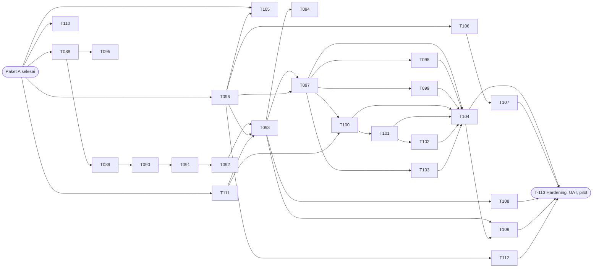

# TASKS — Paket B: Penjualan & Uang Aman (T-088–T-113)

> Siap eksekusi **setelah** exit gate Paket A lulus dan checklist `docs/16-PAKET-B-PENJUALAN-UANG.md` §0 dicentang. Format sama dengan `TASKS.md`. Spesifikasi: `docs/16-PAKET-B-PENJUALAN-UANG.md` (**16**), `docs/15-PAKET-A-MASTER-GUDANG.md` (**15**), `docs/14-ROADMAP-LENGKAP.md` (**14**). Path relatif ke `backend/`.
>
> **Aturan khusus paket ini**
> - **Nama berkas halaman & komponen frontend mengikuti konvensi repo** (kebab-case huruf kecil, mis. `pages/sales/orders/form.tsx`); path PascalCase di task ini indikatif (**15** §0 S-3).
> - Domain baru: `app/Domain/{Sales,Delivery,Receivable,Cash,Pos,Warranty,Integration,Reporting}` + `app/Domain/Accounting/{Outbox,Period}` (struktur Fase 0).
> - Semua perubahan piutang lewat `App\Domain\Receivable\ReceivableLedger`; semua Action keuangan memanggil `App\Domain\Accounting\Period\PeriodGuard` (SEC-115, SEC-123).
> - Halaman publik: `app/Http/Controllers/Public/*` + `resources/views/public/*.blade.php` (Blade, bukan Inertia). POS PWA: `resources/pos/` (entry Vite terpisah).
> - Setiap dokumen keuangan memancarkan event **16** §11.2 di transaksi yang sama; test kontrak keseimbangan per event.
> - Dependency baru hanya: library PDF (OQ-109, diputuskan sebelum T-091) dan `workbox-*` (T-107). Lainnya → berhenti dan tanyakan.
> - Permission Paket B dibuat **seluruhnya** di T-088; task lain hanya memakai.

| Ringkasan | Nilai |
|---|---|
| Task | 26 (T-088–T-113) |
| Estimasi | 211 jam (rentang 180–270) |
| Exit gate | Checklist **16** §10.2 + UAT-B01–B30 lulus + `receivables:reconcile` & `inventory:reconcile` = 0 selisih pada data UAT + pilot 1 gudang, 1 toko, 1 area sales berjalan 2 minggu |

## Urutan & dependensi

Jalur kritis: T-088 → T-089 → T-090 → T-091 → T-092 → T-093 → T-097 → T-100 → T-101 → T-104 → T-113. Cabang paralel aman: T-105 (kas kecil), T-106/T-107 (POS), T-110 (katalog), T-111 (template) — file bersama: `PermissionCatalog` (sudah lengkap di T-088), `listing_catalog.php`, `routes/admin.php`, `Implementasi_Plan.md`.

**Mode B-ringan (OQ-110 = ya):** urutan menjadi T-088 (hanya bagian role & permission) → T-096 → T-111 → T-112 → T-097 → T-098 → T-099 → T-100 → T-101 → T-102 → T-103 → T-104, lalu sisanya.

---

### T-088 — Pesanan penjualan web + role & permission Paket B
- Paket: B | Prioritas: P0 | Estimasi: 12 jam
- Memenuhi: FR-B01, FR-B02 (a–c, h), BR-104, BR-112, BR-200, BR-201, BR-202 (a–c), SEC-111, SEC-130, ADR-108
- Dependensi: Paket A
- Konteks wajib: **16** §4.1, §4.3 (`sales_orders`, `sales_order_lines`), §5.1 (`sales-orders.*`), §6.1–§6.5, §6.7, §7.1 (editor pesanan), §7.3 (`sales_orders`), §8.1 BR-104, BR-112, §8.2 BR-200–BR-202, §9 (`sales.price_lock_hours`), §10.2 SEC-111, SEC-130; **15** BR-168, BR-169
- File: migrations `sales_orders`, `sales_order_lines`, `customer_balances` (+ seeder baris untuk kios yang ada), `customer_flags`; sequence `sales_order`; seeder `PaketBRoleSeeder` (6 role, 74 permission, matriks **16** §6.4, tambahan **16** §6.5, MFA supervisor); `app/Domain/Access/PermissionCatalog.php`; `app/Domain/Sales/{Models/{SalesOrder,SalesOrderLine},Enums/{SalesOrderStatus,SalesChannel,PaymentType,TermType},Pricing/OrderCalculator.php,Data/{OrderDraft,CalculatedOrder}.php,Actions/{SaveSalesOrderDraft,PreviewSalesOrder,SubmitSalesOrder},Checks/{CustomerOrderableCheck,RestrictedProductCheck,RegistrationCheck}.php,Listings/SalesOrderListing,Policies/SalesOrderPolicy,Resources/SalesOrderResource}`; `app/Support/Idempotency/IdempotencyGuard.php`; controller `Admin/SalesOrderController`; lookups `customers_for_order`, `sellable_products`; pages `Sales/Orders/{Index,Form,Show}.tsx`; `components/pakis/{CustomerCreditCard,OrderLineEditor,ExceptionBadges}.tsx`; tests `tests/Feature/Sales/Order*`, `tests/Unit/Sales/OrderCalculatorTest.php`, `tests/Feature/Access/PaketBMatrixTest.php`; update `06`, `07` §3.4, `08` §2
- Deskripsi: `OrderCalculator` memakai `PriceResolver` + `PromotionEngine` + diskon manual (BR-200), dipakai `PreviewSalesOrder` (tanpa simpan) dan saat simpan. `SubmitSalesOrder` menjalankan cek (a)–(c) di task ini; cek kredit (d)–(g) ditambahkan T-089 lewat antarmuka `OrderCheck` (pipeline berurutan) — di task ini pesanan tanpa pengecualian langsung `approved` **tanpa reservasi** (reservasi T-090; sampai itu, status berhenti di `approved`). `IdempotencyGuard` dipakai ulang oleh T-097, T-100, T-101, T-105, T-107.
- Kriteria penerimaan:
  - [ ] ≥ 20 kasus `OrderCalculatorTest` (BR-200) lulus, termasuk bonus promo, satuan berbeda, pembulatan
  - [ ] Given request memuat `unit_price`/`line_total`/`grand_total`, Then nilai diabaikan dan disimpan hasil server (SEC-111)
  - [ ] Kunci idempoten sama + isi sama → 200 dokumen yang sama; isi beda → `409 IDEMPOTENCY_CONFLICT`
  - [ ] Produk terbatas ke kios tidak memenuhi syarat → `422 RESTRICTED_BUYER_NOT_ELIGIBLE` (tidak menjadi pengecualian)
  - [ ] Kios `prospect` hanya bisa `cash`; `inactive`/`merged` → `CUSTOMER_NOT_ORDERABLE`
  - [ ] Draft lewat `sales.price_lock_hours` → ajukan memaksa hitung ulang + konfirmasi (`409 PRICE_CHANGED` sampai dikonfirmasi)
  - [ ] Sales (scope self) hanya bisa memilih kios yang ditugaskan; ID kios lain → 404
  - [ ] `PaketBMatrixTest` memverifikasi 74 permission × 13 role; auditor hanya permission `.view`/`_reports.view`
  - [ ] Listing `sales_orders` lulus kontrak
- Verifikasi: `php artisan test --filter='SalesOrder|OrderCalculator|PaketBMatrix'`
- Di luar lingkup: kredit & approval (T-089), reservasi (T-090)

### T-089 — Kredit, tempo, credit hold, approval pengecualian
- Paket: B | Prioritas: P0 | Estimasi: 8 jam
- Memenuhi: FR-B02 (d–g), FR-B03, FR-B04, FR-B05, BR-105, BR-106, BR-202 (d–g), BR-203, BR-204, BR-205, SEC-112, SEC-126
- Dependensi: T-088, T-067
- Konteks wajib: **16** §4.2 (`customer_balances`, `customer_flags`), §5.1 (`credit-holds.*`), §6.6 (`sales_order_exception`, `customer_credit_release`), §6.8 (pesanan), §7.3 (`credit_holds`), §8.2 BR-202–BR-205, §9 (`credit.*`, `sales.manual_discount_limit_pct`), §11.1 (`credit:apply-holds`)
- File: `app/Domain/Sales/Checks/{CollectorBlockCheck,CreditExposureCheck,OverdueCheck,CreditHoldCheck,DiscountAuthorityCheck,TermCheck}.php`; `app/Domain/Sales/Approvables/SalesOrderException.php`; `app/Domain/Receivable/Queries/CreditExposure.php`; `app/Domain/Customer/Actions/{PlaceCreditHold,RequestCreditRelease}.php` + `Approvables/CustomerCreditRelease`; command `credit:apply-holds`; `RuleMatcher` kunci kondisi `exception_types` (+ test **15**); controller `Admin/CreditHoldController`; listing `CreditHoldListing`; pages `Sales/Credit/Index.tsx`, panel pengecualian di `Sales/Orders/Show.tsx` & `Approvals/Show.tsx`; seeder aturan approval **16** §6.6; tests
- Deskripsi: Lengkapi pipeline cek BR-202. Paparan dihitung dengan mengunci `customer_balances` FOR UPDATE. Cek (d) memakai `CollectorCashStatus` dari T-101 — sebelum T-101 selesai, kelas stub mengembalikan "tidak diblokir" dan test ditandai `->todo()` (dicatat di Implementasi_Plan). Saat approval diputuskan, `SalesOrderException::onApproved` menjalankan ulang cek (e)–(g); bila muncul pengecualian baru → batalkan & ajukan ulang (BR-203).
- Kriteria penerimaan:
  - [ ] Paparan = piutang + giro belum cair + pesanan kredit belum difakturkan − titipan + pesanan ini (test tabel)
  - [ ] Lewat limit Rp 3 jt → `pending_approval` dengan rantai < Rp 5 jt; Rp 12 jt → 2 langkah; Rp 30 jt → 3 langkah, masing-masing oleh orang berbeda
  - [ ] Pembuat pesanan & delegasinya tidak bisa menyetujui (maker-checker)
  - [ ] Dua pesanan kredit paralel yang bersama melewati limit → salah satu menjadi pengecualian (SEC-126)
  - [ ] Tunggakan > toleransi → pengecualian `overdue`; > `credit.hold_overdue_days` → job menahan kios & memberi notifikasi
  - [ ] Hold manual hanya lepas lewat approval `customer_credit_release` oleh orang lain
  - [ ] Tempo panen hanya untuk kios `harvest_term_allowed`, jatuh tempo ≤ batas
  - [ ] Listing `credit_holds` lulus kontrak
- Verifikasi: `php artisan test --filter='Credit|SalesOrderException|OrderCheck'`
- Di luar lingkup: blokir penagih nyata (T-101)

### T-090 — Reservasi, backorder, pembatalan
- Paket: B | Prioritas: P0 | Estimasi: 8 jam
- Memenuhi: FR-B06, FR-B07, BR-101, BR-102, BR-206, BR-207
- Dependensi: T-089, T-078
- Konteks wajib: **16** §4.3 (kolom qty baris, ALTER `stock_movements`), §5.1 (`sales-orders.cancel`, `lines.cancel`, `lines.reallocate`), §6.8, §8.2 BR-206, BR-207, §9 (`sales.backorder_max_days`), §11.1; **15** BR-155, FEFO
- File: migration ALTER ENUM `stock_movements.movement_type`; `app/Domain/Sales/Actions/{ReserveSalesOrder,ResolveShortage,CancelSalesOrder,CancelSalesOrderLine,AllocateBackorders}.php`; commands `sales:allocate-backorders`, `sales:backorder-reminders`; listener `GoodsReceiptPosted`/`StockTransferReceived` → antre alokasi; UI pilihan kekurangan di `Sales/Orders/Show.tsx`; tests
- Deskripsi: Saat `approved` (langsung atau via approval) reservasi FEFO per baris. Kekurangan → dialog 3 pilihan BR-206. Job backorder memproses urut `approved_at`. Pembatalan melepas reservasi & menurunkan `unbilled_order_amount`.
- Kriteria penerimaan:
  - [ ] Stok 60 pesan 100 → reservasi 60, `backorder` 40; pilihan "batalkan sisa" menulis `lost_sales` `order_line_cancelled`
  - [ ] Dua pesanan berebut stok terakhir → tidak ada reservasi melebihi stok (uji paralel)
  - [ ] Backorder ter-reservasi otomatis setelah penerimaan barang, urut pesanan disetujui lebih dulu
  - [ ] Pesanan dengan surat jalan aktif tidak bisa dibatalkan (`ORDER_NOT_CANCELLABLE`)
  - [ ] Baris bonus dibatalkan proporsional saat baris induk dibatalkan sebagian
- Verifikasi: `php artisan test --filter='Reserve|Backorder|CancelSalesOrder'`
- Di luar lingkup: surat jalan (T-091)

### T-091 — Surat jalan, ambil, rute, berangkat
- Paket: B | Prioritas: P0 | Estimasi: 8 jam
- Memenuhi: FR-B08, FR-B09, FR-B10, BR-144 (seri saat ambil), BR-208, BR-209 (berangkat)
- Dependensi: T-090; OQ-109 diputuskan (atau pakai cetak HTML)
- Konteks wajib: **16** §4.4 (`delivery_routes`, `deliveries`, `delivery_lines`, `delivery_line_batches`, `delivery_line_serials`), §5.1 (`deliveries.*`, `delivery-routes.*`), §6.8, §7.1 (papan pengiriman, dokumen cetak), §7.3, §8.2 BR-208, BR-209; **14** ADR-114
- File: migrations; sequences `delivery`, `delivery_route`; `app/Domain/Delivery/{Models/*,Enums/{DeliveryStatus,RouteStatus},Actions/{CreateDelivery,PickDelivery,CancelDelivery,SaveRoute,DispatchRoute},Listings/{DeliveryReadyLineListing,DeliveryListing,DeliveryRouteListing},Policies/*,Documents/{DeliveryNotePdf,RouteManifestPdf}}`; `app/Support/Pdf/PdfRenderer.php` (pembungkus library OQ-109); controllers; pages `Delivery/{ReadyLines,Deliveries/*,Routes/*}.tsx`; tests
- Deskripsi: Papan siap kirim per kios; buat surat jalan dari baris ter-reservasi; ambil dengan scan & ganti batch (reservasi pindah, `fefo_override`); seri `in_stock → reserved`; rute: kendaraan & driver wajib saat berangkat; berangkat memindahkan stok ke TRANSIT per batch.
- Kriteria penerimaan:
  - [ ] Surat jalan hanya satu kios & satu lokasi asal; qty ≤ ter-reservasi (`QTY_EXCEEDS_RESERVED`)
  - [ ] Ganti batch saat ambil memindahkan reservasi dalam satu transaksi; batch bukan FEFO ditandai
  - [ ] Seri wajib = qty untuk produk `tracks_serial`
  - [ ] Driver dengan rute `dispatched` lain → `DRIVER_HAS_ACTIVE_ROUTE`
  - [ ] Setelah berangkat: stok gudang turun, TRANSIT naik, kartu stok menampilkan `delivery_dispatch_*`
  - [ ] Surat jalan tercetak memuat rekening resmi + peringatan (BR-132)
  - [ ] 3 listing lulus kontrak; staf gudang lokasi lain → 404
- Verifikasi: `php artisan test --filter='Delivery|Route'`
- Di luar lingkup: bukti terima (T-092)

### T-092 — Bukti terima di web, gagal kirim, barang kembali
- Paket: B | Prioritas: P0 | Estimasi: 6 jam
- Memenuhi: FR-B11, FR-B12, BR-107, BR-209
- Dependensi: T-091
- Konteks wajib: **16** §4.4 (`proofs_of_delivery`), §5.1 (`deliveries.pod/fail/return-check`, `my-deliveries`), §6.8, §7.1 (halaman ponsel), §8.2 BR-209, §9 (`delivery.pod_require_location`), §10.2 SEC-121
- File: migration `proofs_of_delivery`; `app/Domain/Delivery/Actions/{RecordProofOfDelivery,RecordDeliveryFailure,CheckReturnedGoods}.php`; listing `MyDeliveryListing`; pages `Delivery/My/{Index,Pod}.tsx` (ponsel), `Delivery/Deliveries/PodFromPaper.tsx`; `components/pakis/{CameraCapture,SignaturePad}.tsx`; tests
- Deskripsi: Bukti terima mode `driver_web` (driver rute itu) dan `office_from_paper` (wajib foto surat jalan bertanda tangan). Satu transaksi: `issue` `sale` dari TRANSIT, seri `sold`, status surat jalan & pesanan, panggil `IssueInvoiceFromDelivery` (T-093; sebelum T-093 selesai, hook kosong + test `->todo()`). Barang kembali diperiksa gudang ≠ driver.
- Kriteria penerimaan:
  - [ ] Diterima + ditolak > diambil → `POD_QTY_INVALID`; ditolak tanpa alasan/kondisi ditolak
  - [ ] Bukti terima kedua → `POD_ALREADY_RECORDED`
  - [ ] Driver lain / bukan rute itu → 404
  - [ ] Qty ditolak `damaged` masuk bin karantina setelah diperiksa; `good` kembali ke rak pilihan; sisa baris pesanan jadi backorder
  - [ ] Foto wajib; lokasi wajib bila setting aktif
- Verifikasi: `php artisan test --filter='ProofOfDelivery|DeliveryFailure|ReturnedGoods'`
- Di luar lingkup: aplikasi driver (Paket C)

### T-093 — Faktur, PPN, rekening resmi, PDF
- Paket: B | Prioritas: P0 | Estimasi: 10 jam
- Memenuhi: FR-B13, FR-B14, FR-B15, FR-B23, BR-107, BR-132, BR-210, BR-211, SEC-119, SEC-122
- Dependensi: T-092, T-096 (outbox & PeriodGuard), T-111 (antrean pesan)
- Konteks wajib: **16** §4.2 (`bank_accounts`, `tax_rates`), §4.5 (`invoices`, `invoice_lines`), §5.1 (`invoices.*`, `bank-accounts.*`, `tax-rates.*`), §5.2 (`public.official-accounts`), §6.6 (`invoice_void`), §8.1 BR-132, §8.2 BR-210, BR-211, §9 (`tax.*`, `collection.official_account_warning`), §11.2 (`sales.invoice_issued`, `sales.invoice_voided`), §10.2 SEC-119, SEC-122; **14** OQ-101
- File: migrations `bank_accounts`, `tax_rates`, `invoices`, `invoice_lines`; sequence `invoice`; `app/Domain/Receivable/{Models/{Invoice,InvoiceLine,BankAccount,TaxRate},Enums/{InvoiceStatus,InvoiceType},ReceivableLedger.php (inti: invoice issue/void),Tax/VatCalculator.php,Actions/{IssueInvoiceFromDelivery,ReissueInvoice,RequestInvoiceVoid,SendInvoice},Approvables/InvoiceVoid,Documents/InvoicePdf,Listings/InvoiceListing,Resources/InvoiceResource}`; `app/Domain/Receivable/Settings/{SaveBankAccount}`; `app/Http/Controllers/Public/OfficialAccountController.php` + view; pages `Receivable/Invoices/*`, `Settings/BankAccounts/*`, `Settings/TaxRates/*`; `components/pakis/OfficialAccountsNotice.tsx`; tests `tests/Contract/OfficialAccountTemplateTest.php`
- Deskripsi: Faktur terbit di transaksi bukti terima (BR-210) dengan alokasi diskon proporsional & PPN opsional. `ReceivableLedger` dibuat di sini (arch test SEC-115 mulai berlaku). Rekening resmi master + snapshot di faktur. Batal faktur via approval. PDF via `PdfRenderer`.
- Kriteria penerimaan:
  - [ ] Faktur memakai qty diterima; Σ diskon baris = diskon pesanan × proporsi (selisih pembulatan di baris terakhir)
  - [ ] `tax.is_pkp=false` → PPN 0; `true` → tarif & `dpp_factor` dari `tax_rates` pada tanggal faktur; mode harga termasuk/tidak (test kasus)
  - [ ] Tanggal bukti terima ≤ lock date → tanggal faktur = hari setelah lock date, dicatat
  - [ ] `customer_balances.receivable_balance` naik, `unbilled_order_amount` turun, event `sales.invoice_issued` seimbang
  - [ ] Satu faktur aktif per surat jalan; terbit ulang hanya setelah `void`
  - [ ] Faktur berpembayaran → `INVOICE_NOT_VOIDABLE`
  - [ ] Rekening hanya diubah Owner + konfirmasi password + notifikasi Owner & Finance; faktur lama tetap snapshot lama
  - [ ] `OfficialAccountTemplateTest`: setiap template dokumen merender blok rekening resmi + peringatan
  - [ ] `cogs_total` tidak muncul di resource untuk role tanpa `margin_reports.view`
- Verifikasi: `php artisan test --filter='Invoice|Vat|BankAccount|OfficialAccount'`
- Di luar lingkup: faktur pajak elektronik (Paket F)

### T-094 — Retur penjualan & nota kredit
- Paket: B | Prioritas: P1 | Estimasi: 8 jam
- Memenuhi: FR-B16, BR-212
- Dependensi: T-093, T-097 (alokasi nota kredit; bila belum, alokasi nota kredit ditulis langsung lewat `ReceivableLedger` dan diuji ulang di T-097)
- Konteks wajib: **16** §4.5 (`sales_returns`, `sales_return_lines`, `credit_notes`), §5.1 (`sales-returns.*`, `credit-notes.*`), §6.6 (`sales_return`), §6.8, §8.2 BR-212, §9 (`sales.return_max_days`), §11.2 (`sales.credit_note_issued`)
- File: migrations; sequences `sales_return`, `credit_note`; `app/Domain/Sales/{Models/{SalesReturn,SalesReturnLine},Actions/{RequestSalesReturn,ReceiveSalesReturn},Approvables/SalesReturnApproval,Listings/SalesReturnListing}`; `app/Domain/Receivable/{Models/CreditNote,Actions/IssueCreditNote,Documents/CreditNotePdf,Listings/CreditNoteListing}`; pages `Sales/Returns/*`, `Receivable/CreditNotes/*`; tests
- Deskripsi: Pengajuan dari faktur → baris & batch yang dikirim; approval; penerimaan fisik gudang (≠ pengaju ≠ sales PJ); nota kredit otomatis, alokasi ke faktur asal, sisa ke titipan; seri & garansi.
- Kriteria penerimaan:
  - [ ] Batch tidak termasuk kiriman → `RETURN_BATCH_MISMATCH`; qty > sisa → `RETURN_QTY_EXCEEDED`
  - [ ] Pemeriksa = pengaju atau sales PJ → 403
  - [ ] `good` → stok gudang dengan HPP pengiriman asal; `damaged`/`expired` → karantina
  - [ ] Nota kredit = qty diterima × harga neto (+ PPN proporsional); faktur lunas → seluruhnya ke titipan
  - [ ] Event `sales.credit_note_issued` seimbang; `cogs_reversal` hanya qty `good`
  - [ ] 2 listing lulus kontrak
- Verifikasi: `php artisan test --filter='SalesReturn|CreditNote'`
- Di luar lingkup: retur toko (T-106), retur canvas (Paket C)

### T-095 — Permintaan tak terpenuhi (lost sales)
- Paket: B | Prioritas: P2 | Estimasi: 3 jam
- Memenuhi: FR-B17
- Dependensi: T-088
- Konteks wajib: **16** §4.3 (`lost_sales`), §5.1 (`lost-sales.*`), §7.3 (`lost_sales`)
- File: migration `lost_sales`; `app/Domain/Sales/{Models/LostSale,Actions/RecordLostSale,Listings/LostSaleListing}`; page `Sales/LostSales/Index.tsx` (form cepat di dialog); tests
- Deskripsi: Input manual cepat (produk, qty, kios opsional, alasan) dan API internal untuk T-090/T-106. Ringkasan per produk & bulan di halaman daftar.
- Kriteria penerimaan:
  - [ ] Pembatalan karena stok (T-090) dan POS tanpa stok (T-106) menulis lost sales otomatis
  - [ ] Listing lulus kontrak; filter per alasan & periode benar
- Verifikasi: `php artisan test --filter=LostSale`
- Di luar lingkup: prediksi (Paket G)

### T-096 — Outbox akuntansi penjualan & uang + tanggal kunci
- Paket: B | Prioritas: P0 | Estimasi: 6 jam
- Memenuhi: FR-B18, BR-113, BR-229 (lock & outbox), SEC-123, ADR-104, ADR-115
- Dependensi: Paket A (T-077)
- Konteks wajib: **16** §8.1 BR-113, §8.2 BR-229, §9 (`accounting.lock_date`), §10.2 SEC-123, §11.2; **14** §7, ADR-104, ADR-115
- File: `app/Domain/Accounting/Outbox/{EventCatalog.php,EventPayload.php,BalancedPayloadValidator.php}`; `app/Domain/Accounting/Period/{PeriodGuard.php,Actions/UpdateLockDate.php}`; controller `Admin/LockDateController`; page `Settings/LockDate.tsx`; tests `tests/Contract/AccountingEventCatalogTest.php`, `tests/Arch/PeriodGuardArchTest.php`
- Deskripsi: Katalog event **16** §11.2 sebagai kelas data (kode, peran akun yang diizinkan, builder payload). `AccountingOutbox::record()` (A) menolak payload tidak seimbang. `PeriodGuard` + lock date (hanya maju; mundur Owner + alasan + password). Event pembatalan memakai `revision + 1`.
- Kriteria penerimaan:
  - [ ] Payload tidak seimbang → exception (test per event dengan fixture)
  - [ ] Peran akun di luar katalog event ditolak
  - [ ] Lock date mundur oleh Finance → 403; oleh Owner dengan alasan → berhasil & tercatat
  - [ ] Arch test: Action domain `Sales/Receivable/Cash/Pos` yang memanggil outbox juga memanggil `PeriodGuard`
- Verifikasi: `php artisan test --filter='AccountingEvent|PeriodGuard|LockDate'`
- Di luar lingkup: jurnal (Paket F)

### T-097 — Pembayaran, alokasi, titipan, realokasi, batal
- Paket: B | Prioritas: P0 | Estimasi: 10 jam
- Memenuhi: FR-B19, FR-B20, FR-B21, BR-108, BR-130, BR-213, BR-214, BR-215, SEC-115, SEC-126
- Dependensi: T-093 (atau T-112 untuk B-ringan), T-096
- Konteks wajib: **16** §4.6 (`payments`, `payment_allocations`, `customer_deposit_entries`), §5.1 (`payments.*`, `deposits-balance.*`), §6.6 (`payment_reallocation`, `payment_void`, `customer_deposit_refund`), §6.8, §7.3 (`payments`), §8.2 BR-213–BR-215, §9 (`collection.transfer_requires_bank_check`), §11.2
- File: migrations + trigger append-only; sequence `payment`; `ReceivableLedger` (alokasi, titipan, pembalikan); `app/Domain/Receivable/{Models/{Payment,PaymentAllocation,CustomerDepositEntry},Enums/*,Actions/{RecordPayment,PreviewAllocation,ApplyDeposit,RequestDepositRefund,RequestReallocation,RequestPaymentVoid},Approvables/{PaymentReallocation,PaymentVoid,CustomerDepositRefund},Listings/PaymentListing,Queries/CustomerStatement}`; controllers; pages `Receivable/Payments/*`, `Receivable/Statement.tsx`; `components/pakis/AllocationPreview.tsx`; tests `tests/Arch/ReceivableLedgerArchTest.php`, `tests/Concurrency/DoubleAllocationTest.php`
- Deskripsi: Catat tunai kantor (kwitansi terbit lewat T-100; sebelum T-100, tunai kantor dinonaktifkan), transfer (rekening resmi + bukti), giro (T-098), VA (T-099). Alokasi BR-213. Realokasi & batal via approval (append-only).
- Kriteria penerimaan:
  - [ ] Tertua lebih dulu (`due_date`, `invoice_date`, `id`); pilihan kios → sisa ke titipan, tidak ke faktur lain
  - [ ] Titipan tidak pernah dipakai otomatis
  - [ ] Realokasi menulis baris negatif + positif, tidak ada UPDATE (trigger); ke kios lain ditolak
  - [ ] Batal pembayaran dengan titipan terpakai → `DEPOSIT_ALREADY_USED`
  - [ ] Transfer ke rekening bukan resmi → `PAYMENT_BANK_NOT_OFFICIAL`
  - [ ] `DoubleAllocationTest`: dua pembayaran bersamaan ke faktur sisa Rp 1 jt masing-masing Rp 1 jt → satu faktur lunas, kelebihan ke titipan, tidak ada `paid_amount > grand_total`
  - [ ] Arch test SEC-115 hijau; event seimbang
- Verifikasi: `php artisan test --filter='Payment|Allocation|Deposit|ReceivableLedger'`
- Di luar lingkup: rekonsiliasi bank (Paket F)

### T-098 — Giro
- Paket: B | Prioritas: P1 | Estimasi: 6 jam
- Memenuhi: FR-B22, BR-109, BR-216
- Dependensi: T-097
- Konteks wajib: **16** §4.6 (`giros`), §5.1 (`giros.*`), §6.8, §6.9 (diagram giro), §7.3 (`giros`), §8.2 BR-216, BR-204 (giro), §9 (`collection.giro_*`, `credit.hold_after_bounced_giros`), §11.1
- File: migration `giros`; `app/Domain/Receivable/{Models/Giro,Enums/GiroStatus,Actions/{ReceiveGiro,HandOverGiro,DepositGiro,ClearGiro,BounceGiro,ReturnGiro},Listings/GiroListing}`; commands `giros:handover-reminders`, `giros:due-today`; pages `Receivable/Giros/*`; tests
- Deskripsi: Siklus giro penuh; penerimaan di lapangan lewat form kwitansi (T-100) atau di kantor lewat pembayaran.
- Kriteria penerimaan:
  - [ ] Giro diterima tidak mengurangi piutang; `pending_giro_amount` naik dan ikut paparan kredit
  - [ ] Cair → alokasi bertanggal cair, event `receivable.giro_cleared`
  - [ ] Ditolak → flag kios, biaya (bila diatur) jadi faktur `charge`, ditolak ke-2 dalam 12 bulan → hold
  - [ ] Nomor giro + bank duplikat → `GIRO_DUPLICATE`; foto wajib
- Verifikasi: `php artisan test --filter=Giro`
- Di luar lingkup: kliring otomatis dari mutasi bank (Paket F)

### T-099 — VA per kios, webhook, dana tak dikenal
- Paket: B | Prioritas: P1 | Estimasi: 10 jam
- Memenuhi: FR-B24, FR-B25, BR-217, SEC-113, SEC-114
- Dependensi: T-097; OQ-102 untuk driver nyata
- Konteks wajib: **16** §4.2 (`integration_logs`, `webhook_receipts`), §4.6 (`virtual_accounts`, `unidentified_payments`), §5.1 (`virtual-accounts.*`, `unidentified-payments.*`), §5.3 (`webhooks.payments`), §6.6 (`unidentified_payment_match`), §8.2 BR-217, §10.2 SEC-113, SEC-114; **14** §12 `PaymentGateway`, ADR-113
- File: migrations; `app/Domain/Integration/{PaymentGateway/{PaymentGateway.php,FakePaymentGateway.php,Data/*},Logging/IntegrationLogger.php,Webhooks/{WebhookVerifier,StoreWebhook}.php,Models/*}`; `app/Http/Controllers/Api/V1/PaymentWebhookController.php`; `app/Jobs/ProcessPaymentWebhook.php`; `app/Domain/Receivable/{Actions/{CreateVirtualAccounts,ProposeUnidentifiedMatch,IgnoreUnidentified},Approvables/UnidentifiedPaymentMatch,Listings/{VirtualAccountListing,UnidentifiedPaymentListing}}`; command `integration-logs:purge`; pages `Receivable/VirtualAccounts/*`, `Receivable/Unidentified/*`; `.env.example` (`PAYMENT_GATEWAY_DRIVER=fake`, secret per penyedia); tests
- Deskripsi: Kontrak adapter + driver `fake` (bisa memicu webhook simulasi dari tinker/test). Webhook disimpan dulu, diproses di job. Pencocokan dana tak dikenal butuh orang kedua.
- Kriteria penerimaan:
  - [ ] Signature salah → 401 + `security_events`, tidak diproses
  - [ ] Event sama dikirim 2x → satu pembayaran; `external_id` sama dari event berbeda → satu pembayaran
  - [ ] VA tidak dikenal / kios nonaktif → `unidentified_payments`
  - [ ] Pengusul pencocokan tidak bisa menyetujui
  - [ ] Log integrasi tanpa token & nomor HP termasking
- Verifikasi: `php artisan test --filter='Webhook|VirtualAccount|Unidentified|PaymentGateway'`
- Di luar lingkup: driver penyedia nyata (setelah OQ-102), QRIS (Paket C)

### T-100 — Kwitansi digital, tautan publik, pembatalan
- Paket: B | Prioritas: P0 | Estimasi: 8 jam
- Memenuhi: FR-B26, FR-B27, BR-127, BR-128, BR-218, BR-219 (kwitansi & tautan), SEC-116, SEC-117, SEC-118
- Dependensi: T-097, T-111
- Konteks wajib: **16** §4.2 (`public_links`), §4.7 (`receipts`), §4.8 (`customer_inquiries`), §5.1 (`collections`, `receipts.*`), §5.2 (`public.links.*`), §6.6 (`receipt_void`), §6.8, §6.9 (diagram kwitansi), §7.1 (halaman ponsel), §8.2 BR-218, BR-219, §9 (`collection.receipt_link_days`, `collection.office_whatsapp`), §10.2 SEC-116–SEC-118
- File: migrations `receipts` (+ trigger), `public_links`, `customer_inquiries` (tabel dibuat di sini, layar lengkap di T-103); sequences `receipt`, `customer_inquiry`; `app/Domain/Receivable/{Models/Receipt,Actions/{IssueReceipt,RequestReceiptVoid},Approvables/ReceiptVoid,Support/AmountInWords.php,Documents/ReceiptPdf,Listings/{CollectionListing,ReceiptListing}}`; `app/Domain/Integration/PublicLinks/{PublicLinkService,Models/PublicLink}`; `app/Http/Controllers/Public/PublicLinkController.php` + views `public/links/{receipt,invoice,balance,warranty,expired}.blade.php`; pages `Collection/{Index,Receipt}.tsx` (ponsel), `Receivable/Receipts/*`; `components/pakis/ReceiptView.tsx`; tests
- Deskripsi: `/tagih` untuk penagih: daftar kios scope dengan sisa piutang; terima tunai/giro → pembayaran + alokasi + kwitansi + pesan. Cek blokir penagih memakai `CollectorCashStatus` (T-101; stub sampai T-101). Tautan publik generik untuk semua `purpose`. "Tidak sesuai" membuat pengaduan dan notifikasi Finance & Owner saja.
- Kriteria penerimaan:
  - [ ] Isi kwitansi tidak bisa diubah (trigger); tidak ada route edit
  - [ ] Penagih = pengguna login; kios di luar scope → 404
  - [ ] Terbilang benar untuk 1, 11, 1.000, 1.000.000, 1.250.500 (test)
  - [ ] Pesan ke `owner_phone` kios dengan tautan; token tidak tersimpan mentah
  - [ ] Tautan: salah → 404, kedaluwarsa → 410, jawaban kedua → 409; header `noindex` & `no-referrer`
  - [ ] "Tidak sesuai" → pengaduan; sales & supervisor area tidak menerima notifikasi (SEC-118)
  - [ ] Batal hanya penerbit sebelum setor, disetujui Finance ≠ penerbit, kios diberi tahu
- Verifikasi: `php artisan test --filter='Receipt|PublicLink|AmountInWords'`
- Di luar lingkup: blok nomor offline (Paket C)

### T-101 — Plafon uang di tangan, setoran, verifikasi kasir
- Paket: B | Prioritas: P0 | Estimasi: 9 jam
- Memenuhi: FR-B28, FR-B29, BR-110, BR-129, BR-220, BR-221, SEC-120
- Dependensi: T-100
- Konteks wajib: **16** §4.7 (`cash_on_hand_limits`, `cash_deposits`, `cash_deposit_lines`), §5.1 (`cash-deposits.*`, `cash-limits.*`, `collector-status`), §6.8, §6.9, §7.1 (status penagih), §7.3, §8.2 BR-220, BR-221, §9 (`collection.*`), §10.2 SEC-120, §11.1 (`collection:deposit-reminders`)
- File: migrations; sequence `cash_deposit`; `app/Domain/Cash/{Models/*,CollectorCashStatus.php,Actions/{SetCashLimit,SubmitCashDeposit,VerifyCashDeposit,RejectCashDeposit},Listings/{CashDepositListing,CashLimitListing,CollectorStatusListing}}`; command `collection:deposit-reminders`; ganti stub di T-089/T-100; pages `Cash/Deposits/*`, `Cash/Limits.tsx`, `Cash/CollectorStatus.tsx`; `components/pakis/{MoneyCount,CollectorStatusBar}.tsx`; tests `tests/Concurrency/CashLimitRaceTest.php`
- Deskripsi: Status penagih dihitung, blokir 3 sebab, buka otomatis. Setoran dari kwitansi tunai; verifikasi kasir ≠ penyetor; selisih → `variance` (penyelesaian di T-102).
- Kriteria penerimaan:
  - [ ] Blokir saat (a) plafon, (b) kwitansi lewat batas setor (kalender kerja), (c) setoran `variance`/`rejected` belum selesai
  - [ ] Penerimaan tunai yang membuat uang di tangan > plafon → `CASH_LIMIT_EXCEEDED`
  - [ ] `CashLimitRaceTest`: dua kwitansi paralel yang bersama melewati plafon → satu ditolak
  - [ ] Pesanan kredit oleh sales diblokir → `COLLECTOR_BLOCKED` (test T-089 diaktifkan)
  - [ ] `declared_amount` = Σ kwitansi (tidak bisa diketik); kwitansi orang lain/giro → `DEPOSIT_RECEIPT_INVALID`
  - [ ] Verifikator = penyetor → `DEPOSIT_SAME_PERSON`; cocok → event `cash.deposit_verified`
  - [ ] 3 listing lulus kontrak
- Verifikasi: `php artisan test --filter='CashDeposit|CashLimit|CollectorCashStatus'`
- Di luar lingkup: setoran via VA setoran (OQ-114)

### T-102 — Piutang karyawan & alert Owner
- Paket: B | Prioritas: P0 | Estimasi: 4 jam
- Memenuhi: FR-B30, BR-133, BR-221 (penyelesaian), BR-222
- Dependensi: T-101
- Konteks wajib: **16** §4.7 (`employee_receivables`, `employee_receivable_settlements`), §5.1 (`cash-deposits.resolve`, `employee-receivables.*`), §6.6 (`employee_receivable_writeoff`), §8.2 BR-222, §11.2
- File: migrations; sequence `employee_receivable`; `app/Domain/Cash/{Models/*,Actions/{ResolveDepositVariance,CreateEmployeeReceivable,SettleEmployeeReceivable,RequestEmployeeReceivableWriteOff},Approvables/EmployeeReceivableWriteOff,Listings/EmployeeReceivableListing,Notifications/EmployeeReceivableCreated}`; pages `Cash/EmployeeReceivables/*`; tests
- Deskripsi: Kelas umum dipakai setoran (di sini), kas kecil (T-105), shift POS (T-106), canvas (Paket C). Alert Owner seketika.
- Kriteria penerimaan:
  - [ ] Selisih setoran → piutang karyawan + event `cash.deposit_shortage` + notifikasi Owner
  - [ ] Pelunasan tunai mengurangi sisa; status berubah; event seimbang
  - [ ] Hapus buku hanya lewat approval Owner
  - [ ] Piutang karyawan tidak tampil di piutang kios mana pun
- Verifikasi: `php artisan test --filter=EmployeeReceivable`
- Di luar lingkup: potongan gaji (Paket E)

### T-103 — Konfirmasi saldo & pengaduan kios
- Paket: B | Prioritas: P0 | Estimasi: 10 jam
- Memenuhi: FR-B31, FR-B32, BR-131, BR-219 (pengaduan), BR-223, SEC-118
- Dependensi: T-097, T-100 (tautan & pengaduan), T-111
- Konteks wajib: **16** §4.8, §5.1 (`balance-confirmations.*`, `customer-inquiries.*`), §6.2 (pengecualian scope), §6.8, §7.3, §8.2 BR-223, §9 (`balance_confirmation.*`), §10.2 SEC-118, §11.1
- File: migrations `balance_confirmation_batches`, `balance_confirmations`; sequence `balance_confirmation`; `app/Domain/Receivable/{Models/*,Actions/{GenerateBalanceConfirmations,SampleCustomers,ExpireBalanceConfirmations,AssignInquiry,ResolveInquiry,RecordInquiry},Listings/{BalanceConfirmationListing,CustomerInquiryListing}}`; commands `balance-confirmations:{monthly,weekly,expire}`; pages `Receivable/BalanceConfirmations/*`, `Receivable/Inquiries/*`; view `public/links/balance.blade.php`; tests
- Deskripsi: Bulanan & sampel mingguan berbobot, ad hoc per area/kios, respons via tautan, pengaduan ditangani Finance.
- Kriteria penerimaan:
  - [ ] Bulanan: semua kios eligible tepat sekali per `as_of_date` (unik batch+kios)
  - [ ] Sampel: 1.000 simulasi → proporsi ±3% dari setting; kios yang dikonfirmasi ≤ 7 hari dilewati
  - [ ] Tidak dijawab → `expired`, bukan `confirmed`
  - [ ] `sales`/`supervisor` → 403 di semua route konfirmasi & pengaduan; ID langsung → 404
  - [ ] Pengaduan dari telepon kantor bisa diinput manual dengan kanal `office_phone`
- Verifikasi: `php artisan test --filter='BalanceConfirmation|Inquiry'`
- Di luar lingkup: kanal Pakis Mitra (Paket C)

### T-104 — Aging, kartu piutang, rekonsiliasi saldo, dasbor kontrol uang
- Paket: B | Prioritas: P0 | Estimasi: 6 jam
- Memenuhi: FR-B33, BR-224
- Dependensi: T-097–T-103
- Konteks wajib: **16** §5.1 (`receivables.*`, `reports.cash-control`), §7.3 (`receivables_aging`, `cash_control_report`), §7.4, §8.2 BR-224, §11.1 (`receivables:reconcile`)
- File: `app/Domain/Receivable/{Queries/{Aging,AgingAsOf}.php,Listings/ReceivableAgingListing,Exports/AgingExport,Actions/ReconcileCustomerBalances}`; `app/Domain/Reporting/Listings/CashControlReportListing.php`; command `receivables:reconcile`; pages `Receivable/Aging.tsx`, `Reports/CashControl.tsx`; widget dasbor; tests
- Deskripsi: Aging per tanggal (termasuk masa lalu dari alokasi bertanggal), kartu piutang, laporan kontrol uang (penagih: uang di tangan, setoran telat, kwitansi batal, rasio tunai, kios "tidak sesuai", konfirmasi tidak dijawab per area).
- Kriteria penerimaan:
  - [ ] Aging per tanggal lalu = hitung dari alokasi ≤ tanggal itu (test dengan pembayaran setelah as-of)
  - [ ] Rekonsiliasi pada data acak 500 transaksi = 0 selisih; selisih buatan → alert
  - [ ] Aging 3.000 kios < 1 s (seeder volume)
  - [ ] Ekspor termasking & `mass_export` > 1.000 baris
- Verifikasi: `php artisan test --filter='Aging|ReconcileCustomer|CashControl'`
- Di luar lingkup: red flag otomatis (Paket C)

### T-105 — Kas kecil imprest & hitung fisik
- Paket: B | Prioritas: P1 | Estimasi: 9 jam
- Memenuhi: FR-B34, FR-B35, BR-146, BR-147, BR-225, SEC-121
- Dependensi: T-067, T-096, T-102 (piutang karyawan; bila belum, selisih hitung dicatat dan dikaitkan setelah T-102)
- Konteks wajib: **16** §4.9, §5.1 (`petty-cash-*`), §6.6 (`petty_cash_expense`), §6.8, §7.3, §8.2 BR-225, §9 (`petty_cash.*`), §10.2 SEC-121, §11.2
- File: migrations; sequence `petty_cash_expense`; referensi `expense_category`; `app/Domain/Cash/PettyCash/{Models/*,Actions/{SaveFund,SubmitExpense,PayExpense,RequestReplenishment,PayReplenishment,ConfirmReplenishment,RecordCount},Approvables/PettyCashExpenseApproval,Listings/*}`; `app/Support/Attachments/AttachmentHasher.php` (SEC-121, dipakai T-092, T-097, T-098); command `petty-cash:count-reminders`; pages `PettyCash/*` (ponsel untuk pengajuan); tests
- Deskripsi: Dana per lokasi, pengajuan foto kamera, approval lokasi → Finance di atas ambang, bayar oleh pemegang, isi ulang, hitung fisik oleh orang lain.
- Kriteria penerimaan:
  - [ ] Foto yang sama untuk pengajuan kedua → `DUPLICATE_ATTACHMENT`
  - [ ] Bayar melebihi saldo → `PETTY_CASH_INSUFFICIENT`; CHECK DB menjaga saldo
  - [ ] Pengaju tidak bisa menyetujui; ≥ ambang butuh Finance
  - [ ] Isi ulang = Σ pengeluaran `paid` belum diganti; konfirmasi terima menaikkan saldo
  - [ ] Penghitung = pemegang → `COUNT_SAME_PERSON`; selisih kurang → piutang karyawan
- Verifikasi: `php artisan test --filter=PettyCash`
- Di luar lingkup: jurnal biaya (Paket F)

### T-106 — POS backend: register, shift, sinkron, retur, kekurangan stok
- Paket: B | Prioritas: P1 | Estimasi: 10 jam
- Memenuhi: FR-B36, BR-226, SEC-124 (server), SEC-130 (POS)
- Dependensi: T-077, T-075, T-096, T-102
- Konteks wajib: **16** §4.10, §5.1 (`pos-*`), §5.3 (`api.v1.pos.*`), §6.6 (`pos_shift_variance`), §6.8, §7.3, §8.2 BR-226, §9 (`pos.*`), §10.2 SEC-124, §11.1 (`pos:resolve-shortfalls`), §11.2 (`pos.shift_closed`, `pos.cash_dropped`)
- File: migrations; sequence `pos_shift`; `app/Domain/Pos/{Models/*,Actions/{ActivateDevice,RevokeDevice,OpenShift,SyncBatch,RecordSale,RecordReturn,RecordCashMovement,CloseShift,ResolveShortfalls},Approvables/PosShiftVariance,Sync/{SyncItemValidator,SyncResult}.php,Listings/*}`; `app/Http/Controllers/Api/V1/Pos/*`; command `pos:resolve-shortfalls`; pages `Pos/{Registers,Shifts,Sales,Shortfalls}/*`; tests `tests/Feature/Pos/*`
- Deskripsi: API sinkron idempoten per item; penjualan mengurangi stok toko FEFO tanpa pernah minus (kekurangan dicatat); retur dengan approval kepala toko; tutup shift dihitung server.
- Kriteria penerimaan:
  - [ ] Batch sinkron berisi item yang sudah diterima → `duplicate`, tidak dobel
  - [ ] Stok sistem 3, struk 5 → issue 3, kekurangan 2, stok 0 (tidak minus); stok masuk → job menyelesaikan
  - [ ] Nomor struk unik per register; lompatan nomor terdeteksi di laporan
  - [ ] Retur oleh kasir yang sama sebagai penyetuju → ditolak
  - [ ] Tutup shift sebelum semua item shift tersinkron → `SHIFT_HAS_PENDING_SYNC`; selisih > toleransi → approval
  - [ ] Perangkat dicabut → `401 POS_DEVICE_REVOKED`
  - [ ] Produk terbatas tanpa kios memenuhi syarat → item `rejected`
- Verifikasi: `php artisan test --filter=Pos`
- Di luar lingkup: QRIS, member petani (Paket C/F)

### T-107 — POS PWA offline + struk
- Paket: B | Prioritas: P1 | Estimasi: 14 jam
- Memenuhi: FR-B37, BR-226 (klien), SEC-124 (klien), NFR-B04, ADR-110
- Dependensi: T-106
- Konteks wajib: **16** §5.3, §7.1 (POS PWA), §8.2 BR-226, §9 (`pos.offline_max_hours`, `pos.pin_retry_limit`), §10.2 SEC-124; **14** ADR-110, ADR-111; **15** BR-168, BR-169 (fixture promo)
- File: `resources/pos/{main.tsx,App.tsx,sw.ts,db/{schema.ts,queue.ts},sync/{bootstrap.ts,delta.ts,push.ts},pricing/{priceResolver.ts,promotionEngine.ts},screens/{Activate,Login,Shift,Sale,Payment,Receipt,Return,Close}.tsx,print/receipt58.css}`; `vite.config` entry `pos`; `workbox-*` (catat di `03` §5); tests `resources/pos/**/__tests__/*` (Vitest) + Playwright `tests/e2e/pos-offline.spec.ts`
- Deskripsi: PWA dengan service worker (precache shell), IndexedDB (master toko + antrean), harga & promo di klien memakai **fixture kasus uji yang sama** dengan server (`tests/Fixtures/promotion_cases.json`), struk cetak browser, nomor struk lokal per register, PIN offline, sinkron otomatis saat online dengan backoff.
- Kriteria penerimaan:
  - [ ] Fixture promo & harga lulus di Vitest dengan hasil identik dengan PHP
  - [ ] Playwright: offline → 50 transaksi → online → semua `accepted`, ulang kirim → `duplicate`
  - [ ] Lewat `pos.offline_max_hours` tanpa sinkron → transaksi baru diblokir dengan pesan jelas
  - [ ] PIN salah `pos.pin_retry_limit` kali → sesi kasir lokal dihapus
  - [ ] Struk 58 mm memuat nama toko, nomor struk, item, total, bayar, kembali, rekening resmi
  - [ ] Lighthouse PWA installable; tidak ada token/password di IndexedDB (test inspeksi)
- Verifikasi: `npm run test -- pos` · `npx playwright test tests/e2e/pos-offline.spec.ts`
- Di luar lingkup: printer Bluetooth (Paket C via Pakis Pro)

### T-108 — Nomor seri saat jual & kartu garansi
- Paket: B | Prioritas: P1 | Estimasi: 5 jam
- Memenuhi: FR-B38, BR-144, BR-145, BR-227
- Dependensi: T-093, T-080, T-106 (POS)
- Konteks wajib: **16** §4.11, §5.1 (`warranty-cards.*`), §5.2 (`public.warranty.check`), §8.2 BR-227, §9 (`warranty.send_card_via`)
- File: migration `warranty_cards`; sequence `warranty_card`; `app/Domain/Warranty/{Models/WarrantyCard,Actions/{IssueWarrantyCard,VoidWarrantyCard,ResendWarrantyCard},Listings/WarrantyCardListing}`; listener seri `sold`/`returned`; `app/Http/Controllers/Public/WarrantyCheckController.php` + view; page `Warranty/Cards/*`; tests
- Deskripsi: Kartu terbit saat seri `sold` (bukti terima atau POS) bila produk bergaransi; kirim pesan; cek publik minimal; retur → `void`.
- Kriteria penerimaan:
  - [ ] Seri terjual dijual lagi → `SERIAL_ALREADY_SOLD`
  - [ ] `ends_on = sold_on + warranty_months`; satu kartu aktif per seri
  - [ ] Cek publik tidak menampilkan nama/nomor pembeli; rate limit 10/menit/IP
  - [ ] Pesan ke pembeli POS hanya bila nomor diisi & persetujuan dicentang
- Verifikasi: `php artisan test --filter=Warranty`
- Di luar lingkup: tiket servis & klaim (Paket C)

### T-109 — Dasbor Owner & laporan standar
- Paket: B | Prioritas: P1 | Estimasi: 8 jam
- Memenuhi: FR-B39, SEC-122
- Dependensi: T-093, T-104, T-106
- Konteks wajib: **16** §4.13, §5.1 (`dashboard.owner`, `reports.*`), §7.3 (`sales_report`, `margin_report`, `returns_discounts_report`), §7.4, §10.2 SEC-122, §11.1 (`reports:refresh-sales`)
- File: migration `sales_daily_summaries`; `app/Domain/Reporting/{Actions/RefreshSalesSummaries,Listings/{SalesReportListing,MarginReportListing,ReturnsDiscountsReportListing},Widgets/*}`; command; pages `Dashboard/Owner.tsx`, `Reports/{Sales,Margin,ReturnsDiscounts}.tsx`; tests
- Deskripsi: Ringkasan harian idempoten + data hari ini langsung; widget **16** §7.4 sesuai izin; laporan retur & diskon per sales/kios (bahan red flag C).
- Kriteria penerimaan:
  - [ ] Refresh dua kali → hasil sama; total ringkasan = Σ faktur − nota kredit + POS (test rekonsiliasi)
  - [ ] Role tanpa `margin_reports.view` tidak menerima angka HPP/margin di widget, laporan, maupun ekspor
  - [ ] Dasbor Owner < 1,5 s dengan data volume (seeder)
  - [ ] 3 listing laporan lulus kontrak
- Verifikasi: `php artisan test --filter='Report|Dashboard|SalesSummary'`
- Di luar lingkup: laporan terjadwal & peta sebaran (Paket G)

### T-110 — Katalog publik
- Paket: B | Prioritas: P2 | Estimasi: 7 jam
- Memenuhi: FR-B40, BR-112 (katalog), BR-228, SEC-130 (katalog)
- Dependensi: T-070, T-071
- Konteks wajib: **16** §4.12, §5.1 (`catalog.*`), §5.2 (`public.catalog.*`), §8.2 BR-228, §9 (`catalog.*`); **14** OQ-108
- File: migration ALTER `products` + `product_label_uses`; referensi `crop`, `pest`; `app/Domain/Catalog/Public/{CatalogQuery,Actions/{PublishProduct,UnpublishProduct,SaveLabelUse}}`; `app/Http/Controllers/Public/CatalogController.php`; views `public/catalog/{index,show}.blade.php` (Tailwind, terang/gelap, SEO meta, sitemap); pages `Catalog/{Index,Edit}.tsx`; tests
- Deskripsi: Katalog server-render dengan cache, pencarian FULLTEXT + filter tanaman/OPT/prinsipal, info izin edar, penggunaan label apa adanya.
- Kriteria penerimaan:
  - [ ] Produk terbatas tidak bisa dipublikasikan (validasi) dan tidak pernah muncul (query)
  - [ ] Produk wajib izin tanpa izin aktif tersembunyi otomatis
  - [ ] Tidak ada harga, stok, atau HPP di HTML (test string)
  - [ ] Halaman lulus CSP tanpa inline script; Lighthouse SEO ≥ 90 (dicatat di PR)
- Verifikasi: `php artisan test --filter=Catalog`
- Di luar lingkup: pemesanan online (Pakis Mitra, Paket C), Klinik Tani AI (Paket G)

### T-111 — Template pesan & antrean pengiriman
- Paket: B | Prioritas: P0 | Estimasi: 6 jam
- Memenuhi: FR-B41, BR-219 (template & antrean), SEC-119 (template), SEC-129
- Dependensi: Paket A (T-074 `WhatsAppChannel`)
- Konteks wajib: **16** §4.2 (`message_templates`, `outbound_messages`), §5.1 (`message-templates.*`, `outbound-messages`), §8.2 BR-219, §9 (`messages.max_attempts`), §10.2 SEC-119, SEC-129, §11.1 (`messages:dispatch`)
- File: migrations; seeder template default (7 kode); `app/Domain/Integration/Messaging/{MessageTemplateRenderer,PlaceholderRegistry,QueueMessage,DispatchMessage}.php`; `app/Jobs/SendOutboundMessage.php`; pages `Settings/MessageTemplates/*`, `Messages/Outbound.tsx`; tests
- Deskripsi: Template per kode & kanal dengan placeholder allowlist; antrean dengan backoff; status; kirim ulang; pesan gagal 3x → notifikasi Finance untuk kirim manual. Dipakai T-093, T-100, T-103, T-108.
- Kriteria penerimaan:
  - [ ] Placeholder di luar allowlist → validasi gagal; deret ≥ 8 digit di luar placeholder → `TEMPLATE_HARDCODED_NUMBER`
  - [ ] Render meng-escape nilai (tidak ada injeksi markup)
  - [ ] Penerima diambil dari `customers.owner_phone` saat kirim; tidak ada field penerima di request
  - [ ] Gagal 3x → status `failed` + notifikasi Finance
- Verifikasi: `php artisan test --filter='MessageTemplate|OutboundMessage'`
- Di luar lingkup: driver WhatsApp nyata (Paket C, OQ-124)

### T-112 — Impor saldo awal piutang & cutover
- Paket: B | Prioritas: P0 | Estimasi: 6 jam
- Memenuhi: FR-B42, BR-229 (saldo awal)
- Dependensi: T-074, T-096, T-093 (tabel `invoices`; untuk B-ringan, migration `invoices`/`invoice_lines`/`bank_accounts` dipindah ke task ini)
- Konteks wajib: **16** §4.14, §5.1 (`master-imports.*` tipe `opening_receivables`), §8.2 BR-229, §9 (`receivables.opening_balance_open`), §11.2 (`receivable.opening_balance`); **15** BR-170
- File: `app/Domain/Receivable/Imports/OpeningReceivableImporter.php`; `app/Domain/Receivable/Actions/CloseOpeningReceivables.php`; `docs/runbooks/CUTOVER-PAKET-B.md`; template unduhan; tests
- Deskripsi: Impor faktur lama per kios (nomor lama, tanggal, jatuh tempo, sisa) dan titipan; ringkasan total per kios sebelum konfirmasi; tutup oleh Owner. Runbook: hentikan kwitansi manual, cut-off, konfirmasi saldo ad hoc ke semua kios setelah impor (BR-223) sebagai validasi.
- Kriteria penerimaan:
  - [ ] Impor ulang file sama → 0 baris baru (kunci: kios + nomor lama)
  - [ ] Total per kios = file; event `receivable.opening_balance` total = Σ sisa
  - [ ] Setelah ditutup → `OPENING_RECEIVABLE_CLOSED`
  - [ ] Runbook dicek saat UAT-B27
- Verifikasi: `php artisan test --filter=OpeningReceivable`
- Di luar lingkup: saldo awal stok (T-086)

### T-113 — Hardening, uji keamanan, UAT A+B, pilot go-live
- Paket: B | Prioritas: P0 | Estimasi: 14 jam
- Memenuhi: NFR-B01–NFR-B06, SEC-125, SEC-127, SEC-128, checklist **16** §10.2, exit gate Paket B
- Dependensi: T-088–T-112
- Konteks wajib: **16** §10, §12; **15** §10.2, §12; `09` §6–§7; `10` §4
- File: `tests/Feature/Security/PaketBIdorTest.php` (route dari router), `tests/Feature/Audit/PaketBAuditTest.php`, `tests/Feature/Security/RateLimitPaketBTest.php`, skrip k6 `tests/load/{order_submit,payment_webhook,pos_sync}.js`, `docs/uat/UAT-PAKET-B.xlsx`, `docs/runbooks/PILOT-PAKET-AB.md`, update `09` §6
- Deskripsi: Sapu IDOR otomatis, audit data-driven, rate limit, uji beban (NFR-B01–B05), uji PWA di perangkat toko, UAT bersama Pakis, pilot 1 gudang + 1 toko + 1 area sales selama 2 minggu dengan pemantauan harian (rekonsiliasi stok & piutang, kontrol uang).
- Kriteria penerimaan:
  - [ ] IDOR test mencakup semua route ber-scope Paket B (route baru tanpa test → merah)
  - [ ] k6: submit pesanan p95 < 2 s pada 20 VU; webhook p95 < 1 s; sinkron POS 1.000 struk < 2 menit
  - [ ] Semua aksi SEC-127 tercatat audit
  - [ ] Checklist **16** §10.2 & **15** §10.2 dicentang di `Implementasi_Plan.md`
  - [ ] UAT-B01–B30 lulus; temuan P0/P1 selesai
  - [ ] Pilot 2 minggu: `inventory:reconcile` & `receivables:reconcile` = 0 selisih setiap hari, tidak ada insiden P0
- Verifikasi: `php artisan test` · `./vendor/bin/phpstan` · `npm run lint && npm run typecheck && npm run test` · `npx playwright test` · `k6 run tests/load/*.js`
- Di luar lingkup: aplikasi mobile (Paket C)

---

## Ringkasan estimasi

| Kelompok | Task | Jam |
|---|---|---|
| Pesanan, kredit, reservasi | T-088–T-090 | 28 |
| Pengiriman | T-091–T-092 | 14 |
| Faktur, retur, lost sales | T-093–T-095 | 21 |
| Outbox & tanggal kunci | T-096 | 6 |
| Pembayaran, giro, VA | T-097–T-099 | 26 |
| Kwitansi, setoran, piutang karyawan | T-100–T-102 | 21 |
| Konfirmasi saldo & aging | T-103–T-104 | 16 |
| Kas kecil | T-105 | 9 |
| POS | T-106–T-107 | 24 |
| Garansi, dasbor, katalog, template | T-108–T-111 | 26 |
| Saldo awal | T-112 | 6 |
| Hardening, UAT, pilot | T-113 | 14 |
| **Total** | 26 task | **211** |

Rentang: optimis 180 jam · pesimis 270 jam (penyedia VA/WA berganti, PWA bermasalah di perangkat toko, aturan kredit berubah saat UAT).

## Pertanyaan terbuka yang memblokir

| OQ | Memblokir | Bisa jalan dengan default? |
|---|---|---|
| OQ-109 | PDF di T-091/T-093/T-100 | Ya (cetak HTML), PDF menyusul |
| OQ-101 | PPN di T-093 | Ya (non-PKP) |
| OQ-102 | Driver VA nyata di T-099 | Ya (driver `fake`), VA belum dipakai produksi |
| OQ-110 | Urutan B-ringan | Ya (urut normal) |
| OQ-113, OQ-114 | Seed approval & plafon | Ya (angka contoh) |
| OQ-121 | Driver sebagai penagih | Ya (boleh) |
| OQ-124 | Kirim WA otomatis | Ya (antrean + kirim manual oleh Finance) |
