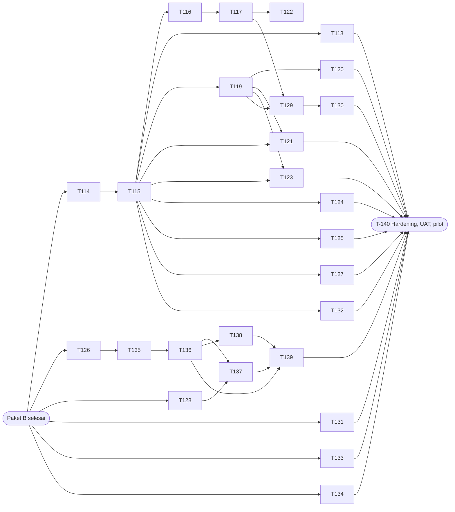

# TASKS — Paket C: Lapangan & Mitra (T-114–T-140)

> Siap eksekusi **setelah** exit gate Paket B (termasuk pilot) lulus dan checklist `docs/17-PAKET-C-LAPANGAN-MITRA.md` §0 dicentang. Spesifikasi: **17** (`docs/17-…`), **16**, **15**, **14**. Path backend relatif ke `backend/`; mobile di `mobile-pro/`, `mobile-mitra/`, `mobile-shared/`.
>
> **Aturan khusus paket ini**
> - **Nama berkas halaman & komponen frontend mengikuti konvensi repo** (kebab-case huruf kecil, mis. `pages/sales/orders/form.tsx`); path PascalCase di task ini indikatif (**15** §0 S-3).
> - Aturan bisnis A/B **tidak** diduplikasi di mobile: endpoint mobile memanggil Action yang sama dengan web. Logika lokal di perangkat (harga, plafon, alokasi perkiraan) hanya untuk tampilan/offline dan selalu diverifikasi server.
> - Setiap Action yang mengubah entitas tersinkron memanggil `SyncChangeRecorder` (ADR-117; arch test dari T-114).
> - Dependency Flutter baru hanya dari **17** §0.1; dicatat di `03` §5.
> - Permission Paket C dibuat seluruhnya di T-114.
> - Test mobile: `fvm flutter analyze && fvm flutter test` di setiap folder Flutter yang disentuh.

| Ringkasan | Nilai |
|---|---|
| Task | 27 (T-114–T-140) |
| Estimasi | 251 jam (rentang 215–320) |
| Exit gate | Checklist **17** §10.2 + UAT-C01–C24 + pilot lapangan 2 minggu |

## Urutan & dependensi

Jalur kritis: T-114 → T-115 → T-119 → T-121 → T-140. Mitra (T-135–T-139) bisa jalan paralel oleh agen lain setelah T-126 (atau dengan kode aktivasi tanpa menunggu WA). Red flag & investigasi (T-129–T-130), insentif (T-131), servis (T-133), rotasi (T-134) adalah backend murni dan bisa paralel.

---

### T-114 — Mesin sinkron server + permission Paket C
- Paket: C | Prioritas: P0 | Estimasi: 12 jam
- Memenuhi: FR-C01–FR-C04, BR-240, BR-241, BR-242, ADR-111, ADR-117, SEC-142, SEC-144
- Dependensi: Paket B
- Konteks wajib: **17** §0.2, §4.2 (`sync_changes`, `sync_device_states`, `client_outbox_receipts`), §5.1, §6.1–§6.4, §6.7 (diagram sinkron), §8.2 BR-240–BR-242, §9 (`sync.*`), §10.2 SEC-142, SEC-144, §11.1
- File: migrations; `app/Domain/Sync/{SyncChangeRecorder.php,Audience.php,Snapshot/{SnapshotBuilder,Sets/*Set.php},Delta/DeltaBuilder.php,Push/{PushProcessor,ItemHandlerRegistry,Contracts/ItemHandler,Results/*}.php,Models/*,Actions/{ReportDeviceStatus,RequestDeviceWipe}}`; `app/Http/Controllers/Api/V1/SyncController.php`; `app/Http/Controllers/Admin/SyncDeviceController.php` + listing `SyncDeviceListing`; commands `sync:prune-changes`, `sync:stale-devices`; seeder `PaketCPermissionSeeder` (27 permission, matriks **17** §6.4); pemanggilan `SyncChangeRecorder` di Action A/B yang mengubah entitas tersinkron (kios, penugasan, produk, harga, promo, faktur, pembayaran, rencana, surat jalan); `tests/Arch/SyncRecorderArchTest.php`, `tests/Feature/Sync/*`, `tests/Feature/Access/PaketCMatrixTest.php`
- Deskripsi: Set snapshot per **17** BR-240, delta dengan penggabungan per entitas & tombstone, push dengan registri handler per `item_type` (handler ditambah task masing-masing; di task ini handler `ping` untuk test). Hasil per item & idempotensi lewat `client_outbox_receipts`.
- Kriteria penerimaan:
  - [ ] Sales A tidak pernah menerima kios/faktur sales B di snapshot maupun delta (SEC-144)
  - [ ] Kios dialihkan A → B: delta A memuat `delete`, delta B memuat `upsert`
  - [ ] Cursor lebih tua dari batas → `410 SNAPSHOT_REQUIRED`
  - [ ] Push: duplikat hash sama → `duplicate`; hash beda → `IDEMPOTENCY_CONFLICT`; item gagal tidak membatalkan item lain; `depends_on` ditolak → `DEPENDENCY_REJECTED`
  - [ ] Arch test: Action yang menulis model tersinkron memanggil recorder
  - [ ] `PaketCMatrixTest` hijau; listing `sync_devices` lulus kontrak
- Verifikasi: `php artisan test --filter='Sync|PaketCMatrix'`
- Di luar lingkup: klien Flutter (T-115)

### T-115 — Sinkron di Pakis Pro + pemilih mode + paket bersama
- Paket: C | Prioritas: P0 | Estimasi: 12 jam
- Memenuhi: FR-C05, FR-C45 (Pro), BR-243, SEC-143, SEC-146 (klien), ADR-116
- Dependensi: T-114
- Konteks wajib: **17** §0.1, §0.2 (ADR-116), §7.1, §8.2 BR-241–BR-243, §9 (`sync.local_retention_days`, `mobile.*`), §10.2 SEC-143
- File: `mobile-shared/` (paket Dart: `api/`, `models/`, `theme/`, `widgets/PagedList`, `format/id_id.dart`) dan pindahkan kode bersama dari `mobile-pro/lib/core` & `shared`; `mobile-pro/lib/core/sync/{snapshot_loader,delta_applier,outbox_queue,sync_scheduler,conflict_inbox}.dart`, tabel drift lokal per set, `features/home/mode_selector.dart`, `features/sync/sync_status_screen.dart`, PIN aplikasi untuk mode keuangan; CI mobile untuk 3 folder; tests Flutter (unit + integrasi dengan server palsu)
- Deskripsi: Antrean drift terenkripsi, unggah foto terpisah bertoken item, backoff eksponensial, sinkron saat buka aplikasi/konektivitas kembali/tombol, kotak Konflik, pembersihan data, hapus jarak jauh (kirim antrean dulu), `FLAG_SECURE` di layar keuangan.
- Kriteria penerimaan:
  - [ ] Matikan aplikasi saat antrean 20 item → buka lagi → antrean utuh & terkirim berurutan
  - [ ] Respons `rejected` muncul di kotak Konflik dengan pesan Indonesia dari kode galat
  - [ ] Wipe: antrean berisi kwitansi dikirim dulu; setelah konfirmasi DB lokal kosong
  - [ ] Mode tampil sesuai permission (test widget per kombinasi role)
  - [ ] `flutter analyze` bersih di `mobile-shared`, `mobile-pro`
- Verifikasi: `cd mobile-pro && fvm flutter test` · `cd mobile-shared && fvm flutter test`
- Di luar lingkup: fitur per mode (task masing-masing)

### T-116 — Rencana kunjungan & peta harian
- Paket: C | Prioritas: P1 | Estimasi: 6 jam
- Memenuhi: FR-C06, FR-C07, BR-244
- Dependensi: T-115
- Konteks wajib: **17** §4.3 (`visit_plans`, `visit_plan_items`), §5.2 (`visit-plans.*`), §5.4 (`admin.visit-plans.*`), §6.6, §7.3, §8.2 BR-244, §9 (`field.sales_can_publish_plan`)
- File: migrations; `app/Domain/Field/{Models/{VisitPlan,VisitPlanItem},Actions/{SaveVisitPlan,PublishVisitPlan,CloseVisitPlans},Listings/VisitPlanListing,Policies/*}`; set sinkron `visit_plan`; controllers web & API; page `Field/VisitPlans/Board.tsx` (papan mingguan); Flutter `features/visits/{plan_list,plan_map}.dart` (`flutter_map`, `url_launcher`); tests
- Deskripsi: Supervisor menyusun rencana tim per minggu; sales melihat & menavigasi. Kios hanya dari scope sales.
- Kriteria penerimaan:
  - [ ] Satu rencana per sales per tanggal; kios di luar scope ditolak
  - [ ] Rencana terbit tersinkron ke perangkat sales saja
  - [ ] Tombol navigasi membuka aplikasi peta ke titik kios
- Verifikasi: `php artisan test --filter=VisitPlan` · `fvm flutter test test/features/visits`
- Di luar lingkup: optimasi rute otomatis

### T-117 — Check-in kunjungan, hasil, usulan titik kios
- Paket: C | Prioritas: P0 | Estimasi: 8 jam
- Memenuhi: FR-C08, FR-C09, BR-143 (lapangan), BR-245, BR-246, SEC-146
- Dependensi: T-116
- Konteks wajib: **17** §4.3 (`visits`, `customer_location_proposals`), §5.1 (item `visit_checkin`/`visit_checkout`/`customer_location_proposal`), §5.4, §7.1, §8.1 BR-143, §8.2 BR-245, BR-246, §9 (`field.*`), §10.2 SEC-146
- File: migrations; `app/Domain/Field/{Models/{Visit,CustomerLocationProposal},Actions/{CheckIn,CheckOut,ProposeCustomerLocation,DecideLocationProposal},Sync/{VisitCheckinHandler,VisitCheckoutHandler,LocationProposalHandler,MockAttemptHandler},Listings/{VisitListing,LocationProposalListing}}`; pages `Field/Visits/*`, `Field/LocationProposals/Index.tsx`; Flutter `features/visits/{checkin,checkout}.dart` memakai `core/location/location_guard.dart`; tests
- Deskripsi: Validasi lokasi & foto, flag radius/durasi/foto duplikat, kunjungan terbuka otomatis tertaut ke pesanan & kwitansi, usulan titik diputuskan Admin Penjualan.
- Kriteria penerimaan:
  - [ ] `isMocked` → tidak tersimpan sebagai kunjungan, `security_events`, red flag (setelah T-129: test diaktifkan)
  - [ ] Di luar radius tanpa alasan → `422`; dengan alasan → tersimpan `outside_radius`
  - [ ] Foto sama dipakai dua kunjungan → flag `duplicate_photo`
  - [ ] Pengusul titik tidak bisa memutuskan; disetujui → koordinat kios berubah + audit
  - [ ] Offline check-in diterima dalam batas jam; lebih → `OFFLINE_TOO_OLD`
- Verifikasi: `php artisan test --filter='Visit|LocationProposal'` · `fvm flutter test test/features/visits`
- Di luar lingkup: pelacakan latar

### T-118 — Pesanan dari Pakis Pro (offline)
- Paket: C | Prioritas: P0 | Estimasi: 10 jam
- Memenuhi: FR-C10, FR-C11, BR-104, BR-247, SEC-147
- Dependensi: T-115, T-088–T-090
- Konteks wajib: **17** §4.1 (ALTER `sales_orders`), §5.1 (item `sales_order`), §7.1, §8.2 BR-247, §10.2 SEC-147; **16** BR-200–BR-207; **15** BR-168, BR-169
- File: `app/Domain/Sales/Sync/SalesOrderHandler.php`, `app/Domain/Sales/Pricing/ClientPriceVerifier.php`, `app/Domain/Sales/Actions/ConfirmRepricedOrder.php`; Flutter `mobile-shared/lib/pricing/{price_resolver,promotion_engine,order_calculator}.dart`, `mobile-pro/lib/features/orders/*`, `features/orders/customer_info.dart`; tests Dart memakai `tests/Fixtures/promotion_cases.json` + kasus BR-200 (salin ke `mobile-shared/test/fixtures` lewat skrip, bukan salin manual)
- Deskripsi: Mesin harga Dart setara PHP; pesanan offline dengan `client_priced_at`; server memverifikasi & memutuskan `kept`/`repriced_pending`; konfirmasi dari aplikasi.
- Kriteria penerimaan:
  - [ ] Fixture harga & promo identik di Dart dan PHP (CI menjalankan keduanya)
  - [ ] ≤ 24 jam & versi sah → harga perangkat dipakai; > 24 jam → `needs_action` + draft
  - [ ] Harga dimanipulasi → `PRICE_MISMATCH`
  - [ ] Cek kredit/terbatas/blokir (**16** BR-202) dijalankan saat sinkron; pengecualian → approval biasa
  - [ ] Info kios offline menampilkan waktu snapshot
- Verifikasi: `php artisan test --filter='SalesOrderHandler|ClientPrice'` · `cd mobile-shared && fvm flutter test test/pricing`
- Di luar lingkup: pesanan Mitra (T-136)

### T-119 — Blok nomor & tagih offline (kwitansi, giro)
- Paket: C | Prioritas: P0 | Estimasi: 12 jam
- Memenuhi: FR-C12, FR-C13, FR-C14, BR-127, BR-248, BR-249, ADR-112, ADR-119, SEC-145
- Dependensi: T-115, T-100, T-098
- Konteks wajib: **17** §0.2 (ADR-119), §4.1 (ALTER `receipts`, `payments`), §4.2 (`number_blocks`, `number_block_usages`), §5.1 (`number-blocks.*`, item `receipt`), §8.2 BR-248, BR-249, §9 (`sync.number_block_*`), §10.2 SEC-145, §11.1 (`number-blocks:expire`)
- File: migrations; `app/Domain/Numbering/{Actions/ReserveBlock}.php` (perluasan `NumberGenerator::reserveBlock`); `app/Domain/Sync/NumberBlocks/{AllocateNumberBlock,ReportUnusedNumbers,RevokeNumberBlock,ExpireNumberBlocks}.php`; `app/Domain/Receivable/Sync/ReceiptHandler.php`; listing `NumberBlockListing`; Flutter `core/numbering/number_block_store.dart`, `features/collection/{collection_list,receipt_form,receipt_view,giro_capture}.dart`; tests (termasuk uji paralel nomor online vs blok)
- Deskripsi: Blok nomor dari counter yang sama dengan nomor online; kwitansi offline tidak bisa diubah; alokasi resmi di server; pesan ke kios setelah sinkron.
- Kriteria penerimaan:
  - [ ] Blok & nomor online paralel tidak pernah bentrok (100 iterasi paralel)
  - [ ] Nomor di luar blok perangkat → `NUMBER_NOT_IN_BLOCK` + red flag
  - [ ] Blok kedaluwarsa dengan nomor tak dilaporkan → red flag high
  - [ ] Kwitansi offline tersinkron → payment + alokasi resmi + pesan kios dengan tautan
  - [ ] Giro di lapangan: foto wajib, `pending_clearing`
- Verifikasi: `php artisan test --filter='NumberBlock|ReceiptHandler'` · `fvm flutter test test/features/collection`
- Di luar lingkup: cetak kwitansi Bluetooth (memakai `EscPosPrinter` dari T-121 bila sudah ada)

### T-120 — Status uang di tangan & setoran di aplikasi
- Paket: C | Prioritas: P0 | Estimasi: 5 jam
- Memenuhi: FR-C15, BR-129, BR-250, SEC-154 (blokir)
- Dependensi: T-119, T-101
- Konteks wajib: **17** §5.2 (`collector-status.me`, `cash-deposits.*`), §8.2 BR-250; **16** BR-220, BR-221
- File: set sinkron `collector_status`; `app/Domain/Cash/Sync/BlockedIssueFlagger.php`; Flutter `features/collection/{cash_status,deposit_create}.dart`; tests
- Deskripsi: Perangkat menghitung uang di tangan lokal; menolak kwitansi tunai & pesanan kredit saat lewat plafon/batas; server menandai kwitansi yang terbit saat diblokir.
- Kriteria penerimaan:
  - [ ] Offline: kwitansi tunai ke-n yang melewati plafon ditolak aplikasi
  - [ ] Kwitansi yang ternyata terbit saat diblokir diterima + flag `issued_while_blocked` + notifikasi Finance & Owner
  - [ ] Buat setoran dari aplikasi (online) memakai Action **16**
- Verifikasi: `php artisan test --filter=BlockedIssue` · `fvm flutter test test/features/collection`
- Di luar lingkup: setoran via VA (OQ-114)

### T-121 — Canvas (muat, jual, nota Bluetooth, retur, rekonsiliasi)
- Paket: C | Prioritas: P0 | Estimasi: 18 jam
- Memenuhi: FR-C16–FR-C19, BR-111, BR-133, BR-251, BR-252, BR-253, ADR-118, SEC-158
- Dependensi: T-115, T-119, T-077, T-093, T-094, T-102
- Konteks wajib: **17** §0.1 (printer), §0.2 (ADR-118), §4.4, §5.2 (`canvas-sessions.*`), §6.5 (`canvas_variance`, `canvas_credit_exception`), §6.6, §6.7 (diagram canvas), §8.2 BR-251–BR-253, §9 (`canvas.*`, `field.canvas_allow_restricted`), §11.2; **16** BR-210, BR-212, BR-222
- File: **spike printer** (1–2 jam, hasil dicatat di `03` §5 & `12`); migrations `canvas_sessions`, `canvas_session_lines`; sequence `canvas_session`; `app/Domain/Field/Canvas/{Models/*,Actions/{OpenCanvasSession,ConfirmCanvasLoad,RecordCanvasSale,RecordCanvasReturn,CloseCanvasSelling,ReconcileCanvasSession,UnloadCanvasSession},Approvables/{CanvasVariance,CanvasCreditException},Sync/{CanvasSaleHandler,CanvasReturnHandler},Listings/CanvasSessionListing}`; page `Field/Canvas/*`; Flutter `core/printing/esc_pos_printer.dart`, `features/canvas/*`, `features/warehouse/canvas_check.dart`; tests
- Deskripsi: ADR-118 jual langsung dari kendaraan (pesanan + surat jalan + POD + faktur dalam satu transaksi, nomor faktur dari blok `invoice`). Rekonsiliasi buta oleh checker.
- Kriteria penerimaan:
  - [ ] Muat dikonfirmasi checker ≠ sales (`CHECKER_SAME_PERSON`); satu sesi terbuka per kendaraan
  - [ ] Nota offline tersinkron → faktur bernomor blok, stok kendaraan berkurang, piutang/pembayaran benar
  - [ ] Stok sistem kendaraan kurang → tidak minus, selisih muncul di rekonsiliasi
  - [ ] Kredit melewati limit saat sinkron → nota sah + approval `canvas_credit_exception` + red flag
  - [ ] Selisih kurang disetujui → piutang karyawan + event `field.canvas_shortage`
  - [ ] Nota tercetak di printer uji memuat nomor, kios, item, total, rekening resmi
  - [ ] Tutup jualan dengan antrean tersisa → `SESSION_HAS_PENDING_SYNC`
- Verifikasi: `php artisan test --filter=Canvas` · `fvm flutter test test/features/canvas` · uji manual printer (dicatat di PR)
- Di luar lingkup: GPS kendaraan (Paket D)

### T-122 — Harga & aktivitas pesaing
- Paket: C | Prioritas: P2 | Estimasi: 4 jam
- Memenuhi: FR-C20, BR-254
- Dependensi: T-117
- Konteks wajib: **17** §4.3 (`competitor_prices`), §7.3, §8.2 BR-254
- File: migration; `app/Domain/Field/{Models/CompetitorPrice,Sync/CompetitorPriceHandler,Listings/CompetitorPriceListing,Reports/CompetitorPriceSummary}`; page `Field/CompetitorPrices/Index.tsx`; Flutter `features/visits/competitor_price_form.dart`; tests
- Kriteria penerimaan:
  - [ ] Input offline saat kunjungan, tertaut `visit_id`
  - [ ] Ringkasan median per produk pesaing per area per bulan
  - [ ] Tidak pernah muncul di respons Mitra
- Verifikasi: `php artisan test --filter=CompetitorPrice`
- Di luar lingkup: analisis pasar (Paket G)

### T-123 — Mode driver (antar, POD, COD)
- Paket: C | Prioritas: P0 | Estimasi: 10 jam
- Memenuhi: FR-C21–FR-C23, BR-107, BR-209, BR-255, SEC-158
- Dependensi: T-115, T-119, T-092
- Konteks wajib: **17** §5.1 (item `pod`, `delivery_failure`), §5.2 (`deliveries.mine`), §7.1, §8.2 BR-255, §9 (`delivery.pod_signature_required`); **16** BR-209
- File: `app/Domain/Delivery/Sync/{PodHandler,DeliveryFailureHandler}.php`; set sinkron `deliveries`; Flutter `features/delivery/{route_list,pod_form,signature_pad,failure_form}.dart`; tests
- Kriteria penerimaan:
  - [ ] POD offline > batas jam tetap diterima dengan flag `late_sync`
  - [ ] Tanda tangan wajib (bila setting aktif), disimpan PNG + hash, tidak bisa diganti
  - [ ] COD memakai kwitansi blok driver; berlaku plafon & setoran driver
  - [ ] Driver lain tidak menerima surat jalan rute orang lain di sinkron
- Verifikasi: `php artisan test --filter='PodHandler|DeliveryFailure'` · `fvm flutter test test/features/delivery`
- Di luar lingkup: trip, P2H, BBM (Paket D)

### T-124 — Mode gudang (terima, ambil, opname, mutasi)
- Paket: C | Prioritas: P1 | Estimasi: 12 jam
- Memenuhi: FR-C24–FR-C27, BR-256
- Dependensi: T-115, Paket A
- Konteks wajib: **17** §0.1 (`mobile_scanner`), §5.2 (`warehouse.*`, `lookup.barcode`), §8.2 BR-256; **15** BR-158, BR-161, BR-162
- File: `app/Http/Controllers/Api/V1/Warehouse/*` (memakai Action Paket A); `app/Domain/Inventory/Sync/{OpnameCountHandler,PickConfirmHandler}.php`; Flutter `features/warehouse/{receive,pick,opname,transfer_receive}.dart`; tests
- Kriteria penerimaan:
  - [ ] Scan barcode satuan dus/botol menghasilkan konversi benar
  - [ ] Opname offline ditolak bila opname sudah `review`; respons tidak memuat qty sistem saat blind
  - [ ] Ambil dengan batch non-FEFO meminta konfirmasi & tercatat override
- Verifikasi: `php artisan test --filter='Api\\\\V1\\\\Warehouse|OpnameCount'` · `fvm flutter test test/features/warehouse`
- Di luar lingkup: penerimaan offline (butuh validasi PO online)

### T-125 — Mode owner & persetujuan dari HP
- Paket: C | Prioritas: P1 | Estimasi: 7 jam
- Memenuhi: FR-C28, FR-C29, BR-257
- Dependensi: T-115, T-067, T-109
- Konteks wajib: **17** §5.2 (`owner.summary`, `approvals.*`), §8.2 BR-257; **16** §7.4
- File: `app/Http/Controllers/Api/V1/{OwnerSummaryController,ApprovalController}.php`; `app/Http/Middleware/RequireReauth.php`; Flutter `features/owner/{summary,approvals,approval_detail,reauth}.dart` (biometrik via API Android bawaan lewat paket yang sudah ada atau PIN; **tanpa** dependency baru bila tidak tersedia → PIN saja); tests
- Kriteria penerimaan:
  - [ ] Angka ringkasan = dasbor web (test perbandingan)
  - [ ] Nominal ≥ ambang tanpa reauth → `401 REAUTH_REQUIRED`
  - [ ] Keputusan approval tidak bisa diantre offline
- Verifikasi: `php artisan test --filter='OwnerSummary|Api\\\\V1\\\\Approval'`
- Di luar lingkup: laporan lengkap di HP

### T-126 — Driver WhatsApp Business nyata
- Paket: C | Prioritas: P0 | Estimasi: 8 jam
- Memenuhi: FR-C30, BR-128, BR-258, SEC-150 (WA)
- Dependensi: T-111; OQ-124 terjawab (bila belum: task diblokir, B tetap memakai antrean + kirim manual)
- Konteks wajib: **17** §4.1 (ALTER `customers`, `outbound_messages`), §5.4 (`whatsapp.webhook`), §8.2 BR-258, §9 (`whatsapp.provider`, `messages.circuit_breaker_failures`); **14** §12, ADR-113; Fase 0 `OtpChannel`
- File: `app/Support/Channels/WhatsApp/{Drivers/<Provider>WhatsAppChannel.php,WhatsAppWebhookVerifier.php,CircuitBreaker.php}`; adaptasi `OtpChannel` Fase 0 agar memakai driver yang sama; `app/Http/Controllers/Api/V1/WhatsAppWebhookController.php`; `app/Domain/Integration/Messaging/Actions/{RecordOptIn,RecordOptOut,HandleInboundReply}.php`; `.env.example`; tests dengan HTTP fake
- Kriteria penerimaan:
  - [ ] Pesan template terkirim lewat driver; status `delivered`/`read` dari webhook bertanda tangan
  - [ ] "STOP" → opt-out; pesan promosi tidak dikirim ke kios tanpa opt-in
  - [ ] Balasan lain → pengaduan kanal `whatsapp_reply`
  - [ ] Gagal beruntun → circuit breaker menahan antrean & memberi tahu Finance
  - [ ] Token penyedia hanya di env; tidak tercatat di log
- Verifikasi: `php artisan test --filter=WhatsApp`
- Di luar lingkup: chatbot

### T-127 — Push notification
- Paket: C | Prioritas: P1 | Estimasi: 6 jam
- Memenuhi: FR-C31, BR-259, SEC-153
- Dependensi: T-115; OQ-005
- Konteks wajib: **17** §0.1 (`firebase_messaging`), §4.5 (`push_tokens`), §5.2/§5.3 (`push-tokens.*`), §8.2 BR-259, §10.2 SEC-153
- File: migration `push_tokens`; `app/Support/Channels/Push/{PushChannel,FcmPushChannel,LogPushChannel}.php`; notifikasi Laravel `via()` menambah push untuk kejadian BR-259; Flutter `mobile-shared/lib/push/*`, registrasi di Pro & Mitra; tests
- Kriteria penerimaan:
  - [ ] Payload push tanpa nominal/nama kios (test semua notifikasi)
  - [ ] Token dicabut saat logout/cabut perangkat
  - [ ] Ketuk push membuka layar tujuan setelah autentikasi
- Verifikasi: `php artisan test --filter=Push`
- Di luar lingkup: kampanye pemasaran

### T-128 — QRIS
- Paket: C | Prioritas: P1 | Estimasi: 6 jam
- Memenuhi: FR-C32, BR-260, SEC-150 (QRIS)
- Dependensi: T-099; OQ-102
- Konteks wajib: **17** §0.1 (`qr_flutter`), §4.5 (`qris_requests`), §5.2/§5.3 (`qris`, `payments.qris`), §8.2 BR-260, §9 (`qris.*`), §11.1
- File: migration; `app/Domain/Integration/PaymentGateway/` (method `createQris`, `getQrisStatus` + driver `fake`); `app/Domain/Receivable/Actions/{CreateQrisRequest,SettleQrisPayment}.php`; handler webhook QRIS; command `qris:expire`; Flutter `mobile-shared/lib/widgets/qris_view.dart`; integrasi POS PWA (layar bayar); tests
- Kriteria penerimaan:
  - [ ] Webhook dibayar → payment `qris` + alokasi ke faktur terpilih; tidak ada kwitansi; tidak menambah uang di tangan
  - [ ] Kedaluwarsa → `QRIS_EXPIRED`
  - [ ] Nominal ≥ ambang diverifikasi ulang ke penyedia sebelum alokasi
- Verifikasi: `php artisan test --filter=Qris`
- Di luar lingkup: QRIS statis

### T-129 — Mesin red flag & dasbor
- Paket: C | Prioritas: P0 | Estimasi: 12 jam
- Memenuhi: FR-C33, BR-261, BR-262, SEC-151
- Dependensi: T-117, T-119, Paket B
- Konteks wajib: **17** §4.6 (`red_flag_rules`, `red_flags`), §5.4 (`red-flags.*`, `red-flag-rules.*`), §6.2, §7.3, §8.2 BR-261, BR-262, §9 (`fraud.*`), §10.2 SEC-151; konsep §18.5
- File: migrations + seeder 16 aturan; `app/Domain/Fraud/{Rules/*Rule.php (satu kelas per kode),RuleRegistry,Actions/{EvaluateRules,RaiseRedFlag,ReviewRedFlag},Models/*,Listings/{RedFlagListing,RedFlagRuleListing},Policies/*}`; command `fraud:evaluate`; pemicu seketika (`balance_dispute`, `visit_mock_location`, `receipt_issued_while_blocked`); pages `Control/RedFlags/*`, `Control/Rules/*`; widget dasbor; tests per aturan
- Kriteria penerimaan:
  - [ ] Setiap aturan punya test positif & negatif dengan data sintetis
  - [ ] Dedup: evaluasi dua kali → satu flag
  - [ ] Pegawai subjek (bila punya akses lain) tidak bisa melihat flag dirinya
  - [ ] Tidak ada perubahan hak pegawai otomatis dari flag (test)
  - [ ] Evaluasi 1 tahun data volume < 10 menit (NFR-C06)
- Verifikasi: `php artisan test --filter='RedFlag|Fraud'`
- Di luar lingkup: aturan BBM (Paket D), pola AI (Paket G)

### T-130 — Kasus investigasi, pembekuan, paket bukti, pemulihan saldo
- Paket: C | Prioritas: P0 | Estimasi: 9 jam
- Memenuhi: FR-C34, BR-133, BR-263, BR-264, SEC-152, SEC-154
- Dependensi: T-129, T-102, T-103
- Konteks wajib: **17** §4.1 (`payments.method = restoration`), §4.6 (`investigation_cases`, `case_evidence`, `transaction_freezes`), §5.4 (`investigations.*`, `freezes.*`), §8.2 BR-263, BR-264, §10.2 SEC-152, SEC-154, §11.2 (`receivable.restoration`)
- File: migrations + trigger append-only `case_evidence`; sequence `investigation_case`; `app/Domain/Fraud/Cases/{Models/*,Actions/{OpenCase,FreezeEmployee,LiftFreeze,AddEvidence,BuildEvidencePackage,RestoreCustomerPayment,CloseCase},Checks/TransactionFreezeCheck}`; pemanggilan `TransactionFreezeCheck` di Action terima tunai, pesanan kredit, retur, canvas; set sinkron `employee_status`; job paket bukti; pages `Control/Cases/*`, `Control/Freezes/*`; tests
- Kriteria penerimaan:
  - [ ] Pembekuan berlaku segera di web & sinkron; item perangkat sebelum `frozen_at` diterima + flag, sesudahnya `EMPLOYEE_FROZEN`
  - [ ] Paket bukti: manifest hash cocok dengan isi ZIP (test verifikasi)
  - [ ] Pemulihan saldo: faktur kios berkurang, piutang karyawan bertambah, event seimbang
  - [ ] Lepas pembekuan hanya Owner + password + alasan
- Verifikasi: `php artisan test --filter='Investigation|Freeze|Restoration'`
- Di luar lingkup: tindakan hukum

### T-131 — Target & insentif sales
- Paket: C | Prioritas: P1 | Estimasi: 12 jam
- Memenuhi: FR-C35, FR-C36, BR-118, BR-265, BR-266
- Dependensi: T-093, T-097, T-096; T-116 (metrik kepatuhan kunjungan)
- Konteks wajib: **17** §4.7, §5.2 (`incentives.mine`), §5.4 (`incentive-*`, `sales-targets.*`), §6.5 (`incentive_period_lock`), §7.3, §8.2 BR-265, BR-266, §11.1
- File: migrations; `app/Domain/Incentive/{Models/*,Metrics/{NetSalesMetric,CollectionMetric,NewActiveCustomersMetric,QtyMetric,VisitComplianceMetric},Actions/{CalculateIncentivePeriod,AccrueIncentiveAdjustments,RequestIncentiveLock},Approvables/IncentivePeriodLock,Imports/SalesTargetImporter,Listings/*}`; command; pages `Incentives/*`; Flutter `features/home/incentive_card.dart`; tests
- Kriteria penerimaan:
  - [ ] Hitung sebelum periode tertutup → `INCENTIVE_PERIOD_NOT_CLOSED`
  - [ ] Tier, gerbang, batas maksimum benar (test tabel)
  - [ ] Retur atas faktur periode terkunci → penyesuaian periode berikut, hasil lama tidak berubah
  - [ ] Supervisor hanya menetapkan target timnya
  - [ ] Sales melihat capaian sendiri saja
- Verifikasi: `php artisan test --filter=Incentive`
- Di luar lingkup: pembayaran via payroll (Paket E), insentif driver (Paket D/E)

### T-132 — Promosi & demplot
- Paket: C | Prioritas: P1 | Estimasi: 9 jam
- Memenuhi: FR-C37, BR-148, BR-267, SEC-155
- Dependensi: T-067, T-077, T-115
- Konteks wajib: **17** §4.8, §5.2 (`promo-activities.*`), §6.5 (`promo_activity`, `promo_activity_overuse`), §6.6, §8.2 BR-267, §9 (`promo.*`), §10.2 SEC-155, §11
- File: migrations; sequence `promo_activity`; `app/Domain/Marketing/{Models/*,Actions/{SavePromoActivity,SubmitPromoActivity,IssuePromoGoods,RealizePromoActivity,ReturnPromoGoods,ClosePromoActivity},Approvables/*,Sync/PromoRealizationHandler,Listings/PromoActivityListing}`; command anonimisasi peserta; pages `Marketing/PromoActivities/*`; Flutter `features/promo/*`; tests
- Kriteria penerimaan:
  - [ ] Keluarkan produk sebelum disetujui → `PROMO_NOT_APPROVED`
  - [ ] Realisasi butuh ≥ `promo.min_photos` foto berlokasi; di luar toleransi → alasan
  - [ ] Pemakaian > rencana → tidak bisa ditutup tanpa approval
  - [ ] HP peserta tanpa persetujuan ditolak (CHECK)
  - [ ] Event keluar & kembali produk seimbang
- Verifikasi: `php artisan test --filter=PromoActivity`
- Di luar lingkup: klaim biaya ke prinsipal (Paket F)

### T-133 — Servis & klaim garansi
- Paket: C | Prioritas: P1 | Estimasi: 8 jam
- Memenuhi: FR-C38, BR-145, BR-268
- Dependensi: T-108, T-093
- Konteks wajib: **17** §4.9, §5.4 (`service-tickets.*`, `warranty-claims.*`), §6.6, §8.2 BR-268, §11
- File: migrations; sequences `service_ticket`, `warranty_claim`; `app/Domain/Warranty/Service/{Models/*,Actions/{OpenServiceTicket,RecordDiagnosis,RecordCustomerApproval,UseSparePart,SubmitWarrantyClaim,DecideWarrantyClaim,HandBack},Listings/*}`; notifikasi status ke pelanggan (template `service_status`); pages `Service/*`; tests
- Kriteria penerimaan:
  - [ ] Status garansi otomatis dari nomor seri & kartu
  - [ ] Perbaikan berbayar tanpa persetujuan pelanggan → `SERVICE_ESTIMATE_NOT_APPROVED`
  - [ ] Biaya servis → faktur `charge`; suku cadang garansi → event `service.parts_used`
  - [ ] Setiap perubahan status mengantre pesan ke pemohon
- Verifikasi: `php artisan test --filter='ServiceTicket|WarrantyClaim'`
- Di luar lingkup: modul bengkel lengkap

### T-134 — Rotasi area tagih & cuti wajib
- Paket: C | Prioritas: P2 | Estimasi: 5 jam
- Memenuhi: FR-C39, BR-134, BR-269
- Dependensi: T-073, T-103; T-049 (opsional, cuti)
- Konteks wajib: **17** §4.10, §5.4 (`collection-rotations.*`), §8.2 BR-269, §9 (`field.rotation_interval_months`, `field.mandatory_leave_consecutive_days`), §11.1
- File: migration; `app/Domain/Field/Rotation/{Models/CollectionRotation,Actions/{PlanRotation,ApplyRotations},Reports/MandatoryLeaveReport,Listings/CollectionRotationListing}`; commands `rotations:apply`, `leave:mandatory-report`; pages `Field/Rotations/*`; tests
- Kriteria penerimaan:
  - [ ] Rotasi/`leave_cover` mengalihkan kios lewat penugasan A & mengirim konfirmasi saldo ad hoc ke seluruh kios area
  - [ ] `leave_cover` kembali otomatis setelah `end_date`
  - [ ] Laporan cuti wajib memakai modul cuti bila ada; bila tidak, dari `leave_cover` (tercatat di laporan sebagai sumber)
- Verifikasi: `php artisan test --filter='Rotation|MandatoryLeave'`
- Di luar lingkup: pengajuan cuti (Fase HR)

### T-135 — Pakis Mitra: backend akun & aplikasi dasar
- Paket: C | Prioritas: P0 | Estimasi: 10 jam
- Memenuhi: FR-C40, BR-270, SEC-141, SEC-148, ADR-109, ADR-116
- Dependensi: T-074, T-115 (`mobile-shared`), T-126 (OTP WA; tanpa itu pakai kode aktivasi)
- Konteks wajib: **17** §4.11 (`customer_users`, `customer_devices`, `mitra_activation_codes`), §5.3 (`auth.*`, `me`, `users.*`), §5.4 (`mitra-users.*`), §6.1, §8.2 BR-270, §9 (`mitra.max_devices_per_user`, `mobile.mitra_min_version`), §10.2 SEC-141, SEC-148
- File: migrations; `config/auth.php` guard `mitra`; `app/Domain/Mitra/{Models/{CustomerUser,CustomerDevice,MitraActivationCode},Actions/{InviteMitraUser,IssueActivationCode,RequestMitraOtp,VerifyMitraOtp,ActivateWithCode,AddStaffUser,SuspendMitraUser,RevokeMitraDevice},Scopes/MitraScope,Http/Middleware/SetCurrentCustomer,Listings/MitraUserListing}`; `app/Http/Controllers/Mitra/V1/*`; listener ganti HP kios → tangguhkan owner lama; pages `Mitra/Users/*`; `mobile-mitra/` scaffold (FVM, `applicationId` berbeda, tema, login OTP/kode, gerbang versi); tests
- Kriteria penerimaan:
  - [ ] Token staf ditolak di `/api/mitra` dan token Mitra ditolak di `/api/v1`
  - [ ] Undangan hanya untuk kios terverifikasi; owner = `owner_phone`
  - [ ] OTP & kode aktivasi sesuai SEC-148 (throttle, sekali pakai, kedaluwarsa)
  - [ ] Ganti HP kios → akun owner lama `suspended`
  - [ ] APK Mitra debug terbangun di CI
- Verifikasi: `php artisan test --filter=Mitra` · `cd mobile-mitra && fvm flutter test`
- Di luar lingkup: fitur katalog/pesanan (T-136)

### T-136 — Mitra: katalog, keranjang, pesan, status
- Paket: C | Prioritas: P0 | Estimasi: 12 jam
- Memenuhi: FR-C41, BR-112, BR-271
- Dependensi: T-135, T-088–T-090, T-110 (data label & tanaman/OPT)
- Konteks wajib: **17** §5.3 (`catalog.*`, `orders.*`, `deliveries.*`), §7.2, §7.3 (`mitra_catalog`, `mitra_orders`), §8.2 BR-271, §9 (`mitra.allow_restricted_order`, `mitra.stock_badge_thresholds`)
- File: `app/Domain/Mitra/{Catalog/MitraCatalogQuery,Orders/{PreviewMitraOrder,SubmitMitraOrder,CancelMitraOrder,ReorderMitraOrder},Resources/*}` (resource allowlist); listings Mitra; Flutter `mobile-mitra/lib/features/{catalog,cart,orders,deliveries}/*` memakai mesin harga `mobile-shared`; tests
- Kriteria penerimaan:
  - [ ] Harga di katalog = `PriceResolver` kios itu; tidak ada harga kios lain
  - [ ] Produk terbatas tersembunyi (default) & pemesanan langsung lewat API ditolak
  - [ ] Pesanan Mitra lewat cek **16** BR-202; pengecualian tampil "menunggu konfirmasi"
  - [ ] Respons tanpa HPP/stok angka (snapshot test)
  - [ ] Pesan ulang = draft harga hari ini
- Verifikasi: `php artisan test --filter='MitraCatalog|MitraOrder'` · `cd mobile-mitra && fvm flutter test`
- Di luar lingkup: pembayaran (T-137)

### T-137 — Mitra: tagihan, bayar, kwitansi, konfirmasi saldo
- Paket: C | Prioritas: P0 | Estimasi: 8 jam
- Memenuhi: FR-C42, BR-131, BR-272
- Dependensi: T-136, T-103, T-099, T-128
- Konteks wajib: **17** §5.3 (`invoices.*`, `statement`, `payments.*`, `receipts.*`, `balance-confirmations.*`), §6.1 (hak keuangan), §8.2 BR-272; **16** BR-223
- File: `app/Domain/Mitra/Finance/*`; Flutter `mobile-mitra/lib/features/{billing,receipts,balance_confirmation}/*`; tests
- Kriteria penerimaan:
  - [ ] Staf tanpa `can_view_finance` → `403 MITRA_NOT_ALLOWED`
  - [ ] Sisa limit = limit − paparan (sama dengan web)
  - [ ] Jawaban konfirmasi saldo dari Mitra = jawaban tautan publik (satu kali, pengaduan ke Finance)
  - [ ] Layar bayar menampilkan rekening resmi + peringatan
- Verifikasi: `php artisan test --filter=MitraFinance`
- Di luar lingkup: autodebit

### T-138 — Mitra: retur, keluhan, garansi, promo, poin
- Paket: C | Prioritas: P1 | Estimasi: 8 jam
- Memenuhi: FR-C43, BR-273
- Dependensi: T-136, T-094, T-133
- Konteks wajib: **17** §4.11 (`customer_point_entries`), §5.3 (`returns.*`, `inquiries.*`, `warranty.*`, `service-tickets.store`, `promotions.index`, `points.index`), §8.2 BR-273, §9 (`mitra.points_*`), §11.1
- File: migration `customer_point_entries`; `app/Domain/Mitra/{Points/{AccruePoints,ReversePoints,ExpirePoints,RedeemPoints},Returns/*,Inquiries/*}`; listener faktur lunas/nota kredit → poin; page admin `Mitra/Points/*`; Flutter `mobile-mitra/lib/features/{returns,complaints,warranty,promotions,points}/*`; tests
- Kriteria penerimaan:
  - [ ] Retur Mitra masuk alur **16** BR-212 dengan `request_channel = mitra`
  - [ ] Poin terakru sekali per faktur lunas, dibalik bila nota kredit
  - [ ] Kedaluwarsa poin berjalan; saldo tidak negatif
- Verifikasi: `php artisan test --filter='MitraReturn|CustomerPoint'`
- Di luar lingkup: katalog hadiah (OQ-133)

### T-139 — Keamanan API Mitra & rilis APK
- Paket: C | Prioritas: P0 | Estimasi: 6 jam
- Memenuhi: FR-C44, FR-C45, SEC-141, SEC-149, SEC-156, SEC-157
- Dependensi: T-135–T-138
- Konteks wajib: **17** §10 (semua), §7.3 (perluasan kontrak listing)
- File: `tests/Feature/Security/MitraIdorTest.php` (route dari router), `tests/Contract/MitraResourceSnapshotTest.php`, perluasan `ListingContractTest` ke `mitra.v1.`, rate limiter Mitra, workflow rilis APK Mitra (keystore terpisah), `docs/runbooks/RILIS-MOBILE.md`
- Kriteria penerimaan:
  - [ ] IDOR antar kios untuk setiap route `mitra.v1.*` berparameter → 404
  - [ ] Snapshot respons tanpa field terlarang (SEC-149)
  - [ ] Rate limit sesuai SEC-156
  - [ ] APK Mitra rilis bertanda tangan, versi minimum ditegakkan
- Verifikasi: `php artisan test --filter='MitraIdor|MitraResourceSnapshot|ListingContract'`
- Di luar lingkup: iOS (OQ-135)

### T-140 — Hardening, UAT & pilot lapangan Paket C
- Paket: C | Prioritas: P0 | Estimasi: 16 jam
- Memenuhi: NFR-C01–NFR-C07, SEC-159, SEC-160, exit gate Paket C
- Dependensi: semua T-114–T-139
- Konteks wajib: **17** §10, §12; `09` §6–§7; `10` §4
- File: `tests/Feature/Audit/PaketCAuditTest.php`, `tests/Feature/Security/PaketCIdorTest.php`, k6 `tests/load/{sync_push,sync_delta,mitra_catalog}.js`, uji perangkat terdokumentasi (`docs/uat/UAT-PAKET-C.xlsx`, `docs/runbooks/PILOT-PAKET-C.md`), CI audit dependency Flutter ketiga folder
- Deskripsi: Uji beban sinkron & katalog, uji offline 24 jam di 3 ponsel nyata (sales, canvas, driver), UAT bersama Pakis, pilot 2 minggu (1 area, 1 canvas, 2 driver, 1 gudang, 30 kios Mitra) dengan pemantauan harian antrean tertunda, blok nomor, rekonsiliasi canvas, red flag.
- Kriteria penerimaan:
  - [ ] Snapshot ≤ 15 MB & delta ≤ 500 KB per hari (NFR-C02) diukur di data pilot
  - [ ] Push 300 item < 60 s; katalog Mitra p95 < 800 ms
  - [ ] Semua aksi SEC-159 tercatat audit
  - [ ] Checklist **17** §10.2 dicentang
  - [ ] UAT-C01–C24 lulus; pilot tanpa insiden P0, 0 nomor blok tak terlaporkan
- Verifikasi: `php artisan test` · `fvm flutter test` (3 folder) · `k6 run tests/load/*.js`
- Di luar lingkup: Paket D

---

## Ringkasan estimasi

| Kelompok | Task | Jam |
|---|---|---|
| Sinkron (server & klien) | T-114–T-115 | 24 |
| Mode sales (kunjungan, pesanan, tagih, plafon, pesaing) | T-116–T-120, T-122 | 45 |
| Canvas | T-121 | 18 |
| Driver, gudang, owner | T-123–T-125 | 29 |
| Kanal (WhatsApp, push, QRIS) | T-126–T-128 | 20 |
| Red flag & investigasi | T-129–T-130 | 21 |
| Insentif, promosi, servis, rotasi | T-131–T-134 | 34 |
| Pakis Mitra | T-135–T-139 | 44 |
| Hardening, UAT, pilot | T-140 | 16 |
| **Total** | 27 task | **251** |

Rentang: optimis 215 jam · pesimis 320 jam (printer Bluetooth bermasalah, persetujuan template WhatsApp lama, perangkat lapangan beragam).

## Pertanyaan terbuka yang memblokir

| OQ | Memblokir | Bisa jalan dengan default? |
|---|---|---|
| OQ-124 | T-126 | Tidak (task menunggu); B & Mitra pakai kode aktivasi/antrean manual |
| OQ-005 | T-127 | Ya (driver `log`), push nyata menunggu |
| OQ-102 | T-128 | Ya (driver `fake`) |
| OQ-129 | T-121 (printer) | Ya, spike dengan printer yang tersedia |
| OQ-130, OQ-131, OQ-133, OQ-136 | Aturan canvas kredit, skema insentif, poin, cuti | Ya (default di **17** §13) |
| OQ-135, OQ-137 | Distribusi Mitra | Ya (Android, Play Store internal testing) |
