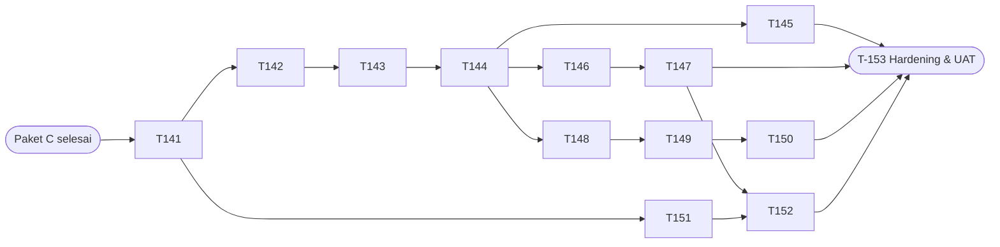

# TASKS — Paket D: Armada & BBM (T-141–T-153)

> Siap eksekusi setelah exit gate Paket C dan checklist `docs/18-PAKET-D-ARMADA-BBM.md` §0. Spesifikasi: **18**, **17**, **16**, **15**, **14**. Path backend relatif ke `backend/`; mobile `mobile-pro/`.
>
> **Aturan khusus:** tidak ada dependency baru (backend & Flutter). Domain `app/Domain/Fleet` (sudah ada sejak A, berisi `Vehicle`) diperluas. Permission & role `koordinator_armada` dibuat di T-141. Item sinkron baru didaftarkan di registri handler **17** T-114. Aturan red flag baru ditambahkan ke registri **17** T-129.

| Ringkasan | Nilai |
|---|---|
| Task | 13 (T-141–T-153) |
| Estimasi | 107 jam (rentang 90–140) |
| Exit gate | Checklist **18** §10.2 + UAT-D01–D12 + uji tracker 1 minggu |

## Urutan & dependensi

---

### T-141 — Data kendaraan lengkap, pemegang, role & permission Paket D
- Paket: D | Prioritas: P0 | Estimasi: 6 jam
- Memenuhi: FR-D01, FR-D02, BR-137, BR-280
- Dependensi: Paket C (T-068 kendaraan minimal)
- Konteks wajib: **18** §0, §4.1 (ALTER `vehicles`), §4.2 (`vehicle_assignments`), §5.1 (`vehicles.*`, `vehicle-assignments.*`), §6.1–§6.4, §8.2 BR-280
- File: migrations; referensi `fuel_type`; `app/Domain/Fleet/{Models/{Vehicle (diperluas),VehicleAssignment},Actions/{UpdateVehicleFleetData,AssignVehicle,EndVehicleAssignment,RecordOdometer},Policies/*}`; seeder `PaketDRoleSeeder` (`koordinator_armada`, 25 permission, matriks); `DataScope` dimensi kendaraan; page `Vehicles/Show.tsx` (tab baru); set sinkron `fleet` (kendaraan saya); tests + `PaketDMatrixTest`
- Kriteria penerimaan:
  - [ ] Kendaraan tanpa `fuel_type_id`/`tank_capacity_l` tidak bisa dipakai trip (`FUEL_TYPE_NOT_ASSIGNED`)
  - [ ] Ubah jenis BBM butuh alasan & tercatat audit
  - [ ] Satu `primary_driver` & satu `holder` aktif (unik DB)
  - [ ] `RecordOdometer` menolak nilai mundur (online) / memberi flag (item offline)
  - [ ] `PaketDMatrixTest` hijau
- Verifikasi: `php artisan test --filter='Vehicle|PaketDMatrix'`
- Di luar lingkup: dokumen (T-142)

### T-142 — Dokumen kendaraan & pengingat
- Paket: D | Prioritas: P0 | Estimasi: 5 jam
- Memenuhi: FR-D03, BR-135, BR-281, SEC-167
- Dependensi: T-141
- Konteks wajib: **18** §4.2 (`vehicle_documents`), §5.1, §7.3, §8.2 BR-281, §9 (`fleet.document_reminder_days`, `fleet.insurance_blocks_trip`), §11.1
- File: migration; referensi `vehicle_document_type` (meta `blocks_trip`); `app/Domain/Fleet/Documents/{Models/VehicleDocument,Actions/SaveVehicleDocument,Queries/DocumentValidity,Listings/VehicleDocumentListing}`; command `fleet:document-reminders`; pages `Fleet/Documents/*`; tests
- Kriteria penerimaan:
  - [ ] Dokumen baru menjadikan yang lama `superseded`
  - [ ] `DocumentValidity::blockingIssues(vehicle, date)` mengembalikan dokumen habis yang memblokir (KIR hanya untuk `requires_kir`)
  - [ ] Pengingat sekali per ambang (via `reminder_logs`)
  - [ ] Berkas di disk privat, signed URL 5 menit
- Verifikasi: `php artisan test --filter=VehicleDocument`
- Di luar lingkup: perpanjangan otomatis

### T-143 — P2H & kelayakan trip
- Paket: D | Prioritas: P0 | Estimasi: 7 jam
- Memenuhi: FR-D04, FR-D05, BR-282, BR-283, SEC-165
- Dependensi: T-142, T-151 (bagian jadwal; bila belum, cek servis dilewati dengan catatan & test `->todo()`)
- Konteks wajib: **18** §4.3 (`vehicle_daily_checks`), §5.1 (`p2h-templates.*`, `daily-checks.*`, `trips.check/override`), §6.5 (`trip_eligibility_override`), §8.2 BR-282, BR-283, §9 (`fleet.service_overdue_block_days`, `fleet.require_driver_license_record`)
- File: migration; referensi `p2h_item`; `app/Domain/Fleet/Checks/{Models/VehicleDailyCheck,Actions/RecordDailyCheck,Sync/DailyCheckHandler,Listings/DailyCheckListing}`; `app/Domain/Fleet/Trips/Eligibility/{TripEligibilityChecker,Reasons}.php`; `Approvables/TripEligibilityOverride`; Flutter `features/fleet/{my_vehicle,daily_check}.dart`; tests
- Kriteria penerimaan:
  - [ ] Item kritis `not_ok` → `fail` + alert `p2h_failed`
  - [ ] Checker kelayakan mengembalikan semua alasan (dokumen, servis, P2H, status, driver dibekukan)
  - [ ] Override hanya lewat approval orang lain; tercatat di laporan
  - [ ] Perangkat menampilkan status layak/tidak dari snapshot
- Verifikasi: `php artisan test --filter='DailyCheck|TripEligibility'` · `fvm flutter test test/features/fleet`
- Di luar lingkup: integrasi data SIM dari HR (OQ-144)

### T-144 — Trip, odometer, serah terima
- Paket: D | Prioritas: P0 | Estimasi: 9 jam
- Memenuhi: FR-D06–FR-D08, BR-284, BR-285, ADR-120
- Dependensi: T-143, T-091, T-121
- Konteks wajib: **18** §0.1, §4.1 (ALTER `deliveries`), §4.3 (`trips`, `vehicle_handovers`), §5.1 (`trips.*`), §5.2 (item `trip_start`/`trip_end`/`vehicle_handover`/`handover_ack`), §6.6, §6.7, §8.2 BR-284, BR-285, §9 (`fleet.max_trip_hours`)
- File: migrations; sequence `trip`; `app/Domain/Fleet/Trips/{Models/{Trip,VehicleHandover},Actions/{CreateTripForRoute,CreateTripForCanvas,CreateTripForTransfer,CreateManualTrip,StartTrip,EndTrip,CancelTrip,RecordHandover,AcknowledgeHandover},Sync/*Handler,Listings/TripListing}`; listener rute/sesi canvas/mutasi → trip; pages `Fleet/Trips/*`; Flutter `features/fleet/{trip_start,trip_end,handover}.dart`; tests
- Kriteria penerimaan:
  - [ ] Rute antar dibuat → satu trip; driver & kendaraan sama
  - [ ] Satu trip `in_progress` per kendaraan & per driver (`TRIP_ALREADY_ACTIVE`)
  - [ ] Trip dimulai offline saat `blocked` → tersimpan + flag `started_while_blocked` + alert critical
  - [ ] Trip antar tidak `completed` sebelum semua surat jalan final
  - [ ] Penerima handover belum konfirmasi → tidak bisa mulai trip (`HANDOVER_NOT_ACKNOWLEDGED`)
- Verifikasi: `php artisan test --filter='Trip|Handover'` · `fvm flutter test test/features/fleet`
- Di luar lingkup: GPS (T-148)

### T-145 — Uang jalan & biaya trip
- Paket: D | Prioritas: P0 | Estimasi: 8 jam
- Memenuhi: FR-D09–FR-D11, BR-133, BR-141, BR-286, BR-287, SEC-166
- Dependensi: T-144, T-102, T-096
- Konteks wajib: **18** §4.4, §5.1 (`trip-allowance-rules.*`, `trip-allowances.*`), §5.2 (item `trip_expense`, `allowance_submit`), §6.5 (`trip_allowance_variance`), §8.2 BR-286, BR-287, §9, §11.2; **16** BR-222
- File: migrations; referensi `trip_expense_category`; `app/Domain/Fleet/Allowances/{Models/*,Actions/{EstimateAllowance,IssueAllowance,RecordTripExpense,SubmitSettlement,SettleAllowance},Approvables/TripAllowanceVariance,Listings/*}`; command `fleet:allowance-overdue`; pages `Fleet/Allowances/*`; Flutter `features/fleet/{trip_expenses,allowance_settlement}.dart`; tests
- Kriteria penerimaan:
  - [ ] Estimasi sesuai rumus BR-286 (test tabel)
  - [ ] Penyelesai = penerima → 403; biaya tanpa foto (bukan `no_receipt`) ditolak
  - [ ] Kurang setor → approval wajar atau piutang karyawan + event `fleet.trip_allowance_shortage` + alert Owner
  - [ ] Uang jalan lewat batas → uang jalan berikutnya ditolak (`ALLOWANCE_OVERDUE`)
  - [ ] Event issued/settled seimbang
- Verifikasi: `php artisan test --filter=TripAllowance`
- Di luar lingkup: transfer otomatis ke rekening driver

### T-146 — Harga BBM & pengisian dengan cek wajar
- Paket: D | Prioritas: P0 | Estimasi: 10 jam
- Memenuhi: FR-D12–FR-D14, BR-136, BR-137, BR-288, BR-289, SEC-161, SEC-166
- Dependensi: T-144
- Konteks wajib: **18** §4.5, §5.1 (`fuel-prices.*`, `fuel-logs.*`), §5.2 (item `fuel_log`), §6.5 (`fuel_type_exception`), §6.6, §8.2 BR-288, BR-289, §9 (`fleet.tank_tolerance_pct`, `fleet.fuel_amount_tolerance_pct`, `fleet.min_km_between_fills`, `fleet.station_route_max_km`), §11.2
- File: migrations; sequence `fuel_log`; `app/Domain/Fleet/Fuel/{Models/{FuelPrice,FuelLog},Checks/{FuelLogChecker,Checks/*}.php,Actions/{SaveFuelPrice,RecordFuelLog,ReviewFuelLog},Approvables/FuelTypeException,Sync/FuelLogHandler,Listings/*}`; pages `Fleet/Fuel/{Prices,Logs,Review}.tsx`; Flutter `features/fleet/fuel_log.dart`; tests
- Kriteria penerimaan:
  - [ ] Setiap cek a–h punya test lulus & gagal
  - [ ] Harga dipilih berdasarkan jam pengisian (perubahan harga tengah hari)
  - [ ] Struk sama dua kali → `DUPLICATE_ATTACHMENT`
  - [ ] `needs_review` diverifikasi orang lain; `rejected` dari uang jalan menjadi biaya ditolak
  - [ ] Event `fleet.fuel_approved` hanya untuk metode bayar perusahaan
- Verifikasi: `php artisan test --filter='Fuel'`
- Di luar lingkup: integrasi kartu BBM (OQ-140)

### T-147 — Km/liter & red flag armada
- Paket: D | Prioritas: P1 | Estimasi: 7 jam
- Memenuhi: FR-D15, FR-D16, BR-138, BR-139, BR-290, BR-291
- Dependensi: T-146, T-129, T-149 (jarak GPS; bila belum, aturan odometer–GPS aktif setelah T-149)
- Konteks wajib: **18** §8.2 BR-290, BR-291, §9 (`fleet.kpl_deviation_pct`, `fleet.odo_gps_deviation_pct`), §11.1; **17** BR-261, BR-262
- File: `app/Domain/Fleet/Fuel/Efficiency/{KplCalculator,TripFuelAllocator,PeerBaseline}.php`; `app/Domain/Fraud/Rules/{FuelKplDeviationRule,FuelOdometerGpsMismatchRule,FuelAmountMismatchRule,FuelOverTankRule,FuelFrequentShortDistanceRule,FuelStationOffRouteRule,VehicleMovingWithoutTripRule,TripAllowanceUnsettledRule,TripStartedWhileBlockedRule}.php` + seeder aturan; command `fleet:monthly-kpl`; tests
- Kriteria penerimaan:
  - [ ] Km/l antar pengisian penuh benar dengan pengisian tidak penuh di tengah
  - [ ] Pembanding: target kendaraan atau median sejenis 3 bulan
  - [ ] Odometer vs GPS hanya dinilai bila cakupan GPS ≥ 80%
  - [ ] Setiap aturan baru punya test positif & negatif
- Verifikasi: `php artisan test --filter='Kpl|FuelOdometer|VehicleMoving|TripAllowanceUnsettled'`
- Di luar lingkup: skor driver (Paket G)

### T-148 — GPS ponsel saat trip/kunjungan + partisi
- Paket: D | Prioritas: P0 | Estimasi: 9 jam
- Memenuhi: FR-D17, BR-143, BR-292, ADR-121, SEC-162, SEC-163, SEC-168, SEC-170
- Dependensi: T-144, T-117
- Konteks wajib: **18** §0 (S-3, S-5), §4.6 (`gps_positions`, `gps_daily_summaries`), §5.2 (`gps.positions`), §8.2 BR-292, §9 (`fleet.phone_gps_interval_seconds`, `fleet.visit_tracking_max_minutes`, `fleet.gps_detail_retention_days`), §10.2 SEC-162, SEC-163, SEC-168, SEC-170, §11.1
- File: migration `gps_positions` (partisi dinamis, lewati di non-MySQL), `gps_daily_summaries`; `app/Domain/Fleet/Gps/{Models/GpsPosition,Actions/{IngestPhonePositions,SummarizeDaily},Partitions/PartitionMaintainer}.php`; command `gps:maintain-partitions`; endpoint `api.v1.gps.positions`; halaman "Riwayat lokasi saya" (Flutter) + API; Flutter `core/location/activity_tracker.dart` (foreground service geolocator, notifikasi tetap, berhenti otomatis); tests + uji perangkat 8 jam (catat di PR)
- Kriteria penerimaan:
  - [ ] Titik di luar jendela trip/kunjungan → tidak disimpan (`GPS_OUTSIDE_ACTIVITY`)
  - [ ] Perekaman berhenti otomatis saat trip selesai/kunjungan ditutup/batas menit
  - [ ] Partisi: job menambah 3 bulan ke depan & DROP partisi lewat retensi (uji di MySQL CI)
  - [ ] Akses riwayat lokasi pegawai tercatat `sensitive_data_viewed`; pegawai melihat data dirinya
  - [ ] Aplikasi tetap berfungsi bila izin latar ditolak (mode layar aktif)
- Verifikasi: `php artisan test --filter='Gps|Partition'` · `fvm flutter test test/core/location`
- Di luar lingkup: tracker (T-149)

### T-149 — Adapter GPS tracker & ringkasan trip
- Paket: D | Prioritas: P1 | Estimasi: 12 jam
- Memenuhi: FR-D18, FR-D19, BR-293, SEC-164
- Dependensi: T-148; OQ-105
- Konteks wajib: **18** §4.6 (`gps_devices`, `trip_gps_summaries`), §5.1 (`gps.live`, `gps-devices.*`, `trips.route`), §5.2 (`webhooks.gps`), §8.2 BR-293, §9 (`fleet.max_jump_kmh`), §10.2 SEC-164; **14** §12, ADR-113
- File: migrations; `app/Domain/Integration/Gps/{GpsProvider.php,FakeGpsProvider.php,<Provider>GpsProvider.php (sesuai OQ-105)}`; `app/Domain/Fleet/Gps/{Actions/{IngestTrackerPositions,SummarizeTrip},Geo/{Haversine,DouglasPeucker,JumpFilter}.php}`; `app/Http/Controllers/Api/V1/GpsWebhookController.php`; command `gps:poll-providers`, `gps:summarize-trips`; pages `Fleet/LiveMap.tsx`, `Fleet/Trips/Route.tsx`, `Fleet/GpsDevices/*`; `.env.example`; tests
- Kriteria penerimaan:
  - [ ] Driver `fake` mendukung push & poll; perangkat tak terdaftar → `GPS_DEVICE_UNKNOWN`
  - [ ] Lompatan > batas disaring; jarak trip uji (jalur sintetis) dalam ±2% dari jarak referensi
  - [ ] Polyline disederhanakan ≤ 500 titik per trip
  - [ ] Peta posisi terkini < 2 s untuk 30 kendaraan
  - [ ] Tracker aktif → GPS ponsel driver dimatikan untuk trip itu; tracker diam > 15 menit → ponsel aktif kembali
- Verifikasi: `php artisan test --filter='Tracker|SummarizeTrip|Haversine|DouglasPeucker'`
- Di luar lingkup: sensor BBM (OQ-141)

### T-150 — Geofence & alert armada
- Paket: D | Prioritas: P1 | Estimasi: 8 jam
- Memenuhi: FR-D20, FR-D21, BR-140, BR-294, BR-295, ADR-122
- Dependensi: T-149
- Konteks wajib: **18** §4.1 (ALTER `customers`, `deliveries`), §4.6 (`geofences`, `geofence_events`, `fleet_alerts`), §5.1 (`geofences.*`, `fleet-alerts.*`), §7.3, §8.2 BR-294, BR-295, §9 (`fleet.operating_hours`, `fleet.*geofence*`, `fleet.long_stop_minutes`, `fleet.speed_limit_by_type`, `fleet.take_home_max_km`), §11.1
- File: migrations; `app/Domain/Fleet/Geofence/{Models/*,Actions/{SyncGeofencesFromMaster,EvaluatePositions},Detectors/{EnterExitDetector,OverspeedDetector,LongStopDetector,AfterHoursDetector,MovingWithoutTripDetector,GpsGapDetector}}`; `app/Domain/Fleet/Alerts/{Models/FleetAlert,Actions/{RaiseFleetAlert,HandleFleetAlert},Listings/*}`; command `gps:evaluate-alerts`; pages `Fleet/Geofences/*`, `Fleet/Alerts/*`; push ke ARM; tests
- Kriteria penerimaan:
  - [ ] Histeresis: satu titik di luar tidak memicu `exit`
  - [ ] Masuk geofence kios di rute → `deliveries.arrived_at`
  - [ ] Overspeed hanya bila ≥ 60 s; dedup per kendaraan+jenis+jam
  - [ ] Bergerak di luar jam: pengecualian `take_home_allowed` sesuai jarak
  - [ ] Geofence kios otomatis hanya untuk titik terverifikasi
- Verifikasi: `php artisan test --filter='Geofence|FleetAlert|Detector'`
- Di luar lingkup: geofence poligon (radius cukup untuk Paket D)

### T-151 — Servis, perawatan, ban
- Paket: D | Prioritas: P1 | Estimasi: 10 jam
- Memenuhi: FR-D22–FR-D24, BR-142, BR-296, BR-297
- Dependensi: T-141, T-067, T-105
- Konteks wajib: **18** §4.7, §5.1 (`maintenance-*`, `vehicle-tires.*`), §6.5 (`maintenance_order`), §6.6, §8.2 BR-296, BR-297, §9 (`fleet.maintenance_*`, `fleet.min_tire_km`), §11
- File: migrations; sequence `maintenance_order`; referensi `maintenance_item`; `app/Domain/Fleet/Maintenance/{Models/*,Actions/{SaveSchedule,RecomputeDue,CreateMaintenanceOrder,SubmitMaintenanceOrder,StartService,FinishService,InstallTire,RemoveTire},Approvables/MaintenanceOrderApproval,Listings/*}`; command `fleet:service-due`; pages `Fleet/Maintenance/*`, tab ban; tests
- Kriteria penerimaan:
  - [ ] Jatuh tempo = km atau hari mana lebih dulu (test tabel)
  - [ ] Item `part` tanpa foto lama → `MAINTENANCE_PART_PHOTO_REQUIRED` (CHECK DB juga)
  - [ ] `in_service` → kendaraan `in_maintenance`, trip ditolak (`VEHICLE_IN_MAINTENANCE`)
  - [ ] Selesai memperbarui jadwal & event `fleet.maintenance_approved`
  - [ ] Satu ban aktif per posisi (`TIRE_POSITION_OCCUPIED`)
- Verifikasi: `php artisan test --filter='Maintenance|Tire'`
- Di luar lingkup: stok suku cadang bengkel internal

### T-152 — Laporan armada & data skor driver
- Paket: D | Prioritas: P1 | Estimasi: 6 jam
- Memenuhi: FR-D25, FR-D26, BR-298, BR-299
- Dependensi: T-147, T-151, T-109
- Konteks wajib: **18** §5.1 (`fleet-reports.*`), §7.3 (`fleet_cost_report`, `fleet_efficiency_report`), §8.2 BR-298, BR-299
- File: `app/Domain/Reporting/Fleet/{FleetCostReport,FleetEfficiencyReport,DriverScoreInputs}.php` + listing; pages `Reports/Fleet/*`; widget dasbor (biaya armada % omzet); tests rekonsiliasi
- Kriteria penerimaan:
  - [ ] Biaya/km & per pengiriman = perhitungan manual data uji
  - [ ] `DriverScoreInputs` menghasilkan 5 indikator per driver per bulan (dipakai G)
  - [ ] Ekspor tanpa titik lokasi detail
- Verifikasi: `php artisan test --filter='FleetReport|DriverScoreInputs'`
- Di luar lingkup: skor & insentif driver (G/E)

### T-153 — Hardening & UAT Paket D
- Paket: D | Prioritas: P0 | Estimasi: 10 jam
- Memenuhi: NFR-D01–NFR-D05, SEC-169, exit gate Paket D
- Dependensi: T-141–T-152
- Konteks wajib: **18** §10, §12
- File: `tests/Feature/Security/PaketDIdorTest.php`, `tests/Feature/Audit/PaketDAuditTest.php`, k6 `tests/load/gps_ingest.js`, `docs/uat/UAT-PAKET-D.xlsx`, checklist PDP lokasi (`docs/runbooks/PRIVASI-LOKASI.md`)
- Kriteria penerimaan:
  - [ ] Ingest 500 titik < 200 ms; 2 juta titik/bulan tanpa penurunan query rute
  - [ ] IDOR kendaraan/trip/BBM/uang jalan → 404 di luar scope
  - [ ] Checklist **18** §10.2 dicentang; UAT-D01–D12 lulus; uji tracker 1 minggu
- Verifikasi: `php artisan test` · `k6 run tests/load/gps_ingest.js`
- Di luar lingkup: Paket E

---

## Ringkasan estimasi

| Kelompok | Task | Jam |
|---|---|---|
| Kendaraan, dokumen, kelayakan | T-141–T-143 | 18 |
| Trip & uang jalan | T-144–T-145 | 17 |
| BBM & km/l | T-146–T-147 | 17 |
| GPS, tracker, geofence | T-148–T-150 | 29 |
| Servis & laporan | T-151–T-152 | 16 |
| Hardening & UAT | T-153 | 10 |
| **Total** | 13 task | **107** |

## Pertanyaan terbuka yang memblokir

| OQ | Memblokir | Default |
|---|---|---|
| OQ-105 | Driver tracker nyata (T-149) | Driver `phone` + `fake` |
| OQ-138 | Seed kendaraan | Diisi saat cutover |
| OQ-139, OQ-140, OQ-142, OQ-143 | Aturan uang jalan, metode bayar BBM, jarak rute, jam operasional | Default **18** §13 |
