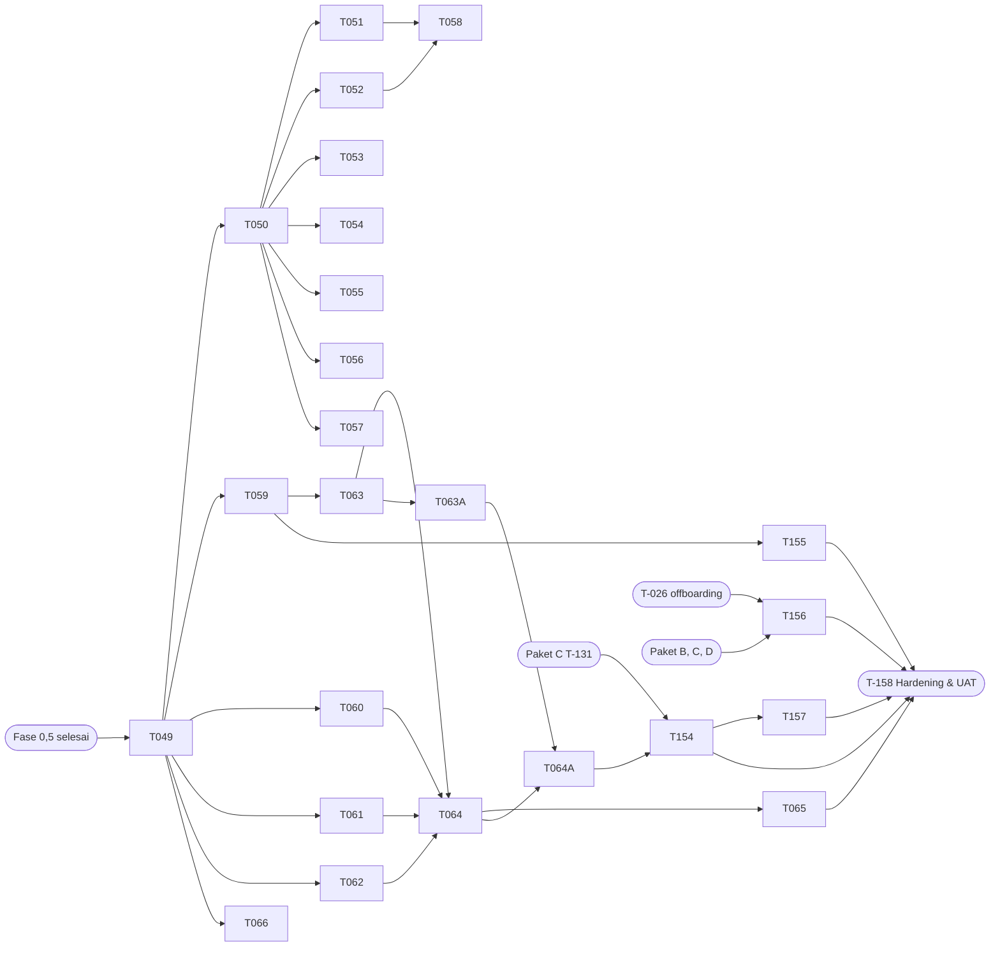

# TASKS — Paket E: SDM Lanjut & Payroll

> Paket E = **Fase HR di `TASKS.md` (T-049–T-066, sumber `13-FASE-HR.md`)** + task integrasi di file ini (T-154–T-158) + dua task pelengkap bersyarat (T-063A, T-064A). Spesifikasi tambahan: **19** (`docs/19-PAKET-E-SDM-PAYROLL.md`), **14**–**18**. Path relatif ke `backend/`.
>
> **Aturan khusus paket ini**
> - `13-FASE-HR.md` adalah sumber kebenaran HR. Sebelum T-063A/T-064A/T-154, jalankan **penyelarasan 19 §0**: butir yang sudah dicakup `13` memakai `13`; task pelengkap yang tidak perlu ditandai **Dibatalkan** di `Implementasi_Plan.md` dengan alasan.
> - Tambahkan **addendum kriteria 19 §0.1** ke T-049, T-050, T-059–T-066 di `TASKS.md` sebelum task itu dikerjakan.
> - Tidak ada dependency baru selain library PDF (OQ-109, dipakai T-058 & T-065).
> - **Nama berkas halaman & komponen frontend mengikuti konvensi repo** (kebab-case, `pages/site-settings/…` untuk pengaturan sistem; **15** §0 S-3).
> - Payroll nyata pertama hanya setelah fixture konsultan pajak lolos (BR-306, OQ-145).

| Ringkasan | Nilai |
|---|---|
| Task | T-049–T-066 (18, di `TASKS.md`) + 7 di file ini |
| Estimasi | 132 jam (Fase HR) + 55 jam (file ini) = **187 jam** (T-063A/T-064A 16 jam bisa batal bila `13` sudah mencakup) |
| Exit gate | Checklist **19** §10 + UAT-E01–E08 + payroll paralel 1 bulan (hitung sistem vs hitung manual Pakis) tanpa selisih yang tidak terjelaskan |

## Urutan & dependensi

Catatan: T-049 + T-060 boleh dimajukan (**14** §3.2). T-155 & T-156 tidak menunggu payroll dan bisa dikerjakan segera setelah T-059/T-062.

## Ringkasan Fase HR (detail di `TASKS.md`)

| ID | Task | Est | Addendum **19** §0.1 |
|---|---|---|---|
| T-049 | Fondasi modul HR | 8 | Permission E, modul `piece_work`, `onboarding`, `offboarding_clearance` |
| T-050 | Dokumen elektronik | 8 | Jenis `sim` + masa berlaku (kelayakan trip D) |
| T-051 | Riwayat status kerja | 8 | — |
| T-052 | Pendidikan & pengalaman | 5 | — |
| T-053 | Pangkat/golongan | 5 | — |
| T-054 | Diklat & penghargaan | 5 | — |
| T-055 | Sanksi | 6 | — |
| T-056 | Keluarga | 7 | — |
| T-057 | Kesehatan, psikotes, persetujuan | 8 | — |
| T-058 | Cetak CV (PDF) | 5 | Library PDF = ADR-114/OQ-109 |
| T-059 | Data administrasi | 5 | Perubahan rekening lewat T-155 |
| T-060 | Cuti & izin | 12 | Cuti sales → saran `leave_cover` (C BR-269) |
| T-061 | Lembur | 8 | Trip D sebagai bukti pendukung |
| T-062 | Kasbon | 6 | Potongan lewat `payroll_external_inputs`; tunduk batas potongan |
| T-063 | Komponen & struktur gaji | 8 | `DECIMAL(18,2)` (OQ-111); kode komponen integrasi |
| T-064 | Proses payroll, BPJS, PPh 21 | 14 | Tarik input eksternal, prorata, batas potongan, event |
| T-065 | Slip & laporan payroll | 6 | PDF ADR-114; transfer hanya rekening disetujui |
| T-066 | Penilaian kinerja | 8 | KPI otomatis di Paket G |

---

### T-063A — Pekerja harian, borongan, uang kehadiran *(bersyarat: 19 §0 S-1/S-2)*
- Paket: E | Prioritas: P1 | Estimasi: 8 jam
- Memenuhi: FR-E07, FR-E08, BR-308, BR-309, BR-310
- Dependensi: T-063, T-037 (resolver absensi)
- Konteks wajib: **19** §0, §4.4, §5 (`piece-work-*`, `attendance-allowance-rules.*`), §6, §8.2 BR-308–BR-310; `13` (status kerja harian)
- File: migrations `piece_work_rates`, `piece_work_entries`, `piece_work_entry_members`, `attendance_allowance_rules`; `app/Domain/Payroll/PieceWork/{Models/*,Actions/{SavePieceWorkRate,RecordPieceWork,ApprovePieceWork,RejectPieceWork},Sync/PieceWorkHandler,Listings/*}`; `app/Domain/Payroll/Inputs/Providers/{PieceWorkInputProvider,AttendanceAllowanceProvider}.php`; halaman kebab-case `pages/payroll/piece-work/*`, `pages/payroll/attendance-allowance-rules/*`; Flutter `features/warehouse/piece_work.dart`; tests
- Kriteria penerimaan:
  - [ ] Bagian anggota ≠ 100% → `PIECE_WORK_SHARES_INVALID`; pencatat = penyetuju → 403
  - [ ] Tarif dipilih sesuai `work_date` (perubahan tarif tengah bulan)
  - [ ] Uang kehadiran dihitung hanya dari status dalam daftar & durasi minimum
  - [ ] Disetujui → input payroll per anggota (unik per sumber)
- Verifikasi: `php artisan test --filter='PieceWork|AttendanceAllowance'`
- Di luar lingkup: pembayaran tunai mingguan (OQ-146)

### T-064A — Aturan berversi, THR, tata kelola persetujuan, event gaji *(bersyarat: 19 §0 S-3–S-5)*
- Paket: E | Prioritas: P0 | Estimasi: 8 jam
- Memenuhi: FR-E09–FR-E12, BR-120, BR-121, BR-306, BR-307, BR-311, BR-312, SEC-175
- Dependensi: T-064, T-067 (approval), T-096 (outbox & PeriodGuard)
- Konteks wajib: **19** §4.5, §6.4 (`payroll_period`), §6.6 (diagram), §8.2 BR-306, BR-307, BR-311, BR-312, §9 (`payroll.*`), §11
- File: migration `payroll_rule_versions` + ALTER tabel periode `13` (`period_type`, `approval_request_id`, `locked_at`, `paid_at`); `app/Domain/Payroll/Rules/{RuleVersionRepository,Schemas/*}.php`; `app/Domain/Payroll/Actions/{SubmitPayrollPeriod,MarkPayrollPaid,CreateThrPeriod}.php`; `Approvables/PayrollPeriodApproval`; event `payroll.period_approved`, `payroll.paid` di katalog outbox; command `payroll:thr-reminder`; halaman `pages/payroll/rules/*`; `tests/Fixtures/payroll/*.json` (dari konsultan); tests
- Kriteria penerimaan:
  - [ ] Versi aktif tidak bisa diubah; aktivasi tanpa `validated_by/on` → `PAYROLL_RULE_NOT_VALIDATED`
  - [ ] Periode memakai versi berlaku pada akhir periode (test perubahan tarif tengah tahun)
  - [ ] Penghitung = penyetuju → 403; periode `locked` tidak bisa dihitung ulang (`PAYROLL_PERIOD_LOCKED`)
  - [ ] THR sebagai periode terpisah, proporsional (fixture)
  - [ ] Event seimbang, `PeriodGuard` untuk tanggal bayar
- Verifikasi: `php artisan test --filter='PayrollRule|PayrollPeriod|Thr'`
- Di luar lingkup: e-Bupot/pelaporan pajak (Paket F, OQ-101)

### T-154 — Kontrak input payroll, insentif sales & driver, potongan piutang karyawan
- Paket: E | Prioritas: P0 | Estimasi: 9 jam
- Memenuhi: FR-E01–FR-E04, BR-118, BR-300, BR-301, BR-303
- Dependensi: T-131, T-064 (dan T-064A bila dibuat), T-102, T-152
- Konteks wajib: **19** §0.1 (T-062, T-063, T-064), §4.1, §5 (`payroll-inputs.*`, `deduction-agreements.*`), §6.4 (`employee_receivable_deduction`), §8.2 BR-300, BR-301, BR-303, §11; **17** BR-266; **18** BR-299; **16** BR-222
- File: migrations `payroll_external_inputs`, `employee_receivable_deduction_agreements`; `app/Domain/Payroll/Inputs/{Contracts/PayrollInputProvider,PayrollInputCollector,Models/PayrollExternalInput,Providers/{IncentiveInputProvider,IncentiveAdjustmentProvider,EmployeeReceivableInstallmentProvider}}.php`; `app/Domain/Payroll/Deductions/{Models/DeductionAgreement,Actions/{SubmitDeductionAgreement,ApplyInstallmentSettlement},Approvables/DeductionAgreementApproval}`; metrik driver di `app/Domain/Incentive/Metrics/{DeliveryOnTimeMetric,PodCompletenessMetric,KplAchievementMetric}.php`; hook T-064 untuk menarik input; command `payroll:collect-inputs`; halaman `pages/payroll/inputs/*`, `pages/payroll/deduction-agreements/*`; tests
- Kriteria penerimaan:
  - [ ] Insentif `locked` → satu input per pegawai/skema; dijalankan dua kali tidak dobel
  - [ ] Penyesuaian retur periode terkunci masuk periode berikutnya sebagai input terpisah
  - [ ] Piutang karyawan tanpa perjanjian aktif tidak pernah terpotong (`DEDUCTION_AGREEMENT_REQUIRED` bila dipaksa)
  - [ ] Payroll dikunci → pelunasan `payroll_deduction` tercatat di **16**
  - [ ] Metrik driver dari data D sesuai definisi BR-303 (test data sintetis)
- Verifikasi: `php artisan test --filter='PayrollInput|DeductionAgreement|DriverMetric'`
- Di luar lingkup: KPI otomatis (Paket G)

### T-155 — Onboarding, aktivasi & perubahan rekening dengan persetujuan kedua
- Paket: E | Prioritas: P0 | Estimasi: 6 jam
- Memenuhi: FR-E13–FR-E15, BR-122, BR-302, BR-313, SEC-172, SEC-173
- Dependensi: T-059, T-067
- Konteks wajib: **19** §4.2, §5 (`onboarding*`, `employee-activations.*`, `bank-account-changes.*`, `api.v1.profile.bank-account-change`), §6.4, §8.2 BR-302, BR-313, §9 (`hr.require_activation_approval`, `payroll.bank_change_cooloff_days`)
- File: migrations; `app/Domain/Employee/Onboarding/{Models/*,Actions/{BuildChecklist,CompleteItem,RequestActivation},Approvables/EmployeeActivation}`; `app/Domain/Employee/BankAccount/{Models/EmployeeBankAccountChange,Actions/{RequestBankAccountChange,ApplyBankAccountChange},Approvables/EmployeeBankAccountChangeApproval,Support/HolderNameMatcher}`; ubah T-059 agar rekening tidak bisa diedit langsung; Flutter profil → ajukan rekening; halaman `pages/hr/onboarding/*`, `pages/hr/bank-account-changes/*`; tests
- Kriteria penerimaan:
  - [ ] Pegawai baru: akun tidak bisa login & tidak masuk payroll sebelum disetujui (`EMPLOYEE_NOT_ACTIVATED`)
  - [ ] Item `required_before_activation` belum selesai → approval tidak bisa diputuskan
  - [ ] Nama pemilik rekening tidak cocok → langkah Owner; notifikasi ke nomor HP lama
  - [ ] Tidak ada route/field untuk mengubah rekening langsung (test)
- Verifikasi: `php artisan test --filter='Onboarding|EmployeeActivation|BankAccountChange'`
- Di luar lingkup: verifikasi rekening otomatis via bank (OQ)

### T-156 — Clearance offboarding lintas modul & barang yang dipegang
- Paket: E | Prioritas: P0 | Estimasi: 9 jam
- Memenuhi: FR-E16–FR-E19, BR-123, BR-314, BR-315, BR-316, SEC-174
- Dependensi: T-026, T-062, T-101, T-102, T-121, T-145, T-105, T-106, T-119
- Konteks wajib: **19** §4.3, §5 (`held-items.*`, `offboarding-clearances.*`), §6.4 (`offboarding_clearance_waiver`), §8.2 BR-314–BR-316, §9 (`offboarding.clearance_lead_days`), §11
- File: migrations; `app/Domain/Employee/Offboarding/Clearance/{ClearanceEvaluator,Checks/{CashReceiptsCheck,CashDepositsCheck,GirosCheck,EmployeeReceivablesCheck,LoansCheck,TripAllowancesCheck,CanvasCheck,VehicleAssignmentsCheck,HeldItemsCheck,PettyCashCustodianCheck,PosShiftCheck,NumberBlocksCheck,CustomerAssignmentsCheck,ApprovalRoleCheck}.php,Actions/{OpenClearance,ClearClearance,RequestWaiver},Approvables/ClearanceWaiver}`; `app/Domain/Employee/HeldItems/*`; integrasi dengan offboarding Fase 0 (membuka clearance, tidak menunda pencabutan); command `offboarding:evaluate-clearances`; halaman `pages/hr/clearances/*`, `pages/hr/held-items/*`; tests
- Kriteria penerimaan:
  - [ ] Setiap pemeriksaan (14) punya test positif/negatif
  - [ ] Akses tetap dicabut pada hari terakhir walau clearance `blocked`
  - [ ] Barang kembali `lost`/`damaged` dengan nilai → hanya menjadi potongan bila ada perjanjian (BR-301)
  - [ ] Waiver hanya lewat approval Owner
- Verifikasi: `php artisan test --filter='Clearance|HeldItem'`
- Di luar lingkup: surat keterangan kerja otomatis

### T-157 — Prorata & batas potongan
- Paket: E | Prioritas: P0 | Estimasi: 7 jam
- Memenuhi: FR-E05, FR-E06, BR-119, BR-124, BR-304, BR-305
- Dependensi: T-064, T-154
- Konteks wajib: **19** §8.2 BR-304, BR-305, §9 (`payroll.proration_basis`, `payroll.cutoff_day`, `payroll.late_joiner_next_period`); `payroll_rule_versions` (`deduction_limit`, `proration`)
- File: `app/Domain/Payroll/Calculation/{PeriodSegmenter,ProrationCalculator,DeductionLimiter}.php` + integrasi ke kalkulator T-064; tests tabel
- Kriteria penerimaan:
  - [ ] Segmentasi masuk/keluar/mutasi/perubahan gaji benar untuk basis kalender & hari kerja (≥ 12 kasus)
  - [ ] Pembulatan rupiah per komponen per segmen
  - [ ] Potongan melewati batas → urutan prioritas, sisa `deferred`, catatan di slip; pajak & iuran wajib tidak ditunda
- Verifikasi: `php artisan test --filter='Proration|DeductionLimit'`
- Di luar lingkup: —

### T-158 — Hardening, validasi konsultan & UAT Paket E
- Paket: E | Prioritas: P0 | Estimasi: 8 jam
- Memenuhi: FR-E20, BR-317, SEC-171, NFR-E01–NFR-E03, exit gate Paket E
- Dependensi: T-049–T-066, T-063A/T-064A (bila dibuat), T-154–T-157
- Konteks wajib: **19** §10, §12; `13`
- File: `app/Domain/Reporting/Labor/LaborCostReport.php` + listing + halaman; `tests/Feature/Security/PaketEIdorTest.php`, `tests/Feature/Audit/PaketEAuditTest.php`, fixture konsultan, `docs/uat/UAT-PAKET-E.xlsx`, `docs/runbooks/PAYROLL-PARALEL.md`
- Kriteria penerimaan:
  - [ ] Fixture konsultan (BPJS, PPh 21, THR, lembur) lolos; dokumen validasi ditandatangani konsultan disimpan
  - [ ] Payroll 200 orang < 60 s; hitung ulang idempoten
  - [ ] Laporan biaya tenaga kerja agregat ≥ 3 orang per sel
  - [ ] UAT-E01–E08 lulus; payroll paralel 1 bulan tanpa selisih tak terjelaskan
- Verifikasi: `php artisan test` · runbook payroll paralel
- Di luar lingkup: Paket F

---

## Ringkasan estimasi (file ini)

| Task | Jam |
|---|---|
| T-063A (bersyarat) | 8 |
| T-064A (bersyarat) | 8 |
| T-154 | 9 |
| T-155 | 6 |
| T-156 | 9 |
| T-157 | 7 |
| T-158 | 8 |
| **Total** | **55** (39 bila T-063A & T-064A batal) |
