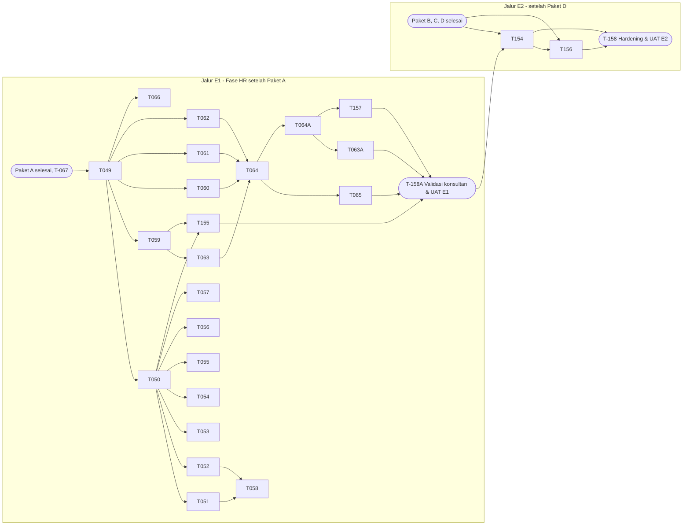

# TASKS — Paket E: SDM Lanjut & Payroll

> **Revisi 16 Nov 2026 (repo):** menerapkan PE-1–PE-11 + sisi payroll PF-1/PF-2 dari `12`.
>
> Paket E = **Fase HR di `TASKS.md` (T-049–T-066, sumber `13-FASE-HR.md`)** + task pelengkap & integrasi di file ini, dalam **dua jalur** (PE-1, keputusan Mas 16 Nov 2026):
> - **E1** — ikut Fase HR **setelah Paket A**: T-063A, T-064A (tanpa event akuntansi), T-155 (persetujuan kedua oleh Owner), T-157, T-158A (validasi konsultan pajak & UAT payroll). Payroll nyata pertama menunggu fixture konsultan (BR-306).
> - **E2** — **setelah Paket D**: T-154 (+ event `payroll.*`), T-156, T-158 (sisa hardening & UAT), dan addendum lintas modul **19** §0.2.
>
> Spesifikasi tambahan: **19** (`docs/19-PAKET-E-SDM-PAYROLL.md`), **14**–**18**. Path relatif ke `backend/`.
>
> **Aturan khusus paket ini**
> - `13-FASE-HR.md` adalah sumber kebenaran HR. Penyelarasan **19** §0 sudah dijalankan (`12` PE-3): S-1, S-2, S-3, S-5 tidak dicakup `13`, S-4 sebagian, jadi **T-063A dan T-064A wajib**. Bila `13` berubah sebelum Fase HR dimulai, cocokkan ulang dan catat di `12`.
> - Tambahkan **addendum E1 19 §0.1** ke T-013/T-024 (lewat T-155), T-049, T-050, T-059, T-061–T-066 di `TASKS.md` saat Fase HR dimulai. **Addendum E2 19 §0.2** diterapkan di task B/C/D pemiliknya (T-134, T-143, T-144) atau task E2, **bukan** di task Fase HR.
> - **Izin Paket E ditambahkan per task** yang memakainya (**19** §6.2), bukan sekaligus di T-049. Izin yang dipakai Pakis Pro masuk `MobileAccess::PERMISSIONS` + test SEC-020.
> - Setiap kode galat, kunci setting, jenis notifikasi (`notification.on_<jenis>`), dan listing ditambahkan oleh task pemiliknya ke `05` §2.3 + `ErrorCode` (+ `api_error.dart` bila dipakai API mobile), `SettingRegistry` + `08` §2, `NotificationKind`, dan `07` §3.4 + `listing_catalog.php` beserta testnya.
> - Tidak ada dependency baru selain library PDF (OQ-109, dipakai T-058 & T-065).
> - **Nama berkas halaman & komponen frontend mengikuti konvensi repo** (kebab-case; halaman SDM di `pages/employees/…`, payroll di `pages/payroll/…`, bukan `pages/hr/*`; **15** §0 S-3).
> - Payroll nyata pertama hanya setelah fixture konsultan pajak lolos (BR-306, OQ-145).

| Ringkasan | Nilai |
|---|---|
| Task | T-049–T-066 (18, di `TASKS.md`) + 8 di file ini (E1: T-063A, T-064A, T-155, T-157, T-158A · E2: T-154, T-156, T-158) |
| Estimasi | 132 jam (Fase HR) + ±3 jam addendum T-064 (**19** §0.1) + 59 jam (file ini: E1 35 + E2 24) = **±194 jam** |
| Exit gate | Checklist **19** §15 (bagian E1 di T-158A, bagian E2 di T-158) + UAT-E01–E08 per jalur + payroll paralel 1 bulan (hitung sistem vs hitung manual Pakis) tanpa selisih yang tidak terjelaskan |

## Urutan & dependensi

Catatan: T-064A dikerjakan **berurutan langsung setelah T-064** (PE-3; nomor tidak digabung karena T-064 milik `TASKS.md`). T-155 tidak menunggu payroll dan bisa dikerjakan segera setelah T-059 & T-050. Addendum E2 untuk task B/C/D (T-134, T-143, T-144) dikerjakan saat task itu, tidak menunggu T-154.

## Ringkasan Fase HR (detail di `TASKS.md`)

| ID | Task | Est | Addendum **19** §0.1 (E1) · §0.2 (E2) |
|---|---|---|---|
| T-049 | Fondasi modul HR | 8 | Modul `piece_work`, `onboarding`, `offboarding_clearance` di `hr.modules`; izin E **tidak** di sini (per task) |
| T-050 | Dokumen elektronik | 8 | Jenis `sim` + masa berlaku · E2: kelayakan trip di T-143 (D) |
| T-051 | Riwayat status kerja | 8 | — |
| T-052 | Pendidikan & pengalaman | 5 | — |
| T-053 | Pangkat/golongan | 5 | — |
| T-054 | Diklat & penghargaan | 5 | — |
| T-055 | Sanksi | 6 | — |
| T-056 | Keluarga | 7 | — |
| T-057 | Kesehatan, psikotes, persetujuan | 8 | — |
| T-058 | Cetak CV (PDF) | 5 | Library PDF = ADR-114/OQ-109 |
| T-059 | Data administrasi | 5 | Perubahan rekening lewat T-155 |
| T-060 | Cuti & izin | 12 | — · E2: saran `leave_cover` diterapkan di T-134 (C BR-269) |
| T-061 | Lembur | 8 | Upah lembur dari aturan berversi `overtime` (dihitung T-064) · E2: trip D sebagai bukti di T-144 |
| T-062 | Kasbon | 6 | Cicilan lewat `payroll_external_inputs`; batas % dari aturan berversi `deduction_limit` (diuji T-064/T-157) · E2: piutang karyawan & event pencairan di T-154 |
| T-063 | Komponen & struktur gaji | 8 | `DECIMAL(18,2)` (OQ-111 terjawab); kode komponen integrasi |
| T-064 | Proses payroll, BPJS, PPh 21 | 14 (+±3) | Tabel `payroll_rule_versions` (tarif dari aturan berversi, bukan Pengaturan), `payroll_external_inputs` (kontrak kosong), snapshot kehadiran, `payroll.process` tanpa kunci, `PAYROLL_PERIOD_LOCKED` · E2: event + `PeriodGuard` di T-154 |
| T-065 | Slip & laporan payroll | 6 | PDF ADR-114; transfer hanya rekening disetujui · E2: rekening resmi pembayar di T-154 |
| T-066 | Penilaian kinerja | 8 | KPI otomatis di Paket G |

---

## Jalur E1 — ikut Fase HR setelah Paket A

### T-063A — Pekerja harian, borongan, uang kehadiran *(E1, wajib: 19 §0 S-1/S-2)*
- Paket: E1 | Prioritas: P1 | Estimasi: 8 jam
- Memenuhi: FR-E07, FR-E08, BR-308, BR-309, BR-310
- Dependensi: T-064A (dikerjakan setelahnya; memakai `payroll_external_inputs` & snapshot kehadiran dari T-064 dan izin `payroll_rules.manage` dari T-064A), T-063, T-037 (resolver absensi)
- Konteks wajib: **19** §0, §4.4, §4.5 (`payroll_attendance_snapshots`), §5 (`piece-work-*`, `attendance-allowance-rules.*`), §6, §8.2 BR-308–BR-310, §11 (kode galat); `13` (status kerja harian); `04` (`attendance_days.status`), `08` BR-068, BR-071
- File: migrations `piece_work_rates`, `piece_work_entries`, `piece_work_entry_members`, `attendance_allowance_rules`; `app/Domain/Payroll/PieceWork/{Models/*,Actions/{SavePieceWorkRate,RecordPieceWork,ApprovePieceWork,RejectPieceWork},Listings/*}`; `app/Domain/Payroll/Inputs/Providers/{PieceWorkInputProvider,AttendanceAllowanceProvider}.php`; izin `piece_work.*` di `PermissionCatalog`/`RoleCatalog` + `06` + test matriks; kode `PIECE_WORK_SHARES_INVALID` di `05` §2.3 (sub-tabel web) + `ErrorCode`; listing `piece_work_rates`, `piece_work_entries`, `attendance_allowance_rules` di `07` §3.4 + `listing_catalog.php`; halaman kebab-case `pages/payroll/piece-work/*`, `pages/payroll/attendance-allowance-rules/*`; tests
- Catatan: input borongan dari Pakis Pro (mode gudang, item sinkron `piece_work_entry`, `Sync/PieceWorkHandler`, Flutter `features/warehouse/piece_work.dart`) butuh mesin sinkron & mode gudang **Paket C** (T-114/T-124), yang belum ada saat E1. Bagian itu **belum dijadwalkan** (dicatat untuk keputusan, lihat `12`); T-063A membangun input web saja
- Kriteria penerimaan:
  - [ ] Bagian anggota ≠ 100% → `PIECE_WORK_SHARES_INVALID`; pencatat = penyetuju → 403
  - [ ] Tarif dipilih sesuai `work_date` (perubahan tarif tengah bulan)
  - [ ] Uang kehadiran dihitung dari snapshot kehadiran periode, hanya status dalam `counted_statuses` (subset `attendance_days.status`; nilai di luar enum, mis. `field_duty`, ditolak validasi) & durasi minimum; hari tugas luar kota (`present`/`late`) ikut terhitung
  - [ ] Uang kehadiran: satu input per pegawai per periode per aturan (kunci unik PE-6); borongan disetujui → input per anggota
  - [ ] Listing lolos `ListingContractTest`; izin baru default ❌ untuk role di luar matriks
- Verifikasi: `php artisan test --filter='PieceWork|AttendanceAllowance'` · `php artisan test tests/Contract`
- Di luar lingkup: pembayaran tunai mingguan (OQ-146); input Pakis Pro (lihat Catatan)

### T-064A — Aturan berversi (kelola & aktivasi), THR, tata kelola persetujuan payroll *(E1, wajib: 19 §0 S-3–S-5)*
- Paket: E1 | Prioritas: P0 | Estimasi: 8 jam
- Memenuhi: FR-E09–FR-E11, BR-120, BR-121, BR-306, BR-307, BR-311, SEC-173 (payroll), SEC-174 (THR), SEC-175
- Dependensi: T-064 (**langsung setelahnya**, PE-3), T-067 (mesin approval)
- Konteks wajib: **19** §0.1 (T-064), §4.5, §5 (`payroll-inputs.index`, `payroll-rule-versions.*`, `thr-date-exceptions.*`), §6.2–§6.4 (`payroll_period`, `payroll.approve`), §6.6 (diagram), §7, §8.2 BR-306, BR-307, BR-311, §9 (`payroll.*`, tipe `date`), §11; `12` PE-2, PE-8
- File: ALTER tabel periode `13` (`period_type`, `approval_request_id`, `submitted_by`, `locked_at`, `paid_at`); migration `thr_date_exceptions`; halaman kelola & aktivasi versi aturan di atas `payroll_rule_versions` (tabel & resolver dari T-064) `app/Domain/Payroll/Rules/{Schemas/*,Actions/ActivateRuleVersion}.php`; `app/Domain/Payroll/Actions/{SubmitPayrollPeriod,MarkPayrollPaid,CreateThrPeriod}.php`; `Approvables/PayrollPeriodApproval` (mesin T-067, `document_type` `payroll_period`); izin `payroll.approve`, `payroll_inputs.view`, `payroll_rules.manage` + `06` + test matriks; tipe setting `date` + kunci `payroll.thr_company_date`, `payroll.thr_reminder_days`, `payroll.variance_alert_pct`, `notification.on_thr_reminder` (+ case `NotificationKind`, `08` §2); kode `PAYROLL_RULE_NOT_VALIDATED`; listing `payroll_external_inputs`, `payroll_rule_versions`, `thr_date_exceptions`; command `payroll:thr-reminder`; halaman `pages/payroll/rules/*`, `pages/payroll/inputs/*`, `pages/payroll/thr-date-exceptions/*`; `tests/Fixtures/payroll/*.json` (dari konsultan); tests
- Kriteria penerimaan:
  - [ ] Versi aktif tidak bisa diubah; aktivasi tanpa `legal_basis`/`validated_by`/`validated_on` → `PAYROLL_RULE_NOT_VALIDATED`; aktivasi butuh konfirmasi password + audit
  - [ ] Periode memakai versi berlaku pada akhir periode (test perubahan tarif tengah tahun)
  - [ ] HRD (`payroll.process`) menghitung & mengajukan; persetujuan lewat mesin approval dengan `payroll.approve` (default Owner); pengaju = penyetuju → ditolak (maker-checker); HRD tanpa `payroll.approve` tidak bisa mengunci
  - [ ] Periode terkunci **saat disetujui** + snapshot kehadiran dibekukan; periode `locked` tidak bisa dihitung ulang (`PAYROLL_PERIOD_LOCKED`)
  - [ ] THR sebagai periode terpisah, proporsional (fixture), tanggal acuan dari `payroll.thr_company_date` dengan pengecualian per pegawai; skema & form tidak punya kolom/isian agama atau label hari raya (test, SEC-012)
  - [ ] Tidak ada event akuntansi dipancarkan (E2); tandai dibayar oleh `payroll.process` (default sementara E1)
- Verifikasi: `php artisan test --filter='PayrollRule|PayrollPeriod|Thr'` · `php artisan test tests/Contract`
- Di luar lingkup: event `payroll.*` & `PeriodGuard` (T-154, E2); e-Bupot/pelaporan pajak (Paket F, OQ-101)

### T-155 — Onboarding, aktivasi & perubahan rekening dengan persetujuan kedua *(E1)*
- Paket: E1 | Prioritas: P0 | Estimasi: 7 jam
- Memenuhi: FR-E13–FR-E15, BR-122, BR-302, BR-313 (bagian E1), SEC-172, SEC-173
- Dependensi: T-059, T-050, T-067 (mesin approval), T-024/T-013/T-020 (addendum di task ini), T-029 (notifikasi), T-031 (token mobile)
- Konteks wajib: **19** §4.2 (termasuk addendum T-024/T-013), §5 (`onboarding*`, `employee-activations.*`, `bank-account-changes.*`, `api.v1.me.bank-account`), §6.2–§6.4, §8.2 BR-302, BR-313, §9 (`hr.require_activation_approval`, `hr.bank_change_after_contact_change_days`, `payroll.bank_change_cooloff_days`, `notification.on_employee_activated`, `notification.on_bank_account_changed`), §11 (kode galat); `08` BR-010; `09` SEC-001, SEC-020; `12` PE-5, PE-11
- File: migrations `onboarding_templates`, `employee_activation_requests`, `onboarding_checklists`, `employee_bank_account_changes` (unik hanya `pending`/`open` lewat kolom generated); `app/Domain/Employee/Onboarding/{Models/*,Actions/{BuildChecklist,CompleteItem,RequestActivation},Approvables/EmployeeActivation}`; perubahan `CreateEmployee` (T-024) & aktivasi akun (`ToggleUser`, T-013/T-020) sesuai **19** §4.2 **tanpa** mengubah skema `employees`/`users`; `app/Domain/Employee/BankAccount/{Models/EmployeeBankAccountChange,Actions/{RequestBankAccountChange,ApplyBankAccountChange},Approvables/EmployeeBankAccountChangeApproval,Support/HolderNameMatcher}`; ubah T-059 agar rekening tidak bisa diedit langsung; route API `api.v1.me.bank-account` + `employees.bank_account.request` di `MobileAccess::PERMISSIONS`; izin T-155 (§6.2) + `06` + test matriks; kunci setting & `NotificationKind`; kode `EMPLOYEE_NOT_ACTIVATED` (sub-tabel web), `BANK_ACCOUNT_CHANGE_PENDING` (tabel utama + `mobile-pro/lib/core/api/api_error.dart`, koordinasi sesi mobile); listing `onboarding_checklists`, `employee_activations`, `bank_account_changes`; Flutter profil → ajukan rekening; halaman `pages/employees/onboarding/*`, `pages/employees/bank-account-changes/*`; tests
- Kriteria penerimaan:
  - [ ] Pegawai baru dibuat lewat alur Fase 0 dengan `employees.status = active`; tidak ada status pegawai baru dan CHECK `employees_inactive_chk` utuh (test skema)
  - [ ] Sebelum disetujui: akun nonaktif, tidak masuk payroll; mengaktifkan akun → `EMPLOYEE_NOT_ACTIVATED`; login tetap `INVALID_CREDENTIALS` yang sama (SEC-001)
  - [ ] Disetujui (Owner, ≠ pengaju) → akun aktif + `payroll_eligible_from` dalam satu transaksi; ditolak → pengajuan ulang bisa (unik hanya `pending`)
  - [ ] Item `required_before_activation` belum selesai → approval tidak bisa diputuskan
  - [ ] Nama pemilik rekening tidak cocok → langkah Owner; pengajuan rekening ditolak bila HP/email akun berubah dalam `hr.bank_change_after_contact_change_days` hari (termasuk lewat `PUT /api/v1/me`); pemberitahuan ke kontak yang tercatat sebelum pengajuan lewat kanal `notification.on_bank_account_changed`
  - [ ] Tidak ada route/field untuk mengubah rekening langsung (test); `api.v1.me.bank-account` hanya untuk diri sendiri; token tanpa ability → 403 (SEC-020); route baru masuk test IDOR
- Verifikasi: `php artisan test --filter='Onboarding|EmployeeActivation|BankAccountChange'` · `php artisan test tests/Contract` · `fvm flutter test` (bagian profil)
- Di luar lingkup: verifikasi rekening otomatis via bank (OQ); item onboarding kendaraan & barang dipegang (T-156, E2)

### T-157 — Prorata & batas potongan *(E1)*
- Paket: E1 | Prioritas: P0 | Estimasi: 7 jam
- Memenuhi: FR-E05, FR-E06, BR-119, BR-124, BR-304, BR-305
- Dependensi: T-064, T-064A (aturan berversi `deduction_limit`, `proration`), T-062 (cicilan kasbon)
- Konteks wajib: **19** §0.1 (T-062, T-064), §4.1 (`included_amount`, kunci unik PE-6), §6.5, §8.2 BR-304, BR-305, §9 (`payroll.proration_basis`, `payroll.cutoff_day`, `payroll.late_joiner_next_period`); `payroll_rule_versions` (`deduction_limit`, `proration`)
- File: `app/Domain/Payroll/Calculation/{PeriodSegmenter,ProrationCalculator,DeductionLimiter}.php` + integrasi ke kalkulator T-064; kunci setting T-157 (`SettingRegistry` + `08` §2); tests tabel
- Kriteria penerimaan:
  - [ ] Segmentasi masuk/keluar/mutasi/perubahan gaji benar untuk basis kalender & hari kerja (≥ 12 kasus)
  - [ ] Pembulatan rupiah per komponen per segmen
  - [ ] Potongan melewati batas → urutan prioritas; baris terpotong sebagian `included` dengan `included_amount`, sisanya tidak dipindah sebagai baris baru (cicilan periode berikut dihitung dari sisa, jadwal memanjang); catatan di slip; pajak & iuran wajib tidak ditunda
  - [ ] Batas % kasbon dibaca dari aturan berversi `deduction_limit`, bukan setting (kriteria batas T-062, PE-3)
- Verifikasi: `php artisan test --filter='Proration|DeductionLimit'`
- Di luar lingkup: cicilan piutang karyawan (T-154, E2; memakai `DeductionLimiter` yang sama)

### T-158A — Validasi konsultan pajak, hardening & UAT payroll E1 *(E1; bagian E1 dari T-158, pola sufiks seperti T-036A)*
- Paket: E1 | Prioritas: P0 | Estimasi: 5 jam
- Memenuhi: SEC-171, SEC-173, NFR-E01–NFR-E03, exit gate **E1** (**19** §15 bagian E1)
- Dependensi: T-049–T-066, T-063A, T-064A, T-155, T-157
- Konteks wajib: **19** §0, §10, §12, §15; `13`; `12` PE-1
- File: `tests/Feature/Security/PaketE1IdorTest.php`, `tests/Feature/Audit/PaketE1AuditTest.php`, fixture konsultan `tests/Fixtures/payroll/*`, `docs/uat/UAT-PAKET-E.xlsx` (lembar E1), `docs/runbooks/PAYROLL-PARALEL.md`
- Kriteria penerimaan:
  - [ ] Fixture konsultan (BPJS, PPh 21, THR, lembur) lolos; dokumen validasi ditandatangani konsultan disimpan. **Payroll nyata pertama tidak dijalankan sebelum ini** (BR-306, OQ-145)
  - [ ] Payroll 200 orang < 60 s; hitung ulang idempoten
  - [ ] Semua route E1 masuk test IDOR; aksi E1 tercatat audit
  - [ ] Checklist **19** §15 bagian E1 tercentang; UAT E1 (E01, E02/E03/E05 bagian E1, E07, E08) lulus; payroll paralel 1 bulan tanpa selisih tak terjelaskan
- Verifikasi: `php artisan test` · runbook payroll paralel
- Di luar lingkup: bagian E2 (T-158)

---

## Jalur E2 — setelah Paket D

### T-154 — Input payroll lintas modul, insentif sales & driver, potongan piutang karyawan, event gaji *(E2)*
- Paket: E2 | Prioritas: P0 | Estimasi: 11 jam
- Memenuhi: FR-E01–FR-E04, FR-E12, BR-118, BR-300, BR-301, BR-303, BR-312
- Dependensi: T-158A (E1 selesai), T-064, T-064A, T-157, T-131 (C), T-096 (outbox & `PeriodGuard`), T-102 (piutang karyawan), T-152 (data skor driver D)
- Konteks wajib: **19** §0.2 (T-062, T-064, T-065, §6.3), §4.1, §4.5 (ALTER periode & kasbon), §5 (`deduction-agreements.*`), §6.3–§6.4 (`employee_receivable_deduction`, `payroll_period`), §8.2 BR-300, BR-301, BR-303, BR-312, §9 (`payroll.owner_approval_threshold`), §11; **17** BR-266 (`incentive_results.final_amount`, `sent_to_payroll`), §4 (`incentive_schemes.metric`); **18** BR-299; **16** BR-222, BR-229, §11.2; **20** §4.2.1, BR-344; **14** §7
- File: migration `employee_receivable_deduction_agreements`; ALTER periode `13` (`paid_from_bank_account_id`) & tabel kasbon `13` (pencairan); ALTER ENUM `incentive_schemes.metric` (**17**); `app/Domain/Payroll/Inputs/{Contracts/PayrollInputProvider,PayrollInputCollector,Providers/{IncentiveInputProvider,EmployeeReceivableInstallmentProvider}}.php` (kontrak & model input sudah ada dari T-064); `app/Domain/Payroll/Deductions/{Models/DeductionAgreement,Actions/{SubmitDeductionAgreement,ApplyInstallmentSettlement},Approvables/DeductionAgreementApproval}`; metrik driver di `app/Domain/Incentive/Metrics/{DeliveryOnTimeMetric,PodCompletenessMetric,KplAchievementMetric}.php`; event `payroll.period_approved`, `payroll.paid`, `payroll.loan_disbursed` di katalog outbox; `PeriodGuard` pada tanggal bayar & pencairan; migrasi data idempoten sel matriks FIN/KTK/ARM/AUD (PA-11) termasuk `payroll.approve` untuk Finance; izin `deduction_agreements.*`; kode `DEDUCTION_AGREEMENT_REQUIRED`; listing `deduction_agreements`; command `payroll:collect-inputs`; halaman `pages/payroll/deduction-agreements/*`; tests
- Kriteria penerimaan:
  - [ ] Insentif `locked` → satu input per pegawai/skema sebesar `final_amount` dan status hasil insentif `sent_to_payroll` dalam transaksi yang sama; dijalankan dua kali tidak dobel; tidak ada input penyesuaian terpisah (PE-7)
  - [ ] Piutang karyawan tanpa perjanjian aktif tidak pernah terpotong (`DEDUCTION_AGREEMENT_REQUIRED` bila dipaksa); cicilan per periode unik per pegawai × periode (PE-6)
  - [ ] Periode dikunci → pelunasan `payroll_deduction` tercatat di **16** tanpa event `cash.employee_receivable_settled`
  - [ ] `payroll.period_approved` agregat per lokasi × komponen tanpa `employee_id` (PF-2); `payroll.paid` membawa `bank_account_id` (PF-1); `payroll.loan_disbursed` D `employee_loan_receivable` · K `bank`/`cash_head_office`; semua seimbang (test kontrak outbox); tanggal bayar di periode terkunci → `PERIOD_LOCKED`
  - [ ] Rantai `payroll_period` setelah E2: Finance, + Owner ≥ `payroll.owner_approval_threshold`
  - [ ] Metrik driver dari data D sesuai definisi BR-303 (test data sintetis)
- Verifikasi: `php artisan test --filter='PayrollInput|DeductionAgreement|DriverMetric|PayrollEvent'` · `php artisan test tests/Contract`
- Di luar lingkup: KPI otomatis (Paket G); perlakuan periode/kasbon E1 tanpa event (belum diputuskan, `12`)

### T-156 — Clearance offboarding lintas modul & barang yang dipegang *(E2)*
- Paket: E2 | Prioritas: P0 | Estimasi: 9 jam
- Memenuhi: FR-E16–FR-E19, BR-123, BR-313 (bagian E2), BR-314, BR-315, BR-316, SEC-174
- Dependensi: T-154, T-026, T-062, T-101, T-102, T-121, T-145, T-105, T-106, T-119, T-155
- Konteks wajib: **19** §0.2 (T-026, T-155), §4.3, §5 (`held-items.*`, `offboarding-clearances.*`), §6.4 (`offboarding_clearance_waiver`), §8.2 BR-313–BR-316, §9 (`offboarding.clearance_lead_days`, `notification.on_clearance_due`), §11; `08` BR-053; `12` PE-4
- File: migrations `employee_held_items`, `offboarding_clearances` (`exit_date`, `exit_reason_id`, unik hanya clearance terbuka); `app/Domain/Employee/Offboarding/Clearance/{ClearanceEvaluator,Checks/{CashReceiptsCheck,CashDepositsCheck,GirosCheck,EmployeeReceivablesCheck,LoansCheck,TripAllowancesCheck,CanvasCheck,VehicleAssignmentsCheck,HeldItemsCheck,PettyCashCustodianCheck,PosShiftCheck,NumberBlocksCheck,CustomerAssignmentsCheck,ApprovalRoleCheck}.php,Actions/{OpenClearance,ClearClearance,RequestWaiver},Approvables/ClearanceWaiver}`; `app/Domain/Employee/HeldItems/*`; addendum T-026: offboarding menolak pegawai dengan clearance terbuka (`CLEARANCE_WAIVER_REQUIRED`), aturan tanggal BR-053 tidak berubah; item onboarding kendaraan/barang (BR-313 E2); izin T-156 (§6.2); kunci setting & `NotificationKind`; listing `held_items`, `offboarding_clearances`; command `offboarding:evaluate-clearances`; halaman `pages/employees/clearances/*`, `pages/employees/held-items/*`; tests
- Kriteria penerimaan:
  - [ ] Setiap pemeriksaan (14) punya test positif/negatif
  - [ ] HRD membuka clearance dengan rencana `exit_date` & `exit_reason_id` (nilai awal form T-026); tidak ada offboarding terjadwal; T-026 tetap menolak tanggal keluar > hari ini
  - [ ] Offboarding dengan clearance `open`/`blocked` → `CLEARANCE_WAIVER_REQUIRED`; setelah `cleared`/`cleared_with_settlement`/waiver → offboarding berjalan dan akses dicabut seperti Fase 0; nonaktifkan akun mendesak (T-020) tetap bisa tanpa menunggu clearance
  - [ ] Barang kembali `lost`/`damaged` dengan nilai → hanya menjadi potongan bila ada perjanjian (BR-301)
  - [ ] Waiver hanya lewat approval Owner; route baru masuk test IDOR
- Verifikasi: `php artisan test --filter='Clearance|HeldItem|Offboard'`
- Di luar lingkup: surat keterangan kerja otomatis

### T-158 — Hardening & UAT Paket E2 *(E2; sisa T-158 setelah T-158A)*
- Paket: E2 | Prioritas: P0 | Estimasi: 4 jam
- Memenuhi: FR-E20, BR-317, SEC-171 (laporan & event), exit gate **E2** (**19** §15 bagian E2)
- Dependensi: T-158A, T-154, T-156, addendum **19** §0.2 di T-134, T-143, T-144
- Konteks wajib: **19** §0.2, §10, §12, §15; `13`
- File: `app/Domain/Reporting/Labor/LaborCostReport.php` + listing `labor_cost_report` + halaman; izin `labor_reports.view`; kunci `payroll.labor_report_min_cell_size`; `tests/Feature/Security/PaketEIdorTest.php`, `tests/Feature/Audit/PaketEAuditTest.php` (route E2), `docs/uat/UAT-PAKET-E.xlsx` (lembar E2)
- Kriteria penerimaan:
  - [ ] Laporan biaya tenaga kerja agregat ≥ `payroll.labor_report_min_cell_size` orang per sel; angka per pegawai tidak tampil
  - [ ] Addendum §0.2 terverifikasi di task pemiliknya
  - [ ] Checklist **19** §15 bagian E2 tercentang; UAT E2 (E02/E03/E05 bagian E2, E04, E06) lulus
- Verifikasi: `php artisan test`
- Di luar lingkup: Paket F

---

## Ringkasan estimasi (file ini)

| Task | Jalur | Jam |
|---|---|---|
| T-063A | E1 | 8 |
| T-064A | E1 | 8 |
| T-155 | E1 | 7 |
| T-157 | E1 | 7 |
| T-158A | E1 | 5 |
| **Subtotal E1** | | **35** |
| T-154 | E2 | 11 |
| T-156 | E2 | 9 |
| T-158 | E2 | 4 |
| **Subtotal E2** | | **24** |
| **Total** | | **59** (+±3 jam addendum T-064 di `TASKS.md`) |

Perubahan dari versi sebelumnya (55 jam): T-063A/T-064A tidak lagi "bisa batal" (PE-3); event gaji pindah dari T-064A ke T-154 (+2); T-155 +1 (addendum T-024/T-013, API `me`, masa tunggu kontak); T-158 dipecah menjadi T-158A (E1, 5) + T-158 (E2, 4), +1 karena dua kali UAT.
