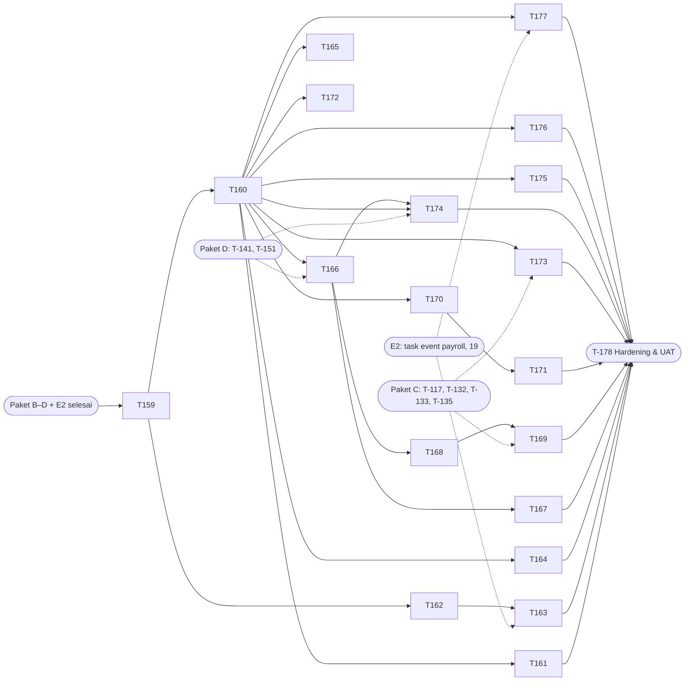

# TASKS — Paket F: Keuangan & Prinsipal (T-159–T-178)

> Revisi 16 Nov 2026 (repo): menerapkan PD-1, PF-1–PF-3 (sisi D/F), PF-5, PF-10–PF-12 dari `12`.
>
> Siap eksekusi setelah exit gate Paket B–D **dan E2** (**19**, keputusan PE-1: E2 = event payroll, setelah D; PF-10) dan checklist `docs/20-PAKET-F-KEUANGAN-PRINSIPAL.md` §0. Task yang bergantung pada C/D/E2 menulis dependensinya sendiri. Spesifikasi: **20**, **19**, **18**, **17**, **16**, **15**, **14**. Path backend relatif ke `backend/`.
>
> **Aturan khusus:** dependency baru yang dibutuhkan — library PDF (**menunggu OQ-109**), pembuat QR (**menunggu OQ-160f**), k6 uji beban (**ikut PA-4, menunggu**) — tidak boleh dipilih agent; selama belum diputuskan, fitur PDF/QR berhenti di kontrak + `fake` dan dicatat blocker. Yang sudah ada: aritmetika `brick/math` (langsung sejak A), ekspor OpenSpout lewat kerangka ekspor Fase 0. Domain baru: `app/Domain/{Accounting (diperluas dari outbox A), Tax, Asset, Principal, Consignment}`; `Pos` & `Purchasing` diperluas. Hanya `GeneralLedger` yang menulis jurnal; hanya `PayableLedger` yang menulis alokasi hutang; hanya `LoyaltyLedger` yang menulis poin. Kunci enkripsi baru (`TAX_ID_ENCRYPTION_KEY`, `TAX_ID_HASH_KEY`, `MEMBER_PHONE_ENCRYPTION_KEY`, `MEMBER_PHONE_HASH_KEY`) ditambahkan ke `.env.example` tanpa nilai. **Format file pajak & mutasi bank tidak boleh dikarang**: test memakai fixture contoh resmi/anonim yang disediakan Pakis; bila belum ada, task berhenti di adapter + `fake` dan dicatat blocker.
> - **Role & izin** ditambahkan ke `app/Domain/Access/Support/{PermissionCatalog,RoleCatalog}.php` sebagai allowlist eksplisit per role (PA-11), bukan seeder role paket; + migrasi data idempoten penambah sel Paket F ke role bawaan.
> - **Event & periode:** F hanya **mengonsumsi** payload D/E2 (kualifier `bank_account_id`, `refs.supplier_id`, agregat payroll sudah ada sejak paket pemancar, PF-1/PF-2). Action F pemancar event memanggil `PeriodGuard` (**16** T-096); `PeriodGuardArchTest` diperluas ke domain F (PF-3). Kasus tanpa event (PF-5) di **20** §11.2 diuji per kasus.
> - **Ekspor** (pajak, jurnal, laporan, file transfer) lewat kerangka ekspor Fase 0 (`ExportableListing` + `config/pakis.php` `exports` + `StartExport`, `export_files`, `FormulaEscaper`); tidak ada penulis berkas sendiri; `exports.mass` tidak dipakai (PA-3).
> - **Kode galat:** setiap task menambah kodenya ke `05` §2.3 + enum `ErrorCode`; kode khusus web di sub-tabel "khusus web" (PA-17); kode yang artinya sama memakai kode yang ada; `PERIOD_LOCKED` = 422 (PF-11).
> - **Setting:** angka bisnis = kunci setting (**20** §9); tipe ikut PA-19, tipe tambahan (`date`, `string[]`, teks berversi) dibuat di T-159.
> - **Nama berkas halaman & komponen frontend mengikuti konvensi repo** (kebab-case huruf kecil); path PascalCase di task ini indikatif (**15** §0 S-3).

| Ringkasan | Nilai |
|---|---|
| Task | 20 (T-159–T-178) |
| Estimasi | 184 jam (rentang 157–237; +2 jam revisi 16 Nov: tipe setting & arch test `PeriodGuard` di T-159, listing tambahan) |
| Exit gate | Backfill `failed = 0`, neraca seimbang tiap bulan, sub-buku = GL, checklist **20** §10.3, UAT-F01–F16, uji tutup buku 1 bulan nyata |

## Urutan & dependensi

T-173 (konsinyasi), T-175 (saran pembelian), dan T-176 (member) tidak bergantung pada buku besar untuk fungsinya, tetapi event barunya baru terposting setelah T-160; boleh dikerjakan paralel bila tim lebih dari satu.

---

### T-159 — Bagan akun, pemetaan peran akun, periode, role & permission Paket F
- Paket: F | Prioritas: P0 | Estimasi: 9 jam
- Memenuhi: FR-F01, FR-F02, BR-320, BR-321, ADR-124
- Dependensi: T-096 (outbox & lock date B), T-067 (tipe setting PA-19); exit gate Paket D + E2 (payload `bank_account_id`/`refs.supplier_id`/agregat payroll sudah ada)
- Konteks wajib: **20** §0, §4.1, §4.2 (+ §4.2.1), §5.1 (`accounts.*`, `account-mappings.*`), §6.1–§6.4, §8.2 BR-320–BR-321, §9 (`accounting.*`, catatan tipe); **14** §7, §8; **18** §11.2; `12` PA-11, PA-17, PA-19
- File: migrations (`chart_of_accounts`, `account_mappings`, `fiscal_periods`, `fiscal_period_checks`, ALTER `bank_accounts`); `app/Domain/Accounting/{AccountRoleCatalog,Models/{ChartOfAccount,AccountMapping,FiscalPeriod},Actions/{CreateAccount,UpdateAccount,DeactivateAccount,SaveAccountMapping},Services/AccountResolver}`; `database/seeders/ChartOfAccountsTemplateSeeder`; `app/Domain/Access/Support/{PermissionCatalog,RoleCatalog}.php` (role `akuntan`, 49 permission, matriks §6.4 sebagai allowlist eksplisit, PA-11) + migrasi data idempoten penambah sel Paket F; `SettingRegistry`/`SettingType` (tipe `date`, `string[]`, teks berversi + `08` §2 + test registri); sequence §4.1 (pola **14** §8); perluasan `tests/Arch/PeriodGuardArchTest.php` ke domain F; pages `accounting/accounts/index.tsx`, `accounting/account-mappings/index.tsx`; tests `AccountRoleCatalogTest`, `AccountResolverTest`, `PaketFMatrixTest`
- Deskripsi: CoA bertingkat + template contoh yang mencakup seluruh peran §4.2.1; pemetaan per peran & kualifier berlaku sejak tanggal; resolver BR-321; pembuatan periode 12 bulan dari `accounting.fiscal_year_start_month`.
- Kriteria penerimaan:
  - [ ] Test meng-iterasi seluruh event **14** §7 (fixture payload per event) dan gagal bila ada peran yang tidak ada di `AccountRoleCatalog`
  - [ ] Ubah tipe/induk akun berjurnal → `ACCOUNT_HAS_ENTRIES`; akun terpetakan tidak bisa dinonaktifkan
  - [ ] Pemetaan ke tipe akun yang tidak diizinkan peran ditolak
  - [ ] Peran `bank` tanpa kualifier rekening ditolak; `bank_accounts.gl_account_id` terisi dari pemetaan
  - [ ] Resolver: kualifier persis > default > `ACCOUNT_ROLE_UNMAPPED`; `effective_from` dihormati
  - [ ] `PaketFMatrixTest` hijau (matriks = `RoleCatalog`); test "izin baru default ❌ selain `owner`/`super_admin`" (PA-11) hijau. Sel PF-8 mengikuti OQ-160d bila sudah dijawab, selain itu matriks §6.4 apa adanya
  - [ ] Katalog peran memuat `fleet_card_clearing`; `inventory` tanpa kualifier (`stock_location_type` tidak ada di ENUM)
  - [ ] Hierarki akun dibatasi `accounting.coa_max_depth`; tipe setting baru lulus test registri
  - [ ] `PeriodGuardArchTest` mencakup `Purchasing` hutang, `Principal`, `Asset`, `Consignment`, `Tax`
- Verifikasi: `php artisan test --filter='AccountRole|AccountResolver|ChartOfAccount|PaketFMatrix|SettingRegistry|PeriodGuard'`
- Di luar lingkup: posting (T-160)

### T-160 — Mesin posting, buku besar, saldo awal GL & backfill
- Paket: F | Prioritas: P0 | Estimasi: 14 jam
- Memenuhi: FR-F03, FR-F04, BR-322, BR-323, BR-113, ADR-123, ADR-125, SEC-176, NFR-F01, NFR-F07
- Dependensi: T-159
- Konteks wajib: **20** §4.2 (`journal_entries`, `journal_lines`, `account_period_balances`, trigger), §6.7, §8.2 BR-322–BR-323, §11.1–§11.2; **15** §4.8 (`accounting_events`); **16** §11.2
- File: migrations + trigger append-only; `app/Domain/Accounting/{GeneralLedger,EventPoster,PayloadValidator,Models/{JournalEntry,JournalLine,AccountPeriodBalance},Jobs/{PostPendingEvents,BackfillMonth},Actions/{ImportOpeningTrialBalance,RetryFailedEvents},Console/{PostEvents,Backfill,RebuildBalances}}`; pages `accounting/events/index.tsx`, `accounting/journals/index.tsx`, `accounting/journals/show.tsx`, `accounting/ledger/show.tsx`; tests `EventPosterTest`, `GeneralLedgerImmutabilityTest`, `BackfillTest`, `BalanceConsistencyTest`
- Deskripsi: posting per event dalam transaksi (FOR UPDATE SKIP LOCKED), dimensi dari `refs`, ringkasan saldo; impor saldo awal GL (mengecualikan akun yang sudah dibentuk event opening A/B); backfill berantai per bulan dengan laporan.
- Kriteria penerimaan:
  - [ ] Satu event → satu jurnal; menjalankan job dua kali/paralel 2 worker tidak menggandakan (`je_event_unique`)
  - [ ] Payload tidak seimbang / peran tak dikenal → `failed` + `error`; job lanjut ke event lain
  - [ ] `expense:{kode}` terurai ke peran `expense` + kualifier kategori
  - [ ] Event `lines: []` → `skipped`; event revision 2 → jurnal kebalikan dari payload-nya
  - [ ] Trigger menolak UPDATE/DELETE `journal_lines` dan UPDATE kolom selain yang diizinkan
  - [ ] `account_period_balances` = agregasi `journal_lines` setelah 10.000 posting (`accounting:rebuild-balances` menghasilkan nilai identik)
  - [ ] Backfill data sintetis 12 bulan: `failed = 0`, neraca saldo seimbang tiap bulan, saldo piutang/stok GL = sub-buku — tanpa menyunting event lama (fixture D/E2 sudah membawa `bank_account_id` & `refs.supplier_id`)
  - [ ] Perlakuan event bertanggal di periode yang sudah ditutup saat backfill mengikuti OQ-160a; sebelum dijawab, backfill hanya di staging
  - [ ] Arch test: hanya `GeneralLedger` menulis tabel jurnal
- Verifikasi: `php artisan test --filter='EventPoster|GeneralLedger|Backfill|BalanceConsistency'`
- Di luar lingkup: jurnal manual (T-161)

### T-161 — Jurnal manual & pembalik, periode akuntansi & tutup buku
- Paket: F | Prioritas: P0 | Estimasi: 8 jam
- Memenuhi: FR-F05, FR-F06, FR-F30, BR-324, BR-325, ADR-115, SEC-177
- Dependensi: T-160, T-067 (approval)
- Konteks wajib: **20** §4.2, §5.1 (`journals.*`, `fiscal-periods.*`), §6.5 (`manual_journal`, `journal_reversal`), §6.6, §6.7 (diagram tutup), §8.2 BR-324–BR-325, §10.2 SEC-176–SEC-177
- File: `app/Domain/Accounting/{Actions/{CreateManualJournal,SubmitManualJournal,ReverseJournal,StartPeriodClosing,ClosePeriod,ReopenPeriod,WaivePeriodCheck},Services/{FiscalPeriodService,PeriodCloseChecklist},Checks/*}` (satu kelas per `check_code`); `journal_entry_attachments`; pages `accounting/journals/create.tsx`, `accounting/periods/index.tsx`, `accounting/periods/show.tsx`; tests
- Kriteria penerimaan:
  - [ ] Jurnal tidak seimbang / akun tidak postable / akun sub-buku (selain `adjustment` + Owner) ditolak dengan kode galat §11.3 (daftar peran terlarang & langkah Owner final mengikuti OQ-160b)
  - [ ] Pembuat tidak bisa menyetujui; lampiran wajib di atas ambang; ukuran lampiran ≤ `accounting.attachment_max_kb` (validator `app/Support/Upload/`)
  - [ ] Pembalikan jurnal `auto` → `JOURNAL_AUTO_NOT_REVERSIBLE`; pembalik manual mengisi `reversed_by_entry_id`
  - [ ] Checklist menjalankan semua `check_code` BR-325; `fail` mencegah tutup sampai di-waive Owner (`suspense_zero` mengikuti OQ-160c)
  - [ ] Tutup → `accounting.lock_date` = `end_date`; faktur/pembayaran B bertanggal periode itu ditolak `PERIOD_LOCKED` (422). Nasib route B `admin.accounting.lock-date`, migrasi `lock_date` → `fiscal_periods`, dan tutup berurutan mengikuti OQ-160a
  - [ ] Buka kembali hanya Owner + password + alasan; `security_events` + notifikasi; periode sesudahnya ikut terbuka
  - [ ] Tutup periode 12 membentuk jurnal `closing` ke `retained_earnings`
- Verifikasi: `php artisan test --filter='ManualJournal|FiscalPeriod|PeriodClose'`
- Di luar lingkup: laporan (T-164)

### T-162 — Rekening bank & impor mutasi
- Paket: F | Prioritas: P1 | Estimasi: 8 jam
- Memenuhi: FR-F07, BR-326, SEC-181
- Dependensi: T-159
- Konteks wajib: **20** §4.1 (ALTER `bank_accounts`), §4.3, §5.1 (`bank-statements.*`), §8.2 BR-326; OQ-103, OQ-160
- File: migrations (`bank_statements`, `bank_statement_lines`); `app/Domain/Accounting/Bank/{Contracts/BankStatementParser,Parsers/{GenericCsvParser,FakeParser},Actions/ImportBankStatement}`; fixture `tests/Fixtures/bank/` (file anonim dari Pakis); pages `bank/statements/index.tsx`, `bank/statements/create.tsx`; tests
- Kriteria penerimaan:
  - [ ] Impor file yang sama → ditolak (hash file); periode tumpang tindih → baris berhash sama dilewati
  - [ ] Σ mutasi ≠ selisih saldo → `STATEMENT_TOTAL_MISMATCH`
  - [ ] Sel diawali `=`/`+`/`-`/`@` diperlakukan teks; file > `bank.statement_max_file_kb` / > `bank.statement_max_rows` baris ditolak (validator `app/Support/Upload/`, PA-22)
  - [ ] Parser per bank hanya dibuat untuk format yang fixture-nya tersedia; selain itu `GenericCsvParser` dengan pemetaan kolom tersimpan
- Verifikasi: `php artisan test --filter='BankStatement'`
- Di luar lingkup: pencocokan (T-163)

### T-163 — Rekonsiliasi bank
- Paket: F | Prioritas: P1 | Estimasi: 8 jam
- Memenuhi: FR-F08, FR-F29, BR-327
- Dependensi: T-162, T-160; task E2 event payroll (**19**, `payroll.paid` untuk pencocokan gaji)
- Konteks wajib: **20** §4.3 (`bank_reconciliation_matches`), §5.1 (`bank-reconciliation.*`), §7.1 (dua panel), §8.2 BR-327, §13 OQ-160c; **16** (`payments`, `cash_deposits`, `giros`, `unidentified_payments`, `petty_cash_replenishments`), **19** (`payroll.paid`)
- File: `app/Domain/Accounting/Bank/{Matching/{RuleR1Reference,RuleR2AmountDate,RuleR3Combination},Actions/{AutoMatch,ManualMatch,Unmatch,IgnoreLine,RecordBankFee,CompleteReconciliation}}`; page `bank/reconciliation/show.tsx`; tests
- Kriteria penerimaan:
  - [ ] R1–R3 berurutan (R3 dibatasi `bank.match_combination_max_docs`); > 1 kandidat → `suggested`, tidak dicocokkan otomatis
  - [ ] Pelaku `ignore`/`fee` dan perlakuan dana tak dikenal saat `complete` mengikuti OQ-160c (sebelum dijawab: perilaku BR-327 apa adanya)
  - [ ] Satu dokumen hanya cocok ke satu baris aktif (unik DB); Σ cocok ≤ |amount|
  - [ ] Biaya/bunga ≤ `bank.fee_auto_limit` → jurnal `bank.fee_recorded`; di atasnya diarahkan ke jurnal manual
  - [ ] Dana masuk tak dikenal → `unidentified_payments` (**16**), bukan jurnal
  - [ ] Selesai hanya bila semua baris `matched`/`ignored` dan saldo buku = `closing_balance`
  - [ ] Data uji UAT-F03: ≥ 80% baris cocok otomatis
- Verifikasi: `php artisan test --filter='BankReconciliation'`
- Di luar lingkup: file transfer keluar (T-167)

### T-164 — Laporan keuangan: neraca saldo, neraca, laba rugi, arus kas
- Paket: F | Prioritas: P0 | Estimasi: 12 jam
- Memenuhi: FR-F09, BR-328, SEC-187, NFR-F02
- Dependensi: T-160
- Konteks wajib: **20** §4.2 (`account_period_balances`), §5.1 (`financial-reports.*`), §7.1, §8.2 BR-328
- File: `app/Domain/Accounting/Reports/{TrialBalance,BalanceSheet,IncomeStatement,CashFlowIndirect,LedgerDrilldown,Exporters/*}`; job `VerifyBalances`; pages `financial-reports/{trial-balance,balance-sheet,income-statement,cash-flow}.tsx`; tests
- Kriteria penerimaan:
  - [ ] Neraca seimbang (aset = kewajiban + ekuitas + laba berjalan) untuk data backfill
  - [ ] Laba rugi `group_by` lokasi/area/prinsipal; baris tanpa dimensi → "Tidak dialokasikan"
  - [ ] Arus kas merekonsiliasi perubahan akun kas; selisih → peringatan kategori akun
  - [ ] Drill-down angka → buku besar → jurnal → dokumen sumber (tautan)
  - [ ] Neraca saldo bulanan < 3 s (data 1 juta baris jurnal)
  - [ ] FIN tanpa setting tidak bisa membuka neraca (403)
  - [ ] Ekspor XLSX lewat kerangka ekspor Fase 0 (`ExportableListing` + `StartExport`), tersanitasi `FormulaEscaper`, `mass_export` tercatat di atas ambang; ekspor PDF menunggu OQ-109
- Verifikasi: `php artisan test --filter='FinancialReport|TrialBalance|CashFlow'`
- Di luar lingkup: HPP & margin (T-165)

### T-165 — Laporan HPP & margin per produk/kios/sales/area/prinsipal
- Paket: F | Prioritas: P1 | Estimasi: 7 jam
- Memenuhi: FR-F10, BR-329, BR-114
- Dependensi: T-160
- Konteks wajib: **20** §8.2 BR-329, §5.1 (`margin-reports.cogs`); **16** (`invoice_lines`, `pos_sale_lines`, `credit_notes`, `sales_daily_summaries`)
- File: `app/Domain/Reporting/Margin/{CogsMarginReport,MarginReconciliation}`; page `reports/cogs-margin.tsx`; tests
- Kriteria penerimaan:
  - [ ] Σ margin per bulan = `sales_revenue − sales_return − cogs` di GL (test rekonsiliasi)
  - [ ] HPP memakai `unit_cost` tercatat saat serah, tidak dihitung ulang
  - [ ] Margin setelah dukungan prinsipal tampil terpisah
  - [ ] Hanya `margin_reports.view`; respons tanpa permission tidak memuat kolom HPP
- Verifikasi: `php artisan test --filter='CogsMargin'`
- Di luar lingkup: analitik area lanjutan (G T-191)

### T-166 — Faktur pembelian, hutang dagang, nota debit, saldo awal hutang
- Paket: F | Prioritas: P0 | Estimasi: 10 jam
- Memenuhi: FR-F11, FR-F12, FR-F31, BR-330, BR-331, BR-345, SEC-180
- Dependensi: T-080 (penerimaan), T-160, T-151 (D: `maintenance_orders.supplier_id` + `refs.supplier_id`)
- Konteks wajib: **20** §4.4 (`purchase_invoices`, lines, ALTER `goods_receipt_lines`, `supplier_debit_notes`), §5.1 (`purchase-invoices.*`, `payables.*`), §6.5 (`purchase_invoice_variance`), §6.7 (diagram 3 arah), §8.2 BR-330–BR-331, BR-345, §11.2 (+ kasus tanpa event); **15** BR-159; **18** §4.7 (`maintenance_orders`), §11.2
- File: `app/Domain/Purchasing/Payables/{PayableLedger,Models/{PurchaseInvoice,PurchaseInvoiceLine,SupplierDebitNote},Actions/{CreatePurchaseInvoice,PostPurchaseInvoice,VoidPurchaseInvoice,IssueDebitNoteFromReturn,ImportOpeningPayables,CreateExpenseInvoiceFromMaintenance}}`; listener retur beli (A) → `qty_returned_base` & nota debit; `CreateExpenseInvoiceFromMaintenance` membaca `maintenance_orders.supplier_id` (payload & tabel D **tidak** diubah, F hanya mengonsumsi); pages `payables/purchase-invoices/{index,create,show}.tsx`, `payables/aging.tsx`, `payables/debit-notes/index.tsx`, `payables/opening/index.tsx`; tests
- Kriteria penerimaan:
  - [ ] Dua faktur paralel atas baris penerimaan sama: yang kedua ditolak `INVOICE_QTY_EXCEEDS_RECEIPT`
  - [ ] Nomor faktur supplier ganda (non-void) → `SUPPLIER_INVOICE_DUPLICATE`
  - [ ] Selisih dalam toleransi → `purchase_price_variance`; di luar → approval; HPP rata-rata tidak berubah (default)
  - [ ] Event `purchase.invoice_posted` seimbang; void → pembalik & qty dikembalikan
  - [ ] Retur setelah faktur → nota debit + event + alokasi otomatis
  - [ ] Servis kendaraan berjangka → faktur `expense` tanpa event baru (test kontrak kasus (d) **20** §11.2: tidak ada `purchase.invoice_posted`, Σ `payable` GL = sub-buku)
  - [ ] Faktur beli `expense` dengan baris `fixed_asset` → `purchase.invoice_posted` memuat D `fixed_asset` (dasar kasus (a), dilanjutkan T-174)
  - [ ] `PostPurchaseInvoice`/`VoidPurchaseInvoice`/`IssueDebitNoteFromReturn` memanggil `PeriodGuard` (`PERIOD_LOCKED` 422)
  - [ ] Saldo awal hutang: total per supplier dikonfirmasi; setelah ditutup → `OPENING_BALANCE_CLOSED`
  - [ ] Aging per bucket benar terhadap data uji
- Verifikasi: `php artisan test --filter='PurchaseInvoice|Payable|DebitNote'`
- Di luar lingkup: pembayaran (T-167)

### T-167 — Pembayaran supplier + persetujuan + perubahan rekening supplier
- Paket: F | Prioritas: P0 | Estimasi: 8 jam
- Memenuhi: FR-F13, BR-332, SEC-179, SEC-180
- Dependensi: T-166, T-067
- Konteks wajib: **20** §4.4 (`supplier_payments`, `supplier_payment_allocations`, `supplier_bank_account_changes`), §5.1 (`supplier-payments.*`, `supplier-bank-changes.*`), §6.5 (`supplier_payment`, `supplier_bank_change`), §8.2 BR-332, §10.2 SEC-179
- File: `app/Domain/Purchasing/Payables/{Actions/{CreateSupplierPayment,SubmitSupplierPayment,ExecuteSupplierPayment,ClearOutgoingGiro,VoidSupplierPayment,RequestSupplierBankChange,RecordBankChangeCallback},Exports/BankTransferFileAdapter (fake + generik, di atas kerangka ekspor Fase 0)}`; ubah `UpdateSupplier` (A) agar menolak perubahan `bank_*` langsung (izin pengaju, verifikasi saat `CreateSupplier`, dan lihat rekening penuh oleh eksekutor mengikuti OQ-160d); listing `supplier_bank_changes`; pages `payables/payments/{index,create,show}.tsx`, `suppliers/bank-changes.tsx`; tests
- Kriteria penerimaan:
  - [ ] Pembuat ≠ penyetuju; eksekutor ≠ penyetuju (maker-checker **15** BR-153; rujukan klausul mengikuti OQ-160b)
  - [ ] Listing `supplier_bank_changes` lulus `ListingContractTest` (cari, filter, sort)
  - [ ] Eksekusi/giro/void memanggil `PeriodGuard`; baris `bank` payload membawa `bank_account_id`
  - [ ] Rekening supplier berubah setelah pengajuan → approval batal (`BENEFICIARY_CHANGED`)
  - [ ] Selama perubahan rekening menunggu → pengajuan pembayaran ditolak `SUPPLIER_BANK_CHANGE_PENDING`; panggilan balik oleh orang ≠ pengaju
  - [ ] `paid` → event `purchase.payment_made`; giro → `cleared` lewat rekonsiliasi (`purchase.giro_cleared`)
  - [ ] File transfer massal hanya pembayaran `approved`, lewat `StartExport`, tercatat `mass_export`
  - [ ] Supplier `payable_hold` → `SUPPLIER_ON_HOLD`
- Verifikasi: `php artisan test --filter='SupplierPayment|SupplierBankChange'`
- Di luar lingkup: integrasi API bank (tidak ada)

### T-168 — Program prinsipal: target, rebate bertingkat, potongan, progres & akrual
- Paket: F | Prioritas: P1 | Estimasi: 10 jam
- Memenuhi: FR-F14, FR-F32, BR-333
- Dependensi: T-166
- Konteks wajib: **20** §4.5 (`principal_programs`, scopes, tiers, progress), §5.1 (`principal-programs.*`, `principal-reports.index`), §8.2 BR-333, §11.2 (`principal.rebate_accrued`); OQ-155
- File: `app/Domain/Principal/{Models/*,Services/{ProgramBasisCalculator,TierEvaluator},Jobs/{ComputeProgramProgress,AccrueRebates},Actions/{CreateProgram,ActivateProgram,EndProgram}}`; pages `principals/programs/{index,show}.tsx`, `principals/reports/index.tsx`; tests
- Kriteria penerimaan:
  - [ ] Basis beli = penerimaan − retur; basis jual = faktur + POS − nota kredit; hanya scope & periode
  - [ ] Tier retroaktif vs non-retroaktif sesuai contoh angka di test; `budget_cap` membatasi
  - [ ] Akrual bulanan hanya dari tier yang sudah tercapai; selisih negatif dibalik
  - [ ] Progres tampil "kurang X untuk tier berikut"
  - [ ] SPV hanya melihat program yang menyentuh area timnya
  - [ ] Listing `principal_reports` (`admin.principal-reports.index`) lulus `ListingContractTest`
  - [ ] Akrual (`principal.rebate_accrued`) memanggil `PeriodGuard`
- Verifikasi: `php artisan test --filter='PrincipalProgram|TierEvaluator|AccrueRebate'`
- Di luar lingkup: portal prinsipal (G T-188)

### T-169 — Klaim ke prinsipal & status pencairan
- Paket: F | Prioritas: P1 | Estimasi: 7 jam
- Memenuhi: FR-F15, BR-334, BR-148, SEC-183
- Dependensi: T-168, T-132 (kegiatan promosi C), T-133 (klaim garansi C)
- Konteks wajib: **20** §4.5 (`principal_claims`, lines, settlements), §5.1 (`principal-claims.*`), §6.5 (`principal_claim_write_off`), §8.2 BR-334, §11.2; **17** (`promo_activities`, `promo_activity_photos`), **16/17** (`warranty_claims`)
- File: `app/Domain/Principal/{Actions/{BuildClaimFromProgram,BuildClaimFromPromo,AddWarrantyClaimLine,SubmitClaim,RecordPrincipalDecision,SettleClaim,WriteOffClaim},Pdf/ClaimSummaryPdf}` (PDF menunggu OQ-109; sebelum itu kontrak + `fake`); pages `principals/claims/{index,show}.tsx`; tests
- Kriteria penerimaan:
  - [ ] Kegiatan promosi `closed` didanai prinsipal muncul sebagai kandidat; nilai = biaya × porsi
  - [ ] Satu sumber satu klaim aktif (`CLAIM_SOURCE_ALREADY_CLAIMED`); foto hash sama di kegiatan lain → `CLAIM_EVIDENCE_DUPLICATE`
  - [ ] Disetujui sebagian → event selisih terhadap akrual; penyelesaian `cash`/`payable_offset`/`goods` sesuai BR-334 (goods menutup GRNI & `qty_invoiced_base`)
  - [ ] Test kontrak kasus (b) **20** §11.2: penyelesaian `payable_offset`/`credit_note` → hanya `principal.claim_settled`; nota debit bersumber `principal_claim` tidak memancarkan `purchase.debit_note_issued` (D `payable` satu kali)
  - [ ] Write-off hanya via approval Owner; semua pemancar event memanggil `PeriodGuard`
  - [ ] Pengingat klaim tanpa keputusan > `principal.claim_followup_days`
- Verifikasi: `php artisan test --filter='PrincipalClaim'`
- Di luar lingkup: pengiriman klaim elektronik ke sistem prinsipal

### T-170 — PPN keluaran/masukan (bila PKP) & identitas pajak pelanggan
- Paket: F | Prioritas: P1 (P0 bila PKP) | Estimasi: 10 jam
- Memenuhi: FR-F16, FR-F18, BR-335, SEC-178
- Dependensi: T-160; **blocker OQ-101, OQ-153** (OQ-101 menunggu, lihat **20** §13)
- Konteks wajib: **20** §4.6 (`customer_tax_profiles`, `tax_invoices`), §5.1 (`tax-invoices.*`, `customer-tax-profiles.*`, `tax-reports.vat-recap`), §8.2 BR-335, §9 (`tax.*`), §10.2 SEC-178; **16** BR-210 (PPN faktur), `tax_rates`
- File: `app/Domain/Tax/{Models/*,Actions/{PrepareOutputTaxInvoice,PrepareInputTaxInvoice,CancelTaxInvoice,ReplaceTaxInvoice,SaveCustomerTaxProfile},Reports/VatRecap,Jobs/PrepareTaxInvoices}`; cast terenkripsi kunci terpisah; pages `tax/invoices/index.tsx`, `tax/vat-recap.tsx`, `customers/tax-profile.tsx`; tests
- Kriteria penerimaan:
  - [ ] `tax.is_pkp = false` → tidak ada `tax_invoices` dan menu pajak tersembunyi
  - [ ] PKP: faktur ber-PPN → satu faktur pajak aktif per dokumen (unik DB); void → `cancelled`
  - [ ] Identitas pembeli terenkripsi kunci `TAX_ID_*`; masking; lihat penuh tercatat; tidak muncul di log (test log scan)
  - [ ] Rekap PPN = saldo `vat_output` − `vat_input` per masa
  - [ ] Mode POS mengikuti `tax.pos_output_mode` (default `none`)
  - [ ] Listing `customer_tax_profiles` (`admin.customer-tax-profiles.index`) lulus `ListingContractTest`; tidak ada kolom identitas penuh di listing
- Verifikasi: `php artisan test --filter='TaxInvoice|VatRecap|CustomerTaxProfile'`
- Di luar lingkup: file ekspor (T-171), SPT

### T-171 — Ekspor data faktur pajak ke format sistem DJP yang berlaku
- Paket: F | Prioritas: P1 (bila PKP) | Estimasi: 8 jam
- Memenuhi: FR-F17, BR-336, SEC-182, ADR-113
- Dependensi: T-170; **blocker OQ-101, OQ-145** (format & contoh resmi terverifikasi)
- Konteks wajib: **20** §4.6 (`tax_exports`, `tax_export_items`, catatan format), §5.1 (`tax-exports.*`), §8.2 BR-336
- File: `app/Domain/Tax/Export/{Contracts/TaxExportFormatter,Formatters/FakeFormatter,Actions/{GenerateTaxExport,ImportTaxExportResult},Jobs/PurgeTaxExports}`; listing `tax_invoices` `implements ExportableListing` + kunci `config/pakis.php` `exports`, berkas lewat `StartExport`/`export_files` (bukan penulis sendiri; format non-XLSX ditambahkan di `app/Support/Export`); formatter resmi ditambahkan **hanya** setelah contoh resmi tersedia (fixture `tests/Fixtures/tax/`); page `tax/exports/index.tsx`; tests
- Kriteria penerimaan:
  - [ ] Hanya faktur `ready` diekspor; yang tidak lengkap terdaftar dengan alasan (`TAX_INVOICE_INCOMPLETE`)
  - [ ] Output formatter resmi identik byte-per-byte dengan fixture contoh (bila tersedia)
  - [ ] Unduh butuh MFA ulang; maks `tax.export_max_downloads` unduhan dalam `tax.export_download_window_hours`; file kedaluwarsa (`export_files.expires_at` dari `tax.export_file_retention_days`) & terhapus; `mass_export` tercatat
  - [ ] Impor hasil mengisi `tax_invoice_number`, status `approved`; faktur `approved` tidak bisa diubah
- Verifikasi: `php artisan test --filter='TaxExport'`
- Di luar lingkup: unggah otomatis ke sistem DJP

### T-172 — Ekspor jurnal ke software akuntansi luar
- Paket: F | Prioritas: P2 (P0 bila OQ-106 = ekspor saja) | Estimasi: 7 jam
- Memenuhi: FR-F19, BR-337
- Dependensi: T-160; OQ-106 (menunggu, **20** §13)
- Konteks wajib: **20** §0 S-1, §4.6 (catatan kerangka ekspor Fase 0), §4.7, §5.1 (`accounting-exports.*`, `external-account-mappings.*`), §7.2, §8.2 BR-337
- File: `app/Domain/Accounting/Export/{Contracts/AccountingExportAdapter,Adapters/GenericCsvAdapter,Actions/GenerateAccountingExport}` (adapter menentukan kolom; berkas lewat `ExportableListing` + `StartExport`/`export_files`); `Listings/ExternalAccountMappingListing`; pages `accounting/exports/index.tsx`, `accounting/exports/mappings.tsx`; tests
- Kriteria penerimaan:
  - [ ] Akun tanpa pemetaan eksternal → `EXTERNAL_MAPPING_MISSING` + daftar
  - [ ] Jurnal yang pernah diekspor ke sistem sama dikecualikan kecuali "ekspor ulang" (tercatat)
  - [ ] Mode `daily_summary` menjumlah per hari × akun × lokasi dan tetap seimbang
  - [ ] CSV tersanitasi `FormulaEscaper`; tercatat `mass_export` (kerangka Fase 0)
  - [ ] Listing `external_account_mappings` lulus `ListingContractTest`
- Verifikasi: `php artisan test --filter='AccountingExport|ExternalAccountMapping'`
- Di luar lingkup: integrasi API software akuntansi tertentu

### T-173 — Konsinyasi: stok titipan, laporan terjual, tagihan, hitung & retur sisa
- Paket: F | Prioritas: P2 | Estimasi: 14 jam
- Memenuhi: FR-F20, BR-338, SEC-184, SEC-190
- Dependensi: T-077 (buku stok), T-082 (mutasi), T-093 (faktur), T-117 (kunjungan), T-135 (Mitra), T-160 (posting event); OQ-154
- Konteks wajib: **20** §4.1 (ALTER `stock_locations`, `invoices`, `stock_movements`), §4.8, §5.1 (`consignments.*`, `consignment-reports.*`), §5.3, §6.5 (`consignment_agreement`, `consignment_variance`), §8.2 BR-338; **15** (mutasi), **16** BR-210, **17** (kunjungan, Mitra, `public_links`)
- File: `app/Domain/Consignment/{Models/*,Actions/{CreateConsignment,ShipConsignment,WithdrawConsignment,SubmitConsignmentReport,ConfirmConsignmentReport,PostConsignmentReport,CloseConsignment},Jobs/ConsignmentReminders}` (`PostConsignmentReport` menerbitkan faktur lewat `ReceivableLedger` B dan memanggil `PeriodGuard`); sequence `consignment` `KNS-{YY}{MM}-{SEQ:4}` & `consignment_report` (**20** §4.1); handler sinkron `consignment_count` (registri **17** T-114); endpoint Mitra `/api/mitra/v1/konsinyasi…`; Flutter `mobile-pro/lib/features/consignment/*`, `mobile-mitra/lib/features/consignment/*`; pages `consignments/{index,show}.tsx`, `consignments/reports/show.tsx`; tests `ConsignmentTest`, `ConsignmentIdorTest`
- Kriteria penerimaan:
  - [ ] Lokasi stok `consignment` per kios dibuat otomatis; stok titipan tidak teralokasi ke pesanan lain
  - [ ] Kirim melewati plafon nilai/qty → `CONSIGNMENT_LIMIT_EXCEEDED`; produk terbatas ke kios tidak memenuhi syarat ditolak
  - [ ] Laporan terjual terkonfirmasi kios → stok berkurang (FEFO) + faktur `consignment` lewat `ReceivableLedger` + `sales.invoice_issued`; satu faktur aktif per laporan
  - [ ] Selisih hitung > toleransi → approval; hasil ke faktur kios atau `inventory.written_off`
  - [ ] Laporan terlambat > `consignment.overdue_suspend_days` → `suspended`, kiriman ditolak `CONSIGNMENT_SUSPENDED`
  - [ ] Tutup dengan stok ≠ 0 → `CONSIGNMENT_NOT_EMPTY`
  - [ ] Kios A tidak bisa melihat/melaporkan titipan kios B (404); respons Mitra tanpa HPP
- Verifikasi: `php artisan test --filter='Consignment'` · `fvm flutter test` (mobile-pro, mobile-mitra)
- Di luar lingkup: konsinyasi masuk (Pakis menerima titipan prinsipal)

### T-174 — Aset tetap, penyusutan otomatis, mutasi & penghapusan
- Paket: F | Prioritas: P1 | Estimasi: 10 jam
- Memenuhi: FR-F21, FR-F22, BR-339, BR-340, SEC-186
- Dependensi: T-160, T-166 (faktur beli `expense`, kasus (a)), T-141 (kendaraan D); OQ-157
- Konteks wajib: **20** §4.9, §5.1 (`asset-categories.*`, `fixed-assets.*`, `asset-disposals.*`, `asset-depreciation.*`), §6.5 (`asset_disposal`), §8.2 BR-339–BR-340, §11.2
- File: `app/Domain/Asset/{Models/*,Services/{AssetDepreciator,DepreciationSchedule},Actions/{RegisterAsset,ImportOpeningAssets,TransferAsset,ConfirmAssetTransfer,DisposeAsset,PostDisposal},Jobs/DepreciateAssets,Pdf/AssetLabels}` (label PDF + QR menunggu OQ-109 & OQ-160f; sebelum itu label tanpa berkas/`fake`); `Listings/AssetCategoryListing`; pages `assets/{index,show}.tsx`, `assets/categories/index.tsx`, `assets/disposals/index.tsx`, `assets/depreciation/index.tsx`; tests
- Kriteria penerimaan:
  - [ ] Garis lurus: Σ penyusutan = biaya − residu tepat di bulan terakhir; saldo menurun beralih ke garis lurus
  - [ ] Run dua kali untuk periode sama tidak menggandakan (unik DB); satu event per run dengan baris per kategori × lokasi
  - [ ] Di bawah ambang kapitalisasi → `ASSET_BELOW_THRESHOLD`
  - [ ] Pelepasan menyusulkan penyusutan, menghitung laba/rugi, event `asset.disposed`; kendaraan → `sold`/`inactive` & penugasan berakhir
  - [ ] Aset `disposed` tidak bisa diaktifkan (`ASSET_ALREADY_DISPOSED`)
  - [ ] Checklist tutup buku `depreciation_posted` terpenuhi setelah run
  - [ ] Test kontrak kasus (a) **20** §11.2: aset dari faktur beli `expense` diaktifkan tanpa `asset.acquired` (jurnal dari `purchase.invoice_posted`); `asset.acquired` tidak pernah K `payable`; baris K `bank` membawa `bank_account_id`
  - [ ] Listing `asset_categories` lulus `ListingContractTest`; semua pemancar event memanggil `PeriodGuard`
- Verifikasi: `php artisan test --filter='FixedAsset|Depreciat|AssetDisposal'`
- Di luar lingkup: penyusutan fiskal (OQ-158)

### T-175 — Saran pembelian: reorder point & stok minimum per musim
- Paket: F | Prioritas: P1 | Estimasi: 9 jam
- Memenuhi: FR-F23, FR-F24, FR-F25, BR-341, NFR-F04
- Dependensi: T-077, T-095 (lost sales B), T-079 (PO)
- Konteks wajib: **20** §4.10, §5.1 (`purchase-suggestions.*`, `seasonal-factors.*`), §8.2 BR-341, §9 (`purchasing.*`); **15** (`product_stock_levels`, `supplier_products.lead_time_days`), **16** (`lost_sales`)
- File: `app/Domain/Purchasing/Suggestions/{Models/*,Services/{DemandCalculator,SeasonalFactorCalculator,ReorderPointCalculator},Jobs/GenerateSuggestions,Actions/{DecideSuggestion,CreatePoDraftsFromSuggestions}}`; pages `purchasing/suggestions/index.tsx`, `purchasing/seasonal-factors/index.tsx`; tests
- Kriteria penerimaan:
  - [ ] Contoh angka di test: permintaan, faktor musim, titik pesan ulang, qty saran, pembulatan ke atas satuan beli
  - [ ] Lost sales tervalidasi menaikkan permintaan; PO terbuka & reservasi diperhitungkan
  - [ ] Faktor musim "hitung dari data" dibatasi `purchasing.seasonal_factor_min`–`purchasing.seasonal_factor_max` (default 0,2–5); manual menimpa
  - [ ] Saran → PO `draft` per supplier; tidak ada PO otomatis
  - [ ] 3.000 SKU × 10 gudang < 5 menit
- Verifikasi: `php artisan test --filter='PurchaseSuggestion|SeasonalFactor'`
- Di luar lingkup: prediksi AI (G T-184)

### T-176 — Member petani & poin
- Paket: F | Prioritas: P2 | Estimasi: 10 jam
- Memenuhi: FR-F26, FR-F27, BR-342, BR-343, SEC-185
- Dependensi: T-106 (POS B), T-160; OQ-156; kartu member ber-QR menunggu OQ-160f (sebelum itu nomor member saja)
- Konteks wajib: **20** §4.1 (ALTER `pos_sales`, `pos_sale_payments`), §4.11, §5.1 (`farmer-members.*`, `loyalty.*`), §5.2, §7.1 (POS), §8.2 BR-342–BR-343, §9 (`members.*`, `loyalty.*`), §10.2 SEC-185, §11.2; **16** (POS, `outbound_messages`), **17** (red flag)
- File: `app/Domain/Pos/Members/{Models/{FarmerMember,LoyaltyPoint},LoyaltyLedger,Actions/{RegisterMember,LookupMember,EarnPoints,RedeemPoints,ReversePointsForReturn,AdjustPoints,CloseMember},Jobs/{ExpirePoints,AnonymizeInactiveMembers}}`; ubah payload `pos.shift_closed` (+ `loyalty_liability`); aturan red flag `member_points_cashier_pattern` (registri **17** T-129); PWA POS: komponen member & tukar poin; pages `store/members/{index,show}.tsx`, `store/loyalty/settings.tsx`; tests
- Kriteria penerimaan:
  - [ ] Pendaftaran wajib persetujuan keanggotaan; promosi terpisah & dapat ditarik
  - [ ] Nomor HP unik via hash; tersimpan terenkripsi kunci terpisah; admin melihat masking
  - [ ] Tukar poin hanya online, ≤ saldo & ≤ `loyalty.max_redeem_pct`; offline → poin dihitung ulang server
  - [ ] Retur membalik poin; saldo tidak pernah < 0; kedaluwarsa FIFO
  - [ ] Kasir tidak bisa menyesuaikan poin transaksinya; penyesuaian > ambang butuh approval
  - [ ] Anonimisasi menghapus nama & HP, transaksi tetap
  - [ ] Event poin & `pos.shift_closed` dengan pembayaran poin seimbang
- Verifikasi: `php artisan test --filter='FarmerMember|Loyalty'`
- Di luar lingkup: aplikasi untuk petani

### T-177 — Jurnal gaji dari payroll
- Paket: F | Prioritas: P1 | Estimasi: 5 jam
- Memenuhi: FR-F28, BR-344, SEC-189
- Dependensi: T-160; task E2 event payroll (**19**, pemancar `payroll.period_approved`/`payroll.paid`; PE-1, PF-10) — bukan T-064/T-064A (E1 tanpa event akuntansi)
- Konteks wajib: **20** §8.2 BR-344, §11.2; **19** BR-312, §11
- File: test kontrak sisi konsumen `PayrollAccountingEventTest`; pemetaan kualifier `payroll_component`; test laporan. Builder payload payroll **tidak** diubah di F (bentuk agregat per lokasi × komponen + `bank_account_id` ditetapkan di E2, **19**); bila payload E2 belum sesuai, task berhenti dan dicatat blocker
- Kriteria penerimaan:
  - [ ] Payload `payroll.period_approved`/`payroll.paid` tanpa `employee_id`/nama (test); baris `bank` `payroll.paid` membawa `bank_account_id`
  - [ ] Baris jurnal gaji berdimensi lokasi, tanpa `employee_id`
  - [ ] Σ jurnal gaji = rekap payroll periode
- Verifikasi: `php artisan test --filter='PayrollAccounting'`
- Di luar lingkup: perubahan perhitungan payroll

### T-178 — Hardening & UAT Paket F + uji tutup buku bulanan
- Paket: F | Prioritas: P0 | Estimasi: 10 jam
- Memenuhi: NFR-F01–NFR-F07, SEC-188, exit gate Paket F
- Dependensi: T-159–T-177
- Konteks wajib: **20** §10, §12; OQ-152
- File: `tests/Feature/Security/PaketFIdorTest.php`, `tests/Feature/Audit/PaketFAuditTest.php`, uji beban `tests/load/posting.js` (alat k6 ikut PA-4, menunggu; bila ditolak, skrip artisan pengganti), `docs/uat/UAT-PAKET-F.xlsx`, runbook `docs/runbooks/TUTUP-BUKU.md` (langkah bulanan akuntan), `docs/runbooks/CUTOVER-AKUNTANSI.md` (saldo awal, paralel, backfill)
- Kriteria penerimaan:
  - [ ] Posting 10.000 event < 5 menit; backfill 1 juta event < 2 jam (data sintetis)
  - [ ] IDOR faktur beli/pembayaran/klaim/konsinyasi/aset/member → 404 di luar scope
  - [ ] Akun `akuntan` berbatas waktu & sesi idle per role sesuai jawaban OQ-160e (PF-9); sebelum dijawab, idle mengikuti `security.session_idle_minutes` global dan tidak ada kolom `users.expires_at`
  - [ ] Checklist **20** §10.3 dicentang; UAT-F01–F16 lulus; satu bulan nyata ditutup bersama akuntan Pakis
- Verifikasi: `php artisan test` · `k6 run tests/load/posting.js` (setelah PA-4)
- Di luar lingkup: Paket G

---

## Ringkasan estimasi

| Kelompok | Task | Jam |
|---|---|---|
| Buku besar & periode | T-159–T-161 | 31 |
| Bank | T-162–T-163 | 16 |
| Laporan | T-164–T-165 | 19 |
| Hutang & pembayaran | T-166–T-167 | 18 |
| Prinsipal | T-168–T-169 | 17 |
| Pajak & ekspor jurnal | T-170–T-172 | 25 |
| Konsinyasi, aset, saran beli, member | T-173–T-176 | 43 |
| Jurnal gaji | T-177 | 5 |
| Hardening & UAT | T-178 | 10 |
| **Total** | 20 task | **184** |

## Pertanyaan terbuka yang memblokir

| OQ | Memblokir | Default bila belum dijawab |
|---|---|---|
| OQ-106 | Ruang lingkup F (pembukuan utama vs ekspor) | Pembukuan utama + ekspor `generic_csv` |
| OQ-151, OQ-157 | Backfill final (T-160), aset lama (T-174), hutang lama (T-166) | Template CoA; backfill di staging saja |
| OQ-101, OQ-145, OQ-153 | T-170, T-171 | `tax.is_pkp = false`; formatter `fake` |
| OQ-103, OQ-160 | Parser bank (T-162), file transfer (T-167) | `GenericCsvParser`; tanpa file transfer |
| OQ-154 | Komisi konsinyasi (T-173) | Selisih harga (komisi 0) |
| OQ-155 | Model program (T-168) | Model §4.5 |
| OQ-156 | Nilai poin (T-176) | `members.enabled = false` |
| OQ-159 | Ambang approval (T-161, T-167) | Contoh §9 |
| OQ-160a (PF-4) | Jalur tanggal kunci B vs `FiscalPeriodService`, backfill periode tertutup (T-160, T-161) | Perilaku **20** apa adanya; backfill hanya di staging |
| OQ-160b (PF-6) | Peran terlarang & langkah Owner jurnal manual (T-161) | Daftar BR-324 apa adanya |
| OQ-160c (PF-7) | Dana tak dikenal, `suspense_zero`, pemisahan tugas rekonsiliasi (T-162, T-163) | BR-327 apa adanya |
| OQ-160d (PF-8) | Izin B untuk `akuntan`, izin perubahan rekening supplier, rekening penuh eksekutor (T-072, T-164, T-165, T-167) | Matriks §6.4 apa adanya |
| OQ-160e (PF-9) | `users.expires_at` & idle per role (T-159, T-178) | Tanpa kolom; idle global |
| OQ-160f (PF-12) + OQ-109 + PA-4 | Library PDF, pembuat QR, k6 (T-164, T-169, T-174, T-176, T-178) | Kontrak + `fake`; XLSX saja; tanpa QR; uji beban lewat test |
