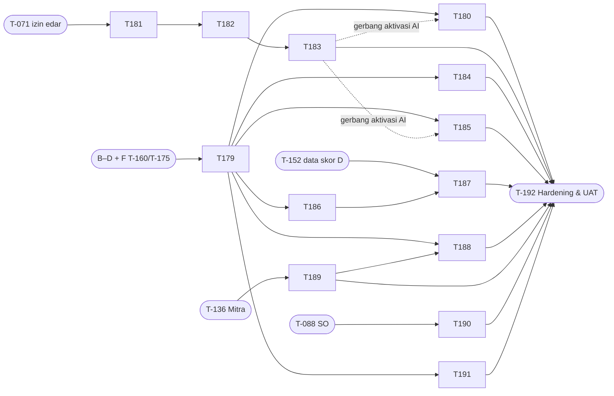

# TASKS — Paket G: Cerdas & Kinerja (T-179–T-192)

> Siap eksekusi setelah exit gate Paket B–D (+ F T-160 & T-175 untuk T-184), data operasional ±6 bulan, dan checklist `docs/21-PAKET-G-CERDAS-KINERJA.md` §0. Spesifikasi: **21**, **20**, **19**, **18**, **17**, **16**, **15**, **14**. Path backend relatif ke `backend/`.
>
> **Aturan khusus:** tidak ada vector database & tidak ada runtime Python baru (ADR-126, ADR-128). Klien LLM memakai HTTP client Laravel melalui `AiGateway` saja. **Tidak ada nama model, versi, atau harga yang ditulis di kode/seed** — semua dari setting. Seluruh test AI memakai `FakeLlmProvider` deterministik; uji dengan provider nyata hanya manual (T-183) dengan data dummy. Setiap fitur AI wajib lulus test dalam mode `ai.provider = none`. Domain baru: `app/Domain/{Reporting (diperluas), Intelligence, Performance, PrincipalPortal, Marketplace}`. Kunci baru `.env.example`: `AI_API_KEY`, `MARKETPLACE_CREDENTIALS_KEY` (tanpa nilai).
> - **Nama berkas halaman & komponen frontend mengikuti konvensi repo** (kebab-case huruf kecil); path PascalCase di task ini indikatif (**15** §0 S-3).

| Ringkasan | Nilai |
|---|---|
| Task | 14 (T-179–T-192) |
| Estimasi | 146 jam (rentang 120–190) |
| Exit gate | Setiap fitur AI punya alternatif non-AI yang lulus test; golden set lulus; uji payload tanpa data pribadi; checklist **21** §10.3; UAT-G01–G15 |

## Urutan & dependensi

---

### T-179 — Data mart, katalog metrik, dasbor + permission Paket G
- Paket: G | Prioritas: P0 | Estimasi: 10 jam
- Memenuhi: FR-G01, FR-G02, FR-G03, FR-G33, BR-360, NFR-G01, NFR-G02
- Dependensi: Paket B–D (laporan sumber)
- Konteks wajib: **21** §0, §4.1 (`daily_summaries`, `stock_daily_snapshots`, `mart_refresh_runs`, `mart_dirty_dates`), §5.1 (`dashboards.*`, `mart.*`, `metrics.index`), §6.1–§6.4, §8.2 BR-360; **16** (`sales_daily_summaries`, laporan), **18**, **20** (laporan)
- File: migrations; `app/Domain/Reporting/{MetricCatalog,Metrics/*` (satu kelas per metrik, memanggil kelas query laporan sumber)`,MartRefresher,Jobs/{RefreshMart,SnapshotStock},Listeners/MarkMartDirty}`; seeder `PaketGPermissionSeeder` (30 permission, matriks §6.4); pages `dashboards/owner.tsx`, `dashboards/manager.tsx`, `system/data-mart.tsx`; tests `MetricParityTest` (per metrik), `MartDirtyDateTest`, `PaketGMatrixTest`
- Kriteria penerimaan:
  - [ ] Untuk setiap metrik di katalog: nilai mart tanggal X = laporan sumber tanggal X (data uji)
  - [ ] Void/dokumen bertanggal mundur/sinkron offline terlambat menandai tanggal; refresh parsial memperbaiki ≤ 30 menit
  - [ ] Dasbor membaca mart saja (test query log tanpa tabel transaksi)
  - [ ] `sales.gross_margin` tidak tampil tanpa `margin_reports.view`
  - [ ] Refresh 3 tahun data sintetis < 30 menit; dasbor p95 < 1,5 s
  - [ ] `PaketGMatrixTest` hijau
- Verifikasi: `php artisan test --filter='MetricParity|MartDirty|Dashboard|PaketGMatrix'`
- Di luar lingkup: laporan terjadwal (T-180)

### T-180 — Laporan terjadwal & ringkasan mingguan owner
- Paket: G | Prioritas: P1 | Estimasi: 8 jam
- Memenuhi: FR-G04, FR-G05, BR-361, BR-362, SEC-199
- Dependensi: T-179; T-183 untuk mode narasi AI (mode template tidak menunggu)
- Konteks wajib: **21** §4.1 (`report_schedules`, recipients, `report_runs`, `owner_digests`), §5.1, §8.2 BR-361–BR-362, §9 (`owner_digest.*`); **16** (`message_templates`, `outbound_messages`)
- File: `app/Domain/Reporting/{ScheduledReportCatalog,Actions/{SaveReportSchedule,RunScheduledReport},Digest/{OwnerDigestBuilder,DigestTemplateWriter,DigestNarrativeValidator},Jobs/{RunScheduledReports,GenerateOwnerDigest}}`; pages `reports/scheduled/{index,form,runs}.tsx`, `reports/owner-digest/{index,show}.tsx`; tests
- Kriteria penerimaan:
  - [ ] Penerima yang kehilangan permission/scope dilewati & dicatat; pembuat diberi tahu
  - [ ] Pesan WA/email `summary_link` hanya ≤ 5 angka + tautan wajib login
  - [ ] Ringkasan owner: fakta = mart; narasi template selalu tersedia; narasi AI dengan angka/nama asing → fallback (`failed_fallback_template`)
  - [ ] Payload AI digest hanya fakta berlabel pseudonim (test payload fake provider)
- Verifikasi: `php artisan test --filter='ScheduledReport|OwnerDigest'`
- Di luar lingkup: pembuat laporan bebas (ad-hoc)

### T-181 — Basis pengetahuan dari label & izin edar resmi
- Paket: G | Prioritas: P1 | Estimasi: 10 jam
- Memenuhi: FR-G07, FR-G08, BR-364, BR-365
- Dependensi: T-071 (izin edar A), T-110 (katalog publik dan `product_label_uses` B); OQ-163
- Konteks wajib: **21** §4.2 (`knowledge_documents`, `knowledge_chunks`, `knowledge_synonyms`), §5.1 (`knowledge-documents.*`, `knowledge-synonyms.*`), §6.5 (`knowledge_document_publish`), §8.2 BR-364–BR-365; **15** (`products`, `product_registrations`), **16** (`product_label_uses`)
- File: migrations (FULLTEXT); `app/Domain/Intelligence/Knowledge/{Builders/{LabelUseDocumentBuilder,RegistrationDocumentBuilder,UsageNoteDocumentBuilder},Chunker,PdfTextExtractor (memakai library PDF ADR-114 bila mendukung ekstraksi teks; jika tidak → task berhenti & catat blocker),Listeners/RebuildOnSourceChange,Jobs/{RebuildKnowledge,WithdrawExpired},EntityRecognizer,SynonymNormalizer}`; seeder sinonim contoh (nama lokal umum tanaman/OPT, ditandai "contoh — ditinjau Pakis"); pages `klinik-tani/knowledge/{index,show}.tsx`, `klinik-tani/synonyms/index.tsx`; tests
- Kriteria penerimaan:
  - [ ] Satu chunk per baris label memuat `dose_text` persis
  - [ ] Ubah label → versi baru, chunk lama `is_active = false`; izin `expired`/`revoked` → dokumen `withdrawn`
  - [ ] Dokumen unggahan `pending_review`; aktivasi butuh peninjau ≠ pengunggah
  - [ ] Pengenal entitas: sinonim n-gram terpanjang; dua kandidat → `clarification`
  - [ ] Isi dokumen yang memuat kalimat instruksi tetap diperlakukan sebagai teks (tidak ada jalur eksekusi)
- Verifikasi: `php artisan test --filter='Knowledge|EntityRecognizer|Synonym'`
- Di luar lingkup: OCR gambar label

### T-182 — Asisten Klinik Tani + `AiGateway` & `LlmProvider`
- Paket: G | Prioritas: P1 | Estimasi: 16 jam
- Memenuhi: FR-G09, FR-G10, FR-G11, FR-G12, FR-G34, BR-366, BR-367, BR-368, ADR-126, ADR-127, SEC-191, SEC-192, SEC-193, NFR-G03
- Dependensi: T-181; OQ-161, OQ-162, OQ-170 (mode AI); mode non-AI tidak menunggu
- Konteks wajib: **21** §4.2 (`ai_requests`, `assistant_*`), §5.1 & §5.3 (`assistant.*`), §6.7 (diagram), §7.1 (Klinik Tani), §8.2 BR-365–BR-368, §9 (`ai.*`), §10.2 SEC-191–SEC-193
- File: `app/Domain/Intelligence/Ai/{Contracts/LlmProvider,Providers/{NullProvider,OpenAiCompatibleProvider,FakeLlmProvider},AiGateway,PersonalDataScrubber,FieldAllowlist,BudgetGuard,PromptTemplates/*` (berversi di repo)`}`; `app/Domain/Intelligence/Assistant/{Retriever,AnswerComposer (template),AiAnswerComposer,AnswerValidator,Actions/{AskAssistant,GiveFeedback,ResolveReview},Jobs/PurgeConversations}`; pages `klinik-tani/index.tsx`, `klinik-tani/reviews/index.tsx`, `system/ai/settings.tsx`; Flutter `mobile-pro/lib/features/klinik_tani/*` (online chat + offline cari tanaman × OPT dari snapshot), `mobile-mitra/lib/features/klinik_tani/*` (di balik setting); tests `AssistantPolicyTest`, `AnswerValidatorTest`, `AiPayloadPrivacyTest`, `AiGatewayTest`
- Kriteria penerimaan:
  - [ ] `ai.provider = none`: semua pertanyaan dijawab template dari label (atau `not_available`/`clarification`)
  - [ ] Fake LLM mengarang dosis/produk/URL → validator gagal → `fallback_non_ai`
  - [ ] Off-label → `out_of_scope`; tanaman × OPT tanpa produk → `not_available`
  - [ ] Produk terbatas: internal berlabel; Mitra tidak berhak → disembunyikan / `restricted_notice`
  - [ ] Payload ke provider tidak memuat pola HP/NIK/email/nama pegawai/kios dari korpus uji (fake merekam payload)
  - [ ] Timeout/anggaran habis → mode non-AI dengan pesan; `ai_requests` tercatat tanpa isi prompt
  - [ ] Jawaban dirender tanpa HTML mentah (uji XSS)
  - [ ] Arch test: hanya `AiGateway` memanggil `LlmProvider`; asisten tidak punya tool yang mengubah data
- Verifikasi: `php artisan test --filter='Assistant|AnswerValidator|AiPayloadPrivacy|AiGateway'` · `fvm flutter test`
- Di luar lingkup: diagnosis dari foto

### T-183 — Evaluasi & guardrail AI: golden set, regresi, batas biaya
- Paket: G | Prioritas: P1 | Estimasi: 8 jam
- Memenuhi: FR-G13, FR-G32, BR-369, SEC-194, NFR-G07
- Dependensi: T-182
- Konteks wajib: **21** §4.2 (`ai_eval_*`), §5.1 (`ai-evaluations.*`, `ai-usage.index`), §8.2 BR-369, §9
- File: `app/Domain/Intelligence/Evaluation/{EvalRunner,Metrics/*,Actions/{RunEvaluation,ActivatePromptOrModel}}`; seeder golden set awal ≥ 100 kasus (data dummy, ditinjau APJ — kasus tag `injection`, `pii`, `restricted`, `off_label`, `expired`); rate limiter; pages `system/ai/{evaluations/index,evaluations/show,usage}.tsx`; tests
- Kriteria penerimaan:
  - [ ] Perubahan `prompt_template_version`/`ai.model_label` tersimpan `pending` sampai evaluasi lulus (`AI_EVAL_NOT_PASSED`)
  - [ ] Metrik & ambang BR-369 dihitung; kecocokan dosis 100% dan pelanggaran produk terlarang 0 wajib
  - [ ] Rate limit per pengguna/kios & anggaran bulanan; 80% anggaran → notifikasi Owner
  - [ ] Dasbor pemakaian per fitur × bulan dari `ai_requests`
  - [ ] Laporan evaluasi manual dengan provider nyata terlampir di `docs/uat/` (data dummy)
- Verifikasi: `php artisan test --filter='Evaluation|AiBudget|AiRateLimit'` · `php artisan ai:evaluate --feature=assistant`
- Di luar lingkup: fine-tuning model

### T-184 — Prediksi kebutuhan musim (saran, keputusan manusia)
- Paket: G | Prioritas: P2 | Estimasi: 14 jam
- Memenuhi: FR-G14, FR-G15, BR-370, ADR-128, NFR-G04
- Dependensi: T-175 (saran pembelian F), T-179 (snapshot stok)
- Konteks wajib: **21** §4.3 (`forecast_runs`, `forecast_items`, ALTER `purchase_suggestion_items`), §5.1 (`forecasts.*`), §8.2 BR-370; **20** BR-341
- File: `app/Domain/Intelligence/Forecast/{DemandSeriesBuilder,StockoutCensor,DemandClassifier,Methods/{SeasonalNaive,BaselineF,SimpleExponentialSmoothing,HoltWinters,CrostonSba},Backtester,ModelSelector,Jobs/RunForecast}`; ubah halaman saran pembelian (F) untuk opsi "pakai prediksi"; pages `purchasing/forecasts/{index,show}.tsx`; tests dengan deret sintetis
- Kriteria penerimaan:
  - [ ] Deret musiman sintetis: metode musiman terpilih & WAPE < baseline; deret acak: baseline dipilih
  - [ ] Intermittent (ADI > 1,32) → Croston/SBA; data < 12 bulan → `insufficient` + baseline
  - [ ] Koreksi hari kosong stok diterapkan & tercatat di `explanation`
  - [ ] p80 ≥ p50; hasil deterministik untuk input sama
  - [ ] Memakai prediksi di saran hanya atas pilihan PUR; tidak ada PO otomatis
  - [ ] 3.000 SKU × 10 gudang < 30 menit
- Verifikasi: `php artisan test --filter='Forecast'`
- Di luar lingkup: model ML eksternal

### T-185 — Deteksi anomali dengan penjelasan (tanpa mengubah data)
- Paket: G | Prioritas: P2 | Estimasi: 12 jam
- Memenuhi: FR-G16, FR-G17, FR-G18, BR-371, SEC-198
- Dependensi: T-129 (red flag C), T-179; T-183 untuk penjelasan AI
- Konteks wajib: **21** §4.3 (`anomaly_findings`), §5.1 (`anomalies.*`, `anomaly-detectors.*`), §8.2 BR-371; **17** (`red_flags`, investigasi)
- File: `app/Domain/Intelligence/Anomaly/{AnomalyDetectorCatalog,Detectors/*` (satu kelas per detektor BR-371)`,RobustZ,ExplanationTemplate,AiExplanation,Actions/{DismissFinding,PromoteFindingToRedFlag},Jobs/DetectAnomalies}`; pages `control/anomalies/{index,show,detectors}.tsx`; tests
- Kriteria penerimaan:
  - [ ] Contoh angka: robust z & ambang menghasilkan temuan yang benar; rekan < minimum → tidak ada temuan
  - [ ] Pendinginan mencegah duplikat; severity naik → dilaporkan
  - [ ] Promote membuat red flag `rule_code = anomaly.*` (hanya subjek employee/customer/vehicle)
  - [ ] Subjek & atasannya tidak dapat melihat temuan (403); akses tercatat
  - [ ] Arch test: modul Anomaly tidak memanggil Action yang mengubah data operasional/pegawai
  - [ ] Penjelasan AI hanya label pseudonim; validator angka
- Verifikasi: `php artisan test --filter='Anomaly'`
- Di luar lingkup: aturan red flag baru di C (tetap di **17**)

### T-186 — KPI otomatis + penilaian atasan + keberatan
- Paket: G | Prioritas: P1 | Estimasi: 10 jam
- Memenuhi: FR-G19, FR-G20, FR-G21, BR-372, BR-373
- Dependensi: T-066 (penilaian `13`), T-179; OQ-164
- Konteks wajib: **21** §0 S-5, §4.4 (`kpi_*`), §5.1 (`kpi-*`, `my-kpi.show`), §6.2, §6.5 (`kpi_definition_change`), §8.2 BR-372–BR-373; **15** (delegasi Plt/Plh), `13` (penilaian)
- File: `app/Domain/Performance/{Models/*,KpiCalculator,AssignmentWeighting,Actions/{SaveKpiDefinitionVersion,ComputeKpiPeriod,OpenReview,SubmitSupervisorReview,AcknowledgeReview,FileDispute,ResolveDispute,FinalizeKpiPeriod},Integration/AppraisalBridge (ke 13 bila ada)}`; seeder contoh KPI (ditandai "contoh"); pages `hr/kpi/{definitions,periods,reviews/index,reviews/form,disputes,my-kpi}.tsx`; tests
- Kriteria penerimaan:
  - [ ] Σ bobot ≠ 100 → `KPI_WEIGHTS_INVALID`; versi baru tidak mengubah periode lampau
  - [ ] `lower_better`, cap 120%, data kurang → bobot dibagi ulang (contoh angka di test)
  - [ ] Mutasi tengah periode dibobot hari per penugasan
  - [ ] Atasan hanya menilai bawahan langsung; tidak bisa menilai diri sendiri; Plt mengikuti delegasi
  - [ ] Keberatan diputus HRD; diterima → hitung ulang & tercatat
  - [ ] Final mengunci (`KPI_PERIOD_LOCKED`); tidak ada perubahan payroll/status pegawai otomatis (arch test)
- Verifikasi: `php artisan test --filter='Kpi'`
- Di luar lingkup: formulir penilaian `13`

### T-187 — Skor driver & biaya armada, terhubung insentif driver
- Paket: G | Prioritas: P2 | Estimasi: 8 jam
- Memenuhi: FR-G22, FR-G23, BR-374
- Dependensi: T-152 (data skor D), T-154 (input payroll E), T-186 (metrik KPI driver); OQ-147, OQ-166
- Konteks wajib: **21** §4.4 (`driver_scores`), §5.1 (`driver-scores.*`), §8.2 BR-374; **18** BR-299, **19** BR-303, **17** (`incentive_schemes`)
- File: `app/Domain/Fleet/Scoring/{DriverScoreCalculator,FleetCostAllocator,Jobs/ComputeDriverScores}`; metrik insentif `driver_score` di registri metrik insentif **17**; pages `fleet/driver-scores/{index,show,settings}.tsx`; tests
- Kriteria penerimaan:
  - [ ] Contoh angka di test menghasilkan skor & biaya per km yang sama dengan hitungan manual
  - [ ] Trip < minimum → `total_score` NULL
  - [ ] Skema insentif driver dapat memakai `driver_score`; skor `locked` saat periode insentif dikunci
  - [ ] DRV hanya melihat miliknya; peringkat tanpa nama driver lain
- Verifikasi: `php artisan test --filter='DriverScore'`
- Di luar lingkup: perubahan perhitungan payroll

### T-188 — Portal prinsipal (guard `principal`, agregat)
- Paket: G | Prioritas: P2 | Estimasi: 14 jam
- Memenuhi: FR-G24, FR-G25, FR-G26, BR-375, BR-376, ADR-129, SEC-195, SEC-196, NFR-G05
- Dependensi: T-179, T-168/T-169 (program & klaim F), T-189 (dataset `kiosk_sellout`, boleh menyusul); OQ-165
- Konteks wajib: **21** §4.5 (`principal_users`, `principal_data_sharing`, `principal_portal_logs`), §5.1, §5.2, §6.1, §6.5 (`principal_sharing_change`), §6.7 (diagram portal), §8.2 BR-375–BR-376, §10.2 SEC-195–SEC-196
- File: `config/auth.php` (guard & provider `principal`, password broker); `app/Domain/PrincipalPortal/{Models/*,PrincipalReadModel,CellSuppressor,Datasets/{SellIn,SellOutArea,Stock,Programs,KioskSellout},Actions/{InvitePrincipalUser,AcceptInvitation,SuspendPrincipalUser,RevokePrincipalUser,SaveDataSharing},Jobs/ExpireAccounts}`; route file `routes/principal.php`; layout & pages `principal-portal/*.tsx`; admin pages `principals/portal-admin/{users,sharing,logs}.tsx`; tests `PrincipalPortalIdorTest`, `CellSuppressionTest`
- Kriteria penerimaan:
  - [ ] Prinsipal A tidak dapat melihat produk/area/klaim prinsipal B (404) atau route admin/Mitra
  - [ ] Sel < ambang digabung; supresi komplementer mencegah pengurangan (test 1–4 kios per sel)
  - [ ] Tidak ada nama/kode/lokasi kios, HPP, margin di respons & ekspor (test kontrak)
  - [ ] MFA wajib; undangan sekali pakai & kedaluwarsa; akun kedaluwarsa/tidak aktif otomatis
  - [ ] Semua tampilan/ekspor tercatat di `principal_portal_logs`
  - [ ] Portal hanya membaca tabel mart (test query log)
- Verifikasi: `php artisan test --filter='PrincipalPortal|CellSuppression'`
- Di luar lingkup: API untuk sistem prinsipal

### T-189 — Data sell-out kios (opt-in) di Pakis Mitra
- Paket: G | Prioritas: P2 | Estimasi: 8 jam
- Memenuhi: FR-G27, FR-G28, BR-377
- Dependensi: T-136 (Mitra), T-179; OQ-167
- Konteks wajib: **21** §4.5 (`kiosk_sellout_*`), §5.3 (`mitra.v1.sellout.*`), §8.2 BR-377, §9 (`sellout.*`); **17** (Mitra, peran `owner` di `customer_users`)
- File: `app/Domain/Mitra/Sellout/{Actions/{GiveSelloutConsent,WithdrawSelloutConsent,SubmitSelloutReport},PlausibilityChecker}`; Flutter `mobile-mitra/lib/features/sellout/*`; page `analytics/sellout.tsx`; tests
- Kriteria penerimaan:
  - [ ] Hanya `customer_users.role = owner` dapat memberi/menarik persetujuan
  - [ ] Laporan tanpa consent → `SELLOUT_CONSENT_REQUIRED`; idempoten `client_uuid`
  - [ ] Data tidak wajar → `excluded` + pemberitahuan ke kios
  - [ ] Penarikan: laporan baru ditolak; data keluar dari dataset prinsipal sejak tanggal penarikan
  - [ ] Sales area tidak melihat data per kios
- Verifikasi: `php artisan test --filter='Sellout'` · `fvm flutter test` (mobile-mitra)
- Di luar lingkup: integrasi POS milik kios

### T-190 — Marketplace alat pertanian (sinkron stok & pesanan, pestisida dikecualikan)
- Paket: G | Prioritas: P3 | Estimasi: 14 jam
- Memenuhi: FR-G29, FR-G30, FR-G31, BR-378, BR-379, BR-112, SEC-197, NFR-G06
- Dependensi: T-088 (SO), T-091 (surat jalan), T-093 (faktur), T-163 (rekonsiliasi F); **blocker OQ-107** untuk connector nyata
- Konteks wajib: **21** §4.6 (tabel marketplace, ALTER `sales_orders`, `sales_daily_summaries`, `deliveries`), §5.1 (`marketplace-*`), §5.3 (webhook), §6.5 (`marketplace_channel_activate`), §8.2 BR-378–BR-379, §11.2; **14** §12 (`MarketplaceConnector`), **16** (SO, surat jalan, faktur, pembayaran)
- File: `app/Domain/Marketplace/{Contracts/MarketplaceConnector,Connectors/FakeConnector,Eligibility/ProductEligibility,Actions/{ConnectChannel,ActivateChannel,SaveListing,PushStock,ImportOrder,AcceptOrder,RejectOrder,MarkShipped,ApplyCompletion,ImportSettlement},Jobs/{SyncStock,PullOrders,PurgeBuyerData},Http/WebhookController}`; connector nyata ditambahkan **hanya** setelah OQ-107 & dokumentasi API resmi tersedia; pages `marketplace/{channels,listings,orders/index,orders/show}.tsx`; tests
- Kriteria penerimaan:
  - [ ] Produk jenis pestisida/terbatas ditolak di server (`MARKETPLACE_PRODUCT_NOT_ALLOWED`) walau setting diubah
  - [ ] Stok dikirim dengan buffer; produk jadi tidak layak → stok 0 & listing `blocked`
  - [ ] Webhook signature salah → 401; pesanan ganda idempoten
  - [ ] Pesanan diterima → SO kanal `marketplace`; surat jalan `courier` + resi; `completed` → faktur; batal/retur sesuai B
  - [ ] Pencairan → pembayaran neto + `marketplace.fee_recorded` seimbang
  - [ ] Data pembeli terhapus setelah retensi
- Verifikasi: `php artisan test --filter='Marketplace'`
- Di luar lingkup: iklan, chat pembeli, multi-gudang per kanal

### T-191 — Peta sebaran pelanggan & analitik area
- Paket: G | Prioritas: P2 | Estimasi: 6 jam
- Memenuhi: FR-G06, BR-363
- Dependensi: T-179; Leaflet (A, `leaflet` 1.9.x)
- Konteks wajib: **21** §5.1 (`customer-map.show`, `area-analytics.show`), §7.1, §8.2 BR-363; **15** (koordinat kios, master wilayah)
- File: `app/Domain/Reporting/Analytics/{CustomerMapQuery,AreaCoverageQuery}`; pages `analytics/customer-map.tsx`, `analytics/area.tsx`; tests
- Kriteria penerimaan:
  - [ ] Hanya kios bertitik terverifikasi; scope SLS/SPV diterapkan
  - [ ] Desa tanpa kios aktif di kecamatan terlayani tampil (white space)
  - [ ] Ekspor tanpa nomor HP pemilik
  - [ ] 5.000 titik dimuat < 2 s (cluster)
- Verifikasi: `php artisan test --filter='CustomerMap|AreaCoverage'`
- Di luar lingkup: optimasi rute (C)

### T-192 — Hardening & UAT Paket G
- Paket: G | Prioritas: P0 | Estimasi: 8 jam
- Memenuhi: NFR-G01–NFR-G07, exit gate Paket G
- Dependensi: T-179–T-191
- Konteks wajib: **21** §10, §12
- File: `tests/Feature/Security/PaketGIdorTest.php`, `tests/Feature/Security/AiPrivacyCorpusTest.php` (1.000 pertanyaan sintetis), k6 `tests/load/assistant.js`, `docs/uat/UAT-PAKET-G.xlsx`, runbook `docs/runbooks/AI-OPERASIONAL.md` (ganti model, evaluasi, anggaran, mematikan fitur), `docs/runbooks/PORTAL-PRINSIPAL.md`
- Kriteria penerimaan:
  - [ ] Semua fitur lulus dalam mode `ai.provider = none`
  - [ ] Korpus privasi: 0 pola data pribadi di payload provider
  - [ ] IDOR KPI/anomali/skor driver/portal/marketplace → 404/403 di luar scope
  - [ ] Checklist **21** §10.3 dicentang; UAT-G01–G15 lulus
- Verifikasi: `php artisan test` · `k6 run tests/load/assistant.js`
- Di luar lingkup: pengembangan setelah v1.4

---

## Ringkasan estimasi

| Kelompok | Task | Jam |
|---|---|---|
| Mart, laporan, peta | T-179, T-180, T-191 | 24 |
| Klinik Tani & AI | T-181–T-183 | 34 |
| Prediksi & anomali | T-184–T-185 | 26 |
| KPI & skor driver | T-186–T-187 | 18 |
| Portal prinsipal & sell-out | T-188–T-189 | 22 |
| Marketplace | T-190 | 14 |
| Hardening & UAT | T-192 | 8 |
| **Total** | 14 task | **146** |

## Pertanyaan terbuka yang memblokir

| OQ | Memblokir | Default bila belum dijawab |
|---|---|---|
| OQ-161, OQ-170 | Mode AI (T-182) | `ai.provider = none` (template) |
| OQ-162 | Klinik Tani di Mitra | Internal saja |
| OQ-163 | Dokumen pelengkap | Hanya sumber otomatis label & izin |
| OQ-164 | Seeder KPI (T-186) | Contoh BR-372 |
| OQ-165 | Portal per prinsipal (T-188) | `principal_portal.enabled = false` |
| OQ-166, OQ-147 | Bobot skor & insentif (T-187) | Default BR-374 |
| OQ-167 | Imbalan sell-out (T-189) | Tanpa imbalan |
| OQ-107 | Connector marketplace nyata (T-190) | `FakeConnector` |
