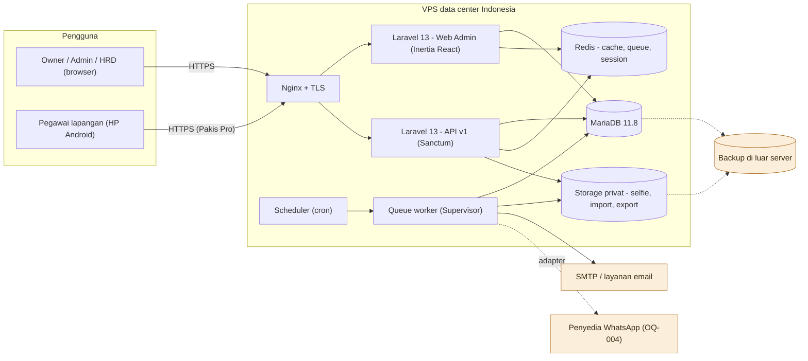
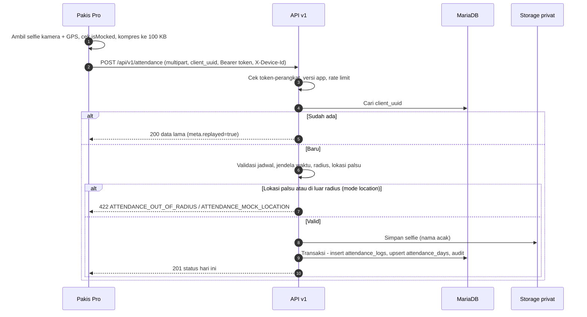
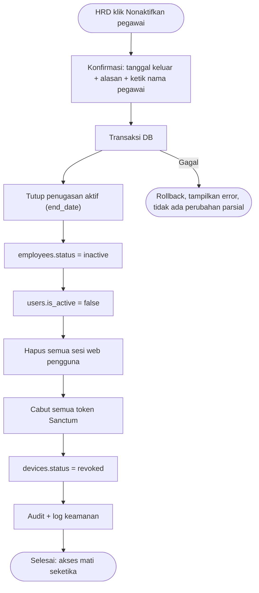

# 03 — Arsitektur (Fase 0 + 0,5)

## 1. Ringkasan

PAKIS ONE dibangun sebagai **modular monolith** Laravel 13 (PHP 8.5) yang melayani dua hal sekaligus: web admin (Inertia + React) dan API v1 untuk aplikasi **Pakis Pro** (Flutter). Aplikasi ini single-tenant untuk CV Pakis Jaya Abadi. Semua parameter bisnis tersimpan di database lewat registri setting, sehingga bisa diubah tanpa deploy.

## 2. Diagram Konteks & Container



Web dan API berada di satu codebase dan satu proses PHP-FPM. Keduanya dipisah lewat grup route dan guard (`web` session vs `sanctum` token).

## 3. Struktur Repositori (monorepo)

```
pakis-one/
├── CLAUDE.md · AGENTS.md · Implementasi_Plan.md · TASKS.md
├── docs/                         # paket dokumen ini (+ docs/reference/ konsep v1.4)
├── backend/                      # Laravel 13
│   ├── CLAUDE.md                 # aturan khusus backend (dibuat di T-001)
│   ├── app/
│   │   ├── Domain/
│   │   │   ├── Access/           # User, Role, Permission, DataScope, MFA, Session, Security log
│   │   │   ├── Settings/         # SettingRegistry, SettingStore, Branding
│   │   │   ├── Numbering/        # DocumentSequence, NumberGenerator
│   │   │   ├── Reference/        # ReferenceItem
│   │   │   ├── Region/           # Province, Regency, District, Village
│   │   │   ├── Organization/     # Location, Department, Position
│   │   │   ├── Employee/         # Employee, Assignment, Offboarding, Import
│   │   │   ├── Device/           # Device, DeviceChangeRequest
│   │   │   ├── Attendance/       # Shift, Schedule, Holiday, Attendance, Correction, StatusResolver
│   │   │   ├── Notification/     # InAppNotification, channel adapter (Mail, OtpChannel)
│   │   │   └── Audit/            # AuditLogger, AuditLog
│   │   │   (tiap domain: Models/, Actions/, Policies/, Listings/, Enums/, Events/)
│   │   ├── Support/Listing/      # ListingSpec, Filter types, ListingQuery, HasListing
│   │   ├── Support/Export/       # XlsxExporter (streaming), FormulaEscaper
│   │   └── Http/
│   │       ├── Controllers/Admin/    # Inertia
│   │       ├── Controllers/Api/V1/   # JSON
│   │       ├── Requests/ · Resources/ · Middleware/
│   ├── resources/js/
│   │   ├── pages/<Modul>/<Halaman>.tsx
│   │   └── components/pakis/     # DataTable, FilterBar, SettingField, dsb.
│   ├── database/{migrations,seeders,factories}
│   └── tests/{Feature,Unit,Contract,Arch}
└── mobile-pro/                   # Flutter: Pakis Pro
    ├── CLAUDE.md                 # aturan khusus mobile (dibuat di T-030)
    └── lib/
        ├── core/      # api client, auth, device, config, offline queue, theme
        ├── features/  # auth, attendance, corrections, approvals, notifications, profile
        └── shared/    # widgets: PagedList, FilterSheet, EmptyState, dsb.
```

## 4. Pola Kunci

### 4.1 Lapisan backend
Controller tipis: **Form Request** (validasi) → `authorize` (Policy) → **Action** (`handle()`, satu kelas satu aksi, transaksi DB) → Resource/Inertia. Logika bisnis tidak boleh ada di controller, model observer, atau komponen React.

### 4.2 Registri Setting (semua dinamis)
- Definisi setiap kunci ada di `app/Domain/Settings/SettingRegistry.php`: kunci, grup, tipe (`string`, `text`, `int`, `decimal`, `bool`, `enum`, `time`, `color`, `image`, `email_list`, `json`), default, aturan validasi, label, bantuan, `is_public`, `restart_required`. Daftar lengkap ada di `08-BUSINESS-RULES.md` §2.
- Nilai disimpan di tabel `settings`. Kunci yang belum pernah diubah memakai default dari registri.
- Halaman Pengaturan **dibuat otomatis** dari registri (satu tab per grup), jadi kunci baru cukup ditambah di registri tanpa membuat form baru.
- Pembacaan lewat `setting('attendance.default_radius_m')`, di-cache (Redis) dan dibersihkan saat ada perubahan.
- **Secret tidak pernah disimpan di `settings`.** Contohnya password SMTP, token WhatsApp, dan `APP_KEY`; semuanya tetap di `.env` (SEC-060).

### 4.3 Mesin Listing (paging, pencarian, filter, sort)
Masalah yang diselesaikan: fitur paging/pencarian/filter sering terlewat di sebagian CRUD. Solusinya:
- Setiap daftar punya kelas `*Listing` (mis. `EmployeeListing`) yang mengimplementasikan `HasListing` dan mengembalikan `ListingSpec` berisi: kolom yang dicari, filter (tipe `select`, `multi_select`, `boolean`, `date_range`, `number_range`, `relation`), sort yang diizinkan, sort default, dan opsi `per_page`.
- `ListingQuery::apply($builder, $spec, $request)` menerapkan semuanya dan mengembalikan paginator + `meta.listing` (definisi filter beserta opsinya, filter aktif, sort aktif). **Parameter di luar spec diabaikan**, tidak pernah dimasukkan mentah ke query (SEC-032).
- Frontend memakai satu komponen `<DataTable listing={...}>` yang merender kolom pencarian, panel filter, sort per kolom, pilihan per halaman, paging, chip filter aktif, tombol reset, empty state, dan sinkron ke query string URL.
- API mobile memakai `ListingSpec` yang sama dan format meta yang sama (`05` §3.3).
- **Ditegakkan oleh test:** `tests/Contract/ListingContractTest.php` menelusuri semua route bernama `*.index` di grup `admin.` dan `api.v1.`. Test memastikan controllernya memakai `HasListing` dan responsnya memuat paging, pencarian, filter, dan sort yang berfungsi (`10` §3). Route daftar baru yang tidak patuh membuat CI merah.

### 4.4 Penomoran server-side
`NumberGenerator::next('employee')` mengunci baris `document_sequences` (`SELECT ... FOR UPDATE`) di dalam transaksi pemanggil, membentuk nomor dari pola setting, lalu menaikkan counter. Nomor tidak pernah dibuat di klien (ADR-009).

### 4.5 Sinkron offline Pakis Pro
- Setiap absen punya `client_uuid` (UUID v4) yang dibuat di HP. Server menyimpan `UNIQUE (client_uuid)`, sehingga kiriman ulang mengembalikan data yang sudah ada (idempoten, HTTP 200 + `meta.replayed=true`).
- Antrean disimpan di SQLite terenkripsi (kunci di Android Keystore lewat secure storage).
- Sinkron dipicu saat aplikasi dibuka, saat konektivitas kembali, dan lewat tombol "Sinkronkan". Antrean diproses berurutan dengan backoff eksponensial.
- Waktu: online memakai waktu server. Offline memakai `client_time`, divalidasi terhadap batas `attendance.offline_max_hours` dan selisih jam perangkat yang dilaporkan saat sinkron (BR-067).

### 4.6 Penentuan status absensi
`AttendanceStatusResolver` dipanggil saat absen masuk/pulang, saat koreksi disetujui, dan oleh job `attendance:resolve-day` (setiap hari pukul `attendance.daily_close_time`). Resolver membuat baris `absent`/`holiday`/`off` untuk pegawai yang dijadwalkan tetapi tidak absen. Resolver idempoten per (pegawai, tanggal).

## 5. Stack & Versi

Versi di bawah sudah diverifikasi per 3 November 2026. Versi patch dikunci di `composer.lock`, `package-lock.json`, dan `pubspec.lock` saat T-001/T-030, lalu dicatat ulang di tabel ini.

**Versi terkunci T-001 (14 Nov 2026, PHP 8.5.12):**

| Paket | Versi | | Paket npm | Versi |
|---|---|---|---|---|
| laravel/framework | 13.42.0 | | react / react-dom | 19.3.1 |
| inertiajs/inertia-laravel | 3.7.0 | | @inertiajs/react | 3.11.0 |
| laravel/fortify | 1.42.0 | | tailwindcss | 4.3.5 |
| laravel/wayfinder | 0.1.23 | | typescript | 5.9.3 |
| laravel/sanctum | 4.4.0 | | vite-plus (`vp`, pengganti Vite di starter kit) | 1.4.0 |
| spatie/laravel-permission | 8.5.0 | | @laravel/vite-plugin-wayfinder | 0.1.11 |
| openspout/openspout | 5.13.0 | | | |
| pestphp/pest (+ plugin laravel 5.0.1) | 5.3.5 | | | |
| larastan/larastan (phpstan 2.3.5) | 3.15.0 | | | |
| laravel/pint | 1.32.3 | | | |
| pragmarx/google2fa | 9.1.0 | | | |

**Test frontend (T-005, disetujui 14 Nov 2026):** Vitest 5.0.5 (sudah dibawa `vite-plus`, dijalankan `vp test`), devDependency `happy-dom` 21.0.4 dan `@testing-library/react` 16.3.3. Tanpa `jest-dom`/`user-event` langsung (memakai assertion Vitest & `fireEvent`).

Dibawa starter kit `laravel/react-starter-kit` (dev-main, Laravel 13): `laravel/wayfinder` (route TS bertipe), `laravel/chisel` 0.1.1, `laravel/pao` 1.1.5 (output alat dev ringkas untuk agent), dan `laravel/passkeys` 0.2.1 (dependency wajib Fortify; **fitur passkey dimatikan**, lihat `12` log 14 Nov 2026). Laravel Boost tidak dipasang.

| Komponen | Versi | Catatan |
|---|---|---|
| PHP | **8.5.x** (patch terbaru) | Laravel 13 mendukung 8.3–8.5. Bila ada dependency wajib yang belum kompatibel dengan 8.5, turun ke 8.4 dan catat di ADR-003. |
| Laravel | **13.x** | Rilis 17 Maret 2026, bug fix s.d. Q3 2027, security fix s.d. 17 Maret 2028. |
| Starter kit | Laravel React starter kit resmi (Inertia + React + TypeScript + Tailwind + shadcn/ui) | Autentikasi web via Laravel Fortify bawaan starter kit. Fitur `registration` dan `passkeys` dimatikan, "ingat saya" dihapus (T-001). |
| Otorisasi | `spatie/laravel-permission` **^8** | Mendukung Laravel 12–13, PHP 8.3–8.5. |
| Token API | `laravel/sanctum` | Versi kompatibel Laravel 13 dari starter/composer. |
| TOTP mobile | `pragmarx/google2fa` | Sudah menjadi dependency Fortify, dipakai juga untuk verifikasi MFA di API. |
| Excel | `openspout/openspout` | Baca/tulis streaming, hemat memori untuk import/export besar. |
| Test | Pest, Larastan (level 7), Pint, Playwright (E2E web) | CI: `.github/workflows/backend.yml`. Secret: gitleaks 8.30.1 (`secrets.yml` + pre-commit). |
| Database | **MariaDB 11.8** (keputusan 14 Nov 2026, menggantikan MySQL 8.4) | Lokal: XAMPP port 3307. CI: image `mariadb:11.8.9`. Produksi: MariaDB 11.8. utf8mb4, `Asia/Jakarta` di sisi aplikasi, kolom waktu disimpan UTC. |
| Cache/Queue/Session | Redis (paket stabil OS, ≥ 7) | Queue `redis`, driver `database` tidak dipakai di produksi. **Lokal** memakai driver `database` (PHP XAMPP tanpa phpredis). |
| Mobile | Flutter stable terbaru (dikunci dengan FVM `.fvmrc`): **3.50.0** / Dart 3.14 (T-030, 15 Nov 2026) | Android minSdk 26. Proyek Android saja. |
| Paket Flutter | `dio`, `flutter_riverpod`, `go_router`, `drift` + `sqlcipher_flutter_libs`, `flutter_secure_storage`, `camera`, `geolocator`, `flutter_image_compress`, `device_info_plus`, `package_info_plus`, `connectivity_plus`, `uuid`, `intl`, **`material_ui`** (disetujui Mas 15 Nov 2026: `package:flutter/material.dart` deprecated sejak Flutter 3.47) | Penambahan paket lain wajib lewat `12-OPEN-QUESTIONS.md`. `sqlcipher_flutter_libs` sudah EOL (0.7.0+eol) → pengganti diputuskan sebelum T-042 (antrean offline). ANDROID_ID, SHA-256, dan buka URL lewat kanal native kecil (`MainActivity.kt`), bukan paket `crypto`/`url_launcher` (keputusan Mas 15 Nov 2026). |

**Versi terkunci T-030 (15 Nov 2026, `mobile-pro/pubspec.lock`):** dio 5.11.1 · flutter_riverpod 3.5.0 · go_router 18.1.4 · flutter_secure_storage 11.2.0 · package_info_plus 10.2.2 · uuid 4.6.0 · intl 0.20.3 · material_ui 1.11.0 · flutter_lints 6.0.0 (dev). Paket lain di tabel dipasang (dan dikunci) di task pemakainya: `camera`, `geolocator`, `flutter_image_compress`, `connectivity_plus`, `drift` + enkripsi (T-042), `device_info_plus` (T-032).

Dependency di luar tabel ini **dilarang** ditambahkan tanpa persetujuan tertulis (aturan berhenti di `CLAUDE.md`).

## 6. Architecture Decision Records

| ADR | Keputusan | Alasan | Konsekuensi |
|---|---|---|---|
| ADR-001 | **Single-tenant**, tanpa `tenant_id` | Dipakai Pakis saja (keputusan Mas, 3 Nov 2026). Mengurangi kompleksitas query, test, dan risiko bocor antar tenant. | Kalau kelak dijual ke distributor lain, butuh migrasi `tenant_id` + global scope. Kode tetap modular untuk memudahkan itu. |
| ADR-002 | Monorepo `backend/` + `mobile-pro/` | Kontrak API dan aplikasi mobile berubah bersamaan, cocok untuk satu developer + AI agent. | CI dipisah per folder (path filter). |
| ADR-003 | Laravel 13 + **PHP 8.5** | Rilis terbaru dengan dukungan security terpanjang. | Kompatibilitas dependency dicek di T-001. Fallback 8.4 terdokumentasi. |
| ADR-004 | Web admin dengan Inertia React (starter kit resmi) | Satu codebase, routing & auth Laravel, tanpa SPA terpisah. | API JSON hanya untuk mobile (`/api/v1`). |
| ADR-005 | Pakis Pro dengan **Flutter**, Android dulu | Butuh kamera langsung, GPS + deteksi lokasi palsu, penyimpanan offline terenkripsi. Ini sulit dan tidak andal di PWA. | iOS menyusul (OQ-006). |
| ADR-006 | Registri setting di kode + nilai di DB | "Semua dinamis" tanpa form manual per kunci. Validasi dan tipe tetap terjaga. | Menambah kunci = ubah registri + `08` §2 + test. |
| ADR-007 | Mesin listing internal (`Support/Listing`) | Satu pola untuk web & API, meta filter untuk UI otomatis, dan bisa ditegakkan dengan test kontrak. Alternatif `spatie/laravel-query-builder` tidak menyediakan meta UI dan menambah dependency. | Dipelihara sendiri. Cakupan test wajib tinggi. |
| ADR-008 | Token Sanctum terikat perangkat | Satu akun satu HP mencegah titip absen. Pencabutan cukup di satu tempat. | Ganti HP butuh persetujuan admin. |
| ADR-009 | Penomoran hanya di server dengan row lock | Nomor tidak bisa dipalsukan atau bentrok. Fondasi untuk kwitansi di Fase 1. | Butuh transaksi di setiap pembuatan dokumen bernomor. |
| ADR-010 | Absen online memakai waktu server | Jam HP mudah diubah. | Offline diterima dengan batas dan penanda (BR-067). |
| ADR-011 | `spatie/laravel-permission` + kolom tambahan di `roles` (`description`, `data_scope`, `mfa_required`, `is_system`) | Role dinamis dengan matriks permission, standar di semua produk Sintech. | Permission dibuat seeder dari `06` §3. UI tidak bisa membuat permission baru. |
| ADR-012 | ~~MySQL 8.4 LTS~~ **MariaDB 11.8** (revisi 14 Nov 2026) | Lingkungan dev memakai XAMPP bawaan (MariaDB 11.8). Satu mesin DB untuk lokal, CI, dan produksi lebih aman daripada mengandalkan kompatibilitas dua mesin. | Trigger append-only (T-007), `SELECT … FOR UPDATE` (T-009), dan kolom JSON (alias `LONGTEXT` + `CHECK json_valid` di MariaDB) diuji di MariaDB. Hindari fitur khusus MySQL 8.4. Berlaku di lokal, CI, dan produksi (OQ-014 terjawab). |

## 7. Alur Penting

### 7.1 Absen masuk (online)



### 7.2 Offboarding



## 8. Target Deployment

| Lingkungan | Infrastruktur | Data |
|---|---|---|
| Lokal | XAMPP (Windows): PHP 8.5, MariaDB 11.8 di `127.0.0.1:3307`. Cache/queue/session driver `database` | Seeder demo (dummy) |
| Staging | VPS Hetzner milik Sintech, subdomain staging | Dummy saja. Tidak pernah memakai data pegawai asli |
| Produksi | VPS data center Indonesia (penyedia: OQ-002), Ubuntu 24.04 LTS | Data asli Pakis |

**Spesifikasi produksi minimum:** 4 vCPU, 8 GB RAM, 160 GB SSD (selfie ±9 GB/tahun), IPv4 publik, snapshot mingguan dari penyedia.

**Komponen server:** Nginx, PHP-FPM 8.5 (OPcache), MariaDB 11.8 (bind ke localhost), Redis (bind localhost + password), Supervisor (2 worker `default`, 1 worker `imports`), cron `schedule:run` tiap menit, Certbot (TLS), UFW (22 dari IP admin, 80, 443), fail2ban, unattended-upgrades.

**Backup:** `mariadb-dump --single-transaction` harian + binlog, `storage/app/private` harian. Semuanya dienkripsi (age/gpg) dan dikirim ke penyimpanan di luar server (lokasi: OQ-002). Uji restore bulanan dicatat.

**Rilis:** GitHub Actions → build aset → deploy lewat SSH (zero-downtime dengan symlink release), `php artisan migrate --force`, `optimize`, `queue:restart`. APK Pakis Pro dibangun dan ditandatangani di CI, keystore disimpan sebagai secret CI, lalu dibagikan lewat URL unduh di setting `mobile.download_url` (distribusi Play Store: OQ-006).
