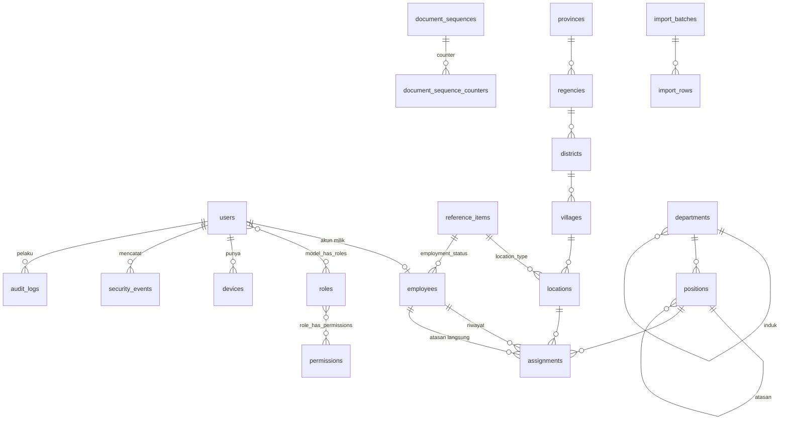
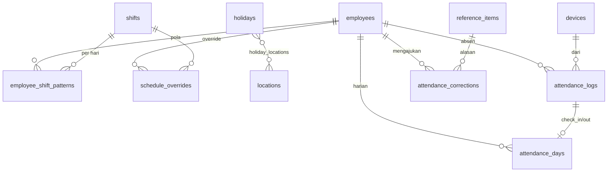

# 04 — Database (Fase 0 + 0,5)

MariaDB 11.8 (ADR-012, revisi 14 Nov 2026), `utf8mb4_0900_ai_ci`, InnoDB. Semua kolom `DATETIME`/`TIMESTAMP` disimpan dalam **UTC** dan ditampilkan sesuai setting `general.timezone`. Kolom `DATE` (mis. `work_date`) adalah tanggal lokal operasional. Nama tabel jamak, snake_case (konvensi Laravel).

Kolom audit standar (ditulis singkat sebagai **[audit]**): `created_by BIGINT UNSIGNED NULL FK users`, `updated_by BIGINT UNSIGNED NULL FK users`, `created_at`, `updated_at`. **[soft]** = `deleted_at TIMESTAMP NULL`.

## 1. ERD

### 1.1 Akses, Setting, Organisasi



### 1.2 Absensi



## 2. DDL

> DDL ini adalah spesifikasi. Implementasi berupa migration Laravel dengan nama tabel, kolom, tipe, constraint, dan index **identik**.

### 2.1 Bawaan starter kit / framework (dipertahankan)
`password_reset_tokens`, `sessions`, `cache`, `cache_locks`, `jobs`, `job_batches`, `failed_jobs`, `personal_access_tokens` (Sanctum), `notifications` (database notification Laravel). Tabel `users` **dimodifikasi** (§2.2).

Tabel Spatie: `permissions`, `roles`, `model_has_permissions`, `model_has_roles`, `role_has_permissions`. Tabel `roles` **ditambah kolom** (§2.3).

### 2.2 users

```sql
CREATE TABLE users (
  id BIGINT UNSIGNED PRIMARY KEY AUTO_INCREMENT,
  employee_id BIGINT UNSIGNED NULL,
  name VARCHAR(150) NOT NULL,
  username VARCHAR(50) NOT NULL,
  email VARCHAR(150) NULL,
  email_verified_at TIMESTAMP NULL,
  phone VARCHAR(20) NULL,
  avatar_path VARCHAR(255) NULL,
  password VARCHAR(255) NOT NULL,
  must_change_password BOOLEAN NOT NULL DEFAULT FALSE,
  password_changed_at TIMESTAMP NULL,
  two_factor_secret TEXT NULL,               -- terenkripsi (cast encrypted) oleh Fortify
  two_factor_recovery_codes TEXT NULL,       -- terenkripsi
  two_factor_confirmed_at TIMESTAMP NULL,
  is_active BOOLEAN NOT NULL DEFAULT TRUE,
  locked_until TIMESTAMP NULL,
  last_login_at TIMESTAMP NULL,
  last_login_ip VARCHAR(45) NULL,
  telegram_chat_id VARCHAR(32) NULL,        -- diisi saat pengguna menautkan bot Telegram (OTP lupa password)
  telegram_linked_at TIMESTAMP NULL,
  created_by BIGINT UNSIGNED NULL, updated_by BIGINT UNSIGNED NULL,
  created_at TIMESTAMP NULL, updated_at TIMESTAMP NULL, deleted_at TIMESTAMP NULL,
  UNIQUE KEY users_username_unique (username),
  UNIQUE KEY users_email_unique (email),
  UNIQUE KEY users_employee_id_unique (employee_id),
  UNIQUE KEY users_telegram_chat_id_unique (telegram_chat_id),
  KEY users_active_name_idx (is_active, name),
  CONSTRAINT users_employee_fk FOREIGN KEY (employee_id) REFERENCES employees(id),
  CONSTRAINT users_username_chk CHECK (username REGEXP '^[a-z0-9._-]{3,50}$')
);
```
`username` disimpan huruf kecil. Login mencocokkan `username` atau `email` (case-insensitive). Kolom `remember_token` dari starter kit dihapus karena fitur "ingat saya" tidak dipakai (SEC-005).

### 2.3 roles (kolom tambahan)

```sql
ALTER TABLE roles
  ADD COLUMN label VARCHAR(60) NOT NULL,                  -- nama tampilan ("Kepala Lokasi"); `name` Spatie = kode (BR-030)
  ADD COLUMN description VARCHAR(255) NULL,
  ADD COLUMN data_scope ENUM('all','location','team','self') NOT NULL DEFAULT 'self',
  ADD COLUMN mfa_required BOOLEAN NOT NULL DEFAULT FALSE,
  ADD COLUMN is_system BOOLEAN NOT NULL DEFAULT FALSE,   -- tidak bisa dihapus/diganti nama
  ADD COLUMN sort_order SMALLINT UNSIGNED NOT NULL DEFAULT 0;
```
`name` adalah **kode** role (`^[a-z0-9_]{3,40}$`, dipakai `hasRole`), `label` nama yang tampil di layar (keputusan Mas 15 Nov 2026). Kolom `permissions` dan `roles` lain mengikuti Spatie. `guard_name` = `web` untuk semua (API memakai guard `sanctum` dengan pemeriksaan permission yang sama lewat `Gate`).

### 2.4 settings

```sql
CREATE TABLE settings (
  id BIGINT UNSIGNED PRIMARY KEY AUTO_INCREMENT,
  `key` VARCHAR(120) NOT NULL,
  value JSON NOT NULL,
  updated_by BIGINT UNSIGNED NULL,
  created_at TIMESTAMP NULL, updated_at TIMESTAMP NULL,
  UNIQUE KEY settings_key_unique (`key`),
  CONSTRAINT settings_updated_by_fk FOREIGN KEY (updated_by) REFERENCES users(id)
);
```
Hanya kunci yang terdaftar di `SettingRegistry` yang boleh ditulis (BR-020). Berkas gambar (logo) disimpan di disk `public`. `value` berisi path relatif.

### 2.5 document_sequences & counters

```sql
CREATE TABLE document_sequences (
  id BIGINT UNSIGNED PRIMARY KEY AUTO_INCREMENT,
  code VARCHAR(50) NOT NULL,                 -- 'employee', 'attendance_correction'
  name VARCHAR(100) NOT NULL,
  pattern VARCHAR(100) NOT NULL,             -- mis. 'PJA-{YY}{SEQ:4}'
  reset_period ENUM('never','yearly','monthly','daily') NOT NULL DEFAULT 'never',
  is_system BOOLEAN NOT NULL DEFAULT TRUE,   -- code tidak bisa diubah/hapus
  [audit],
  UNIQUE KEY document_sequences_code_unique (code)
);
CREATE TABLE document_sequence_counters (
  id BIGINT UNSIGNED PRIMARY KEY AUTO_INCREMENT,
  document_sequence_id BIGINT UNSIGNED NOT NULL,
  scope_key VARCHAR(40) NOT NULL,            -- periode (+ kode lokasi bila pola memuat {LOC}); '-' bila never
  last_number INT UNSIGNED NOT NULL DEFAULT 0,
  updated_at TIMESTAMP NULL,
  UNIQUE KEY dsc_seq_scope_unique (document_sequence_id, scope_key),
  CONSTRAINT dsc_seq_fk FOREIGN KEY (document_sequence_id) REFERENCES document_sequences(id)
);
```

### 2.6 reference_items

```sql
CREATE TABLE reference_items (
  id BIGINT UNSIGNED PRIMARY KEY AUTO_INCREMENT,
  group_code VARCHAR(50) NOT NULL,           -- location_type | employment_status | correction_reason | offboarding_reason
  code VARCHAR(50) NOT NULL,
  name VARCHAR(150) NOT NULL,
  description VARCHAR(255) NULL,
  sort_order SMALLINT UNSIGNED NOT NULL DEFAULT 0,
  is_active BOOLEAN NOT NULL DEFAULT TRUE,
  is_system BOOLEAN NOT NULL DEFAULT FALSE,  -- code dipakai logika, tidak bisa diubah/hapus
  meta JSON NULL,
  [audit],
  UNIQUE KEY ref_group_code_unique (group_code, code),
  KEY ref_group_active_sort_idx (group_code, is_active, sort_order)
);
```
Daftar grup dikunci di `ReferenceGroup` enum (`08` §3). UI tidak bisa membuat grup baru.

### 2.7 Wilayah

```sql
CREATE TABLE provinces (code CHAR(2) PRIMARY KEY, name VARCHAR(100) NOT NULL, KEY provinces_name_idx (name));
CREATE TABLE regencies (code CHAR(5) PRIMARY KEY, province_code CHAR(2) NOT NULL, name VARCHAR(100) NOT NULL,
  KEY regencies_prov_name_idx (province_code, name), CONSTRAINT regencies_prov_fk FOREIGN KEY (province_code) REFERENCES provinces(code));
CREATE TABLE districts (code CHAR(8) PRIMARY KEY, regency_code CHAR(5) NOT NULL, name VARCHAR(100) NOT NULL,
  KEY districts_reg_name_idx (regency_code, name), CONSTRAINT districts_reg_fk FOREIGN KEY (regency_code) REFERENCES regencies(code));
CREATE TABLE villages (code CHAR(13) PRIMARY KEY, district_code CHAR(8) NOT NULL, name VARCHAR(100) NOT NULL,
  KEY villages_dist_name_idx (district_code, name), KEY villages_name_idx (name),
  CONSTRAINT villages_dist_fk FOREIGN KEY (district_code) REFERENCES districts(code));
```
Format kode bertitik ala Kemendagri (`33`, `33.19`, `33.19.01`, `33.19.01.2001`). Struktur SQL Sintech dipetakan oleh command `regions:import` (OQ-003).

### 2.8 Organisasi

```sql
CREATE TABLE locations (
  id BIGINT UNSIGNED PRIMARY KEY AUTO_INCREMENT,
  code VARCHAR(20) NOT NULL,
  name VARCHAR(150) NOT NULL,
  location_type_id BIGINT UNSIGNED NOT NULL,          -- reference_items(location_type)
  address TEXT NULL,
  village_code CHAR(13) NULL,
  latitude DECIMAL(10,7) NULL,
  longitude DECIMAL(10,7) NULL,
  attendance_radius_m SMALLINT UNSIGNED NULL,          -- NULL = setting attendance.default_radius_m
  phone VARCHAR(20) NULL,
  head_employee_id BIGINT UNSIGNED NULL,
  is_active BOOLEAN NOT NULL DEFAULT TRUE,
  [audit], [soft],
  UNIQUE KEY locations_code_unique (code),
  KEY locations_active_name_idx (is_active, name),
  KEY locations_type_idx (location_type_id),
  CONSTRAINT locations_type_fk FOREIGN KEY (location_type_id) REFERENCES reference_items(id),
  CONSTRAINT locations_village_fk FOREIGN KEY (village_code) REFERENCES villages(code),
  CONSTRAINT locations_head_fk FOREIGN KEY (head_employee_id) REFERENCES employees(id),
  CONSTRAINT locations_radius_chk CHECK (attendance_radius_m IS NULL OR attendance_radius_m BETWEEN 20 AND 5000),
  CONSTRAINT locations_coord_chk CHECK ((latitude IS NULL AND longitude IS NULL) OR (latitude BETWEEN -11 AND 6 AND longitude BETWEEN 94 AND 142))
);

CREATE TABLE departments (
  id BIGINT UNSIGNED PRIMARY KEY AUTO_INCREMENT,
  code VARCHAR(20) NOT NULL, name VARCHAR(150) NOT NULL,
  parent_id BIGINT UNSIGNED NULL,
  is_active BOOLEAN NOT NULL DEFAULT TRUE,
  [audit], [soft],
  UNIQUE KEY departments_code_unique (code),
  KEY departments_active_name_idx (is_active, name),
  CONSTRAINT departments_parent_fk FOREIGN KEY (parent_id) REFERENCES departments(id)
);

CREATE TABLE positions (
  id BIGINT UNSIGNED PRIMARY KEY AUTO_INCREMENT,
  code VARCHAR(20) NOT NULL, name VARCHAR(150) NOT NULL,
  department_id BIGINT UNSIGNED NOT NULL,
  parent_position_id BIGINT UNSIGNED NULL,
  level TINYINT UNSIGNED NOT NULL DEFAULT 5,          -- 1 = tertinggi
  attendance_mode ENUM('location','any_location','anywhere') NOT NULL DEFAULT 'location',
  is_active BOOLEAN NOT NULL DEFAULT TRUE,
  [audit], [soft],
  UNIQUE KEY positions_code_unique (code),
  KEY positions_dept_active_idx (department_id, is_active),
  CONSTRAINT positions_dept_fk FOREIGN KEY (department_id) REFERENCES departments(id),
  CONSTRAINT positions_parent_fk FOREIGN KEY (parent_position_id) REFERENCES positions(id)
);
```

### 2.9 Pegawai & Penugasan

```sql
CREATE TABLE employees (
  id BIGINT UNSIGNED PRIMARY KEY AUTO_INCREMENT,
  employee_number VARCHAR(30) NOT NULL,                -- dari NumberGenerator('employee')
  full_name VARCHAR(150) NOT NULL,
  nik_enc TEXT NULL,                                   -- Crypt::encryptString
  nik_hash CHAR(64) NULL,                              -- HMAC-SHA256(nik, NIK_HASH_KEY)
  gender ENUM('L','P') NOT NULL,
  birth_date DATE NULL,
  phone VARCHAR(20) NULL,
  email VARCHAR(150) NULL,
  address TEXT NULL,
  village_code CHAR(13) NULL,
  photo_path VARCHAR(255) NULL,
  employment_status_id BIGINT UNSIGNED NOT NULL,       -- reference_items(employment_status)
  join_date DATE NOT NULL,
  exit_date DATE NULL,
  exit_reason_id BIGINT UNSIGNED NULL,                 -- reference_items(offboarding_reason)
  exit_note VARCHAR(255) NULL,
  status ENUM('active','inactive') NOT NULL DEFAULT 'active',
  [audit], [soft],
  UNIQUE KEY employees_number_unique (employee_number),
  UNIQUE KEY employees_nik_hash_unique (nik_hash),
  KEY employees_status_name_idx (status, full_name),
  KEY employees_emp_status_idx (employment_status_id),
  KEY employees_join_date_idx (join_date),
  CONSTRAINT employees_emp_status_fk FOREIGN KEY (employment_status_id) REFERENCES reference_items(id),
  CONSTRAINT employees_exit_reason_fk FOREIGN KEY (exit_reason_id) REFERENCES reference_items(id),
  CONSTRAINT employees_village_fk FOREIGN KEY (village_code) REFERENCES villages(code),
  CONSTRAINT employees_exit_chk CHECK (exit_date IS NULL OR exit_date >= join_date),
  CONSTRAINT employees_inactive_chk CHECK (status = 'active' OR exit_date IS NOT NULL)
);

CREATE TABLE assignments (
  id BIGINT UNSIGNED PRIMARY KEY AUTO_INCREMENT,
  employee_id BIGINT UNSIGNED NOT NULL,
  position_id BIGINT UNSIGNED NOT NULL,
  location_id BIGINT UNSIGNED NOT NULL,
  supervisor_employee_id BIGINT UNSIGNED NULL,
  attendance_mode ENUM('location','any_location','anywhere') NULL,   -- NULL = ikut jabatan
  is_primary BOOLEAN NOT NULL DEFAULT TRUE,
  start_date DATE NOT NULL,
  end_date DATE NULL,
  note VARCHAR(255) NULL,
  active_primary_key BIGINT UNSIGNED
    GENERATED ALWAYS AS (IF(is_primary = 1 AND end_date IS NULL, employee_id, NULL)) STORED,
  [audit],
  UNIQUE KEY assignments_one_active_primary (active_primary_key),
  KEY assignments_emp_start_idx (employee_id, start_date),
  KEY assignments_loc_end_idx (location_id, end_date),
  KEY assignments_sup_end_idx (supervisor_employee_id, end_date),
  KEY assignments_pos_end_idx (position_id, end_date),
  CONSTRAINT assignments_emp_fk FOREIGN KEY (employee_id) REFERENCES employees(id),
  CONSTRAINT assignments_pos_fk FOREIGN KEY (position_id) REFERENCES positions(id),
  CONSTRAINT assignments_loc_fk FOREIGN KEY (location_id) REFERENCES locations(id),
  CONSTRAINT assignments_sup_fk FOREIGN KEY (supervisor_employee_id) REFERENCES employees(id),
  CONSTRAINT assignments_dates_chk CHECK (end_date IS NULL OR end_date >= start_date),
  CONSTRAINT assignments_not_self_sup_chk CHECK (supervisor_employee_id IS NULL OR supervisor_employee_id <> employee_id)
);
```

### 2.10 Import & Export

```sql
CREATE TABLE import_mapping_profiles (
  id BIGINT UNSIGNED PRIMARY KEY AUTO_INCREMENT,
  type VARCHAR(40) NOT NULL,                 -- 'employees'
  name VARCHAR(100) NOT NULL,
  header_signature CHAR(64) NOT NULL,        -- sha256 dari header ternormalisasi
  mapping JSON NOT NULL,                     -- {"Nama Lengkap":"full_name", ...}
  [audit],
  UNIQUE KEY imp_profile_type_name_unique (type, name),
  KEY imp_profile_sig_idx (type, header_signature)
);
CREATE TABLE import_batches (
  id BIGINT UNSIGNED PRIMARY KEY AUTO_INCREMENT,
  type VARCHAR(40) NOT NULL,
  original_name VARCHAR(255) NOT NULL,
  stored_path VARCHAR(255) NOT NULL,         -- disk private
  file_hash CHAR(64) NOT NULL,
  status ENUM('uploaded','mapped','validated','processing','completed','failed','cancelled') NOT NULL DEFAULT 'uploaded',
  mapping JSON NULL,
  total_rows INT UNSIGNED NOT NULL DEFAULT 0,
  valid_rows INT UNSIGNED NOT NULL DEFAULT 0,
  error_rows INT UNSIGNED NOT NULL DEFAULT 0,
  created_rows INT UNSIGNED NOT NULL DEFAULT 0,
  updated_rows INT UNSIGNED NOT NULL DEFAULT 0,
  skipped_rows INT UNSIGNED NOT NULL DEFAULT 0,
  completed_at TIMESTAMP NULL,
  [audit],
  KEY imp_batch_type_status_idx (type, status, created_at),
  KEY imp_batch_hash_idx (type, file_hash)
);
CREATE TABLE import_rows (
  id BIGINT UNSIGNED PRIMARY KEY AUTO_INCREMENT,
  import_batch_id BIGINT UNSIGNED NOT NULL,
  row_number INT UNSIGNED NOT NULL,
  row_key VARCHAR(100) NULL,                 -- nik_hash, atau employee_number, atau hash(nama+tgl lahir)
  data JSON NOT NULL,                        -- nilai SUDAH dipetakan; NIK disimpan termasking
  errors JSON NULL,                          -- {"birth_date":["Format tanggal tidak dikenali"]}
  status ENUM('valid','invalid','created','updated','skipped') NOT NULL,
  UNIQUE KEY imp_rows_batch_row_unique (import_batch_id, row_number),
  KEY imp_rows_batch_status_idx (import_batch_id, status),
  CONSTRAINT imp_rows_batch_fk FOREIGN KEY (import_batch_id) REFERENCES import_batches(id) ON DELETE CASCADE
);
CREATE TABLE export_files (
  id BIGINT UNSIGNED PRIMARY KEY AUTO_INCREMENT,
  listing VARCHAR(60) NOT NULL,              -- kunci listing, mis. 'attendance_days'
  params JSON NOT NULL,                      -- filter/sort/q yang dipakai
  status ENUM('queued','processing','ready','failed','expired') NOT NULL DEFAULT 'queued',
  path VARCHAR(255) NULL,
  row_count INT UNSIGNED NULL,
  expires_at TIMESTAMP NULL,
  [audit],
  KEY export_owner_idx (created_by, created_at),
  KEY export_status_exp_idx (status, expires_at)
);
```

### 2.11 Audit & Keamanan

```sql
CREATE TABLE audit_logs (
  id BIGINT UNSIGNED PRIMARY KEY AUTO_INCREMENT,
  occurred_at DATETIME(3) NOT NULL,
  user_id BIGINT UNSIGNED NULL,
  actor_label VARCHAR(60) NULL,              -- 'system', 'scheduler', 'import#12'
  event VARCHAR(80) NOT NULL,                -- 'employee.updated'
  auditable_type VARCHAR(80) NULL,
  auditable_id BIGINT UNSIGNED NULL,
  old_values JSON NULL,
  new_values JSON NULL,
  ip VARCHAR(45) NULL,
  user_agent VARCHAR(255) NULL,
  request_id CHAR(26) NULL,
  KEY audit_obj_idx (auditable_type, auditable_id, occurred_at),
  KEY audit_user_idx (user_id, occurred_at),
  KEY audit_event_idx (event, occurred_at),
  KEY audit_time_idx (occurred_at)
);
-- Append-only (SEC-040): diblokir di level DB
CREATE TRIGGER audit_logs_no_update BEFORE UPDATE ON audit_logs FOR EACH ROW
  SIGNAL SQLSTATE '45000' SET MESSAGE_TEXT = 'audit_logs is append-only';
CREATE TRIGGER audit_logs_no_delete BEFORE DELETE ON audit_logs FOR EACH ROW
  BEGIN IF COALESCE(@audit_purge, 0) <> 1 THEN SIGNAL SQLSTATE '45000' SET MESSAGE_TEXT = 'audit_logs delete blocked'; END IF; END;

CREATE TABLE security_events (
  id BIGINT UNSIGNED PRIMARY KEY AUTO_INCREMENT,
  occurred_at DATETIME(3) NOT NULL,
  user_id BIGINT UNSIGNED NULL,
  identifier VARCHAR(150) NULL,              -- username/email yang dicoba (untuk login gagal)
  event ENUM('login_success','login_failed','lockout','logout','new_device_login',
             'password_changed','password_reset_requested','password_reset_completed','password_reset_by_admin',
             'mfa_enabled','mfa_disabled','mfa_failed','mfa_reset_by_admin',
             'session_revoked','token_revoked','role_changed','permission_changed',
             'device_registered','device_approved','device_revoked','attendance_mock_detected',
             'sensitive_data_viewed','mass_export','telegram_linked') NOT NULL,
  channel ENUM('web','api','system') NOT NULL,
  ip VARCHAR(45) NULL,
  user_agent VARCHAR(255) NULL,
  context JSON NULL,
  KEY sec_user_idx (user_id, occurred_at),
  KEY sec_event_idx (event, occurred_at),
  KEY sec_ip_idx (ip, occurred_at)
);
```
Trigger append-only yang sama juga dipasang di `security_events`. Purge retensi (`audit:purge`) memakai koneksi khusus yang menyetel `SET @audit_purge = 1`.

### 2.12 Perangkat

```sql
CREATE TABLE devices (
  id BIGINT UNSIGNED PRIMARY KEY AUTO_INCREMENT,
  user_id BIGINT UNSIGNED NOT NULL,
  device_uid VARCHAR(100) NOT NULL,          -- hash SHA-256 dari ANDROID_ID + install id
  model VARCHAR(100) NULL, os_version VARCHAR(40) NULL, app_version VARCHAR(20) NULL,
  status ENUM('pending','active','revoked','replaced','rejected') NOT NULL DEFAULT 'pending',
  request_reason VARCHAR(255) NULL,
  token_id BIGINT UNSIGNED NULL,             -- personal_access_tokens.id yang aktif untuk perangkat ini
  approved_by BIGINT UNSIGNED NULL, approved_at TIMESTAMP NULL,
  revoked_by BIGINT UNSIGNED NULL, revoked_at TIMESTAMP NULL,
  last_seen_at TIMESTAMP NULL,
  active_user_key BIGINT UNSIGNED GENERATED ALWAYS AS (IF(status = 'active', user_id, NULL)) STORED,
  active_uid_key VARCHAR(100) GENERATED ALWAYS AS (IF(status = 'active', device_uid, NULL)) STORED,
  created_at TIMESTAMP NULL, updated_at TIMESTAMP NULL,
  UNIQUE KEY devices_one_active_per_user (active_user_key),
  UNIQUE KEY devices_one_user_per_phone (active_uid_key),
  KEY devices_status_idx (status, created_at),
  KEY devices_user_idx (user_id, status),
  CONSTRAINT devices_user_fk FOREIGN KEY (user_id) REFERENCES users(id)
);
```

### 2.13 Absensi

```sql
CREATE TABLE shifts (
  id BIGINT UNSIGNED PRIMARY KEY AUTO_INCREMENT,
  code VARCHAR(20) NOT NULL, name VARCHAR(100) NOT NULL,
  start_time TIME NOT NULL, end_time TIME NOT NULL,
  crosses_midnight BOOLEAN NOT NULL DEFAULT FALSE,
  late_tolerance_min SMALLINT UNSIGNED NOT NULL DEFAULT 0,
  checkin_open_min SMALLINT UNSIGNED NOT NULL DEFAULT 120,     -- boleh absen masuk X menit sebelum start
  checkout_close_min SMALLINT UNSIGNED NOT NULL DEFAULT 360,   -- boleh absen pulang s.d. X menit setelah end
  color CHAR(7) NOT NULL DEFAULT '#2F6B3B',
  is_active BOOLEAN NOT NULL DEFAULT TRUE,
  [audit], [soft],
  UNIQUE KEY shifts_code_unique (code),
  KEY shifts_active_idx (is_active, name),
  CONSTRAINT shifts_midnight_chk CHECK (crosses_midnight = 1 OR end_time > start_time)
);

CREATE TABLE employee_shift_patterns (
  id BIGINT UNSIGNED PRIMARY KEY AUTO_INCREMENT,
  employee_id BIGINT UNSIGNED NOT NULL,
  effective_from DATE NOT NULL,
  mon_shift_id BIGINT UNSIGNED NULL, tue_shift_id BIGINT UNSIGNED NULL, wed_shift_id BIGINT UNSIGNED NULL,
  thu_shift_id BIGINT UNSIGNED NULL, fri_shift_id BIGINT UNSIGNED NULL, sat_shift_id BIGINT UNSIGNED NULL,
  sun_shift_id BIGINT UNSIGNED NULL,          -- NULL = libur pada hari itu
  [audit],
  UNIQUE KEY esp_emp_from_unique (employee_id, effective_from),
  CONSTRAINT esp_emp_fk FOREIGN KEY (employee_id) REFERENCES employees(id)
  -- FK ke shifts untuk ketujuh kolom *_shift_id
);

CREATE TABLE schedule_overrides (
  id BIGINT UNSIGNED PRIMARY KEY AUTO_INCREMENT,
  employee_id BIGINT UNSIGNED NOT NULL,
  date DATE NOT NULL,
  shift_id BIGINT UNSIGNED NULL,              -- NULL = libur
  note VARCHAR(255) NULL,
  [audit],
  UNIQUE KEY so_emp_date_unique (employee_id, date),
  KEY so_date_idx (date),
  CONSTRAINT so_emp_fk FOREIGN KEY (employee_id) REFERENCES employees(id),
  CONSTRAINT so_shift_fk FOREIGN KEY (shift_id) REFERENCES shifts(id)
);

CREATE TABLE holidays (
  id BIGINT UNSIGNED PRIMARY KEY AUTO_INCREMENT,
  date DATE NOT NULL, name VARCHAR(150) NOT NULL,
  is_national BOOLEAN NOT NULL DEFAULT TRUE,
  applies_to_all BOOLEAN NOT NULL DEFAULT TRUE,
  [audit],
  UNIQUE KEY holidays_date_name_unique (date, name),
  KEY holidays_date_idx (date)
);
CREATE TABLE holiday_locations (
  holiday_id BIGINT UNSIGNED NOT NULL, location_id BIGINT UNSIGNED NOT NULL,
  PRIMARY KEY (holiday_id, location_id),
  CONSTRAINT hl_holiday_fk FOREIGN KEY (holiday_id) REFERENCES holidays(id) ON DELETE CASCADE,
  CONSTRAINT hl_location_fk FOREIGN KEY (location_id) REFERENCES locations(id)
);

CREATE TABLE attendance_logs (
  id BIGINT UNSIGNED PRIMARY KEY AUTO_INCREMENT,
  client_uuid CHAR(36) NOT NULL,
  employee_id BIGINT UNSIGNED NOT NULL,
  user_id BIGINT UNSIGNED NOT NULL,
  device_id BIGINT UNSIGNED NOT NULL,
  type ENUM('in','out') NOT NULL,
  recorded_at DATETIME NOT NULL,              -- waktu efektif (server, atau client_time bila offline sah)
  server_received_at DATETIME NOT NULL,
  client_time DATETIME NOT NULL,
  is_offline BOOLEAN NOT NULL DEFAULT FALSE,
  latitude DECIMAL(10,7) NOT NULL, longitude DECIMAL(10,7) NOT NULL,
  accuracy_m DECIMAL(7,2) NULL,
  is_mock BOOLEAN NOT NULL DEFAULT FALSE,     -- selalu FALSE untuk log yang diterima (mock ditolak, BR-065)
  matched_location_id BIGINT UNSIGNED NULL,
  distance_m INT UNSIGNED NULL,
  within_radius BOOLEAN NOT NULL,
  selfie_path VARCHAR(255) NULL,              -- NULL setelah purge retensi
  selfie_purged_at TIMESTAMP NULL,
  app_version VARCHAR(20) NULL,
  flags JSON NULL,                            -- {"clock_skew_s":420,"low_accuracy":true}
  created_at TIMESTAMP NULL,
  UNIQUE KEY att_logs_client_uuid_unique (client_uuid),
  KEY att_logs_emp_time_idx (employee_id, recorded_at),
  KEY att_logs_purge_idx (selfie_purged_at, recorded_at),
  CONSTRAINT att_logs_emp_fk FOREIGN KEY (employee_id) REFERENCES employees(id),
  CONSTRAINT att_logs_user_fk FOREIGN KEY (user_id) REFERENCES users(id),
  CONSTRAINT att_logs_device_fk FOREIGN KEY (device_id) REFERENCES devices(id),
  CONSTRAINT att_logs_loc_fk FOREIGN KEY (matched_location_id) REFERENCES locations(id)
);

CREATE TABLE attendance_days (
  id BIGINT UNSIGNED PRIMARY KEY AUTO_INCREMENT,
  employee_id BIGINT UNSIGNED NOT NULL,
  work_date DATE NOT NULL,
  location_id BIGINT UNSIGNED NULL,           -- snapshot penugasan utama pada tanggal itu
  position_id BIGINT UNSIGNED NULL,
  department_id BIGINT UNSIGNED NULL,
  shift_id BIGINT UNSIGNED NULL,
  scheduled_start DATETIME NULL, scheduled_end DATETIME NULL,
  check_in_log_id BIGINT UNSIGNED NULL, check_out_log_id BIGINT UNSIGNED NULL,
  check_in_at DATETIME NULL, check_out_at DATETIME NULL,
  late_minutes SMALLINT UNSIGNED NOT NULL DEFAULT 0,
  early_leave_minutes SMALLINT UNSIGNED NOT NULL DEFAULT 0,
  work_minutes SMALLINT UNSIGNED NOT NULL DEFAULT 0,
  status ENUM('present','late','early_leave','no_checkout','absent','holiday','off') NOT NULL,
  is_corrected BOOLEAN NOT NULL DEFAULT FALSE,
  is_offline BOOLEAN NOT NULL DEFAULT FALSE,
  has_anomaly BOOLEAN NOT NULL DEFAULT FALSE,
  resolved_at TIMESTAMP NULL,
  created_at TIMESTAMP NULL, updated_at TIMESTAMP NULL,
  UNIQUE KEY att_days_emp_date_unique (employee_id, work_date),
  KEY att_days_date_loc_status_idx (work_date, location_id, status),
  KEY att_days_date_dept_idx (work_date, department_id),
  KEY att_days_date_status_idx (work_date, status),
  CONSTRAINT att_days_emp_fk FOREIGN KEY (employee_id) REFERENCES employees(id),
  CONSTRAINT att_days_in_fk FOREIGN KEY (check_in_log_id) REFERENCES attendance_logs(id),
  CONSTRAINT att_days_out_fk FOREIGN KEY (check_out_log_id) REFERENCES attendance_logs(id)
);

CREATE TABLE attendance_corrections (
  id BIGINT UNSIGNED PRIMARY KEY AUTO_INCREMENT,
  number VARCHAR(30) NOT NULL,                -- NumberGenerator('attendance_correction')
  employee_id BIGINT UNSIGNED NOT NULL,
  work_date DATE NOT NULL,
  type ENUM('check_in','check_out','both') NOT NULL,
  proposed_check_in TIME NULL, proposed_check_out TIME NULL,
  reason_id BIGINT UNSIGNED NOT NULL,         -- reference_items(correction_reason)
  note VARCHAR(500) NOT NULL,
  attachment_path VARCHAR(255) NULL,
  status ENUM('pending','approved','rejected','cancelled') NOT NULL DEFAULT 'pending',
  approver_employee_id BIGINT UNSIGNED NULL,  -- atasan langsung saat diajukan
  submitted_by BIGINT UNSIGNED NOT NULL,
  decided_by BIGINT UNSIGNED NULL, decided_at TIMESTAMP NULL,
  decision_note VARCHAR(500) NULL,
  pending_key VARCHAR(30) GENERATED ALWAYS AS (IF(status = 'pending', CONCAT(employee_id, '|', work_date), NULL)) STORED,
  created_at TIMESTAMP NULL, updated_at TIMESTAMP NULL,
  UNIQUE KEY att_corr_number_unique (number),
  UNIQUE KEY att_corr_one_pending (pending_key),
  KEY att_corr_status_approver_idx (status, approver_employee_id),
  KEY att_corr_emp_date_idx (employee_id, work_date),
  KEY att_corr_status_created_idx (status, created_at),
  CONSTRAINT att_corr_emp_fk FOREIGN KEY (employee_id) REFERENCES employees(id),
  CONSTRAINT att_corr_reason_fk FOREIGN KEY (reason_id) REFERENCES reference_items(id),
  CONSTRAINT att_corr_submitter_fk FOREIGN KEY (submitted_by) REFERENCES users(id),
  CONSTRAINT att_corr_times_chk CHECK (
    (type = 'check_in' AND proposed_check_in IS NOT NULL) OR
    (type = 'check_out' AND proposed_check_out IS NOT NULL) OR
    (type = 'both' AND proposed_check_in IS NOT NULL AND proposed_check_out IS NOT NULL))
);
```

### 2.14 Notifikasi

`notifications` = tabel database notification Laravel (§2.1), kolom bawaan: `id CHAR(36)` (UUID), `type` (jenis notifikasi, mis. `export_ready`, lewat `databaseType()`), `notifiable_type`/`notifiable_id`, `data` (JSON: `title`, `body`, `url`), `read_at`, `created_at`/`updated_at`. Index tambahan `notif_owner_time_idx (notifiable_type, notifiable_id, created_at)` untuk daftar & jumlah belum dibaca milik sendiri.

```sql
CREATE TABLE notification_deliveries (       -- upaya kirim kanal luar (BR-070), tanpa isi pesan
  id BIGINT UNSIGNED PRIMARY KEY AUTO_INCREMENT,
  notification_id CHAR(36) NOT NULL,          -- = notifications.id (tidak di-FK: email bisa tanpa baris aplikasi)
  user_id BIGINT UNSIGNED NULL REFERENCES users(id) ON DELETE SET NULL,
  kind VARCHAR(40) NOT NULL,                  -- jenis notifikasi, mis. 'account_locked'
  channel ENUM('email','telegram','whatsapp') NOT NULL,
  status ENUM('sent','failed','skipped_quota','skipped_paused') NOT NULL,
  fallback_from ENUM('email','telegram','whatsapp') NULL, -- dicoba karena kanal ini dilewati/gagal
  error VARCHAR(60) NULL,                     -- kode pendek ('http_502', 'timeout'), tanpa token/isi
  created_at TIMESTAMP NOT NULL,
  KEY notif_deliv_notification_idx (notification_id),
  KEY notif_deliv_channel_idx (channel, status, created_at),
  KEY notif_deliv_time_idx (created_at)
);
```
Retensi `notification_deliveries` mengikuti `retention.security_days`; purge dijadwalkan bersama job retensi (T-045).

## 3. Index ↔ Query yang Dilayani

| Index | Query |
|---|---|
| `users_active_name_idx` | Daftar pengguna, filter aktif, sort nama |
| `employees_status_name_idx` | Daftar pegawai (default: aktif, sort nama), pencarian prefix nama |
| `assignments_one_active_primary` | Menjamin satu penugasan utama aktif (BR-051) |
| `assignments_loc_end_idx` | Scope `location`: pegawai aktif di lokasi X (`end_date IS NULL`) |
| `assignments_sup_end_idx` | Scope `team`: bawahan langsung aktif; daftar persetujuan atasan |
| `devices_one_active_per_user` / `devices_one_user_per_phone` | BR-040: satu akun satu HP, satu HP satu akun |
| `att_logs_client_uuid_unique` | Idempotensi sinkron offline (BR-067) |
| `att_logs_emp_time_idx` | Riwayat absen pegawai (mobile), penentuan status harian |
| `att_logs_purge_idx` | Job purge selfie berdasarkan umur |
| `att_days_emp_date_unique` | Upsert harian, rekap per pegawai per bulan |
| `att_days_date_loc_status_idx` | Daftar absensi harian difilter tanggal + lokasi + status (paling sering) |
| `att_days_date_dept_idx` | Filter per departemen |
| `att_corr_status_approver_idx` | Antrean persetujuan atasan |
| `att_corr_one_pending` | Satu koreksi `pending` per pegawai per tanggal (BR-069) |
| `audit_obj_idx` | Riwayat perubahan satu objek (tab "Riwayat" di halaman detail) |
| `sec_event_idx`, `sec_ip_idx` | Deteksi lonjakan login gagal per IP/waktu |
| `notif_owner_time_idx` | Daftar notifikasi milik sendiri (sort waktu) & jumlah belum dibaca (polling lonceng) |
| `notif_deliv_channel_idx` | Pemantauan kanal: kegagalan/kuota per kanal dalam rentang waktu |

Pencarian teks memakai `LIKE 'kata%'` di kolom ber-index untuk nama/kode. `LIKE '%kata%'` hanya dipakai di tabel kecil (< 50.000 baris) atau dikombinasikan dengan filter tanggal (BR-002).

## 4. Data Awal (Seeder)

### 4.1 Wajib (semua lingkungan, idempoten)
- Urutan `DatabaseSeeder`: Permission → Role → SuperAdmin → Sequence → Reference.
- `PermissionSeeder`: semua permission dari `06` §3 (sumber di kode: `App\Domain\Access\Support\PermissionCatalog`).
- `RoleSeeder`: role dari `06` §2 (`is_system` sesuai tabel), permission default sesuai matriks `06` §4.
- `ReferenceSeeder`:
  - `location_type`: `office` Kantor, `warehouse` Gudang, `store` Toko, `other` Lainnya.
  - `employment_status`: `permanent` Tetap, `contract` Kontrak, `probation` Percobaan, `daily` Harian Lepas.
  - `correction_reason`: `forgot` Lupa absen, `gps_error` GPS/HP bermasalah, `field_duty` Tugas luar, `system_error` Gangguan sistem, `other` Lainnya.
  - `offboarding_reason`: `resign` Mengundurkan diri, `contract_end` Kontrak berakhir, `terminated` Diberhentikan, `retired` Pensiun, `deceased` Meninggal dunia, `other` Lainnya.
  - Semua item seed `is_system = true`.
- `SequenceSeeder`: `employee` → `PJA-{YY}{SEQ:4}`, reset `never`. `attendance_correction` → `KOR-{YYYY}{MM}-{SEQ:4}`, reset `monthly`.
- `SuperAdminSeeder`: membaca `SUPERADMIN_USERNAME`, `SUPERADMIN_EMAIL`, `SUPERADMIN_PASSWORD` dari env. **Gagal** bila env kosong atau password < 16 karakter (SEC-008). `must_change_password = true`.
- Wilayah: tidak lewat seeder. Pakai `php artisan regions:import {path.sql}` (T-012).

### 4.2 Demo (hanya `local`/`staging`, ditolak di `production`)
- Lokasi: `KTR-01` Kantor Pusat Kalirejo, `GDG-01` Gudang Undaan, `TKO-01` Toko Kalirejo. Koordinat contoh di sekitar Undaan, Kudus.
- Departemen: Penjualan, Gudang & Logistik, Toko, Keuangan & Administrasi, SDM.
- Jabatan: Owner (lv 1), Kepala Gudang, Kepala Toko, Supervisor Sales (lv 3), Sales (`anywhere`), Driver (`any_location`), Staf Gudang, Kasir, Admin, Staf HRD.
- 15 pegawai fiktif (nama umum Jawa, NIK acak tidak valid Dukcapil), akun login untuk semuanya dengan password `password-demo-123` dan `must_change_password = false`.
- Shift: `PAGI` 08:00–16:00 (toleransi 10), `GDG` 07:00–15:00 (toleransi 5), `SLS` 07:30–16:30 (toleransi 15). Pola Senin–Sabtu, Minggu libur.
- Hari libur: dua tanggal contoh bertanda "(contoh)". Daftar libur nasional resmi diisi HRD (OQ-008).
- 30 hari data absensi acak untuk demo rekap.
