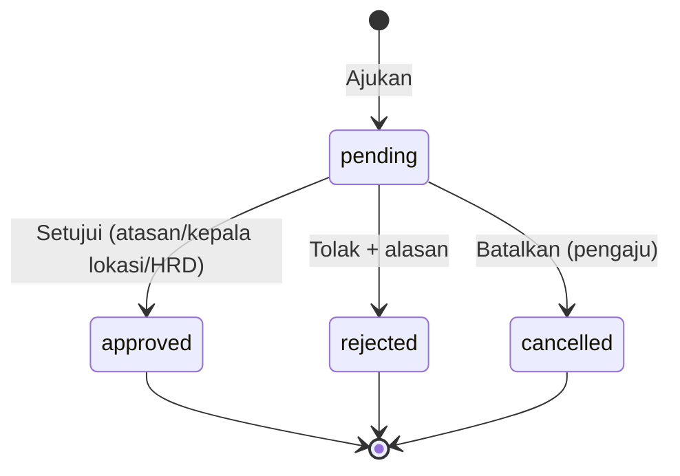

# 06 — Otorisasi, Role, Scope & Menu (Fase 0 + 0,5)

Model: **RBAC dinamis** (Spatie) + **scope data per role** + **Policy per resource**. Permission format `modul.aksi`. Role adalah kumpulan permission yang bisa diatur Administrator dari layar. Permission sendiri hanya dibuat oleh seeder dari dokumen ini (ADR-011).

## 1. Prinsip

1. **Least privilege.** Role baru dibuat tanpa permission.
2. **Permission ≠ scope.** Permission menentukan *boleh melakukan apa*, sedangkan `data_scope` menentukan *terhadap data siapa*.
3. **Cek di backend per resource.** Menyembunyikan menu hanya untuk UX. Data di luar scope menghasilkan **404**, bukan 403 (SEC-033).
4. **Maker-checker.** Tidak ada yang bisa menyetujui koreksi absennya sendiri, atau membuat/mengubah/membatalkan tugas luar kota yang memuat dirinya sendiri (SEC-031).
5. **Super Admin (Sintech) terpisah dari Owner.** Super Admin hanya untuk dukungan teknis. Owner bisa menonaktifkan akun Super Admin kapan saja, dan semua aksinya tercatat (SEC-009).
6. **Aksi sensitif butuh konfirmasi ulang password** (`password.confirm`, berlaku `security.password_confirm_minutes`): reset password pengguna, reset MFA, ubah role/permission, offboarding, ubah setting grup `security`, export audit.

## 2. Role Bawaan

| Kode | Nama | `data_scope` | `mfa_required` | `is_system` | Pemegang contoh |
|---|---|---|---|---|---|
| `super_admin` | Super Admin | `all` | ✅ | ✅ | Tim Sintech |
| `owner` | Owner | `all` | ✅ | ✅ | Pemilik CV |
| `administrator` | Administrator | `all` | ✅ | ❌ | Admin kantor / IT internal |
| `hrd` | HRD | `all` | ✅ | ❌ | Staf HRD |
| `kepala_lokasi` | Kepala Lokasi | `location` | ❌ | ❌ | Pimpinan unit kerja (kantor/toko/gudang) untuk SDM & presensi lokasinya |
| `supervisor` | Supervisor | `team` | ✅ | ❌ | Supervisor Sales |
| `pegawai` | Pegawai | `self` | ❌ | ✅ | Sales, driver, staf gudang, kasir |
| `admin_penjualan` | Admin Penjualan | `all` | ✅ | ❌ | Staf admin penjualan kantor (Paket A) |
| `kepala_gudang` | Kepala Gudang | `location` | ✅ | ❌ | Kepala Gudang Undaan (Paket A) |
| `staf_gudang` | Staf Gudang | `location` | ❌ | ❌ | Staf penerimaan & picking (Paket A) |
| `purchasing` | Purchasing | `all` | ✅ | ❌ | Staf pembelian (Paket A) |

Empat role terakhir ditambah Paket A (T-067, `15` §6.1). `supervisor` wajib MFA sejak T-067 karena memutuskan approval Paket A (PA-12); `kepala_lokasi` tetap tanpa MFA (PA-33). Instalasi yang sudah berjalan mendapat perubahan ini lewat migrasi data `add_paket_a_permissions_to_builtin_roles` (hanya menambah, tidak mencabut ubahan pengguna; PA-11). Karena aturan hak target ⊆ pelaku (§10) dan batas delegasi role (BR-031) tetap berlaku, akun `supervisor`, `kepala_lokasi`, dan keempat role Paket A hanya bisa dikelola Owner/super_admin; HRD dan Administrator tidak memegang izin Paket A mereka (PA-35, keputusan Mas 16 Nov 2026).

`super_admin` otomatis lolos semua permission lewat `Gate::before`, **kecuali** satu hal: Super Admin tidak bisa mengubah role/permission akun Owner. Role `is_system` tidak bisa dihapus atau diganti kodenya, tetapi permission-nya tetap bisa diubah, kecuali `super_admin` dan `owner` yang terkunci penuh. Satu pengguna bisa memegang beberapa role. Scope efektif = scope **terluas** dari role-role itu, dan MFA wajib bila salah satu role mewajibkan.

## 3. Daftar Permission (109)

| Modul | Permission | Arti |
|---|---|---|
| Dasbor | `dashboard.view` | Melihat dasbor |
| Pengaturan | `settings.view`, `settings.update` | Melihat / mengubah site setting |
| Penomoran | `sequences.view`, `sequences.update` | Melihat / mengubah pola penomoran |
| Referensi | `references.view`, `references.manage` | Melihat / mengelola daftar referensi |
| Pengguna | `users.view`, `users.create`, `users.update`, `users.deactivate`, `users.reset_password`, `users.reset_mfa`, `users.export` | Kelola akun |
| Role | `roles.view`, `roles.manage` | Melihat / mengelola role & matriks |
| Audit | `audit.view`, `audit.export` | Audit log & log keamanan |
| Wilayah | `regions.view` | Melihat master wilayah |
| Lokasi | `locations.view`, `locations.manage` | |
| Departemen | `departments.view`, `departments.manage` | |
| Jabatan | `positions.view`, `positions.manage` | |
| Pegawai | `employees.view`, `employees.create`, `employees.update`, `employees.delete`, `employees.view_sensitive`, `employees.offboard`, `employees.import`, `employees.export` | `view_sensitive` = buka NIK lengkap |
| Penugasan | `assignments.view`, `assignments.manage` | |
| Perangkat | `devices.view`, `devices.manage` | Setujui/tolak/cabut HP |
| Shift | `shifts.view`, `shifts.manage` | |
| Jadwal | `schedules.view`, `schedules.manage` | Pola & pengecualian |
| Hari libur | `holidays.view`, `holidays.manage` | |
| Presensi | `attendance.view`, `attendance.view_photo`, `attendance.export`, `attendance.self` | `self` = presensi & lihat milik sendiri via mobile. `view_photo` juga membuka koordinat presisi & diagram lokasi di detail presensi (T-038, keputusan Mas 15 Nov 2026) |
| Koreksi presensi | `attendance_corrections.view`, `attendance_corrections.create`, `attendance_corrections.approve` | `create` = mengajukan milik sendiri |
| Tugas luar kota | `field_trips.view`, `field_trips.manage`, `field_trips.request`, `field_trips.approve` | `manage` = buat/ubah/batalkan langsung berlaku; `request` = ajukan milik sendiri dari Pakis Pro (T-036A bagian 2); `approve` = putuskan pengajuan (bagian 2) |
| Persetujuan (Paket A) | `approvals.view`, `approvals.configure` | `view` = menu & tab "Saya ajukan"/"Semua"; calon penyetuju langkah aktif tetap bisa memutuskan tanpa izin ini (PA-27) |
| Lokasi stok & kendaraan (Paket A) | `stock_locations.view`, `stock_locations.manage`, `vehicles.view`, `vehicles.manage` | |
| Produk (Paket A) | `products.view`, `products.manage`, `product_registrations.manage` | `product_registrations` = izin edar |
| Prinsipal & supplier (Paket A) | `suppliers.view`, `suppliers.manage` | |
| Area & pelanggan (Paket A) | `sales_areas.view`, `sales_areas.manage`, `customers.view`, `customers.export`, `customers.manage`, `customers.verify`, `customers.merge`, `customers.change_phone`, `customers.change_phone_approve`, `credit_limits.set`, `credit_limits.set_high` | `export` = data sensitif (HP pemilik, PA-3) |
| Harga & promo (Paket A) | `prices.view`, `prices.manage`, `prices.publish`, `promotions.view`, `promotions.manage`, `promotions.approve` | |
| Pembelian (Paket A) | `purchase_orders.view`, `purchase_orders.create`, `purchase_orders.approve`, `purchase_orders.approve_high`, `goods_receipts.view`, `goods_receipts.create`, `goods_receipts.approve_short_shelf_life`, `purchase_returns.manage`, `purchase_returns.approve` | |
| Stok (Paket A) | `stock.view`, `stock.view_cost`, `stock.export`, `stock_transfers.view`, `stock_transfers.create`, `stock_transfers.receive`, `stock_transfers.approve_variance`, `stock_opnames.view`, `stock_opnames.manage`, `stock_opnames.approve_variance`, `stock_opnames.approve_variance_high`, `stock_quarantine.manage`, `stock_quarantine.release`, `stock_disposals.manage`, `stock_disposals.approve`, `serials.manage`, `serials.approve_swap` | `view_cost` = kolom HPP (SEC-107); `export` = dengan HPP/biaya |
| Impor master (Paket A) | `master_imports.manage` | |

54 izin pertama = Fase 0 + 0,5; 55 izin bertanda Paket A = `15` §6.3 (T-067). Izin baru tidak pernah otomatis jatuh ke role selain `owner`/`super_admin`: matriks role lain adalah daftar eksplisit di `RoleCatalog` (PA-11).

## 4. Matriks Kewenangan (default seeder)

✅ penuh · 🔸 terbatas oleh scope role · ❌ tidak. `super_admin` = semua ✅ (tidak ditampilkan). Tabel ini hanya memuat **izin Fase 0 + 0,5**; sel izin Paket A untuk 10 role yang sama ada di `15` §6.4 (sumber kebenaran, dibaca langsung oleh `PaketAMatrixTest`). Owner memegang semua izin Paket A dan terkunci (PA-10). Dari izin Fase 0, empat role Paket A hanya mendapat `dashboard.view` (PA-25).

| Permission | owner | administrator | hrd | kepala_lokasi | supervisor | pegawai | admin_penjualan | kepala_gudang | staf_gudang | purchasing |
|---|---|---|---|---|---|---|---|---|---|---|
| `dashboard.view` | ✅ | ✅ | ✅ | 🔸 | 🔸 | ❌ | ✅ | ✅ | ✅ | ✅ |
| `settings.view` | ✅ | ✅ | ❌ | ❌ | ❌ | ❌ | ❌ | ❌ | ❌ | ❌ |
| `settings.update` | ✅ | ✅ | ❌ | ❌ | ❌ | ❌ | ❌ | ❌ | ❌ | ❌ |
| `sequences.view` / `sequences.update` | ✅ | ✅ | ❌ | ❌ | ❌ | ❌ | ❌ | ❌ | ❌ | ❌ |
| `references.view` | ✅ | ✅ | ✅ | ❌ | ❌ | ❌ | ❌ | ❌ | ❌ | ❌ |
| `references.manage` | ✅ | ✅ | ✅ | ❌ | ❌ | ❌ | ❌ | ❌ | ❌ | ❌ |
| `users.view` | ✅ | ✅ | ✅ | ❌ | ❌ | ❌ | ❌ | ❌ | ❌ | ❌ |
| `users.create` / `users.update` | ✅ | ✅ | ✅ | ❌ | ❌ | ❌ | ❌ | ❌ | ❌ | ❌ |
| `users.deactivate` | ✅ | ✅ | ✅ | ❌ | ❌ | ❌ | ❌ | ❌ | ❌ | ❌ |
| `users.reset_password` | ✅ | ✅ | ✅ | ❌ | ❌ | ❌ | ❌ | ❌ | ❌ | ❌ |
| `users.reset_mfa` | ✅ | ✅ | ❌ | ❌ | ❌ | ❌ | ❌ | ❌ | ❌ | ❌ |
| `users.export` | ✅ | ✅ | ❌ | ❌ | ❌ | ❌ | ❌ | ❌ | ❌ | ❌ |
| `roles.view` | ✅ | ✅ | ❌ | ❌ | ❌ | ❌ | ❌ | ❌ | ❌ | ❌ |
| `roles.manage` | ✅ | ✅ | ❌ | ❌ | ❌ | ❌ | ❌ | ❌ | ❌ | ❌ |
| `audit.view` | ✅ | ✅ | ❌ | ❌ | ❌ | ❌ | ❌ | ❌ | ❌ | ❌ |
| `audit.export` | ✅ | ❌ | ❌ | ❌ | ❌ | ❌ | ❌ | ❌ | ❌ | ❌ |
| `regions.view` | ✅ | ✅ | ✅ | ❌ | ❌ | ❌ | ❌ | ❌ | ❌ | ❌ |
| `locations.view` | ✅ | ✅ | ✅ | 🔸 | ❌ | ❌ | ❌ | ❌ | ❌ | ❌ |
| `locations.manage` | ✅ | ✅ | ✅ | ❌ | ❌ | ❌ | ❌ | ❌ | ❌ | ❌ |
| `departments.view` / `positions.view` | ✅ | ✅ | ✅ | ❌ | ❌ | ❌ | ❌ | ❌ | ❌ | ❌ |
| `departments.manage` / `positions.manage` | ✅ | ✅ | ✅ | ❌ | ❌ | ❌ | ❌ | ❌ | ❌ | ❌ |
| `employees.view` | ✅ | ✅ | ✅ | 🔸 | 🔸 | ❌ | ❌ | ❌ | ❌ | ❌ |
| `employees.create` / `employees.update` | ✅ | ❌ | ✅ | ❌ | ❌ | ❌ | ❌ | ❌ | ❌ | ❌ |
| `employees.delete` | ✅ | ❌ | ✅ | ❌ | ❌ | ❌ | ❌ | ❌ | ❌ | ❌ |
| `employees.view_sensitive` | ✅ | ❌ | ✅ | ❌ | ❌ | ❌ | ❌ | ❌ | ❌ | ❌ |
| `employees.offboard` | ✅ | ❌ | ✅ | ❌ | ❌ | ❌ | ❌ | ❌ | ❌ | ❌ |
| `employees.import` / `employees.export` | ✅ | ❌ | ✅ | ❌ | ❌ | ❌ | ❌ | ❌ | ❌ | ❌ |
| `assignments.view` | ✅ | ✅ | ✅ | 🔸 | 🔸 | ❌ | ❌ | ❌ | ❌ | ❌ |
| `assignments.manage` | ✅ | ❌ | ✅ | ❌ | ❌ | ❌ | ❌ | ❌ | ❌ | ❌ |
| `devices.view` | ✅ | ✅ | ✅ | 🔸 | ❌ | ❌ | ❌ | ❌ | ❌ | ❌ |
| `devices.manage` | ✅ | ✅ | ✅ | ❌ | ❌ | ❌ | ❌ | ❌ | ❌ | ❌ |
| `shifts.view` | ✅ | ✅ | ✅ | 🔸 | ❌ | ❌ | ❌ | ❌ | ❌ | ❌ |
| `shifts.manage` | ✅ | ❌ | ✅ | ❌ | ❌ | ❌ | ❌ | ❌ | ❌ | ❌ |
| `schedules.view` | ✅ | ✅ | ✅ | 🔸 | 🔸 | ❌ | ❌ | ❌ | ❌ | ❌ |
| `schedules.manage` | ✅ | ❌ | ✅ | 🔸 | ❌ | ❌ | ❌ | ❌ | ❌ | ❌ |
| `holidays.view` | ✅ | ✅ | ✅ | ✅ | ✅ | ❌ | ❌ | ❌ | ❌ | ❌ |
| `holidays.manage` | ✅ | ❌ | ✅ | ❌ | ❌ | ❌ | ❌ | ❌ | ❌ | ❌ |
| `attendance.view` | ✅ | ✅ | ✅ | 🔸 | 🔸 | ❌ | ❌ | ❌ | ❌ | ❌ |
| `attendance.view_photo` | ✅ | ❌ | ✅ | 🔸 | 🔸 | ❌ | ❌ | ❌ | ❌ | ❌ |
| `attendance.export` | ✅ | ❌ | ✅ | 🔸 | ❌ | ❌ | ❌ | ❌ | ❌ | ❌ |
| `attendance.self` | ✅ | ✅ | ✅ | ✅ | ✅ | ✅ | ❌ | ❌ | ❌ | ❌ |
| `attendance_corrections.view` | ✅ | ✅ | ✅ | 🔸 | 🔸 | ❌ | ❌ | ❌ | ❌ | ❌ |
| `attendance_corrections.create` | ✅ | ✅ | ✅ | ✅ | ✅ | ✅ | ❌ | ❌ | ❌ | ❌ |
| `attendance_corrections.approve` | ✅ | ❌ | ✅ | 🔸 | 🔸 | ❌ | ❌ | ❌ | ❌ | ❌ |
| `field_trips.view` | ✅ | ✅ | ✅ | 🔸 | 🔸 | ❌ | ❌ | ❌ | ❌ | ❌ |
| `field_trips.manage` | ✅ | ❌ | ✅ | 🔸 | 🔸 | ❌ | ❌ | ❌ | ❌ | ❌ |
| `field_trips.request` | ✅ | ✅ | ✅ | ✅ | ✅ | ✅ | ❌ | ❌ | ❌ | ❌ |
| `field_trips.approve` | ✅ | ❌ | ✅ | 🔸 | 🔸 | ❌ | ❌ | ❌ | ❌ | ❌ |

Catatan: `administrator` sengaja **tidak** bisa membuka NIK, mengubah data pegawai, atau melihat foto. Peran ini mengurus sistem, bukan data SDM. Pemisahan ini mengurangi risiko orang dalam (threat T-05, `09` §2).

## 5. Scope Data

| `data_scope` | Pegawai yang terlihat | Diterapkan pada |
|---|---|---|
| `all` | Semua | — |
| `location` | Pegawai yang punya penugasan aktif (utama **atau tambahan**) di **lokasi pengguna**: (a) lokasi penugasan aktif pengguna (utama + tambahan/rangkap, BR-051, keputusan Mas 15 Nov 2026), dan (b) lokasi yang `head_employee_id` = pegawai pengguna. Untuk `attendance_days` dipakai snapshot `attendance_days.location_id`. | employees, assignments, devices (lewat user→employee), schedules, attendance_days, attendance_corrections, locations (hanya lokasinya), shifts (hanya yang dipakai pegawai di lokasinya), users (lewat `users.employee_id`; akun tanpa pegawai hanya terlihat scope `all`, keputusan Mas 15 Nov 2026) |
| `team` | Diri sendiri + bawahan langsung & tidak langsung lewat `assignments.supervisor_employee_id` (penugasan aktif, CTE rekursif maks 5 tingkat) | sama dengan baris atas |
| `self` | Diri sendiri | API mobile milik sendiri |

**Batch impor (`import_batches`/`import_rows`, T-027):** berisi data pegawai (nama, nomor, NIK termasking), jadi scope `all` melihat semua batch, scope lain hanya batch yang diunggahnya sendiri; batch lain → 404. Lokasi & atasan di berkas harus dalam scope pengunggah (baris galat "tidak ditemukan"). Profil pemetaan tidak memuat data pegawai sehingga dipakai bersama pemegang `employees.import`.

Implementasi: `App\Domain\Access\DataScope::apply(Builder $q, User $u, string $employeeColumn)` dipanggil oleh setiap `*Listing` dan setiap Policy `view/update`; `DataScope::allows($u, $employeeId)` untuk Policy. Pengguna tanpa pegawai (mis. Super Admin) dengan scope selain `all` tidak melihat data apa pun. Struktur organisasi dibaca lewat `OrgStructure` (`DatabaseOrgStructure`: penugasan aktif = `start_date ≤ hari ini` dan `end_date` kosong/≥ hari ini, tanggal lokal). `team` dihitung per tingkat (≤ 5 query, pengaman struktur melingkar) — hasil sama dengan CTE rekursif 5 tingkat (T-019).

Shift (T-033, `App\Domain\Attendance\Support\ShiftScope`): scope `all` melihat semua shift; scope lain hanya shift yang dipakai pola jadwal pegawai dalam DataScope-nya. Sebelum tabel pola jadwal ada (T-035) tidak ada shift yang "dipakai", jadi scope sempit tidak melihat shift apa pun (fail-closed). `{shift}` di luar scope → 404.

## 6. Aturan Persetujuan Koreksi (BR-069)

Pengguna **U** boleh memutuskan koreksi **K** bila semua syarat terpenuhi:
1. `K.status = pending`.
2. `U` punya `attendance_corrections.approve`.
3. `K.employee_id ≠ U.employee_id` (tidak menyetujui milik sendiri).
4. Salah satu dari: `U.employee_id = K.approver_employee_id` (atasan langsung saat diajukan), **atau** pegawai `K` masuk scope `U` dan scope `U` adalah `all` atau `location`.

Bila atasan langsung tidak ada atau nonaktif, koreksi tetap bisa diputuskan oleh `kepala_lokasi` di lokasi itu atau HRD (fallback lewat syarat 4b).

**Presensi manual** (keputusan Mas 16 Nov 2026, BR-069): pengguna boleh mengisi presensi atas nama pegawai **P** bila syarat 2–4 di atas terpenuhi terhadap P (syarat 4a memakai atasan langsung P pada penugasan utama hari ini). Hasilnya koreksi yang langsung `approved`. Tidak ada izin baru.

Di API, koreksi yang tidak boleh diputuskan U (di luar syarat 4) → 404; milik sendiri → 403 `CORRECTION_SELF_APPROVAL`; sudah bukan `pending` → 409 `STATE_CONFLICT`.

## 7. Transisi Status

### 7.1 Koreksi absen

| Dari | Aksi | Role berwenang | Ke |
|---|---|---|---|
| — | Ajukan | Pegawai sendiri (`attendance_corrections.create`) | `pending` |
| `pending` | Batalkan | Pengaju | `cancelled` |
| `pending` | Setujui | Sesuai §6 | `approved` |
| `pending` | Tolak (alasan wajib) | Sesuai §6 | `rejected` |
| `approved`/`rejected`/`cancelled` | — | — | final |

### 7.2 Perangkat

| Dari | Aksi | Oleh | Ke |
|---|---|---|---|
| — | Login pertama (auto-approve aktif & belum punya perangkat) | sistem | `active` |
| — | Login dari HP baru | sistem | `pending` |
| `pending` | Setujui | `devices.manage` | `active` (perangkat aktif lama → `replaced`, token lama dicabut) |
| `pending` | Tolak (alasan) | `devices.manage` | `rejected` |
| `active` | Cabut | `devices.manage`, atau offboarding | `revoked` |
| `pending` | Pegawai dinonaktifkan (offboarding, keputusan Mas 15 Nov 2026) | sistem | `rejected` (alasan "Pegawai dinonaktifkan") |

### 7.2a Tugas luar kota (T-036A)

| Dari | Aksi | Oleh | Ke |
|---|---|---|---|
| — | Buat (langsung berlaku) | `field_trips.manage`, semua pegawai tugas dalam scope | `approved` |
| `approved` | Ubah (belum selesai) / Batalkan | `field_trips.manage`, semua pegawai tugas dalam scope | `approved` / `cancelled` |
| — | Ajukan dari Pakis Pro | pegawai sendiri (`field_trips.request`) — bagian 2 (selesai 16 Nov 2026) | `pending` |
| `pending` | Setujui / Tolak (alasan wajib saat menolak) | `field_trips.approve` mengikuti §6 (atasan langsung pengaju dihitung saat diputuskan, atau scope `all`/`location`; bukan milik sendiri) — bagian 2 | `approved` / `rejected` |
| `rejected`/`cancelled` | — | — | final |

Tugas terlihat bila **salah satu** pegawainya dalam scope pelaku (selain itu 404); mengubah/membatalkan butuh **semua** pegawainya dalam scope (selain itu 403), agar atasan tidak mengubah tugas pegawai lokasi lain. **Maker-checker (SEC-031, keputusan Mas 16 Nov 2026):** pelaku tidak bisa membuat tugas yang memuat dirinya sendiri (galat validasi) dan tidak bisa mengubah/membatalkan tugas yang memuat dirinya (403), karena tugas yang dibuat langsung berlaku; tugas untuk diri sendiri dibuat orang lain, atau diajukan dari Pakis Pro dan disetujui orang lain (bagian 2).

### 7.3 Pegawai
`active` → **Nonaktifkan** (`employees.offboard`) → `inactive` → **Aktifkan kembali** (`employees.offboard`, wajib penugasan baru) → `active`.

### 7.4 Batch import
`uploaded` → (pemetaan disimpan) `mapped` → (validasi selesai) `validated` → (proses) `processing` → `completed` / `failed`. Dari `uploaded`/`mapped`/`validated` bisa ke `cancelled`.

## 8. Matriks Menu (web)

Menu tampil bila pengguna punya permission pada kolom "Syarat". Grup dikelompokkan dalam **seksi** berjudul (teks kecil, tidak bisa diklik; keputusan Mas 16 Nov 2026): **HRIS** = Unit Kerja, Kepegawaian, Presensi (Fase HR menambah grupnya di seksi ini); **Sistem** = Pengguna & Akses, Pengaturan, Audit. Modul bisnis berikutnya menambah seksi baru. **Distribusi** (Paket A, keputusan Mas 16 Nov 2026) = Penjualan, Persediaan, Pembelian, Master (`15` §6.5), **paling atas** sebelum HRIS. Urutan tabel = urutan sidebar.

| Seksi | Grup | Menu | Syarat | owner | admin | hrd | kepala_lokasi | supervisor |
|---|---|---|---|---|---|---|---|---|
| — | — | Dasbor | `dashboard.view` | ✅ | ✅ | ✅ | ✅ | ✅ |
| — | — | Persetujuan (angka = menunggu keputusan saya) | `approvals.view`, atau ada yang menunggu keputusannya (PA-27) | ✅ | ❌ | ❌ | ✅ | ✅ |
| Distribusi | Penjualan | Pelanggan (T-073; role Paket A: `15` §6.4) | `customers.view` | ✅ | ❌ | ❌ | ❌ | ✅ |
| Distribusi | Penjualan | Verifikasi Kios (T-074; antrean verifikasi; role Paket A: `15` §6.4) | `customers.verify` | ✅ | ❌ | ❌ | ❌ | ✅ |
| Distribusi | Penjualan | Area Penjualan (T-073; role Paket A: `15` §6.4) | `sales_areas.view` | ✅ | ✅ | ❌ | ❌ | ✅ |
| Distribusi | Penjualan | Daftar Harga (T-075; role Paket A: `15` §6.4) | `prices.view` | ✅ | ❌ | ❌ | ❌ | ✅ |
| Distribusi | Penjualan | Promo (T-076; role Paket A: `15` §6.4) | `promotions.view` | ✅ | ❌ | ❌ | ❌ | ✅ |
| Distribusi | Pembelian | Purchase Order (T-079; role Paket A: `15` §6.4, kepala gudang terbatas lokasinya) | `purchase_orders.view` | ✅ | ❌ | ❌ | ❌ | ❌ |
| Distribusi | Pembelian | Supplier (T-072; role Paket A: `15` §6.4) | `suppliers.view` | ✅ | ❌ | ❌ | ❌ | ❌ |
| Distribusi | Pembelian | Prinsipal (T-072; role Paket A: `15` §6.4) | `suppliers.view` | ✅ | ❌ | ❌ | ❌ | ❌ |
| Distribusi | Master | Produk (T-070; role Paket A: `15` §6.4) | `products.view` | ✅ | ✅ | ❌ | ✅ | ✅ |
| Distribusi | Master | Izin Edar (T-071; role Paket A: `15` §6.4) | `products.view` | ✅ | ✅ | ❌ | ✅ | ✅ |
| Distribusi | Master | Kategori (T-069; role Paket A: `15` §6.4) | `products.view` | ✅ | ✅ | ❌ | ✅ | ✅ |
| Distribusi | Master | Lokasi Stok (T-068; role Paket A: `15` §6.4) | `stock_locations.view` | ✅ | ✅ | ❌ | ✅ | ✅ |
| Distribusi | Master | Kendaraan (T-068; role Paket A: `15` §6.4) | `vehicles.view` | ✅ | ✅ | ❌ | ✅ | ✅ |
| HRIS | Unit Kerja | Lokasi | `locations.view` | ✅ | ✅ | ✅ | ✅ | ❌ |
| HRIS | Unit Kerja | Departemen | `departments.view` | ✅ | ✅ | ✅ | ❌ | ❌ |
| HRIS | Unit Kerja | Jabatan | `positions.view` | ✅ | ✅ | ✅ | ❌ | ❌ |
| HRIS | Kepegawaian | Pegawai | `employees.view` | ✅ | ✅ | ✅ | ✅ | ✅ |
| HRIS | Kepegawaian | Penugasan | `assignments.view` | ✅ | ✅ | ✅ | ✅ | ✅ |
| HRIS | Kepegawaian | Impor Pegawai | `employees.import` | ✅ | ❌ | ✅ | ❌ | ❌ |
| HRIS | Presensi | Presensi Harian | `attendance.view` | ✅ | ✅ | ✅ | ✅ | ✅ |
| HRIS | Presensi | Rekap Bulanan | `attendance.view` | ✅ | ✅ | ✅ | ✅ | ✅ |
| HRIS | Presensi | Koreksi Presensi | `attendance_corrections.view` | ✅ | ✅ | ✅ | ✅ | ✅ |
| HRIS | Presensi | Jadwal | `schedules.view` | ✅ | ✅ | ✅ | ✅ | ✅ |
| HRIS | Presensi | Shift | `shifts.view` | ✅ | ✅ | ✅ | ✅ | ❌ |
| HRIS | Presensi | Hari Libur | `holidays.view` | ✅ | ✅ | ✅ | ✅ | ✅ |
| HRIS | Presensi | Tugas Luar Kota | `field_trips.view` | ✅ | ✅ | ✅ | ✅ | ✅ |
| HRIS | Presensi | Perangkat | `devices.view` | ✅ | ✅ | ✅ | ✅ | ❌ |
| Sistem | Pengguna & Akses | Pengguna | `users.view` | ✅ | ✅ | ✅ | ❌ | ❌ |
| Sistem | Pengguna & Akses | Role & Hak Akses | `roles.view` | ✅ | ✅ | ❌ | ❌ | ❌ |
| Sistem | Pengaturan | Pengaturan Umum | `settings.view` | ✅ | ✅ | ❌ | ❌ | ❌ |
| Sistem | Pengaturan | Penomoran | `sequences.view` | ✅ | ✅ | ❌ | ❌ | ❌ |
| Sistem | Pengaturan | Referensi | `references.view` | ✅ | ✅ | ✅ | ❌ | ❌ |
| Sistem | Pengaturan | Wilayah | `regions.view` | ✅ | ✅ | ✅ | ❌ | ❌ |
| Sistem | Pengaturan | Aturan Persetujuan | `approvals.configure` | ✅ | ❌ | ❌ | ❌ | ❌ |
| Sistem | Audit | Audit Log | `audit.view` | ✅ | ✅ | ❌ | ❌ | ❌ |
| Sistem | Audit | Log Keamanan | `audit.view` | ✅ | ✅ | ❌ | ❌ | ❌ |
| — | Header | Notifikasi, Unduhan, Profil | auth | ✅ | ✅ | ✅ | ✅ | ✅ |

Persetujuan & Aturan Persetujuan (T-067, `15` §6.5): role Paket A pemegang `approvals.view` (admin_penjualan, kepala_gudang, purchasing) juga melihat menu Persetujuan; staf_gudang tidak. Calon penyetuju tanpa `approvals.view` (mis. atasan langsung atau kepala lokasi ber-role HRD) boleh membuka tab "Menunggu saya" (PA-27), jadi menu Persetujuan juga tampil baginya **selama ada permintaan yang menunggu keputusannya**; tanpa itu menu tersembunyi. Angka menu dihitung `ApprovalVisibility::pendingCountFor`, sama dengan isi tab itu.

Penjualan (T-073, `15` §6.5): Pelanggan, Verifikasi Kios (T-074), dan Area Penjualan juga tampil untuk `admin_penjualan`; Daftar Harga (T-075) dan Promo (T-076) disisipkan di grup ini oleh task masing-masing. Karena menu Pelanggan ada, pemegang `customers.view` tanpa izin menu lain boleh masuk web (BR-017).

Role `pegawai` saja **tidak** bisa masuk web admin. Login web ditolak dengan pesan "Akun Anda hanya untuk aplikasi Pakis Pro" bila pengguna tidak punya satu pun permission yang membuka menu di atas (BR-017).

## 9. Menu Pakis Pro (mobile)

| Tab/Layar | Syarat |
|---|---|
| Absen (beranda) | `attendance.self` |
| Riwayat & Rekap | `attendance.self` |
| Koreksi Saya | `attendance_corrections.create` |
| Persetujuan | `attendance_corrections.approve` (tab muncul hanya bila punya) |
| Notifikasi | auth |
| Profil (ubah password, keluar sesi lain, info perangkat) | auth |

## 10. Implementasi

- Permission dicek lewat Policy (`EmployeePolicy`, `AttendanceDayPolicy`, `AttendanceCorrectionPolicy`, dst.). Controller memakai atribut `#[Authorize]` (Laravel 13) atau `$this->authorize()`.
- Route-model binding untuk resource ber-scope memakai trait `App\Support\Authorization\ScopedRouteBinding` (model menyebut `scopedEmployeeColumn()`), sehingga ID di luar scope menghasilkan 404. Lookup ber-scope cukup mengisi `LookupSource::scopeColumn()`.
- Super Admin lolos semua permission lewat `Gate::before`, **kecuali** ability akun yang dilindungi Owner (`users.manage-account`, `users.assign-roles`, `users.reset-password-of`, `users.reset-mfa-of`, `UserPolicy`): bukan akun sendiri, akun Owner hanya oleh Owner (SEC-009), dan **hak target ⊆ hak pelaku** — semua permission & scope akun target harus dimiliki pelaku (T-020, keputusan Mas 15 Nov 2026). Akibatnya dengan matriks default: Administrator hanya bisa mengelola akun ber-role Pegawai (dan Administrator lain), HRD mengelola Pegawai, akun HRD & Administrator dikelola Owner. Sejak T-067 Kepala Lokasi, Supervisor, dan keempat role Paket A memegang izin Paket A yang tidak dimiliki HRD/Administrator, sehingga akun mereka hanya dikelola Owner/super_admin (PA-35, keputusan Mas 16 Nov 2026; aturan tidak dilonggarkan).
- Penetapan role (T-020, `AssignUserRoles`): role yang ditambahkan/dilepas harus seluruh permission-nya dimiliki pelaku dan scope-nya tidak lebih luas; role `owner`/`super_admin` hanya oleh Owner.
- Gerbang web BR-017 (`RequireWebMenuAccess`) berjalan sebelum route binding ber-scope (prioritas middleware), sehingga akun tanpa menu web selalu dikeluarkan, bukan menerima 404.
- Test: `tests/Feature/Authorization/PermissionMatrixTest` (role × permission, route perwakilan per modul) dan trait `Tests\Support\AssertsIdor` + `FakeOrgStructure` untuk test IDOR modul.
- `HandleInertiaRequests` membagikan `auth.permissions` (array) dan `auth.menu` (sudah difilter server) ke frontend.
- Perubahan role/permission/penugasan → `security_events` (`role_changed`/`permission_changed`) + `audit_logs`, dan cache permission Spatie dibersihkan.

## 11. Edge Case Otorisasi

| Kasus | Perilaku |
|---|---|
| Pegawai merangkap dua role (mis. `kepala_lokasi` + `supervisor`) | Permission = gabungan. Scope = terluas (`location` > `team`). |
| Atasan dimutasi saat koreksi masih `pending` | `approver_employee_id` tetap atasan lama. Atasan baru bisa memutuskan lewat §6 syarat 4b bila scope-nya cocok. Atasan lama kehilangan akses bila pegawai keluar scope-nya, dan HRD tetap bisa. |
| Atasan langsung nonaktif / tidak ada | Fallback ke kepala lokasi / HRD (§6). Dasbor HRD menampilkan "koreksi tanpa atasan". |
| Lokasi dilebur | Nonaktifkan lokasi lama, mutasi massal penugasan ke lokasi baru (tanggal efektif). Snapshot `attendance_days.location_id` lama tidak berubah. |
| Owner tidak sengaja mencabut `roles.manage` dari semua role | Role `owner` dikunci penuh (`is_system`, permission tidak bisa dikurangi), jadi Owner selalu bisa memulihkan. |
| Super Admin mengubah Owner | Ditolak (§2). |
