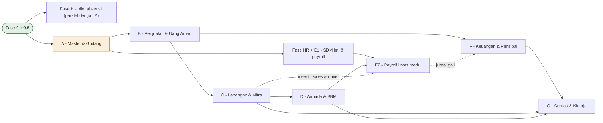
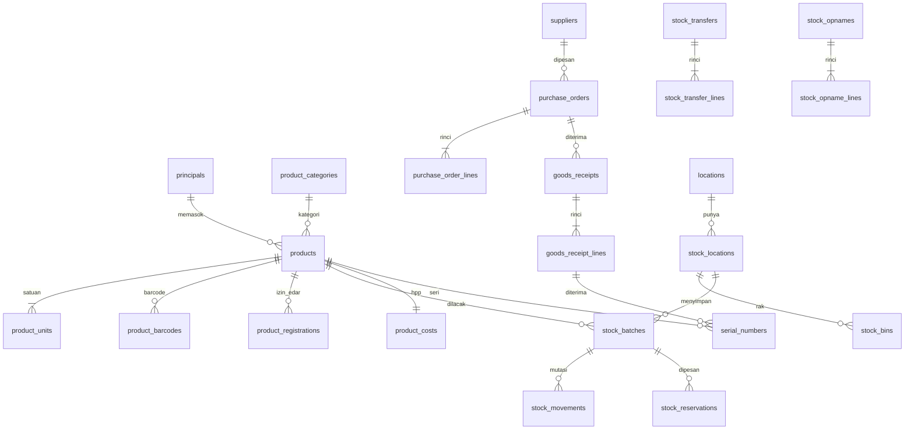
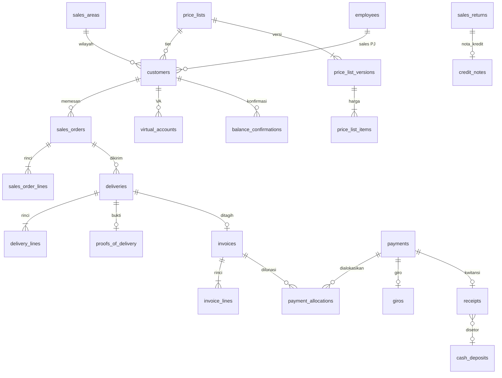
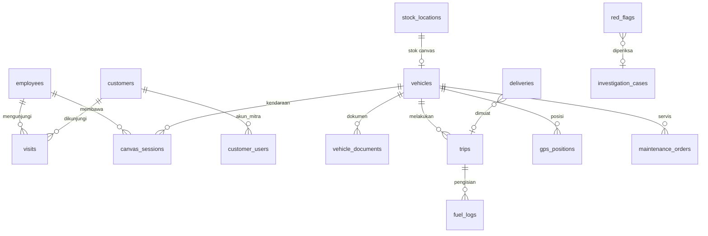
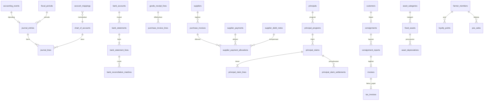

# 14 — Roadmap Pengembangan Lengkap (Kerangka Lintas Modul)

**Status:** Lapis 1, kerangka. Berlaku untuk seluruh 66 modul konsep **PAKIS ONE v1.4 (final)**.
**Versi:** Paket Dev Lengkap v1.4 · 16 November 2026
**Hubungan dengan dokumen lain:** `00`–`13` tetap menjadi sumber kebenaran untuk Fase 0, 0,5, dan HR. Dokumen ini menetapkan **kontrak lintas modul** untuk Paket A–G: nama domain, tabel inti, event akuntansi, penomoran, grup setting, role, state machine, dan integrasi. Detail siap eksekusi tiap paket ditulis di dokumen paket (`15-PAKET-A-…`, `16-PAKET-B-…`, dst.) saat paket itu dirinci.

## 0. Cara Memakai Dokumen Ini

| Lapis | Isi | Status per paket |
|---|---|---|
| **1. Kerangka** (dokumen ini + `TASKS_ROADMAP.md`) | Keputusan lintas modul, ERD global, outline task | Semua paket |
| **2. Detail siap eksekusi** (dokumen paket + `TASKS_PAKET_X.md`) | DDL final, kontrak API, matriks permission, katalog listing, BR, SEC, kriteria penerimaan per task | Dibuat bertahap: A + B lebih dulu, paket berikutnya saat paket sebelumnya ±70% |

**Aturan agent:** hanya kerjakan task dari paket berstatus **Siap eksekusi** di §3. Outline di `TASKS_ROADMAP.md` **bukan** task yang boleh dikerjakan. Bila task siap eksekusi bertentangan dengan dokumen ini, berhenti dan laporkan (aturan berhenti `CLAUDE.md` §5).

## 1. Penyesuaian Resmi terhadap Konsep v1.4

Cakupan fungsional konsep v1.4 final dan tidak diubah. Hal teknis berikut mengikuti keputusan yang sudah berjalan di repo:

| # | Konsep v1.4 | Dipakai di pengembangan | Alasan |
|---|---|---|---|
| P-1 | Semua tabel bisnis punya `tenant_id` | **Tidak ada `tenant_id`** | ADR-001 (single-tenant) + model distribusi self-hosted: satu instalasi = satu distributor |
| P-2 | Laravel 13 (PHP 8.4), MySQL 8.4 | Versi di `03-ARCHITECTURE.md` §5 repo (PHP 8.5; CI MariaDB 11.8) | Sudah terkunci di T-001/T-002 |
| P-3 | Kode role `OWN`, `SLS`, …; permission berbahasa Indonesia (`produk.manage`) | Kode role & permission **bahasa Inggris** snake_case (`owner`, `sales`, `products.manage`) | Konvensi `06-AUTHORIZATION.md`. Pemetaan di §10 |
| P-4 | Status berbahasa Indonesia (`diajukan`, `disetujui`) | Kode status bahasa Inggris, label UI bahasa Indonesia | Konvensi enum Fase 0. Pemetaan di §11 |
| P-5 | Aturan bisnis `BR-01`…`BR-48` | **`BR-101`…`BR-148`** (BR-1NN = konsep BR-NN) | Nomor BR-001–BR-099 sudah dipakai Fase 0/HR. Pemetaan lengkap di §13 |
| P-6 | `stock_batches.warehouse_id` | `stock_batches.stock_location_id` → tabel `stock_locations` (gudang, toko, kendaraan canvas) | CORE-02 menyebut kendaraan canvas sebagai lokasi stok |
| P-7 | Object storage S3-compatible | Disk privat Laravel (Fase 0). Pindah ke S3-compatible cukup lewat konfigurasi `filesystems` | Self-hosted. Tetap kompatibel bila distributor punya object storage (OQ-104) |
| P-8 | Roadmap Fase 0–4 | Paket A–G (§3) | Urutan disesuaikan dengan yang sudah dibangun (Fase 0, 0,5, HR) |
| P-9 | BR-15: absen di luar radius **tidak ditolak**, berstatus "perlu verifikasi" | Fase 0,5 **menolak** absen di luar radius (BR-064), dengan jalan keluar tugas luar kota (BR-071) dan presensi manual oleh atasan (T-040) | Sudah dibangun & diputuskan di repo. Bila Pakis ingin perilaku konsep, tambahkan setting mode "terima + tandai" lewat task baru |

## 2. Peta 66 Modul → Paket → Status

Status per 16 Nov 2026 berdasarkan `TASKS.md` repo: ✅ selesai · 🟡 sebagian · ⬜ belum.

| Kode | Modul | Paket | Status | Catatan |
|---|---|---|---|---|
| CORE-01 | Akses, Peran & Keamanan | Fase 0 | ✅ | Role baru ditambah per paket (§8) |
| CORE-02 | Struktur Organisasi | Fase 0 + A | 🟡 | Lokasi sudah ada. Lokasi stok & kendaraan canvas di A |
| CORE-03 | Approval Berjenjang | A | 🟡 | Koreksi absen punya alur sendiri. Mesin approval generik di A (ADR-105) |
| CORE-04 | Notifikasi | Fase 0 + C | 🟡 | In-app, email, Telegram sudah. Driver WhatsApp nyata di C (OQ-004), push di C (OQ-005) |
| CORE-05 | Audit Log | Fase 0 | ✅ | |
| CORE-06 | Import Data | Fase 0 + A + B | 🟡 | Pegawai sudah. Produk, pelanggan, harga, saldo stok (A); saldo piutang (B) |
| MST-01 | Produk & Satuan | A | ⬜ | |
| MST-02 | Izin Edar Produk | A | ⬜ | |
| MST-03 | Prinsipal & Supplier | A | ⬜ | |
| MST-04 | Pelanggan & Area | A | ⬜ | |
| MST-05 | Harga & Promo | A | ⬜ | |
| PRC-01 | PO & Penerimaan Barang | A | ⬜ | |
| PRC-02 | Program Prinsipal | F | ⬜ | |
| PRC-03 | Hutang Dagang | F | ⬜ | |
| INV-01 | Multi-Gudang & Lokasi Rak | A | ⬜ | |
| INV-02 | Batch & Kedaluwarsa | A | ⬜ | |
| INV-03 | Mutasi Stok | A | ⬜ | |
| INV-04 | Stock Opname | A | ⬜ | |
| INV-05 | Barang Rusak, Retur & Pemusnahan | A | ⬜ | |
| INV-06 | Saran Pembelian | F | ⬜ | |
| SAL-01 | Pesanan Penjualan | B (web) + C (mobile) | ⬜ | |
| SAL-02 | Kredit & Tempo | B | ⬜ | |
| SAL-03 | Retur Penjualan | B | ⬜ | |
| SAL-04 | Target & Insentif Sales | C | ⬜ | Insentif diteruskan ke payroll (E) |
| SAL-05 | Permintaan Tak Terpenuhi | B | ⬜ | |
| SAL-06 | Konsinyasi | F | ⬜ | |
| FLD-01 | Kunjungan & Rute | C | ⬜ | |
| FLD-02 | Canvas | C | ⬜ | |
| FLD-03 | Penagihan & Setoran | B (web) + C (mobile) | ⬜ | Setoran harian web sejak B |
| FLD-04 | Harga & Aktivitas Pesaing | C | ⬜ | |
| MKT-01 | Promosi & Demplot | C | ⬜ | |
| DLV-01 | Pengiriman | B (web) + C (driver) | ⬜ | |
| GAR-01 | Nomor Seri & Garansi | A (terima) + B (jual) | ⬜ | |
| GAR-02 | Servis & Klaim Garansi | C | ⬜ | |
| POS-01 | Kasir Toko | B | ⬜ | PWA offline (ADR-110) |
| POS-02 | Member Petani | F | ⬜ | |
| FIN-01 | Piutang & Pembayaran | B | ⬜ | VA di B, QRIS di C |
| FIN-02 | Kas, Bank & Akuntansi | F | ⬜ | Event akuntansi dicatat sejak A (ADR-104) |
| FIN-03 | Perpajakan | F | ⬜ | Bergantung status PKP (OQ-101) |
| FIN-04 | Biaya Operasional & Kas Kecil | B | ⬜ | |
| FIN-05 | Aset Tetap | F | ⬜ | |
| MOB-01 | Pakis Pro | Fase 0,5 + C | 🟡 | Absensi sudah/berjalan. Mode sales, canvas, driver, gudang, owner di C |
| MOB-02 | Pakis Mitra | C | ⬜ | Aplikasi terpisah (ADR-109) |
| WEB-01 | Katalog Publik | B | ⬜ | Hubungan dengan `katalog.pakisjayaabadi.com` (OQ-108) |
| WEB-02 | Portal Prinsipal | G | ⬜ | |
| WEB-03 | Marketplace Alat Pertanian | G | ⬜ | |
| BI-01 | Dashboard & Laporan | B → G | 🟡 | Dasbor absensi (T-044). Dasbor penjualan/piutang di B, berkembang tiap paket |
| AI-01 | Asisten Klinik Tani | G | ⬜ | |
| AI-02 | Prediksi Kebutuhan Musim | G | ⬜ | |
| AI-03 | Deteksi Anomali | G | ⬜ | Rule-based red flag lebih dulu (C) |
| FLT-01 | Kendaraan & Dokumen | D | ⬜ | |
| FLT-02 | Pelacakan GPS | D | ⬜ | |
| FLT-03 | Trip & Uang Jalan | D | ⬜ | |
| FLT-04 | BBM | D | ⬜ | |
| FLT-05 | Servis & Perawatan | D | ⬜ | |
| FLT-06 | Skor Driver & Biaya Armada | G | ⬜ | |
| AUD-01 | Konfirmasi Saldo & Pengaduan Kios | B | ⬜ | |
| AUD-02 | Red Flag & Investigasi | C | ⬜ | |
| HR-01 | Pegawai & Penempatan | Fase 0 + E | 🟡 | Inti sudah. Riwayat lengkap = Fase HR (T-049–T-058) |
| HR-02 | Jadwal & Shift | Fase 0,5 | ✅ | |
| HR-03 | Absensi | Fase 0,5 | 🟡 | T-039–T-045 berjalan |
| HR-04 | Cuti, Izin & Lembur | E | ⬜ | T-060, T-061 (boleh dimajukan, lihat §3.2) |
| HR-05 | Payroll | E | ⬜ | T-063–T-065 |
| HR-06 | Kasbon & Potongan | E | ⬜ | T-062 |
| HR-07 | Kinerja (KPI) | G | ⬜ | Penilaian manual T-066 di E, KPI otomatis di G |
| HR-08 | Masuk & Keluar Pegawai | Fase 0 + E | 🟡 | Offboarding akses sudah (T-026). Checklist, serah terima aset, clearance setoran & stok canvas di E |

## 3. Paket, Urutan & Dependensi

### 3.1 Daftar paket

| Paket | Nama | Modul utama | Outline task | Estimasi kasar* | Status |
|---|---|---|---|---|---|
| Fase 0 + 0,5 | Fondasi & Absensi | CORE-01/05, HR-01..03 | T-001–T-048 | ±270 jam | Berjalan (T-039 dst.) |
| HR | Riwayat Kepegawaian | HR-01 (lanjut), HR-04..06 | T-049–T-066 | ±132 jam | Dikerjakan **setelah Paket A** (PA-8, keputusan 16 Nov 2026), bersama Paket E1 |
| **A** | Master & Gudang | CORE-02/03/06, MST-01..05, PRC-01, INV-01..05, GAR-01 (terima) | T-067–T-087 + T-085A | ±170 jam | ✅ Dirinci: `15` + `TASKS_PAKET_A.md` (22 task) |
| **B** | Penjualan & Uang Aman | SAL-01..03/05, DLV-01 (web), FIN-01/04, FLD-03 (web), AUD-01, POS-01, GAR-01 (jual), WEB-01, BI-01 | T-088–T-113 | ±211 jam | ✅ Dirinci: `16` + `TASKS_PAKET_B.md` |
| **C** | Lapangan & Mitra | MOB-01 (mode lapangan), MOB-02, FLD-01..04, DLV-01 (driver), SAL-04, MKT-01, GAR-02, AUD-02, CORE-04 (WA & push) | T-114–T-140 | ±251 jam | ✅ Dirinci: `17` + `TASKS_PAKET_C.md` |
| **D** | Armada & BBM | FLT-01..05 | T-141–T-153 | ±107 jam | ✅ Dirinci: `18` + `TASKS_PAKET_D.md` |
| **E** | SDM Lanjut & Payroll | HR-04..06, HR-08 (lanjut) + Fase HR; dipecah **E1** (ikut Fase HR setelah A) dan **E2** (setelah D), PE-1 | T-049–T-066 + T-154–T-158 (+ T-063A, T-064A bersyarat) | ±132 + ±55 jam | ✅ Dirinci: `19` + `TASKS_PAKET_E.md` (HR inti tetap `13`) |
| **F** | Keuangan & Prinsipal | FIN-02/03/05, PRC-02/03, SAL-06, INV-06, POS-02 | T-159–T-178 | ±182 jam | ✅ Dirinci: `20` + `TASKS_PAKET_F.md` |
| **G** | Cerdas & Kinerja | AI-01..03, HR-07, WEB-02/03, FLT-06, BI-01 lanjut | T-179–T-192 | ±146 jam | ✅ Dirinci: `21` + `TASKS_PAKET_G.md`. Butuh data operasional ±6 bulan |

*Jam efektif developer + Claude Code. Setelah semua paket dirinci: task baru A–G = 170 + 211 + 251 + 107 + 55 + 182 + 146 = **±1.122 jam**, ditambah ±132 jam Fase HR (`13`) yang dikerjakan setelah Paket A. Rentang per paket ada di header tiap `TASKS_PAKET_*.md`.

### 3.2 Urutan yang disarankan

Keputusan 16 Nov 2026 (PA-8, `12`): urutan **Fase 0,5 → Paket A → Fase HR**. Gerbang Paket A = exit gate Fase 0 + 0,5 (T-041–T-045) + checklist `15` §0.

1. Selesaikan Fase 0,5 (T-036A bagian 2, T-039–T-045).
2. Paket **A**. Fase H (T-046–T-048, pilot absensi di Pakis) **tidak** menahan Paket A dan boleh berjalan paralel.
3. **Fase HR** (T-049–T-066, `13`) bersama **Paket E1** (T-063A, T-064A tanpa event akuntansi, T-155, T-157, validasi & UAT payroll dari T-158; PE-1).
4. Paket **B**. Go-live pilot penjualan & kontrol uang di satu gudang, satu toko, dan satu area sales. Posisi B terhadap Fase HR belum ditetapkan (PA-8).
5. Paket **C**, lalu **D**. Sesudah D: **Paket E2** (T-154, T-156, event `payroll.*`, sisa T-158, addendum lintas modul; PE-1).
6. Paket **F**, lalu **G**.

Alternatif percepatan anti-penggelapan: **B-ringan** (T-096–T-104 dengan saldo piutang hasil impor T-112) boleh dikerjakan setelah bagian kios dari Paket A (T-067, T-073, T-074, T-085) tanpa menunggu produk, harga, dan gudang selesai. Pesanan dan faktur tetap di sistem lama Pakis, sementara kwitansi, setoran, VA, dan konfirmasi saldo sudah memakai PAKIS ONE. Keputusan: OQ-110.

Garis putus-putus = data yang mengalir, bukan prasyarat keras. Payroll E1 (bersama Fase HR) berjalan sebelum C/D dengan insentif diinput manual; E2 menyusul setelah D (PE-1).

## 4. Keputusan Arsitektur Baru (ADR-101 dst.)

Nomor ADR 101+ dipakai agar tidak bentrok dengan ADR di `03` repo.

| ADR | Keputusan | Alasan | Konsekuensi |
|---|---|---|---|
| ADR-101 | **Uang `DECIMAL(18,2)`, kuantitas `DECIMAL(18,3)`, persentase `DECIMAL(7,4)`, harga/biaya per satuan dasar `DECIMAL(18,4)`** (HPP per botol dari harga per dus bisa berdesimal panjang). Hitung memakai `Brick\Math\BigDecimal` (sudah dependency Laravel). Dilarang `float`. | Konsep v1.4 §14. Pembulatan harus deterministik untuk faktur, PPN, dan jurnal. | Modul HR yang menulis "integer rupiah" (`13`) diselaraskan: kolom tetap `DECIMAL(18,2)`, nilai dibulatkan ke rupiah penuh oleh aturan payroll (OQ-111). |
| ADR-102 | **Stok disimpan dalam satuan terkecil** per produk (`products.base_unit`). Satuan lain = konversi (`product_units.factor`). | Jual per botol dari stok dus tanpa selisih. | Semua dokumen menyimpan `qty` + `unit_id` + `qty_base`. |
| ADR-103 | **Buku stok append-only**: setiap perubahan = baris `stock_movements`. Saldo di `stock_batches` (`qty_on_hand`, `qty_reserved`) hanya diubah oleh `StockLedger` di dalam transaksi dengan `SELECT … FOR UPDATE`. | BR-101 stok tidak boleh minus. Kartu stok selalu bisa ditelusuri. | Tidak ada `UPDATE` saldo di luar `StockLedger` (test arsitektur). `stock_movements` dipartisi per tahun bila > 5 juta baris. |
| ADR-104 | **Outbox event akuntansi sejak Paket A** (tabel dibuat di T-077 untuk event stok, event penjualan & uang ditambah di Paket B): setiap transaksi bernilai uang/stok menulis baris `accounting_events` di transaksi yang sama. Paket F membaca outbox untuk membuat jurnal, termasuk mundur (*backfill*) ke transaksi lama. | Jurnal otomatis (FIN-02) datang belakangan, tetapi data historis tidak boleh hilang. | Katalog event di §7 adalah kontrak. Menambah event baru = ubah §7 + test. |
| ADR-105 | **Mesin approval generik** (`approval_rules`, `approval_requests`, `approval_steps`) dengan aturan berbasis jenis dokumen + ambang nominal + rantai role, maker-checker, delegasi bertanggal, dan eskalasi waktu. | Diskon, over limit, retur, opname, kas kecil, PO, pembatalan kwitansi, BBM, payroll butuh pola sama. | Koreksi absen & tugas luar kota tetap memakai alur yang sudah ada (tidak dimigrasi). |
| ADR-106 | **Scope data berdimensi**: `employee` (Fase 0), `stock_location` (gudang/toko/kendaraan yang ditugaskan), `customer` (area penjualan & sales penanggung jawab). `DataScope` menerima dimensi per resource. | Sales hanya kios di areanya, gudang hanya stoknya (konsep §15). | Kolom `roles.data_scope` tetap. Dimensi ditentukan per Listing/Policy, bukan per role. |
| ADR-107 | **`stock_locations`** sebagai satu-satunya tempat stok: tipe `warehouse`, `store`, `vehicle` (canvas), `in_transit`. Gudang/toko menunjuk `locations` (Fase 0). Kendaraan menunjuk `vehicles` (dibuat minimal di A, dilengkapi D). | CORE-02, BR-111 canvas. | Satu `locations` bisa punya beberapa `stock_locations` (mis. gudang utama + zona karantina). |
| ADR-108 | **Harga dikunci di baris dokumen** (harga, diskon, promo yang dipakai, versi price list). Price list berversi dengan tanggal berlaku. Tidak ada perhitungan ulang otomatis setelah dokumen dibuat, kecuali aturan BR-104 untuk pesanan offline. | Faktur tidak boleh berubah karena price list diubah. | `sales_order_lines` menyimpan snapshot harga. |
| ADR-109 | **Pakis Mitra = aplikasi Flutter terpisah** dengan guard `mitra` dan tabel `customer_users` (pengguna kios), bukan role di `users`. | Kios adalah pihak luar. Pemisahan guard mencegah eskalasi ke data internal. | API `/api/mitra/v1`. Rate limit & ability terpisah. |
| ADR-110 | **POS toko = PWA** offline (IndexedDB + service worker), sinkron lewat API yang sama dengan mobile. | Konsep §7: perangkat tetap di toko, tanpa toko aplikasi. | Struk dicetak via printer yang didukung browser (USB/jaringan). Printer Bluetooth tetap via Pakis Pro (canvas). |
| ADR-111 | **Sinkron offline generik** untuk Pakis Pro/POS: snapshot master berversi (`sync_cursor`), outbox klien dengan `idempotency_key`, dan resolusi konflik di server (server menang + notifikasi). | Pola absensi Fase 0,5 diperluas ke pesanan, kunjungan, kwitansi, POD, BBM. | Kontrak sinkron ditulis di dokumen paket C sebelum layar mobile dibuat. |
| ADR-112 | **Kwitansi offline memakai blok nomor per perangkat** yang dialokasikan server (`number_blocks`, ADR-119). Nomor tidak kembali dalam batas waktu → red flag. | BR-127. Nomor tetap berasal dari server walau dibuat offline. | Pola yang sama dipakai nota canvas. |
| ADR-113 | **Semua integrasi luar lewat adapter** + antrean + retry dengan backoff + log pengiriman (`integration_logs`). Daftar adapter di §12. | Penyedia WA/VA/GPS/pajak bisa berganti per distributor (self-hosted). | Driver `log`/`fake` untuk dev & test di setiap adapter. |
| ADR-114 | **Satu library PDF** untuk faktur, surat jalan, kwitansi, nota, slip gaji, CV, dan berita acara. Library dipilih sekali (OQ-109) sebelum T-058 atau T-092, mana yang lebih dulu. | Konsistensi tampilan & satu dependency untuk diaudit. | Template PDF memakai branding dari setting. |
| ADR-115 | **Periode akuntansi & tanggal kunci** (`accounting.lock_date`): transaksi bertanggal ≤ tanggal kunci ditolak. Koreksi lewat dokumen pembalik di periode terbuka. | BR-113 jurnal tidak diedit. | Berlaku sejak B untuk dokumen keuangan (faktur, pembayaran, setoran), walau jurnal baru dibuat di F. |
| ADR-116 | `mobile-mitra/` + paket Dart bersama `mobile-shared/` | Dua aplikasi Flutter berbagi kontrak & komponen | Detail `17` §0.2 |
| ADR-117 | Perubahan sinkron dicatat eksplisit oleh Action (`sync_changes`) | Audiens hanya diketahui Action; logika tidak di observer | Detail `17` §0.2 |
| ADR-118 | Penjualan canvas = dokumen jual langsung dari lokasi stok kendaraan | Satu jalur faktur & piutang | Detail `17` §0.2 |
| ADR-119 | Blok nomor generik `number_blocks` (menggantikan nama `receipt_number_blocks` di ADR-112) | Kwitansi & nota canvas satu mekanisme | Detail `17` §0.2 |
| ADR-120 | Trip sebagai pusat biaya armada | Setiap liter & km terhubung ke trip | Detail `18` §0.1 |
| ADR-121 | Satu tabel `gps_positions` berpartisi bulanan untuk tracker & ponsel | Retensi cepat, satu jalur jarak/geofence | Detail `18` §0.1 |
| ADR-122 | Alert armada terpisah dari red flag | Operasi harian vs pengendalian kecurangan | Detail `18` §0.1 |
| ADR-123 | Buku besar double-entry imutabel; koreksi = pembalik | BR-113, audit | Detail `20` §0.1 |
| ADR-124 | Posting berbasis peran akun + `account_mappings` berlaku sejak tanggal | CoA dapat diubah tanpa ubah kode; backfill | Detail `20` §0.1 |
| ADR-125 | Dimensi analitik di baris jurnal (lokasi, area, kios, supplier, prinsipal, kendaraan, aset, rekening) | Laporan per lokasi tanpa ledakan akun | Detail `20` §0.1 |
| ADR-126 | Klinik Tani = retrieval terstruktur + FULLTEXT, tanpa vector database di G | Data label terstruktur; korpus kecil | Detail `21` §0.1 |
| ADR-127 | `LlmProvider` (`none`/`self_hosted`/`api`) lewat `AiGateway` (pembersih data pribadi, allowlist, anggaran) | Kedaulatan data, ganti penyedia | Detail `21` §0.1 |
| ADR-128 | Prediksi & anomali statistik deterministik di PHP; LLM hanya narasi | Dapat dijelaskan & diuji | Detail `21` §0.1 |
| ADR-129 | Portal prinsipal = guard `principal`, hanya membaca mart agregat | Pihak luar; cegah akses transaksi mentah | Detail `21` §0.1 |

## 5. Peta Domain (folder `app/Domain/`)

**Nama tabel final per paket ada di dokumen paket (`15` dst.); tabel ini ringkasan.** Domain Fase 0 tetap: `Access`, `Settings`, `Numbering`, `Reference`, `Region`, `Organization`, `Employee`, `Device`, `Attendance`, `Notification`, `Audit`. Domain baru:

| Domain | Isi | Paket | Tabel inti (pemilik) |
|---|---|---|---|
| `Approval` | Mesin approval generik | A | `approval_rules`, `approval_rule_steps`, `approval_requests`, `approval_steps`, `approval_delegations` |
| `Catalog` | Kategori, produk, satuan, barcode, izin edar | A | `product_categories`, `products`, `product_units`, `product_barcodes`, `product_registrations` |
| `Customer` | Area, kios, kontak, verifikasi | A | `sales_areas`, `sales_area_districts`, `customers`, `customer_contacts`, `customer_verifications`, `customer_otp_codes`, `customer_assignments` |
| `Pricing` | Price list, tier, promo | A | `price_lists`, `price_list_versions`, `price_list_items`, `promotions`, `promotion_targets`, `promotion_scopes`, `promotion_tiers` |
| `Inventory` | Lokasi stok, rak, batch, buku stok, reservasi, mutasi, opname, karantina, pemusnahan | A | `stock_locations`, `stock_bins`, `stock_batches`, `stock_movements`, `stock_reservations`, `stock_transfers` (+ lines), `stock_opnames` (+ lines), `disposal_reports` (+ lines), `product_costs`, `product_stock_levels`, `stock_batch_status_logs`, `serial_numbers` |
| `Purchasing` | Prinsipal, supplier, PO, penerimaan, retur beli | A | `principals`, `suppliers`, `supplier_products`, `purchase_orders` (+ lines), `goods_receipts` (+ lines), `purchase_returns` (+ lines) |
| `Warranty` | Kartu garansi, servis (nomor seri milik `Inventory`) | B / C | `warranty_cards`, `service_tickets` (+ parts, events), `warranty_claims` |
| `Sales` | Pesanan, retur, lost sales | B / C | `sales_orders` (+ lines), `sales_returns` (+ lines), `lost_sales` |
| `Incentive` | Target & insentif | C | `incentive_periods`, `sales_targets`, `incentive_schemes`, `incentive_results`, `incentive_adjustments` |
| `Delivery` | Surat jalan, rute, bukti terima | B / C | `deliveries`, `delivery_lines`, `delivery_routes`, `proofs_of_delivery` |
| `Receivable` | Faktur, nota kredit, pembayaran, alokasi, giro, VA, kwitansi, konfirmasi saldo, titipan | B | `invoices` (+ lines), `credit_notes`, `payments`, `payment_allocations`, `giros`, `virtual_accounts`, `unidentified_payments`, `receipts`, `receipt_number_blocks`, `customer_deposits` (titipan), `balance_confirmations` |
| `Cash` | Setoran, plafon tunai, kas kecil, piutang karyawan | B | `cash_deposits` (+ lines), `cash_on_hand_limits`, `petty_cash_funds`, `petty_cash_expenses`, `petty_cash_counts`, `employee_receivables` |
| `Pos` | Shift kasir, penjualan eceran, struk, member | B / F | `pos_registers`, `pos_shifts`, `pos_sales` (+ lines, payments), `farmer_members`, `loyalty_points` (`20` §4.11) |
| `Field` | Kunjungan, rute, canvas, harga pesaing, rotasi | C | `visit_plans` (+ items), `visits`, `customer_location_proposals`, `canvas_sessions` (+ lines), `competitor_prices`, `collection_rotations` |
| `Marketing` | Demplot & kegiatan promosi | C | `promo_activities`, `promo_activity_products`, `promo_activity_attendees`, `promo_activity_photos` |
| `Mitra` | Akun kios & portal | C | `customer_users`, `customer_devices`, `mitra_activation_codes`, `customer_point_entries` (keluhan memakai `customer_inquiries` B) |
| `Fraud` | Red flag & investigasi | C | `red_flag_rules`, `red_flags`, `investigation_cases`, `case_evidence`, `transaction_freezes` |
| `Sync` | Sinkron offline & blok nomor | C | `sync_changes`, `sync_device_states`, `client_outbox_receipts`, `number_blocks`, `number_block_usages` |
| `Fleet` | Kendaraan, dokumen, trip, BBM, GPS, servis | A (minimal) / D | `vehicles`, `vehicle_assignments`, `vehicle_documents`, `vehicle_daily_checks` (P2H), `trips`, `vehicle_handovers`, `trip_allowance_rules`, `trip_allowances`, `trip_expenses`, `fuel_prices`, `fuel_logs`, `gps_devices`, `gps_positions`, `trip_gps_summaries`, `gps_daily_summaries`, `geofences`, `geofence_events`, `fleet_alerts`, `maintenance_schedules`, `maintenance_orders` (+ items), `vehicle_tires` |
| `Payroll` | Komponen, periode, slip + input lintas modul, borongan, aturan berversi | E | tabel inti mengikuti `13-FASE-HR.md`; tambahan `19` §4: `payroll_external_inputs`, `employee_receivable_deduction_agreements`, `piece_work_*`, `attendance_allowance_rules`, `payroll_rule_versions`; SDM: `onboarding_*`, `employee_activation_requests`, `employee_bank_account_changes`, `employee_held_items`, `offboarding_clearances` |
| `Accounting` | CoA, periode, jurnal, rekonsiliasi, laporan, ekspor jurnal | B (outbox) / F | `accounting_events`, `chart_of_accounts`, `account_mappings`, `fiscal_periods`, `fiscal_period_checks`, `journal_entries`, `journal_lines`, `journal_entry_attachments`, `account_period_balances`, `bank_accounts`, `bank_statements`, `bank_statement_lines`, `bank_reconciliation_matches`, `external_account_mappings`, `accounting_exports`, `accounting_export_entries` |
| `Tax` | PPN & ekspor faktur pajak | F | `customer_tax_profiles`, `tax_invoices`, `tax_exports`, `tax_export_items` (tarif: `tax_rates` B) |
| `Asset` | Aset tetap & penyusutan | F | `asset_categories`, `fixed_assets`, `asset_depreciations`, `asset_transfers`, `asset_disposals` |
| `Principal` | Program, rebate, klaim | F | `principal_programs`, `principal_program_scopes`, `principal_program_tiers`, `principal_program_progress`, `principal_claims`, `principal_claim_lines`, `principal_claim_settlements` |
| `Purchasing` (F) | Hutang dagang & saran pembelian (sub-folder `Payables`, `Suggestions`) | F | `purchase_invoices` (+ lines), `supplier_debit_notes`, `supplier_payments`, `supplier_payment_allocations`, `supplier_bank_account_changes`, `seasonal_factors`, `purchase_suggestion_runs`, `purchase_suggestion_items` |
| `Consignment` | Titip jual | F | `consignments`, `consignment_lines`, `consignment_reports`, `consignment_report_lines` (stok di `stock_locations` tipe `consignment`) |
| `Reporting` | Dasbor, mart, laporan terjadwal, ringkasan owner, peta & analitik area | B → G | `sales_daily_summaries` (B), `daily_summaries`, `stock_daily_snapshots`, `mart_refresh_runs`, `mart_dirty_dates`, `report_schedules`, `report_schedule_recipients`, `report_runs`, `owner_digests` |
| `Intelligence` | Basis pengetahuan, asisten, gateway & evaluasi AI, prediksi, anomali | G | `knowledge_documents`, `knowledge_chunks`, `knowledge_synonyms`, `ai_requests`, `assistant_conversations`, `assistant_messages`, `ai_eval_cases`, `ai_eval_runs`, `ai_eval_results`, `forecast_runs`, `forecast_items`, `anomaly_findings` |
| `Performance` | KPI & penilaian atasan | G | `kpi_definitions`, `kpi_periods`, `kpi_targets`, `kpi_results`, `kpi_reviews`, `kpi_disputes` (skor driver `driver_scores` di `Fleet`) |
| `PrincipalPortal` | Akun & portal prinsipal | G | `principal_users`, `principal_data_sharing`, `principal_portal_logs` |
| `Marketplace` | Kanal, listing, pesanan | G | `marketplace_channels`, `marketplace_listings`, `marketplace_orders`, `marketplace_order_lines` |
| `Mitra` (G) | Sell-out kios | G | `kiosk_sellout_consents`, `kiosk_sellout_reports`, `kiosk_sellout_lines` |
| `Integration` | Adapter & log | B | `integration_logs`, `webhook_receipts` |

## 6. Model Data Global

### 6.1 Konvensi (tambahan atas `04` §1)

- Uang `DECIMAL(18,2)`, kuantitas `DECIMAL(18,3)`, persentase `DECIMAL(7,4)` (ADR-101).
- Setiap baris dokumen menyimpan `qty`, `unit_id`, `qty_base` (ADR-102) dan snapshot harga (ADR-108).
- Dokumen bernomor memakai `NumberGenerator` (§8) dan kolom `number VARCHAR(30) UNIQUE`.
- Dokumen dengan status memakai kolom `status` ENUM bahasa Inggris dan tabel transisi di kode (§11). Status tidak diubah di luar `*TransitionService`.
- Dokumen yang dibuat offline punya `idempotency_key CHAR(36) UNIQUE` (UUID dari klien).
- `[audit]` dan `[soft]` mengikuti `04`. Dokumen keuangan yang sudah terbit **tidak** di-soft-delete. Pembatalan = status `void` + dokumen pembalik.

### 6.2 ERD — Master, Pembelian & Stok

### 6.3 ERD — Pelanggan, Penjualan & Piutang

### 6.4 ERD — Lapangan, Mitra, Armada

### 6.5 ERD — Keuangan & Prinsipal

Keempat ERD ini menetapkan **nama tabel dan relasi**. Kolom lengkap, tipe, constraint, dan index ditulis di DDL dokumen paket (Lapis 2) dan harus memakai nama yang sama.

### 6.6 Tabel bervolume besar

| Tabel | Perkiraan (3 tahun) | Strategi |
|---|---|---|
| `stock_movements` | 1–3 juta baris | Index `(stock_batch_id, moved_at)`, `(source_type, source_id)`. Partisi per tahun bila > 5 juta |
| `gps_positions` | 10–50 juta baris | Partisi per bulan. Detail 90 hari, lalu diringkas per trip (konsep §14) |
| `audit_logs` | sudah ada | Partisi per bulan saat > 10 juta |
| `accounting_events`, `journal_lines` | 1–2 juta | Index per periode & sumber |
| `integration_logs` | tinggi | Retensi 90 hari (setting) |

## 7. Katalog Event Akuntansi (outbox, ADR-104)

Tabel `accounting_events` (append-only, trigger seperti `audit_logs`): `id`, `event_code`, `business_date`, `source_type`, `source_id`, `revision`, `payload JSON` (nilai per **peran akun**, bukan kode akun), `status` (`pending`/`posted`/`skipped`/`failed`), `journal_entry_id`, `created_at`. `UNIQUE (event_code, source_type, source_id, revision)`.

Peran akun (mis. `inventory`, `receivable`) dipetakan ke kode akun di `account_mappings` (Paket F). Sebelum F, event hanya dicatat (`pending`). Tabel dibuat di T-077 (Paket A).

| Kode event | Dipancarkan oleh | Paket | Jurnal yang dibentuk di F (peran akun) |
|---|---|---|---|
| `inventory.goods_received` | Penerimaan barang diposting | A | D `inventory` · K `goods_received_not_invoiced` |
| `inventory.purchase_returned` | Retur ke prinsipal dikirim | A | D `goods_received_not_invoiced` / `payable` · K `inventory` |
| `inventory.adjusted` | Opname / penyesuaian disetujui | A | D/K `inventory` · K/D `inventory_variance` |
| `inventory.written_off` | Pemusnahan / rusak disetujui | A | D `inventory_loss` · K `inventory` |
| `inventory.transferred` | Mutasi diterima | A | Tanpa jurnal (lokasi internal). Event dicatat untuk jejak |
| `inventory.opening_balance` | Saldo awal stok diimpor | A | D `inventory` · K `opening_balance_equity` |
| `inventory.transfer_variance` | Selisih mutasi disetujui | A | D `inventory_loss` · K `inventory` |
| `sales.invoice_issued` | Faktur terbit | B | D `receivable` · K `sales_revenue` (+ K `vat_output` bila PKP) · D `cogs` · K `inventory` |
| `sales.credit_note_issued` | Nota kredit retur | B | D `sales_return` · K `receivable` · D `inventory` · K `cogs` (bila barang kembali ke stok baik) |
| `pos.shift_closed` | Shift kasir ditutup | B | D `cash_store` · K `sales_revenue` · D `cogs` · K `inventory` |
| `receivable.payment_received` | Pembayaran dicatat (tunai/VA/transfer) | B | D `cash_in_transit` (tunai ke collector) / `bank` (VA, transfer) · K `receivable` |
| `receivable.giro_cleared` | Giro cair | B | D `bank` · K `receivable` |
| `receivable.giro_bounced` | Giro ditolak | B | Tanpa jurnal bila belum cair. Event untuk risiko pelanggan |
| `receivable.overpayment` | (dicadangkan — kelebihan bayar sudah tercakup di `receivable.payment_received`, `16` §11.2) | — | — |
| `cash.deposit_verified` | Setoran diverifikasi kasir | B | D `cash_head_office` · K `cash_in_transit` |
| `cash.deposit_shortage` | Selisih setoran → piutang karyawan | B | D `employee_receivable` · K `cash_in_transit` |
| `cash.petty_expense_approved` | Pengeluaran kas kecil disetujui | B | D `expense:{kategori}` · K `petty_cash` |
| `cash.petty_replenished` | Pengisian ulang kas kecil | B | D `petty_cash` · K `bank`/`cash_head_office` |
| `sales.invoice_voided`, `receivable.payment_voided` | Pembatalan (event pembalik, revision naik) | B | Kebalikan event asal |
| `sales.charge_invoiced` | Faktur biaya (giro ditolak) | B | D `receivable` · K `other_income` |
| `receivable.deposit_applied` / `receivable.deposit_refunded` | Titipan dipakai / dikembalikan | B | D `customer_deposit` · K `receivable` / `bank` |
| `receivable.reallocated` | Realokasi antar faktur kios yang sama | B | Tanpa baris (jejak) |
| `receivable.opening_balance` | Impor saldo awal piutang | B | D `receivable` · K `opening_balance_equity` |
| `cash.employee_receivable_settled` / `cash.employee_receivable_written_off` | Pelunasan / hapus piutang karyawan | B | D `cash_head_office` / `other_expense` · K `employee_receivable` |
| `cash.petty_count_variance` | Selisih hitung kas kecil | B | D `employee_receivable` · K `petty_cash` (kurang) |
| `pos.cash_dropped` | Setoran laci toko diverifikasi | B | D `cash_head_office` · K `cash_store` |
| `marketing.promo_goods_returned` | Sisa produk promosi kembali | C | D `inventory` · K `promotion_expense` |
| `service.parts_used` | Suku cadang servis garansi | C | D `warranty_expense` · K `inventory` |
| `receivable.restoration` | Pemulihan saldo kios (investigasi) | C | D `employee_receivable` · K `receivable` |

Rincian payload Paket B: `16` §11.2.
| `field.canvas_shortage` | Selisih stok canvas → piutang karyawan | C | D `employee_receivable` · K `inventory` |
| `marketing.promo_goods_issued` | Produk demplot keluar | C | D `promotion_expense` · K `inventory` |
| `fleet.fuel_approved` | Pengisian BBM sah | D | D `fuel_expense` · K `trip_advance`/`petty_cash`/`bank` |
| `fleet.trip_allowance_issued` | Uang jalan diberikan | D | D `trip_advance` · K `cash_head_office` |
| `fleet.trip_allowance_settled` | Uang jalan dipertanggungjawabkan | D | D `travel_expense` (+ D `cash_head_office` sisa) · K `trip_advance` |
| `fleet.maintenance_approved` | Servis disetujui | D | D `vehicle_maintenance_expense` · K `payable`/`bank` |
| `fleet.trip_allowance_shortage` | Kurang setor uang jalan → piutang karyawan | D | D `employee_receivable` · K `trip_advance` |
| `payroll.period_approved` | Payroll disetujui | E | D `salary_expense`, `incentive_expense`, `piece_work_expense`, `bpjs_employer_expense` · K `salary_payable`, `bpjs_payable`, `pph21_payable`, `employee_receivable`, `employee_loan_receivable` (`19` BR-312) |
| `payroll.paid` | Gaji dibayar | E | D `salary_payable` · K `bank` |
| `purchase.invoice_posted` / `purchase.invoice_voided` | Faktur pembelian posted / void | F | D `goods_received_not_invoiced` · D/K `purchase_price_variance` · D `vat_input` · K `payable` |
| `purchase.debit_note_issued` | Nota debit (retur setelah faktur, koreksi) | F | D `payable` · K `goods_received_not_invoiced` (+ K `vat_input`) |
| `purchase.payment_made` / `purchase.giro_cleared` / `purchase.payment_voided` | Bayar ke supplier / giro keluar cair / batal | F | D `payable` · K `bank` atau `outgoing_giro`; D `outgoing_giro` · K `bank` |
| `payable.opening_balance` | Saldo awal hutang | F | D `opening_balance_equity` · K `payable` |
| `principal.rebate_accrued` | Akrual rebate bulanan | F | D `principal_receivable` · K `rebate_income` |
| `principal.claim_approved` / `principal.claim_settled` / `principal.claim_written_off` | Keputusan, penyelesaian, hapus klaim | F | D `principal_receivable` · K `rebate_income`/`promotion_expense`/`warranty_expense`; D `bank`/`payable`/GRNI · K `principal_receivable`; D `other_expense` · K `principal_receivable` |
| `asset.acquired` / `asset.depreciated` / `asset.disposed` | Aset: perolehan, penyusutan, pelepasan | F | `20` §11.2 |
| `bank.fee_recorded` | Biaya/bunga bank dari rekonsiliasi | F | D `bank_fee_expense` · K `bank` / D `bank` · K `interest_income` |
| `loyalty.points_earned` / `loyalty.points_expired` / `loyalty.points_reversed` | Poin member | F | D `promotion_expense` · K `loyalty_liability` (dan kebalikannya) |
| `marketplace.fee_recorded` | Impor pencairan marketplace | G | D `marketplace_fee_expense` · K `receivable` |

Rincian payload Paket F & perubahan payload lama (`pos.shift_closed`, `fleet.maintenance_approved`, `payroll.period_approved`): `20` §11.2. Katalog peran akun final: `20` §4.2.1.

## 8. Penomoran Dokumen (kode `document_sequences`)

Pola default mengikuti prototipe (`XX-{YY}{MM}-{SEQ:4}`, reset bulanan). Semua bisa diubah di layar Penomoran (BR-025).

| Kode | Dokumen | Pola default | Reset | Paket |
|---|---|---|---|---|
| `product` | Kode produk (bila tidak diisi manual) | `PRD-{SEQ:5}` | never | A |
| `customer` | Kode kios | `KIO-{SEQ:5}` | never | A |
| `supplier` | Kode supplier | `SUP-{SEQ:4}` | never | A |
| `purchase_order` | PO | `PO-{YY}{MM}-{SEQ:4}` | monthly | A |
| `goods_receipt` | Penerimaan barang | `GR-{YY}{MM}-{SEQ:4}` | monthly | A |
| `purchase_return` | Retur ke prinsipal | `RTB-{YY}{MM}-{SEQ:4}` | monthly | A |
| `stock_transfer` | Mutasi stok | `MUT-{YY}{MM}-{SEQ:4}` | monthly | A |
| `stock_opname` | Stock opname | `OPN-{YY}{MM}-{SEQ:4}` | monthly | A |
| `disposal_report` | Berita acara pemusnahan | `BAP-{YYYY}-{SEQ:4}` | yearly | A |
| `sales_order` | Pesanan penjualan | `SO-{YY}{MM}-{SEQ:4}` | monthly | B |
| `delivery` | Surat jalan | `SJ-{YY}{MM}-{SEQ:4}` | monthly | B |
| `invoice` | Faktur | `INV-{YY}{MM}-{SEQ:4}` | monthly | B |
| `credit_note` | Nota kredit | `NK-{YY}{MM}-{SEQ:4}` | monthly | B |
| `sales_return` | Retur penjualan | `RTJ-{YY}{MM}-{SEQ:4}` | monthly | B |
| `payment` | Pembayaran | `BYR-{YY}{MM}-{SEQ:5}` | monthly | B |
| `receipt` | Kwitansi | `K-{YY}{MM}-{SEQ:4}` | monthly | B (blok offline di C) |
| `cash_deposit` | Setoran | `ST-{YY}{MM}-{SEQ:4}` | monthly | B |
| `petty_cash_expense` | Kas kecil | `KK-{LOC}-{YY}{MM}-{SEQ:4}` | monthly | B |
| `pos_sale` | Struk POS | `{REG}-{YY}{MM}{DD}-{SEQ:4}` dibuat **klien per register** (offline), unik `(register, number)` di server — bukan `NumberGenerator` | daily | B |
| `balance_confirmation` | Konfirmasi saldo | `KS-{YY}{MM}-{SEQ:5}` | monthly | B |
| `warranty_card` | Kartu garansi | `GRS-{YY}{MM}-{SEQ:4}` | monthly | B |
| `service_ticket` | Tiket servis | `SRV-{YY}{MM}-{SEQ:4}` | monthly | C |
| `canvas_session` | Sesi canvas | `CV-{YY}{MM}-{SEQ:4}` | monthly | C |
| `promo_activity` | Demplot/kegiatan | `DMP-{YY}{MM}-{SEQ:3}` | monthly | C |
| `investigation_case` | Kasus investigasi | `KSU-{YYYY}-{SEQ:4}` | yearly | C |
| `trip` | Trip | `TRP-{YY}{MM}-{SEQ:4}` | monthly | D |
| `fuel_log` | Pengisian BBM | `BBM-{YY}{MM}-{SEQ:5}` | monthly | D |
| `maintenance_order` | Perintah servis kendaraan | `SVK-{YY}{MM}-{SEQ:4}` | monthly | D |
| `journal_entry` | Jurnal | `JU-{YY}{MM}-{SEQ:5}` | monthly | F |
| `purchase_invoice` | Faktur pembelian | `FB-{YY}{MM}-{SEQ:4}` | monthly | F |
| `consignment` | Konsinyasi | `KNS-{YY}{MM}-{SEQ:4}` | monthly | F |
| `fixed_asset` | Aset tetap | `AST-{SEQ:5}` | never | F |

## 9. Grup Setting Baru (registri)

Kunci di bawah **tentatif**. **Paket A final di `15` §9, Paket B di `16` §9, Paket C di `17` §9, Paket D di `18` §9, Paket E di `19` §9, Paket F di `20` §9, Paket G di `21` §9** (nama kunci di sana yang berlaku bila berbeda dengan tabel ini). Daftar final (tipe, validasi, publik) ditulis di `08` §2 oleh task yang membuatnya, dan test registri ikut diperbarui. Nilai default diambil dari konsep v1.4. Angka rupiah adalah **contoh** yang wajib ditetapkan Pakis.

| Grup | Kunci utama (default) | Paket |
|---|---|---|
| `inventory` | `min_shelf_life_months` (6), `near_expiry_alert_days` (90), `auto_quarantine_expired` (true), `opname_blind_count` (true), `negative_stock_allowed` (false, terkunci) | A |
| `purchasing` | `po_approval_threshold` (contoh Rp 25.000.000), `receipt_tolerance_pct` (0) | A |
| `customer` | `otp_enabled` (false sampai driver WhatsApp nyata, OQ-004; OTP kios lewat kerangka OTP Fase 0, kanal WhatsApp saja), `otp_*` (menit, percobaan, throttle), `duplicate_radius_m` (300), `default_term_days` (30) — final `15` §9 | A |
| `pricing` | `rounding` (`none`/`100`/`500`/`1000`), `allow_backdated_publish` (false) — final `15` §9. Paket A **tidak** membuat grup `map` (tanpa tile/Leaflet, PA-20) | A |
| `sales` | `offline_price_lock_hours` (24), `overdue_block_days` (contoh 14), `allow_partial_delivery` (true), `backorder_enabled` (true) | B |
| `credit` | `harvest_term_max_days` (contoh 120), `over_limit_approval_chain` (supervisor → finance → owner) | B |
| `collection` | `cash_on_hand_limit_default` (contoh Rp 15.000.000), `deposit_deadline_days` (1), `receipt_void_requires_approval` (true), `official_bank_accounts` (daftar), `official_whatsapp` | B |
| `balance_confirmation` | `monthly_day` (1), `weekly_sample_pct` (10), `response_days` (7) | B |
| `pos` | `allow_offline_hours` (24), `shift_variance_tolerance` (contoh Rp 0) | B |
| `petty_cash` | `finance_approval_threshold` (contoh Rp 500.000), `count_interval_days` (7) | B |
| `warranty` | `default_months` (12), `send_card_via` (`whatsapp`) | B |
| `field` | `visit_checkin_radius_m` (100), `canvas_variance_tolerance` (0), `competitor_price_required` (false) | C |
| `fraud` | ambang per aturan red flag (mis. `cash_ratio_deviation_pct` 50, `late_payment_after_visit_days` 3) | C |
| `mitra` | `self_order_enabled` (true), `show_restricted_products` (false, terkunci) | C |
| `fleet` | `kpl_deviation_pct` (20), `odo_gps_deviation_pct` (10), `operating_hours` (06:00–21:00), `trip_settlement_days` (1), `gps_detail_retention_days` (90), `fuel_amount_tolerance_pct` (2) | D |
| `accounting` | `lock_date`, `fiscal_year_start_month` (1), `cost_method` (`moving_average`, terkunci) | B (lock) / F |
| `tax` | `is_pkp` (B, OQ-101), `pkp_effective_date`, `pos_output_mode`; tarif berversi di tabel `tax_rates` (B) — kunci `vat_rate_versioned` **tidak dibuat** | B / F |
| `ai` | `provider` (`none`/`self_hosted`/`api`), `send_personal_data` (false, terkunci), `features.*`, `monthly_budget`; grup lain G: `owner_digest`, `forecast`, `anomaly`, `kpi`, `principal_portal`, `sellout`, `marketplace` (`21` §9) | G |

## 10. Role & Permission

### 10.1 Role baru (ditambah oleh paket yang membutuhkan)

| Kode (repo) | Konsep v1.4 | Nama | `data_scope` & dimensi | `mfa_required` | Paket |
|---|---|---|---|---|---|
| `owner` | OWN | Owner | all | ✅ | sudah ada |
| `administrator` | ADM | Administrator | all (sistem, bukan penyetuju transaksi) | ✅ | sudah ada |
| `supervisor` | SPV | Supervisor / Manajer Area | team + area pelanggan | ✅ (menyetujui transaksi) | sudah ada, MFA diwajibkan sejak A (T-067, + migrasi data role yang ada; PA-12) |
| `sales` | SLS | Sales (taking order, penagih, canvas di C) | self + kios yang ditugaskan + stok kendaraannya (C) | ❌ | B |
| `admin_penjualan` | APJ | Admin Penjualan | all area (master kios & harga di A; pesanan, faktur, retur di B) | ✅ (memverifikasi kios & impor master; PA-12) | A |
| `kepala_gudang` | KGD | Kepala Gudang | lokasi stok yang ditugaskan | ✅ | A |
| `staf_gudang` | KGD | Staf Gudang | lokasi stok yang ditugaskan | ❌ | A |
| `driver` | DRV | Driver | pengiriman/trip yang ditugaskan | ❌ | B (bukti terima web, penagih) / C |
| `purchasing` | PUR | Purchasing | all (pembelian & prinsipal) | ✅ | A |
| `kepala_toko` | KSR | Kepala Toko | toko yang ditugaskan | ✅ | B |
| `kasir_toko` | KSR | Kasir Toko | toko yang ditugaskan | ❌ | B |
| `finance` | FIN | Finance / Kasir Pusat | all (piutang, pembayaran, setoran) | ✅ | B |
| `akuntan` | ACC | Akuntan | all (jurnal, laporan, pajak) | ✅ | F |
| `koordinator_armada` | ARM | Koordinator Armada | all kendaraan | ✅ | D |
| `hrd` | HRD | HRD | all (pegawai) | ✅ | sudah ada |
| `pegawai` | PGW | Pegawai | self | ❌ | sudah ada |
| `auditor` | AUD | Auditor | all, **baca saja** termasuk audit | ✅ | B |
| — (guard `mitra`) | MTR | Mitra Kios | kios sendiri | OTP | C |
| — (guard `principal`) | PRN | Prinsipal | produk miliknya, agregat | ✅ | G |

Role Fase 0 `kepala_lokasi` tetap ada untuk absensi. Kepala gudang/toko boleh memegang dua role sekaligus (`06` §2: permission digabung, scope terluas).

### 10.2 Namespace permission per paket

Nama final, matriks per role, dan jumlah total ditulis di `06` §3–§4 oleh task pertama tiap paket (+ `PermissionCatalog`, + test matriks). Pemetaan ke permission kunci konsep §15.2:

| Paket | Namespace (contoh aksi) | Konsep v1.4 |
|---|---|---|
| A | **Final: `15` §6.3 (55 permission).** Ringkas: `approvals.*`, `stock_locations.*`, `vehicles.view/manage`, `products.*`, `product_registrations.manage`, `suppliers.*`, `sales_areas.*`, `customers.*` (termasuk `customers.export`), `credit_limits.set/set_high`, `prices.*`, `promotions.*`, `purchase_orders.*`, `goods_receipts.*`, `purchase_returns.*`, `stock.view/view_cost/export`, `stock_transfers.*`, `stock_opnames.*`, `stock_quarantine.*`, `stock_disposals.*`, `serials.*`, `master_imports.manage` | `produk.manage`, `harga.manage`, `pelanggan.manage`, `limit_kredit.set`, `po.create`, `po.approve`, `penerimaan.create`, `stok.view`, `mutasi.create`, `opname.selisih.approve` |
| B | **Final: `16` §6.3 (74 permission).** Ringkas: `sales_orders.*`, `credit.*`, `lost_sales.*`, `deliveries.*`, `invoices.*`, `sales_returns.*`, `payments.*`, `giros.*`, `virtual_accounts.manage`, `unidentified_payments.*`, `receivables.*`, `receipts.*`, `deposits.*`, `cash_limits.manage`, `employee_receivables.*`, `balance_confirmations.*`, `customer_inquiries.*`, `petty_cash.*`, `pos.*`, `warranty.*`, `sales_reports.view`, `margin_reports.view`, `cash_control_reports.view`, `exports.mass`, `bank_accounts.manage`, `tax.manage`, `message_templates.manage`, `catalog_public.manage`, `accounting.lock` | `so.create`, `so.approve_exception`, `pengiriman.pod`, `pos.sell`, `pembayaran.terima`, `setoran.verify`, `retur.approve`, `piutang.view`, `laporan.margin.view`, `export.massal`, `kwitansi.terbit`, `kwitansi.batal.approve`, `pembayaran.alokasi.ubah`, `kas_kecil.*` |
| C | **Final: `17` §6.3 (27 permission).** `visits.*`, `competitor_prices.*`, `canvas.*`, `red_flags.*`, `investigations.manage`, `incentives.*`, `promo_activities.*`, `service_tickets.*`, `rotations.manage`, `mitra_users.manage`, `customer_points.manage`. Pengguna Mitra memakai guard `mitra` (bukan Spatie) | `investigasi.manage`, `garansi.klaim.manage`, `promosi.manage` |
| D | **Final: `18` §6.3 (25 permission) + role `koordinator_armada`.** `vehicle_documents.*`, `vehicle_checks.*`, `trips.*`, `trip_allowances.*`, `fuel_logs.*`, `fuel_prices.manage`, `gps.*`, `geofences.manage`, `fleet_alerts.handle`, `maintenance.*`, `fleet_reports.view` (+ `vehicles.view/manage` dari A) | `kendaraan.manage`, `trip.manage`, `trip.execute`, `bbm.input`, `bbm.verify`, `tracking.view`, `servis.approve`, `uang_jalan.settle` |
| E | `13-FASE-HR.md` + **`19` §6.2 (15 permission)**: `payroll_inputs.view`, `payroll_rules.manage`, `deduction_agreements.*`, `piece_work.*`, `onboarding.manage`, `employees.activate_approve`, `employees.bank_account.request/approve`, `held_items.manage`, `offboarding.*`, `labor_reports.view` | `pegawai.manage`, `pegawai.rekening.approve`, `payroll.calculate`, `payroll.approve`, `gaji.view` |
| F | **Final: `20` §6.3 (49 permission) + role `akuntan`.** `accounts.*`, `accounting_events.manage`, `journals.*`, `periods.*`, `accounting_exports.generate`, `bank_statements.import`, `bank_reconciliation.*`, `reports.financial.view`, `purchase_invoices.*`, `payables.import_opening`, `supplier_payments.*`, `principal_programs.*`, `principal_claims.*`, `tax_invoices.*`, `tax_exports.generate`, `customer_tax_profiles.*`, `consignments.*`, `consignment_reports.*`, `assets.*`, `asset_depreciation.run`, `purchase_suggestions.*`, `seasonal_factors.manage`, `members.*`, `loyalty.*` (pakai ulang `tax.manage`, `margin_reports.view`, `exports.mass` dari B) | `jurnal.manual.create` |
| G | **Final: `21` §6.3 (30 permission), tanpa role baru.** `dashboards.*`, `report_schedules.manage`, `owner_digest.view`, `customer_map.view`, `mart.manage`, `ai.assistant.use`, `knowledge_base.manage`, `assistant_reviews.manage`, `ai_evaluations.manage`, `ai_settings.manage`, `ai_usage.view`, `forecasts.*`, `anomalies.*`, `anomaly_detectors.configure`, `kpi.*`, `driver_scores.*`, `principal_users.manage`, `principal_sharing.manage`, `principal_portal_logs.view`, `sellout.view`, `marketplace.manage`, `marketplace_orders.process`. Akses prinsipal = guard `principal` (bukan permission `principal_portal.access`) | — |

## 11. State Machine Inti

Kode bahasa Inggris (P-4). Siapa boleh melakukan aksi ditetapkan di matriks transisi dokumen paket.

| Objek | Status (urutan normal → akhir) | Cabang | Paket |
|---|---|---|---|
| `purchase_orders` | `draft` → `submitted` → `approved` → `partially_received` → `received` → `closed` | `rejected`, `cancelled` | A |
| `goods_receipts` | `draft` → `checked` → `posted` | `pending_approval` (sisa umur < batas, BR-103), `rejected` | A |
| `stock_transfers` | `draft` → `shipped` → `received` | `received_with_variance` → `closed` (approval), `cancelled` | A |
| `stock_opnames` | `draft` → `counting` → `review` → `posted` | `pending_approval` (selisih), `cancelled` | A |
| `stock_batches.status` | `available` | `quarantine`, `expired`, `disposed` (izin edar dicek saat alokasi, bukan status batch — `15` BR-102) | A |
| `customers.status` | `prospect` → `active` | `credit_hold` (otomatis), `inactive`, `merged` | A |
| `sales_orders` | `draft` → `approved` → `in_fulfillment` → `fulfilled` → `closed` | `pending_approval` → `approved`/`rejected`; `cancelled` (sebelum ada surat jalan). Status kirim ada di `deliveries`, status bayar di `invoices` (`16` §6.6) | B |
| `deliveries` | `planned` → `picked` → `on_route` → `delivered` | `partially_delivered`, `failed`, `cancelled` (sebelum `on_route`) | B |
| `invoices` | `issued` → `partially_paid` → `paid` | `void` (dengan nota kredit). `overdue` = turunan dari `due_date`, bukan status tersimpan | B |
| `payments` | `recorded` → `allocated` | `pending_clearing` (giro) → `recorded`/`bounced`; `void` | B |
| `receipts` | `issued` → `deposited` → `verified` | `void_requested` → `void` | B |
| `cash_deposits` | `submitted` → `verified` | `variance` → `resolved` | B |
| `sales_returns` | `requested` → `approved` → `received` → `credited` | `rejected` | B |
| `petty_cash_expenses` | `submitted` → `approved` → `reimbursed` | `rejected` | B |
| `pos_shifts` | `open` → `closed` | `closed_with_variance` → approval | B |
| `balance_confirmations` | `sent` → `confirmed` | `disputed` → `resolved`; `expired` | B |
| `canvas_sessions` | `loading` → `active` → `reconciling` → `closed` | `pending_approval` (selisih), `cancelled` | C |
| `promo_activities` | `planned` → `pending_approval` → `approved` → `realized` → `closed` | `rejected`, `cancelled` | C |
| `service_tickets` | `open` → `inspecting` → `repairing` → `ready` → `closed` | `waiting_customer_approval`, `claimed_to_principal`, `cancelled` | C |
| `red_flags` | `open` → `reviewed` | `dismissed`, `escalated` → `investigation_cases` | C |
| `investigation_cases` | `open` → `investigating` → `resolved` → `closed` | — | C |
| `trips` | `planned` → `checked` → `in_progress` → `completed` → `settled` | `blocked` → override → `checked`; `cancelled` | D |
| `fuel_logs` | `accepted` (cek lulus) | `needs_review` → `approved`/`rejected` | D |
| `maintenance_orders` | `planned` → `pending_approval` → `approved` → `in_service` → `done` | `rejected`, `cancelled` | D |
| `journal_entries` | `posted` (manual: `draft` → `pending_approval` → `posted`) | tetap `posted` + `reversed_by_entry_id` (status `reversed` tidak dipakai; `20` §6.6) | F |
| `fiscal_periods` | `open` → `closing` → `closed` | `closed` → `open` (Owner + alasan; `reopened_count`) | F |

## 12. Integrasi & Adapter (ADR-113)

| Adapter | Kegunaan | Driver awal | Paket | Keputusan |
|---|---|---|---|---|
| `WhatsAppChannel` | OTP verifikasi kios, kwitansi, konfirmasi saldo, kartu garansi, status kiriman | `log` | A: **tanpa kontrak baru** (PA-6) — OTP kios lewat kerangka OTP Fase 0 (`App\Domain\Notification\Otp\{OtpService,OtpManager,OtpChannel}`, `config/otp.php`) kanal WhatsApp saja; pesan kios lain lewat `WhatsAppSender` + `ChannelGuard` (T-029) / C (driver nyata) | OQ-004 (penyedia WhatsApp Business API, akun atas nama distributor). Selama belum ada, `customer.otp_enabled=false` + telepon kantor (BR-165b) |
| `PaymentGateway` | VA per kios, QRIS, webhook pembayaran | `fake` | B (VA) / C (QRIS) | OQ-102 |
| `BankStatementParser` | Impor mutasi rekening (CSV per bank) untuk rekonsiliasi & pembayaran tanpa berita | per bank | B (identifikasi) / F (rekonsiliasi) | OQ-103 |
| `PushChannel` | Notifikasi Pakis Pro & Pakis Mitra | `log` | C | OQ-005 |
| `GpsProvider` | Posisi kendaraan dari tracker | `phone` (dari Pakis Pro) | D | OQ-105 (vendor API atau Traccar) |
| `MapProvider` | Peta & geocoding | — (Paket A tanpa peta interaktif: titik dari tautan Google Maps / Geolocation API + `LocationDiagram`, tanpa tile, CSP tidak berubah; PA-20) | A (input titik) | Peta interaktif hanya bila ada server tile sendiri (OQ-120) |
| `ThermalPrinter` | Nota canvas & struk (ESC/POS Bluetooth) | — | C | Model printer diuji lapangan |
| `TaxExport` | Data faktur pajak untuk sistem DJP | file | F | OQ-101. Format diverifikasi saat F |
| `AccountingExport` | Ekspor jurnal ke software akuntansi luar | file | F | OQ-106 |
| `MarketplaceConnector` | Sinkron stok & pesanan alat | — | G | OQ-107 |
| `LlmProvider` | Klinik Tani, ringkasan owner, penjelasan anomali (lewat `AiGateway`) | `none` | G | OQ-161, OQ-170; data pribadi tidak dikirim (konsep §11, `21` BR-368) |

## 13. Pemetaan Aturan Bisnis Konsep → Pengembangan

BR-1NN = BR-NN di konsep v1.4. Teks aturan ada di konsep. Dokumen paket menyalin teksnya ke `08` dan menambah detail teknis.

| BR | Ringkas | Paket |
|---|---|---|
| BR-101 | Stok tidak boleh minus, reservasi atomik | A |
| BR-102 | Alokasi FEFO; batch karantina/ED/izin habis tidak dialokasikan | A |
| BR-103 | Sisa umur simpan < batas butuh persetujuan Kepala Gudang | A |
| BR-104 | Harga dikunci saat pesanan dibuat; offline ≤ 24 jam | B (web) / C (offline) |
| BR-105 | Over limit / tunggakan > N hari → approval | B |
| BR-106 | Diskon di atas kewenangan → approval berjenjang, maker-checker | B |
| BR-107 | Faktur dari jumlah yang benar-benar diterima | B |
| BR-108 | Alokasi pembayaran ke faktur tertua; kelebihan jadi titipan | B |
| BR-109 | Giro mengurangi piutang setelah cair | B |
| BR-110 | Setoran diverifikasi kasir maks H+1; kwitansi digital | B |
| BR-111 | Stok canvas = lokasi; rekonsiliasi akhir hari | C |
| BR-112 | Pestisida terbatas hanya ke pembeli memenuhi syarat; tidak dijual bebas online | A (penanda) / B / C |
| BR-113 | Jurnal seimbang, tidak diedit, koreksi pembalik | B (outbox) / F |
| BR-114 | HPP moving average per produk | A |
| BR-115–BR-124 | Aturan HRIS & payroll | Fase 0,5 / `13` / E — pemetaan `19` §8.1 |
| BR-125 | Kios baru: limit aktif setelah verifikasi (foto, lokasi, OTP) | A |
| BR-126 | Ubah nomor HP kios hanya Admin Penjualan + verifikasi | A |
| BR-127 | Kwitansi digital bernomor server; blok offline; void perlu Finance | B / C |
| BR-128 | WA kwitansi ke kios + tombol "Tidak sesuai" ke Finance & Owner | B (kontrak) / C (WA nyata) |
| BR-129 | Plafon tunai sales; lewat plafon/H+1 → blokir tunai & kredit baru | B |
| BR-130 | Alokasi oleh sistem; realokasi Finance + persetujuan kedua | B |
| BR-131 | Konfirmasi saldo bulanan + sampel mingguan | B |
| BR-132 | Pembayaran ke rekening tak resmi tidak diakui; rekening resmi di semua dokumen | B |
| BR-133 | Selisih setoran/canvas → piutang karyawan + alert | B / C |
| BR-134 | Cuti wajib & rotasi area sales | C |
| BR-135–BR-143 | Aturan armada & BBM | D |
| BR-144 | Nomor seri dicatat saat terima & jual, sekali terjual | A / B |
| BR-145 | Masa garansi dari tanggal jual | B / C |
| BR-146 | Kas kecil: foto nota, maker-checker, ambang Finance | B |
| BR-147 | Hitung fisik kas kecil mingguan | B |
| BR-148 | Promosi disetujui sebelum dilaksanakan | C |

Aturan baru yang lahir saat perincian paket memakai **blok BR per paket** (§16 butir 5: A 150–199, B 200–239, dst.). Kontrol keamanan baru memakai **SEC-101 ke atas**.

## 14. Keamanan: Ancaman Utama Paket A–G

Threat model lengkap ditulis per paket. Fokus yang wajib muncul:

| Ancaman | Paket | Kontrol inti |
|---|---|---|
| Lapping, kwitansi palsu, uang ditahan sales | B / C | BR-127–BR-133, red flag, konfirmasi saldo langsung ke kios |
| Kios fiktif & ganti nomor HP kios | A / C | BR-125, BR-126, deteksi duplikat, alert perubahan |
| Manipulasi stok (opname, retur, pemusnahan fiktif) | A / B | Hitung buta, maker-checker, foto, berita acara, ledger append-only |
| Diskon/retur kolusi | B | Approval berjenjang, red flag retur/diskon |
| Pembayaran ke rekening pribadi | B | BR-132, rekening resmi di semua dokumen, VA per kios |
| Webhook pembayaran palsu | B | Verifikasi signature, idempotensi `external_id`, cocokkan nominal |
| Kebocoran harga/margin ke pihak luar | B / C / G | `stock.view_cost`, `reports.margin.view`, respons API Mitra tanpa HPP |
| Kecurangan BBM & odometer | D | BR-135–BR-143 |
| Akses mitra ke data internal | C | Guard terpisah (ADR-109), test IDOR antar kios |
| Data pribadi ke layanan AI | G | `ai.send_personal_data` terkunci false |

## 15. Pertanyaan Terbuka Baru (OQ-101 dst.)

| ID | Pertanyaan | Dampak | Paket terblokir |
|---|---|---|---|
| OQ-101 | Pakis sudah PKP? Bila ya, sejak kapan dan siapa yang mengelola faktur pajak? | PPN di faktur, modul pajak | B (perhitungan PPN di faktur), F |
| OQ-102 | Bank/payment gateway untuk VA per kios & QRIS, biaya ditanggung siapa | VA, QRIS | B (VA), C (QRIS) |
| OQ-103 | Rekening bank resmi Pakis & format mutasi yang bisa diunduh | Identifikasi pembayaran, rekonsiliasi | B, F |
| OQ-104 | Penyimpanan berkas produksi: disk server atau object storage | Foto POD, kunjungan, nota | B |
| OQ-105 | GPS tracker: vendor (pakai API vendor) atau server Traccar sendiri | Armada | D |
| OQ-106 | Software akuntansi yang dipakai sekarang. Tetap dipakai (ekspor jurnal) atau diganti modul F? | Cakupan F | F |
| OQ-107 | Marketplace yang dituju untuk alat pertanian | WEB-03 | G |
| OQ-108 | `katalog.pakisjayaabadi.com` diganti WEB-01 atau dibiarkan dan disinkron? | WEB-01 | B |
| OQ-109 | Library PDF (ADR-114) | Faktur, kwitansi, slip, CV | B, E |
| OQ-110 | Mulai B-ringan (kontrol uang) sebelum A selesai? | Urutan paket | A/B |
| OQ-111 | Penyelarasan tipe uang payroll (`13` integer rupiah vs ADR-101) | E | E |
| OQ-112 | Data master awal: jumlah SKU, kios, lokasi stok, format Excel saat ini | Import & kapasitas | A |
| OQ-113 | Aturan kredit nyata: limit per tier, tempo panen, N hari tunggakan, ambang diskon per role | Approval & kredit | B |
| OQ-114 | Plafon tunai per sales & aturan setoran (kasir pusat / VA setoran) | Uang aman | B |
| OQ-115 | Syarat penjualan pestisida terbatas & prosedur pemusnahan (konfirmasi dinas & prinsipal) | BR-112, INV-05 | A, B |
| OQ-116 | Biaya angkut pembelian masuk HPP atau beban | BR-159 | A, F |
| OQ-117 | Gabung kios yang punya piutang terbuka | BR-166 | B |
| OQ-118 | Tier harga yang dipakai Pakis | Seed price list | A |
| OQ-119 | Daftar gudang/toko/kendaraan canvas & kode rak saat go-live | Seed lokasi stok | A |
| OQ-120 | Peta interaktif hanya bila ada server tile sendiri (Paket A tanpa tile, PA-20) | Peta kios | A |
| OQ-121 | Driver boleh menerima tunai/giro? | Role driver | B |
| OQ-122 | Toko melayani kios kredit atau hanya tunai? | POS | B |
| OQ-123 | Kertas struk & printer toko | POS PWA | B |
| OQ-124 | Nomor WhatsApp kantor & penyedia WA Business | Pesan kios | B / C |
| OQ-125 | Kebijakan retur penjualan | BR-212 | B |
| OQ-126 | Biaya giro ditolak dibebankan ke kios? | BR-216 | B |
| OQ-127 | Siapa menginput penggunaan label untuk katalog publik | Katalog | B |
| OQ-128 | Ukuran & masa berlaku blok nomor | Kwitansi offline | C |
| OQ-129 | Printer Bluetooth canvas | Nota canvas | C |
| OQ-130 | Canvas boleh kredit? | Canvas | C |
| OQ-131 | Skema insentif sales nyata | Insentif | C / E |
| OQ-132 | Prosedur klaim demplot ke prinsipal | Promosi | C / F |
| OQ-133 | Hadiah & penukaran poin kios | Mitra | C |
| OQ-134 | Domain API final (pinning) | Keamanan mobile | C |
| OQ-135 | Mitra di iOS | Distribusi | C |
| OQ-136 | Cuti wajib & rotasi | Anti-penggelapan | C |
| OQ-137 | Distribusi APK | Rilis | C |
| OQ-138 | Data kendaraan, jenis BBM, tangki, target km/l | Armada | D |
| OQ-139 | Aturan uang jalan nyata | Uang jalan | D |
| OQ-140 | Metode bayar BBM (uang jalan/kartu/voucher) | BBM | D |
| OQ-141 | Sensor level BBM truk | BBM | D (opsional) |
| OQ-142 | Estimasi jarak rute jalan | Uang jalan | D |
| OQ-143 | Kendaraan dibawa pulang & jam operasional | Alert | D |
| OQ-144 | Data SIM driver | Kelayakan | D |
| OQ-145 | Konsultan pajak & validasi fixture payroll | Payroll | E |
| OQ-146 | Pembayaran buruh harian/borongan | Payroll | E |
| OQ-147 | Skema insentif driver | Insentif | E |
| OQ-148 | Basis prorata & cutoff | Payroll | E |
| OQ-149 | Komponen potongan upah & batas | Payroll | E |
| OQ-150 | Barang dipegang pegawai | Offboarding | E |
| OQ-151 | CoA & kebijakan akuntansi final | Backfill | F |
| OQ-152 | Masa paralel dengan pembukuan lama | Go-live F | F |
| OQ-153 | PPN penjualan eceran POS | Pajak | F |
| OQ-154 | Skema konsinyasi (selisih harga/komisi, tanggungan hilang) | Konsinyasi | F |
| OQ-155 | Contoh surat program prinsipal | Program | F |
| OQ-156 | Kebijakan poin member | Member | F |
| OQ-157 | Cut-off saldo awal GL, aset lama, hutang lama | Backfill | F |
| OQ-158 | Penyusutan fiskal terpisah | Aset | F |
| OQ-159 | Ambang approval pembayaran supplier & jurnal manual | Approval | F |
| OQ-160 | Bank Pakis & file mutasi/transfer | Bank | F |
| OQ-161 | Penyedia LLM (self-host vs API) | AI | G |
| OQ-162 | Klinik Tani untuk kios di Mitra? | AI | G |
| OQ-163 | Dokumen pelengkap basis pengetahuan | AI | G |
| OQ-164 | KPI per role | KPI | G |
| OQ-165 | Prinsipal & dataset portal | Portal | G |
| OQ-166 | Bobot skor driver | Armada | G |
| OQ-167 | Imbalan sell-out kios | Sell-out | G |
| OQ-168 | Kanal ringkasan owner | Laporan | G |
| OQ-169 | Pola anomali prioritas | Anomali | G |
| OQ-170 | Pemrosesan data AI di luar negeri | AI | G |

## 16. Pemeriksaan & Penggabungan ke Repo

Saat paket ini digabung:
1. Salin dokumen ini ke `docs/14-ROADMAP-LENGKAP.md` dan `TASKS_ROADMAP.md` ke root.
2. Tambah ke tabel sumber kebenaran di `CLAUDE.md`: "Kontrak lintas modul Paket A–G → `docs/14-ROADMAP-LENGKAP.md`".
3. Tambah aturan di `CLAUDE.md` §5: "Jangan mengerjakan task dari `TASKS_ROADMAP.md`. Hanya task dari `TASKS.md` atau `TASKS_PAKET_*.md` yang berstatus siap eksekusi."
4. Tambah bagian "Paket A–G" di `Implementasi_Plan.md` dengan status dari §3.1. Fase HR dikerjakan **setelah Paket A** bersama Paket E1 (PA-8, PE-1; §3.2), tidak lagi ditandai "Ditunda".
5. Rentang nomor yang dicadangkan: task **T-067–T-199**, BR **BR-101–BR-399** (BR-101–148 = konsep; blok aturan baru per paket: A 150–199, B 200–239, C 240–279, D 280–299, E 300–319, F 320–359, G 360–379), SEC **SEC-101–SEC-199** (A 101–110, B 111–140, C 141–160, D 161–170, E 171–175, F 176–190, G 191–199), ADR **ADR-101–ADR-199**, OQ **OQ-101–OQ-199**, dokumen **`15-`** dst. Bila salah satu sudah terpakai di repo, nomor di paket ini digeser dan dicatat di log keputusan `12`.
