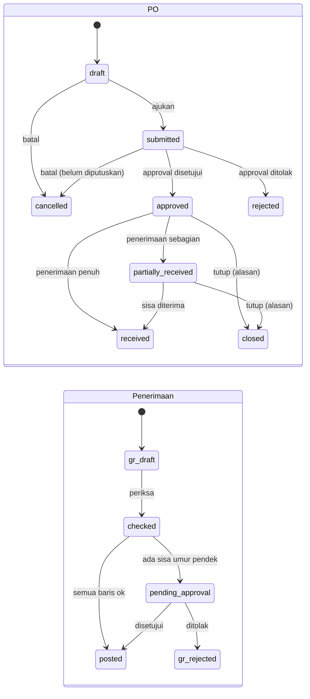
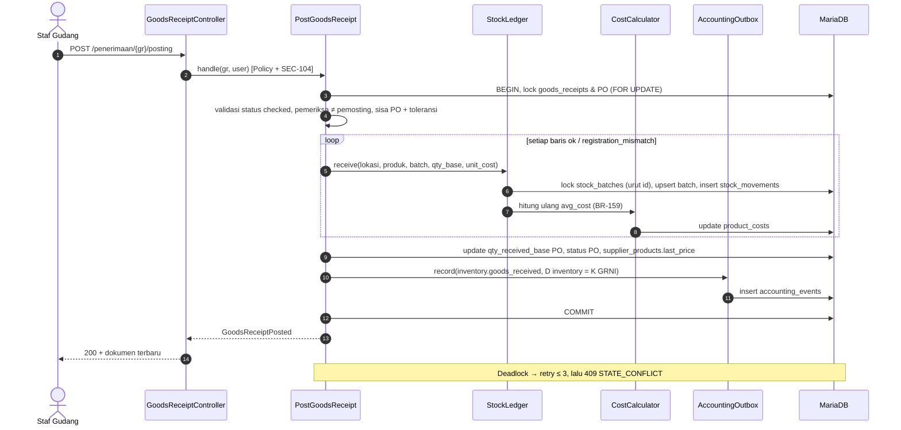
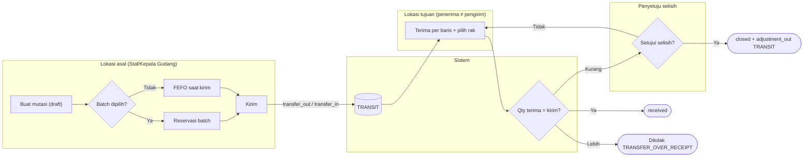

# 15 — Paket A: Master & Gudang (siap eksekusi)

Revisi 16 Nov 2026 (repo): menerapkan keputusan PA-1, PA-3, PA-5–PA-8, PA-10–PA-24 dari `12` + PF-3 sisi A (`PeriodGuard` di T-077), kontrak payload event `14` §7 (§11.4).

**Rentang:** T-067–T-087 (+ T-085A) · FR-A01–FR-A30 · BR-150–BR-170 · SEC-101–SEC-110
**Kontrak lintas modul:** `14-ROADMAP-LENGKAP.md` (ADR-101–ADR-115, nama tabel §5–§6, event §7, penomoran §8, role §10, status §11).
**Modul konsep v1.4:** CORE-02, CORE-03, CORE-06, MST-01..05, PRC-01, INV-01..05, GAR-01 (terima).

## 0. Penyelarasan dengan Repo (cek sebelum T-067)

Paket ini ditulis dari docs v1.0 ditambah perubahan yang terlihat di `TASKS.md` per 16 Nov 2026. Pemeriksaan butir di bawah sudah dilakukan 16 Nov 2026 (`12` "Penyelarasan Paket A–B", hasil di kolom terakhir) dan keputusannya sudah diterapkan ke dokumen ini serta `TASKS_PAKET_A.md`. Task pertama (T-067) tetap **wajib** mengecek ulang butir yang berubah terhadap repo dan mencatat selisih baru di `12` (log keputusan) sebelum menulis kode:

| # | Asumsi di paket ini | Cek di repo | Hasil 16 Nov 2026 |
|---|---|---|---|
| S-1 | Tabel `locations`, `employees`, `assignments`, `users`, `reference_items`, `document_sequences`, `settings`, `audit_logs`, `notifications` seperti `04` v1.0 | Nama kolom & tipe | Cocok. Catatan: kabupaten = `regencies` (bukan `cities`); kode wilayah **bertitik** (`districts.code` CHAR(8) `33.19.04`, `villages.code` CHAR(13)); `users.phone` belum dinormalisasi (PA-23, dibereskan T-073) |
| S-2 | `App\Domain\Reference\Enums\ReferenceGroup`, `App\Domain\Settings\{SettingRegistry,SettingType}`, `App\Domain\Access\Support\{PermissionCatalog,RoleCatalog}`, `App\Domain\Notification\NotificationRouter`, `App\Domain\Access\DataScope`, `App\Support\Listing\{ListingSpec,HasListing,UsesListing}`, `App\Support\Export\{ExportableListing,StartExport}`, `App\Support\Lookup\{LookupSource,LookupRegistry}` | Nama kelas & namespace | Cocok sebagian. `DataScope::forStock()`/`forCustomer()` dibuat T-068/T-073. Kerangka impor Fase 0 khusus pegawai → diekstrak ke `app/Support/Import` di **T-085A** (PA-15). Validator unggahan tersebar per modul → diekstrak ke `app/Support/Upload/` di T-070 (PA-22). Konfirmasi password = `RequirePassword` (`password.confirm`) untuk rute statis atau `App\Support\Auth\PasswordConfirmation::isRecent()` untuk yang bersyarat (PA-24b) |
| S-3 | **Nama berkas mengikuti konvensi repo**, bukan paket ini. `TASKS.md` repo memakai huruf kecil kebab-case (`pages/employees/show.tsx`, `components/pakis/history-list.tsx`). Path halaman/komponen PascalCase di paket A–G bersifat indikatif dan diterjemahkan ke konvensi repo (mis. `Sales/Orders/Form.tsx` → `pages/sales/orders/form.tsx`). **Folder `pages/settings/` milik pengaturan pengguna starter kit**: halaman yang di paket ini ditulis `Settings/…` (aturan approval, rekening resmi, tarif pajak, template pesan, tanggal kunci) ditempatkan di bawah `pages/site-settings/…` mengikuti T-008 | `TASKS.md` (catatan T-006, T-007, T-008) | Cocok. Komponen yang sudah ada di `components/pakis/` dipakai ulang, bukan dibuat baru (§7.2) |
| S-4 | Nomor BR/SEC/FR/OQ dalam rentang paket ini belum terpakai (mis. oleh `13-FASE-HR.md`) | Bila terpakai, geser seluruh rentang paket dan catat | Cocok. Tertinggi di repo: T-066 (+T-036A), BR-072, SEC-070. Task sisipan **T-085A** memakai pola sufiks seperti T-036A |
| S-5 | `stancl`/paket tenancy tidak dipakai, tidak ada `tenant_id` | ADR-001 | Cocok |
| S-6 | Dependency baru di paket ini **hanya satu**: `brick/math` `^1.0` sebagai dependency langsung composer (sudah terpasang 1.0.0 tidak langsung lewat `laravel/framework`; API 1.x memakai enum `RoundingMode`), dicatat di `03` §5 oleh T-069. **Tanpa `leaflet`/tile peta** (PA-20). OpenSpout sudah ada | `03` §5, `composer.lock`, `package-lock.json` | Cocok setelah keputusan PA-20 |

## 1. Ruang Lingkup

**Termasuk:** mesin approval generik, lokasi stok & rak, kendaraan minimal (untuk lokasi canvas), kategori, satuan & konversi, produk, izin edar, prinsipal & supplier, area penjualan, pelanggan/kios (verifikasi, duplikat, ubah nomor HP, limit & tempo), price list berversi, promo, buku stok batch/ED + reservasi + HPP moving average, outbox event akuntansi + tanggal kunci (`PeriodGuard`, §11.4), FEFO & karantina otomatis, PO, penerimaan barang (batch/ED/izin/nomor seri), retur ke prinsipal, mutasi stok, stock opname hitung buta, karantina manual & pemusnahan, import master & saldo awal stok, laporan stok & telusur batch.

**Di luar lingkup (paket lain):** pesanan penjualan, pengiriman, faktur, pembayaran (B); layar mobile gudang (C); data kendaraan lengkap, dokumen kendaraan (D); jurnal (F); saran pembelian (F); kanal OTP WhatsApp nyata (C, OQ-004).

## 2. Kebutuhan Fungsional

| ID | Kebutuhan | Rujukan |
|---|---|---|
| FR-A01 | Mesin approval generik: aturan per jenis dokumen dengan rentang nominal & kondisi, langkah berurutan (berdasarkan permission, atasan langsung, atau kepala lokasi), maker-checker, delegasi bertanggal, eskalasi waktu, kotak masuk persetujuan, riwayat. | ADR-105, BR-153 |
| FR-A02 | Pengaturan aturan approval oleh Owner dari layar (dinamis), dengan pratinjau "siapa menyetujui dokumen senilai X". | BR-153 |
| FR-A03 | Lokasi stok bertipe `warehouse`/`store`/`vehicle`/`in_transit` yang ditautkan ke lokasi Fase 0 atau kendaraan. Satu lokasi sistem `TRANSIT`. | ADR-107 |
| FR-A04 | Rak/bin per lokasi stok dengan zona `general`/`pesticide`/`restricted`/`quarantine`. | INV-01 |
| FR-A05 | Kendaraan minimal: plat, jenis, nama, aktif (dilengkapi Paket D). Setiap kendaraan canvas punya satu lokasi stok `vehicle`. | ADR-107 |
| FR-A06 | Kategori produk bertingkat dengan penanda perilaku: wajib batch, wajib ED, wajib nomor seri, wajib izin edar. | BR-151 |
| FR-A07 | Satuan (referensi `unit`) dan konversi per produk: satuan dasar + satuan lain dengan faktor, default jual & beli. | ADR-102, BR-150 |
| FR-A08 | Produk: SKU (manual atau otomatis), nama, kategori, prinsipal, merek, bahan aktif, formulasi, ukuran kemasan, foto, deskripsi, produk terbatas, garansi (bulan), batas sisa umur simpan (override), bisa dijual/dibeli, status. | BR-151, BR-112 |
| FR-A09 | Barcode per satuan produk (bisa lebih dari satu), unik global. | MST-01 |
| FR-A10 | Izin edar per produk: nomor pendaftaran, pemegang, tanggal terbit, berlaku sampai, berkas, status. Produk wajib izin tanpa izin aktif diblokir dari alokasi jual. Pengingat sebelum habis. | BR-152 |
| FR-A11 | Prinsipal dan supplier (syarat bayar, rekening, kontak), produk yang dipasok per supplier dengan harga beli terakhir & lead time. | MST-03, SEC-108 |
| FR-A12 | Area penjualan bertingkat dengan supervisor, gudang asal, dan kecamatan cakupan. | ADR-106 |
| FR-A13 | Pelanggan/kios: kode, nama toko, pemilik, nomor HP pemilik (WhatsApp resmi), tipe, alamat, desa, titik peta, foto toko, area, sales penanggung jawab, tier harga, limit kredit, tempo standar, izin tempo panen, gudang asal, kelayakan pembeli produk terbatas, status. | MST-04 |
| FR-A14 | Verifikasi kios baru: foto toko + titik lokasi + OTP ke nomor pemilik (atau verifikasi telepon kantor bila kanal OTP belum aktif), lalu disetujui oleh pemverifikasi yang bukan pembuat. Limit kredit aktif hanya setelah terverifikasi. | BR-125, BR-166 |
| FR-A15 | Deteksi kios duplikat (kemiripan nama + nomor HP + jarak titik) saat simpan, dan penggabungan dua kios dengan persetujuan. | BR-166 |
| FR-A16 | Ubah nomor HP kios hanya oleh Admin Penjualan dengan verifikasi ke nomor lama atau telepon kantor, dicatat dan dilaporkan ke Owner. Nomor kios tidak boleh sama dengan nomor pegawai aktif. | BR-126 |
| FR-A17 | Penugasan area & sales ke kios, termasuk pengalihan massal dengan riwayat. | BR-167 |
| FR-A18 | Perubahan limit kredit lewat approval sesuai nominal. | BR-153 |
| FR-A19 | Price list per tier/area/toko dengan versi bertanggal berlaku, harga per satuan & harga bertingkat per jumlah minimum. Versi yang diterbitkan tidak bisa diubah. | ADR-108, BR-168 |
| FR-A20 | Promo: diskon persen/nominal, beli X gratis Y, harga bundel, diskon bertingkat. Target produk/kategori/prinsipal, cakupan semua/tier/area/kios/kanal, periode, prioritas, bisa digabung atau tidak, anggaran, sumber dana (perusahaan/prinsipal). | BR-169 |
| FR-A21 | Buku stok per batch per lokasi per rak, dengan mutasi append-only, reservasi, dan HPP moving average per produk. | ADR-103, BR-101, BR-114, BR-154, BR-159 |
| FR-A22 | Alokasi FEFO yang bisa dipakai modul lain (PO tidak, SO/mutasi/retur ya). | BR-102, BR-156 |
| FR-A23 | Karantina otomatis batch kedaluwarsa (job harian) dan alert mendekati ED & izin akan habis. | BR-157 |
| FR-A24 | Purchase order dengan persetujuan berdasarkan nilai, penerimaan bertahap, tutup manual dengan alasan. | BR-160 |
| FR-A25 | Penerimaan barang: cek fisik per baris (jumlah diterima/ditolak + alasan), batch, ED, nomor pendaftaran pada kemasan, rak tujuan, nomor seri untuk produk alat, persetujuan bila sisa umur di bawah batas, posting ke stok. | BR-103, BR-144, BR-158 |
| FR-A26 | Retur ke prinsipal dari batch tertentu dengan persetujuan. | PRC-01 |
| FR-A27 | Mutasi stok antar lokasi (kirim → dalam perjalanan → terima), selisih terima dengan persetujuan, pengingat terima. | BR-161 |
| FR-A28 | Stock opname per lokasi/rak/kategori/produk, hitung buta, hitung ulang, persetujuan selisih berdasarkan nilai, posting penyesuaian. | BR-162 |
| FR-A29 | Karantina manual sebagian jumlah batch ke rak karantina, pelepasan karantina, pemusnahan/retur/serah ke instansi dengan berita acara, saksi, foto, dan persetujuan. | BR-163, BR-164 |
| FR-A30 | Import produk, kios, harga, dan saldo awal stok per batch (pemetaan kolom, validasi, idempoten). Laporan kartu stok, posisi stok, mendekati ED, izin akan habis, telusur batch & recall. | BR-170 |

## 3. Kebutuhan Non-Fungsional Tambahan

| ID | Target |
|---|---|
| NFR-A01 | Kapasitas: 3.000 SKU, 3.000 kios, 10 lokasi stok, 30.000 baris `stock_batches`, ±1 juta `stock_movements`/tahun |
| NFR-A02 | Posting penerimaan 100 baris < 3 s. Alokasi FEFO 1 produk < 100 ms |
| NFR-A03 | Uji konkurensi: 20 proses mengambil stok terakhir bersamaan → tidak ada saldo minus, tidak ada deadlock tak tertangani (retry ≤ 3) |
| NFR-A04 | Listing posisi stok & kartu stok p95 < 500 ms pada 1 juta mutasi |

## 4. Database

Konvensi `04` §1 + `14` §6.1. `[audit]` = `created_by`, `updated_by`, `created_at`, `updated_at`. `[soft]` = `deleted_at`. Semua FK ke `users`/`employees` memakai `BIGINT UNSIGNED`.

### 4.1 Referensi & penomoran baru

Grup `reference_items` baru (tambah ke `ReferenceGroup`, seed `is_system`):

| `group_code` | Item sistem (kode → nama) | Meta |
|---|---|---|
| `unit` | `bottle` Botol, `box` Dus, `sachet` Sachet, `pcs` Pcs, `pack` Pak, `kg` Kg, `gram` Gram, `liter` Liter, `ml` mL, `sack` Karung, `jerrycan` Jeriken, `unit` Unit | `{"integer_only": true}` untuk bottle, box, sachet, pcs, pack, sack, jerrycan, unit |
| `formulation` | `ec` EC, `wp` WP, `sl` SL, `sc` SC, `wg` WG, `gr` GR, `od` OD, `cs` CS, `other` Lainnya | — |
| `customer_type` | `kiosk` Kios, `retail` Toko eceran, `farmer_group` Kelompok tani, `project` Proyek/instansi, `other` Lainnya | — |
| `receipt_reject_reason` | `damaged` Rusak, `short_expiry` ED terlalu dekat, `wrong_item` Barang salah, `excess` Kelebihan kirim, `other` Lainnya | — |
| `purchase_return_reason` | `damaged` Rusak, `near_expiry` Mendekati ED, `recall` Penarikan prinsipal, `wrong_item` Barang salah, `other` Lainnya | — |
| `quarantine_reason` | `damaged` Rusak, `leaking` Bocor/rembes, `suspect` Diduga tidak sesuai, `expired` Kedaluwarsa, `recall` Penarikan, `other` Lainnya | — |
| `disposal_reason` | `expired` Kedaluwarsa, `damaged` Rusak, `recall` Penarikan, `other` Lainnya | — |
| `opname_variance_reason` | `miscount` Salah hitung sebelumnya, `damaged` Rusak tak tercatat, `lost` Hilang, `unrecorded_transaction` Transaksi belum dicatat, `other` Lainnya | — |

`document_sequences` baru (seed `SequenceSeeder`, pola dari `14` §8): `product`, `customer`, `supplier`, `purchase_order`, `goods_receipt`, `purchase_return`, `stock_transfer`, `stock_opname`, `disposal_report`.

Tabel umum pengingat (dibuat T-071, dipakai T-071, T-078, T-082) agar job berulang tidak mengirim notifikasi ganda:

```sql
CREATE TABLE reminder_logs (
  id BIGINT UNSIGNED PRIMARY KEY AUTO_INCREMENT,
  subject_type VARCHAR(60) NOT NULL,             -- 'product_registration', 'stock_batch', 'stock_transfer'
  subject_id BIGINT UNSIGNED NOT NULL,
  reminder_key VARCHAR(40) NOT NULL,             -- 'h60', 'ed90', '2026-11-16'
  sent_at TIMESTAMP NOT NULL,
  UNIQUE KEY reminder_unique (subject_type, subject_id, reminder_key)
);
```

### 4.2 Approval (T-067)

```sql
CREATE TABLE approval_rules (
  id BIGINT UNSIGNED PRIMARY KEY AUTO_INCREMENT,
  document_type VARCHAR(60) NOT NULL,        -- lihat §4.2.1
  name VARCHAR(120) NOT NULL,
  min_amount DECIMAL(18,2) NULL,             -- inklusif; NULL = tanpa batas bawah
  max_amount DECIMAL(18,2) NULL,             -- eksklusif; NULL = tanpa batas atas
  conditions JSON NULL,                      -- mis. {"sales_area_id":[3,4]}; kunci yang diizinkan per document_type
  priority SMALLINT UNSIGNED NOT NULL DEFAULT 100,  -- kecil = dicek lebih dulu
  is_active BOOLEAN NOT NULL DEFAULT TRUE,
  [audit],
  KEY approval_rules_type_active_idx (document_type, is_active, priority),
  CONSTRAINT approval_rules_amount_chk CHECK (min_amount IS NULL OR max_amount IS NULL OR max_amount > min_amount)
);
CREATE TABLE approval_rule_steps (
  id BIGINT UNSIGNED PRIMARY KEY AUTO_INCREMENT,
  approval_rule_id BIGINT UNSIGNED NOT NULL,
  step_order TINYINT UNSIGNED NOT NULL,
  approver_type ENUM('permission','direct_supervisor','location_head') NOT NULL,
  permission_name VARCHAR(120) NULL,         -- wajib bila approver_type = permission
  escalate_after_hours SMALLINT UNSIGNED NULL,   -- jam kalender; NULL = setting approval.default_escalation_hours
  escalation_permission VARCHAR(120) NULL,   -- pemegang izin ini boleh memutuskan setelah eskalasi
  [audit],
  UNIQUE KEY ars_rule_order_unique (approval_rule_id, step_order),
  CONSTRAINT ars_rule_fk FOREIGN KEY (approval_rule_id) REFERENCES approval_rules(id) ON DELETE CASCADE,
  CONSTRAINT ars_perm_chk CHECK (approver_type <> 'permission' OR permission_name IS NOT NULL)
);
CREATE TABLE approval_requests (
  id BIGINT UNSIGNED PRIMARY KEY AUTO_INCREMENT,
  document_type VARCHAR(60) NOT NULL,
  document_id BIGINT UNSIGNED NOT NULL,
  approval_rule_id BIGINT UNSIGNED NOT NULL,
  rule_snapshot JSON NOT NULL,               -- salinan aturan & langkah saat diajukan
  amount DECIMAL(18,2) NULL,
  summary VARCHAR(255) NOT NULL,             -- "PO-2611-0042 · PT Agro · Rp 48.500.000"
  context JSON NULL,                         -- data pendukung untuk ditampilkan penyetuju
  requester_user_id BIGINT UNSIGNED NOT NULL,
  document_creator_user_id BIGINT UNSIGNED NULL,
  scope_location_id BIGINT UNSIGNED NULL,    -- untuk location_head & scope
  scope_employee_id BIGINT UNSIGNED NULL,    -- pegawai terkait (untuk direct_supervisor)
  status ENUM('pending','approved','rejected','cancelled') NOT NULL DEFAULT 'pending',
  current_step TINYINT UNSIGNED NOT NULL DEFAULT 1,
  decided_at TIMESTAMP NULL,
  pending_key VARCHAR(80) GENERATED ALWAYS AS (IF(status = 'pending', CONCAT(document_type, '#', document_id), NULL)) STORED,
  created_at TIMESTAMP NULL, updated_at TIMESTAMP NULL,
  UNIQUE KEY apr_one_pending_unique (pending_key),
  KEY apr_doc_idx (document_type, document_id),
  KEY apr_status_created_idx (status, created_at),
  CONSTRAINT apr_rule_fk FOREIGN KEY (approval_rule_id) REFERENCES approval_rules(id)
);
CREATE TABLE approval_steps (
  id BIGINT UNSIGNED PRIMARY KEY AUTO_INCREMENT,
  approval_request_id BIGINT UNSIGNED NOT NULL,
  step_order TINYINT UNSIGNED NOT NULL,
  approver_type ENUM('permission','direct_supervisor','location_head') NOT NULL,
  permission_name VARCHAR(120) NULL,
  resolved_employee_id BIGINT UNSIGNED NULL, -- untuk direct_supervisor/location_head saat langkah aktif
  status ENUM('waiting','pending','approved','rejected','skipped') NOT NULL DEFAULT 'waiting',
  activated_at TIMESTAMP NULL,
  escalate_at TIMESTAMP NULL,
  escalated BOOLEAN NOT NULL DEFAULT FALSE,
  decided_by BIGINT UNSIGNED NULL,
  acting_for_user_id BIGINT UNSIGNED NULL,   -- diisi bila memutuskan sebagai delegasi
  decided_at TIMESTAMP NULL,
  note VARCHAR(500) NULL,
  created_at TIMESTAMP NULL, updated_at TIMESTAMP NULL,
  UNIQUE KEY aps_req_order_unique (approval_request_id, step_order),
  KEY aps_pending_perm_idx (status, permission_name),
  KEY aps_pending_emp_idx (status, resolved_employee_id),
  KEY aps_escalate_idx (status, escalate_at),
  CONSTRAINT aps_req_fk FOREIGN KEY (approval_request_id) REFERENCES approval_requests(id) ON DELETE CASCADE
);
CREATE TABLE approval_delegations (
  id BIGINT UNSIGNED PRIMARY KEY AUTO_INCREMENT,
  delegator_user_id BIGINT UNSIGNED NOT NULL,
  delegate_user_id BIGINT UNSIGNED NOT NULL,
  start_date DATE NOT NULL, end_date DATE NOT NULL,
  document_types JSON NULL,                  -- NULL = semua
  reason VARCHAR(255) NOT NULL,
  is_active BOOLEAN NOT NULL DEFAULT TRUE,
  [audit],
  KEY apd_delegate_idx (delegate_user_id, is_active, start_date, end_date),
  CONSTRAINT apd_not_self_chk CHECK (delegator_user_id <> delegate_user_id),
  CONSTRAINT apd_dates_chk CHECK (end_date >= start_date)
);
```

#### 4.2.1 Jenis dokumen yang memakai approval di Paket A

| `document_type` | Dipicu oleh | Nominal yang dibandingkan | Aturan default (seed, bisa diubah Owner) |
|---|---|---|---|
| `purchase_order` | Ajukan PO | `grand_total` | < Rp 25 jt: `purchase_orders.approve` · ≥ Rp 25 jt: `direct_supervisor` (atasan langsung pengaju; PO mengisi `scope_employee_id` = pegawai pengaju) lalu `purchase_orders.approve_high` (PA-26: BR-153(11) satu orang satu langkah) |
| `goods_receipt_short_shelf_life` | Baris penerimaan sisa umur < batas | — | `location_head` lalu eskalasi ke `goods_receipts.approve_short_shelf_life` |
| `stock_transfer_variance` | Terima mutasi dengan selisih | nilai selisih (HPP) | `stock_transfers.approve_variance` |
| `stock_opname_variance` | Ajukan posting opname dengan selisih | nilai absolut selisih (HPP) | < Rp 1 jt: `stock_opnames.approve_variance` · ≥ Rp 1 jt: + `stock_opnames.approve_variance_high` |
| `stock_disposal` | Ajukan berita acara pemusnahan | nilai (HPP) | `stock_disposals.approve` |
| `stock_quarantine_release` | Lepas karantina manual | — | `stock_quarantine.release` |
| `purchase_return` | Ajukan retur ke prinsipal | nilai (HPP) | `purchase_returns.approve` |
| `customer_activation` | Kirim verifikasi kios | limit kredit yang diminta (0 bila tanpa limit) | < Rp 20 jt: `customers.verify` · ≥ Rp 20 jt: `customers.verify` lalu `credit_limits.set_high` (keputusan Mas 16 Nov 2026, PA-51: satu permintaan, satu aturan bertingkat; dokumen = baris `customer_verifications` ber-`type = activation`, PA-49) |
| `customer_credit_limit` | Ubah limit kredit | limit baru | < Rp 20 jt: `credit_limits.set` · ≥ Rp 20 jt: `direct_supervisor` (atasan langsung **sales kios**; `scope_employee_id` = `assigned_sales_employee_id`) lalu `credit_limits.set_high` (keputusan Mas 16 Nov 2026, PA-51; pola PA-26 agar Owner tidak buntu oleh BR-153(11)). Dokumen = baris `customers`, limit diminta = `approval_requests.amount` (PA-56). Kios belum terverifikasi → 422 `CUSTOMER_NOT_VERIFIED` |
| `customer_phone_change` | Ubah nomor HP kios | — | `customers.change_phone_approve` (dokumen = baris `customer_verifications` ber-`type = phone_change`, PA-49/PA-57) |
| `customer_merge` | Gabung kios duplikat | — | `customers.merge` (dokumen = baris `customers` kios sumber, kios tujuan di `context._merge_into_id`, PA-56/PA-58) |
| `price_list_publish` | Terbitkan versi price list | — | `prices.publish` |
| `promotion_activate` | Aktifkan promo | anggaran | `promotions.approve` |
| `serial_swap` | Tukar nomor seri | — | `serials.approve_swap` |

Angka rupiah di tabel adalah **contoh seed**. Wajib ditetapkan Pakis saat UAT (OQ-113).

Registri jenis dokumen (T-067): `config/pakis.php` `approvables` (`label`, `model` = kelas Approvable yang diisi task pemilik dokumen, `conditions` = kunci kondisi yang diizinkan). Seed = `ApprovalRuleSeeder` (18 aturan untuk 14 jenis sejak T-074; jenis yang sudah punya aturan apa pun tidak disentuh — aturan aktivasi kios dan limit kredit bawaan T-067 yang belum diubah/dipakai diperbarui migrasi data T-074 `060300` dan `060400`, PA-51). Kontrak `App\Domain\Approval\Contracts\Approvable`: `approvalDocumentType`, `approvalAmount`, `approvalSummary`, `approvalContext`, `approvalConditions`, `approvalScopeLocationId`, `approvalScopeEmployeeId`, `creatorUserId`, `approvalUrl`, `onApproved(?request)`, `onRejected`, `onCancelled`.

### 4.3 Lokasi stok, rak, kendaraan (T-068)

```sql
CREATE TABLE vehicles (                      -- minimal; kolom armada ditambah Paket D
  id BIGINT UNSIGNED PRIMARY KEY AUTO_INCREMENT,
  plate_no VARCHAR(15) NOT NULL,             -- disimpan tanpa spasi, huruf besar: K9021AB
  name VARCHAR(100) NOT NULL,
  vehicle_type ENUM('truck','pickup','van','motorcycle','other') NOT NULL,
  is_canvas BOOLEAN NOT NULL DEFAULT FALSE,
  home_location_id BIGINT UNSIGNED NULL,
  is_active BOOLEAN NOT NULL DEFAULT TRUE,
  [audit], [soft],
  UNIQUE KEY vehicles_plate_unique (plate_no),
  CONSTRAINT vehicles_home_fk FOREIGN KEY (home_location_id) REFERENCES locations(id)
);
CREATE TABLE stock_locations (
  id BIGINT UNSIGNED PRIMARY KEY AUTO_INCREMENT,
  code VARCHAR(20) NOT NULL,
  name VARCHAR(150) NOT NULL,
  type ENUM('warehouse','store','vehicle','in_transit') NOT NULL,
  location_id BIGINT UNSIGNED NULL,          -- wajib untuk warehouse & store
  vehicle_id BIGINT UNSIGNED NULL,           -- wajib untuk vehicle
  is_sellable BOOLEAN NOT NULL DEFAULT TRUE, -- false untuk in_transit
  is_system BOOLEAN NOT NULL DEFAULT FALSE,  -- TRANSIT
  is_active BOOLEAN NOT NULL DEFAULT TRUE,
  [audit], [soft],
  UNIQUE KEY stock_locations_code_unique (code),
  UNIQUE KEY stock_locations_vehicle_unique (vehicle_id),
  KEY stock_locations_type_active_idx (type, is_active),
  KEY stock_locations_location_idx (location_id),
  CONSTRAINT sl_location_fk FOREIGN KEY (location_id) REFERENCES locations(id),
  CONSTRAINT sl_vehicle_fk FOREIGN KEY (vehicle_id) REFERENCES vehicles(id),
  CONSTRAINT sl_type_chk CHECK (
    (type IN ('warehouse','store') AND location_id IS NOT NULL AND vehicle_id IS NULL) OR
    (type = 'vehicle' AND vehicle_id IS NOT NULL) OR
    (type = 'in_transit' AND location_id IS NULL AND vehicle_id IS NULL))
);
CREATE TABLE stock_bins (
  id BIGINT UNSIGNED PRIMARY KEY AUTO_INCREMENT,
  stock_location_id BIGINT UNSIGNED NOT NULL,
  code VARCHAR(20) NOT NULL,                 -- R2-04
  name VARCHAR(100) NULL,
  zone ENUM('general','pesticide','restricted','quarantine') NOT NULL DEFAULT 'general',
  is_active BOOLEAN NOT NULL DEFAULT TRUE,
  [audit],
  UNIQUE KEY stock_bins_loc_code_unique (stock_location_id, code),
  KEY stock_bins_loc_zone_idx (stock_location_id, zone, is_active),
  CONSTRAINT sb_loc_fk FOREIGN KEY (stock_location_id) REFERENCES stock_locations(id)
);
```
Seed: lokasi stok sistem `TRANSIT` (tipe `in_transit`, `is_system`, `is_sellable=false`). Setiap lokasi stok `warehouse`/`store` otomatis mendapat satu bin karantina `Q-01` (zona `quarantine`).

### 4.4 Katalog (T-069–T-071)

```sql
CREATE TABLE product_categories (
  id BIGINT UNSIGNED PRIMARY KEY AUTO_INCREMENT,
  code VARCHAR(30) NOT NULL, name VARCHAR(100) NOT NULL,
  parent_id BIGINT UNSIGNED NULL,
  kind ENUM('insecticide','fungicide','herbicide','molluscicide','rodenticide','pgr','seed','fertilizer','adjuvant','tool','other') NOT NULL,  -- moluksida & rodentisida: PA-45
  requires_batch BOOLEAN NOT NULL DEFAULT TRUE,
  requires_expiry BOOLEAN NOT NULL DEFAULT TRUE,
  requires_serial BOOLEAN NOT NULL DEFAULT FALSE,
  requires_registration BOOLEAN NOT NULL DEFAULT TRUE,
  default_bin_zone ENUM('general','pesticide','restricted') NOT NULL DEFAULT 'general',
  sort_order SMALLINT UNSIGNED NOT NULL DEFAULT 0,
  is_active BOOLEAN NOT NULL DEFAULT TRUE,
  [audit], [soft],
  UNIQUE KEY product_categories_code_unique (code),
  KEY product_categories_parent_idx (parent_id, sort_order),
  CONSTRAINT pc_parent_fk FOREIGN KEY (parent_id) REFERENCES product_categories(id),
  CONSTRAINT pc_expiry_chk CHECK (requires_expiry = 0 OR requires_batch = 1)
);
CREATE TABLE products (
  id BIGINT UNSIGNED PRIMARY KEY AUTO_INCREMENT,
  sku VARCHAR(30) NOT NULL,
  name VARCHAR(150) NOT NULL,
  product_category_id BIGINT UNSIGNED NOT NULL,
  principal_id BIGINT UNSIGNED NULL,
  brand VARCHAR(80) NULL,
  active_ingredient VARCHAR(255) NULL,       -- "Abamektin 18 g/l"
  formulation_id BIGINT UNSIGNED NULL,       -- reference_items(formulation)
  package_size VARCHAR(40) NULL,             -- "500 ml"
  base_unit_id BIGINT UNSIGNED NOT NULL,     -- reference_items(unit); tidak bisa diubah setelah ada mutasi
  description TEXT NULL,
  usage_note TEXT NULL,                      -- ringkasan petunjuk label (teks dari label resmi)
  photo_path VARCHAR(255) NULL,
  tracks_batch BOOLEAN NOT NULL,
  tracks_expiry BOOLEAN NOT NULL,
  tracks_serial BOOLEAN NOT NULL,
  requires_registration BOOLEAN NOT NULL,
  is_restricted BOOLEAN NOT NULL DEFAULT FALSE,   -- pestisida terbatas (BR-112)
  restricted_note VARCHAR(255) NULL,
  warranty_months SMALLINT UNSIGNED NULL,
  min_shelf_life_months SMALLINT UNSIGNED NULL,   -- NULL = setting inventory.min_shelf_life_months
  is_sellable BOOLEAN NOT NULL DEFAULT TRUE,
  is_purchasable BOOLEAN NOT NULL DEFAULT TRUE,
  status ENUM('active','inactive','discontinued') NOT NULL DEFAULT 'active',
  [audit], [soft],
  UNIQUE KEY products_sku_unique (sku),
  KEY products_status_name_idx (status, name),
  KEY products_category_status_idx (product_category_id, status),
  KEY products_principal_idx (principal_id),
  CONSTRAINT products_category_fk FOREIGN KEY (product_category_id) REFERENCES product_categories(id),
  CONSTRAINT products_principal_fk FOREIGN KEY (principal_id) REFERENCES principals(id),
  CONSTRAINT products_base_unit_fk FOREIGN KEY (base_unit_id) REFERENCES reference_items(id),
  CONSTRAINT products_formulation_fk FOREIGN KEY (formulation_id) REFERENCES reference_items(id),
  CONSTRAINT products_expiry_chk CHECK (tracks_expiry = 0 OR tracks_batch = 1)
);
CREATE TABLE product_units (
  id BIGINT UNSIGNED PRIMARY KEY AUTO_INCREMENT,
  product_id BIGINT UNSIGNED NOT NULL,
  unit_id BIGINT UNSIGNED NOT NULL,          -- reference_items(unit)
  factor DECIMAL(18,3) NOT NULL,             -- isi dalam satuan dasar; satuan dasar = 1
  is_base BOOLEAN NOT NULL DEFAULT FALSE,
  is_default_sales BOOLEAN NOT NULL DEFAULT FALSE,
  is_default_purchase BOOLEAN NOT NULL DEFAULT FALSE,
  is_active BOOLEAN NOT NULL DEFAULT TRUE,
  [audit],
  UNIQUE KEY pu_product_unit_unique (product_id, unit_id),
  CONSTRAINT pu_product_fk FOREIGN KEY (product_id) REFERENCES products(id),
  CONSTRAINT pu_unit_fk FOREIGN KEY (unit_id) REFERENCES reference_items(id),
  CONSTRAINT pu_factor_chk CHECK (factor > 0 AND (is_base = 0 OR factor = 1))
);
CREATE TABLE product_barcodes (
  id BIGINT UNSIGNED PRIMARY KEY AUTO_INCREMENT,
  product_id BIGINT UNSIGNED NOT NULL,
  product_unit_id BIGINT UNSIGNED NOT NULL,
  barcode VARCHAR(64) NOT NULL,
  created_at TIMESTAMP NULL, updated_at TIMESTAMP NULL,
  UNIQUE KEY product_barcodes_barcode_unique (barcode),
  CONSTRAINT pb_product_fk FOREIGN KEY (product_id) REFERENCES products(id),
  CONSTRAINT pb_unit_fk FOREIGN KEY (product_unit_id) REFERENCES product_units(id)
);
CREATE TABLE product_registrations (
  id BIGINT UNSIGNED PRIMARY KEY AUTO_INCREMENT,
  product_id BIGINT UNSIGNED NOT NULL,
  registration_no VARCHAR(60) NOT NULL,
  holder_name VARCHAR(150) NULL,
  issued_at DATE NULL,
  valid_until DATE NOT NULL,
  document_path VARCHAR(255) NULL,           -- disk privat
  status ENUM('active','expired','revoked') NOT NULL DEFAULT 'active',
  note VARCHAR(255) NULL,
  [audit],
  UNIQUE KEY preg_product_no_unique (product_id, registration_no),
  KEY preg_product_valid_idx (product_id, valid_until),
  KEY preg_status_valid_idx (status, valid_until),
  CONSTRAINT preg_product_fk FOREIGN KEY (product_id) REFERENCES products(id)
);
```
Satu baris `product_units` dengan `is_base = true` per produk wajib ada (dibuat otomatis saat produk dibuat). Maksimal satu `is_default_sales` dan satu `is_default_purchase` per produk (dijaga Action + test).

### 4.5 Prinsipal & supplier (T-072)

```sql
CREATE TABLE principals (
  id BIGINT UNSIGNED PRIMARY KEY AUTO_INCREMENT,
  code VARCHAR(20) NOT NULL, name VARCHAR(150) NOT NULL,
  contact_name VARCHAR(100) NULL, phone VARCHAR(20) NULL, email VARCHAR(150) NULL,
  address TEXT NULL, website VARCHAR(150) NULL,
  is_active BOOLEAN NOT NULL DEFAULT TRUE,
  [audit], [soft],
  UNIQUE KEY principals_code_unique (code),
  KEY principals_active_name_idx (is_active, name)
);
CREATE TABLE suppliers (
  id BIGINT UNSIGNED PRIMARY KEY AUTO_INCREMENT,
  code VARCHAR(20) NOT NULL,                 -- NumberGenerator('supplier')
  name VARCHAR(150) NOT NULL,
  principal_id BIGINT UNSIGNED NULL,
  tax_id VARCHAR(30) NULL,                   -- NPWP badan
  contact_name VARCHAR(100) NULL, phone VARCHAR(20) NULL, email VARCHAR(150) NULL,
  address TEXT NULL, village_code CHAR(13) NULL,
  payment_term_days SMALLINT UNSIGNED NOT NULL DEFAULT 30,
  bank_name VARCHAR(60) NULL,
  bank_account_no_enc TEXT NULL,             -- terenkripsi (SEC-108)
  bank_account_name VARCHAR(150) NULL,
  is_active BOOLEAN NOT NULL DEFAULT TRUE,
  [audit], [soft],
  UNIQUE KEY suppliers_code_unique (code),
  KEY suppliers_active_name_idx (is_active, name),
  CONSTRAINT suppliers_principal_fk FOREIGN KEY (principal_id) REFERENCES principals(id),
  CONSTRAINT suppliers_village_fk FOREIGN KEY (village_code) REFERENCES villages(code)
);
CREATE TABLE supplier_products (
  supplier_id BIGINT UNSIGNED NOT NULL,
  product_id BIGINT UNSIGNED NOT NULL,
  supplier_sku VARCHAR(40) NULL,
  last_price DECIMAL(18,2) NULL,             -- per satuan beli default
  last_price_unit_id BIGINT UNSIGNED NULL,   -- product_units.id
  lead_time_days SMALLINT UNSIGNED NULL,
  is_preferred BOOLEAN NOT NULL DEFAULT FALSE,
  updated_at TIMESTAMP NULL,
  PRIMARY KEY (supplier_id, product_id),
  KEY sp_product_idx (product_id, is_preferred),
  CONSTRAINT sp_supplier_fk FOREIGN KEY (supplier_id) REFERENCES suppliers(id),
  CONSTRAINT sp_product_fk FOREIGN KEY (product_id) REFERENCES products(id)
);
```
Urutan migration: `products.principal_id` dibuat di T-070 **tanpa** constraint FK. Constraint `products_principal_fk` ditambahkan oleh migration T-072 setelah tabel `principals` ada.

### 4.6 Area & pelanggan (T-073, T-074)

```sql
CREATE TABLE sales_areas (
  id BIGINT UNSIGNED PRIMARY KEY AUTO_INCREMENT,
  code VARCHAR(20) NOT NULL, name VARCHAR(100) NOT NULL,
  parent_id BIGINT UNSIGNED NULL,
  supervisor_employee_id BIGINT UNSIGNED NULL,
  home_stock_location_id BIGINT UNSIGNED NULL,   -- gudang asal default
  is_active BOOLEAN NOT NULL DEFAULT TRUE,
  [audit], [soft],
  UNIQUE KEY sales_areas_code_unique (code),
  KEY sales_areas_supervisor_idx (supervisor_employee_id, is_active),
  CONSTRAINT sa_parent_fk FOREIGN KEY (parent_id) REFERENCES sales_areas(id),
  CONSTRAINT sa_supervisor_fk FOREIGN KEY (supervisor_employee_id) REFERENCES employees(id),
  CONSTRAINT sa_home_sl_fk FOREIGN KEY (home_stock_location_id) REFERENCES stock_locations(id)
);
CREATE TABLE sales_area_districts (
  sales_area_id BIGINT UNSIGNED NOT NULL,
  district_code CHAR(8) NOT NULL,
  PRIMARY KEY (sales_area_id, district_code),
  KEY sad_district_idx (district_code),
  CONSTRAINT sad_area_fk FOREIGN KEY (sales_area_id) REFERENCES sales_areas(id) ON DELETE CASCADE,
  CONSTRAINT sad_district_fk FOREIGN KEY (district_code) REFERENCES districts(code)
);
CREATE TABLE customers (
  id BIGINT UNSIGNED PRIMARY KEY AUTO_INCREMENT,
  code VARCHAR(20) NOT NULL,                     -- NumberGenerator('customer')
  store_name VARCHAR(150) NOT NULL,
  owner_name VARCHAR(150) NOT NULL,
  owner_phone VARCHAR(20) NOT NULL,              -- format 62…, nomor WhatsApp resmi kios
  owner_phone_verified_at TIMESTAMP NULL,
  customer_type_id BIGINT UNSIGNED NOT NULL,     -- reference_items(customer_type)
  address TEXT NULL,
  village_code CHAR(13) NULL,
  latitude DECIMAL(10,7) NULL, longitude DECIMAL(10,7) NULL,
  photo_path VARCHAR(255) NULL,                  -- foto toko
  sales_area_id BIGINT UNSIGNED NOT NULL,
  assigned_sales_employee_id BIGINT UNSIGNED NULL,
  price_list_id BIGINT UNSIGNED NULL,            -- NULL = harga area kios lalu default; hanya kind tier (PA-61)
  home_stock_location_id BIGINT UNSIGNED NULL,   -- NULL = gudang asal area
  credit_limit DECIMAL(18,2) NOT NULL DEFAULT 0,
  credit_limit_active BOOLEAN NOT NULL DEFAULT FALSE,
  term_days SMALLINT UNSIGNED NOT NULL DEFAULT 30,
  harvest_term_allowed BOOLEAN NOT NULL DEFAULT FALSE,
  harvest_term_max_days SMALLINT UNSIGNED NULL,
  restricted_buyer_eligible BOOLEAN NOT NULL DEFAULT FALSE,   -- BR-112
  restricted_buyer_note VARCHAR(255) NULL,
  restricted_buyer_document_path VARCHAR(255) NULL,
  restricted_buyer_valid_until DATE NULL,
  status ENUM('prospect','active','credit_hold','inactive','merged') NOT NULL DEFAULT 'prospect',
  hold_reason VARCHAR(255) NULL,
  merged_into_id BIGINT UNSIGNED NULL,
  verified_at TIMESTAMP NULL, verified_by BIGINT UNSIGNED NULL,
  [audit], [soft],
  UNIQUE KEY customers_code_unique (code),
  KEY customers_area_sales_idx (sales_area_id, assigned_sales_employee_id, status),
  KEY customers_sales_status_idx (assigned_sales_employee_id, status),
  KEY customers_status_name_idx (status, store_name),
  KEY customers_phone_idx (owner_phone),
  CONSTRAINT customers_type_fk FOREIGN KEY (customer_type_id) REFERENCES reference_items(id),
  CONSTRAINT customers_village_fk FOREIGN KEY (village_code) REFERENCES villages(code),
  CONSTRAINT customers_area_fk FOREIGN KEY (sales_area_id) REFERENCES sales_areas(id),
  CONSTRAINT customers_sales_fk FOREIGN KEY (assigned_sales_employee_id) REFERENCES employees(id),
  CONSTRAINT customers_home_sl_fk FOREIGN KEY (home_stock_location_id) REFERENCES stock_locations(id),
  CONSTRAINT customers_merged_fk FOREIGN KEY (merged_into_id) REFERENCES customers(id),
  CONSTRAINT customers_limit_chk CHECK (credit_limit >= 0),
  CONSTRAINT customers_active_limit_chk CHECK (credit_limit_active = 0 OR verified_at IS NOT NULL),
  CONSTRAINT customers_merged_chk CHECK (status <> 'merged' OR merged_into_id IS NOT NULL)
  -- FK price_list_id ditambahkan oleh migration T-075
);
CREATE TABLE customer_contacts (
  id BIGINT UNSIGNED PRIMARY KEY AUTO_INCREMENT,
  customer_id BIGINT UNSIGNED NOT NULL,
  name VARCHAR(100) NOT NULL,
  role VARCHAR(60) NULL,                         -- penjaga toko, bagian bayar
  phone VARCHAR(20) NULL,
  [audit],
  KEY cc_customer_idx (customer_id),
  CONSTRAINT cc_customer_fk FOREIGN KEY (customer_id) REFERENCES customers(id) ON DELETE CASCADE
);
CREATE TABLE customer_verifications (
  id BIGINT UNSIGNED PRIMARY KEY AUTO_INCREMENT,
  customer_id BIGINT UNSIGNED NOT NULL,
  type ENUM('activation','phone_change') NOT NULL,
  method ENUM('otp','office_call') NOT NULL,
  phone_target VARCHAR(20) NOT NULL,             -- nomor yang diverifikasi
  phone_previous VARCHAR(20) NULL,               -- untuk phone_change
  otp_verified_at TIMESTAMP NULL,
  office_call_note VARCHAR(500) NULL,            -- wajib bila method = office_call
  photo_path VARCHAR(255) NULL,
  latitude DECIMAL(10,7) NULL, longitude DECIMAL(10,7) NULL,
  requested_credit_limit DECIMAL(18,2) NULL,
  status ENUM('pending','approved','rejected','cancelled') NOT NULL DEFAULT 'pending',
  approval_request_id BIGINT UNSIGNED NULL,
  submitted_by BIGINT UNSIGNED NOT NULL,
  created_at TIMESTAMP NULL, updated_at TIMESTAMP NULL,
  KEY cv_customer_idx (customer_id, created_at),
  KEY cv_status_idx (status, type),
  CONSTRAINT cv_customer_fk FOREIGN KEY (customer_id) REFERENCES customers(id),
  CONSTRAINT cv_method_chk CHECK (method <> 'office_call' OR office_call_note IS NOT NULL)
);
CREATE TABLE customer_otp_codes (
  id BIGINT UNSIGNED PRIMARY KEY AUTO_INCREMENT,
  customer_id BIGINT UNSIGNED NOT NULL,
  purpose ENUM('activation','phone_change') NOT NULL,
  phone VARCHAR(20) NOT NULL,                    -- nomor tujuan OTP
  code_hash VARCHAR(255) NOT NULL,               -- Hash::make, kode tidak pernah disimpan
  expires_at TIMESTAMP NOT NULL,
  attempts TINYINT UNSIGNED NOT NULL DEFAULT 0,
  consumed_at TIMESTAMP NULL,
  sent_by BIGINT UNSIGNED NOT NULL,
  created_at TIMESTAMP NULL,
  KEY cotp_customer_idx (customer_id, purpose, created_at),
  KEY cotp_phone_idx (phone, created_at),        -- throttle per nomor
  CONSTRAINT cotp_customer_fk FOREIGN KEY (customer_id) REFERENCES customers(id)
);
CREATE TABLE customer_assignments (
  id BIGINT UNSIGNED PRIMARY KEY AUTO_INCREMENT,
  customer_id BIGINT UNSIGNED NOT NULL,
  sales_area_id BIGINT UNSIGNED NOT NULL,
  sales_employee_id BIGINT UNSIGNED NULL,
  start_date DATE NOT NULL, end_date DATE NULL,
  reason VARCHAR(255) NULL,
  active_key BIGINT UNSIGNED GENERATED ALWAYS AS (IF(end_date IS NULL, customer_id, NULL)) STORED,
  [audit],
  UNIQUE KEY ca_one_active_unique (active_key),
  KEY ca_sales_end_idx (sales_employee_id, end_date),
  CONSTRAINT ca_customer_fk FOREIGN KEY (customer_id) REFERENCES customers(id),
  CONSTRAINT ca_area_fk FOREIGN KEY (sales_area_id) REFERENCES sales_areas(id),
  CONSTRAINT ca_sales_fk FOREIGN KEY (sales_employee_id) REFERENCES employees(id)
);
```
`customers.sales_area_id` dan `assigned_sales_employee_id` adalah cache dari `customer_assignments` aktif. Keduanya hanya diubah oleh Action penugasan (BR-167).

### 4.7 Harga & promo (T-075, T-076)

```sql
CREATE TABLE price_lists (
  id BIGINT UNSIGNED PRIMARY KEY AUTO_INCREMENT,
  code VARCHAR(20) NOT NULL, name VARCHAR(100) NOT NULL,
  kind ENUM('tier','area','store','default') NOT NULL,
  sales_area_id BIGINT UNSIGNED NULL,          -- untuk kind = area
  stock_location_id BIGINT UNSIGNED NULL,      -- untuk kind = store (POS, Paket B)
  description VARCHAR(255) NULL,
  is_active BOOLEAN NOT NULL DEFAULT TRUE,
  default_key TINYINT GENERATED ALWAYS AS (IF(kind = 'default', 1, NULL)) STORED,
  [audit],
  UNIQUE KEY price_lists_code_unique (code),
  UNIQUE KEY price_lists_one_default (default_key),
  CONSTRAINT pl_area_fk FOREIGN KEY (sales_area_id) REFERENCES sales_areas(id),
  CONSTRAINT pl_sl_fk FOREIGN KEY (stock_location_id) REFERENCES stock_locations(id)
);
CREATE TABLE price_list_versions (
  id BIGINT UNSIGNED PRIMARY KEY AUTO_INCREMENT,
  price_list_id BIGINT UNSIGNED NOT NULL,
  version_no INT UNSIGNED NOT NULL,
  effective_from DATETIME NOT NULL,            -- UTC
  effective_to DATETIME NULL,                  -- diisi otomatis saat versi berikut terbit
  status ENUM('draft','pending_approval','published','superseded','rejected') NOT NULL DEFAULT 'draft',
  note VARCHAR(255) NULL,
  approval_request_id BIGINT UNSIGNED NULL,
  published_by BIGINT UNSIGNED NULL, published_at TIMESTAMP NULL,
  copied_from_version_id BIGINT UNSIGNED NULL,
  [audit],
  UNIQUE KEY plv_list_version_unique (price_list_id, version_no),
  KEY plv_list_effective_idx (price_list_id, status, effective_from),
  CONSTRAINT plv_list_fk FOREIGN KEY (price_list_id) REFERENCES price_lists(id)
);
CREATE TABLE price_list_items (
  id BIGINT UNSIGNED PRIMARY KEY AUTO_INCREMENT,
  price_list_version_id BIGINT UNSIGNED NOT NULL,
  product_id BIGINT UNSIGNED NOT NULL,
  product_unit_id BIGINT UNSIGNED NOT NULL,
  min_qty DECIMAL(18,3) NOT NULL DEFAULT 1,    -- dalam satuan baris ini
  price DECIMAL(18,2) NOT NULL,
  created_at TIMESTAMP NULL, updated_at TIMESTAMP NULL,
  UNIQUE KEY pli_version_unit_qty_unique (price_list_version_id, product_unit_id, min_qty),
  KEY pli_product_idx (product_id),
  CONSTRAINT pli_version_fk FOREIGN KEY (price_list_version_id) REFERENCES price_list_versions(id) ON DELETE CASCADE,
  CONSTRAINT pli_product_fk FOREIGN KEY (product_id) REFERENCES products(id),
  CONSTRAINT pli_unit_fk FOREIGN KEY (product_unit_id) REFERENCES product_units(id),
  CONSTRAINT pli_price_chk CHECK (price >= 0 AND min_qty > 0)
);
CREATE TABLE promotions (
  id BIGINT UNSIGNED PRIMARY KEY AUTO_INCREMENT,
  code VARCHAR(30) NOT NULL, name VARCHAR(150) NOT NULL,
  type ENUM('percent_discount','amount_discount','buy_x_get_y','bundle_price','tiered_discount') NOT NULL,
  starts_at DATETIME NOT NULL, ends_at DATETIME NOT NULL,
  priority SMALLINT UNSIGNED NOT NULL DEFAULT 100,
  is_stackable BOOLEAN NOT NULL DEFAULT FALSE,
  channels JSON NOT NULL,                        -- ["office","sales","mitra","pos"]
  budget_amount DECIMAL(18,2) NULL,
  budget_used DECIMAL(18,2) NOT NULL DEFAULT 0,
  funded_by ENUM('company','principal','shared') NOT NULL DEFAULT 'company',
  principal_id BIGINT UNSIGNED NULL,
  principal_share_pct DECIMAL(7,4) NULL,
  status ENUM('draft','pending_approval','active','ended','cancelled') NOT NULL DEFAULT 'draft',
  approval_request_id BIGINT UNSIGNED NULL,
  description VARCHAR(500) NULL,
  [audit],
  UNIQUE KEY promotions_code_unique (code),
  KEY promotions_status_period_idx (status, starts_at, ends_at),
  CONSTRAINT promo_principal_fk FOREIGN KEY (principal_id) REFERENCES principals(id),
  CONSTRAINT promo_period_chk CHECK (ends_at > starts_at),
  CONSTRAINT promo_funding_chk CHECK (funded_by = 'company' OR principal_id IS NOT NULL)
);
CREATE TABLE promotion_targets (
  id BIGINT UNSIGNED PRIMARY KEY AUTO_INCREMENT,
  promotion_id BIGINT UNSIGNED NOT NULL,
  target_type ENUM('product','category','principal') NOT NULL,
  target_id BIGINT UNSIGNED NOT NULL,
  UNIQUE KEY pt_unique (promotion_id, target_type, target_id),
  CONSTRAINT pt_promo_fk FOREIGN KEY (promotion_id) REFERENCES promotions(id) ON DELETE CASCADE
);
CREATE TABLE promotion_scopes (
  id BIGINT UNSIGNED PRIMARY KEY AUTO_INCREMENT,
  promotion_id BIGINT UNSIGNED NOT NULL,
  scope_type ENUM('all','price_list','sales_area','customer') NOT NULL,
  scope_id BIGINT UNSIGNED NULL,                 -- NULL untuk all
  UNIQUE KEY ps_unique (promotion_id, scope_type, scope_id),
  CONSTRAINT ps_promo_fk FOREIGN KEY (promotion_id) REFERENCES promotions(id) ON DELETE CASCADE
);
CREATE TABLE promotion_tiers (
  id BIGINT UNSIGNED PRIMARY KEY AUTO_INCREMENT,
  promotion_id BIGINT UNSIGNED NOT NULL,
  min_qty_base DECIMAL(18,3) NULL,
  min_amount DECIMAL(18,2) NULL,
  discount_pct DECIMAL(7,4) NULL,
  discount_amount DECIMAL(18,2) NULL,            -- per satuan dasar
  bundle_price DECIMAL(18,2) NULL,
  free_product_id BIGINT UNSIGNED NULL,
  free_qty_base DECIMAL(18,3) NULL,
  KEY ptier_promo_idx (promotion_id),
  CONSTRAINT ptier_promo_fk FOREIGN KEY (promotion_id) REFERENCES promotions(id) ON DELETE CASCADE,
  CONSTRAINT ptier_free_fk FOREIGN KEY (free_product_id) REFERENCES products(id),
  CONSTRAINT ptier_threshold_chk CHECK (min_qty_base IS NOT NULL OR min_amount IS NOT NULL),
  CONSTRAINT ptier_pct_chk CHECK (discount_pct IS NULL OR (discount_pct > 0 AND discount_pct < 100))
);
```

### 4.8 Buku stok & outbox (T-077)

```sql
CREATE TABLE stock_batches (
  id BIGINT UNSIGNED PRIMARY KEY AUTO_INCREMENT,
  stock_location_id BIGINT UNSIGNED NOT NULL,
  stock_bin_id BIGINT UNSIGNED NULL,
  product_id BIGINT UNSIGNED NOT NULL,
  batch_no VARCHAR(60) NOT NULL,                 -- '-' bila produk tidak melacak batch
  expiry_date DATE NULL,
  received_date DATE NULL,                       -- tanggal masuk pertama (untuk FEFO tie-break)
  receipt_unit_cost DECIMAL(18,4) NULL,          -- biaya beli per satuan dasar (telusur, bukan HPP)
  qty_on_hand DECIMAL(18,3) NOT NULL DEFAULT 0,
  qty_reserved DECIMAL(18,3) NOT NULL DEFAULT 0,
  status ENUM('available','quarantine','expired','disposed') NOT NULL DEFAULT 'available',
  quarantine_reason_id BIGINT UNSIGNED NULL,
  bin_key BIGINT UNSIGNED GENERATED ALWAYS AS (COALESCE(stock_bin_id, 0)) STORED,
  created_at TIMESTAMP NULL, updated_at TIMESTAMP NULL,
  UNIQUE KEY sbatch_unique (stock_location_id, product_id, batch_no, bin_key),
  KEY sbatch_fefo_idx (product_id, stock_location_id, status, expiry_date),
  KEY sbatch_expiry_idx (status, expiry_date),
  KEY sbatch_bin_idx (stock_bin_id),
  CONSTRAINT sbatch_sl_fk FOREIGN KEY (stock_location_id) REFERENCES stock_locations(id),
  CONSTRAINT sbatch_bin_fk FOREIGN KEY (stock_bin_id) REFERENCES stock_bins(id),
  CONSTRAINT sbatch_product_fk FOREIGN KEY (product_id) REFERENCES products(id),
  CONSTRAINT sbatch_qty_chk CHECK (qty_on_hand >= 0 AND qty_reserved >= 0 AND qty_reserved <= qty_on_hand)
);
CREATE TABLE stock_movements (
  id BIGINT UNSIGNED PRIMARY KEY AUTO_INCREMENT,
  stock_batch_id BIGINT UNSIGNED NOT NULL,
  product_id BIGINT UNSIGNED NOT NULL,
  stock_location_id BIGINT UNSIGNED NOT NULL,
  movement_type ENUM('opening_balance','receipt','purchase_return','transfer_out','transfer_in',
    'adjustment_in','adjustment_out','disposal','bin_move_out','bin_move_in',
    'sale','sales_return','pos_sale','pos_return','canvas_load','canvas_unload','promo_issue') NOT NULL,
  qty DECIMAL(18,3) NOT NULL,                    -- satuan dasar; + masuk, − keluar
  qty_after DECIMAL(18,3) NOT NULL,              -- saldo batch setelah mutasi
  unit_cost DECIMAL(18,4) NOT NULL,              -- HPP rata-rata saat mutasi (penerimaan: biaya beli)
  source_type VARCHAR(60) NOT NULL,              -- 'goods_receipt', 'stock_transfer', …
  source_id BIGINT UNSIGNED NOT NULL,
  source_line_id BIGINT UNSIGNED NULL,
  business_date DATE NOT NULL,
  moved_at DATETIME(3) NOT NULL,
  user_id BIGINT UNSIGNED NULL,
  note VARCHAR(255) NULL,
  KEY smov_batch_time_idx (stock_batch_id, moved_at),
  KEY smov_source_idx (source_type, source_id),
  KEY smov_product_loc_date_idx (product_id, stock_location_id, business_date),
  CONSTRAINT smov_batch_fk FOREIGN KEY (stock_batch_id) REFERENCES stock_batches(id),
  CONSTRAINT smov_qty_chk CHECK (qty <> 0)
);
-- Append-only (SEC-102): trigger BEFORE UPDATE/DELETE seperti audit_logs (04 §2.11)

CREATE TABLE stock_reservations (
  id BIGINT UNSIGNED PRIMARY KEY AUTO_INCREMENT,
  stock_batch_id BIGINT UNSIGNED NOT NULL,
  qty DECIMAL(18,3) NOT NULL,
  source_type VARCHAR(60) NOT NULL,
  source_id BIGINT UNSIGNED NOT NULL,
  source_line_id BIGINT UNSIGNED NULL,
  status ENUM('active','consumed','released') NOT NULL DEFAULT 'active',
  expires_at TIMESTAMP NULL,
  created_at TIMESTAMP NULL, updated_at TIMESTAMP NULL,
  KEY sres_source_idx (source_type, source_id, status),
  KEY sres_batch_status_idx (stock_batch_id, status),
  KEY sres_expiry_idx (status, expires_at),
  CONSTRAINT sres_batch_fk FOREIGN KEY (stock_batch_id) REFERENCES stock_batches(id),
  CONSTRAINT sres_qty_chk CHECK (qty > 0)
);
CREATE TABLE product_costs (
  product_id BIGINT UNSIGNED PRIMARY KEY,
  avg_cost DECIMAL(18,4) NOT NULL DEFAULT 0,     -- per satuan dasar
  qty_basis DECIMAL(18,3) NOT NULL DEFAULT 0,    -- total stok seluruh lokasi saat terakhir dihitung
  last_receipt_at TIMESTAMP NULL,
  updated_at TIMESTAMP NULL,
  CONSTRAINT pcost_product_fk FOREIGN KEY (product_id) REFERENCES products(id)
);
CREATE TABLE product_stock_levels (            -- stok minimum/maksimum per lokasi stok (alert & saran PO)
  id BIGINT UNSIGNED PRIMARY KEY AUTO_INCREMENT,
  product_id BIGINT UNSIGNED NOT NULL,
  stock_location_id BIGINT UNSIGNED NOT NULL,
  min_qty_base DECIMAL(18,3) NOT NULL DEFAULT 0,
  max_qty_base DECIMAL(18,3) NULL,
  [audit],
  UNIQUE KEY psl_unique (product_id, stock_location_id),
  CONSTRAINT psl_product_fk FOREIGN KEY (product_id) REFERENCES products(id),
  CONSTRAINT psl_sl_fk FOREIGN KEY (stock_location_id) REFERENCES stock_locations(id),
  CONSTRAINT psl_qty_chk CHECK (min_qty_base >= 0 AND (max_qty_base IS NULL OR max_qty_base >= min_qty_base))
);
CREATE TABLE stock_batch_status_logs (
  id BIGINT UNSIGNED PRIMARY KEY AUTO_INCREMENT,
  stock_batch_id BIGINT UNSIGNED NOT NULL,
  from_status VARCHAR(20) NOT NULL, to_status VARCHAR(20) NOT NULL,
  reason_id BIGINT UNSIGNED NULL, note VARCHAR(255) NULL,
  user_id BIGINT UNSIGNED NULL,                  -- NULL = job sistem
  created_at TIMESTAMP NULL,
  KEY sbsl_batch_idx (stock_batch_id, created_at),
  CONSTRAINT sbsl_batch_fk FOREIGN KEY (stock_batch_id) REFERENCES stock_batches(id)
);
CREATE TABLE accounting_events (
  id BIGINT UNSIGNED PRIMARY KEY AUTO_INCREMENT,
  event_code VARCHAR(60) NOT NULL,               -- 14 §7
  business_date DATE NOT NULL,
  source_type VARCHAR(60) NOT NULL,
  source_id BIGINT UNSIGNED NOT NULL,
  revision SMALLINT UNSIGNED NOT NULL DEFAULT 1,
  payload JSON NOT NULL,                         -- {"lines":[{"role":"inventory","debit":"1250000.00"}, …], "refs":{…}}
  status ENUM('pending','posted','skipped','failed') NOT NULL DEFAULT 'pending',
  journal_entry_id BIGINT UNSIGNED NULL,
  error VARCHAR(500) NULL,
  created_at TIMESTAMP NULL,
  UNIQUE KEY aev_unique (event_code, source_type, source_id, revision),
  KEY aev_status_date_idx (status, business_date),
  KEY aev_source_idx (source_type, source_id)
);
-- Append-only kecuali kolom status/journal_entry_id/error yang diubah mesin posting Paket F (trigger mengizinkan hanya kolom itu)
```
Lokasi stok tipe `vehicle` & `in_transit`: `stock_bin_id` selalu NULL. Batch di bin zona `quarantine` selalu berstatus `quarantine` (BR-164).

Isi `payload` event Paket A (kualifier wajib sejak event pertama), tabel kasus "tidak dipancarkan", dan `PeriodGuard` yang wajib dipanggil setiap pemanggil `AccountingOutbox::record()`: §11.4. `PeriodGuard` + kunci `accounting.lock_date` dibuat T-077 bersama outbox (PF-3), tanpa tabel baru.

### 4.9 Pembelian & nomor seri (T-079–T-081)

```sql
CREATE TABLE purchase_orders (
  id BIGINT UNSIGNED PRIMARY KEY AUTO_INCREMENT,
  number VARCHAR(30) NOT NULL,
  supplier_id BIGINT UNSIGNED NOT NULL,
  stock_location_id BIGINT UNSIGNED NOT NULL,    -- gudang tujuan
  order_date DATE NOT NULL, expected_date DATE NULL,
  payment_term_days SMALLINT UNSIGNED NOT NULL,
  subtotal DECIMAL(18,2) NOT NULL DEFAULT 0,
  discount_total DECIMAL(18,2) NOT NULL DEFAULT 0,
  tax_total DECIMAL(18,2) NOT NULL DEFAULT 0,    -- diisi Paket F bila PKP
  grand_total DECIMAL(18,2) NOT NULL DEFAULT 0,
  status ENUM('draft','submitted','approved','partially_received','received','closed','rejected','cancelled') NOT NULL DEFAULT 'draft',
  approval_request_id BIGINT UNSIGNED NULL,
  submitted_at TIMESTAMP NULL, approved_at TIMESTAMP NULL, closed_at TIMESTAMP NULL,
  close_reason VARCHAR(255) NULL,
  note TEXT NULL,
  [audit],
  UNIQUE KEY po_number_unique (number),
  KEY po_supplier_status_idx (supplier_id, status, order_date),
  KEY po_status_expected_idx (status, expected_date),
  KEY po_sl_status_idx (stock_location_id, status),
  CONSTRAINT po_supplier_fk FOREIGN KEY (supplier_id) REFERENCES suppliers(id),
  CONSTRAINT po_sl_fk FOREIGN KEY (stock_location_id) REFERENCES stock_locations(id)
);
CREATE TABLE purchase_order_lines (
  id BIGINT UNSIGNED PRIMARY KEY AUTO_INCREMENT,
  purchase_order_id BIGINT UNSIGNED NOT NULL,
  line_no SMALLINT UNSIGNED NOT NULL,
  product_id BIGINT UNSIGNED NOT NULL,
  product_unit_id BIGINT UNSIGNED NOT NULL,
  qty DECIMAL(18,3) NOT NULL,
  qty_base DECIMAL(18,3) NOT NULL,
  unit_price DECIMAL(18,2) NOT NULL,             -- per satuan baris
  discount_pct DECIMAL(7,4) NOT NULL DEFAULT 0,
  line_total DECIMAL(18,2) NOT NULL,
  qty_received_base DECIMAL(18,3) NOT NULL DEFAULT 0,
  note VARCHAR(255) NULL,
  UNIQUE KEY pol_po_line_unique (purchase_order_id, line_no),
  KEY pol_product_idx (product_id),
  CONSTRAINT pol_po_fk FOREIGN KEY (purchase_order_id) REFERENCES purchase_orders(id) ON DELETE CASCADE,
  CONSTRAINT pol_product_fk FOREIGN KEY (product_id) REFERENCES products(id),
  CONSTRAINT pol_unit_fk FOREIGN KEY (product_unit_id) REFERENCES product_units(id),
  CONSTRAINT pol_qty_chk CHECK (qty > 0 AND qty_base > 0 AND unit_price >= 0 AND qty_received_base >= 0)
);
CREATE TABLE goods_receipts (
  id BIGINT UNSIGNED PRIMARY KEY AUTO_INCREMENT,
  number VARCHAR(30) NOT NULL,
  purchase_order_id BIGINT UNSIGNED NULL,        -- wajib kecuali purchasing.allow_receipt_without_po
  supplier_id BIGINT UNSIGNED NOT NULL,
  stock_location_id BIGINT UNSIGNED NOT NULL,
  received_at DATETIME NOT NULL,
  supplier_delivery_no VARCHAR(60) NULL,         -- nomor surat jalan supplier
  vehicle_plate VARCHAR(15) NULL,
  status ENUM('draft','checked','pending_approval','posted','rejected') NOT NULL DEFAULT 'draft',
  approval_request_id BIGINT UNSIGNED NULL,
  checked_by BIGINT UNSIGNED NULL, checked_at TIMESTAMP NULL,
  posted_by BIGINT UNSIGNED NULL, posted_at TIMESTAMP NULL,
  note TEXT NULL,
  [audit],
  UNIQUE KEY gr_number_unique (number),
  KEY gr_po_idx (purchase_order_id),
  KEY gr_sl_status_idx (stock_location_id, status, received_at),
  CONSTRAINT gr_po_fk FOREIGN KEY (purchase_order_id) REFERENCES purchase_orders(id),
  CONSTRAINT gr_supplier_fk FOREIGN KEY (supplier_id) REFERENCES suppliers(id),
  CONSTRAINT gr_sl_fk FOREIGN KEY (stock_location_id) REFERENCES stock_locations(id)
);
CREATE TABLE goods_receipt_lines (
  id BIGINT UNSIGNED PRIMARY KEY AUTO_INCREMENT,
  goods_receipt_id BIGINT UNSIGNED NOT NULL,
  purchase_order_line_id BIGINT UNSIGNED NULL,
  product_id BIGINT UNSIGNED NOT NULL,
  product_unit_id BIGINT UNSIGNED NOT NULL,
  qty_received DECIMAL(18,3) NOT NULL,           -- dalam satuan baris, yang diterima baik
  qty_received_base DECIMAL(18,3) NOT NULL,
  qty_rejected_base DECIMAL(18,3) NOT NULL DEFAULT 0,
  reject_reason_id BIGINT UNSIGNED NULL,         -- reference_items(receipt_reject_reason)
  batch_no VARCHAR(60) NOT NULL,
  expiry_date DATE NULL,
  registration_no_seen VARCHAR(60) NULL,         -- nomor pendaftaran yang tertera di kemasan
  stock_bin_id BIGINT UNSIGNED NULL,
  unit_cost DECIMAL(18,4) NOT NULL,              -- per satuan dasar
  shelf_life_months DECIMAL(5,1) NULL,           -- dihitung saat cek
  line_status ENUM('ok','short_shelf_life','registration_mismatch') NOT NULL DEFAULT 'ok',
  stock_batch_id BIGINT UNSIGNED NULL,           -- diisi saat posting
  KEY grl_gr_idx (goods_receipt_id),
  KEY grl_product_batch_idx (product_id, batch_no),
  CONSTRAINT grl_gr_fk FOREIGN KEY (goods_receipt_id) REFERENCES goods_receipts(id) ON DELETE CASCADE,
  CONSTRAINT grl_pol_fk FOREIGN KEY (purchase_order_line_id) REFERENCES purchase_order_lines(id),
  CONSTRAINT grl_product_fk FOREIGN KEY (product_id) REFERENCES products(id),
  CONSTRAINT grl_unit_fk FOREIGN KEY (product_unit_id) REFERENCES product_units(id),
  CONSTRAINT grl_qty_chk CHECK (qty_received >= 0 AND qty_rejected_base >= 0 AND (qty_received > 0 OR qty_rejected_base > 0)),
  CONSTRAINT grl_reject_chk CHECK (qty_rejected_base = 0 OR reject_reason_id IS NOT NULL)
);
CREATE TABLE purchase_returns (
  id BIGINT UNSIGNED PRIMARY KEY AUTO_INCREMENT,
  number VARCHAR(30) NOT NULL,
  supplier_id BIGINT UNSIGNED NOT NULL,
  stock_location_id BIGINT UNSIGNED NOT NULL,
  goods_receipt_id BIGINT UNSIGNED NULL,
  reason_id BIGINT UNSIGNED NOT NULL,            -- reference_items(purchase_return_reason)
  status ENUM('draft','pending_approval','approved','shipped','closed','rejected','cancelled') NOT NULL DEFAULT 'draft',
  approval_request_id BIGINT UNSIGNED NULL,
  total_cost DECIMAL(18,2) NOT NULL DEFAULT 0,
  shipped_at TIMESTAMP NULL, closed_at TIMESTAMP NULL,
  note TEXT NULL,
  [audit],
  UNIQUE KEY prt_number_unique (number),
  KEY prt_supplier_status_idx (supplier_id, status),
  CONSTRAINT prt_supplier_fk FOREIGN KEY (supplier_id) REFERENCES suppliers(id),
  CONSTRAINT prt_sl_fk FOREIGN KEY (stock_location_id) REFERENCES stock_locations(id),
  CONSTRAINT prt_gr_fk FOREIGN KEY (goods_receipt_id) REFERENCES goods_receipts(id)
);
CREATE TABLE purchase_return_lines (
  id BIGINT UNSIGNED PRIMARY KEY AUTO_INCREMENT,
  purchase_return_id BIGINT UNSIGNED NOT NULL,
  stock_batch_id BIGINT UNSIGNED NOT NULL,
  product_id BIGINT UNSIGNED NOT NULL,
  qty_base DECIMAL(18,3) NOT NULL,
  unit_cost DECIMAL(18,4) NOT NULL,
  reservation_id BIGINT UNSIGNED NULL,           -- BR-155
  KEY prtl_prt_idx (purchase_return_id),
  CONSTRAINT prtl_prt_fk FOREIGN KEY (purchase_return_id) REFERENCES purchase_returns(id) ON DELETE CASCADE,
  CONSTRAINT prtl_batch_fk FOREIGN KEY (stock_batch_id) REFERENCES stock_batches(id),
  CONSTRAINT prtl_qty_chk CHECK (qty_base > 0)
);
CREATE TABLE serial_numbers (
  id BIGINT UNSIGNED PRIMARY KEY AUTO_INCREMENT,
  product_id BIGINT UNSIGNED NOT NULL,
  serial_no VARCHAR(80) NOT NULL,                -- huruf besar, tanpa spasi
  goods_receipt_line_id BIGINT UNSIGNED NULL,
  stock_batch_id BIGINT UNSIGNED NULL,           -- posisi saat ini
  status ENUM('in_stock','reserved','sold','returned','in_service','returned_to_principal','scrapped') NOT NULL DEFAULT 'in_stock',
  input_method ENUM('scan','manual') NOT NULL DEFAULT 'scan',
  label_photo_path VARCHAR(255) NULL,            -- wajib bila manual (kasus tepi konsep §19)
  sold_at TIMESTAMP NULL,                        -- diisi Paket B
  customer_id BIGINT UNSIGNED NULL,              -- diisi Paket B
  created_at TIMESTAMP NULL, updated_at TIMESTAMP NULL,
  UNIQUE KEY serial_product_no_unique (product_id, serial_no),
  KEY serial_status_sold_idx (status, sold_at),
  KEY serial_batch_idx (stock_batch_id),
  CONSTRAINT serial_product_fk FOREIGN KEY (product_id) REFERENCES products(id),
  CONSTRAINT serial_grl_fk FOREIGN KEY (goods_receipt_line_id) REFERENCES goods_receipt_lines(id),
  CONSTRAINT serial_batch_fk FOREIGN KEY (stock_batch_id) REFERENCES stock_batches(id),
  CONSTRAINT serial_manual_chk CHECK (input_method = 'scan' OR label_photo_path IS NOT NULL)
);
```

### 4.10 Mutasi, opname, karantina & pemusnahan (T-082–T-084)

```sql
CREATE TABLE stock_transfers (
  id BIGINT UNSIGNED PRIMARY KEY AUTO_INCREMENT,
  number VARCHAR(30) NOT NULL,
  from_stock_location_id BIGINT UNSIGNED NOT NULL,
  to_stock_location_id BIGINT UNSIGNED NOT NULL,
  status ENUM('draft','shipped','received','received_with_variance','closed','cancelled') NOT NULL DEFAULT 'draft',
  vehicle_id BIGINT UNSIGNED NULL,
  shipped_by BIGINT UNSIGNED NULL, shipped_at TIMESTAMP NULL,
  received_by BIGINT UNSIGNED NULL, received_at TIMESTAMP NULL,
  approval_request_id BIGINT UNSIGNED NULL,
  note TEXT NULL,
  [audit],
  UNIQUE KEY st_number_unique (number),
  KEY st_from_status_idx (from_stock_location_id, status),
  KEY st_to_status_idx (to_stock_location_id, status),
  CONSTRAINT st_from_fk FOREIGN KEY (from_stock_location_id) REFERENCES stock_locations(id),
  CONSTRAINT st_to_fk FOREIGN KEY (to_stock_location_id) REFERENCES stock_locations(id),
  CONSTRAINT st_vehicle_fk FOREIGN KEY (vehicle_id) REFERENCES vehicles(id),
  CONSTRAINT st_diff_chk CHECK (from_stock_location_id <> to_stock_location_id)
);
CREATE TABLE stock_transfer_lines (
  id BIGINT UNSIGNED PRIMARY KEY AUTO_INCREMENT,
  stock_transfer_id BIGINT UNSIGNED NOT NULL,
  product_id BIGINT UNSIGNED NOT NULL,
  source_batch_id BIGINT UNSIGNED NULL,          -- NULL = FEFO otomatis saat kirim
  transit_batch_id BIGINT UNSIGNED NULL,         -- batch di lokasi TRANSIT
  dest_batch_id BIGINT UNSIGNED NULL,
  qty_requested_base DECIMAL(18,3) NOT NULL,
  qty_shipped_base DECIMAL(18,3) NULL,
  qty_received_base DECIMAL(18,3) NULL,
  variance_reason VARCHAR(255) NULL,
  dest_bin_id BIGINT UNSIGNED NULL,
  fefo_override BOOLEAN NOT NULL DEFAULT FALSE,  -- BR-156
  KEY stl_st_idx (stock_transfer_id),
  CONSTRAINT stl_st_fk FOREIGN KEY (stock_transfer_id) REFERENCES stock_transfers(id) ON DELETE CASCADE,
  CONSTRAINT stl_product_fk FOREIGN KEY (product_id) REFERENCES products(id),
  CONSTRAINT stl_qty_chk CHECK (qty_requested_base > 0)
);
CREATE TABLE stock_opnames (
  id BIGINT UNSIGNED PRIMARY KEY AUTO_INCREMENT,
  number VARCHAR(30) NOT NULL,
  stock_location_id BIGINT UNSIGNED NOT NULL,
  scope ENUM('full','bin','category','product') NOT NULL,
  scope_ids JSON NULL,                           -- id bin/kategori/produk
  blind_count BOOLEAN NOT NULL,
  status ENUM('draft','counting','review','pending_approval','posted','cancelled') NOT NULL DEFAULT 'draft',
  frozen_at DATETIME(3) NULL,                    -- snapshot saldo sistem
  approval_request_id BIGINT UNSIGNED NULL,
  variance_value DECIMAL(18,2) NULL,             -- nilai absolut selisih (HPP)
  posted_by BIGINT UNSIGNED NULL, posted_at TIMESTAMP NULL,
  note TEXT NULL,
  [audit],
  UNIQUE KEY opn_number_unique (number),
  KEY opn_sl_status_idx (stock_location_id, status),
  CONSTRAINT opn_sl_fk FOREIGN KEY (stock_location_id) REFERENCES stock_locations(id)
);
CREATE TABLE stock_opname_lines (
  id BIGINT UNSIGNED PRIMARY KEY AUTO_INCREMENT,
  stock_opname_id BIGINT UNSIGNED NOT NULL,
  stock_batch_id BIGINT UNSIGNED NULL,           -- NULL = batch ditemukan saat hitung
  product_id BIGINT UNSIGNED NOT NULL,
  batch_no VARCHAR(60) NOT NULL,
  expiry_date DATE NULL,
  stock_bin_id BIGINT UNSIGNED NULL,
  qty_system_base DECIMAL(18,3) NOT NULL DEFAULT 0,   -- saldo saat frozen_at; disembunyikan bila blind
  qty_counted_base DECIMAL(18,3) NULL,
  qty_recount_base DECIMAL(18,3) NULL,
  counted_by BIGINT UNSIGNED NULL, counted_at TIMESTAMP NULL,
  recounted_by BIGINT UNSIGNED NULL, recounted_at TIMESTAMP NULL,
  variance_reason_id BIGINT UNSIGNED NULL,       -- reference_items(opname_variance_reason)
  note VARCHAR(255) NULL,
  photo_path VARCHAR(255) NULL,
  KEY opnl_opn_idx (stock_opname_id),
  KEY opnl_batch_idx (stock_batch_id),
  CONSTRAINT opnl_opn_fk FOREIGN KEY (stock_opname_id) REFERENCES stock_opnames(id) ON DELETE CASCADE,
  CONSTRAINT opnl_product_fk FOREIGN KEY (product_id) REFERENCES products(id)
);
CREATE TABLE disposal_reports (
  id BIGINT UNSIGNED PRIMARY KEY AUTO_INCREMENT,
  number VARCHAR(30) NOT NULL,                   -- BAP-2026-0001
  stock_location_id BIGINT UNSIGNED NOT NULL,
  reason_id BIGINT UNSIGNED NOT NULL,            -- reference_items(disposal_reason)
  method ENUM('destroy','return_to_principal','handover_to_authority') NOT NULL,
  status ENUM('draft','pending_approval','approved','executed','rejected','cancelled') NOT NULL DEFAULT 'draft',
  planned_date DATE NULL,
  executed_at TIMESTAMP NULL,
  executed_location VARCHAR(255) NULL,
  witnesses JSON NULL,                           -- [{"name":"…","role":"…","organization":"…"}] tanpa NIK
  document_path VARCHAR(255) NULL,               -- scan berita acara bertanda tangan
  photo_paths JSON NULL,
  total_cost DECIMAL(18,2) NOT NULL DEFAULT 0,
  approval_request_id BIGINT UNSIGNED NULL,
  note TEXT NULL,
  [audit],
  UNIQUE KEY bap_number_unique (number),
  KEY bap_sl_status_idx (stock_location_id, status),
  CONSTRAINT bap_sl_fk FOREIGN KEY (stock_location_id) REFERENCES stock_locations(id),
  CONSTRAINT bap_exec_chk CHECK (status <> 'executed' OR (document_path IS NOT NULL AND executed_at IS NOT NULL))
);
CREATE TABLE disposal_report_lines (
  id BIGINT UNSIGNED PRIMARY KEY AUTO_INCREMENT,
  disposal_report_id BIGINT UNSIGNED NOT NULL,
  stock_batch_id BIGINT UNSIGNED NOT NULL,
  product_id BIGINT UNSIGNED NOT NULL,
  qty_base DECIMAL(18,3) NOT NULL,
  unit_cost DECIMAL(18,4) NOT NULL,
  KEY bapl_bap_idx (disposal_report_id),
  CONSTRAINT bapl_bap_fk FOREIGN KEY (disposal_report_id) REFERENCES disposal_reports(id) ON DELETE CASCADE,
  CONSTRAINT bapl_batch_fk FOREIGN KEY (stock_batch_id) REFERENCES stock_batches(id),
  CONSTRAINT bapl_qty_chk CHECK (qty_base > 0)
);
```

### 4.11 Index ↔ query penting

| Index | Query |
|---|---|
| `sbatch_fefo_idx` | Alokasi FEFO: batch `available` produk X di lokasi Y urut ED |
| `sbatch_expiry_idx` | Job karantina harian & laporan mendekati ED |
| `smov_batch_time_idx` | Kartu stok per batch |
| `smov_product_loc_date_idx` | Kartu stok per produk per lokasi per periode |
| `smov_source_idx` | Telusur mutasi dari dokumen (PO/GR/mutasi/opname) |
| `sres_source_idx` | Lepas/konsumsi reservasi per dokumen |
| `customers_area_sales_idx` | Scope `customer`: kios per area & sales |
| `customers_phone_idx` | Deteksi duplikat & cek bentrok nomor pegawai |
| `plv_list_effective_idx` | Versi price list yang berlaku pada waktu T |
| `apr_one_pending_unique` | Satu permintaan approval aktif per dokumen |
| `aps_pending_perm_idx`, `aps_pending_emp_idx` | Kotak masuk persetujuan per permission / per atasan |
| `preg_status_valid_idx` | Job status izin & pengingat izin akan habis |
| `serial_product_no_unique` | Satu nomor seri per produk (BR-144) |

## 5. Route Web (Inertia)

Konvensi `05` §1. Semua route `*.index` = daftar standar (`05` §3, katalog §7.3). Route yang mengubah data memakai Policy, audit, dan CSRF. Paket A **tidak** menambah API mobile (mode gudang di Pakis Pro ada di Paket C).

| Nama | Metode | Path | Permission | Catatan |
|---|---|---|---|---|
| `admin.approvals.index` | GET | `/persetujuan` | login web (PA-27) | Tab (`filter[tab]`): Menunggu saya (`mine`, selalu terbuka bagi calon penyetuju) · Saya ajukan (`submitted`) · Semua sesuai scope (`all`) — dua terakhir butuh `approvals.view` (tanpa izin → 403) |
| `admin.approvals.show` | GET | `/persetujuan/{approval}` | calon penyetuju langkah aktif, pengaju, pemutus langkah sebelumnya, atau `approvals.view` + dokumen dalam scope (PA-27); selain itu 404 | Ringkasan, konteks, riwayat langkah, tautan dokumen. Segmen rute `{approval}` (bukan `{request}`, yang bentrok dengan objek `Request` controller), `whereNumber`, didaftarkan setelah `/persetujuan/delegasi` (PA-31); binding ber-scope `ApprovalRequest::resolveRouteBinding` |
| `admin.approvals.approve` / `reject` | POST | `/persetujuan/{approval}/setujui` · `/tolak` | sesuai langkah aktif (BR-153), tanpa `approvals.view` (PA-27) | Body: `step` (wajib, langkah yang dilihat pengguna; langkah lain → 409), `note`, `current_password` (opsional). `throttle:20,1` |
| `admin.approvals.cancel` | POST | `/persetujuan/{approval}/batalkan` | pengaju (PA-31, BR-153(9)) atau `approvals.configure` (PA-38) | Pengaju: hanya selama belum ada langkah diputuskan (409), `note` opsional. Pemegang `approvals.configure` (bukan `super_admin`): kapan pun selama `pending`, `note` wajib 5–500. Lainnya → 403 | Tolak wajib catatan ≥ 5 karakter. Konfirmasi password bila nominal ≥ `approval.reauth_amount`: bersyarat, jadi **bukan** middleware, melainkan `App\Support\Auth\PasswordConfirmation::isRecent()` di Action + `confirm-password-dialog.tsx` (pola `SettingController`) |
| `admin.approval-rules.index` | GET | `/pengaturan/aturan-persetujuan` | `approvals.configure` | |
| `admin.approval-rules.create`/`store`/`edit`/`update`/`destroy` | | `/pengaturan/aturan-persetujuan` · `/baru` · `/{rule}/ubah` · `/{rule}` | `approvals.configure` | Konfirmasi password (rute statis: middleware `password.confirm` / `RequirePassword`). Aturan yang pernah dipakai hanya bisa dinonaktifkan |
| `admin.approval-rules.preview` | POST | `/pengaturan/aturan-persetujuan/pratinjau` | `approvals.configure` | Input jenis dokumen + nominal (+ `conditions`) → rantai penyetuju (JSON `{data: {rule, auto_approve, missing, steps[]}}`), tanpa konfirmasi password (hanya membaca) |
| `admin.approval-delegations.index`/`store`/`destroy` | | `/persetujuan/delegasi` · `/persetujuan/delegasi/{delegation}` | auth (milik sendiri), `approvals.configure` (semua) | Daftar = delegasi yang diberi/diterima. `store` atas nama pemberi lain hanya `approvals.configure` (403). `destroy` = cabut (`is_active=false`) oleh pemberi atau `approvals.configure`; penerima 403; orang lain 404. Pilihan penerima: lookup `approval_delegates` (semua login web, akun aktif) |
| `admin.stock-locations.index`/`create`/`store`/`edit`/`update` | | `/lokasi-stok/...` | `stock_locations.view` / `.manage` | `TRANSIT` tidak bisa diubah |
| `admin.stock-bins.index`/`store`/`update` | | `/lokasi-stok/rak/...` | `stock_locations.view` / `.manage` | `filter[stock_location_id]` wajib |
| `admin.vehicles.index`/`create`/`store`/`edit`/`update` | | `/kendaraan/...` | `vehicles.view` / `.manage` | Centang canvas → lokasi stok `vehicle` dibuat otomatis |
| `admin.product-categories.index`/`store`/`update`/`destroy` | | `/kategori-produk/...` | `products.view` / `.manage` | |
| `admin.products.index`/`create`/`store`/`show`/`edit`/`update` | | `/produk/...` | `products.view` / `.manage` | Detail bertab: data, satuan & barcode, izin edar, harga (berlaku), stok per lokasi, riwayat |
| `admin.products.units.store`/`update` | | `/produk/{product}/satuan` | `products.manage` | |
| `admin.products.barcodes.store`/`destroy` | | `/produk/{product}/barcode` | `products.manage` | |
| `admin.products.export` | GET | `/produk/ekspor` | `products.view` | Listing `products` (master, izin `.view` seperti Fase 0) |
| `admin.product-registrations.index` | GET | `/izin-edar` | `products.view` | Default filter "berakhir ≤ 60 hari" |
| `admin.product-registrations.store`/`update` | | `/produk/{product}/izin-edar` | `product_registrations.manage` | Unggah berkas PDF/JPG |
| `admin.product-registrations.revoke` | POST | `/produk/{product}/izin-edar/{registration}/cabut` | `product_registrations.manage` | Alasan wajib (BR-152), PA-48 |
| `admin.product-registrations.document` | GET | `/izin-edar/{registration}/berkas` | `products.view` + `signed` | Berkas izin dari disk privat, signed URL 5 menit (SEC-109), PA-48 |
| `admin.principals.index`/`store`/`update` | | `/prinsipal/...` | `suppliers.view` / `.manage` | |
| `admin.suppliers.index`/`create`/`store`/`show`/`edit`/`update` | | `/supplier/...` | `suppliers.view` / `.manage` | Rekening termasking, `reveal` tercatat |
| `admin.suppliers.reveal-account` | POST | `/supplier/{supplier}/rekening` | `suppliers.manage` | `sensitive_data_viewed` |
| `admin.sales-areas.index`/`store`/`update` | | `/area-penjualan/...` | `sales_areas.view` / `.manage` | |
| `admin.customers.index`/`create`/`store`/`show`/`edit`/`update` | | `/pelanggan/...` | `customers.view` / `.manage` | Scope `customer`. Detail bertab: profil, kontak, verifikasi, riwayat area/sales, limit, riwayat |
| `admin.customers.duplicates` | POST | `/pelanggan/cek-duplikat` | `customers.manage` | JSON kandidat duplikat (BR-166). Galat memakai format JSON `05` §2.2 (§11.3) |
| `admin.customers.verify` | POST | `/pelanggan/{customer}/verifikasi` | `customers.manage` | Kirim verifikasi (foto, titik, OTP/telepon kantor) → approval `customer_activation`. Metode telepon kantor = draf menunggu telepon (PA-49) |
| `admin.customers.office-call` | POST | `/pelanggan/{customer}/verifikasi/telepon-kantor` | `customers.manage` | Catat telepon kantor (BR-165b) oleh pengguna ≠ pengaju draf → baris verifikasi + approval `customer_activation` atas nama pengaju (PA-49, T-074) |
| `admin.customers.otp.send` / `admin.customers.otp.check` | POST | `/pelanggan/{customer}/otp` · `/otp/cek` | `customers.manage` | Lewat `CustomerOtpService`: **pengiriman** memakai kanal OTP Fase 0 (`App\Domain\Notification\Otp\{OtpManager,OtpChannel}`, `config/otp.php`), **kanal `whatsapp` saja** ke `owner_phone` (BR-165); **penyimpanan kode (hash), masa berlaku, dan batas percobaan** di tabel `customer_otp_codes` + setting `customer.otp_*`. `OtpService` Fase 0 tidak dipakai karena menyimpan kode di cache per `User` dan khusus lupa password, sedangkan kios bukan `User`. 503 `CHANNEL_UNAVAILABLE` bila `customer.otp_enabled=false` atau kanal WhatsApp tidak tersedia (`OtpManager::available('whatsapp')` = false: driver `none`, atau `log` di produksi) → jalur telepon kantor |
| `admin.customers.change-phone` | POST | `/pelanggan/{customer}/ganti-hp` | `customers.change_phone` | Body `new_phone`, `method` (`otp`/`office_call`), `otp_code`/`office_call_note`, `reason` → bukti HP **lama**, approval `customer_phone_change` (PA-57) |
| `admin.customers.change-phone.otp.send` / `.check` | POST | `/pelanggan/{customer}/ganti-hp/otp` · `/otp/cek` | `customers.change_phone` | **JSON.** OTP WhatsApp ke HP **lama** (tujuan `phone_change`), batas sama dengan OTP aktivasi (`customer.otp_*`) |
| `admin.customers.credit-limit` | POST | `/pelanggan/{customer}/limit` | `customers.manage` | Body `credit_limit` (rupiah ≥ 0, 0 = tanpa limit), `reason` → approval `customer_credit_limit`. Belum terverifikasi → 422 `CUSTOMER_NOT_VERIFIED` |
| `admin.customers.reassign` | POST | `/pelanggan/alihkan` | `customers.manage` | Massal: `customer_ids[]`, area, sales, tanggal, alasan |
| `admin.customers.merge` | POST | `/pelanggan/{customer}/gabung` | `customers.manage` | Body `target_customer_id` (dalam scope), `reason` → approval `customer_merge` (PA-58) |
| `admin.customers.status` | POST | `/pelanggan/{customer}/status` | `customers.manage` | Body `action` (`hold`/`release`/`deactivate`/`reactivate`), `reason` (5–255) — transisi manual §6.6 (PA-58) |
| `admin.customers.contacts.store` / `update` / `destroy` | POST/PUT/DELETE | `/pelanggan/{customer}/kontak` · `/kontak/{contact}` | `customers.manage` | Kontak kios (`name`, `role?`, `phone?`); kontak di-bind sebagai anak kios (kontak kios lain → 404). Diaudit |
| `admin.customers.photo` / `admin.customers.restricted-document` | GET | `/pelanggan/{customer}/foto` · `/dokumen-pembeli-terbatas` | `customers.view` + `signed` | Foto toko & dokumen kelayakan pembeli terbatas dari disk privat, signed URL 5 menit (SEC-108/109) |
| `admin.customer-verifications.photo` | GET | `/pelanggan/verifikasi/{verification}/foto` | `customers.view` + `signed` | Foto verifikasi kios, signed URL 5 menit |
| `admin.customers.export` | GET | `/pelanggan/ekspor` | `customers.export` | Data sensitif (HP pemilik), izin `.export` seperti Fase 0. Nomor HP termasking (SEC-108) |
| `admin.customer-verifications.index` | GET | `/pelanggan/verifikasi` | `customers.verify` | Antrean verifikasi |
| `admin.price-lists.index`/`store`/`update` | | `/daftar-harga/...` | `prices.view` / `.manage` | |
| `admin.price-lists.show` | GET | `/daftar-harga/{list}` | `prices.view` | Daftar versi + versi berlaku |
| `admin.price-lists.versions.store` | POST | `/daftar-harga/{list}/versi` | `prices.manage` | Versi baru (kosong / salin versi lain / persen naik-turun) |
| `admin.price-lists.items.index` | GET | `/daftar-harga/versi/{version}/item` | `prices.view` | Daftar item versi |
| `admin.price-lists.items.export` | GET | `/daftar-harga/versi/{version}/item/ekspor` | `prices.view` | Listing `price_list_items` |
| `admin.price-lists.items.upsert` | PUT | `/daftar-harga/versi/{version}/item` | `prices.manage` | Hanya versi `draft` |
| `admin.price-lists.versions.submit` | POST | `/daftar-harga/versi/{version}/ajukan` | `prices.manage` | → `price_list_publish` (langsung terbit bila pelaku punya `prices.publish`) |
| `admin.promotions.index`/`create`/`store`/`edit`/`update` | | `/promo/...` | `promotions.view` / `.manage` | |
| `admin.promotions.submit` / `end` | POST | `/promo/{promo}/ajukan` · `/akhiri` | `promotions.manage` | |
| `admin.promotions.simulate` | POST | `/promo/simulasi` | `promotions.view` | Hitung harga & promo untuk kios + produk + jumlah |
| `admin.purchase-orders.index`/`create`/`store`/`show`/`edit`/`update` | | `/pembelian/po/...` | `purchase_orders.view` / `.create` | Ubah hanya saat `draft` |
| `admin.purchase-orders.export` | GET | `/pembelian/po/ekspor` | `purchase_orders.view` | Listing `purchase_orders`; didaftarkan sebelum `{po}` |
| `admin.purchase-orders.submit`/`cancel`/`close` | POST | `/pembelian/po/{po}/ajukan` · `/batal` · `/tutup` | `purchase_orders.create` | Tutup wajib alasan |
| `admin.purchase-orders.pdf` | GET | `/pembelian/po/{po}/pdf` | `purchase_orders.view` | Menunggu ADR-114. Sementara halaman cetak HTML |
| `admin.goods-receipts.index`/`create`/`store`/`show`/`edit`/`update` | | `/penerimaan/...` | `goods_receipts.view` / `.create` | Scope lokasi stok |
| `admin.goods-receipts.export` | GET | `/penerimaan/ekspor` | `goods_receipts.view` | Listing `goods_receipts`; didaftarkan sebelum `{gr}`. Harga beli mengikuti SEC-107 |
| `admin.goods-receipts.check` / `post` | POST | `/penerimaan/{gr}/periksa` · `/posting` | `goods_receipts.create` | Posting: pengirim ≠ pemeriksa bila setting `purchasing.receipt_two_person` |
| `admin.goods-receipts.serials` | PUT | `/penerimaan/{gr}/baris/{line}/seri` | `goods_receipts.create` | Input/scan nomor seri |
| `admin.purchase-returns.index`/`create`/`store`/`show` | | `/pembelian/retur/...` | `purchase_returns.manage` | |
| `admin.purchase-returns.submit`/`ship`/`close` | POST | `/pembelian/retur/{ret}/...` | `purchase_returns.manage` | |
| `admin.stock.index` | GET | `/stok` | `stock.view` | Posisi stok. Mode tampilan `per_product` / `per_batch` (filter) |
| `admin.stock.export` | GET | `/stok/ekspor` | `stock.export` | Data sensitif (HPP/biaya), izin `.export` seperti Fase 0. Kolom HPP hanya bila `stock.view_cost` (SEC-107) |
| `admin.stock-levels.index`/`upsert` | GET/PUT | `/stok/minimum` | `stock.view` / `stock_locations.manage` | Stok min/maks per produk per lokasi stok. Impor via `master_imports` tipe `stock_levels` |
| `admin.stock-movements.index` | GET | `/stok/kartu` | `stock.view` | Kartu stok |
| `admin.stock-movements.export` | GET | `/stok/kartu/ekspor` | `stock.export` | Kolom biaya hanya bila `stock.view_cost` (SEC-107) |
| `admin.stock.trace` | GET | `/stok/telusur` | `stock.view` | Input produk + batch → lokasi tersisa, mutasi, (Paket B: kios penerima) |
| `admin.stock.quarantine` / `release` | POST | `/stok/karantina` · `/stok/karantina/{batch}/lepas` | `stock_quarantine.manage` | Lepas → approval `stock_quarantine_release` |
| `admin.stock.bin-move` | POST | `/stok/pindah-rak` | `stock_quarantine.manage` | Pindah antar rak dalam lokasi yang sama |
| `admin.stock-transfers.index`/`create`/`store`/`show` | | `/mutasi/...` | `stock_transfers.view` / `.create` | |
| `admin.stock-transfers.edit` / `update` | GET · PUT | `/mutasi/{transfer}/ubah` · `/mutasi/{transfer}` | `.create` | Hanya draf (PA-66) |
| `admin.stock-transfers.ship` / `receive` / `cancel` | POST | `/mutasi/{transfer}/kirim` · `/terima` · `/batal` | `.create` / `.receive` | Penerima ≠ pengirim |
| `admin.stock-opnames.index`/`create`/`store`/`show` | | `/opname/...` | `stock_opnames.view` / `.manage` | |
| `admin.stock-opnames.start`/`submit`/`post`/`cancel` | POST | `/opname/{opname}/mulai` · `/ajukan` · `/posting` · `/batal` | `stock_opnames.manage` | Mulai = freeze snapshot |
| `admin.stock-opnames.lines.index` | GET | `/opname/{opname}/baris` | `stock_opnames.view` | Lembar hitung. Kolom sistem disembunyikan bila blind |
| `admin.stock-opnames.lines.count` | PUT | `/opname/{opname}/baris/{line}` | `stock_opnames.manage` | Hitung / hitung ulang |
| `admin.disposal-reports.index`/`create`/`store`/`show` | | `/pemusnahan/...` | `stock_disposals.manage` | |
| `admin.disposal-reports.submit`/`execute` | POST | `/pemusnahan/{report}/ajukan` · `/laksanakan` | `stock_disposals.manage` | Laksanakan wajib unggah berita acara + foto |
| `admin.serials.index` | GET | `/nomor-seri` | `stock.view` | |
| `admin.serials.export` | GET | `/nomor-seri/ekspor` | `stock.view` | Listing `serial_numbers`; didaftarkan sebelum `{serial}` |
| `admin.serials.swap` | POST | `/nomor-seri/{serial}/tukar` | `serials.manage` | → approval `serial_swap` |
| `admin.master-imports.*` | | `/impor/{type}` | `master_imports.manage` + izin modul | Memakai kerangka impor generik `app/Support/Import` yang diekstrak dari impor pegawai Fase 0 di **T-085A**, dengan `type` baru: `products`, `customers`, `price_items`, `opening_stock`, `stock_levels`. Parameter `{type}` dibatasi `whereIn` daftar tipe terdaftar agar tidak bentrok dengan `impor/pegawai…`, `impor/profil`, dan `impor/{batch}` (`whereNumber`) milik `admin.imports.*` |

**Ekspor.** Semua rute `*.export` di atas memakai pola Fase 0 (`backend/CLAUDE.md` "Ekspor (T-006)"): kelas listing `implements ExportableListing` + kunci di `config/pakis.php` `exports` + `StartExport` (antrean, batas, escape formula, unduhan). Tidak ada kelas `*Export` sendiri. Izin mengikuti pola Fase 0 (PA-3): `.export` untuk data sensitif (`customers.export`, `stock.export`), `.view` modul untuk master (`products.view`, `prices.view`, `purchase_orders.view`, `goods_receipts.view`, `stock.view`). Kolom biaya tetap mengikuti SEC-107.

**Lookup baru** (satu rute `admin.lookup.show` `/lookup/{source}` + `LookupRegistry`, `05` §4.11; tiap sumber = `LookupSource` yang didaftarkan di `AppServiceProvider`): `products`, `product_units` (`parent` = produk), `product_categories`, `principals`, `suppliers`, `sales_areas`, `customers` (scope `customer`), `stock_locations` (scope stok), `stock_bins` (`parent` = lokasi stok), `price_lists`, `available_batches` (dua parameter produk + lokasi stok lewat `LookupSource::rules()`, hanya `available`, urut FEFO, menampilkan ED & qty tersedia).

## 6. Otorisasi

### 6.1 Role baru

| Kode | Nama | `data_scope` | `mfa_required` | `is_system` | Pemegang contoh |
|---|---|---|---|---|---|
| `admin_penjualan` | Admin Penjualan | `all` | ✅ | ❌ | Staf admin penjualan kantor |
| `kepala_gudang` | Kepala Gudang | `location` | ✅ | ❌ | Kepala Gudang Undaan |
| `staf_gudang` | Staf Gudang | `location` | ❌ | ❌ | Staf penerimaan & picking |
| `purchasing` | Purchasing | `all` | ✅ | ❌ | Staf pembelian |

**MFA penyetuju (PA-12).** Role yang memutuskan approval Paket A wajib MFA sejak T-067: `admin_penjualan` (`customers.verify`, `master_imports.manage`) dan role Fase 0 `supervisor` (`customers.verify`, `credit_limits.set`, `prices.manage`, `promotions.manage`) menjadi `mfa_required = true`. Karena `RoleSeeder` tidak mengubah `mfa_required` role yang sudah ada, T-067 menyertakan migrasi data yang menyalakan `mfa_required` untuk role `supervisor` yang sudah ada. Deskripsi role Fase 0 `kepala_lokasi` di `RoleCatalog` ("Kepala gudang / toko…") diperbarui di T-067 agar tidak tumpang tindih dengan `kepala_gudang` (PA-24f).

### 6.2 Dimensi scope (ADR-106)

| Dimensi | `all` | `location` | `team` | `self` |
|---|---|---|---|---|
| **Stok** (`stock_location_id`) | Semua lokasi stok | Lokasi stok yang `location_id`-nya termasuk **lokasi pengguna menurut definisi Fase 0** (`06` §5, `OrgStructure`): lokasi penugasan utama **+ penugasan tambahan/rangkap** + lokasi yang dikepalai pengguna (`assignedLocationsOf` + `locationsHeadedBy`) | Tidak ada (Paket C: lokasi stok kendaraan anggota tim) | Tidak ada (Paket C: lokasi stok kendaraan yang dipegang) |
| **Pelanggan** (`customer_id`) | Semua kios | Kios yang `home_stock_location_id` (atau gudang asal area) ada di lokasi stok pengguna (definisi lokasi sama dengan baris Stok) | Kios di area yang `supervisor_employee_id` = pengguna, **atau** `assigned_sales_employee_id` ∈ tim pengguna | Kios dengan `assigned_sales_employee_id` = pengguna |

Satu definisi lokasi untuk semua dimensi (PA-13): staf gudang yang rangkap di dua gudang melihat keduanya, sama seperti scope `location` pegawai Fase 0. Implementasi: `DataScope::forStock()` dan `DataScope::forCustomer()` memakai `OrgStructure` yang sama dengan `DataScope::apply()` Fase 0. Listing, lookup, Policy, dan route-model binding dokumen yang punya `stock_location_id` atau `customer_id` wajib memakai dimensi yang sesuai. Di luar scope → 404.

**Penerapan T-068 (PA-43):** sampai Paket C, scope `team` pada dimensi **Stok** = semua lokasi stok (supervisor ✅ `stock_locations.view`/`vehicles.view` di §6.4 hanya untuk melihat master); scope `location` mendapat lokasi stoknya **+ lokasi sistem TRANSIT**; `self` = tidak ada. Lokasi stok kendaraan memakai `location_id` = lokasi asal kendaraan, jadi ikut terlihat di lokasi itu. Kendaraan (`vehicles.home_location_id`) memakai definisi lokasi yang sama (`DataScope::forStockByLocation()`).

### 6.3 Permission baru (55)

Katalog di `app/Domain/Access/Support/PermissionCatalog.php`, matriks default di `app/Domain/Access/Support/RoleCatalog.php` (PA-5). Izin ekspor mengikuti pola Fase 0 (PA-3): `.export` hanya untuk data sensitif (`customers.export` = HP pemilik, `stock.export` = HPP/biaya), ekspor master memakai izin `.view` modulnya.

| Modul | Permission |
|---|---|
| Persetujuan | `approvals.view`, `approvals.configure` |
| Lokasi stok & kendaraan | `stock_locations.view`, `stock_locations.manage`, `vehicles.view`, `vehicles.manage` |
| Produk | `products.view`, `products.manage`, `product_registrations.manage` |
| Prinsipal & supplier | `suppliers.view`, `suppliers.manage` |
| Area & pelanggan | `sales_areas.view`, `sales_areas.manage`, `customers.view`, `customers.export`, `customers.manage`, `customers.verify`, `customers.merge`, `customers.change_phone`, `customers.change_phone_approve`, `credit_limits.set`, `credit_limits.set_high` |
| Harga & promo | `prices.view`, `prices.manage`, `prices.publish`, `promotions.view`, `promotions.manage`, `promotions.approve` |
| Pembelian | `purchase_orders.view`, `purchase_orders.create`, `purchase_orders.approve`, `purchase_orders.approve_high`, `goods_receipts.view`, `goods_receipts.create`, `goods_receipts.approve_short_shelf_life`, `purchase_returns.manage`, `purchase_returns.approve` |
| Stok | `stock.view`, `stock.view_cost`, `stock.export`, `stock_transfers.view`, `stock_transfers.create`, `stock_transfers.receive`, `stock_transfers.approve_variance`, `stock_opnames.view`, `stock_opnames.manage`, `stock_opnames.approve_variance`, `stock_opnames.approve_variance_high`, `stock_quarantine.manage`, `stock_quarantine.release`, `stock_disposals.manage`, `stock_disposals.approve`, `serials.manage`, `serials.approve_swap` |
| Impor master | `master_imports.manage` |

### 6.4 Matriks kewenangan (default seeder)

✅ penuh · 🔸 dalam scope / di bawah ambang · ❌ tidak. Kolom: OWN `owner` · ADM `administrator` · SPV `supervisor` · KL `kepala_lokasi` · HRD `hrd` · PGW `pegawai` · APJ `admin_penjualan` · KGD `kepala_gudang` · SGD `staf_gudang` · PUR `purchasing`. `super_admin` = semua.

| Permission | OWN | ADM | SPV | KL | HRD | PGW | APJ | KGD | SGD | PUR |
|---|---|---|---|---|---|---|---|---|---|---|
| `approvals.view` | ✅ | ❌ | 🔸 | 🔸 | ❌ | ❌ | 🔸 | 🔸 | ❌ | 🔸 |
| `approvals.configure` | ✅ | ❌ | ❌ | ❌ | ❌ | ❌ | ❌ | ❌ | ❌ | ❌ |
| `stock_locations.view` | ✅ | ✅ | ✅ | 🔸 | ❌ | ❌ | ✅ | 🔸 | 🔸 | ✅ |
| `stock_locations.manage` | ✅ | ✅ | ❌ | ❌ | ❌ | ❌ | ❌ | ❌ | ❌ | ❌ |
| `vehicles.view` | ✅ | ✅ | ✅ | 🔸 | ❌ | ❌ | ✅ | 🔸 | ❌ | ❌ |
| `vehicles.manage` | ✅ | ✅ | ❌ | ❌ | ❌ | ❌ | ❌ | ❌ | ❌ | ❌ |
| `products.view` | ✅ | ✅ | ✅ | ✅ | ❌ | ❌ | ✅ | ✅ | ✅ | ✅ |
| `products.manage` | ✅ | ❌ | ❌ | ❌ | ❌ | ❌ | ❌ | ❌ | ❌ | ✅ |
| `product_registrations.manage` | ✅ | ❌ | ❌ | ❌ | ❌ | ❌ | ❌ | ❌ | ❌ | ✅ |
| `suppliers.view` | ✅ | ❌ | ❌ | ❌ | ❌ | ❌ | ❌ | ✅ | ❌ | ✅ |
| `suppliers.manage` | ✅ | ❌ | ❌ | ❌ | ❌ | ❌ | ❌ | ❌ | ❌ | ✅ |
| `sales_areas.view` | ✅ | ✅ | ✅ | ❌ | ❌ | ❌ | ✅ | ❌ | ❌ | ❌ |
| `sales_areas.manage` | ✅ | ❌ | ❌ | ❌ | ❌ | ❌ | ✅ | ❌ | ❌ | ❌ |
| `customers.view` | ✅ | ❌ | 🔸 | ❌ | ❌ | ❌ | ✅ | ❌ | ❌ | ❌ |
| `customers.export` | ✅ | ❌ | ❌ | ❌ | ❌ | ❌ | ✅ | ❌ | ❌ | ❌ |
| `customers.manage` | ✅ | ❌ | 🔸 | ❌ | ❌ | ❌ | ✅ | ❌ | ❌ | ❌ |
| `customers.verify` | ✅ | ❌ | 🔸 | ❌ | ❌ | ❌ | ✅ | ❌ | ❌ | ❌ |
| `customers.merge` | ✅ | ❌ | ❌ | ❌ | ❌ | ❌ | ❌ | ❌ | ❌ | ❌ |
| `customers.change_phone` | ✅ | ❌ | ❌ | ❌ | ❌ | ❌ | ✅ | ❌ | ❌ | ❌ |
| `customers.change_phone_approve` | ✅ | ❌ | ❌ | ❌ | ❌ | ❌ | ❌ | ❌ | ❌ | ❌ |
| `credit_limits.set` | ✅ | ❌ | 🔸 | ❌ | ❌ | ❌ | ❌ | ❌ | ❌ | ❌ |
| `credit_limits.set_high` | ✅ | ❌ | ❌ | ❌ | ❌ | ❌ | ❌ | ❌ | ❌ | ❌ |
| `prices.view` | ✅ | ❌ | ✅ | ❌ | ❌ | ❌ | ✅ | ❌ | ❌ | ✅ |
| `prices.manage` | ✅ | ❌ | 🔸 | ❌ | ❌ | ❌ | ❌ | ❌ | ❌ | ❌ |
| `prices.publish` | ✅ | ❌ | ❌ | ❌ | ❌ | ❌ | ❌ | ❌ | ❌ | ❌ |
| `promotions.view` | ✅ | ❌ | ✅ | ❌ | ❌ | ❌ | ✅ | ❌ | ❌ | ✅ |
| `promotions.manage` | ✅ | ❌ | 🔸 | ❌ | ❌ | ❌ | ❌ | ❌ | ❌ | 🔸 |
| `promotions.approve` | ✅ | ❌ | ❌ | ❌ | ❌ | ❌ | ❌ | ❌ | ❌ | ❌ |
| `purchase_orders.view` | ✅ | ❌ | ❌ | ❌ | ❌ | ❌ | ❌ | 🔸 | ❌ | ✅ |
| `purchase_orders.create` | ✅ | ❌ | ❌ | ❌ | ❌ | ❌ | ❌ | ❌ | ❌ | ✅ |
| `purchase_orders.approve` | ✅ | ❌ | ❌ | ❌ | ❌ | ❌ | ❌ | ❌ | ❌ | ❌ |
| `purchase_orders.approve_high` | ✅ | ❌ | ❌ | ❌ | ❌ | ❌ | ❌ | ❌ | ❌ | ❌ |
| `goods_receipts.view` | ✅ | ❌ | ❌ | ❌ | ❌ | ❌ | ❌ | 🔸 | 🔸 | ✅ |
| `goods_receipts.create` | ✅ | ❌ | ❌ | ❌ | ❌ | ❌ | ❌ | 🔸 | 🔸 | ❌ |
| `goods_receipts.approve_short_shelf_life` | ✅ | ❌ | ❌ | ❌ | ❌ | ❌ | ❌ | 🔸 | ❌ | ❌ |
| `purchase_returns.manage` | ✅ | ❌ | ❌ | ❌ | ❌ | ❌ | ❌ | 🔸 | ❌ | ✅ |
| `purchase_returns.approve` | ✅ | ❌ | ❌ | ❌ | ❌ | ❌ | ❌ | ❌ | ❌ | ❌ |
| `stock.view` | ✅ | ❌ | ✅ | 🔸 | ❌ | ❌ | ✅ | 🔸 | 🔸 | ✅ |
| `stock.view_cost` | ✅ | ❌ | ❌ | ❌ | ❌ | ❌ | ❌ | ❌ | ❌ | ✅ |
| `stock.export` | ✅ | ❌ | ❌ | ❌ | ❌ | ❌ | ❌ | 🔸 | ❌ | ✅ |
| `stock_transfers.view` | ✅ | ❌ | ✅ | 🔸 | ❌ | ❌ | ✅ | 🔸 | 🔸 | ✅ |
| `stock_transfers.create` | ✅ | ❌ | ❌ | ❌ | ❌ | ❌ | ❌ | 🔸 | 🔸 | ❌ |
| `stock_transfers.receive` | ✅ | ❌ | ❌ | ❌ | ❌ | ❌ | ❌ | 🔸 | 🔸 | ❌ |
| `stock_transfers.approve_variance` | ✅ | ❌ | ❌ | ❌ | ❌ | ❌ | ❌ | 🔸 | ❌ | ❌ |
| `stock_opnames.view` | ✅ | ❌ | ❌ | 🔸 | ❌ | ❌ | ❌ | 🔸 | 🔸 | ✅ |
| `stock_opnames.manage` | ✅ | ❌ | ❌ | ❌ | ❌ | ❌ | ❌ | 🔸 | 🔸 | ❌ |
| `stock_opnames.approve_variance` | ✅ | ❌ | ❌ | ❌ | ❌ | ❌ | ❌ | 🔸 | ❌ | ❌ |
| `stock_opnames.approve_variance_high` | ✅ | ❌ | ❌ | ❌ | ❌ | ❌ | ❌ | ❌ | ❌ | ❌ |
| `stock_quarantine.manage` | ✅ | ❌ | ❌ | ❌ | ❌ | ❌ | ❌ | 🔸 | 🔸 | ❌ |
| `stock_quarantine.release` | ✅ | ❌ | ❌ | ❌ | ❌ | ❌ | ❌ | 🔸 | ❌ | ❌ |
| `stock_disposals.manage` | ✅ | ❌ | ❌ | ❌ | ❌ | ❌ | ❌ | 🔸 | ❌ | ❌ |
| `stock_disposals.approve` | ✅ | ❌ | ❌ | ❌ | ❌ | ❌ | ❌ | ❌ | ❌ | ❌ |
| `serials.manage` | ✅ | ❌ | ❌ | ❌ | ❌ | ❌ | ❌ | 🔸 | 🔸 | ❌ |
| `serials.approve_swap` | ✅ | ❌ | ❌ | ❌ | ❌ | ❌ | ❌ | 🔸 | ❌ | ❌ |
| `master_imports.manage` | ✅ | ❌ | ❌ | ❌ | ❌ | ❌ | ✅ | ❌ | ❌ | ✅ |

Catatan penting:
- **Izin Fase 0 untuk role baru:** keempat role baru (`admin_penjualan`, `kepala_gudang`, `staf_gudang`, `purchasing`) juga mendapat **`dashboard.view`** (Fase 0). Sejak T-044 (commit 8934937) route `admin.dashboard` memakai `can:dashboard.view`, dan Fortify mengarahkan setiap login web ke `/dasbor`, sehingga role web tanpa izin ini kena 403 tepat setelah login. Widget dasbor Paket A (§7.4) tetap disaring per izin modulnya. Aturan umum ada di `14` §10.1.
- **Owner memegang semua izin Paket A dan terkunci** (BR-031, `06` §2; `RoleCatalog::LOCKED`), sama seperti Fase 0 (PA-10). Pemisahan tugas tidak ditegakkan dengan mencabut izin Owner, melainkan oleh **maker-checker mesin approval** (BR-153(4): pembuat/pengaju tidak pernah memutuskan dokumennya sendiri, **termasuk Owner**) + audit (SEC-110).
- `administrator` tidak melihat stok, harga, atau pelanggan. Perannya mengurus sistem, bukan transaksi.
- Maker-checker berlaku walau pemegang punya izin: pembuat dokumen tidak bisa menyetujui dokumennya sendiri (BR-153).
- **Matriks eksplisit & jalur upgrade (PA-11).** T-067 mengubah `administrator` dan `hrd` di `RoleCatalog` dari pola "semua izin kecuali daftar" menjadi **daftar izin eksplisit** (isi Fase 0 tidak berubah), agar izin baru tidak otomatis jatuh ke kedua role itu. Test: setiap izin baru default ❌ untuk semua role selain `owner`/`super_admin` kecuali tercantum di matriks (berlaku juga untuk Paket B–G). Instalasi yang sudah berjalan mendapat matriks ini lewat **migrasi data idempoten** yang hanya **menambah** sel ✅/🔸 tabel di atas ke role bawaan yang sudah ada (4 role baru dibuat bila belum ada), tanpa mencabut izin yang sudah diatur pengguna.

### 6.5 Menu (tambahan `06` §8)

| Grup | Menu | Syarat |
|---|---|---|
| — | Persetujuan (dengan angka menunggu) | `approvals.view`, atau ada permintaan yang menunggu keputusan pengguna (PA-27) |
| Penjualan | Pelanggan · Verifikasi Kios · Area Penjualan · Daftar Harga · Promo | `customers.view` · `customers.verify` · `sales_areas.view` · `prices.view` · `promotions.view` |
| Persediaan | Posisi Stok · Kartu Stok · Mutasi · Stock Opname · Pemusnahan · Nomor Seri · Telusur Batch | `stock.view` · `stock.view` · `stock_transfers.view` · `stock_opnames.view` · `stock_disposals.manage` · `stock.view` · `stock.view` |
| Pembelian | Purchase Order · Penerimaan Barang · Retur ke Prinsipal · Supplier · Prinsipal | `purchase_orders.view` · `goods_receipts.view` · `purchase_returns.manage` · `suppliers.view` · `suppliers.view` |
| Master | Produk · Kategori · Izin Edar · Lokasi Stok · Kendaraan · Impor Master | `products.view` · `products.view` · `products.view` · `stock_locations.view` · `vehicles.view` · `master_imports.manage` |
| Sistem | Aturan Persetujuan | `approvals.configure` |

### 6.6 Transisi status

| Objek | Dari | Aksi | Syarat / pelaku | Ke |
|---|---|---|---|---|
| PO | `draft` | Ajukan | `purchase_orders.create` | `submitted` (+ approval) |
| PO | `submitted` | Approval disetujui / ditolak | rantai `purchase_order` | `approved` / `rejected` |
| PO | `approved`/`partially_received` | Penerimaan diposting | sistem | `partially_received` / `received` |
| PO | `draft`/`submitted` | Batalkan | pembuat | `cancelled` |
| PO | `approved`/`partially_received` | Tutup (alasan) | `purchase_orders.create` | `closed` |
| Penerimaan | `draft` | Periksa | `goods_receipts.create` | `checked` |
| Penerimaan | `checked` | Posting, semua baris `ok` | `goods_receipts.create` | `posted` |
| Penerimaan | `checked` | Posting, ada baris `short_shelf_life` | sistem | `pending_approval` → `posted` / `rejected` |
| Mutasi | `draft` | Kirim | `stock_transfers.create` (lokasi asal) | `shipped` |
| Mutasi | `shipped` | Terima tanpa selisih | `stock_transfers.receive` (lokasi tujuan), ≠ pengirim | `received` |
| Mutasi | `shipped` | Terima dengan selisih | sama | `received_with_variance` (+ approval) → `closed` |
| Opname | `draft` | Mulai (freeze) | `stock_opnames.manage` | `counting` |
| Opname | `counting` | Selesai hitung | `stock_opnames.manage` | `review` |
| Opname | `review` | Ajukan posting, tanpa selisih | `stock_opnames.manage` | `posted` |
| Opname | `review` | Ajukan posting, ada selisih | sistem | `pending_approval` → `posted` / `review` (ditolak = hitung ulang) |
| Pemusnahan | `draft` | Ajukan | `stock_disposals.manage` | `pending_approval` → `approved` / `rejected` |
| Pemusnahan | `approved` | Laksanakan (BA + foto) | `stock_disposals.manage` | `executed` |
| Batch | `available` | Karantina manual (pindah ke bin karantina) | `stock_quarantine.manage` | `quarantine` |
| Batch | `available` | ED lewat (job) | sistem | `expired` |
| Batch | `quarantine` | Lepas karantina | approval `stock_quarantine_release` | `available` |
| Batch | `quarantine`/`expired` | Pemusnahan dieksekusi | sistem | `disposed` (qty 0) |
| Versi harga | `draft` | Ajukan | `prices.manage` | `pending_approval` / `published` (bila pelaku punya `prices.publish`) |
| Versi harga | `published` | Versi baru terbit | sistem | `superseded` |
| Promo | `draft` | Ajukan | `promotions.manage` | `pending_approval` → `active` / `draft` |
| Promo | `active` | Akhiri / anggaran habis / lewat tanggal | `promotions.manage` / sistem | `ended` |
| Kios | `prospect` | Verifikasi disetujui | approval `customer_activation` | `active` (limit aktif) |
| Kios | `active` | Tunggakan/blokir manual (alasan) | sistem (B) / `customers.manage` | `credit_hold` |
| Kios | `credit_hold` | Lepas tahan kredit (alasan) | `customers.manage` | `active` |
| Kios | `prospect`/`active`/`credit_hold` | Nonaktifkan (alasan; permintaan approval kios yang menunggu ditarik) | `customers.manage` | `inactive` |
| Kios | `inactive` | Aktifkan kembali (alasan; HP dicek ulang BR-166(2)(3)) | `customers.manage` | `active` (terverifikasi) / `prospect` (belum) |
| Kios | `active`/`credit_hold`/`prospect` | Digabung | approval `customer_merge` | `merged` |

### 6.7 Diagram alur utama

**Siklus pembelian sampai stok.** Status PO dan penerimaan sesuai §6.6; nama status sama persis dengan ENUM DB.



`gr_draft`/`gr_rejected` pada diagram = `draft`/`rejected` di `goods_receipts.status` (prefiks hanya agar tidak bentrok dengan state PO di diagram).

**Posting penerimaan (satu transaksi DB).** Kegagalan di langkah mana pun membatalkan seluruh posting.



**Mutasi antar lokasi lewat TRANSIT.**



## 7. UI & Katalog Listing

### 7.1 Pola halaman (tambahan `07`)

| Pola | Dipakai di | Aturan |
|---|---|---|
| **Daftar standar** | Semua `*.index` | `07` §3: pencarian, filter, sort, paging, kolom bisa disembunyikan, ekspor bila ada izin, empty state, skeleton |
| **Dokumen bergaris** | PO, penerimaan, retur, mutasi, opname, pemusnahan | Header (nomor, status badge, aksi sesuai state & izin) · panel kiri data header · tabel baris · panel kanan: ringkasan nilai, persetujuan, riwayat. Aksi yang tidak berlaku disembunyikan, bukan di-disable tanpa alasan |
| **Detail bertab** | Produk, pelanggan, supplier | Tab diingat di query string `?tab=` |
| **Lembar hitung** | Opname | Bisa dipakai dari tablet: baris besar, input angka, scan barcode (kamera/scanner HID), simpan per baris (PUT), indikator tersimpan |
| **Pemindai** | Penerimaan, mutasi, opname, nomor seri | Input fokus otomatis menerima scanner HID (keyboard wedge). Kamera via `BarcodeDetector` bila tersedia, fallback input manual. Bunyi & getar saat berhasil/gagal |
| **Kotak masuk persetujuan** | `/persetujuan` | Kartu per permintaan: jenis dokumen, nomor, nominal, pengaju, umur menunggu, ringkasan alasan approval (mis. "Nilai Rp 32.000.000 ≥ Rp 25.000.000"). Setujui/tolak dari kartu atau halaman detail |

### 7.2 Komponen baru

**Pakai ulang komponen yang sudah ada** di `resources/js/components/pakis/` (S-3), jangan membuat salinan kedua:

| Kebutuhan Paket A | Komponen yang ada |
|---|---|
| `StockStatusBadge`, `ExpiryBadge` (merah < 0 hari, oranye ≤ `inventory.near_expiry_days`, abu lainnya) | `status-badge.tsx` — petanya diperluas, bukan badge baru |
| HP pemilik & rekening supplier termasking | `masked-value.tsx` |
| Lookup (produk, kios, lokasi stok) dan dasar `BatchPicker` | `async-select.tsx` |
| OTP kios | `otp-code-input.tsx` |
| Konfirmasi password bersyarat (approval ≥ `approval.reauth_amount`, impor kios terverifikasi, tutup saldo awal) | `confirm-password-dialog.tsx` |
| Tombol ekspor | `export-button.tsx` |
| Detail bertab `?tab=` (produk, pelanggan, supplier) | `page-tabs.tsx` |
| Tampilan titik kios | `location-diagram.tsx` (`LocationDiagram`, `07`:38) |

**Komponen baru** (boleh dibuat): `QtyInput` (desimal id-ID, pilih satuan, tampilkan konversi ke satuan dasar) · `MoneyInput` · `BatchPicker` (di atas `async-select.tsx`; lookup `available_batches`, urut FEFO, peringatan bila memilih bukan batch FEFO pertama) · `ApprovalTimeline` · `ScanField` · `LocationPointInput` (input titik kios **tanpa library peta, tanpa tile, CSP tidak berubah** (PA-20): diisi dari tautan Google Maps yang ditempel (pola T-021) **atau** tombol "Ambil lokasi HP" lewat Geolocation API browser (koordinat + akurasi), lalu ditampilkan dengan `LocationDiagram`) · `PhotoCapture` (kompres di klien ke ≤ 1600 px, JPEG 80%) · `DocumentHeader`/`DocumentLines`. Peta interaktif baru dipertimbangkan bila ada server tile sendiri (OQ-120).

### 7.3 Katalog listing baru (`ListingContractTest` wajib)

| Kunci | Route | Pencarian (`q`) | Filter | Sort (default) | Scope |
|---|---|---|---|---|---|
| `approvals` | `admin.approvals.index` | nomor dokumen (ringkasan), nama pengaju | `tab` (mine/submitted/all), `document_type`, `status`, `created_at` (rentang) | `created_at` desc | Hak lihat dokumen (PA-27, PA-30) |
| `approval_rules` | `admin.approval-rules.index` | nama | `document_type`, `is_active` | `document_type`, `priority` | — |
| `approval_delegations` | `admin.approval-delegations.index` | nama pemberi/penerima | `active_on` (rentang tanggal, beririsan dengan `start_date`–`end_date`), `is_active` | `start_date` desc | Milik sendiri (pemberi/penerima) kecuali `approvals.configure` (PA-30) |
| `stock_locations` | `admin.stock-locations.index` | kode, nama | `type`, `location_id`, `is_active` | `code` | Stok |
| `stock_bins` | `admin.stock-bins.index` | kode | `stock_location_id` (wajib), `zone`, `is_active` | `code` | Stok |
| `vehicles` | `admin.vehicles.index` | plat, nama | `vehicle_type`, `is_canvas`, `home_location_id`, `is_active` | `plate_no` | Lokasi (`home_location_id`) |
| `product_categories` | `admin.product-categories.index` | kode, nama | `kind`, `parent_id`, `is_active` | `sort_order` | — |
| `products` | `admin.products.index` | SKU, nama, barcode (exact), bahan aktif | `category_id`, `principal_id`, `kind`, `is_restricted`, `registration_status` (active/expiring/expired/none), `status` | `name` | — |
| `product_registrations` | `admin.product-registrations.index` | nomor pendaftaran, nama produk | `status`, `valid_until` (rentang), `principal_id` | `valid_until` asc | — |
| `principals` | `admin.principals.index` | kode, nama | `is_active` | `name` | — |
| `suppliers` | `admin.suppliers.index` | kode, nama, NPWP | `principal_id`, `is_active` | `name` | — |
| `sales_areas` | `admin.sales-areas.index` | kode, nama | `parent_id`, `supervisor_employee_id`, `is_active` | `code` | — |
| `customers` | `admin.customers.index` | kode, nama toko, nama pemilik, HP (exact, dinormalisasi) | `status`, `sales_area_id`, `assigned_sales_employee_id`, `customer_type_id`, `price_list_id`, `verified` (ya/tidak), `village_code`/`district_code` | `name` | Pelanggan |
| `customer_verifications` | `admin.customer-verifications.index` | nama toko | `status`, `method`, `sales_area_id` | `created_at` asc | Pelanggan |
| `price_lists` | `admin.price-lists.index` | kode, nama | `kind`, `is_active` | `kind`, `name` | — |
| `price_list_items` | `admin.price-lists.items.index` | SKU, nama produk | `price_list_version_id` (wajib), `category_id` | `product.name` | — |
| `promotions` | `admin.promotions.index` | kode, nama | `type`, `status`, `funded_by`, `active_on` (tanggal) | `starts_at` desc | — |
| `purchase_orders` | `admin.purchase-orders.index` | nomor, nama supplier | `status`, `supplier_id`, `stock_location_id`, `order_date` (rentang), `overdue` (ya) | `order_date` desc | Stok (lokasi tujuan) bila bukan `all` |
| `goods_receipts` | `admin.goods-receipts.index` | nomor, nomor SJ supplier, nomor PO | `status`, `supplier_id`, `stock_location_id`, `received_at` (rentang) | `received_at` desc | Stok |
| `purchase_returns` | `admin.purchase-returns.index` | nomor | `status`, `supplier_id`, `stock_location_id` | `created_at` desc | Stok |
| `stock_positions` | `admin.stock.index` | SKU, nama, batch | `view` (per_product/per_batch), `stock_location_id`, `category_id`, `principal_id`, `status`, `expiry_before` (tanggal), `below_min` (ya), `zone` | `product.name` | Stok |
| `stock_movements` | `admin.stock-movements.index` | nomor dokumen sumber, batch | `product_id`, `stock_location_id`, `movement_type`, `business_date` (rentang, wajib, maks 366 hari) | `moved_at` desc | Stok |
| `stock_transfers` | `admin.stock-transfers.index` | nomor | `status`, `from_stock_location_id`, `to_stock_location_id`, `shipped_at` (rentang), `overdue` (ya) | `created_at` desc | Stok (asal **atau** tujuan) |
| `stock_opnames` | `admin.stock-opnames.index` | nomor | `status`, `stock_location_id`, `scope` | `created_at` desc | Stok |
| `stock_opname_lines` | `admin.stock-opnames.lines.index` | SKU, nama, batch | `stock_opname_id` (wajib), `stock_bin_id`, `counted` (ya/tidak), `has_variance` (ya, tidak tersedia saat blind & `counting`) | `stock_bin.code`, `product.name` | Stok |
| `disposal_reports` | `admin.disposal-reports.index` | nomor | `status`, `method`, `stock_location_id` | `created_at` desc | Stok |
| `serial_numbers` | `admin.serials.index` | nomor seri (exact & prefix), SKU | `product_id`, `status`, `stock_location_id` | `created_at` desc | Stok |
| `stock_levels` | `admin.stock-levels.index` | SKU, nama | `stock_location_id` (wajib), `category_id`, `below_min` (ya) | `product.name` | Stok |
| `stock_batches_trace` | `admin.stock.trace` | — | `product_id` + `batch_no` (wajib) | `stock_location.code` | Stok (`all` untuk Owner) |

Total listing setelah Paket A: listing Fase 0 + 29 listing baru (jumlah Fase 0 bisa masih bertambah oleh T-041–T-045, jadi test tidak memakai angka total tetap). Ekspor (`.xlsx` via OpenSpout, di-queue bila > `export.sync_max_rows`) tersedia untuk `products`, `customers`, `price_list_items`, `stock_positions`, `stock_movements`, `purchase_orders`, `goods_receipts`, `serial_numbers` — semuanya lewat pola Fase 0 (listing `implements ExportableListing` + kunci `config/pakis.php` `exports` + `StartExport`, rute & izin di §5), dengan escape formula (SEC-051) dan masking sesuai izin.

### 7.4 Dashboard widget baru

| Widget | Untuk | Isi |
|---|---|---|
| Menunggu persetujuan saya | Semua pemegang `approvals.view`, dan calon penyetuju tanpa izin itu selama ada yang menunggu keputusannya (PA-27) | Jumlah + 5 teratas, tertua dulu |
| Stok mendekati ED | `stock.view` | Nilai & jumlah batch ED ≤ 30/60/90 hari per lokasi (scope); nilai (HPP) hanya untuk `stock.view_cost` (PA-64) |
| Izin edar akan habis | `products.view` | Jumlah produk izin berakhir ≤ 60 hari |
| Stok di bawah minimum | `stock.view` | 10 produk terbawah per lokasi |
| Mutasi belum diterima | `stock_transfers.receive` | Mutasi `shipped` > `inventory.transfer_receive_reminder_hours` |
| PO terlambat | `purchase_orders.view` | PO `approved`/`partially_received` lewat `expected_date` |

## 8. Aturan Bisnis

### 8.1 Aturan konsep yang diimplementasikan di Paket A

| ID | Aturan (konsep v1.4) | Implementasi wajib |
|---|---|---|
| BR-101 | Stok tidak boleh minus, reservasi atomik | Semua perubahan `qty_on_hand`/`qty_reserved` hanya lewat `StockLedger` di dalam transaksi DB dengan `SELECT … FOR UPDATE` pada baris `stock_batches` yang disentuh, dikunci **urut `id` naik** agar tidak deadlock. CHECK constraint DB sebagai lapis kedua. Deadlock (SQLSTATE 40001/1213) di-retry maks 3 kali dengan jeda acak 50–200 ms, lalu gagal `409 STATE_CONFLICT` |
| BR-102 | FEFO; batch karantina/ED/izin habis tidak dialokasikan | `FefoAllocator::allocate(product, stockLocation, qtyBase, asOf)` mengembalikan daftar `(batch, qty)` dari batch `status='available'`, `expiry_date IS NULL OR expiry_date > asOf + inventory.min_sell_days_before_expiry`, urut `expiry_date` asc (NULL terakhir), `received_date` asc, `id` asc. Bila produk `requires_registration` dan tidak ada izin `active` pada `asOf` → `422 PRODUCT_REGISTRATION_INACTIVE`. Stok kurang → `422 INSUFFICIENT_STOCK` berisi qty tersedia |
| BR-103 | Sisa umur simpan < batas butuh persetujuan Kepala Gudang | Batas = `products.min_shelf_life_months` ?? setting `inventory.min_shelf_life_months`. Sisa umur = bulan antara `received_at` dan `expiry_date` (1 desimal). Baris di bawah batas → `line_status='short_shelf_life'` → approval `goods_receipt_short_shelf_life`. Batch ED ≤ tanggal terima **selalu ditolak**, tidak bisa disetujui |
| BR-112 | Pestisida terbatas hanya ke pembeli memenuhi syarat | Paket A menyediakan penanda `products.is_restricted` dan kelayakan kios (`restricted_buyer_eligible` + dokumen + masa berlaku). Penegakan di dokumen jual ada di Paket B/C. Katalog Pakis Mitra (Paket G) wajib mengecualikan produk `is_restricted` |
| BR-114 | HPP moving average per produk | Dihitung di §8.2 BR-159 |
| BR-125 | Kios baru: limit aktif setelah verifikasi | `credit_limit_active` hanya bisa `true` bila `verified_at IS NOT NULL` (CHECK DB + Policy). Detail di BR-165 |
| BR-126 | Ubah HP kios hanya Admin Penjualan + verifikasi | Detail di BR-166 |
| BR-144 | Nomor seri dicatat saat terima & jual, sekali terjual | Penerimaan produk `tracks_serial`: jumlah nomor seri = `qty_received_base` (wajib bilangan bulat). Unik per produk. Bentrok → `422 SERIAL_DUPLICATE`. Penjualan (Paket B) mengubah `in_stock → sold` sekali saja |

### 8.2 Aturan baru

| ID | Aturan |
|---|---|
| **BR-150** | **Satuan & konversi.** Setiap produk punya tepat satu satuan dasar (`product_units.is_base`, faktor 1). Faktor satuan lain > 0, maks 3 desimal, dinyatakan "1 satuan ini = N satuan dasar". Setiap qty dokumen disimpan dua kali: dalam satuan baris (`qty`) dan dalam satuan dasar (`qty_base = qty × factor`, dibulatkan 3 desimal half-up). Satuan dengan referensi `integer_only` (pcs, botol, sak, dus) menolak qty pecahan → `422 QTY_NOT_INTEGER`. Faktor satuan yang sudah dipakai dokumen apa pun **tidak bisa diubah**; buat satuan baru dan nonaktifkan yang lama |
| **BR-151** | **Perilaku kategori.** Penanda kategori (`requires_batch`, `requires_expiry`, `requires_serial`, `requires_registration`) disalin ke produk saat dibuat dan boleh diperketat per produk, tidak boleh dilonggarkan kecuali oleh `products.manage` dengan alasan tercatat. Produk yang sudah punya stok tidak bisa mengubah `tracks_batch`/`tracks_serial` |
| **BR-152** | **Izin edar.** Job harian 00:30 mengubah izin `active` dengan `valid_until < hari ini` menjadi `expired`. `revoked` hanya manual dengan alasan. Label tampilan "akan habis" (filter `registration_status=expiring`) dihitung: `active` dan `valid_until ≤ hari ini + inventory.registration_reminder_days` (default 60). Satu produk boleh punya beberapa izin (perpanjangan); izin berlaku = `active` dengan `valid_until` terjauh. Pengingat in-app ke pemegang `product_registrations.manage` pada H-60, H-30, H-7, H-0. Produk wajib izin tanpa izin berlaku: tidak bisa dialokasikan untuk jual/mutasi ke toko, tetap bisa diterima ke karantina, diretur, dimusnahkan |
| **BR-153** | **Approval.** (1) Aturan dipilih: `is_active`, `document_type` cocok, `min_amount ≤ amount < max_amount`, `conditions` cocok, `priority` terkecil. Tidak ada aturan cocok → dokumen langsung disetujui **hanya** bila setting `approval.auto_approve_when_no_rule=true` (default `false` → `422 APPROVAL_RULE_MISSING`). (2) Aturan & langkah disalin ke `rule_snapshot`; perubahan aturan tidak memengaruhi permintaan berjalan. (3) Langkah diproses berurutan. Penyetuju langkah: `permission` = pengguna aktif yang punya izin itu **dan** dokumen dalam scope-nya; `direct_supervisor` = atasan langsung `scope_employee_id` pada **penugasan utama** yang aktif (`assignments.is_primary`; atasan di penugasan tambahan/rangkap tidak dipakai); `location_head` = kepala `scope_location_id`. (4) **Maker-checker:** pengaju dan pembuat dokumen tidak pernah boleh memutuskan langkah apa pun pada permintaan itu, termasuk sebagai delegasi. Bila satu-satunya calon penyetuju adalah pengaju, langkah langsung tereskalasi. Calon penyetuju hanya akun aktif yang lolos gerbang web (BR-017, `WebAccess`; PA-36) dan bukan `super_admin` (PA-37, juga tidak menerima notifikasi `approval_*`); akun lain tidak dihitung, sehingga langkah yang hanya punya calon seperti itu langsung tereskalasi. (5) Langkah dengan resolusi kosong (atasan/kepala tidak ada) langsung tereskalasi. Bila langkah tanpa calon itu tidak menyebut `escalation_permission`, eskalasi ke pemegang `approvals.configure` (PA-28); tidak pernah disetujui otomatis. (6) Eskalasi: setelah `escalate_after_hours` **jam kalender** (bukan jam kerja; Fase 0 tidak punya kalender jam kerja perusahaan) sejak langkah aktif, nilai dari langkah atau `approval.default_escalation_hours` (keduanya bisa diatur), pemegang `escalation_permission` juga boleh memutuskan; notifikasi ke keduanya. Eskalasi hanya **menambah** penyetuju, tidak pernah menyetujui otomatis. (7) Delegasi: pengguna yang aktif menjadi delegasi boleh memutuskan atas nama pemberi untuk `document_types` tercantum; tercatat `acting_for_user_id`. (8) Penolakan di langkah mana pun → seluruh permintaan `rejected`, dokumen kembali ke state yang ditentukan dokumen (tabel §6.6). (9) Pengaju boleh membatalkan permintaan `pending` selama belum ada langkah yang diputuskan. Pemegang `approvals.configure` (bukan `super_admin`) boleh membatalkan permintaan `pending` kapan pun, termasuk setelah ada keputusan, dengan alasan wajib 5–500 karakter; tercatat audit `approval_request.cancelled` sebagai pembatalan admin dan dokumen menerima `onCancelled` (PA-38). (10) Dokumen yang berubah setelah diajukan otomatis membatalkan permintaan (dokumen yang diajukan terkunci, jadi ini hanya terjadi lewat aksi "tarik kembali"). (11) Satu pengguna hanya boleh memutuskan **satu langkah** dalam satu permintaan; bila calon penyetuju langkah berikutnya hanya pengguna yang sudah memutuskan, langkah itu tereskalasi |
| **BR-154** | **Buku stok.** Setiap perubahan saldo menulis tepat satu baris `stock_movements` per batch yang terdampak, dengan `qty_after` = saldo setelahnya. Mutasi tidak pernah diubah/dihapus; koreksi = mutasi lawan (`adjustment_in/out`) dengan `source` dokumen koreksi. Rekonsiliasi harian (job 01:00): `SUM(qty) per batch = qty_on_hand`; selisih → alert ke Owner & `super_admin`, tidak dikoreksi otomatis |
| **BR-155** | **Reservasi.** Reservasi menaikkan `qty_reserved`, tidak mengurangi `qty_on_hand`. Qty tersedia = `qty_on_hand − qty_reserved`. Reservasi `active` yang lewat `expires_at` dilepas job tiap 15 menit. Konsumsi reservasi dan pengurangan stok terjadi di satu transaksi. Paket A memakai reservasi untuk mutasi `draft` yang sudah memilih batch dan retur ke prinsipal `approved` |
| **BR-156** | **Pilihan batch manual.** Pengguna boleh memilih batch selain FEFO pertama (mis. permintaan kios atau batch lebih tua dalam bin yang sama) bila punya `stock_transfers.create`/izin dokumen terkait. UI memperingatkan; sistem mencatat `fefo_override=true` di baris dokumen. Laporan pelanggaran FEFO tersedia untuk Owner (dibuat T-087, PA-64) |
| **BR-157** | **Kedaluwarsa otomatis.** Job harian 00:15: batch `available` dengan `expiry_date ≤ hari ini` → `expired`, reservasi aktifnya dilepas, tercatat di `stock_batch_status_logs` (user NULL). Notifikasi ringkas ke `kepala_gudang` lokasi terkait. Alert mendekati ED pada `inventory.near_expiry_days` (default 90, 60, 30) — satu notifikasi per batch per ambang |
| **BR-158** | **Penerimaan barang.** (1) Penerimaan dengan PO: produk harus ada di PO, qty diterima kumulatif per baris PO ≤ `qty_base × (1 + purchasing.over_receipt_tolerance_pct)` (default 0%). (2) Tanpa PO hanya bila `purchasing.allow_receipt_without_po=true` dan pelaku punya `purchase_orders.create`. (3) Batch & ED wajib sesuai penanda produk. (4) Nomor pendaftaran di kemasan dibandingkan dengan izin aktif; tidak cocok → `line_status='registration_mismatch'`, baris masuk ke bin karantina, bukan ditolak otomatis. (5) Bila `purchasing.receipt_two_person=true`, pengguna yang memeriksa (`checked_by`) ≠ yang memposting. (6) Posting = satu transaksi: buat/cari `stock_batches` (kunci unik lokasi+produk+batch+bin), tulis mutasi `receipt` dengan `unit_cost` baris, hitung ulang HPP (BR-159), naikkan `qty_received_base` PO, ubah status PO, tulis outbox `inventory.goods_received`. (7) Barang ditolak tidak masuk stok; dicatat untuk klaim ke supplier |
| **BR-159** | **HPP moving average.** Saat penerimaan: `avg_baru = (qty_basis × avg_lama + qty_terima × biaya_terima) / (qty_basis + qty_terima)`, `qty_basis` = total `qty_on_hand` produk di seluruh lokasi (termasuk karantina & TRANSIT) sebelum penerimaan. Bila `qty_basis ≤ 0` → `avg_baru = biaya_terima`. Presisi `DECIMAL(18,4)`, pembulatan half-up di akhir. Biaya terima = harga baris PO setelah diskon baris, dibagi faktor satuan, **tanpa** PPN masukan bila PKP (OQ-101). Mutasi keluar memakai `avg_cost` saat itu sebagai `unit_cost`. Retur ke prinsipal memakai `receipt_unit_cost` batch bila ada, selisihnya ke HPP rata-rata (event `inventory.purchase_returned` membawa dua nilai). Biaya angkut pembelian (landed cost) **tidak** dihitung di Paket A (OQ-116) |
| **BR-160** | **Purchase order.** PO hanya ke supplier aktif. Baris: produk `is_purchasable`, satuan milik produk, qty > 0. Total dihitung server (abaikan total dari klien). PO `approved` tidak bisa diubah; perubahan = tutup lalu buat PO baru. PO otomatis `received` bila semua baris `qty_received_base ≥ qty_base`. Tutup manual wajib alasan dan hanya dari `approved`/`partially_received` |
| **BR-161** | **Mutasi antar lokasi.** Kirim: pindahkan qty dari batch asal ke batch bayangan di `TRANSIT` (nomor batch, ED, biaya sama) dalam satu transaksi (`transfer_out` + `transfer_in` ke TRANSIT). Terima: dari TRANSIT ke lokasi tujuan dan rak yang dipilih, outbox `inventory.transferred` (jejak, tanpa jurnal). Selisih (terima < kirim) tetap di TRANSIT sampai approval `stock_transfer_variance`: disetujui → `adjustment_out` dari TRANSIT dengan alasan dan outbox `inventory.transfer_variance`; ditolak → penerima wajib menghitung ulang. Terima > kirim ditolak (`422 TRANSFER_OVER_RECEIPT`). Penerima ≠ pengirim. Pengingat ke penerima bila belum diterima setelah `inventory.transfer_receive_reminder_hours` (default 24). Lokasi tujuan `vehicle` dipakai Paket C (muat canvas) |
| **BR-162** | **Stock opname.** (1) Mulai = snapshot `qty_system_base` per batch dalam scope pada `frozen_at`. (2) Selama `counting`, mutasi tetap boleh terjadi; selisih dihitung `qty_counted − (qty_system + Σ mutasi batch itu setelah frozen_at)` sehingga transaksi berjalan tidak dianggap selisih. (3) Blind count: kolom sistem & selisih disembunyikan dari penghitung sampai `review`. (4) Baris dengan selisih ≥ `inventory.opname_recount_threshold_pct` (default 5%) atau nilai ≥ `inventory.opname_recount_threshold_amount` wajib hitung ulang oleh pengguna berbeda sebelum `review`. (5) Setiap baris selisih wajib alasan (`opname_variance_reason`). (6) Posting: mutasi `adjustment_in/out` per baris selisih dengan `unit_cost = avg_cost`, outbox `inventory.adjusted`. (7) Batch ditemukan saat hitung (tidak ada di sistem) dibuat sebagai batch baru dengan `adjustment_in` saat posting, biaya = `avg_cost`. (8) Satu batch hanya boleh ada di satu opname `counting`/`review` sekaligus |
| **BR-163** | **Pemusnahan & serah.** Berita acara memuat batch dari status `quarantine`/`expired` saja. Metode `return_to_principal` membuat retur ke prinsipal, bukan mutasi `disposal`. Eksekusi wajib: unggah scan berita acara bertanda tangan, minimal 1 foto, minimal 2 saksi (nama + jabatan + instansi, **tanpa NIK**), tanggal & tempat pelaksanaan. Eksekusi menulis mutasi `disposal` (qty batch → 0, status `disposed`) dan outbox `inventory.written_off`. Template berita acara dicetak dari sistem berisi daftar batch, jumlah, nilai |
| **BR-164** | **Karantina.** Karantina manual = pindah sebagian/seluruh qty batch ke bin zona `quarantine` (mutasi `bin_move_out`/`bin_move_in`, batch tujuan berstatus `quarantine`) dengan alasan `quarantine_reason`. Batch di bin karantina tidak pernah `available`. Lepas karantina = approval `stock_quarantine_release` lalu pindah ke bin non-karantina pilihan. Batch `expired` tidak bisa dilepas, hanya dimusnahkan/diretur |
| **BR-165** | **Aktivasi kios.** Kios baru berstatus `prospect` (boleh dikunjungi, boleh order tunai di Paket B, tanpa tempo). Kirim verifikasi butuh: foto toko, titik lokasi (akurasi ≤ `customer.verify_max_accuracy_m`, default 50 m), dan **salah satu** (a) OTP ke `owner_phone` dikirim lewat kanal OTP Fase 0 (`OtpManager`/`OtpChannel`, `config/otp.php`; kode & percobaan disimpan di `customer_otp_codes`, bukan `OtpService` yang per-`User`) **kanal WhatsApp saja** — tujuannya membuktikan kepemilikan nomor itu (dipakai konfirmasi saldo & kwitansi), sehingga Telegram dan email tidak dipakai untuk aktivasi/ganti HP kios; panjang `auth.otp_length`, berlaku `customer.otp_minutes` (default 5), maks `customer.otp_max_attempts` percobaan (default 5), maks `customer.otp_send_per_phone_hour` kirim/jam per nomor (default 3) dan `customer.otp_send_per_user_hour` per pengguna (default 20); atau (b) bila `customer.otp_enabled=false` (wajib selama driver WhatsApp nyata belum ada, OQ-004), kanal WhatsApp tidak tersedia, atau pengiriman gagal: catatan telepon kantor oleh pengguna yang **bukan** pengaju, berisi waktu & ringkasan. Persetujuan `customer_activation` mengisi `verified_at`, status `active`, dan limit yang diminta (bila limit ≥ ambang, rantai `customer_credit_limit` berlaku di dalam aturan yang sama) |
| **BR-166** | **Duplikat & nomor HP kios.** (1) Nomor HP dinormalisasi ke `62…` (hapus spasi/tanda, `08` → `628`, validasi 10–15 digit) oleh **satu** normalizer bersama `App\Support\Phone\PhoneNormalizer` (dipindah dari `app/Domain/Employee/Support/` di T-073, dipakai Employee, akun, & Customer, perilaku sama) agar perbandingan (3) identik. (2) Saat simpan, kandidat duplikat = HP sama, **atau** kemiripan nama toko ≥ 0,8 (trigram/`similar_text` setelah normalisasi huruf kecil, hapus kata umum "toko", "tani", "ud", "cv") dalam radius `customer.duplicate_radius_m` (default 300 m) atau desa sama. HP sama dengan kios aktif lain → blokir (`422 CUSTOMER_PHONE_DUPLICATE`); kemiripan → peringatan, simpan butuh centang "bukan duplikat" + alasan, tercatat. (3) HP kios tidak boleh sama dengan `employees.phone` pegawai aktif mana pun **maupun** `users.phone` akun aktif mana pun, keduanya dibandingkan setelah normalisasi (1) (`422 PHONE_BELONGS_TO_EMPLOYEE`) — mitigasi sales memakai nomornya sendiri, termasuk nomor WA yang hanya tercatat di akun. `users.phone` dinormalisasi lewat addendum T-020 + migrasi data kecil (T-073). (4) Ganti HP: hanya `customers.change_phone`, verifikasi OTP ke **nomor lama** (kanal WhatsApp, sama dengan BR-165) atau telepon kantor, approval `customer_phone_change`, notifikasi ke Owner berisi nomor lama/baru termasking (jenis `customer_phone_changed`, §9.1). (5) Gabung kios: kios sumber `merged`, `merged_into_id` terisi; Paket A memindahkan kontak, verifikasi, dan penugasan historis tetap di sumber. Paket B memindahkan piutang/dokumen terbuka (atau memblokir gabung bila ada piutang terbuka, OQ-117) |
| **BR-167** | **Penugasan kios.** Tepat satu penugasan aktif per kios (unik DB). Pengalihan = tutup penugasan lama (`end_date = tanggal efektif − 1`) dan buat baru dalam satu transaksi, perbarui cache di `customers`. Tanggal efektif boleh hari ini atau masa depan (job harian 00:05 menerapkan yang jatuh tempo). Pengalihan massal maks 500 kios per aksi. Pegawai yang dinonaktifkan/dimutasi (Fase 0) memicu daftar "kios tanpa sales aktif" di dashboard Admin Penjualan, tidak dialihkan otomatis |
| **BR-168** | **Penentuan harga.** `PriceResolver::resolve(customer, product, unit, qty, at, channel)`: urutan price list = (1) `store` bila channel `pos` (Paket B), (2) price list kios (`customers.price_list_id`), (3) price list `area` untuk area kios, (4) `default`. Di tiap list dipakai versi `published` dengan `effective_from ≤ at < effective_to`. Item dipilih: satuan sama, `min_qty` terbesar ≤ qty. Tidak ada item di list → lanjut ke list berikutnya. Tidak ada sama sekali → `422 PRICE_NOT_FOUND`. Hasil membawa `price_list_version_id` untuk disnapshot di baris dokumen (ADR-108). Versi `published` tidak bisa diubah; koreksi = versi baru. `effective_from` versi baru ≥ sekarang (tidak berlaku surut) kecuali `prices.publish` dengan alasan |
| **BR-169** | **Promo.** `PromotionEngine::apply(lines, customer, channel, at)`: kandidat = promo `active`, periode cocok, kanal cocok, scope cocok, target cocok. Urut `priority` asc. Promo `is_stackable=false` yang terpilih mengunci baris yang terkena dari promo lain. Diskon dihitung dari harga setelah promo sebelumnya (stacking berurutan). Diskon tidak membuat harga baris < 0. `buy_x_get_y` menambah baris bonus (harga 0) yang stoknya ikut dialokasikan FEFO (mutasi `promo_issue`, Paket B). Anggaran: `budget_used` ditambah saat dokumen jual diposting (Paket B) dengan kunci baris; melewati anggaran → promo berhenti berlaku untuk dokumen baru dan status `ended` saat habis. Simulasi (`admin.promotions.simulate`) memakai mesin yang sama tanpa menulis data |
| **BR-170** | **Impor master & saldo awal.** Memakai kerangka impor generik `app/Support/Import` yang diekstrak dari impor pegawai Fase 0 di T-085A (staging `import_batches`/`import_rows`, pemetaan kolom tersimpan, validasi per baris; kontrak per tipe: `fields`, `normalize`, `validate`, `rowKey`, `apply`). Idempoten lewat `import_rows.row_key` = **sha256 kunci gabungan** (bukan kunci alami mentah, karena kunci gabungan bisa > 100 karakter) + `file_hash`. Batas baris per tipe impor diatur lewat setting (`import.max_rows` Fase 0 maks 10.000 tidak cukup untuk saldo awal 30.000 batch, NFR-A01). Kunci idempoten: produk = SKU; kios = HP ternormalisasi (atau kode); harga = versi + satuan + `min_qty`; saldo awal = lokasi stok + SKU + batch + bin. Saldo awal: **tanggal bisnis = tanggal cutover** yang diisi pengimpor per batch impor (default hari ini, wajib > `accounting.lock_date` bila diisi, dipakai mutasi `opening_balance`, `PeriodGuard`, dan event `inventory.opening_balance`); hanya bila setting `inventory.opening_balance_open=true`, hanya ke lokasi tanpa mutasi selain `opening_balance`, menulis mutasi `opening_balance` dengan biaya dari file, lalu `product_costs` = rata-rata tertimbang biaya file; outbox `inventory.opening_balance`. Setelah Owner menutup saldo awal (`opening_balance_open=false`, konfirmasi password), impor saldo awal ditolak |

## 9. Setting Baru (SettingRegistry)

Ditambahkan ke registri `08` §2 oleh task yang tercantum (+ test registri). Semua bisa diubah dari layar Pengaturan oleh pemegang `settings.update` (nama izin di repo) kecuali ditandai **terkunci**. Tidak ada yang `is_public` kecuali disebut. Grup baru (`approval`, `inventory`, `purchasing`, `customer`, `product`, `pricing`, `upload`, `accounting`) ditambahkan ke `SettingRegistry::GROUPS` oleh task pertama yang memakai grup itu. Tidak ada grup `map` (PA-20).

**Tipe & penanda baru (PA-19, dibuat T-067 di `SettingType`/`SettingDefinition` + `08` §2 + test registri):**
- Tipe `decimal` (string desimal, tanpa float), `int_list` (daftar bilangan bulat; `multi_enum` Fase 0 berisi string), dan `money` (rupiah, `DECIMAL(18,2)` sebagai string).
- Penanda `locked`: hanya `super_admin` yang bisa mengubah, wajib konfirmasi password, perubahan tercatat audit (selain grup `SENSITIVE_GROUPS` Fase 0 yang hanya butuh konfirmasi password).
- Penanda `one_way`: nilai bool hanya boleh berubah `true → false`; `false → true` ditolak.
- Tipe `date` (tanggal `YYYY-MM-DD`, boleh kosong) untuk `accounting.lock_date` — ditambahkan T-077 dengan pola yang sama (`SettingType` + `08` §2 + test registri) karena `SettingType` Fase 0 belum punya tipe tanggal.

Nama kunci Fase 0 yang dipakai ulang, bukan dibuat ulang: `export.sync_max_rows` (batas ekspor langsung), `export.mass_export_alert_rows` (ambang event keamanan `mass_export`, SEC-110), `auth.otp_length` (panjang kode OTP kios, artinya sama), `import.max_rows`/`import.max_file_mb` (batas impor pegawai & default tipe lain).

| Kunci | Tipe | Default | Validasi | Task |
|---|---|---|---|---|
| `approval.auto_approve_when_no_rule` | bool | `false` | — | T-067 |
| `approval.default_escalation_hours` | int | `24` | 1–168 | T-067 |
| `approval.reauth_amount` | money | `50000000` (contoh) | ≥ 0 | T-067 |
| `inventory.min_shelf_life_months` | int | `6` | 0–60 | T-080 |
| `inventory.near_expiry_days` | int_list | `[90,60,30]` | 1–3 nilai, 1–365, menurun | T-078 |
| `inventory.min_sell_days_before_expiry` | int | `0` | 0–365 | T-078 |
| `inventory.registration_reminder_days` | int | `60` | 7–365 | T-071 |
| `inventory.transfer_receive_reminder_hours` | int | `24` | 1–168 | T-082 |
| `inventory.opname_blind_count_default` | bool | `true` | — | T-083 |
| `inventory.opname_recount_threshold_pct` | decimal | `5` | 0–100 | T-083 |
| `inventory.opname_recount_threshold_amount` | money | `500000` (contoh) | ≥ 0 | T-083 |
| `inventory.opening_balance_open` | bool | `true` | Penanda `one_way` (hanya `true → false`), konfirmasi password | T-086 |
| `inventory.negative_stock_allowed` | bool | `false` | Penanda `locked`; hanya boleh `false` (test) | T-077 |
| `inventory.reservation_ttl_hours` | int | `72` | 1–720 | T-077 |
| `accounting.lock_date` | date | kosong (= tidak ada periode terkunci) | Dokumen ber-outbox bertanggal bisnis ≤ nilai ini ditolak `PERIOD_LOCKED` (§11.4). Selama Paket A berpenanda `locked` (hanya `super_admin` + konfirmasi password, tercatat audit); aturan maju/mundur (BR-229), izin `accounting.lock`, dan layar khusus dibuat T-096 (**16**) | T-077 (kunci) / T-096 (aksi ubah) |
| `purchasing.allow_receipt_without_po` | bool | `false` | — | T-080 |
| `purchasing.over_receipt_tolerance_pct` | decimal | `0` | 0–20 | T-080 |
| `purchasing.receipt_two_person` | bool | `true` | — | T-080 |
| `purchasing.default_payment_term_days` | int | `30` | 0–365 | T-079 |
| `customer.otp_enabled` | bool | `false` | `true` hanya bila kanal OTP WhatsApp tersedia (`OtpManager::available('whatsapp')`: driver bukan `none`, bukan `log` di produksi). Tetap `false` sampai driver WhatsApp nyata ada (OQ-004) | T-074 |
| `customer.otp_minutes` | int | `5` | 3–30 (berbeda dari `auth.otp_minutes` lupa password, default 10) | T-074 |
| `customer.otp_max_attempts` | int | `5` | 3–10 | T-074 |
| `customer.otp_send_per_phone_hour` | int | `3` | 1–10 | T-074 |
| `customer.otp_send_per_user_hour` | int | `20` | 5–100 | T-074 |
| `customer.verify_max_accuracy_m` | int | `50` | 5–500 | T-074 |
| `customer.duplicate_radius_m` | int | `300` | 0–5000 | T-074 |
| `customer.duplicate_name_similarity` | decimal | `0.8` | 0.5–1 | T-074 |
| `customer.default_term_days` | int | `30` | 0–365 | T-073 |
| `customer.code_mode` | enum | `auto` | `auto`/`manual` | T-073 |
| `product.sku_mode` | enum | `manual` | `auto`/`manual` | T-070 |
| `pricing.rounding` | enum | `none` | `none`/`100`/`500`/`1000` (pembulatan harga hasil promo, ke atas) | T-075 |
| `pricing.allow_backdated_publish` | bool | `false` | — | T-075 |
| `upload.max_image_kb` | int | `5120` | 512–10240 (foto JPG/PNG/WEBP, SEC-109) | T-070 |
| `upload.max_pdf_kb` | int | `10240` | 512–20480 (dokumen PDF, SEC-109) | T-070 |
| `import.max_rows_opening_stock` | int | `30000` | 1000–50000 (NFR-A01; tipe lain memakai `import.max_rows` bila tidak punya kunci `import.max_rows_<type>` sendiri) | T-085A (mekanisme) / T-086 |

Peta tidak memakai tile maupun library (PA-20), jadi tidak ada kunci `map.*`.

### 9.1 Jenis notifikasi Paket A (PA-18)

Pola Fase 0 (catatan T-029): tiap jenis = case `NotificationKind` + kunci `notification.on_<jenis>` (tipe `multi_enum`, pilihan `DeliveryChannel`) di registri & `08` §2.5, diuji dua arah. Default `[]` = **lonceng in-app saja** (lonceng selalu dikirim). Task pemilik menambah case, kunci, dan baris `08` §2.5. Penanda "sekali per ambang" memakai `reminder_logs` (§4.1).

| Jenis (`NotificationKind`) | Kunci | Pemicu | Penerima | Task |
|---|---|---|---|---|
| `approval_requested` | `notification.on_approval_requested` | `ApprovalStepActivated` (BR-153) | Calon penyetuju langkah aktif (termasuk delegasi) | T-067 |
| `approval_decided` | `notification.on_approval_decided` | `ApprovalDecided` | Pengaju | T-067 |
| `approval_escalated` | `notification.on_approval_escalated` | `EscalateApprovals` (BR-153(6)) | Penyetuju langkah + pemegang `escalation_permission` | T-067 |
| `registration_expiring` | `notification.on_registration_expiring` | H-60/30/7/0 (BR-152) | Pemegang `product_registrations.manage` | T-071 |
| `customer_phone_changed` | `notification.on_customer_phone_changed` | Ganti HP kios disetujui (BR-166(4)) | Pemegang `customers.change_phone_approve` yang aktif (Owner), bukan `super_admin` (semangat PA-37); nomor termasking | T-074 |
| `stock_reconcile_mismatch` | `notification.on_stock_reconcile_mismatch` | `ReconcileStockLedger` menemukan selisih (BR-154) | Owner & `super_admin` | T-077 |
| `batch_near_expiry` | `notification.on_batch_near_expiry` | Per ambang `inventory.near_expiry_days` (BR-157) | Kepala gudang lokasi terkait; lokasi tanpa kepala gudang → Owner (PA-64) | T-078 |
| `batch_expired` | `notification.on_batch_expired` | `ExpireBatches` (BR-157) | Kepala gudang lokasi terkait; lokasi tanpa kepala gudang → Owner (PA-64) | T-078 |
| `transfer_not_received` | `notification.on_transfer_not_received` | `TransferReceiveReminders` (BR-161) | Penerima di lokasi tujuan | T-082 |

## 10. Keamanan Tambahan

### 10.1 Ancaman spesifik Paket A

| ID | Ancaman | Aktor | Mitigasi |
|---|---|---|---|
| TA-01 | Staf gudang mengurangi stok lewat opname/penyesuaian untuk menutupi pencurian | Orang dalam | Blind count, hitung ulang oleh orang lain, approval selisih berdasarkan nilai, alasan wajib, laporan selisih per penghitung (SEC-103) |
| TA-02 | Penerimaan fiktif / penerimaan dilebihkan bekerja sama dengan supplier | Orang dalam + supplier | Toleransi 0%, dua orang (periksa ≠ posting), cocokkan dengan PO yang disetujui, nomor SJ supplier wajib, foto SJ opsional (SEC-104) |
| TA-03 | Kios fiktif untuk menampung piutang | Sales | Verifikasi foto+titik+OTP ke pemilik, pemverifikasi ≠ pengaju, HP kios ≠ HP pegawai, deteksi duplikat (SEC-105) |
| TA-04 | Ganti nomor HP kios ke nomor kaki tangan agar konfirmasi saldo tidak sampai | Sales / admin | Hanya Admin Penjualan, verifikasi ke nomor lama, approval Owner, notifikasi Owner (SEC-105) |
| TA-05 | Manipulasi harga (terbitkan harga rendah sementara) | Orang dalam | Versi harga append-only, `prices.publish` hanya Owner, tidak berlaku surut, audit (SEC-106) |
| TA-06 | Penyetuju menyetujui dokumennya sendiri / lewat delegasi ke diri sendiri | Orang dalam | Maker-checker di engine (bukan UI), delegasi tidak boleh ke diri sendiri, test (SEC-101) |
| TA-07 | Race condition menghabiskan stok terakhir dua kali | Pengguna bersamaan | Row lock + CHECK + retry (SEC-102) |
| TA-08 | Melihat HPP / margin oleh role yang tidak berhak | Orang dalam | `stock.view_cost` diperiksa di resource/ekspor, bukan hanya UI (SEC-107) |
| TA-09 | Kebocoran rekening supplier / data pemilik kios | Orang dalam / penyerang | Enkripsi rekening, masking HP di ekspor & daftar, `sensitive_data_viewed` (SEC-108) |
| TA-10 | Unggahan berita acara/izin berisi skrip | Pengguna login | Satu komponen unggahan `app/Support/Upload/` (diekstrak T-070 dari kontrol Fase 0 SEC-050, SEC-052) untuk semua berkas baru (SEC-109) |

### 10.2 Kontrol

| ID | Kontrol | Verifikasi |
|---|---|---|
| SEC-101 | Mesin approval menegakkan maker-checker (pengaju & pembuat dokumen tidak bisa memutuskan, termasuk via delegasi), keputusan hanya oleh calon penyetuju langkah aktif yang di-resolve server, delegasi tidak ke diri sendiri dan tidak berantai. Endpoint approve/reject memeriksa ulang di dalam transaksi dengan kunci baris `approval_requests`. Nominal ≥ `approval.reauth_amount` butuh konfirmasi password; karena bersyarat nominal, diperiksa di Action lewat `App\Support\Auth\PasswordConfirmation::isRecent()` + `confirm-password-dialog.tsx`, bukan middleware `password.confirm`. Maker-checker berlaku juga untuk Owner (BR-031 tetap: Owner memegang semua izin). | Test `APPROVAL_SELF_DECISION`, delegasi, eskalasi, keputusan ganda bersamaan |
| SEC-102 | Stok hanya diubah lewat `StockLedger`. Arsitektur test (Pest arch): tidak ada kode di luar `App\Domain\Inventory\Ledger` yang menulis `stock_batches.qty_*` atau `stock_movements`. Trigger append-only `stock_movements`. CHECK `qty_on_hand ≥ 0`. | Arch test, trigger test, uji konkurensi NFR-A03 |
| SEC-103 | Opname: kolom sistem tidak dikirim ke klien saat blind & `counting` (bukan hanya disembunyikan di UI). Hitung ulang wajib pengguna berbeda. Laporan selisih per penghitung untuk Owner. | Test respons JSON tidak memuat `qty_system_base` |
| SEC-104 | Penerimaan: posting memeriksa `checked_by ≠ user` (bila setting aktif), qty ≤ sisa PO + toleransi, PO `approved`. Biaya baris berasal dari PO, tidak bisa diubah di penerimaan kecuali `purchase_orders.create` dengan alasan. | Test |
| SEC-105 | Verifikasi kios: OTP lewat kerangka OTP Fase 0, **kanal WhatsApp saja** ke `owner_phone`; kode disimpan hash, berlaku `customer.otp_minutes`, maks `customer.otp_max_attempts` percobaan, rate limit kirim `customer.otp_send_per_phone_hour` per nomor dan `customer.otp_send_per_user_hour` per pengguna (default 5 menit, 5, 3/jam, 20/jam). Catatan telepon kantor hanya oleh pengguna ≠ pengaju. HP kios dicek terhadap `employees.phone` pegawai aktif **dan** `users.phone` akun aktif setelah normalisasi bersama `App\Support\Phone\PhoneNormalizer`. Ganti HP memicu notifikasi Owner. | Test throttling (`RATE_LIMITED`), maker-checker, `PHONE_BELONGS_TO_EMPLOYEE` untuk HP pegawai dan HP akun, kanal Telegram/email tidak ditawarkan |
| SEC-106 | `price_list_items` versi selain `draft` tidak bisa diubah (Policy + trigger `BEFORE UPDATE` yang menolak bila versi bukan `draft`). | Trigger test |
| SEC-107 | Kolom biaya (`unit_cost`, `avg_cost`, `receipt_unit_cost`, `variance_value`, `total_cost`) dikeluarkan resource **hanya** bila pengguna punya `stock.view_cost` (atau `purchase_orders.view` untuk harga beli di PO/penerimaan). Ekspor mengikuti aturan yang sama. | Test resource & ekspor per role |
| SEC-108 | `suppliers.bank_account_no_enc` terenkripsi (Crypt), ditampilkan termasking (`••••1234`), lihat lengkap hanya `suppliers.manage` + `sensitive_data_viewed`. HP pemilik kios termasking di ekspor (`6281•••••789`) kecuali `customers.manage`. Foto toko & dokumen izin di disk privat via signed URL 5 menit. | Test |
| SEC-109 | Unggahan baru (foto toko, dokumen izin edar, dokumen kelayakan pembeli terbatas, berita acara, foto pemusnahan, foto label nomor seri, foto opname) memakai satu komponen `app/Support/Upload/` yang diekstrak T-070 dari `CorrectionAttachment`/`AvatarStore` (dipakai T-070, T-071, T-074, T-080, T-083, T-084): deteksi jenis dari isi berkas (bukan ekstensi/MIME klien), allowlist JPG/PNG/WEBP/PDF, batas `upload.max_image_kb` (gambar) / `upload.max_pdf_kb` (PDF) (default 5 MB / 10 MB), nama acak, disk privat, metadata (EXIF/lokasi) dibuang dari foto. | Test komponen + test per endpoint |
| SEC-110 | Aksi sensitif dicatat di `audit_logs` dengan nilai lama/baru: perubahan aturan approval, delegasi, limit kredit, HP kios, penggabungan kios, terbit harga, aktivasi promo, posting opname, pemusnahan, lepas karantina, tutup saldo awal, ubah penanda produk. Ekspor master/stok/pelanggan tercatat event keamanan `mass_export` bila melebihi setting Fase 0 `export.mass_export_alert_rows` (default 1.000), otomatis lewat `RecordExportCreated`. | Test audit per aksi |

Checklist rilis Paket A (tambahan `09` §6): arch test StockLedger & `PeriodGuardArchTest` hijau · uji konkurensi stok lulus · rekonsiliasi saldo vs mutasi = 0 pada data UAT · semua listing baru lulus `ListingContractTest` · test IDOR untuk setiap resource ber-scope stok/pelanggan · OTP rate limit aktif · trigger append-only terpasang di produksi (cek `SHOW TRIGGERS`).

## 11. Job, Event & Kode Galat

### 11.1 Job terjadwal (scheduler Fase 0, zona `general.timezone`)

Jam di tabel = waktu lokal: tiap jadwal memakai `->timezone(DisplayTime::timezone())` seperti `audit:purge` (`routes/console.php`), bukan zona tetap.

| Job | Jadwal | Isi | Idempoten |
|---|---|---|---|
| `ApplyScheduledAssignments` | 00:05 | Terapkan pengalihan kios bertanggal (BR-167) | Ya (cek penugasan aktif) |
| `ExpireBatches` | 00:15 | BR-157 | Ya |
| `RefreshRegistrationStatus` | 00:30 | BR-152 + pengingat H-60/30/7/0 | Ya (pengingat dicatat per izin per ambang) |
| `NearExpiryAlerts` | 06:00 | Alert per ambang | Ya (dicatat per batch per ambang) |
| `ReconcileStockLedger` | 01:00 | BR-154 | Ya |
| `ReleaseExpiredReservations` | tiap 15 menit | BR-155 | Ya |
| `EscalateApprovals` | tiap 15 menit | Tandai `escalated`, kirim notifikasi | Ya |
| `TransferReceiveReminders` | tiap jam | BR-161 | Ya (sekali per mutasi per hari) |
| `EndPromotions` | tiap 15 menit | Promo lewat `ends_at` → `ended` | Ya |
| `ActivatePriceVersions` | tiap 5 menit | Isi `effective_to` versi lama & `superseded` saat `effective_from` versi baru tiba | Ya |

Semua job memakai `onOneServer()` + `withoutOverlapping()` (pola Fase 0) dan mencatat ringkasan ke log JSON. Dijalankan sesuai target deployment `03` (VPS): cron `schedule:run` per menit, antrean lewat Supervisor.

### 11.2 Event domain (in-process, untuk notifikasi & modul lain)

`ApprovalRequested`, `ApprovalStepActivated`, `ApprovalDecided`, `GoodsReceiptPosted`, `StockTransferShipped`, `StockTransferReceived`, `StockOpnamePosted`, `BatchStatusChanged`, `CustomerActivated`, `CustomerPhoneChanged`, `CustomerReassigned`, `PriceListVersionPublished`, `PromotionActivated`, `ProductRegistrationExpiring`. Listener notifikasi memakai kanal in-app Fase 0 (`NotificationRouter`), jenis & kunci kanal di §9.1. Event akuntansi ditulis ke `accounting_events` **di dalam transaksi yang sama** dengan dokumen (bukan lewat listener), setelah `PeriodGuard` dan dengan kualifier payload §11.4.

### 11.3 Kode galat (`05` §2.3 dan §2.4a)

**Jalur galat domain di rute web (PA-16, ditetapkan T-067).** Paket A hanya punya rute web Inertia (§5), sedangkan `ApiError` Fase 0 hanya dirender sebagai JSON untuk `api/*`/`expectsJson()`. T-067 menetapkan satu jalur untuk semua task Paket A: `ApiError` pada request Inertia → `back()->withErrors()` / toast berisi **pesan dari kode galat** (bukan pesan exception), + test. Endpoint yang memang JSON (mis. `admin.customers.duplicates`) memakai format `05` §2.2. Task tidak membuat penanganan galat sendiri per controller.

Rincian yang diterapkan T-067 (`app/Exceptions/InertiaApiErrorRenderer.php`, didaftarkan di `bootstrap/app.php`): (a) `details` berbentuk `field => pesan` (string atau daftar string) menjadi galat field; bila tidak ada, galat umum di kunci `form`. Toast `type=error` selalu berisi `publicMessage()` kode, jadi halaman tidak perlu menampilkan `errors.form` sebagai toast kedua. (b) `NOT_FOUND` → halaman 404 dan `FORBIDDEN` → halaman 403, sama dengan `abort()` (SEC-033). Kode lain yang berstatus 403 (mis. `APPROVAL_SELF_DECISION`, `RECEIPT_SAME_PERSON`) adalah aturan bisnis, jadi ikut jalur form + toast. (c) Request web yang `expectsJson()` menerima format `05` §2.2. (d) GET yang gagal dan kembali ke URL yang sama diarahkan ke dasbor agar tidak berputar.

**Kode yang dipakai bersama (sudah ada di `05` §2.3, tidak ditambah ulang).** Kode dengan arti sama memakai kode yang ada (PA-17):

| Kode | HTTP | Dipakai di Paket A untuk |
|---|---|---|
| `STATE_CONFLICT` | 409 | Langkah approval sudah diputuskan / bukan giliran pengguna (dua keputusan bersamaan); gagal mengunci stok setelah retry deadlock (BR-101); posting ganda |
| `RATE_LIMITED` | 429 | OTP kios: kirim melebihi batas per nomor/pengguna, atau percobaan melebihi `customer.otp_max_attempts` |
| `CHANNEL_UNAVAILABLE` | 503 | Kanal OTP WhatsApp tidak aktif → pakai telepon kantor |
| `VALIDATION_FAILED` / `FORBIDDEN` / `NOT_FOUND` | 422/403/404 | Validasi field, tanpa izin, di luar scope (SEC-033) |

**Tabel "khusus web" (baru, `05` §2.4a — PA-32).** Ditulis di tabel tersendiri `05` §2.4a (setelah §2.4) yang **tidak** diwajibkan di `mobile-pro/lib/core/api/api_error.dart`, karena Paket A tidak punya API mobile. Test kontrak Dart (`api_error_contract_test.dart`) hanya membaca §2.3–§2.4, jadi tidak perlu diubah; `tests/Contract/ApiErrorFormatTest.php` mencocokkan §2.3 + §2.4a dua arah dengan enum `ErrorCode`. Tiap task menambah kodenya sendiri ke `05` §2.4a + `ErrorCode` saat kode itu pertama dipakai:

| Kode | HTTP | Arti |
|---|---|---|
| `APPROVAL_RULE_MISSING` | 422 | Tidak ada aturan approval yang cocok |
| `APPROVAL_SELF_DECISION` | 403 | Pengaju/pembuat mencoba memutuskan |
| `APPROVAL_ALREADY_PENDING` | 409 | Dokumen sudah punya permintaan aktif |
| `INSUFFICIENT_STOCK` | 422 | Stok tersedia kurang (`details.available_base`) |
| `BATCH_NOT_AVAILABLE` | 422 | Batch karantina/ED/disposed |
| `BATCH_EXPIRED_ON_RECEIPT` | 422 | ED ≤ tanggal terima |
| `PRODUCT_REGISTRATION_INACTIVE` | 422 | Produk wajib izin tanpa izin berlaku |
| `QTY_NOT_INTEGER` | 422 | Satuan hanya bilangan bulat |
| `UNIT_FACTOR_LOCKED` | 409 | Faktor satuan sudah dipakai |
| `PRODUCT_TRACKING_LOCKED` | 409 | Penanda batch/seri tidak bisa diubah karena ada stok |
| `SERIAL_DUPLICATE` | 422 | Nomor seri sudah ada |
| `SERIAL_COUNT_MISMATCH` | 422 | Jumlah nomor seri ≠ qty |
| `PO_NOT_APPROVED` | 422 | Penerimaan ke PO yang belum disetujui |
| `OVER_RECEIPT` | 422 | Qty melebihi sisa PO + toleransi |
| `RECEIPT_SAME_PERSON` | 403 | Pemeriksa = pemosting |
| `TRANSFER_OVER_RECEIPT` | 422 | Terima > kirim |
| `TRANSFER_SAME_PERSON` | 403 | Penerima = pengirim |
| `OPNAME_BATCH_LOCKED` | 409 | Batch sedang di opname lain |
| `OPNAME_RECOUNT_REQUIRED` | 422 | Baris wajib hitung ulang belum dihitung ulang |
| `CUSTOMER_PHONE_DUPLICATE` | 422 | HP dipakai kios aktif lain |
| `PHONE_BELONGS_TO_EMPLOYEE` | 422 | HP kios = HP pegawai aktif |
| `CUSTOMER_NOT_VERIFIED` | 422 | Limit diminta untuk kios belum terverifikasi |
| `OTP_INVALID` / `OTP_EXPIRED` | 422/422 | Verifikasi OTP kios (bukan `MFA_INVALID` 401, yang berarti login) |
| `PRICE_NOT_FOUND` | 422 | Tidak ada harga berlaku |
| `PRICE_VERSION_LOCKED` | 409 | Ubah item versi non-draft |
| `OPENING_BALANCE_CLOSED` | 409 | Impor saldo awal setelah ditutup |
| `LOCATION_HAS_MOVEMENTS` | 409 | Saldo awal ke lokasi yang sudah bertransaksi |
| `PERIOD_LOCKED` | 422 | Tanggal bisnis dokumen ber-outbox ≤ `accounting.lock_date` (§11.4; arti & status sama dengan **16** §11.3). Ditambahkan T-077; task Paket B yang pertama mengembalikannya lewat API memindahkannya ke tabel utama `05` §2.3 + `api_error.dart` |

### 11.4 Kontrak event akuntansi & tanggal kunci (PF-3, `14` §7)

**Tanggal kunci (`PeriodGuard`).** T-077 membuat `App\Domain\Accounting\Period\PeriodGuard` (`assertOpen(date)`) bersama `AccountingOutbox`, membaca `setting('accounting.lock_date')` (§9). Setiap Action Paket A yang memanggil `AccountingOutbox::record()` — posting penerimaan (T-080), kirim retur prinsipal (T-081), terima mutasi & putusan selisih mutasi (T-082), posting opname (T-083), eksekusi pemusnahan (T-084), impor saldo awal (T-086) — memanggil `PeriodGuard::assertOpen()` dengan tanggal bisnis dokumen (nilai `business_date` yang sama dengan yang ditulis ke `stock_movements` dan `accounting_events`) **sebelum** menulis mutasi, di transaksi yang sama. Tanggal ≤ lock date → `422 PERIOD_LOCKED`, tidak ada mutasi maupun event yang tertulis. Lock date kosong → semua tanggal terbuka. `tests/Arch/PeriodGuardArchTest.php` (dibuat T-077) mewajibkan setiap kelas Action di **semua** domain (`App\Domain\*`, bukan hanya `Sales/Receivable/Cash/Pos`) yang memanggil `AccountingOutbox::record()` juga memanggil `PeriodGuard`; paket berikutnya tidak membuat arch test kedua, hanya menambah kasus (T-096 menambah pemanggil `ReceivableLedger`).

**Kualifier payload event Paket A** (aturan umum `14` §7: lengkap sejak event pertama, event lama tidak pernah diubah):

| Event | Kualifier wajib |
|---|---|
| Semua `inventory.*` | Setiap baris `lines[]` membawa `stock_location_id` (lokasi stok tempat mutasi dinilai) dan `product_id`, sehingga dimensi lokasi & produk (ADR-125) tersedia untuk backfill tanpa membaca ulang dokumen |
| `inventory.goods_received`, `inventory.purchase_returned` | + `refs.supplier_id` (dimensi `payable`/`goods_received_not_invoiced`, `20` §4.2.1). `inventory.purchase_returned` membawa dua nilai BR-159 (biaya batch & HPP rata-rata, selisih ke `inventory_variance`) |
| `inventory.transferred`, `inventory.transfer_variance` | + `refs.from_stock_location_id` & `refs.to_stock_location_id`. `inventory.transferred` tidak berjurnal: `lines: []`, rincian `product_id`/qty/nilai per lokasi untuk jejak di `refs` (pola **16** §11.2 untuk event tanpa baris) |

Peran yang dipakai Paket A: `inventory`, `goods_received_not_invoiced`, `payable`, `inventory_variance`, `inventory_loss`, `opening_balance_equity` (katalog `20` §4.2.1). Paket A tidak memperkenalkan peran baru.

**Event ini TIDAK dipancarkan bila …** (cegah jurnal dobel, test kontrak per baris di task pemilik):

| Kasus | Event yang dipakai | Tidak dipancarkan | Task |
|---|---|---|---|
| Pindah rak dalam satu lokasi stok (`bin_move_out`/`bin_move_in`), termasuk karantina manual & lepas karantina | — (tanpa event: lokasi stok & nilai tidak berubah) | `inventory.transferred`, `inventory.adjusted` | T-084 |
| Kirim mutasi (asal → TRANSIT) | — (event baru saat terima) | `inventory.transferred` saat kirim | T-082 |
| Terima mutasi (TRANSIT → tujuan) | `inventory.transferred` sekali per penerimaan | — | T-082 |
| Selisih mutasi disetujui (`adjustment_out` dari TRANSIT) | `inventory.transfer_variance` | `inventory.adjusted` | T-082 |
| Batch kedaluwarsa otomatis / ubah status batch | — (hanya `stock_batch_status_logs`) | `inventory.written_off` (baru saat eksekusi pemusnahan) | T-078, T-084 |
| Pemusnahan metode `return_to_principal` | `inventory.purchase_returned` (lewat retur T-081) | `inventory.written_off` | T-084 |
| Selisih biaya retur prinsipal (biaya batch ≠ HPP rata-rata) | Baris `inventory_variance` di `inventory.purchase_returned` yang sama | `inventory.adjusted` | T-081 |
| Baris penerimaan `registration_mismatch` masuk bin karantina | Baris di `inventory.goods_received` yang sama | Event terpisah apa pun | T-080 |
| Batch ditemukan saat opname (`adjustment_in` batch baru) | `inventory.adjusted` | `inventory.goods_received`, `inventory.opening_balance` | T-083 |
| Saldo awal stok | `inventory.opening_balance` | `inventory.goods_received` | T-086 |
| Penyesuaian stok oleh dokumen Paket C (`adjustment_in`/`adjustment_out` untuk sisa promosi kembali, suku cadang servis, selisih kurang canvas) | Event C (**17** §11.2: `marketing.promo_goods_returned`, `service.parts_used`, `field.canvas_shortage`; suku cadang servis berbayar dijual lewat faktur B sehingga memakai `sales.invoice_issued`, PC-12(c)) | `inventory.adjusted` | T-121, T-132, T-133 (C) |
| Selisih lebih canvas | `inventory.adjusted` (**17** §11.2) | — | T-121 (C) |
| Penjualan, retur penjualan, POS (`sale`, `sales_return`, `pos_*`) | Event Paket B (**16** §11.2) | Event `inventory.*` apa pun | B |

## 12. Pengujian

### 12.1 Test otomatis wajib (tambahan `10`)

| Kelompok | Isi minimum | Task |
|---|---|---|
| Unit `Qty`/`Money` | Konversi satuan & pembulatan half-up, `integer_only`, operasi brick/math tanpa float (arch test: tidak ada `float` di `App\Domain\Inventory`) | T-069, T-077 |
| Approval engine | Pemilihan aturan (rentang inklusif/eksklusif, prioritas, kondisi), snapshot, rantai 2 langkah, direct_supervisor & location_head, resolusi kosong → eskalasi, maker-checker (pengaju, pembuat, delegasi), delegasi kedaluwarsa, tolak di langkah 2, batal oleh pengaju, dua penyetuju memutuskan bersamaan (hanya satu menang) | T-067 |
| StockLedger | Masuk/keluar/reservasi/konsumsi/lepas, saldo tidak minus, trigger append-only, `qty_after` benar, rollback bila outbox gagal | T-077 |
| Tanggal kunci & outbox | `PeriodGuardArchTest` (semua domain), dokumen bertanggal ≤ `accounting.lock_date` → `PERIOD_LOCKED` tanpa mutasi & event, lock date kosong = terbuka, kualifier payload §11.4 ada di setiap event, kasus "tidak dipancarkan" §11.4 per dokumen | T-077 (+ T-080–T-084, T-086 per dokumen) |
| Konkurensi | 20 proses PHP nyata lewat `php artisan inventory:stress --workers=20` (dipanggil `tests/Concurrency/LastUnitTest.php`, ikut CI MariaDB) mengambil 1 unit terakhir: tepat 1 sukses, 19 `INSUFFICIENT_STOCK`, saldo 0. Bukan Pest `--parallel`: sejak Pest 5.3.6 `--parallel` berfungsi, tetapi tiap proses Pest memakai DB sendiri (`<DB>_test_N`) sehingga tidak pernah berebut baris yang sama | T-077 |
| HPP | Kasus: stok 0 → biaya terima; stok 10 @1.000 + terima 10 @1.200 = 1.100; terima saat stok minus (tidak mungkin, dites ditolak); presisi 4 desimal | T-077 |
| FEFO | Urutan ED, NULL terakhir, tie-break `received_date`, lewati karantina/ED/izin habis, `min_sell_days_before_expiry`, alokasi lintas beberapa batch | T-078 |
| Penerimaan | Over-receipt, dua orang, ED ≤ tanggal terima, sisa umur pendek → approval, nomor pendaftaran tidak cocok → karantina, nomor seri jumlah & duplikat, posting idempoten (klik ganda) | T-080 |
| Mutasi | TRANSIT, selisih + approval, terima > kirim ditolak, penerima = pengirim ditolak | T-082 |
| Opname | Snapshot + mutasi saat counting tidak jadi selisih, blind (respons JSON), hitung ulang wajib, batch baru, posting | T-083 |
| Kios | `PhoneNormalizer` bersama (test Employee lama hijau), normalisasi `users.phone`, duplikat (HP, nama+radius), HP pegawai & HP akun, OTP kanal WhatsApp saja + throttle dari setting, limit tanpa verifikasi ditolak (DB & Policy), ganti HP, gabung | T-074 |
| Harga & promo | Resolusi 4 tingkat list, versi berlaku pada waktu T, harga bertingkat `min_qty`, versi terbit terkunci (trigger), promo stackable/non, anggaran, harga tidak negatif, simulasi = mesin yang sama | T-075, T-076 |
| Otorisasi | Matriks §6.4 per role (data-driven dari seeder), Owner = semua izin & terkunci, izin baru default ❌ untuk semua role selain `owner`/`super_admin`, migrasi data penambah sel Paket A idempoten (tidak mencabut izin buatan pengguna), MFA `supervisor`/`admin_penjualan`, scope `location` mencakup penugasan rangkap, IDOR untuk setiap resource ber-scope stok & pelanggan, `stock.view_cost` di resource & ekspor, `customers.export`/`stock.export` | T-067, T-087 |
| Galat web | `ApiError` pada request Inertia → `back()->withErrors()`/toast berisi pesan kode, bukan pesan exception; endpoint JSON memakai format `05` §2.2 | T-067 |
| Setting | Tipe `decimal`/`int_list`/`money`, penanda `locked` & `one_way`, kunci baru dua arah dengan `08` §2 | T-067 + task pemilik kunci |
| Unggahan | `app/Support/Upload/`: deteksi isi, allowlist JPG/PNG/WEBP/PDF, metadata dibuang, batas dari setting | T-070 (+ endpoint T-071, T-074, T-080, T-083, T-084) |
| Listing | `ListingContractTest` untuk 29 listing baru | per task |
| Impor | Kerangka `app/Support/Import`: test impor pegawai lama hijau tanpa perubahan perilaku, `row_key` sha256, rute `/impor/{type}` tidak bentrok dengan `impor/pegawai`/`impor/profil`/`impor/{batch}` (T-085A). Idempoten (impor ulang file sama = 0 baris baru), pemetaan kolom tersimpan, error per sel, saldo awal ditutup | T-085A, T-085, T-086 |

### 12.2 Skenario UAT Paket A

| ID | Modul | Skenario | Langkah ringkas | Data uji | Hasil diharapkan |
|---|---|---|---|---|---|
| UAT-A01 | Approval | PO di atas ambang | Purchasing buat PO Rp 32 jt → ajukan | Supplier dummy, 3 produk | Masuk kotak atasan langsung Purchasing (langkah 1, PA-26; tanpa atasan → tereskalasi ke Owner), lalu kotak Owner langkah 2 `approve_high`. Purchasing tidak melihat tombol setujui |
| UAT-A02 | Approval | Delegasi saat Owner cuti | Owner delegasi ke Supervisor 3 hari untuk `purchase_order` | — | Supervisor bisa memutuskan, tercatat "atas nama Owner". Hari ke-4 tidak bisa |
| UAT-A03 | Produk | Produk dengan 3 satuan | Buat produk botol 500 ml, dus = 24 botol, barcode per satuan | — | Scan barcode dus terbaca 24 botol dasar |
| UAT-A04 | Izin edar | Izin habis | Ubah `valid_until` kemarin, jalankan job | 1 produk + stok | Produk tidak bisa dialokasikan, dashboard menampilkan izin habis |
| UAT-A05 | Kios | Kios baru oleh sales | Admin Penjualan buat kios, verifikasi telepon kantor oleh pengguna lain | Foto & titik dummy | Status `active`, limit aktif setelah approval |
| UAT-A06 | Kios | Kios duplikat | Buat kios dengan HP yang sama | — | Ditolak `CUSTOMER_PHONE_DUPLICATE` |
| UAT-A07 | Kios | HP kios = HP sales | Isi HP pegawai sales, lalu HP yang hanya tercatat di akun pengguna sales (format `08…`) | — | Keduanya ditolak `PHONE_BELONGS_TO_EMPLOYEE` |
| UAT-A08 | Harga | Versi harga baru | Buat versi naik 3% berlaku besok, Owner terbitkan | Price list default | Simulasi hari ini = harga lama, besok = harga baru |
| UAT-A09 | Promo | Beli 10 gratis 1 | Buat promo, simulasi kios tier A qty 10 dan 9 | — | Qty 10 dapat bonus 1, qty 9 tidak |
| UAT-A10 | Penerimaan | Terima sebagian + batch berbeda | PO 100 dus, terima 60 (2 batch), lalu 40 | — | PO `partially_received` lalu `received`, 2–3 batch tercatat, HPP terhitung |
| UAT-A11 | Penerimaan | ED pendek | Terima batch ED 4 bulan lagi | Batas 6 bulan | Butuh persetujuan Kepala Gudang, setelah disetujui stok masuk |
| UAT-A12 | Penerimaan | Nomor seri sprayer | Terima 5 sprayer, scan 5 nomor seri | — | 5 nomor seri `in_stock`. Scan nomor yang sama ditolak |
| UAT-A13 | Mutasi | Gudang → toko dengan selisih | Kirim 50, toko terima 48 | — | 2 tertahan di TRANSIT, approval selisih, setelah disetujui penyesuaian tercatat |
| UAT-A14 | Opname | Hitung buta + hitung ulang | Opname rak R2, satu baris selisih 10% | — | Penghitung tidak melihat qty sistem, baris wajib hitung ulang oleh orang lain, approval selisih, kartu stok menampilkan penyesuaian |
| UAT-A15 | Karantina | Kemasan rusak | Karantina 3 botol dari batch X | — | 3 pindah ke Q-01, tidak bisa dialokasikan, stok tersedia batch X berkurang 3 |
| UAT-A16 | Pemusnahan | Berita acara | Pilih batch ED, ajukan, Owner setujui, unggah BA + foto + 2 saksi | Dokumen dummy | Status `executed`, stok 0, outbox `inventory.written_off` |
| UAT-A17 | Stok | Telusur batch (recall) | Cari batch X | — | Lokasi tersisa & riwayat mutasi tampil |
| UAT-A18 | Impor | Impor produk & kios dari Excel Pakis | Unggah file asli (disamarkan), petakan kolom | File dari OQ-112 | Baris valid masuk, baris salah tampil per sel, impor ulang tidak menggandakan |
| UAT-A19 | Saldo awal | Cutover | Impor saldo awal per batch, cek total nilai, tutup saldo awal | File stok fisik | Total nilai = file, impor ulang ditolak setelah ditutup |
| UAT-A20 | Akses | Staf gudang lokasi lain | Login staf gudang Undaan, buka URL penerimaan gudang lain | — | 404 |
| UAT-A21 | Akses | HPP tersembunyi | Login Admin Penjualan, buka posisi stok; login Kepala Gudang (punya `stock.export`, tanpa `stock.view_cost`), ekspor posisi stok | — | Admin Penjualan: kolom HPP tidak ada di layar dan tombol ekspor tidak tampil (`stock.export` ❌). Kepala Gudang: kolom HPP tidak ada di file |

Kolom UAT lengkap (Hasil Aktual, Status, tanda tangan penguji) mengikuti template `10` §4.

## 13. Pertanyaan Terbuka Paket A

| ID | Pertanyaan | Dampak | Default sementara |
|---|---|---|---|
| OQ-112 | Data master awal (jumlah SKU, kios, lokasi, format Excel) | T-085, T-086, kapasitas | NFR-A01 |
| OQ-113 | Ambang nominal approval nyata (PO, opname, limit) | Seed aturan approval | Angka contoh §4.2.1 |
| OQ-115 | Syarat pembeli pestisida terbatas & prosedur pemusnahan resmi (konfirmasi dinas pertanian & prinsipal) | BR-112, BR-163, template BA | Penanda + dokumen + BA generik |
| OQ-116 | Biaya angkut pembelian (landed cost) masuk HPP atau beban? | BR-159 | Tidak masuk HPP (beban, Paket F) |
| OQ-117 | Gabung kios yang punya piutang terbuka: pindahkan piutang atau blokir? | BR-166 (Paket B) | Blokir sampai lunas |
| OQ-118 | Tier harga yang dipakai Pakis (jumlah tier, nama, aturan per area) | Seed price list | 1 default + 3 tier contoh |
| OQ-119 | Gudang/toko/kendaraan canvas yang ada saat go-live + kode rak | Seed lokasi stok & bin | Dummy |
| OQ-120 | Peta interaktif (titik kios, sebaran pelanggan) bila Pakis punya **server tile sendiri** | `LocationPointInput`, `LocationDiagram` | Tanpa peta interaktif & tanpa tile (PA-20): titik dari tautan Google Maps / Geolocation API, tampilan `LocationDiagram`, CSP tidak berubah |

OQ-101 (PKP) memengaruhi BR-159 (biaya terima tanpa PPN masukan). Sampai dijawab, harga PO dianggap **tanpa PPN** dan kolom `tax_total` = 0.

## 14. Traceability

| Kebutuhan | Task | Test / UAT |
|---|---|---|
| FR-A01, FR-A02, BR-153, SEC-101 | T-067 | Approval engine, galat web, matriks & setting, UAT-A01, UAT-A02 |
| FR-A03–FR-A05 | T-068 | Listing, IDOR stok |
| FR-A06, FR-A07, BR-150, BR-151 | T-069 | Unit `Qty`, UAT-A03 |
| FR-A08, FR-A09, BR-112, SEC-109 (komponen `app/Support/Upload/`) | T-070 | Produk, unggahan, UAT-A03 |
| FR-A10, BR-152 | T-071 | Job izin, UAT-A04 |
| FR-A11, SEC-108 | T-072 | Masking rekening |
| FR-A12, FR-A17, BR-166(1), BR-167 | T-073 | Penugasan, `PhoneNormalizer` bersama, IDOR pelanggan |
| FR-A13–FR-A16, FR-A18, BR-125, BR-126, BR-165, BR-166, SEC-105 | T-074 | Kios, UAT-A05–A07 |
| FR-A19, BR-168, SEC-106 | T-075 | Harga, UAT-A08 |
| FR-A20, BR-169 | T-076 | Promo, UAT-A09 |
| FR-A21, BR-101, BR-114, BR-154, BR-155, BR-159, SEC-102, NFR-A02, NFR-A03, ADR-115 (`PeriodGuard`, §11.4) | T-077 | StockLedger, konkurensi, HPP, tanggal kunci & outbox |
| FR-A22, FR-A23, BR-102, BR-156, BR-157 | T-078 | FEFO, job ED |
| FR-A24, BR-160 | T-079 | PO, UAT-A01 |
| FR-A25, BR-103, BR-144, BR-158, SEC-104 | T-080 | Penerimaan, UAT-A10–A12 |
| FR-A26 | T-081 | Retur prinsipal |
| FR-A27, BR-161 | T-082 | Mutasi, UAT-A13 |
| FR-A28, BR-162, SEC-103 | T-083 | Opname, UAT-A14 |
| FR-A29, BR-163, BR-164 | T-084 | Karantina & pemusnahan, UAT-A15, UAT-A16 |
| BR-170 (kerangka impor generik) | T-085A | Impor pegawai lama hijau, kontrak `app/Support/Import` |
| FR-A30 (impor master), BR-170 | T-085 | Impor, UAT-A18 |
| FR-A30 (saldo awal), BR-170 | T-086 | Saldo awal, UAT-A19 |
| FR-A30 (laporan), NFR-A04, SEC-107, SEC-109, SEC-110 | T-087 | Laporan, UAT-A17, UAT-A20, UAT-A21, checklist rilis §10.2 |
| NFR-A01 | T-087 | Seeder volume (3.000 SKU, 1 juta mutasi) + `EXPLAIN` listing |
