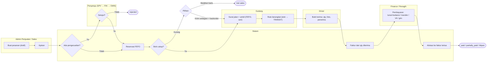
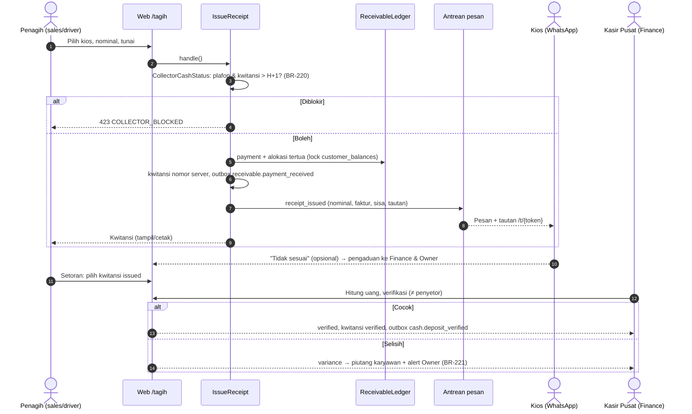
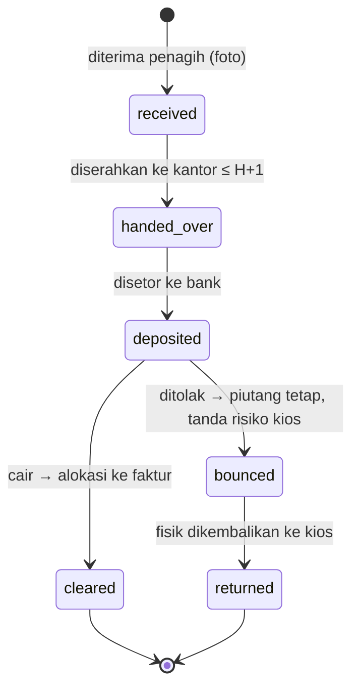

# 16 — Paket B: Penjualan & Uang Aman (siap eksekusi)

Revisi 16 Nov 2026 (repo): PF-3 — `PeriodGuard` + `accounting.lock_date` + `PeriodGuardArchTest` dipindah ke T-077 (Paket A); T-096 menambah layar & aksi ubah tanggal kunci, katalog event B, validator keseimbangan, dan kasus arch test `ReceivableLedger`. Aturan kontrak payload `14` §7.

**Rentang:** T-088–T-113 · FR-B01–FR-B42 · BR-200–BR-229 · SEC-111–SEC-130 · OQ-121 dst.
**Kontrak lintas modul:** `14-ROADMAP-LENGKAP.md` (ADR-101–ADR-115, event §7, penomoran §8, status §11, adapter §12). **Bergantung pada:** `15-PAKET-A-MASTER-GUDANG.md` (disingkat **15**): approval engine, `StockLedger`, `FefoAllocator`, `PriceResolver`, `PromotionEngine`, `DataScope::forStock/forCustomer`, `WhatsAppChannel`, `reminder_logs`.
**Modul konsep v1.4:** SAL-01, SAL-02, SAL-03, SAL-05, DLV-01 (web), FIN-01, FIN-04, FLD-03 (web), AUD-01, POS-01, GAR-01 (jual), WEB-01, BI-01, CORE-04 (template), CORE-06 (saldo awal piutang).

## 0. Penyelarasan (cek sebelum T-088)

| # | Asumsi | Cek |
|---|---|---|
| S-1 | Paket A selesai dan exit gate lulus. Nama kelas & tabel Paket A sesuai **15** | Repo |
| S-2 | `ApprovalEngine` mendukung `conditions` dengan kunci per `document_type` (**15** §4.2). Paket B menambah kunci `exception_types` | `RuleMatcher` |
| S-3 | `StockLedger` menerima tipe mutasi baru `delivery_dispatch_out/in`, `delivery_return_out/in` (ALTER ENUM di T-090, §4.3) | `MovementType` |
| S-4 | `WhatsAppChannel` driver `log` sudah ada (T-074). Paket B menambah antrean pesan & template, **bukan** driver nyata | **15** T-074 |
| S-5 | Library PDF (OQ-109/ADR-114) **wajib diputuskan sebelum T-091**. Bila belum, T-091/T-093/T-100 memakai halaman cetak HTML dan PDF menyusul | `03` §5 |
| S-6 | Dependency baru: library PDF sesuai OQ-109 (satu saja) dan `workbox` (npm, untuk PWA POS, T-107). Tidak ada yang lain | `03` §5 |
| S-7 | Halaman publik (kwitansi, konfirmasi saldo, garansi, katalog) memakai **Blade** server-render di domain yang sama, terpisah dari Inertia admin | `03` |

## 1. Ruang Lingkup

**Termasuk:** pesanan penjualan web (kanal kantor & sales lewat web responsif), kredit & tempo, approval pengecualian, reservasi & backorder, surat jalan & rute, bukti terima di web, faktur & PPN (bila PKP), retur & nota kredit, lost sales, outbox akuntansi penjualan & uang, tanggal kunci, pembayaran & alokasi, titipan, giro, VA & webhook, pembayaran belum teridentifikasi, kwitansi digital, notifikasi kwitansi + "Tidak sesuai", plafon uang di tangan & blokir, setoran & verifikasi kasir, piutang karyawan, konfirmasi saldo, pengaduan kios, aging, kas kecil imprest, POS PWA offline, nomor seri saat jual & kartu garansi, dashboard & laporan standar, katalog publik, template pesan, impor saldo awal piutang.

**Di luar lingkup:** aplikasi mobile Pakis Pro mode lapangan, kunjungan, canvas, blok nomor kwitansi offline, QRIS, Pakis Mitra, WhatsApp driver nyata, red flag otomatis (C); trip & BBM (D); jurnal, CoA, rekonsiliasi bank, faktur pajak elektronik, hutang supplier, member petani & poin (F); prediksi (G).

**Mode B-ringan (OQ-110):** bila disetujui, T-096–T-104 + T-112 dikerjakan lebih dulu dengan saldo piutang hasil impor. Semua aturan di dokumen ini tetap berlaku; faktur baru tetap dari sistem lama sampai T-093 selesai, diimpor berkala lewat T-112.

## 2. Kebutuhan Fungsional

| ID | Kebutuhan | Aturan |
|---|---|---|
| FR-B01 | Pesanan penjualan web: pilih kios (scope), produk & satuan, qty; harga & promo otomatis disnapshot per baris; diskon manual; baris bonus promo; kunci idempoten per pengiriman form. Kanal `office` (Admin Penjualan) dan `sales` (Sales lewat web responsif). | BR-104, BR-200, BR-201, ADR-108 |
| FR-B02 | Pemeriksaan otomatis saat diajukan: status kios, kelayakan pembeli produk terbatas, izin edar, kredit (limit, tunggakan, hold), status penagih (sales), ketersediaan stok. | BR-105, BR-112, BR-202 |
| FR-B03 | Approval pengecualian (lewat limit, tunggakan, diskon di atas kewenangan, tempo panen di atas standar) memakai mesin approval, maker-checker. | BR-105, BR-106, BR-203 |
| FR-B04 | Tempo standar & tempo panen dengan jatuh tempo eksplisit. | BR-205 |
| FR-B05 | Credit hold otomatis (tunggakan lewat N hari, giro ditolak berulang) dan pelepasan hold dengan approval. | BR-204 |
| FR-B06 | Reservasi FEFO saat pesanan disetujui; bila stok kurang: kirim sebagian + backorder, ambil dari gudang lain, atau batalkan baris (lost sales otomatis). | BR-101, BR-102, BR-206 |
| FR-B07 | Pembatalan pesanan/baris sebelum masuk surat jalan; melepas reservasi. | BR-207 |
| FR-B08 | Surat jalan dari baris pesanan siap kirim (satu kios per surat jalan, boleh beberapa pesanan), daftar ambil per rak urut FEFO, scan barcode, nomor seri alat. | BR-144, BR-208 |
| FR-B09 | Rute pengiriman: kelompokkan surat jalan per tanggal, kendaraan, driver, urutan antar; manifest. | BR-208 |
| FR-B10 | Berangkat: stok berpindah ke `TRANSIT`; dokumen surat jalan memuat rekening resmi & peringatan. | BR-132, BR-209 |
| FR-B11 | Bukti terima diinput di web (driver lewat web responsif atau admin dari dokumen kertas yang difoto): qty diterima/ditolak per baris + alasan, nama penerima, foto, tanda tangan opsional, titik lokasi. | BR-107, BR-209 |
| FR-B12 | Barang tidak terkirim/ditolak kembali ke gudang (baik) atau rak karantina (rusak) lewat pemeriksaan gudang. | BR-209 |
| FR-B13 | Faktur otomatis dari bukti terima (qty diterima), jatuh tempo, rekening resmi & peringatan, PDF, kirim ke kios. | BR-107, BR-132, BR-210 |
| FR-B14 | PPN bila PKP dengan tarif berversi; default non-PKP. | BR-210, OQ-101 |
| FR-B15 | Pembatalan faktur: hanya tanpa pembayaran/nota kredit, periode terbuka, approval; barang dikembalikan lewat retur. | BR-211 |
| FR-B16 | Retur penjualan: pengajuan (alasan, foto, batch), approval, pemeriksaan fisik gudang (pemeriksa ≠ pengaju), kondisi → stok baik / karantina, nota kredit otomatis. | BR-212 |
| FR-B17 | Lost sales: manual (permintaan kios saat stok kosong) dan otomatis dari baris yang dibatalkan karena stok. | BR-206 |
| FR-B18 | Event akuntansi penjualan & uang ke outbox, tanggal kunci dokumen keuangan. | BR-113, BR-229, ADR-104, ADR-115 |
| FR-B19 | Pembayaran tunai kantor, transfer, giro, VA; alokasi otomatis ke faktur tertua atau faktur pilihan kios; kelebihan jadi titipan; pemakaian titipan. | BR-108, BR-213 |
| FR-B20 | Realokasi pembayaran oleh Finance dengan approval kedua & alasan. | BR-130, BR-214 |
| FR-B21 | Pembatalan pembayaran dengan approval dan pembalikan alokasi. | BR-215 |
| FR-B22 | Giro: diterima → diserahkan ke kantor (≤ H+1) → disetor → cair/ditolak; tanda risiko kios. | BR-109, BR-216 |
| FR-B23 | Master rekening bank resmi; tercetak di semua dokumen & aplikasi; pembayaran ke rekening tidak resmi tidak diakui. | BR-132 |
| FR-B24 | VA per kios lewat adapter, webhook bertanda tangan, idempoten. | BR-217, OQ-102 |
| FR-B25 | Daftar pembayaran belum teridentifikasi & pencocokan dengan persetujuan kedua. | BR-217 |
| FR-B26 | Kwitansi digital bernomor server untuk tunai & giro; tidak bisa diedit; pembatalan diajukan penerbit, disetujui Finance, diberitahukan ke kios. | BR-127, BR-218 |
| FR-B27 | Pesan kwitansi ke kios (nominal, faktur dilunasi, sisa piutang) dengan tautan "Sesuai / Tidak sesuai"; "Tidak sesuai" jadi laporan ke Finance & Owner, bukan ke sales. | BR-128, BR-219 |
| FR-B28 | Plafon uang di tangan per penagih, status uang di tangan, blokir otomatis terima tunai & pesanan kredit baru. | BR-129, BR-220 |
| FR-B29 | Setoran: penagih memilih kwitansi, menyetor tunai ke kasir pusat / transfer; kasir menghitung & memverifikasi; selisih → piutang karyawan + alert Owner. | BR-110, BR-221 |
| FR-B30 | Piutang karyawan: catat, cicil/lunas, hapus dengan approval Owner. | BR-133, BR-222 |
| FR-B31 | Konfirmasi saldo bulanan ke seluruh kios aktif & sampel acak mingguan; halaman respons bertoken. | BR-131, BR-223 |
| FR-B32 | Pengaduan kios (dari kwitansi, konfirmasi saldo, atau telepon kantor) ditangani Finance, terlihat Owner. | BR-219 |
| FR-B33 | Aging piutang, kartu piutang per kios, laporan kontrol uang. | BR-224 |
| FR-B34 | Kas kecil imprest per lokasi: pengajuan dengan foto nota kamera, kategori, approval sesuai nominal, pengisian ulang. | BR-146, BR-225 |
| FR-B35 | Hitung fisik kas kecil mingguan; selisih → piutang karyawan. | BR-147, BR-225 |
| FR-B36 | POS: register, shift kasir (modal awal, tutup, selisih + approval), penjualan eceran, pembayaran tunai/transfer, retur toko. | BR-226 |
| FR-B37 | POS PWA offline ≥ 24 jam, struk, sinkron idempoten. | BR-226, ADR-110 |
| FR-B38 | Nomor seri dipilih/di-scan saat jual (surat jalan & POS), kartu garansi digital, cek garansi publik dari nomor seri. | BR-144, BR-145, BR-227 |
| FR-B39 | Dashboard Owner & laporan standar (omzet, margin, stok kritis, piutang, kontrol uang). | BR-224 |
| FR-B40 | Katalog publik dari master produk: cari per tanaman, hama, bahan aktif, prinsipal; info izin edar; tanpa harga grosir; produk terbatas tidak tampil. | BR-112, BR-228 |
| FR-B41 | Template pesan per kejadian (faktur, kwitansi, status kirim, konfirmasi saldo, garansi) yang bisa diubah dari layar; antrean pengiriman lewat adapter. | BR-219 |
| FR-B42 | Impor saldo awal piutang (faktur lama) & prosedur cutover. | BR-229 |

## 3. Kebutuhan Non-Fungsional Tambahan

| ID | Target |
|---|---|
| NFR-B01 | Kapasitas: 300 pesanan/hari, 300 faktur/hari, 200 pembayaran/hari, 150 kwitansi/hari, 3 toko × 300 struk/hari. Data 3 tahun: ±300 ribu faktur, ±1 juta baris faktur |
| NFR-B02 | Simpan pesanan 50 baris (harga + promo + cek kredit + reservasi) < 2 s. Aging 3.000 kios < 1 s (p95) |
| NFR-B03 | Webhook VA: respons < 1 s, proses idempoten, aman diulang penyedia |
| NFR-B04 | POS offline: 24 jam / 1.000 struk tersimpan lokal tanpa kehilangan data; sinkron 1.000 struk < 2 menit |
| NFR-B05 | PDF faktur/surat jalan/kwitansi < 3 s per dokumen; cetak massal di-queue |
| NFR-B06 | Pesan ke kios (kwitansi, faktur) masuk antrean < 5 s setelah transaksi; retry dengan backoff sampai 24 jam |

## 4. Database

Konvensi **15** §4 dan `14` §6.1 berlaku: uang `DECIMAL(18,2)`, qty `DECIMAL(18,3)`, persen `DECIMAL(7,4)`, biaya per satuan dasar `DECIMAL(18,4)`, `[audit]` = `created_by`, `updated_by`, `created_at`, `updated_at`. **Dokumen keuangan yang sudah terbit tidak punya soft delete**; pembatalan = status `void` + dokumen/entri pembalik (`14` §6.1).

### 4.1 Referensi & penomoran baru

Grup `reference_items` baru: `sales_order_cancel_reason`, `delivery_reject_reason` (rusak, salah produk, kios menolak, kelebihan), `delivery_fail_reason` (toko tutup, alamat tidak ditemukan, kendaraan rusak, cuaca), `sales_return_reason`, `lost_sale_reason` (stok kosong, harga, izin edar, lainnya), `payment_void_reason`, `receipt_void_reason`, `giro_bounce_reason`, `expense_category` (listrik, bongkar muat, konsumsi, ATK, perbaikan kecil, transport lokal, reimburse staf, lainnya — meta `requires_finance` opsional), `inquiry_type` (kwitansi tidak sesuai, saldo tidak sesuai, harga, pengiriman, kualitas produk, perilaku petugas, lainnya), `crop`, `pest` (katalog publik).

Sequence baru (pola `14` §8): `sales_order`, `delivery`, `delivery_route` (`RUT-{YY}{MM}{DD}-{SEQ:2}`, harian), `invoice`, `credit_note`, `sales_return`, `payment`, `receipt`, `cash_deposit`, `employee_receivable` (`PKR-{YY}{MM}-{SEQ:4}`), `petty_cash_expense`, `balance_confirmation`, `customer_inquiry` (`ADU-{YY}{MM}-{SEQ:4}`), `warranty_card`, `pos_shift` (`SHF-{LOC}-{YY}{MM}{DD}-{SEQ:2}`). Nomor struk POS dibuat klien (`14` §8).

### 4.2 Bank, pajak, integrasi, pesan & tautan publik (T-093, T-096, T-099, T-111)

```sql
CREATE TABLE bank_accounts (                    -- rekening resmi perusahaan (dilengkapi Paket F)
  id BIGINT UNSIGNED PRIMARY KEY AUTO_INCREMENT,
  code VARCHAR(20) NOT NULL,
  bank_name VARCHAR(60) NOT NULL,
  account_no VARCHAR(30) NOT NULL,                -- bukan rahasia: dicetak di semua dokumen
  account_holder VARCHAR(150) NOT NULL,
  purpose ENUM('collection','operational','va_settlement') NOT NULL DEFAULT 'collection',
  is_printed_on_documents BOOLEAN NOT NULL DEFAULT TRUE,
  sort_order SMALLINT UNSIGNED NOT NULL DEFAULT 0,
  is_active BOOLEAN NOT NULL DEFAULT TRUE,
  [audit],
  UNIQUE KEY bank_accounts_code_unique (code),
  UNIQUE KEY bank_accounts_no_unique (bank_name, account_no)
);
CREATE TABLE tax_rates (                        -- PPN berversi (OQ-101); dipakai hanya bila tax.is_pkp
  id BIGINT UNSIGNED PRIMARY KEY AUTO_INCREMENT,
  tax_code VARCHAR(20) NOT NULL,                  -- 'VAT'
  rate_pct DECIMAL(7,4) NOT NULL,
  dpp_factor DECIMAL(9,6) NOT NULL DEFAULT 1,     -- pengali dasar pengenaan pajak sesuai ketentuan yang berlaku
  effective_from DATE NOT NULL,
  note VARCHAR(255) NULL,                         -- dasar hukum, diisi saat OQ-101 dijawab
  [audit],
  UNIQUE KEY tax_rates_code_from_unique (tax_code, effective_from)
);
CREATE TABLE integration_logs (
  id BIGINT UNSIGNED PRIMARY KEY AUTO_INCREMENT,
  adapter VARCHAR(40) NOT NULL,                   -- 'whatsapp', 'payment_gateway'
  driver VARCHAR(40) NOT NULL,
  direction ENUM('outbound','inbound') NOT NULL,
  operation VARCHAR(60) NOT NULL,
  reference_type VARCHAR(60) NULL, reference_id BIGINT UNSIGNED NULL,
  status ENUM('success','failed','retrying') NOT NULL,
  http_status SMALLINT UNSIGNED NULL,
  duration_ms INT UNSIGNED NULL,
  request_excerpt TEXT NULL,                      -- sudah dimasking (SEC-114)
  response_excerpt TEXT NULL,
  error VARCHAR(500) NULL,
  created_at TIMESTAMP NULL,
  KEY ilog_adapter_time_idx (adapter, created_at),
  KEY ilog_ref_idx (reference_type, reference_id)
);
CREATE TABLE webhook_receipts (
  id BIGINT UNSIGNED PRIMARY KEY AUTO_INCREMENT,
  provider VARCHAR(40) NOT NULL,
  event_id VARCHAR(120) NOT NULL,                 -- id unik dari penyedia
  event_type VARCHAR(60) NOT NULL,
  signature_valid BOOLEAN NOT NULL,
  payload JSON NOT NULL,
  status ENUM('received','processed','ignored','failed') NOT NULL DEFAULT 'received',
  error VARCHAR(500) NULL,
  received_at TIMESTAMP NOT NULL, processed_at TIMESTAMP NULL,
  UNIQUE KEY webhook_provider_event_unique (provider, event_id),
  KEY webhook_status_idx (status, received_at)
);
CREATE TABLE message_templates (
  id BIGINT UNSIGNED PRIMARY KEY AUTO_INCREMENT,
  code VARCHAR(60) NOT NULL,                      -- 'invoice_issued', 'receipt_issued', …
  channel ENUM('whatsapp','in_app','email') NOT NULL,
  body TEXT NOT NULL,                             -- placeholder {{nama}} dari allowlist per code
  provider_template_name VARCHAR(100) NULL,       -- nama template yang disetujui penyedia WA (Paket C)
  is_active BOOLEAN NOT NULL DEFAULT TRUE,
  version INT UNSIGNED NOT NULL DEFAULT 1,
  [audit],
  UNIQUE KEY mt_code_channel_unique (code, channel)
);
CREATE TABLE outbound_messages (
  id BIGINT UNSIGNED PRIMARY KEY AUTO_INCREMENT,
  channel ENUM('whatsapp','in_app','email') NOT NULL,
  template_code VARCHAR(60) NOT NULL,
  template_version INT UNSIGNED NOT NULL,
  recipient VARCHAR(150) NOT NULL,                -- nomor 62… / email
  customer_id BIGINT UNSIGNED NULL,
  related_type VARCHAR(60) NULL, related_id BIGINT UNSIGNED NULL,
  payload JSON NOT NULL,                          -- nilai placeholder
  status ENUM('queued','sending','sent','delivered','failed','cancelled') NOT NULL DEFAULT 'queued',
  attempts TINYINT UNSIGNED NOT NULL DEFAULT 0,
  next_attempt_at TIMESTAMP NULL,
  provider_message_id VARCHAR(120) NULL,
  error VARCHAR(500) NULL,
  sent_at TIMESTAMP NULL,
  created_at TIMESTAMP NULL, updated_at TIMESTAMP NULL,
  KEY om_status_next_idx (status, next_attempt_at),
  KEY om_related_idx (related_type, related_id),
  KEY om_customer_idx (customer_id, created_at)
);
CREATE TABLE public_links (                     -- tautan bertoken untuk kios (tanpa login)
  id BIGINT UNSIGNED PRIMARY KEY AUTO_INCREMENT,
  token_hash CHAR(64) NOT NULL,                   -- SHA-256 token; token mentah hanya di pesan
  purpose ENUM('receipt','invoice','balance_confirmation','warranty_card') NOT NULL,
  subject_type VARCHAR(60) NOT NULL, subject_id BIGINT UNSIGNED NOT NULL,
  customer_id BIGINT UNSIGNED NULL,
  expires_at TIMESTAMP NOT NULL,
  responded_at TIMESTAMP NULL,
  view_count INT UNSIGNED NOT NULL DEFAULT 0,
  last_viewed_at TIMESTAMP NULL,
  revoked_at TIMESTAMP NULL,
  created_at TIMESTAMP NULL,
  UNIQUE KEY pl_token_unique (token_hash),
  KEY pl_subject_idx (subject_type, subject_id)
);
CREATE TABLE customer_balances (                -- cache saldo, dikunci saat cek kredit/transaksi (BR-202)
  customer_id BIGINT UNSIGNED PRIMARY KEY,
  receivable_balance DECIMAL(18,2) NOT NULL DEFAULT 0,     -- Σ sisa faktur terbuka
  pending_giro_amount DECIMAL(18,2) NOT NULL DEFAULT 0,    -- giro belum cair (tidak mengurangi piutang)
  unbilled_order_amount DECIMAL(18,2) NOT NULL DEFAULT 0,  -- pesanan kredit disetujui belum difakturkan
  deposit_balance DECIMAL(18,2) NOT NULL DEFAULT 0,        -- titipan
  oldest_open_due_date DATE NULL,
  last_payment_at TIMESTAMP NULL,
  updated_at TIMESTAMP NULL,
  KEY cb_due_idx (oldest_open_due_date),
  CONSTRAINT cb_customer_fk FOREIGN KEY (customer_id) REFERENCES customers(id),
  CONSTRAINT cb_nonneg_chk CHECK (receivable_balance >= 0 AND deposit_balance >= 0 AND unbilled_order_amount >= 0 AND pending_giro_amount >= 0)
);
CREATE TABLE customer_flags (                   -- tanda risiko (giro ditolak, hold manual, sengketa); dipakai red flag Paket C
  id BIGINT UNSIGNED PRIMARY KEY AUTO_INCREMENT,
  customer_id BIGINT UNSIGNED NOT NULL,
  flag_type ENUM('giro_bounced','credit_hold_manual','dispute_open','payment_risk') NOT NULL,
  source_type VARCHAR(60) NULL, source_id BIGINT UNSIGNED NULL,
  note VARCHAR(255) NULL,
  raised_at TIMESTAMP NOT NULL, raised_by BIGINT UNSIGNED NULL,
  cleared_at TIMESTAMP NULL, cleared_by BIGINT UNSIGNED NULL, clear_note VARCHAR(255) NULL,
  KEY cf_customer_open_idx (customer_id, cleared_at),
  CONSTRAINT cf_customer_fk FOREIGN KEY (customer_id) REFERENCES customers(id)
);
```
`customer_balances` hanya diubah oleh `ReceivableLedger` (domain `Receivable`) di transaksi dokumen, dengan `SELECT … FOR UPDATE`. Job `receivables:reconcile` (BR-224) membandingkan cache dengan sumbernya setiap malam.

### 4.3 Pesanan & lost sales (T-088–T-090, T-095)

```sql
CREATE TABLE sales_orders (
  id BIGINT UNSIGNED PRIMARY KEY AUTO_INCREMENT,
  number VARCHAR(30) NOT NULL,
  idempotency_key CHAR(36) NOT NULL,              -- UUID dari form/klien (BR-201)
  channel ENUM('office','sales','mitra','canvas') NOT NULL,   -- mitra & canvas dipakai Paket C
  customer_id BIGINT UNSIGNED NOT NULL,
  salesperson_employee_id BIGINT UNSIGNED NULL,   -- sales PJ kios saat pesanan dibuat (snapshot)
  sales_area_id BIGINT UNSIGNED NOT NULL,         -- snapshot
  source_stock_location_id BIGINT UNSIGNED NOT NULL,
  order_date DATE NOT NULL,
  priced_at DATETIME NOT NULL,                    -- waktu harga dikunci (BR-104)
  requested_delivery_date DATE NULL,
  payment_type ENUM('cash','credit') NOT NULL,
  term_type ENUM('cash','standard','harvest') NOT NULL,
  term_days SMALLINT UNSIGNED NOT NULL DEFAULT 0,
  harvest_due_date DATE NULL,                     -- wajib bila term_type = harvest
  subtotal DECIMAL(18,2) NOT NULL DEFAULT 0,      -- Σ qty × harga list
  promo_discount_total DECIMAL(18,2) NOT NULL DEFAULT 0,
  manual_discount_total DECIMAL(18,2) NOT NULL DEFAULT 0,
  tax_total DECIMAL(18,2) NOT NULL DEFAULT 0,     -- estimasi; nilai final di faktur
  grand_total DECIMAL(18,2) NOT NULL DEFAULT 0,
  max_manual_discount_pct DECIMAL(7,4) NOT NULL DEFAULT 0,
  exceptions JSON NULL,                           -- [{"type":"over_limit","amount":"1250000.00"}, …]
  status ENUM('draft','pending_approval','approved','rejected','in_fulfillment','fulfilled','closed','cancelled') NOT NULL DEFAULT 'draft',
  approval_request_id BIGINT UNSIGNED NULL,
  submitted_at TIMESTAMP NULL, approved_at TIMESTAMP NULL, closed_at TIMESTAMP NULL,
  cancel_reason_id BIGINT UNSIGNED NULL, cancel_note VARCHAR(255) NULL,
  customer_note VARCHAR(500) NULL,                -- catatan dari kios
  internal_note TEXT NULL,
  created_offline_at DATETIME NULL,               -- Paket C
  [audit],
  UNIQUE KEY so_number_unique (number),
  UNIQUE KEY so_idempotency_unique (idempotency_key),
  KEY so_customer_status_idx (customer_id, status, created_at),
  KEY so_sales_status_idx (salesperson_employee_id, status, order_date),
  KEY so_status_date_idx (status, order_date),
  KEY so_sl_status_idx (source_stock_location_id, status),
  CONSTRAINT so_customer_fk FOREIGN KEY (customer_id) REFERENCES customers(id),
  CONSTRAINT so_sl_fk FOREIGN KEY (source_stock_location_id) REFERENCES stock_locations(id),
  CONSTRAINT so_term_chk CHECK (
    (payment_type = 'cash' AND term_type = 'cash' AND term_days = 0) OR
    (payment_type = 'credit' AND term_type = 'standard' AND term_days > 0) OR
    (payment_type = 'credit' AND term_type = 'harvest' AND harvest_due_date IS NOT NULL))
);
CREATE TABLE sales_order_lines (
  id BIGINT UNSIGNED PRIMARY KEY AUTO_INCREMENT,
  sales_order_id BIGINT UNSIGNED NOT NULL,
  line_no SMALLINT UNSIGNED NOT NULL,
  product_id BIGINT UNSIGNED NOT NULL,
  product_unit_id BIGINT UNSIGNED NOT NULL,
  qty DECIMAL(18,3) NOT NULL,
  qty_base DECIMAL(18,3) NOT NULL,
  is_bonus BOOLEAN NOT NULL DEFAULT FALSE,
  bonus_of_line_id BIGINT UNSIGNED NULL,
  price_list_version_id BIGINT UNSIGNED NULL,     -- snapshot (ADR-108); NULL untuk baris bonus
  list_price DECIMAL(18,2) NOT NULL,              -- per satuan baris, sebelum diskon
  promo_discount_amount DECIMAL(18,2) NOT NULL DEFAULT 0,   -- total baris
  applied_promotions JSON NULL,                   -- [{"promotion_id":12,"code":"…","amount":"…"}]
  manual_discount_pct DECIMAL(7,4) NOT NULL DEFAULT 0,
  manual_discount_amount DECIMAL(18,2) NOT NULL DEFAULT 0,
  net_unit_price DECIMAL(18,4) NOT NULL,          -- (line_total / qty), informasi
  line_total DECIMAL(18,2) NOT NULL,
  qty_reserved_base DECIMAL(18,3) NOT NULL DEFAULT 0,
  qty_in_delivery_base DECIMAL(18,3) NOT NULL DEFAULT 0,    -- sudah masuk surat jalan aktif
  qty_delivered_base DECIMAL(18,3) NOT NULL DEFAULT 0,
  qty_cancelled_base DECIMAL(18,3) NOT NULL DEFAULT 0,
  backorder BOOLEAN NOT NULL DEFAULT FALSE,
  fulfillment_stock_location_id BIGINT UNSIGNED NULL,       -- bila diambil dari gudang lain
  UNIQUE KEY sol_so_line_unique (sales_order_id, line_no),
  KEY sol_product_idx (product_id),
  KEY sol_backorder_idx (backorder, product_id),
  CONSTRAINT sol_so_fk FOREIGN KEY (sales_order_id) REFERENCES sales_orders(id) ON DELETE CASCADE,
  CONSTRAINT sol_product_fk FOREIGN KEY (product_id) REFERENCES products(id),
  CONSTRAINT sol_unit_fk FOREIGN KEY (product_unit_id) REFERENCES product_units(id),
  CONSTRAINT sol_qty_chk CHECK (qty > 0 AND qty_base > 0 AND line_total >= 0
    AND qty_delivered_base + qty_cancelled_base <= qty_base)
);
CREATE TABLE lost_sales (
  id BIGINT UNSIGNED PRIMARY KEY AUTO_INCREMENT,
  customer_id BIGINT UNSIGNED NULL,               -- NULL = pembeli eceran / tidak dikenal
  product_id BIGINT UNSIGNED NOT NULL,
  qty_base DECIMAL(18,3) NOT NULL,
  estimated_value DECIMAL(18,2) NULL,
  reason_id BIGINT UNSIGNED NOT NULL,             -- reference_items(lost_sale_reason)
  source ENUM('manual','order_line_cancelled','pos','mitra','sales_visit') NOT NULL,
  source_type VARCHAR(60) NULL, source_id BIGINT UNSIGNED NULL,
  stock_location_id BIGINT UNSIGNED NULL,
  channel ENUM('office','sales','mitra','canvas','pos') NOT NULL,
  recorded_at DATETIME NOT NULL,
  note VARCHAR(255) NULL,
  [audit],
  KEY lost_product_time_idx (product_id, recorded_at),
  KEY lost_customer_time_idx (customer_id, recorded_at),
  CONSTRAINT lost_product_fk FOREIGN KEY (product_id) REFERENCES products(id),
  CONSTRAINT lost_qty_chk CHECK (qty_base > 0)
);
ALTER TABLE stock_movements MODIFY movement_type ENUM('opening_balance','receipt','purchase_return','transfer_out','transfer_in',
  'adjustment_in','adjustment_out','disposal','bin_move_out','bin_move_in',
  'sale','sales_return','pos_sale','pos_return','canvas_load','canvas_unload','promo_issue',
  'delivery_dispatch_out','delivery_dispatch_in','delivery_return_out','delivery_return_in') NOT NULL;   -- T-090
```
Reservasi pesanan memakai `stock_reservations` Paket A dengan `source_type='sales_order_line'`, `expires_at = NULL` (tidak kedaluwarsa otomatis; dilepas oleh pembatalan atau job backorder, BR-206).

### 4.4 Pengiriman (T-091, T-092)

```sql
CREATE TABLE delivery_routes (
  id BIGINT UNSIGNED PRIMARY KEY AUTO_INCREMENT,
  number VARCHAR(30) NOT NULL,
  route_date DATE NOT NULL,
  source_stock_location_id BIGINT UNSIGNED NOT NULL,
  vehicle_id BIGINT UNSIGNED NULL,
  driver_employee_id BIGINT UNSIGNED NULL,
  helper_employee_ids JSON NULL,
  status ENUM('planned','dispatched','completed','cancelled') NOT NULL DEFAULT 'planned',
  dispatched_at TIMESTAMP NULL, completed_at TIMESTAMP NULL,
  note VARCHAR(255) NULL,
  [audit],
  UNIQUE KEY dr_number_unique (number),
  KEY dr_date_sl_idx (route_date, source_stock_location_id),
  KEY dr_driver_date_idx (driver_employee_id, route_date),
  CONSTRAINT dr_sl_fk FOREIGN KEY (source_stock_location_id) REFERENCES stock_locations(id),
  CONSTRAINT dr_vehicle_fk FOREIGN KEY (vehicle_id) REFERENCES vehicles(id)
);
CREATE TABLE deliveries (
  id BIGINT UNSIGNED PRIMARY KEY AUTO_INCREMENT,
  number VARCHAR(30) NOT NULL,
  customer_id BIGINT UNSIGNED NOT NULL,
  source_stock_location_id BIGINT UNSIGNED NOT NULL,
  delivery_route_id BIGINT UNSIGNED NULL,
  route_sequence SMALLINT UNSIGNED NULL,
  planned_date DATE NOT NULL,
  ship_to_address TEXT NULL,                      -- snapshot alamat kios
  status ENUM('planned','picked','on_route','delivered','partially_delivered','failed','cancelled') NOT NULL DEFAULT 'planned',
  picked_by BIGINT UNSIGNED NULL, picked_at TIMESTAMP NULL,
  dispatched_at TIMESTAMP NULL,
  fail_reason_id BIGINT UNSIGNED NULL, fail_note VARCHAR(255) NULL,
  returned_checked_by BIGINT UNSIGNED NULL, returned_checked_at TIMESTAMP NULL,  -- barang kembali diperiksa gudang
  [audit],
  UNIQUE KEY del_number_unique (number),
  KEY del_customer_idx (customer_id, planned_date),
  KEY del_route_idx (delivery_route_id, route_sequence),
  KEY del_status_date_idx (status, planned_date),
  KEY del_sl_status_idx (source_stock_location_id, status),
  CONSTRAINT del_customer_fk FOREIGN KEY (customer_id) REFERENCES customers(id),
  CONSTRAINT del_sl_fk FOREIGN KEY (source_stock_location_id) REFERENCES stock_locations(id),
  CONSTRAINT del_route_fk FOREIGN KEY (delivery_route_id) REFERENCES delivery_routes(id)
);
CREATE TABLE delivery_lines (
  id BIGINT UNSIGNED PRIMARY KEY AUTO_INCREMENT,
  delivery_id BIGINT UNSIGNED NOT NULL,
  sales_order_line_id BIGINT UNSIGNED NOT NULL,
  product_id BIGINT UNSIGNED NOT NULL,
  product_unit_id BIGINT UNSIGNED NOT NULL,       -- satuan dari baris pesanan
  qty_planned_base DECIMAL(18,3) NOT NULL,
  qty_picked_base DECIMAL(18,3) NULL,
  qty_delivered_base DECIMAL(18,3) NULL,          -- diterima kios
  qty_rejected_base DECIMAL(18,3) NULL,           -- ditolak kios (kembali)
  reject_reason_id BIGINT UNSIGNED NULL,
  reject_condition ENUM('good','damaged') NULL,   -- menentukan kembali ke stok atau karantina
  KEY dl_delivery_idx (delivery_id),
  KEY dl_sol_idx (sales_order_line_id),
  CONSTRAINT dl_delivery_fk FOREIGN KEY (delivery_id) REFERENCES deliveries(id) ON DELETE CASCADE,
  CONSTRAINT dl_sol_fk FOREIGN KEY (sales_order_line_id) REFERENCES sales_order_lines(id),
  CONSTRAINT dl_qty_chk CHECK (qty_planned_base > 0
    AND (qty_delivered_base IS NULL OR qty_delivered_base + COALESCE(qty_rejected_base,0) <= COALESCE(qty_picked_base, qty_planned_base))),
  CONSTRAINT dl_reject_chk CHECK (COALESCE(qty_rejected_base,0) = 0 OR (reject_reason_id IS NOT NULL AND reject_condition IS NOT NULL))
);
CREATE TABLE delivery_line_batches (            -- jejak batch yang dikirim (recall & validasi retur)
  id BIGINT UNSIGNED PRIMARY KEY AUTO_INCREMENT,
  delivery_line_id BIGINT UNSIGNED NOT NULL,
  source_batch_id BIGINT UNSIGNED NOT NULL,       -- batch gudang
  transit_batch_id BIGINT UNSIGNED NULL,          -- batch di TRANSIT setelah berangkat
  batch_no VARCHAR(60) NOT NULL, expiry_date DATE NULL,
  qty_base DECIMAL(18,3) NOT NULL,
  qty_delivered_base DECIMAL(18,3) NULL,
  unit_cost DECIMAL(18,4) NULL,                   -- HPP saat diserahkan (BR-209)
  reservation_id BIGINT UNSIGNED NULL,
  fefo_override BOOLEAN NOT NULL DEFAULT FALSE,
  KEY dlb_line_idx (delivery_line_id),
  KEY dlb_batchno_idx (batch_no),
  CONSTRAINT dlb_line_fk FOREIGN KEY (delivery_line_id) REFERENCES delivery_lines(id) ON DELETE CASCADE,
  CONSTRAINT dlb_source_fk FOREIGN KEY (source_batch_id) REFERENCES stock_batches(id),
  CONSTRAINT dlb_qty_chk CHECK (qty_base > 0)
);
CREATE TABLE delivery_line_serials (
  delivery_line_id BIGINT UNSIGNED NOT NULL,
  serial_number_id BIGINT UNSIGNED NOT NULL,
  delivered BOOLEAN NULL,                         -- NULL sampai bukti terima
  PRIMARY KEY (delivery_line_id, serial_number_id),
  UNIQUE KEY dls_serial_unique (serial_number_id, delivery_line_id),
  CONSTRAINT dls_line_fk FOREIGN KEY (delivery_line_id) REFERENCES delivery_lines(id) ON DELETE CASCADE,
  CONSTRAINT dls_serial_fk FOREIGN KEY (serial_number_id) REFERENCES serial_numbers(id)
);
CREATE TABLE proofs_of_delivery (
  id BIGINT UNSIGNED PRIMARY KEY AUTO_INCREMENT,
  delivery_id BIGINT UNSIGNED NOT NULL,
  received_by_name VARCHAR(100) NOT NULL,
  received_at DATETIME NOT NULL,                  -- waktu kios menerima (dari dokumen/driver)
  photo_path VARCHAR(255) NOT NULL,               -- foto barang/serah terima atau foto surat jalan bertanda tangan
  signature_path VARCHAR(255) NULL,
  latitude DECIMAL(10,7) NULL, longitude DECIMAL(10,7) NULL, accuracy_m DECIMAL(8,2) NULL,
  input_mode ENUM('driver_web','office_from_paper','driver_app') NOT NULL,   -- driver_app = Paket C
  recorded_by BIGINT UNSIGNED NOT NULL,
  recorded_at TIMESTAMP NOT NULL,
  note VARCHAR(255) NULL,
  UNIQUE KEY pod_delivery_unique (delivery_id),
  CONSTRAINT pod_delivery_fk FOREIGN KEY (delivery_id) REFERENCES deliveries(id)
);
```

### 4.5 Faktur, retur & nota kredit (T-093, T-094)

```sql
CREATE TABLE invoices (
  id BIGINT UNSIGNED PRIMARY KEY AUTO_INCREMENT,
  number VARCHAR(30) NOT NULL,
  customer_id BIGINT UNSIGNED NOT NULL,
  invoice_type ENUM('sales','opening_balance','charge') NOT NULL DEFAULT 'sales',   -- charge = biaya non-stok (mis. biaya giro ditolak)
  delivery_id BIGINT UNSIGNED NULL,               -- wajib untuk sales
  legacy_number VARCHAR(60) NULL,                 -- nomor faktur sistem lama (saldo awal)
  invoice_date DATE NOT NULL,
  due_date DATE NOT NULL,
  term_type ENUM('cash','standard','harvest') NOT NULL,
  salesperson_employee_id BIGINT UNSIGNED NULL,
  sales_area_id BIGINT UNSIGNED NULL,
  subtotal DECIMAL(18,2) NOT NULL,
  discount_total DECIMAL(18,2) NOT NULL DEFAULT 0,
  tax_base DECIMAL(18,2) NOT NULL DEFAULT 0,
  tax_rate_id BIGINT UNSIGNED NULL,
  tax_total DECIMAL(18,2) NOT NULL DEFAULT 0,
  grand_total DECIMAL(18,2) NOT NULL,
  paid_amount DECIMAL(18,2) NOT NULL DEFAULT 0,       -- Σ alokasi pembayaran & titipan aktif
  credited_amount DECIMAL(18,2) NOT NULL DEFAULT 0,   -- Σ nota kredit teralokasi
  balance DECIMAL(18,2) GENERATED ALWAYS AS (grand_total - paid_amount - credited_amount) STORED,
  cogs_total DECIMAL(18,2) NOT NULL DEFAULT 0,        -- HPP saat diserahkan; tampil hanya untuk reports.margin.view
  status ENUM('issued','partially_paid','paid','void') NOT NULL DEFAULT 'issued',
  bank_accounts_snapshot JSON NOT NULL,           -- rekening resmi saat terbit (BR-132)
  pdf_path VARCHAR(255) NULL,
  sent_at TIMESTAMP NULL,
  void_reason VARCHAR(255) NULL, voided_at TIMESTAMP NULL, void_approval_request_id BIGINT UNSIGNED NULL,
  [audit],
  UNIQUE KEY inv_number_unique (number),
  active_delivery_key BIGINT UNSIGNED GENERATED ALWAYS AS (IF(status <> 'void', delivery_id, NULL)) STORED,
  UNIQUE KEY inv_one_active_per_delivery (active_delivery_key),   -- faktur pengganti boleh setelah yang lama void
  KEY inv_delivery_idx (delivery_id),
  KEY inv_customer_status_due_idx (customer_id, status, due_date),
  KEY inv_status_due_idx (status, due_date),
  KEY inv_sales_date_idx (salesperson_employee_id, invoice_date),
  KEY inv_date_idx (invoice_date),
  CONSTRAINT inv_customer_fk FOREIGN KEY (customer_id) REFERENCES customers(id),
  CONSTRAINT inv_delivery_fk FOREIGN KEY (delivery_id) REFERENCES deliveries(id),
  CONSTRAINT inv_amount_chk CHECK (grand_total >= 0 AND paid_amount >= 0 AND credited_amount >= 0
    AND paid_amount + credited_amount <= grand_total),
  CONSTRAINT inv_source_chk CHECK ((invoice_type = 'sales') = (delivery_id IS NOT NULL))
);
CREATE TABLE invoice_lines (
  id BIGINT UNSIGNED PRIMARY KEY AUTO_INCREMENT,
  invoice_id BIGINT UNSIGNED NOT NULL,
  line_no SMALLINT UNSIGNED NOT NULL,
  delivery_line_id BIGINT UNSIGNED NULL,
  sales_order_line_id BIGINT UNSIGNED NULL,
  product_id BIGINT UNSIGNED NULL,                -- NULL untuk baris ringkasan saldo awal
  description VARCHAR(255) NOT NULL,
  product_unit_id BIGINT UNSIGNED NULL,
  qty DECIMAL(18,3) NOT NULL,                     -- dalam satuan baris pesanan
  qty_base DECIMAL(18,3) NOT NULL,
  unit_price DECIMAL(18,2) NOT NULL,              -- list_price snapshot pesanan
  discount_amount DECIMAL(18,2) NOT NULL DEFAULT 0,   -- promo + manual, proporsional qty diterima
  line_total DECIMAL(18,2) NOT NULL,
  is_bonus BOOLEAN NOT NULL DEFAULT FALSE,
  unit_cost DECIMAL(18,4) NULL,                   -- HPP rata-rata tertimbang dari delivery_line_batches
  UNIQUE KEY invl_inv_line_unique (invoice_id, line_no),
  KEY invl_product_idx (product_id),
  CONSTRAINT invl_inv_fk FOREIGN KEY (invoice_id) REFERENCES invoices(id) ON DELETE RESTRICT,
  CONSTRAINT invl_dl_fk FOREIGN KEY (delivery_line_id) REFERENCES delivery_lines(id)
);
CREATE TABLE sales_returns (
  id BIGINT UNSIGNED PRIMARY KEY AUTO_INCREMENT,
  number VARCHAR(30) NOT NULL,
  customer_id BIGINT UNSIGNED NOT NULL,
  invoice_id BIGINT UNSIGNED NOT NULL,
  return_stock_location_id BIGINT UNSIGNED NOT NULL,
  reason_id BIGINT UNSIGNED NOT NULL,
  photo_paths JSON NOT NULL,                      -- minimal 1 foto
  requested_by_employee_id BIGINT UNSIGNED NULL,  -- sales yang mengajukan (bila ada)
  status ENUM('requested','pending_approval','approved','received','credited','rejected','cancelled') NOT NULL DEFAULT 'requested',
  approval_request_id BIGINT UNSIGNED NULL,
  received_by BIGINT UNSIGNED NULL, received_at TIMESTAMP NULL,
  total_value DECIMAL(18,2) NOT NULL DEFAULT 0,   -- nilai kredit (harga jual neto)
  note TEXT NULL,
  [audit],
  UNIQUE KEY sret_number_unique (number),
  KEY sret_customer_status_idx (customer_id, status),
  KEY sret_status_idx (status, created_at),
  CONSTRAINT sret_customer_fk FOREIGN KEY (customer_id) REFERENCES customers(id),
  CONSTRAINT sret_inv_fk FOREIGN KEY (invoice_id) REFERENCES invoices(id),
  CONSTRAINT sret_sl_fk FOREIGN KEY (return_stock_location_id) REFERENCES stock_locations(id)
);
CREATE TABLE sales_return_lines (
  id BIGINT UNSIGNED PRIMARY KEY AUTO_INCREMENT,
  sales_return_id BIGINT UNSIGNED NOT NULL,
  invoice_line_id BIGINT UNSIGNED NOT NULL,
  product_id BIGINT UNSIGNED NOT NULL,
  batch_no VARCHAR(60) NOT NULL,                  -- wajib cocok dengan batch yang dikirim (BR-212)
  expiry_date DATE NULL,
  qty_requested_base DECIMAL(18,3) NOT NULL,
  qty_received_base DECIMAL(18,3) NULL,           -- hasil periksa fisik
  condition_on_receipt ENUM('good','damaged','expired','wrong_batch') NULL,
  credit_unit_price DECIMAL(18,4) NOT NULL,       -- harga neto per satuan dasar dari faktur
  credit_amount DECIMAL(18,2) NULL,
  stock_batch_id BIGINT UNSIGNED NULL,            -- batch tujuan saat diterima
  serial_number_id BIGINT UNSIGNED NULL,
  KEY sretl_ret_idx (sales_return_id),
  KEY sretl_invl_idx (invoice_line_id),
  CONSTRAINT sretl_ret_fk FOREIGN KEY (sales_return_id) REFERENCES sales_returns(id) ON DELETE CASCADE,
  CONSTRAINT sretl_invl_fk FOREIGN KEY (invoice_line_id) REFERENCES invoice_lines(id),
  CONSTRAINT sretl_qty_chk CHECK (qty_requested_base > 0 AND (qty_received_base IS NULL OR qty_received_base >= 0))
);
CREATE TABLE credit_notes (
  id BIGINT UNSIGNED PRIMARY KEY AUTO_INCREMENT,
  number VARCHAR(30) NOT NULL,
  customer_id BIGINT UNSIGNED NOT NULL,
  invoice_id BIGINT UNSIGNED NOT NULL,
  sales_return_id BIGINT UNSIGNED NULL,
  credit_date DATE NOT NULL,
  subtotal DECIMAL(18,2) NOT NULL,
  tax_total DECIMAL(18,2) NOT NULL DEFAULT 0,
  amount DECIMAL(18,2) NOT NULL,
  amount_to_invoice DECIMAL(18,2) NOT NULL,       -- mengurangi sisa faktur
  amount_to_deposit DECIMAL(18,2) NOT NULL DEFAULT 0,   -- sisa bila faktur sudah lunas → titipan
  cogs_reversal DECIMAL(18,2) NOT NULL DEFAULT 0, -- barang kembali ke stok baik
  status ENUM('issued','void') NOT NULL DEFAULT 'issued',
  [audit],
  UNIQUE KEY cn_number_unique (number),
  UNIQUE KEY cn_return_unique (sales_return_id),
  KEY cn_customer_idx (customer_id, credit_date),
  CONSTRAINT cn_customer_fk FOREIGN KEY (customer_id) REFERENCES customers(id),
  CONSTRAINT cn_inv_fk FOREIGN KEY (invoice_id) REFERENCES invoices(id),
  CONSTRAINT cn_amount_chk CHECK (amount > 0 AND amount_to_invoice + amount_to_deposit = amount)
);
```

### 4.6 Pembayaran, alokasi, titipan, giro, VA (T-097–T-099)

```sql
CREATE TABLE payments (
  id BIGINT UNSIGNED PRIMARY KEY AUTO_INCREMENT,
  number VARCHAR(30) NOT NULL,
  idempotency_key CHAR(36) NOT NULL,
  customer_id BIGINT UNSIGNED NOT NULL,
  method ENUM('cash','transfer','va','giro','deposit_offset','qris') NOT NULL,   -- qris Paket C
  amount DECIMAL(18,2) NOT NULL,
  received_at DATETIME NOT NULL,                  -- waktu uang diterima (server untuk tunai)
  business_date DATE NOT NULL,
  bank_account_id BIGINT UNSIGNED NULL,           -- wajib untuk transfer & va (rekening resmi)
  external_id VARCHAR(120) NULL,                  -- id transaksi VA / referensi bank
  collector_employee_id BIGINT UNSIGNED NULL,     -- penerima tunai/giro di lapangan
  received_by_user_id BIGINT UNSIGNED NOT NULL,
  allocation_mode ENUM('oldest_first','customer_selected') NOT NULL DEFAULT 'oldest_first',
  selected_invoice_ids JSON NULL,                 -- untuk customer_selected
  status ENUM('recorded','allocated','pending_clearing','bounced','void') NOT NULL DEFAULT 'recorded',
  unallocated_amount DECIMAL(18,2) NOT NULL DEFAULT 0,  -- informasi; sisa langsung jadi titipan
  proof_path VARCHAR(255) NULL,                   -- bukti transfer
  void_reason_id BIGINT UNSIGNED NULL, voided_at TIMESTAMP NULL, void_approval_request_id BIGINT UNSIGNED NULL,
  note VARCHAR(255) NULL,
  [audit],
  UNIQUE KEY pay_number_unique (number),
  UNIQUE KEY pay_idempotency_unique (idempotency_key),
  UNIQUE KEY pay_method_external_unique (method, external_id),
  KEY pay_customer_date_idx (customer_id, business_date),
  KEY pay_status_idx (status, business_date),
  KEY pay_collector_idx (collector_employee_id, business_date),
  CONSTRAINT pay_customer_fk FOREIGN KEY (customer_id) REFERENCES customers(id),
  CONSTRAINT pay_bank_fk FOREIGN KEY (bank_account_id) REFERENCES bank_accounts(id),
  CONSTRAINT pay_amount_chk CHECK (amount > 0),
  CONSTRAINT pay_bank_chk CHECK (method NOT IN ('transfer','va') OR bank_account_id IS NOT NULL)
);
CREATE TABLE payment_allocations (              -- append-only (SEC-115)
  id BIGINT UNSIGNED PRIMARY KEY AUTO_INCREMENT,
  source_type ENUM('payment','credit_note','deposit') NOT NULL,
  payment_id BIGINT UNSIGNED NULL,
  credit_note_id BIGINT UNSIGNED NULL,
  deposit_entry_id BIGINT UNSIGNED NULL,          -- pemakaian titipan
  invoice_id BIGINT UNSIGNED NOT NULL,
  amount DECIMAL(18,2) NOT NULL,                  -- negatif = pembalikan
  reverses_allocation_id BIGINT UNSIGNED NULL,
  allocated_by ENUM('system','user') NOT NULL,
  user_id BIGINT UNSIGNED NULL,
  reason VARCHAR(255) NULL,                       -- wajib untuk realokasi/pembalikan
  approval_request_id BIGINT UNSIGNED NULL,
  business_date DATE NOT NULL,
  created_at TIMESTAMP NULL,
  KEY palloc_invoice_idx (invoice_id),
  KEY palloc_payment_idx (payment_id),
  KEY palloc_cn_idx (credit_note_id),
  CONSTRAINT palloc_inv_fk FOREIGN KEY (invoice_id) REFERENCES invoices(id),
  CONSTRAINT palloc_pay_fk FOREIGN KEY (payment_id) REFERENCES payments(id),
  CONSTRAINT palloc_cn_fk FOREIGN KEY (credit_note_id) REFERENCES credit_notes(id),
  CONSTRAINT palloc_src_chk CHECK (
    (source_type = 'payment' AND payment_id IS NOT NULL) OR
    (source_type = 'credit_note' AND credit_note_id IS NOT NULL) OR
    (source_type = 'deposit' AND deposit_entry_id IS NOT NULL)),
  CONSTRAINT palloc_amount_chk CHECK (amount <> 0 AND (amount > 0 OR reverses_allocation_id IS NOT NULL))
);
CREATE TABLE customer_deposit_entries (         -- buku titipan, append-only
  id BIGINT UNSIGNED PRIMARY KEY AUTO_INCREMENT,
  customer_id BIGINT UNSIGNED NOT NULL,
  amount DECIMAL(18,2) NOT NULL,                  -- + masuk (kelebihan bayar, nota kredit), − dipakai/dikembalikan
  entry_type ENUM('overpayment','credit_note','applied_to_invoice','refund','reversal','opening_balance') NOT NULL,
  source_type VARCHAR(60) NOT NULL, source_id BIGINT UNSIGNED NOT NULL,
  balance_after DECIMAL(18,2) NOT NULL,
  business_date DATE NOT NULL,
  user_id BIGINT UNSIGNED NULL,
  note VARCHAR(255) NULL,
  created_at TIMESTAMP NULL,
  KEY cde_customer_idx (customer_id, id),
  CONSTRAINT cde_customer_fk FOREIGN KEY (customer_id) REFERENCES customers(id),
  CONSTRAINT cde_balance_chk CHECK (balance_after >= 0 AND amount <> 0)
);
CREATE TABLE giros (
  id BIGINT UNSIGNED PRIMARY KEY AUTO_INCREMENT,
  payment_id BIGINT UNSIGNED NOT NULL,
  giro_no VARCHAR(40) NOT NULL,
  bank_name VARCHAR(60) NOT NULL,
  account_holder VARCHAR(150) NOT NULL,
  issue_date DATE NULL,
  effective_date DATE NOT NULL,                   -- tanggal efektif/jatuh tempo giro
  amount DECIMAL(18,2) NOT NULL,
  front_photo_path VARCHAR(255) NOT NULL,         -- foto giro saat diterima (konsep §18.2)
  status ENUM('received','handed_over','deposited','cleared','bounced','returned') NOT NULL DEFAULT 'received',
  received_by_employee_id BIGINT UNSIGNED NULL,
  received_at DATETIME NOT NULL,
  handed_over_at TIMESTAMP NULL, handed_over_to BIGINT UNSIGNED NULL,
  deposited_at TIMESTAMP NULL, deposit_bank_account_id BIGINT UNSIGNED NULL,
  cleared_at TIMESTAMP NULL,
  bounced_at TIMESTAMP NULL, bounce_reason_id BIGINT UNSIGNED NULL, bounce_fee DECIMAL(18,2) NULL,
  [audit],
  UNIQUE KEY giro_payment_unique (payment_id),
  UNIQUE KEY giro_bank_no_unique (bank_name, giro_no),
  KEY giro_status_eff_idx (status, effective_date),
  KEY giro_receiver_status_idx (received_by_employee_id, status),
  CONSTRAINT giro_pay_fk FOREIGN KEY (payment_id) REFERENCES payments(id)
);
CREATE TABLE virtual_accounts (
  id BIGINT UNSIGNED PRIMARY KEY AUTO_INCREMENT,
  customer_id BIGINT UNSIGNED NOT NULL,
  provider VARCHAR(40) NOT NULL,                  -- driver PaymentGateway
  bank_code VARCHAR(20) NOT NULL,
  va_number VARCHAR(40) NOT NULL,
  bank_account_id BIGINT UNSIGNED NOT NULL,       -- rekening penampung resmi
  provider_ref VARCHAR(120) NULL,
  status ENUM('active','inactive') NOT NULL DEFAULT 'active',
  [audit],
  UNIQUE KEY va_number_unique (provider, va_number),
  active_key VARCHAR(80) GENERATED ALWAYS AS (IF(status = 'active', CONCAT(customer_id, '#', bank_code), NULL)) STORED,
  UNIQUE KEY va_one_active_unique (active_key),             -- satu VA aktif per kios per bank
  CONSTRAINT va_customer_fk FOREIGN KEY (customer_id) REFERENCES customers(id),
  CONSTRAINT va_bank_fk FOREIGN KEY (bank_account_id) REFERENCES bank_accounts(id)
);
CREATE TABLE unidentified_payments (
  id BIGINT UNSIGNED PRIMARY KEY AUTO_INCREMENT,
  source ENUM('va','bank_transfer','bank_statement') NOT NULL,
  bank_account_id BIGINT UNSIGNED NOT NULL,
  amount DECIMAL(18,2) NOT NULL,
  received_at DATETIME NOT NULL,
  sender_name VARCHAR(150) NULL,
  reference_text VARCHAR(255) NULL,
  external_id VARCHAR(120) NOT NULL,
  status ENUM('unmatched','pending_approval','matched','refunded','ignored') NOT NULL DEFAULT 'unmatched',
  proposed_customer_id BIGINT UNSIGNED NULL,
  matched_payment_id BIGINT UNSIGNED NULL,
  approval_request_id BIGINT UNSIGNED NULL,
  note VARCHAR(255) NULL,
  [audit],
  UNIQUE KEY unid_source_external_unique (source, external_id),
  KEY unid_status_idx (status, received_at),
  CONSTRAINT unid_bank_fk FOREIGN KEY (bank_account_id) REFERENCES bank_accounts(id),
  CONSTRAINT unid_amount_chk CHECK (amount > 0)
);
```
`payment_allocations` dan `customer_deposit_entries` diberi trigger append-only (BEFORE UPDATE/DELETE → `SIGNAL`). `invoices.paid_amount`/`credited_amount`/`status` hanya diubah `ReceivableLedger`.

### 4.7 Kwitansi, plafon, setoran, piutang karyawan (T-100–T-102)

```sql
CREATE TABLE receipts (                         -- kwitansi digital; tidak pernah diubah isinya
  id BIGINT UNSIGNED PRIMARY KEY AUTO_INCREMENT,
  number VARCHAR(30) NOT NULL,                    -- NumberGenerator('receipt'); blok offline Paket C
  payment_id BIGINT UNSIGNED NOT NULL,
  customer_id BIGINT UNSIGNED NOT NULL,
  collector_employee_id BIGINT UNSIGNED NOT NULL, -- pemegang uang/giro
  issued_by_user_id BIGINT UNSIGNED NOT NULL,
  method ENUM('cash','giro') NOT NULL,
  amount DECIMAL(18,2) NOT NULL,
  amount_in_words VARCHAR(255) NOT NULL,          -- terbilang (dibentuk server)
  issued_at DATETIME NOT NULL,                    -- waktu server
  issued_latitude DECIMAL(10,7) NULL, issued_longitude DECIMAL(10,7) NULL,
  allocation_snapshot JSON NOT NULL,              -- faktur yang dilunasi & sisa piutang saat terbit
  status ENUM('issued','deposited','verified','void_requested','void') NOT NULL DEFAULT 'issued',
  cash_deposit_id BIGINT UNSIGNED NULL,
  void_reason_id BIGINT UNSIGNED NULL, void_note VARCHAR(255) NULL,
  void_requested_at TIMESTAMP NULL, voided_at TIMESTAMP NULL, void_approval_request_id BIGINT UNSIGNED NULL,
  customer_notified_at TIMESTAMP NULL,
  customer_response ENUM('confirmed','disputed') NULL, customer_responded_at TIMESTAMP NULL,
  created_at TIMESTAMP NULL, updated_at TIMESTAMP NULL,
  UNIQUE KEY rcpt_number_unique (number),
  UNIQUE KEY rcpt_payment_unique (payment_id),
  KEY rcpt_collector_status_idx (collector_employee_id, status, issued_at),
  KEY rcpt_customer_idx (customer_id, issued_at),
  CONSTRAINT rcpt_pay_fk FOREIGN KEY (payment_id) REFERENCES payments(id),
  CONSTRAINT rcpt_customer_fk FOREIGN KEY (customer_id) REFERENCES customers(id),
  CONSTRAINT rcpt_amount_chk CHECK (amount > 0)
);
-- Trigger rcpt_immutable: BEFORE UPDATE menolak perubahan kolom selain status, cash_deposit_id, void_*, customer_* , updated_at (SEC-116)

CREATE TABLE cash_on_hand_limits (
  id BIGINT UNSIGNED PRIMARY KEY AUTO_INCREMENT,
  employee_id BIGINT UNSIGNED NOT NULL,
  limit_amount DECIMAL(18,2) NOT NULL,
  reason VARCHAR(255) NULL,
  [audit],
  UNIQUE KEY cohl_employee_unique (employee_id),
  CONSTRAINT cohl_amount_chk CHECK (limit_amount >= 0)
);
CREATE TABLE cash_deposits (
  id BIGINT UNSIGNED PRIMARY KEY AUTO_INCREMENT,
  number VARCHAR(30) NOT NULL,
  collector_employee_id BIGINT UNSIGNED NOT NULL,
  deposit_date DATE NOT NULL,
  method ENUM('office_cash','bank_transfer') NOT NULL,
  bank_account_id BIGINT UNSIGNED NULL,
  transfer_proof_path VARCHAR(255) NULL,
  declared_amount DECIMAL(18,2) NOT NULL,         -- Σ kwitansi tunai yang dipilih
  counted_amount DECIMAL(18,2) NULL,              -- hasil hitung kasir / mutasi bank
  variance_amount DECIMAL(18,2) GENERATED ALWAYS AS (COALESCE(counted_amount, declared_amount) - declared_amount) STORED,
  giro_count SMALLINT UNSIGNED NOT NULL DEFAULT 0,
  status ENUM('submitted','verified','variance','resolved','rejected') NOT NULL DEFAULT 'submitted',
  submitted_at TIMESTAMP NOT NULL,
  verified_by BIGINT UNSIGNED NULL, verified_at TIMESTAMP NULL,
  resolution ENUM('employee_receivable','found_and_corrected') NULL,
  employee_receivable_id BIGINT UNSIGNED NULL,
  note VARCHAR(255) NULL,
  [audit],
  UNIQUE KEY cdep_number_unique (number),
  KEY cdep_collector_status_idx (collector_employee_id, status, deposit_date),
  KEY cdep_status_date_idx (status, deposit_date),
  CONSTRAINT cdep_bank_chk CHECK (method = 'office_cash' OR bank_account_id IS NOT NULL)
);
CREATE TABLE cash_deposit_lines (
  cash_deposit_id BIGINT UNSIGNED NOT NULL,
  receipt_id BIGINT UNSIGNED NOT NULL,
  PRIMARY KEY (cash_deposit_id, receipt_id),
  UNIQUE KEY cdl_receipt_unique (receipt_id),     -- satu kwitansi hanya di satu setoran aktif
  CONSTRAINT cdl_dep_fk FOREIGN KEY (cash_deposit_id) REFERENCES cash_deposits(id),
  CONSTRAINT cdl_rcpt_fk FOREIGN KEY (receipt_id) REFERENCES receipts(id)
);
CREATE TABLE employee_receivables (
  id BIGINT UNSIGNED PRIMARY KEY AUTO_INCREMENT,
  number VARCHAR(30) NOT NULL,
  employee_id BIGINT UNSIGNED NOT NULL,
  source_type ENUM('cash_deposit','petty_cash_count','pos_shift','canvas_session','investigation','manual') NOT NULL,
  source_id BIGINT UNSIGNED NULL,
  amount DECIMAL(18,2) NOT NULL,
  settled_amount DECIMAL(18,2) NOT NULL DEFAULT 0,
  status ENUM('open','partially_settled','settled','written_off') NOT NULL DEFAULT 'open',
  description VARCHAR(255) NOT NULL,
  owner_alerted_at TIMESTAMP NULL,
  [audit],
  UNIQUE KEY er_number_unique (number),
  KEY er_employee_status_idx (employee_id, status),
  CONSTRAINT er_amount_chk CHECK (amount > 0 AND settled_amount >= 0 AND settled_amount <= amount)
);
CREATE TABLE employee_receivable_settlements (
  id BIGINT UNSIGNED PRIMARY KEY AUTO_INCREMENT,
  employee_receivable_id BIGINT UNSIGNED NOT NULL,
  method ENUM('cash','payroll_deduction','write_off') NOT NULL,   -- payroll_deduction dibuat Paket E
  amount DECIMAL(18,2) NOT NULL,
  settled_at DATE NOT NULL,
  approval_request_id BIGINT UNSIGNED NULL,       -- wajib untuk write_off
  note VARCHAR(255) NULL,
  [audit],
  KEY ers_er_idx (employee_receivable_id),
  CONSTRAINT ers_er_fk FOREIGN KEY (employee_receivable_id) REFERENCES employee_receivables(id),
  CONSTRAINT ers_amount_chk CHECK (amount > 0)
);
```
Uang di tangan penagih tidak disimpan sebagai saldo; dihitung `CollectorCashStatus` dari kwitansi tunai berstatus `issued`/`deposited` (BR-220) memakai index `rcpt_collector_status_idx`.

### 4.8 Konfirmasi saldo & pengaduan (T-103)

```sql
CREATE TABLE balance_confirmation_batches (
  id BIGINT UNSIGNED PRIMARY KEY AUTO_INCREMENT,
  type ENUM('monthly_all','weekly_sample','ad_hoc') NOT NULL,
  as_of_date DATE NOT NULL,
  sample_pct DECIMAL(7,4) NULL,
  scope JSON NULL,                                -- ad_hoc: {"sales_area_id":[…]} / {"customer_ids":[…]}
  customer_count INT UNSIGNED NOT NULL DEFAULT 0,
  generated_at TIMESTAMP NULL,
  [audit],
  UNIQUE KEY bcb_type_date_unique (type, as_of_date)
);
CREATE TABLE balance_confirmations (
  id BIGINT UNSIGNED PRIMARY KEY AUTO_INCREMENT,
  number VARCHAR(30) NOT NULL,
  batch_id BIGINT UNSIGNED NOT NULL,
  customer_id BIGINT UNSIGNED NOT NULL,
  as_of_date DATE NOT NULL,
  balance_amount DECIMAL(18,2) NOT NULL,
  deposit_amount DECIMAL(18,2) NOT NULL DEFAULT 0,
  open_invoices_snapshot JSON NOT NULL,           -- nomor, tanggal, jatuh tempo, sisa
  recipient_phone VARCHAR(20) NOT NULL,           -- owner_phone saat dikirim
  sent_via ENUM('whatsapp','letter','mitra') NOT NULL,
  sent_at TIMESTAMP NULL,
  status ENUM('queued','sent','confirmed','disputed','resolved','expired') NOT NULL DEFAULT 'queued',
  responded_at TIMESTAMP NULL,
  response_note VARCHAR(500) NULL,
  inquiry_id BIGINT UNSIGNED NULL,
  created_at TIMESTAMP NULL, updated_at TIMESTAMP NULL,
  UNIQUE KEY bc_number_unique (number),
  UNIQUE KEY bc_batch_customer_unique (batch_id, customer_id),
  KEY bc_customer_sent_idx (customer_id, sent_at),
  KEY bc_status_idx (status, sent_at),
  CONSTRAINT bc_batch_fk FOREIGN KEY (batch_id) REFERENCES balance_confirmation_batches(id),
  CONSTRAINT bc_customer_fk FOREIGN KEY (customer_id) REFERENCES customers(id)
);
CREATE TABLE customer_inquiries (                -- pengaduan kios; tidak terlihat oleh sales area itu
  id BIGINT UNSIGNED PRIMARY KEY AUTO_INCREMENT,
  number VARCHAR(30) NOT NULL,
  customer_id BIGINT UNSIGNED NOT NULL,
  inquiry_type_id BIGINT UNSIGNED NOT NULL,       -- reference_items(inquiry_type)
  channel ENUM('receipt_link','balance_link','invoice_link','office_phone','mitra','walk_in') NOT NULL,
  related_type VARCHAR(60) NULL, related_id BIGINT UNSIGNED NULL,
  message TEXT NULL,
  contact_phone VARCHAR(20) NULL,
  attachment_paths JSON NULL,
  status ENUM('open','in_review','resolved','rejected') NOT NULL DEFAULT 'open',
  priority ENUM('normal','high') NOT NULL DEFAULT 'high',
  assigned_user_id BIGINT UNSIGNED NULL,
  resolution TEXT NULL,
  resolved_by BIGINT UNSIGNED NULL, resolved_at TIMESTAMP NULL,
  created_at TIMESTAMP NULL, updated_at TIMESTAMP NULL,
  UNIQUE KEY ci_number_unique (number),
  KEY ci_status_idx (status, created_at),
  KEY ci_customer_idx (customer_id, created_at),
  CONSTRAINT ci_customer_fk FOREIGN KEY (customer_id) REFERENCES customers(id)
);
```

### 4.9 Kas kecil (T-105)

```sql
CREATE TABLE petty_cash_funds (
  id BIGINT UNSIGNED PRIMARY KEY AUTO_INCREMENT,
  code VARCHAR(20) NOT NULL,
  location_id BIGINT UNSIGNED NOT NULL,           -- gudang/toko/kantor (Fase 0)
  custodian_employee_id BIGINT UNSIGNED NOT NULL,
  imprest_amount DECIMAL(18,2) NOT NULL,          -- saldo tetap
  cash_balance DECIMAL(18,2) NOT NULL,            -- saldo kas menurut sistem (diubah Action kas kecil saja)
  is_active BOOLEAN NOT NULL DEFAULT TRUE,
  [audit],
  UNIQUE KEY pcf_code_unique (code),
  UNIQUE KEY pcf_location_unique (location_id),
  CONSTRAINT pcf_amount_chk CHECK (imprest_amount > 0 AND cash_balance >= 0 AND cash_balance <= imprest_amount)
);
CREATE TABLE petty_cash_expenses (
  id BIGINT UNSIGNED PRIMARY KEY AUTO_INCREMENT,
  number VARCHAR(30) NOT NULL,
  petty_cash_fund_id BIGINT UNSIGNED NOT NULL,
  location_id BIGINT UNSIGNED NOT NULL,           -- salinan fund.location_id untuk index konsep
  requester_employee_id BIGINT UNSIGNED NOT NULL,
  expense_category_id BIGINT UNSIGNED NOT NULL,
  amount DECIMAL(18,2) NOT NULL,
  spent_at DATE NOT NULL,
  description VARCHAR(255) NOT NULL,
  receipt_photo_path VARCHAR(255) NOT NULL,       -- dari kamera (SEC-121)
  photo_captured_at DATETIME NULL, photo_device_uid VARCHAR(64) NULL,
  status ENUM('submitted','pending_approval','approved','paid','rejected','reimbursed','cancelled') NOT NULL DEFAULT 'submitted',
  approval_request_id BIGINT UNSIGNED NULL,
  paid_at TIMESTAMP NULL, paid_by BIGINT UNSIGNED NULL,
  replenishment_id BIGINT UNSIGNED NULL,
  [audit],
  UNIQUE KEY pce_number_unique (number),
  KEY pce_location_status_idx (location_id, status, spent_at),
  KEY pce_fund_status_idx (petty_cash_fund_id, status),
  CONSTRAINT pce_fund_fk FOREIGN KEY (petty_cash_fund_id) REFERENCES petty_cash_funds(id),
  CONSTRAINT pce_amount_chk CHECK (amount > 0)
);
CREATE TABLE petty_cash_replenishments (
  id BIGINT UNSIGNED PRIMARY KEY AUTO_INCREMENT,
  petty_cash_fund_id BIGINT UNSIGNED NOT NULL,
  amount DECIMAL(18,2) NOT NULL,                  -- Σ pengeluaran sah
  source ENUM('bank','cash_head_office') NOT NULL,
  bank_account_id BIGINT UNSIGNED NULL,
  status ENUM('requested','paid','cancelled') NOT NULL DEFAULT 'requested',
  paid_at TIMESTAMP NULL, received_by_custodian_at TIMESTAMP NULL,
  [audit],
  KEY pcr_fund_idx (petty_cash_fund_id, status),
  CONSTRAINT pcr_fund_fk FOREIGN KEY (petty_cash_fund_id) REFERENCES petty_cash_funds(id)
);
CREATE TABLE petty_cash_counts (
  id BIGINT UNSIGNED PRIMARY KEY AUTO_INCREMENT,
  petty_cash_fund_id BIGINT UNSIGNED NOT NULL,
  counted_at DATETIME NOT NULL,
  counted_by BIGINT UNSIGNED NOT NULL,            -- ≠ pemegang kas (BR-225)
  witness_user_id BIGINT UNSIGNED NULL,
  expected_cash DECIMAL(18,2) NOT NULL,           -- cash_balance saat hitung
  counted_cash DECIMAL(18,2) NOT NULL,
  pending_receipts_amount DECIMAL(18,2) NOT NULL DEFAULT 0,   -- nota sah belum diajukan (dicatat, bukan pengurang)
  variance DECIMAL(18,2) GENERATED ALWAYS AS (counted_cash - expected_cash) STORED,
  denomination_detail JSON NULL,
  status ENUM('matched','variance','resolved') NOT NULL,
  employee_receivable_id BIGINT UNSIGNED NULL,
  note VARCHAR(255) NULL,
  [audit],
  KEY pcc_fund_time_idx (petty_cash_fund_id, counted_at),
  CONSTRAINT pcc_fund_fk FOREIGN KEY (petty_cash_fund_id) REFERENCES petty_cash_funds(id)
);
```

### 4.10 POS toko (T-106, T-107)

```sql
CREATE TABLE pos_registers (
  id BIGINT UNSIGNED PRIMARY KEY AUTO_INCREMENT,
  code VARCHAR(10) NOT NULL,                      -- dipakai di nomor struk: TKU1
  name VARCHAR(100) NOT NULL,
  stock_location_id BIGINT UNSIGNED NOT NULL,     -- tipe store
  price_list_id BIGINT UNSIGNED NULL,             -- price list store (BR-168 tingkat 1)
  bound_device_uid VARCHAR(64) NULL,              -- perangkat PWA terdaftar (SEC-124)
  receipt_footer VARCHAR(500) NULL,
  is_active BOOLEAN NOT NULL DEFAULT TRUE,
  [audit],
  UNIQUE KEY posr_code_unique (code),
  CONSTRAINT posr_sl_fk FOREIGN KEY (stock_location_id) REFERENCES stock_locations(id)
);
CREATE TABLE pos_shifts (
  id BIGINT UNSIGNED PRIMARY KEY AUTO_INCREMENT,
  number VARCHAR(30) NOT NULL,
  pos_register_id BIGINT UNSIGNED NOT NULL,
  cashier_user_id BIGINT UNSIGNED NOT NULL,
  client_uuid CHAR(36) NOT NULL,                  -- dibuka offline pun idempoten
  opened_at DATETIME NOT NULL,
  opening_cash DECIMAL(18,2) NOT NULL,
  closed_at DATETIME NULL,
  expected_cash DECIMAL(18,2) NULL,               -- dihitung server dari transaksi tersinkron
  counted_cash DECIMAL(18,2) NULL,
  variance DECIMAL(18,2) NULL,
  denomination_detail JSON NULL,
  status ENUM('open','closed','closed_with_variance','variance_approved','variance_charged') NOT NULL DEFAULT 'open',
  approval_request_id BIGINT UNSIGNED NULL,
  employee_receivable_id BIGINT UNSIGNED NULL,
  open_key BIGINT UNSIGNED GENERATED ALWAYS AS (IF(status = 'open', pos_register_id, NULL)) STORED,
  [audit],
  UNIQUE KEY poss_number_unique (number),
  UNIQUE KEY poss_client_unique (client_uuid),
  UNIQUE KEY poss_one_open_unique (open_key),     -- satu shift terbuka per register
  KEY poss_cashier_idx (cashier_user_id, opened_at),
  CONSTRAINT poss_reg_fk FOREIGN KEY (pos_register_id) REFERENCES pos_registers(id)
);
CREATE TABLE pos_cash_movements (               -- setor tengah shift / pengeluaran kecil dari laci (bukan kas kecil)
  id BIGINT UNSIGNED PRIMARY KEY AUTO_INCREMENT,
  pos_shift_id BIGINT UNSIGNED NOT NULL,
  client_uuid CHAR(36) NOT NULL,
  type ENUM('cash_drop','cash_in') NOT NULL,
  amount DECIMAL(18,2) NOT NULL,
  note VARCHAR(255) NOT NULL,
  occurred_at DATETIME NOT NULL,
  created_by BIGINT UNSIGNED NOT NULL, created_at TIMESTAMP NULL,
  UNIQUE KEY pcm_client_unique (client_uuid),
  CONSTRAINT pcm_shift_fk FOREIGN KEY (pos_shift_id) REFERENCES pos_shifts(id),
  CONSTRAINT pcm_amount_chk CHECK (amount > 0)
);
CREATE TABLE pos_sales (
  id BIGINT UNSIGNED PRIMARY KEY AUTO_INCREMENT,
  number VARCHAR(30) NOT NULL,                    -- dari klien: {REG}-{YYMMDD}-{SEQ:4}
  client_uuid CHAR(36) NOT NULL,
  pos_register_id BIGINT UNSIGNED NOT NULL,
  pos_shift_id BIGINT UNSIGNED NOT NULL,
  stock_location_id BIGINT UNSIGNED NOT NULL,
  cashier_user_id BIGINT UNSIGNED NOT NULL,
  customer_id BIGINT UNSIGNED NULL,               -- kios yang belanja di toko (tunai)
  buyer_name VARCHAR(100) NULL, buyer_phone VARCHAR(20) NULL,   -- untuk kartu garansi (opsional)
  sold_at DATETIME NOT NULL,                      -- waktu perangkat
  synced_at TIMESTAMP NOT NULL,                   -- waktu server
  clock_skew_seconds INT NULL,
  price_list_version_ids JSON NOT NULL,
  subtotal DECIMAL(18,2) NOT NULL,
  discount_total DECIMAL(18,2) NOT NULL DEFAULT 0,
  tax_total DECIMAL(18,2) NOT NULL DEFAULT 0,
  grand_total DECIMAL(18,2) NOT NULL,
  paid_total DECIMAL(18,2) NOT NULL,
  change_amount DECIMAL(18,2) NOT NULL DEFAULT 0,
  cogs_total DECIMAL(18,2) NULL,
  has_stock_shortfall BOOLEAN NOT NULL DEFAULT FALSE,
  status ENUM('completed','partially_returned','returned','void') NOT NULL DEFAULT 'completed',
  void_reason VARCHAR(255) NULL, void_approved_by BIGINT UNSIGNED NULL,
  created_at TIMESTAMP NULL, updated_at TIMESTAMP NULL,
  UNIQUE KEY possale_reg_number_unique (pos_register_id, number),
  UNIQUE KEY possale_client_unique (client_uuid),
  KEY possale_shift_idx (pos_shift_id),
  KEY possale_sl_date_idx (stock_location_id, sold_at),
  CONSTRAINT possale_shift_fk FOREIGN KEY (pos_shift_id) REFERENCES pos_shifts(id),
  CONSTRAINT possale_amount_chk CHECK (grand_total >= 0 AND paid_total >= grand_total AND change_amount = paid_total - grand_total)
);
CREATE TABLE pos_sale_lines (
  id BIGINT UNSIGNED PRIMARY KEY AUTO_INCREMENT,
  pos_sale_id BIGINT UNSIGNED NOT NULL,
  line_no SMALLINT UNSIGNED NOT NULL,
  product_id BIGINT UNSIGNED NOT NULL,
  product_unit_id BIGINT UNSIGNED NOT NULL,
  qty DECIMAL(18,3) NOT NULL,
  qty_base DECIMAL(18,3) NOT NULL,
  unit_price DECIMAL(18,2) NOT NULL,
  discount_amount DECIMAL(18,2) NOT NULL DEFAULT 0,
  applied_promotions JSON NULL,
  line_total DECIMAL(18,2) NOT NULL,
  qty_issued_base DECIMAL(18,3) NOT NULL DEFAULT 0,     -- sudah dikurangi dari buku stok
  qty_shortfall_base DECIMAL(18,3) NOT NULL DEFAULT 0,  -- belum bisa dikurangi (BR-226)
  qty_returned_base DECIMAL(18,3) NOT NULL DEFAULT 0,
  serial_number_id BIGINT UNSIGNED NULL,
  unit_cost DECIMAL(18,4) NULL,
  UNIQUE KEY posl_sale_line_unique (pos_sale_id, line_no),
  KEY posl_shortfall_idx (qty_shortfall_base, product_id),
  CONSTRAINT posl_sale_fk FOREIGN KEY (pos_sale_id) REFERENCES pos_sales(id) ON DELETE RESTRICT,
  CONSTRAINT posl_qty_chk CHECK (qty > 0 AND qty_base > 0 AND qty_issued_base + qty_shortfall_base = qty_base)
);
CREATE TABLE pos_sale_payments (
  id BIGINT UNSIGNED PRIMARY KEY AUTO_INCREMENT,
  pos_sale_id BIGINT UNSIGNED NOT NULL,
  method ENUM('cash','transfer','debit_card','qris') NOT NULL,   -- qris Paket C
  amount DECIMAL(18,2) NOT NULL,
  reference VARCHAR(100) NULL,
  bank_account_id BIGINT UNSIGNED NULL,
  KEY posp_sale_idx (pos_sale_id),
  CONSTRAINT posp_sale_fk FOREIGN KEY (pos_sale_id) REFERENCES pos_sales(id),
  CONSTRAINT posp_amount_chk CHECK (amount > 0)
);
CREATE TABLE pos_returns (
  id BIGINT UNSIGNED PRIMARY KEY AUTO_INCREMENT,
  number VARCHAR(30) NOT NULL,                    -- {REG}-R{YYMMDD}-{SEQ:3}, dari klien
  client_uuid CHAR(36) NOT NULL,
  pos_sale_id BIGINT UNSIGNED NOT NULL,
  pos_shift_id BIGINT UNSIGNED NOT NULL,
  reason VARCHAR(255) NOT NULL,
  refund_method ENUM('cash','transfer') NOT NULL,
  refund_amount DECIMAL(18,2) NOT NULL,
  approved_by_user_id BIGINT UNSIGNED NOT NULL,   -- kepala toko (PIN/login di perangkat), ≠ kasir
  returned_at DATETIME NOT NULL,
  created_at TIMESTAMP NULL,
  UNIQUE KEY posret_client_unique (client_uuid),
  KEY posret_sale_idx (pos_sale_id),
  CONSTRAINT posret_sale_fk FOREIGN KEY (pos_sale_id) REFERENCES pos_sales(id)
);
CREATE TABLE pos_return_lines (
  id BIGINT UNSIGNED PRIMARY KEY AUTO_INCREMENT,
  pos_return_id BIGINT UNSIGNED NOT NULL,
  pos_sale_line_id BIGINT UNSIGNED NOT NULL,
  qty_base DECIMAL(18,3) NOT NULL,
  condition_on_return ENUM('good','damaged') NOT NULL,
  refund_amount DECIMAL(18,2) NOT NULL,
  CONSTRAINT posrl_ret_fk FOREIGN KEY (pos_return_id) REFERENCES pos_returns(id),
  CONSTRAINT posrl_line_fk FOREIGN KEY (pos_sale_line_id) REFERENCES pos_sale_lines(id),
  CONSTRAINT posrl_qty_chk CHECK (qty_base > 0)
);
CREATE TABLE pos_device_sessions (              -- otorisasi PWA per perangkat (SEC-124)
  id BIGINT UNSIGNED PRIMARY KEY AUTO_INCREMENT,
  pos_register_id BIGINT UNSIGNED NOT NULL,
  device_uid VARCHAR(64) NOT NULL,
  token_hash CHAR(64) NOT NULL,                   -- token perangkat (Sanctum) disimpan hash
  activated_by BIGINT UNSIGNED NOT NULL,          -- kepala toko
  activated_at TIMESTAMP NOT NULL, revoked_at TIMESTAMP NULL, last_sync_at TIMESTAMP NULL,
  UNIQUE KEY pds_token_unique (token_hash),
  KEY pds_reg_idx (pos_register_id, revoked_at),
  CONSTRAINT pds_reg_fk FOREIGN KEY (pos_register_id) REFERENCES pos_registers(id)
);
```

### 4.11 Kartu garansi (T-108)

```sql
CREATE TABLE warranty_cards (
  id BIGINT UNSIGNED PRIMARY KEY AUTO_INCREMENT,
  number VARCHAR(30) NOT NULL,
  serial_number_id BIGINT UNSIGNED NOT NULL,
  product_id BIGINT UNSIGNED NOT NULL,
  customer_id BIGINT UNSIGNED NULL,               -- kios (penjualan via faktur)
  buyer_name VARCHAR(100) NULL,                   -- pembeli akhir (POS) — opsional
  buyer_phone VARCHAR(20) NULL,
  source_type ENUM('invoice_line','pos_sale_line') NOT NULL,
  source_id BIGINT UNSIGNED NOT NULL,
  sold_on DATE NOT NULL,
  warranty_months SMALLINT UNSIGNED NOT NULL,     -- snapshot products.warranty_months
  ends_on DATE NOT NULL,
  status ENUM('active','void') NOT NULL DEFAULT 'active',
  sent_at TIMESTAMP NULL,
  [audit],
  UNIQUE KEY wc_number_unique (number),
  active_key BIGINT UNSIGNED GENERATED ALWAYS AS (IF(status = 'active', serial_number_id, NULL)) STORED,
  UNIQUE KEY wc_one_active_unique (active_key),
  KEY wc_ends_idx (ends_on),
  CONSTRAINT wc_serial_fk FOREIGN KEY (serial_number_id) REFERENCES serial_numbers(id)
);
```
`warranty_cards.status = void` hanya bila penjualannya diretur. Satu kartu aktif per nomor seri dijaga `wc_one_active_unique`; nomor seri yang dijual ulang setelah retur mendapat kartu baru.

### 4.12 Katalog publik (T-110)

```sql
ALTER TABLE products
  ADD COLUMN is_public BOOLEAN NOT NULL DEFAULT FALSE,
  ADD COLUMN public_slug VARCHAR(160) NULL,
  ADD COLUMN public_description TEXT NULL,
  ADD COLUMN published_at TIMESTAMP NULL,
  ADD UNIQUE KEY products_public_slug_unique (public_slug),
  ADD KEY products_public_idx (is_public, status, name);
CREATE TABLE product_label_uses (               -- isi label resmi: tanaman × OPT × dosis (teks label, bukan rekomendasi)
  id BIGINT UNSIGNED PRIMARY KEY AUTO_INCREMENT,
  product_id BIGINT UNSIGNED NOT NULL,
  crop_id BIGINT UNSIGNED NOT NULL,               -- reference_items(crop)
  pest_id BIGINT UNSIGNED NULL,                   -- reference_items(pest); NULL untuk pupuk/ZPT
  dose_text VARCHAR(255) NULL,                    -- disalin persis dari label
  application_note VARCHAR(255) NULL,
  source_note VARCHAR(255) NOT NULL,              -- "Label kemasan / dokumen pendaftaran no. …"
  [audit],
  UNIQUE KEY plu_unique (product_id, crop_id, pest_id),
  KEY plu_crop_pest_idx (crop_id, pest_id),
  CONSTRAINT plu_product_fk FOREIGN KEY (product_id) REFERENCES products(id)
);
```
Produk `is_restricted = true` tidak bisa `is_public = true` (validasi + test; setting `catalog.show_restricted_products` terkunci `false`). Pencarian publik memakai FULLTEXT `products(name, active_ingredient, brand)` (InnoDB) ditambah filter tanaman/OPT/prinsipal.

### 4.13 Ringkasan harian (T-109)

```sql
CREATE TABLE sales_daily_summaries (
  id BIGINT UNSIGNED PRIMARY KEY AUTO_INCREMENT,
  business_date DATE NOT NULL,
  channel ENUM('office','sales','mitra','canvas','pos') NOT NULL,
  stock_location_id BIGINT UNSIGNED NOT NULL,
  sales_area_id BIGINT UNSIGNED NULL,
  salesperson_employee_id BIGINT UNSIGNED NULL,
  principal_id BIGINT UNSIGNED NULL,
  gross_amount DECIMAL(18,2) NOT NULL,
  discount_amount DECIMAL(18,2) NOT NULL,
  return_amount DECIMAL(18,2) NOT NULL,
  net_amount DECIMAL(18,2) NOT NULL,
  cogs_amount DECIMAL(18,2) NOT NULL,
  document_count INT UNSIGNED NOT NULL,
  refreshed_at TIMESTAMP NOT NULL,
  dim_key VARCHAR(120) GENERATED ALWAYS AS (CONCAT_WS('#', business_date, channel, stock_location_id,
    COALESCE(sales_area_id,0), COALESCE(salesperson_employee_id,0), COALESCE(principal_id,0))) STORED,
  UNIQUE KEY sds_dim_unique (dim_key),
  KEY sds_date_idx (business_date, channel)
);
```
Sumber: faktur (`invoices`, tanggal faktur), nota kredit, dan struk POS. Dibangun ulang per tanggal oleh job (`reports:refresh-sales`, idempoten: hapus tanggal lalu isi ulang di satu transaksi). Data hari ini dihitung langsung (tidak dari ringkasan).

### 4.14 Saldo awal piutang (T-112)

Tidak ada tabel baru. Faktur lama diimpor sebagai `invoices` dengan `invoice_type = 'opening_balance'`, `delivery_id = NULL`, satu baris ringkasan (`product_id = NULL`), `legacy_number` terisi, `cogs_total = 0`. Titipan lama → `customer_deposit_entries` tipe `opening_balance`. Event `receivable.opening_balance` (`14` §7).

### 4.15 Index ↔ query penting

| Index | Query |
|---|---|
| `so_idempotency_unique` | Tolak pesanan ganda (klik ganda, sinkron ulang) |
| `so_customer_status_idx` | Riwayat pesanan kios; pesanan terbuka untuk paparan kredit |
| `sol_backorder_idx` | Job alokasi backorder saat stok masuk |
| `del_status_date_idx`, `del_route_idx` | Papan pengiriman harian, manifest rute |
| `dlb_batchno_idx` | Telusur recall: kios penerima batch X (melengkapi **15** `admin.stock.trace`) |
| `inv_customer_status_due_idx` | Aging per kios, cek tunggakan saat pesan, alokasi tertua |
| `inv_status_due_idx` | Aging seluruh kios, job credit hold |
| `pay_method_external_unique` | Idempotensi webhook VA / referensi transfer |
| `palloc_invoice_idx` | Riwayat pelunasan faktur |
| `giro_status_eff_idx` | Giro jatuh tempo hari ini, giro belum diserahkan |
| `rcpt_collector_status_idx` | Uang di tangan penagih, kwitansi belum disetor (BR-220) |
| `cdep_collector_status_idx` | Setoran tertunda per penagih |
| `bc_status_idx` | Daftar jawaban "tidak sesuai" |
| `ci_status_idx` | Antrean pengaduan Finance |
| `pce_location_status_idx` | Rekap kas kecil per lokasi, antrean persetujuan |
| `possale_reg_number_unique`, `possale_client_unique` | Struk unik per register, sinkron offline idempoten |
| `posl_shortfall_idx` | Job penyelesaian kekurangan stok POS |
| `om_status_next_idx` | Pekerja antrean pesan |
| `sds_date_idx` | Dashboard omzet & margin |

## 5. Route

### 5.1 Web admin (Inertia)

Konvensi `05` §1. Semua `*.index` = daftar standar (§7.3). Halaman yang dipakai di lapangan (pesanan sales, bukti terima driver, tagih & kwitansi, setoran, kas kecil) **responsif ponsel** dan online-only di Paket B.

| Nama | Metode | Path | Permission | Catatan |
|---|---|---|---|---|
| `admin.sales-orders.index`/`create`/`store`/`show`/`edit`/`update` | | `/penjualan/pesanan/...` | `sales_orders.view` / `.create` | Scope pelanggan. Ubah hanya `draft` |
| `admin.sales-orders.price-preview` | POST | `/penjualan/pesanan/hitung` | `sales_orders.create` | Harga + promo + cek kredit tanpa menyimpan (JSON) |
| `admin.sales-orders.submit` | POST | `/penjualan/pesanan/{so}/ajukan` | `sales_orders.create` | Cek BR-202/203 → `approved` atau `pending_approval` |
| `admin.sales-orders.cancel` | POST | `/penjualan/pesanan/{so}/batal` | `sales_orders.cancel` | Alasan wajib (BR-207) |
| `admin.sales-orders.lines.cancel` | POST | `/penjualan/pesanan/{so}/baris/{line}/batal` | `sales_orders.cancel` | Batal sisa baris (backorder) |
| `admin.sales-orders.lines.reallocate` | POST | `/penjualan/pesanan/{so}/baris/{line}/alokasi` | `deliveries.manage` | Ambil dari gudang lain / coba ulang reservasi |
| `admin.sales-orders.pdf` | GET | `/penjualan/pesanan/{so}/cetak` | `sales_orders.view` | |
| `admin.credit-holds.index` | GET | `/penjualan/kredit` | `credit.view` | Kios hold, paparan, tunggakan |
| `admin.credit-holds.place`/`release` | POST | `/penjualan/kredit/{customer}/tahan` · `/lepas` | `credit.manage` | Lepas → approval `customer_credit_release` |
| `admin.lost-sales.index`/`store` | | `/penjualan/permintaan-hilang` | `lost_sales.view` / `.create` | |
| `admin.deliveries.index`/`create`/`store`/`show` | | `/pengiriman/surat-jalan/...` | `deliveries.view` / `.manage` | Scope stok (gudang asal); driver: miliknya |
| `admin.deliveries.ready-lines` | GET | `/pengiriman/siap-kirim` | `deliveries.manage` | Baris pesanan ter-reservasi belum dikirim, per kios |
| `admin.deliveries.pick` | PUT | `/pengiriman/surat-jalan/{delivery}/ambil` | `deliveries.manage` | Konfirmasi ambil (scan, batch, nomor seri) |
| `admin.deliveries.cancel` | POST | `/pengiriman/surat-jalan/{delivery}/batal` | `deliveries.manage` | Hanya `planned`/`picked` |
| `admin.deliveries.pod` | GET/POST | `/pengiriman/surat-jalan/{delivery}/bukti-terima` | `deliveries.record_pod` | Driver (miliknya) atau admin; foto wajib |
| `admin.deliveries.fail` | POST | `/pengiriman/surat-jalan/{delivery}/gagal` | `deliveries.record_pod` | Alasan wajib |
| `admin.deliveries.return-check` | POST | `/pengiriman/surat-jalan/{delivery}/periksa-kembali` | `deliveries.manage` | Barang kembali diterima gudang (BR-209) |
| `admin.deliveries.pdf` | GET | `/pengiriman/surat-jalan/{delivery}/cetak` | `deliveries.view` | Surat jalan + rekening resmi |
| `admin.delivery-routes.index`/`store`/`show`/`update` | | `/pengiriman/rute/...` | `deliveries.view` / `.manage` | Susun urutan (drag) |
| `admin.delivery-routes.dispatch` | POST | `/pengiriman/rute/{route}/berangkat` | `deliveries.manage` | Semua surat jalan `picked` → `on_route` |
| `admin.delivery-routes.manifest` | GET | `/pengiriman/rute/{route}/manifest` | `deliveries.view` | |
| `admin.my-deliveries.index` | GET | `/tugas-kirim` | `deliveries.record_pod` | Daftar milik driver hari ini (ponsel) |
| `admin.invoices.index`/`show` | GET | `/piutang/faktur/...` | `invoices.view` | Scope pelanggan |
| `admin.invoices.pdf` / `send` | GET/POST | `/piutang/faktur/{invoice}/pdf` · `/kirim` | `invoices.view` / `invoices.send` | Kirim ulang ke WA kios |
| `admin.invoices.void` | POST | `/piutang/faktur/{invoice}/batal` | `invoices.void` | → approval `invoice_void` |
| `admin.sales-returns.index`/`create`/`store`/`show` | | `/penjualan/retur/...` | `sales_returns.view` / `.request` | Pilih faktur → baris & batch yang dikirim |
| `admin.sales-returns.receive` | POST | `/penjualan/retur/{ret}/terima` | `sales_returns.receive` | Gudang; pemeriksa ≠ pengaju |
| `admin.credit-notes.index`/`show`/`pdf` | GET | `/piutang/nota-kredit/...` | `invoices.view` | |
| `admin.payments.index`/`create`/`store`/`show` | | `/piutang/pembayaran/...` | `payments.view` / `.receive` | Tunai kantor, transfer, giro |
| `admin.payments.allocation-preview` | POST | `/piutang/pembayaran/pratinjau-alokasi` | `payments.receive` | |
| `admin.payments.reallocate` | POST | `/piutang/pembayaran/{payment}/realokasi` | `payments.reallocate` | → approval `payment_reallocation` |
| `admin.payments.void` | POST | `/piutang/pembayaran/{payment}/batal` | `payments.void` | → approval `payment_void` |
| `admin.deposits-balance.apply` | POST | `/piutang/titipan/{customer}/pakai` | `payments.receive` | Pakai titipan ke faktur |
| `admin.deposits-balance.refund` | POST | `/piutang/titipan/{customer}/kembalikan` | `payments.void` | → approval `customer_deposit_refund` |
| `admin.giros.index`/`show` | GET | `/piutang/giro/...` | `giros.view` | |
| `admin.giros.hand-over`/`deposit`/`clear`/`bounce`/`return` | POST | `/piutang/giro/{giro}/serahkan` · `/setor` · `/cair` · `/tolak` · `/kembalikan` | `giros.manage` (serahkan: penerima giro) | |
| `admin.virtual-accounts.index`/`store`/`deactivate` | | `/piutang/va/...` | `virtual_accounts.manage` | Buat VA massal per kios aktif |
| `admin.unidentified-payments.index`/`show`/`store` | | `/piutang/belum-teridentifikasi/...` | `unidentified_payments.manage` | Input manual dari mutasi bank |
| `admin.unidentified-payments.match` / `ignore` | POST | `/piutang/belum-teridentifikasi/{item}/cocokkan` · `/abaikan` | `unidentified_payments.manage` | Cocokkan → approval `unidentified_payment_match` |
| `admin.collections.index` | GET | `/tagih` | `receipts.issue` | Daftar tagih penagih: kios scope + sisa piutang + status plafon (ponsel) |
| `admin.receipts.create`/`store` | | `/tagih/{customer}/kwitansi` | `receipts.issue` | Terima tunai/giro → payment + kwitansi. Ditolak bila diblokir (BR-220) |
| `admin.receipts.index`/`show`/`pdf` | GET | `/piutang/kwitansi/...` | `receipts.view` | Penagih: miliknya |
| `admin.receipts.void-request` | POST | `/piutang/kwitansi/{receipt}/ajukan-batal` | `receipts.void_request` | Hanya penerbit, sebelum disetor |
| `admin.cash-deposits.index`/`create`/`store`/`show` | | `/setoran/...` | `deposits.view` / `.submit` | Penagih memilih kwitansi `issued` miliknya |
| `admin.cash-deposits.verify` | POST | `/setoran/{deposit}/verifikasi` | `deposits.verify` | Kasir: input hasil hitung; ≠ penyetor |
| `admin.cash-deposits.resolve` | POST | `/setoran/{deposit}/selesaikan` | `deposits.verify` | Selisih → piutang karyawan / ditemukan |
| `admin.cash-limits.index`/`upsert` | GET/PUT | `/setoran/plafon` | `cash_limits.manage` | Per penagih; konfirmasi password |
| `admin.collector-status.index` | GET | `/setoran/status-penagih` | `deposits.view` | Uang di tangan, kwitansi tertua, status blokir |
| `admin.employee-receivables.index`/`show`/`store` | | `/piutang-karyawan/...` | `employee_receivables.view` / `.manage` | |
| `admin.employee-receivables.settle` / `write-off` | POST | `/piutang-karyawan/{er}/lunasi` · `/hapus` | `employee_receivables.manage` | Hapus → approval `employee_receivable_writeoff` |
| `admin.balance-confirmations.index`/`show` | GET | `/konfirmasi-saldo/...` | `balance_confirmations.view` | **Tidak** untuk sales |
| `admin.balance-confirmations.generate` | POST | `/konfirmasi-saldo/buat` | `balance_confirmations.send` | Ad hoc per area / kios |
| `admin.balance-confirmations.resend` | POST | `/konfirmasi-saldo/{bc}/kirim-ulang` | `balance_confirmations.send` | |
| `admin.customer-inquiries.index`/`show`/`store` | | `/pengaduan/...` | `customer_inquiries.view` / `.resolve` | Input manual dari telepon kantor |
| `admin.customer-inquiries.assign` / `resolve` | POST | `/pengaduan/{inq}/tugaskan` · `/selesaikan` | `customer_inquiries.resolve` | |
| `admin.receivables.aging` | GET | `/piutang/umur` | `receivables.view` | Bucket per kios/area/sales |
| `admin.receivables.statement` | GET | `/piutang/kartu/{customer}` | `receivables.view` | Kartu piutang + titipan |
| `admin.receivables.export` | GET | `/piutang/umur/ekspor` | `receivables.view` + `exports.mass` (> 1.000 baris) | |
| `admin.petty-cash-funds.index`/`store`/`update` | | `/kas-kecil/dana/...` | `petty_cash.manage_funds` | |
| `admin.petty-cash-expenses.index`/`create`/`store`/`show` | | `/kas-kecil/...` | `petty_cash.view` / `.request` | Foto dari kamera (`capture`) |
| `admin.petty-cash-expenses.pay` | POST | `/kas-kecil/{expense}/bayar` | `petty_cash.pay` | Pemegang kas menyerahkan uang |
| `admin.petty-cash-replenishments.store`/`pay`/`receive` | POST | `/kas-kecil/dana/{fund}/isi-ulang` · `/bayar` · `/terima` | `petty_cash.manage_funds` (ajukan, terima), `petty_cash.approve_high` (bayar) | |
| `admin.petty-cash-counts.index`/`store` | | `/kas-kecil/dana/{fund}/hitung` | `petty_cash.count` | Penghitung ≠ pemegang |
| `admin.pos-registers.index`/`store`/`update` | | `/toko/kasir/...` | `pos.manage_registers` | |
| `admin.pos-registers.activate-device` | POST | `/toko/kasir/{register}/aktifkan-perangkat` | `pos.manage_registers` | QR sekali pakai berumur 10 menit |
| `admin.pos-registers.revoke-device` | POST | `/toko/kasir/{register}/cabut-perangkat/{session}` | `pos.manage_registers` | |
| `admin.pos-shifts.index`/`show` | GET | `/toko/shift/...` | `pos.view` | |
| `admin.pos-shifts.resolve` | POST | `/toko/shift/{shift}/selesaikan` | `pos.approve_variance` | Lewat approval `pos_shift_variance` |
| `admin.pos-sales.index`/`show` | GET | `/toko/struk/...` | `pos.view` | |
| `admin.pos-shortfalls.index` | GET | `/toko/kekurangan-stok` | `pos.view` | BR-226 |
| `admin.warranty-cards.index`/`show`/`resend` | | `/garansi/...` | `warranty.view` / `warranty.manage` | |
| `admin.bank-accounts.index`/`store`/`update` | | `/pengaturan/rekening-resmi` | `bank_accounts.manage` | Konfirmasi password; tercatat |
| `admin.tax-rates.index`/`store` | | `/pengaturan/tarif-pajak` | `tax.manage` | Hanya bila `tax.is_pkp` |
| `admin.message-templates.index`/`update`/`preview` | | `/pengaturan/template-pesan` | `message_templates.manage` | Placeholder allowlist |
| `admin.outbound-messages.index` | GET | `/pesan-keluar` | `message_templates.manage` | Status kirim, kirim ulang |
| `admin.catalog.index`/`update` | | `/katalog-publik/...` | `catalog_public.manage` | Terbit/tarik produk, deskripsi publik |
| `admin.catalog.label-uses.store`/`destroy` | | `/katalog-publik/{product}/label` | `catalog_public.manage` | |
| `admin.dashboard.owner` | GET | `/dasbor/owner` | `sales_reports.view` | Widget §7.4 |
| `admin.reports.sales` / `margin` / `cash-control` / `returns-discounts` | GET | `/laporan/...` | `sales_reports.view` / `margin_reports.view` / `cash_control_reports.view` | Semua daftar standar + ekspor |
| `admin.accounting.lock-date` | GET/PUT | `/pengaturan/tanggal-kunci` | `accounting.lock` | Konfirmasi password, hanya maju kecuali Owner + alasan (T-096, `UpdateLockDate`). Kunci `accounting.lock_date` & `PeriodGuard` sudah ada dari T-077; sejak rute ini ada, kunci tidak lagi diubah lewat layar Pengaturan umum |
| `admin.master-imports.*` | | `/impor/{type}` | sesuai tipe | Tipe baru `opening_receivables` (`receivables.import_opening`) |

**Lookup baru:** `customers_for_order` (scope + status bisa pesan), `sellable_products` (`parent` = lokasi stok, menampilkan stok tersedia & harga untuk kios), `open_invoices` (`parent` = kios), `my_cash_receipts` (kwitansi tunai `issued` milik penagih), `bank_accounts`, `drivers` (pegawai dengan role driver aktif), `delivery_ready_customers`.

### 5.2 Halaman publik (Blade, tanpa login)

| Nama | Metode | Path | Perlindungan | Isi |
|---|---|---|---|---|
| `public.links.show` | GET | `/t/{token}` | Token 32 byte acak (hash di DB), kedaluwarsa, rate limit 30/menit per IP, `noindex` | Kwitansi / faktur / konfirmasi saldo / kartu garansi sesuai `purpose`. Tanpa data pegawai selain nama penagih |
| `public.links.respond` | POST | `/t/{token}/jawab` | CSRF, token valid, sekali jawab | `confirmed` / `disputed` + catatan → `customer_inquiries` |
| `public.warranty.check` | GET | `/garansi/cek` | Rate limit 10/menit per IP, CAPTCHA ringan bila > 5 gagal | Input nomor seri → status & tanggal berakhir saja |
| `public.catalog.index`/`show` | GET | `/katalog`, `/katalog/{slug}` | Cache 10 menit | Produk publik, izin edar, penggunaan label |
| `public.official-accounts` | GET | `/rekening-resmi` | — | Daftar rekening resmi + peringatan (BR-132) |

### 5.3 API

| Nama | Metode | Path | Auth | Catatan |
|---|---|---|---|---|
| `api.v1.webhooks.payments` | POST | `/api/v1/webhooks/payments/{provider}` | Signature penyedia (HMAC/kunci publik sesuai driver) + allowlist IP opsional | Selalu 200 setelah disimpan ke `webhook_receipts`; proses di job (NFR-B03) |
| `api.v1.pos.bootstrap` | GET | `/api/v1/pos/bootstrap` | Token perangkat POS | Produk toko, harga store, promo aktif, barcode, saldo stok toko, rekening resmi, template struk, `sync_cursor` |
| `api.v1.pos.delta` | GET | `/api/v1/pos/delta?cursor=` | Token perangkat POS | Perubahan master sejak cursor |
| `api.v1.pos.sync` | POST | `/api/v1/pos/sync` | Token perangkat POS + PIN kasir per transaksi | Batch ≤ 200 item (`shift_open`, `sale`, `return`, `cash_movement`, `shift_close`), masing-masing `client_uuid`; respons per item `accepted`/`duplicate`/`rejected` + alasan |
| `api.v1.pos.cashier-login` | POST | `/api/v1/pos/kasir/masuk` | Token perangkat + kredensial kasir | Mengembalikan hash PIN offline bergaram per perangkat (SEC-124) |

## 6. Otorisasi

### 6.1 Role baru

| Kode | Nama | `data_scope` | `mfa_required` | Pemegang contoh |
|---|---|---|---|---|
| `sales` | Sales (taking order & penagih) | `self` | ❌ | Sales area |
| `driver` | Driver | `self` | ❌ | Driver truk antar |
| `kepala_toko` | Kepala Toko | `location` | ✅ | Kepala Toko Pakis Undaan |
| `kasir_toko` | Kasir Toko | `location` | ❌ | Kasir toko |
| `finance` | Finance / Kasir Pusat | `all` | ✅ | Staf keuangan & kasir pusat |
| `auditor` | Auditor | `all` (baca saja) | ✅ | Auditor internal/eksternal |

Perubahan role yang ada: `supervisor` → `mfa_required = true` (menyetujui transaksi uang). Pemegang role kasir/penagih yang juga pegawai tetap memakai akun Fase 0 (satu akun per orang).

### 6.2 Dimensi scope (melanjutkan **15** §6.2)

| Resource | Kolom scope | `all` | `location` | `team` | `self` |
|---|---|---|---|---|---|
| Pesanan, faktur, pembayaran, retur, giro, titipan | `customer_id` | Semua | Kios yang gudang asalnya di lokasi pengguna | Kios area supervisi / tim | Kios yang ditugaskan ke pengguna |
| Surat jalan, rute | `source_stock_location_id` + `driver_employee_id` | Semua | Lokasi stok pengguna | Lokasi stok tim | Rute/surat jalan dengan driver = pengguna |
| Kwitansi, setoran | `collector_employee_id` (dimensi `employee` Fase 0) | Semua | Penagih di lokasi pengguna | Penagih bawahan | Milik sendiri |
| Kas kecil | `location_id` dana + `requester_employee_id` | Semua | Dana lokasi pengguna | Dana lokasi tim | Pengajuan sendiri |
| POS | `pos_registers.stock_location_id` + `cashier_user_id` | Semua | Toko pengguna | — | Shift/struk sendiri |

**Pengecualian disengaja:** konfirmasi saldo dan pengaduan **tidak** memakai scope pelanggan untuk role `sales` dan `supervisor` — mereka tidak punya izinnya sama sekali (BR-131, konsep §18.4). Finance & Owner melihat semua.

### 6.3 Permission baru (74)

| Modul | Permission |
|---|---|
| Penjualan | `sales_orders.view`, `sales_orders.create`, `sales_orders.cancel`, `sales_orders.approve_exception`, `sales_orders.approve_exception_finance`, `sales_orders.approve_exception_high`, `credit.view`, `credit.manage`, `credit.release_approve`, `lost_sales.view`, `lost_sales.create` |
| Pengiriman | `deliveries.view`, `deliveries.manage`, `deliveries.record_pod` |
| Faktur & retur | `invoices.view`, `invoices.send`, `invoices.void`, `invoices.void_approve`, `sales_returns.view`, `sales_returns.request`, `sales_returns.approve`, `sales_returns.approve_high`, `sales_returns.receive` |
| Pembayaran | `payments.view`, `payments.receive`, `payments.reallocate`, `payments.reallocate_approve`, `payments.void`, `payments.void_approve`, `giros.view`, `giros.manage`, `virtual_accounts.manage`, `unidentified_payments.manage`, `unidentified_payments.approve_match`, `receivables.view`, `receivables.import_opening` |
| Kwitansi & setoran | `receipts.view`, `receipts.issue`, `receipts.void_request`, `receipts.void_approve`, `deposits.view`, `deposits.submit`, `deposits.verify`, `cash_limits.manage`, `employee_receivables.view`, `employee_receivables.manage`, `employee_receivables.write_off_approve` |
| Konfirmasi & pengaduan | `balance_confirmations.view`, `balance_confirmations.send`, `customer_inquiries.view`, `customer_inquiries.resolve` |
| Kas kecil | `petty_cash.view`, `petty_cash.request`, `petty_cash.approve`, `petty_cash.approve_high`, `petty_cash.pay`, `petty_cash.count`, `petty_cash.manage_funds` |
| POS | `pos.view`, `pos.sell`, `pos.approve_return`, `pos.approve_variance`, `pos.manage_registers` |
| Garansi | `warranty.view`, `warranty.manage` |
| Laporan | `sales_reports.view`, `margin_reports.view`, `cash_control_reports.view`, `exports.mass` |
| Pengaturan | `bank_accounts.manage`, `tax.manage`, `message_templates.manage`, `catalog_public.manage`, `accounting.lock` |

`exports.mass`: bila sudah ada di Fase 0 (`mass_export`), pakai yang ada dan kurangi hitungan satu.

### 6.4 Matriks kewenangan (default seeder)

✅ penuh · 🔸 dalam scope / milik sendiri / di bawah ambang · ❌ tidak. Kolom: OWN `owner` · ADM `administrator` · SPV `supervisor` · APJ `admin_penjualan` · KGD `kepala_gudang` · SGD `staf_gudang` · PUR `purchasing` · SLS `sales` · DRV `driver` · KTK `kepala_toko` · KSR `kasir_toko` · FIN `finance` · AUD `auditor`. `hrd`, `pegawai`, `kepala_lokasi` tidak mendapat permission Paket B kecuali `hrd` → `employee_receivables.view` (bahan potongan gaji Paket E). `super_admin` = semua.

| Permission | OWN | ADM | SPV | APJ | KGD | SGD | PUR | SLS | DRV | KTK | KSR | FIN | AUD |
|---|---|---|---|---|---|---|---|---|---|---|---|---|---|
| `sales_orders.view` | ✅ | ❌ | 🔸 | ✅ | 🔸 | ❌ | ❌ | 🔸 | ❌ | ❌ | ❌ | ✅ | ✅ |
| `sales_orders.create` | ❌ | ❌ | 🔸 | ✅ | ❌ | ❌ | ❌ | 🔸 | ❌ | ❌ | ❌ | ❌ | ❌ |
| `sales_orders.cancel` | ❌ | ❌ | 🔸 | ✅ | ❌ | ❌ | ❌ | 🔸 | ❌ | ❌ | ❌ | ❌ | ❌ |
| `sales_orders.approve_exception` | ✅ | ❌ | 🔸 | ❌ | ❌ | ❌ | ❌ | ❌ | ❌ | ❌ | ❌ | ❌ | ❌ |
| `sales_orders.approve_exception_finance` | ✅ | ❌ | ❌ | ❌ | ❌ | ❌ | ❌ | ❌ | ❌ | ❌ | ❌ | ✅ | ❌ |
| `sales_orders.approve_exception_high` | ✅ | ❌ | ❌ | ❌ | ❌ | ❌ | ❌ | ❌ | ❌ | ❌ | ❌ | ❌ | ❌ |
| `credit.view` | ✅ | ❌ | 🔸 | ✅ | ❌ | ❌ | ❌ | 🔸 | ❌ | ❌ | ❌ | ✅ | ✅ |
| `credit.manage` | ❌ | ❌ | ❌ | ✅ | ❌ | ❌ | ❌ | ❌ | ❌ | ❌ | ❌ | ✅ | ❌ |
| `credit.release_approve` | ✅ | ❌ | ❌ | ❌ | ❌ | ❌ | ❌ | ❌ | ❌ | ❌ | ❌ | ✅ | ❌ |
| `lost_sales.view` | ✅ | ❌ | 🔸 | ✅ | ❌ | ❌ | ✅ | ❌ | ❌ | ❌ | ❌ | ❌ | ✅ |
| `lost_sales.create` | ❌ | ❌ | 🔸 | ✅ | ❌ | ❌ | ❌ | 🔸 | ❌ | 🔸 | 🔸 | ❌ | ❌ |
| `deliveries.view` | ✅ | ❌ | 🔸 | ✅ | 🔸 | 🔸 | ❌ | ❌ | 🔸 | ❌ | ❌ | ❌ | ✅ |
| `deliveries.manage` | ❌ | ❌ | ❌ | ✅ | 🔸 | 🔸 | ❌ | ❌ | ❌ | ❌ | ❌ | ❌ | ❌ |
| `deliveries.record_pod` | ❌ | ❌ | ❌ | ✅ | 🔸 | ❌ | ❌ | ❌ | 🔸 | ❌ | ❌ | ❌ | ❌ |
| `invoices.view` | ✅ | ❌ | 🔸 | ✅ | ❌ | ❌ | ❌ | 🔸 | ❌ | ❌ | ❌ | ✅ | ✅ |
| `invoices.send` | ❌ | ❌ | ❌ | ✅ | ❌ | ❌ | ❌ | ❌ | ❌ | ❌ | ❌ | ✅ | ❌ |
| `invoices.void` | ❌ | ❌ | ❌ | ✅ | ❌ | ❌ | ❌ | ❌ | ❌ | ❌ | ❌ | ✅ | ❌ |
| `invoices.void_approve` | ✅ | ❌ | ❌ | ❌ | ❌ | ❌ | ❌ | ❌ | ❌ | ❌ | ❌ | ✅ | ❌ |
| `sales_returns.view` | ✅ | ❌ | 🔸 | ✅ | 🔸 | 🔸 | ❌ | 🔸 | ❌ | ❌ | ❌ | ✅ | ✅ |
| `sales_returns.request` | ❌ | ❌ | 🔸 | ✅ | ❌ | ❌ | ❌ | 🔸 | ❌ | ❌ | ❌ | ❌ | ❌ |
| `sales_returns.approve` | ✅ | ❌ | 🔸 | ❌ | ❌ | ❌ | ❌ | ❌ | ❌ | ❌ | ❌ | ❌ | ❌ |
| `sales_returns.approve_high` | ✅ | ❌ | ❌ | ❌ | ❌ | ❌ | ❌ | ❌ | ❌ | ❌ | ❌ | ❌ | ❌ |
| `sales_returns.receive` | ❌ | ❌ | ❌ | ❌ | 🔸 | 🔸 | ❌ | ❌ | ❌ | ❌ | ❌ | ❌ | ❌ |
| `payments.view` | ✅ | ❌ | 🔸 | ✅ | ❌ | ❌ | ❌ | 🔸 | ❌ | ❌ | ❌ | ✅ | ✅ |
| `payments.receive` | ❌ | ❌ | ❌ | ❌ | ❌ | ❌ | ❌ | ❌ | ❌ | ❌ | ❌ | ✅ | ❌ |
| `payments.reallocate` | ❌ | ❌ | ❌ | ❌ | ❌ | ❌ | ❌ | ❌ | ❌ | ❌ | ❌ | ✅ | ❌ |
| `payments.reallocate_approve` | ✅ | ❌ | ❌ | ❌ | ❌ | ❌ | ❌ | ❌ | ❌ | ❌ | ❌ | ❌ | ❌ |
| `payments.void` | ❌ | ❌ | ❌ | ❌ | ❌ | ❌ | ❌ | ❌ | ❌ | ❌ | ❌ | ✅ | ❌ |
| `payments.void_approve` | ✅ | ❌ | ❌ | ❌ | ❌ | ❌ | ❌ | ❌ | ❌ | ❌ | ❌ | ❌ | ❌ |
| `giros.view` | ✅ | ❌ | 🔸 | ❌ | ❌ | ❌ | ❌ | 🔸 | ❌ | ❌ | ❌ | ✅ | ✅ |
| `giros.manage` | ❌ | ❌ | ❌ | ❌ | ❌ | ❌ | ❌ | 🔸 | 🔸 | ❌ | ❌ | ✅ | ❌ |
| `virtual_accounts.manage` | ❌ | ❌ | ❌ | ❌ | ❌ | ❌ | ❌ | ❌ | ❌ | ❌ | ❌ | ✅ | ❌ |
| `unidentified_payments.manage` | ❌ | ❌ | ❌ | ❌ | ❌ | ❌ | ❌ | ❌ | ❌ | ❌ | ❌ | ✅ | ❌ |
| `unidentified_payments.approve_match` | ✅ | ❌ | ❌ | ❌ | ❌ | ❌ | ❌ | ❌ | ❌ | ❌ | ❌ | ✅ | ❌ |
| `receivables.view` | ✅ | ❌ | 🔸 | ✅ | ❌ | ❌ | ❌ | 🔸 | ❌ | ❌ | ❌ | ✅ | ✅ |
| `receivables.import_opening` | ❌ | ❌ | ❌ | ❌ | ❌ | ❌ | ❌ | ❌ | ❌ | ❌ | ❌ | ✅ | ❌ |
| `receipts.view` | ✅ | ❌ | 🔸 | ❌ | ❌ | ❌ | ❌ | 🔸 | 🔸 | 🔸 | 🔸 | ✅ | ✅ |
| `receipts.issue` | ❌ | ❌ | ❌ | ❌ | ❌ | ❌ | ❌ | 🔸 | 🔸 | 🔸 | 🔸 | ✅ | ❌ |
| `receipts.void_request` | ❌ | ❌ | ❌ | ❌ | ❌ | ❌ | ❌ | 🔸 | 🔸 | 🔸 | 🔸 | ✅ | ❌ |
| `receipts.void_approve` | ✅ | ❌ | ❌ | ❌ | ❌ | ❌ | ❌ | ❌ | ❌ | ❌ | ❌ | ✅ | ❌ |
| `deposits.view` | ✅ | ❌ | 🔸 | ❌ | ❌ | ❌ | ❌ | 🔸 | 🔸 | 🔸 | 🔸 | ✅ | ✅ |
| `deposits.submit` | ❌ | ❌ | ❌ | ❌ | ❌ | ❌ | ❌ | 🔸 | 🔸 | 🔸 | 🔸 | ❌ | ❌ |
| `deposits.verify` | ❌ | ❌ | ❌ | ❌ | ❌ | ❌ | ❌ | ❌ | ❌ | ❌ | ❌ | ✅ | ❌ |
| `cash_limits.manage` | ✅ | ❌ | ❌ | ❌ | ❌ | ❌ | ❌ | ❌ | ❌ | ❌ | ❌ | ❌ | ❌ |
| `employee_receivables.view` | ✅ | ❌ | ❌ | ❌ | ❌ | ❌ | ❌ | ❌ | ❌ | ❌ | ❌ | ✅ | ✅ |
| `employee_receivables.manage` | ❌ | ❌ | ❌ | ❌ | ❌ | ❌ | ❌ | ❌ | ❌ | ❌ | ❌ | ✅ | ❌ |
| `employee_receivables.write_off_approve` | ✅ | ❌ | ❌ | ❌ | ❌ | ❌ | ❌ | ❌ | ❌ | ❌ | ❌ | ❌ | ❌ |
| `balance_confirmations.view` | ✅ | ❌ | ❌ | ❌ | ❌ | ❌ | ❌ | ❌ | ❌ | ❌ | ❌ | ✅ | ✅ |
| `balance_confirmations.send` | ❌ | ❌ | ❌ | ❌ | ❌ | ❌ | ❌ | ❌ | ❌ | ❌ | ❌ | ✅ | ❌ |
| `customer_inquiries.view` | ✅ | ❌ | ❌ | ❌ | ❌ | ❌ | ❌ | ❌ | ❌ | ❌ | ❌ | ✅ | ✅ |
| `customer_inquiries.resolve` | ✅ | ❌ | ❌ | ❌ | ❌ | ❌ | ❌ | ❌ | ❌ | ❌ | ❌ | ✅ | ❌ |
| `petty_cash.view` | ✅ | ❌ | 🔸 | 🔸 | 🔸 | 🔸 | 🔸 | 🔸 | 🔸 | 🔸 | 🔸 | ✅ | ✅ |
| `petty_cash.request` | ❌ | ❌ | 🔸 | 🔸 | 🔸 | 🔸 | 🔸 | 🔸 | 🔸 | 🔸 | 🔸 | 🔸 | ❌ |
| `petty_cash.approve` | ✅ | ❌ | 🔸 | ❌ | 🔸 | ❌ | ❌ | ❌ | ❌ | 🔸 | ❌ | ✅ | ❌ |
| `petty_cash.approve_high` | ✅ | ❌ | ❌ | ❌ | ❌ | ❌ | ❌ | ❌ | ❌ | ❌ | ❌ | ✅ | ❌ |
| `petty_cash.pay` | ❌ | ❌ | ❌ | ❌ | 🔸 | ❌ | ❌ | ❌ | ❌ | 🔸 | ❌ | 🔸 | ❌ |
| `petty_cash.count` | ✅ | ❌ | ❌ | ❌ | ❌ | ❌ | ❌ | ❌ | ❌ | ❌ | ❌ | ✅ | ❌ |
| `petty_cash.manage_funds` | ✅ | ❌ | ❌ | ❌ | ❌ | ❌ | ❌ | ❌ | ❌ | ❌ | ❌ | ✅ | ❌ |
| `pos.view` | ✅ | ❌ | ❌ | ❌ | ❌ | ❌ | ❌ | ❌ | ❌ | 🔸 | 🔸 | ✅ | ✅ |
| `pos.sell` | ❌ | ❌ | ❌ | ❌ | ❌ | ❌ | ❌ | ❌ | ❌ | 🔸 | 🔸 | ❌ | ❌ |
| `pos.approve_return` | ❌ | ❌ | ❌ | ❌ | ❌ | ❌ | ❌ | ❌ | ❌ | 🔸 | ❌ | ❌ | ❌ |
| `pos.approve_variance` | ✅ | ❌ | ❌ | ❌ | ❌ | ❌ | ❌ | ❌ | ❌ | 🔸 | ❌ | ✅ | ❌ |
| `pos.manage_registers` | ✅ | ❌ | ❌ | ❌ | ❌ | ❌ | ❌ | ❌ | ❌ | 🔸 | ❌ | ❌ | ❌ |
| `warranty.view` | ✅ | ❌ | ❌ | ✅ | ❌ | ❌ | ❌ | 🔸 | ❌ | 🔸 | 🔸 | ❌ | ✅ |
| `warranty.manage` | ❌ | ❌ | ❌ | ✅ | ❌ | ❌ | ❌ | ❌ | ❌ | 🔸 | ❌ | ❌ | ❌ |
| `sales_reports.view` | ✅ | ❌ | 🔸 | ✅ | ❌ | ❌ | ✅ | ❌ | ❌ | 🔸 | ❌ | ✅ | ✅ |
| `margin_reports.view` | ✅ | ❌ | 🔸 | ❌ | ❌ | ❌ | ❌ | ❌ | ❌ | ❌ | ❌ | ✅ | ✅ |
| `cash_control_reports.view` | ✅ | ❌ | ❌ | ❌ | ❌ | ❌ | ❌ | ❌ | ❌ | ❌ | ❌ | ✅ | ✅ |
| `exports.mass` | ✅ | ❌ | ❌ | ❌ | ❌ | ❌ | ❌ | ❌ | ❌ | ❌ | ❌ | 🔸 | ❌ |
| `bank_accounts.manage` | ✅ | ❌ | ❌ | ❌ | ❌ | ❌ | ❌ | ❌ | ❌ | ❌ | ❌ | ❌ | ❌ |
| `tax.manage` | ❌ | ❌ | ❌ | ❌ | ❌ | ❌ | ❌ | ❌ | ❌ | ❌ | ❌ | ✅ | ❌ |
| `message_templates.manage` | ✅ | ✅ | ❌ | ❌ | ❌ | ❌ | ❌ | ❌ | ❌ | ❌ | ❌ | ❌ | ❌ |
| `catalog_public.manage` | ❌ | ❌ | ❌ | ✅ | ❌ | ❌ | ✅ | ❌ | ❌ | ❌ | ❌ | ❌ | ❌ |
| `accounting.lock` | ✅ | ❌ | ❌ | ❌ | ❌ | ❌ | ❌ | ❌ | ❌ | ❌ | ❌ | ✅ | ❌ |

### 6.5 Permission Paket A yang ditambahkan ke role baru

| Role | Permission Paket A (dimensi scope sesuai **15** §6.2) |
|---|---|
| `sales` | `customers.view` 🔸, `products.view`, `prices.view`, `promotions.view`, `approvals.view` 🔸 |
| `driver` | — |
| `kepala_toko` | `products.view`, `prices.view`, `promotions.view`, `stock.view` 🔸, `stock_transfers.view` 🔸, `stock_transfers.create` 🔸, `stock_transfers.receive` 🔸, `stock_opnames.view` 🔸, `stock_opnames.manage` 🔸, `stock_quarantine.manage` 🔸, `serials.manage` 🔸, `approvals.view` 🔸 |
| `kasir_toko` | `products.view`, `stock.view` 🔸 |
| `finance` | `customers.view`, `approvals.view`, `prices.view`, `stock.view`, `stock.view_cost`, `credit_limits.set` |
| `auditor` | Semua permission Paket A berakhiran `.view`, `stock.view_cost`, dan `audit.view` (Fase 0) |

Tidak ada permission yang mengubah data untuk `auditor` (test: setiap permission auditor berakhiran `.view` atau `_reports.view`).

### 6.6 Jenis dokumen approval baru (seed, bisa diubah Owner)

| `document_type` | Dipicu | Nominal | Rantai default |
|---|---|---|---|
| `sales_order_exception` | Pesanan dengan pengecualian (BR-203) | nilai pengecualian | < Rp 5 jt: `direct_supervisor` (atasan sales) atau `sales_orders.approve_exception` · Rp 5–25 jt: + `sales_orders.approve_exception_finance` · ≥ Rp 25 jt: + `sales_orders.approve_exception_high` |
| `customer_credit_release` | Lepas hold kredit | piutang terbuka | `credit.release_approve` |
| `invoice_void` | Batal faktur | `grand_total` | `invoices.void_approve` |
| `sales_return` | Retur penjualan | nilai retur | < Rp 2 jt: `sales_returns.approve` (SPV dalam scope) · ≥ Rp 2 jt: + `sales_returns.approve_high` |
| `payment_reallocation` | Realokasi pembayaran | nilai dipindah | `payments.reallocate_approve` |
| `payment_void` | Batal pembayaran | `amount` | `payments.void_approve` |
| `customer_deposit_refund` | Kembalikan titipan | nilai | `payments.void_approve` |
| `receipt_void` | Batal kwitansi | `amount` | `receipts.void_approve` |
| `unidentified_payment_match` | Cocokkan dana tak dikenal ke kios | `amount` | `unidentified_payments.approve_match` |
| `employee_receivable_writeoff` | Hapus piutang karyawan | sisa | `employee_receivables.write_off_approve` |
| `petty_cash_expense` | Pengajuan kas kecil | `amount` | < `petty_cash.finance_threshold`: `location_head` (fallback `petty_cash.approve`) · ≥ ambang: + `petty_cash.approve_high` |
| `pos_shift_variance` | Tutup shift dengan selisih | `ABS(variance)` | `location_head` (kepala toko) · ≥ Rp 100 rb: + `pos.approve_variance` (FIN) |

Angka adalah **contoh seed** (OQ-113). Rantai SPV → FIN → OWN mengikuti konsep §15.4; BR-153(11) memastikan tiap langkah diputuskan orang berbeda.

### 6.7 Menu (tambahan)

| Grup | Menu | Syarat |
|---|---|---|
| Penjualan | Pesanan · Siap Kirim · Kredit & Hold · Retur · Permintaan Hilang | `sales_orders.view` · `deliveries.manage` · `credit.view` · `sales_returns.view` · `lost_sales.view` |
| Pengiriman | Surat Jalan · Rute · Tugas Kirim Saya | `deliveries.view` · `deliveries.view` · `deliveries.record_pod` |
| Piutang & Penagihan | Faktur · Pembayaran · Giro · VA · Belum Teridentifikasi · Nota Kredit · Umur Piutang · Tagih (penagih) · Kwitansi | `invoices.view` · `payments.view` · `giros.view` · `virtual_accounts.manage` · `unidentified_payments.manage` · `invoices.view` · `receivables.view` · `receipts.issue` · `receipts.view` |
| Setoran & Kontrol Uang | Setoran · Status Penagih · Plafon · Piutang Karyawan · Konfirmasi Saldo · Pengaduan | `deposits.view` · `deposits.view` · `cash_limits.manage` · `employee_receivables.view` · `balance_confirmations.view` · `customer_inquiries.view` |
| Toko / POS | Buka Kasir (PWA) · Shift · Struk · Kekurangan Stok · Perangkat Kasir | `pos.sell` · `pos.view` · `pos.view` · `pos.view` · `pos.manage_registers` |
| Biaya & Kas Kecil | Ajukan · Persetujuan · Dana & Isi Ulang · Hitung Fisik | `petty_cash.request` · `petty_cash.approve` · `petty_cash.manage_funds` · `petty_cash.count` |
| Garansi | Kartu Garansi | `warranty.view` |
| Laporan | Dasbor Owner · Penjualan · Margin · Kontrol Uang · Permintaan Hilang · Retur & Diskon | `sales_reports.view` · `sales_reports.view` · `margin_reports.view` · `cash_control_reports.view` · `lost_sales.view` · `sales_reports.view` |
| Sistem | Rekening Resmi · Tarif Pajak · Template Pesan · Katalog Publik · Tanggal Kunci | `bank_accounts.manage` · `tax.manage` · `message_templates.manage` · `catalog_public.manage` · `accounting.lock` |

Menu ponsel (lebar < 768 px) untuk `sales`, `driver`: Tagih · Pesanan · Tugas Kirim · Setoran · Kas Kecil · Absen (Fase 0).

### 6.8 Transisi status

| Objek | Dari | Aksi | Pelaku / syarat | Ke |
|---|---|---|---|---|
| Pesanan | `draft` | Ajukan, tanpa pengecualian | `sales_orders.create` | `approved` (+ reservasi) |
| Pesanan | `draft` | Ajukan, ada pengecualian | `sales_orders.create` | `pending_approval` |
| Pesanan | `pending_approval` | Approval disetujui / ditolak | rantai `sales_order_exception` | `approved` (+ reservasi) / `rejected` |
| Pesanan | `draft`/`pending_approval`/`approved` | Batalkan (belum ada surat jalan) | `sales_orders.cancel` | `cancelled` (reservasi dilepas) |
| Pesanan | `approved` | Surat jalan pertama dibuat | sistem | `in_fulfillment` |
| Pesanan | `in_fulfillment` | Semua baris terkirim/dibatalkan | sistem | `fulfilled` |
| Pesanan | `fulfilled` | Semua faktur terkait terbit | sistem | `closed` |
| Surat jalan | `planned` | Konfirmasi ambil | `deliveries.manage` (lokasi asal) | `picked` |
| Surat jalan | `planned`/`picked` | Batalkan | `deliveries.manage` | `cancelled` (reservasi kembali ke baris pesanan) |
| Surat jalan | `picked` | Rute berangkat | `deliveries.manage` | `on_route` (stok → TRANSIT) |
| Surat jalan | `on_route` | Bukti terima, semua diterima | `deliveries.record_pod` | `delivered` (+ faktur) |
| Surat jalan | `on_route` | Bukti terima, ada ditolak | `deliveries.record_pod` | `partially_delivered` (+ faktur qty diterima) |
| Surat jalan | `on_route` | Gagal kirim | `deliveries.record_pod` | `failed` |
| Surat jalan | `partially_delivered`/`failed` | Gudang periksa barang kembali | `deliveries.manage`, ≠ driver | status tetap; `returned_checked_at` terisi |
| Faktur | `issued`/`partially_paid` | Alokasi | sistem | `partially_paid` / `paid` |
| Faktur | `issued` (tanpa alokasi & nota kredit) | Batal | approval `invoice_void` | `void` |
| Retur | `requested` | Ajukan | `sales_returns.request` | `pending_approval` |
| Retur | `pending_approval` | Disetujui / ditolak | rantai `sales_return` | `approved` / `rejected` |
| Retur | `approved` | Gudang terima & periksa | `sales_returns.receive`, ≠ pengaju | `received` → `credited` (nota kredit otomatis) |
| Pembayaran | `recorded` | Alokasi (tunai/transfer/VA) | sistem | `allocated` |
| Pembayaran giro | `pending_clearing` | Giro cair | `giros.manage` | `allocated` |
| Pembayaran giro | `pending_clearing` | Giro ditolak | `giros.manage` | `bounced` |
| Pembayaran | `allocated` | Batal | approval `payment_void` | `void` (alokasi dibalik) |
| Giro | `received` | Serahkan ke kantor | penerima giro → Finance | `handed_over` |
| Giro | `handed_over` | Setor ke bank | `giros.manage` | `deposited` |
| Giro | `deposited` | Cair / ditolak | `giros.manage` | `cleared` / `bounced` |
| Giro | `bounced` | Fisik dikembalikan ke kios | `giros.manage` | `returned` |
| Kwitansi | `issued` | Masuk setoran | `deposits.submit` (pemilik) | `deposited` |
| Kwitansi | `deposited` | Setoran diverifikasi | `deposits.verify` | `verified` |
| Kwitansi | `issued` | Ajukan batal | penerbit | `void_requested` |
| Kwitansi | `void_requested` | Disetujui / ditolak | approval `receipt_void` | `void` (pembayaran dibalik) / `issued` |
| Setoran | `submitted` | Verifikasi, cocok | `deposits.verify`, ≠ penyetor | `verified` |
| Setoran | `submitted` | Verifikasi, selisih | `deposits.verify` | `variance` |
| Setoran | `variance` | Selesaikan | `deposits.verify` | `resolved` |
| Setoran | `submitted` | Tolak (bukti transfer tidak ada di mutasi) | `deposits.verify` | `rejected` (kwitansi kembali `issued`) |
| Konfirmasi saldo | `queued` | Terkirim | sistem | `sent` |
| Konfirmasi saldo | `sent` | Kios menjawab sesuai / tidak | tautan publik | `confirmed` / `disputed` |
| Konfirmasi saldo | `disputed` | Pengaduan selesai | `customer_inquiries.resolve` | `resolved` |
| Konfirmasi saldo | `sent` | Lewat `balance_confirmation.response_days` | sistem | `expired` |
| Kas kecil | `submitted` | Ajukan | sistem | `pending_approval` |
| Kas kecil | `pending_approval` | Disetujui / ditolak | rantai `petty_cash_expense` | `approved` / `rejected` |
| Kas kecil | `approved` | Uang diserahkan | `petty_cash.pay` (pemegang dana) | `paid` |
| Kas kecil | `paid` | Masuk isi ulang yang dibayar | sistem | `reimbursed` |
| Shift POS | `open` | Tutup, selisih 0 | kasir | `closed` |
| Shift POS | `open` | Tutup, ada selisih | kasir | `closed_with_variance` (+ approval) |
| Shift POS | `closed_with_variance` | Disetujui sebagai selisih wajar / dibebankan | rantai `pos_shift_variance` | `variance_approved` / `variance_charged` (piutang karyawan) |

### 6.9 Diagram alur utama

**Pesanan sampai uang masuk** (swimlane per aktor; nama status sama dengan ENUM).



**Kwitansi tunai sampai setoran terverifikasi** (gerbang anti-penggelapan: plafon, konfirmasi ke kios, verifikasi kasir).



**Siklus giro** (BR-109, BR-216).



## 7. UI & Katalog Listing

### 7.1 Pola halaman baru

| Pola | Dipakai di | Aturan |
|---|---|---|
| **Editor pesanan** | Pesanan | Kios dipilih dulu (menampilkan status, limit, paparan, tunggakan, titipan, tier). Baris: cari produk/scan → satuan default jual → qty. Harga, promo, dan cek kredit dihitung ulang server lewat `price-preview` (debounce 400 ms) — **klien tidak menghitung harga**. Panel ringkasan menandai pengecualian yang akan memicu approval sebelum diajukan |
| **Halaman ponsel lapangan** | Tagih, kwitansi, setoran, tugas kirim, bukti terima, kas kecil, pesanan sales | Satu kolom, tombol ≥ 48 px, angka besar, input `inputmode="numeric"`, kamera via `<input type="file" accept="image/*" capture="environment">`, lokasi via Geolocation API (opsional, akurasi dicatat). Online-only di Paket B: tampilkan banner jelas bila offline dan blokir kirim |
| **Papan pengiriman** | Siap kirim, rute | Kolom kios siap kirim (dengan bobot/jumlah koli kasar) → seret ke rute; urutan antar bisa disusun |
| **Kartu piutang** | Kios | Garis waktu faktur, pembayaran, alokasi, nota kredit, titipan, giro, konfirmasi saldo, pengaduan |
| **Status penagih** | Finance, Owner | Per penagih: uang di tangan vs plafon (bar), kwitansi tertua belum disetor, status `aktif`/`diblokir` + alasan |
| **POS PWA** | `/pos` (aplikasi terpisah dalam repo, `resources/pos/`) | Layar penuh, scan barcode (HID), keranjang, pembayaran, struk 58/80 mm via dialog cetak browser, indikator sinkron (antrean, terakhir sinkron), mode offline jelas |
| **Dokumen cetak** | Surat jalan, faktur, kwitansi, nota kredit, manifest, BA | Template dengan branding setting, rekening resmi + peringatan BR-132, nomor halaman; PDF via ADR-114 |

### 7.2 Komponen baru

`CustomerCreditCard` (status, limit, paparan, tersedia, tunggakan, hold, titipan) · `OrderLineEditor` · `ExceptionBadges` · `AllocationPreview` · `ReceiptView` (layar & cetak) · `CameraCapture` (wajib kamera, tolak galeri di perangkat yang mendukung `capture`; server tetap memvalidasi, SEC-121) · `SignaturePad` (canvas → PNG) · `MoneyCount` (input pecahan uang untuk setoran/shift/kas kecil) · `CollectorStatusBar` · `OfficialAccountsNotice` (rekening resmi + peringatan, dipakai di semua dokumen & halaman kios).

### 7.3 Katalog listing baru (`ListingContractTest` wajib)

| Kunci | Route | Pencarian | Filter | Sort default | Scope |
|---|---|---|---|---|---|
| `sales_orders` | `admin.sales-orders.index` | nomor, nama kios | `status`, `channel`, `customer_id`, `salesperson_employee_id`, `sales_area_id`, `source_stock_location_id`, `order_date` (rentang), `has_exception`, `has_backorder` | `created_at` desc | Pelanggan |
| `credit_holds` | `admin.credit-holds.index` | kode, nama kios | `status` (`credit_hold`/`active`), `sales_area_id`, `overdue_days_min`, `over_limit` (ya) | `oldest_open_due_date` asc | Pelanggan |
| `lost_sales` | `admin.lost-sales.index` | SKU, nama produk, nama kios | `reason_id`, `source`, `channel`, `product_id`, `recorded_at` (rentang) | `recorded_at` desc | Pelanggan (baris tanpa kios: `all`/`location`) |
| `delivery_ready_lines` | `admin.deliveries.ready-lines` | nama kios, nomor pesanan | `source_stock_location_id` (wajib), `sales_area_id`, `requested_delivery_date` (rentang) | `requested_delivery_date` asc | Stok |
| `deliveries` | `admin.deliveries.index` | nomor, nama kios, nomor pesanan | `status`, `source_stock_location_id`, `planned_date` (rentang), `delivery_route_id`, `customer_id` | `planned_date` desc | Stok / driver |
| `delivery_routes` | `admin.delivery-routes.index` | nomor, plat | `status`, `route_date` (rentang), `source_stock_location_id`, `driver_employee_id` | `route_date` desc | Stok / driver |
| `my_deliveries` | `admin.my-deliveries.index` | nama kios | `status`, `planned_date` | `route_sequence` | Driver = pengguna |
| `invoices` | `admin.invoices.index` | nomor, nomor lama, nama kios | `status`, `overdue` (ya), `customer_id`, `sales_area_id`, `salesperson_employee_id`, `invoice_date`/`due_date` (rentang), `invoice_type` | `invoice_date` desc | Pelanggan |
| `credit_notes` | `admin.credit-notes.index` | nomor, nomor faktur, nama kios | `status`, `credit_date` (rentang), `customer_id` | `credit_date` desc | Pelanggan |
| `sales_returns` | `admin.sales-returns.index` | nomor, nomor faktur, nama kios | `status`, `reason_id`, `return_stock_location_id`, `created_at` (rentang) | `created_at` desc | Pelanggan atau stok (gudang penerima) |
| `payments` | `admin.payments.index` | nomor, nama kios, `external_id` | `method`, `status`, `customer_id`, `collector_employee_id`, `bank_account_id`, `business_date` (rentang) | `received_at` desc | Pelanggan |
| `giros` | `admin.giros.index` | nomor giro, bank, nama kios | `status`, `effective_date` (rentang), `received_by_employee_id`, `not_handed_over_overdue` (ya) | `effective_date` asc | Pelanggan / penerima |
| `virtual_accounts` | `admin.virtual-accounts.index` | nomor VA, nama kios | `bank_code`, `status`, `provider` | `customer.store_name` | — |
| `unidentified_payments` | `admin.unidentified-payments.index` | nama pengirim, berita | `status`, `source`, `bank_account_id`, `received_at` (rentang), `amount` (rentang) | `received_at` asc | — |
| `collections` | `admin.collections.index` | nama kios | `has_overdue`, `village_code` | `oldest_open_due_date` asc | Pelanggan (penagih: kios yang ditugaskan) |
| `receipts` | `admin.receipts.index` | nomor, nama kios | `status`, `method`, `collector_employee_id`, `issued_at` (rentang), `customer_response` | `issued_at` desc | Penagih |
| `cash_deposits` | `admin.cash-deposits.index` | nomor, nama penagih | `status`, `method`, `collector_employee_id`, `deposit_date` (rentang) | `deposit_date` desc | Penagih |
| `cash_limits` | `admin.cash-limits.index` | nama/nomor pegawai | `location_id`, `has_custom_limit` | `employee.name` | — |
| `collector_status` | `admin.collector-status.index` | nama/nomor pegawai | `blocked` (ya/tidak), `location_id`, `role` | `cash_on_hand` desc | Penagih |
| `employee_receivables` | `admin.employee-receivables.index` | nomor, nama pegawai | `status`, `source_type`, `employee_id`, `created_at` (rentang) | `created_at` desc | — |
| `balance_confirmations` | `admin.balance-confirmations.index` | nomor, nama kios | `status`, `batch_id`, `sent_via`, `as_of_date` (rentang), `sales_area_id` | `sent_at` desc | — (bukan untuk sales) |
| `customer_inquiries` | `admin.customer-inquiries.index` | nomor, nama kios, isi | `status`, `inquiry_type_id`, `channel`, `assigned_user_id`, `created_at` (rentang) | `created_at` asc | — |
| `receivables_aging` | `admin.receivables.aging` | kode, nama kios | `sales_area_id`, `salesperson_employee_id`, `bucket` (0–30/31–60/61–90/>90), `as_of_date` | `overdue_amount` desc | Pelanggan |
| `petty_cash_funds` | `admin.petty-cash-funds.index` | kode, nama lokasi | `is_active`, `location_id` | `code` | Kas kecil |
| `petty_cash_expenses` | `admin.petty-cash-expenses.index` | nomor, deskripsi | `status`, `expense_category_id`, `location_id`, `requester_employee_id`, `spent_at` (rentang) | `spent_at` desc | Kas kecil |
| `petty_cash_counts` | `admin.petty-cash-counts.index` | — (q diabaikan, didokumentasikan) | `petty_cash_fund_id` (wajib), `status`, `counted_at` (rentang) | `counted_at` desc | Kas kecil |
| `pos_registers` | `admin.pos-registers.index` | kode, nama | `stock_location_id`, `is_active` | `code` | POS |
| `pos_shifts` | `admin.pos-shifts.index` | nomor, nama kasir | `status`, `pos_register_id`, `opened_at` (rentang) | `opened_at` desc | POS |
| `pos_sales` | `admin.pos-sales.index` | nomor struk | `status`, `pos_register_id`, `pos_shift_id`, `sold_at` (rentang), `has_stock_shortfall` | `sold_at` desc | POS |
| `pos_shortfalls` | `admin.pos-shortfalls.index` | SKU, nama, nomor struk | `stock_location_id`, `product_id` | `sold_at` asc | POS |
| `warranty_cards` | `admin.warranty-cards.index` | nomor, nomor seri, nama pembeli | `status`, `product_id`, `ends_on` (rentang) | `sold_on` desc | Pelanggan / toko |
| `bank_accounts` | `admin.bank-accounts.index` | kode, bank, nomor | `purpose`, `is_active` | `sort_order` | — |
| `tax_rates` | `admin.tax-rates.index` | kode | `tax_code` | `effective_from` desc | — |
| `message_templates` | `admin.message-templates.index` | kode | `channel`, `is_active` | `code` | — |
| `outbound_messages` | `admin.outbound-messages.index` | penerima (exact), kode template | `status`, `channel`, `template_code`, `created_at` (rentang) | `created_at` desc | — |
| `catalog_products` | `admin.catalog.index` | SKU, nama, bahan aktif | `is_public`, `principal_id`, `category_id`, `has_label_uses` | `name` | — |
| `sales_report` | `admin.reports.sales` | — | `business_date` (rentang, wajib), `channel`, `stock_location_id`, `sales_area_id`, `salesperson_employee_id`, `principal_id`, `group_by` | `business_date` desc | Pelanggan/stok |
| `margin_report` | `admin.reports.margin` | SKU, nama | sama dengan `sales_report` + `product_id` | `net_amount` desc | Pelanggan/stok |
| `cash_control_report` | `admin.reports.cash-control` | nama penagih | `period` (wajib), `location_id` | `risk_score` desc | — |
| `returns_discounts_report` | `admin.reports.returns-discounts` | nama sales/kios | `period` (wajib), `sales_area_id`, `salesperson_employee_id` | `return_ratio` desc | Pelanggan |

Total listing setelah Paket B: 58 (A) + 40 = **98**. Ekspor (`.xlsx`) tersedia untuk `sales_orders`, `invoices`, `payments`, `receipts`, `cash_deposits`, `receivables_aging`, `petty_cash_expenses`, `pos_sales`, `lost_sales`, `sales_report`, `margin_report` — escape formula (SEC-051), nomor HP termasking, kolom HPP/margin hanya untuk `margin_reports.view`.

### 7.4 Dashboard

| Widget | Untuk | Isi |
|---|---|---|
| Omzet hari ini & bulan berjalan | `sales_reports.view` | Neto vs bulan lalu, per kanal |
| Margin kotor | `margin_reports.view` | % margin bulan berjalan, 5 produk margin terendah |
| Piutang | `receivables.view` | Total, lewat jatuh tempo, bucket umur, 10 kios tunggakan terbesar (scope) |
| Kontrol uang | `cash_control_reports.view` | Uang di tangan seluruh penagih vs plafon, penagih diblokir, setoran tertunda, kwitansi dibatalkan minggu ini, giro belum diserahkan |
| Suara kios | `customer_inquiries.view` | Pengaduan terbuka, jawaban "tidak sesuai" konfirmasi saldo |
| Pesanan menunggu | `sales_orders.approve_exception` | Pengecualian menunggu keputusan saya |
| Siap kirim | `deliveries.manage` | Baris siap kirim & backorder per gudang |
| Kas kecil | `petty_cash.approve` | Pengajuan menunggu, saldo dana per lokasi |
| Penagih (diri sendiri) | `receipts.issue` | Uang di tangan, sisa plafon, batas waktu setor |

## 8. Aturan Bisnis

### 8.1 Aturan konsep yang diimplementasikan di Paket B

| ID | Aturan (konsep v1.4) | Implementasi |
|---|---|---|
| BR-104 | Harga dikunci saat pesanan dibuat | `priced_at` = saat baris terakhir dihitung server; disnapshot per baris (BR-200). Pesanan `draft` yang diajukan > `sales.price_lock_hours` (default 24) setelah `priced_at` dihitung ulang dan pengguna wajib konfirmasi selisih. Aturan offline 24 jam di Paket C memakai kolom yang sama (`created_offline_at`) |
| BR-105 | Lewat limit / tunggakan > N hari → approval | BR-202, BR-203 |
| BR-106 | Diskon di atas kewenangan → approval berjenjang, maker-checker | BR-203 + **15** BR-153(4)(11) |
| BR-107 | Faktur dari jumlah yang benar-benar diterima | BR-209, BR-210 |
| BR-108 | Alokasi ke faktur tertua, kecuali kios memilih; kelebihan → titipan | BR-213 |
| BR-109 | Giro mengurangi piutang setelah cair; ditolak → tanda risiko | BR-216 |
| BR-110 | Setoran diverifikasi kasir maks H+1; kios menerima kwitansi digital | BR-218, BR-220, BR-221 |
| BR-112 | Pestisida terbatas hanya ke pembeli memenuhi syarat | Saat ajukan: baris produk `is_restricted` ditolak bila kios `restricted_buyer_eligible = false` atau `restricted_buyer_valid_until < hari ini` (`422 RESTRICTED_BUYER_NOT_ELIGIBLE`), **tidak bisa** di-approve sebagai pengecualian. POS: produk terbatas wajib pilih kios yang memenuhi syarat (tidak dijual ke pembeli anonim). Katalog publik: tidak tampil (BR-228) |
| BR-113 | Jurnal seimbang, tidak diedit, koreksi pembalik | Outbox: setiap payload event wajib seimbang (Σ debit = Σ kredit, test kontrak per event). Pembatalan memancarkan event pembalik, bukan menghapus event (BR-229) |
| BR-127 | Kwitansi digital bernomor server, tidak bisa diedit, void perlu Finance | BR-218 |
| BR-128 | Pesan kwitansi ke kios + "Tidak sesuai" ke Finance & Owner | BR-219 |
| BR-129 | Plafon tunai; lewat plafon/H+1 → blokir tunai & kredit baru | BR-220 |
| BR-130 | Alokasi oleh sistem; realokasi Finance + persetujuan kedua | BR-214 |
| BR-131 | Konfirmasi saldo bulanan + sampel mingguan | BR-223 |
| BR-132 | Pembayaran ke rekening tak resmi tidak diakui; rekening resmi di semua dokumen | Pembayaran `transfer`/`va` wajib `bank_account_id` aktif dari master (CHECK + validasi). Setiap template dokumen & pesan wajib memuat blok `{{rekening_resmi}}` + kalimat peringatan dari setting `collection.official_account_warning` (test render semua template). Halaman publik `/rekening-resmi`. Laporan kios "sudah bayar ke rekening lain" dicatat sebagai pengaduan, **bukan** pembayaran |
| BR-133 | Selisih setoran → piutang karyawan + alert | BR-221, BR-222 |
| BR-144 | Nomor seri sekali terjual | BR-227 |
| BR-145 | Garansi dari tanggal jual | BR-227 |
| BR-146 | Kas kecil: foto nota kamera, maker-checker, ambang Finance | BR-225 |
| BR-147 | Hitung fisik kas kecil mingguan | BR-225 |

### 8.2 Aturan baru

| ID | Aturan |
|---|---|
| **BR-200** | **Perhitungan baris & dokumen.** Urutan: (1) `list_price` dari `PriceResolver` untuk satuan baris & qty; (2) `PromotionEngine` (promo otomatis, **15** BR-169) → `promo_discount_amount`; (3) diskon manual persen atas nilai setelah promo → `manual_discount_amount` (pembulatan half-up ke rupiah per baris); (4) `line_total = qty × list_price − promo − manual`, tidak boleh < 0. Dokumen: `subtotal = Σ qty × list_price`, `grand_total = subtotal − Σ promo − Σ manual + tax_total`. PPN dihitung di faktur (BR-210); di pesanan hanya estimasi. Semua angka dihitung server dengan `Money` (ADR-101); nilai dari klien diabaikan. `max_manual_discount_pct` = diskon manual terbesar di baris mana pun |
| **BR-201** | **Idempotensi.** Setiap pembuatan pesanan, pembayaran, kwitansi, setoran, kas kecil, dan struk POS membawa `idempotency_key`/`client_uuid` (UUID v4 dibuat saat form dibuka / transaksi dimulai). Kunci sama + isi sama → kembalikan dokumen yang sudah ada (200). Kunci sama + isi berbeda → `409 IDEMPOTENCY_CONFLICT`. Kunci disimpan permanen di dokumen (unik DB) |
| **BR-202** | **Pemeriksaan saat ajukan** (urut, berhenti pada penolakan keras): (a) kios `active` atau `credit_hold`; `prospect` hanya boleh `payment_type = cash`; `inactive`/`merged` ditolak. (b) BR-112 produk terbatas (keras). (c) izin edar produk (keras, **15** BR-152). (d) penagih: bila pembuat ber-role `sales` dan `CollectorCashStatus` = diblokir → pesanan **kredit** ditolak (`423 COLLECTOR_BLOCKED`, keras); tunai tetap boleh. (e) kredit (hanya `credit`): kunci `customer_balances` FOR UPDATE; **paparan** = `receivable_balance + pending_giro_amount + unbilled_order_amount − deposit_balance + grand_total` pesanan ini. Bila `credit_limit_active = false` → kredit ditolak (`CUSTOMER_CREDIT_INACTIVE`, keras). Bila paparan > `credit_limit` → pengecualian `over_limit` (nilai = selisih). Bila ada faktur dengan `due_date < hari ini − credit.overdue_tolerance_days` → pengecualian `overdue` (nilai = total lewat jatuh tempo). Bila `status = credit_hold` → pengecualian `credit_hold` (nilai = `grand_total`). (f) diskon: `max_manual_discount_pct > sales.manual_discount_limit_pct` → pengecualian `discount` (nilai = Σ diskon manual). (g) tempo: `term_days > customers.term_days` atau `harvest_due_date − order_date > customers.harvest_term_max_days` → pengecualian `term` (nilai = `grand_total`). (h) stok: tidak memblokir pengajuan; dicek saat reservasi (BR-206). Hasil (a)–(g) disimpan di `exceptions` |
| **BR-203** | **Approval pengecualian.** Ada ≥ 1 pengecualian → `pending_approval` dengan satu permintaan `sales_order_exception`, `amount = MAX(nilai pengecualian)`, `conditions.exception_types` = daftar tipe (aturan approval boleh memilih per tipe). Ringkasan untuk penyetuju: paparan, limit, tunggakan tertua, riwayat bayar 3 bulan, diskon per baris vs batas. Saat diputuskan, pemeriksaan (e) diulang dengan saldo terbaru; bila pengecualian baru muncul (mis. faktur lain jatuh tempo), permintaan lama dibatalkan otomatis dan dibuat ulang. Disetujui → `approved` + `unbilled_order_amount` naik (kredit) + reservasi |
| **BR-204** | **Credit hold.** Job harian 00:20: kios `active` dengan faktur lewat jatuh tempo > `credit.hold_overdue_days` → `credit_hold` (`hold_reason` otomatis), notifikasi ke Admin Penjualan, Finance, sales PJ. Giro ditolak ≥ `credit.hold_after_bounced_giros` kali dalam 12 bulan → `credit_hold` + `customer_flags.giro_bounced`. Hold manual oleh `credit.manage` dengan alasan. Kios `credit_hold` otomatis kembali `active` hanya bila penyebab otomatisnya hilang (job) **dan** tidak ada hold manual; hold manual dilepas lewat approval `customer_credit_release`. Hold tidak membatalkan pesanan yang sudah `approved` |
| **BR-205** | **Tempo.** `standard`: `due_date = invoice_date + term_days` (default `customers.term_days`). `harvest`: hanya bila `customers.harvest_term_allowed`; `due_date = harvest_due_date` yang diisi saat pesanan (maks `order_date + harvest_term_max_days`, setting global `credit.harvest_term_max_days` sebagai batas atas). `cash`: `due_date = invoice_date`. Faktur mewarisi `term_type` & perhitungan dari pesanan, memakai tanggal faktur (bukan tanggal pesanan) untuk `standard` |
| **BR-206** | **Reservasi & kekurangan stok.** Saat `approved`: per baris non-bonus & bonus, `FefoAllocator` di `source_stock_location_id` → `reserve()` per batch (qty_reserved_base). Bila kurang: baris ditandai `backorder = true` dengan sisa belum ter-reservasi; pengguna (pembuat atau `deliveries.manage`) memilih per baris: **(1) kirim sebagian + backorder** (default), **(2) ambil dari gudang lain** (reservasi di `fulfillment_stock_location_id`, dikirim lewat mutasi **15** BR-161 atau surat jalan dari gudang itu), **(3) batalkan sisa** → `qty_cancelled_base` + `lost_sales` otomatis (`source = order_line_cancelled`). Job `sales:allocate-backorders` (tiap 30 menit dan saat event `GoodsReceiptPosted`/`StockTransferReceived`) mencoba reservasi backorder, urut `approved_at` asc (siapa dulu dia dapat). Backorder lebih dari `sales.backorder_max_days` → notifikasi Admin Penjualan untuk diputuskan; tidak dibatalkan otomatis. Baris bonus promo hanya dikirim proporsional dengan baris induk yang terkirim |
| **BR-207** | **Pembatalan.** Pesanan bisa dibatalkan selama tidak ada surat jalan berstatus selain `cancelled`; reservasi dilepas, `unbilled_order_amount` turun. Baris bisa dibatalkan sebagian untuk qty yang belum masuk surat jalan. Alasan wajib (`sales_order_cancel_reason`). Pembatalan karena stok kosong otomatis menulis lost sales. Sales hanya bisa membatalkan pesanan buatannya yang belum `approved` |
| **BR-208** | **Surat jalan & rute.** Satu surat jalan = satu kios + satu lokasi stok asal; boleh berisi baris dari beberapa pesanan kios itu yang ter-reservasi. Qty rencana ≤ qty ter-reservasi baris. Ambil: daftar ambil per rak (urut kode rak), batch dari reservasi; ganti batch hanya ke batch `available` lain (BR-156 FEFO override tercatat) dengan memindah reservasi di transaksi yang sama. Produk `tracks_serial`: scan nomor seri `in_stock` di lokasi → `reserved`; jumlah = qty. Surat jalan bisa masuk satu rute; rute satu tanggal, satu lokasi asal, satu kendaraan, satu driver (kendaraan & driver wajib saat berangkat). Satu driver hanya satu rute `dispatched` sekaligus |
| **BR-209** | **Berangkat, bukti terima, barang kembali.** Berangkat (rute): per batch `move()` gudang → TRANSIT (`delivery_dispatch_out/in`), konsumsi reservasi, `qty_in_delivery_base` naik. Bukti terima: wajib foto + nama penerima + `received_at`; qty diterima + ditolak ≤ qty diambil; ditolak wajib alasan & kondisi. Saat bukti terima disimpan (satu transaksi): `issue()` dari TRANSIT tipe `sale` untuk qty diterima (FEFO dalam batch surat jalan, `unit_cost = avg_cost` saat itu disimpan di `delivery_line_batches`), nomor seri diterima → `sold` (`customer_id`, `sold_at`), status surat jalan, `qty_delivered_base` pesanan, lalu **faktur** (BR-210). Qty ditolak/gagal tetap di TRANSIT sampai gudang asal memeriksa: kondisi `good` → `move()` TRANSIT → gudang (rak pilihan, `delivery_return_*`), `damaged` → bin karantina; reservasi tidak dibuat ulang otomatis — sisa baris pesanan kembali menjadi backorder yang bisa dikirim ulang atau dibatalkan. Pemeriksa barang kembali ≠ driver. Bukti terima mode `office_from_paper` wajib foto surat jalan yang ditandatangani kios; mode `driver_web` hanya oleh driver rute itu dan bila `delivery.pod_require_location = true` wajib titik lokasi dengan akurasi ≤ 100 m. Bukti terima tidak bisa diubah; koreksi lewat retur penjualan |
| **BR-210** | **Faktur.** Terbit otomatis di transaksi bukti terima bila qty diterima > 0. Baris = baris surat jalan dengan qty diterima; harga dari snapshot pesanan; diskon promo & manual dialokasikan proporsional `qty_diterima / qty_pesanan` (pembulatan half-up per baris; selisih pembulatan masuk baris terakhir agar Σ tepat). `invoice_date` = tanggal bisnis bukti terima (`received_at` lokal); bila tanggal itu ≤ `accounting.lock_date` → faktur memakai hari pertama setelah tanggal kunci dan dicatat. PPN: bila `tax.is_pkp = false` → 0. Bila `true`: tarif dari `tax_rates` berlaku pada `invoice_date`; mode `tax.prices_include_vat` menentukan DPP dihitung dari harga termasuk atau belum termasuk PPN; `tax_base = ROUND(neto × dpp_factor)` (rumus final diverifikasi saat OQ-101). `cogs_total = Σ qty × unit_cost`. `bank_accounts_snapshot` = rekening `collection` aktif. Faktur menaikkan `customer_balances.receivable_balance`, menurunkan `unbilled_order_amount` sebesar nilai baris pesanan yang difakturkan, memancarkan `sales.invoice_issued`, dan mengantre pesan `invoice_issued` ke kios. Pesanan `cash` tetap menerbitkan faktur jatuh tempo hari itu |
| **BR-211** | **Batal faktur.** Hanya bila `paid_amount = 0`, `credited_amount = 0`, `invoice_date > accounting.lock_date`, dan alasan administratif (salah kios/salah harga). Disetujui → `void`, event pembalik `sales.invoice_voided`, piutang turun. Barang **tidak** otomatis kembali ke stok: bila barang sungguh kembali, pakai retur penjualan; bila hanya salah dokumen, Finance membuat faktur pengganti lewat "terbitkan ulang dari surat jalan" (satu faktur aktif per surat jalan dijaga `inv_one_active_per_delivery`; faktur `void` tetap menunjuk surat jalannya). Faktur `charge` dan `opening_balance` dibatalkan dengan aturan yang sama |
| **BR-212** | **Retur penjualan & nota kredit.** Pengajuan: faktur kios itu, baris faktur, batch harus termasuk `delivery_line_batches` faktur itu (`422 RETURN_BATCH_MISMATCH`), qty ≤ qty faktur − qty yang sudah diretur, ≥ 1 foto, alasan. Batas waktu retur: `sales.return_max_days` dari tanggal faktur (lewat → tetap boleh, tapi pengecualian dicatat di ringkasan approval). Disetujui → gudang menerima & memeriksa fisik (pemeriksa ≠ pengaju & ≠ sales PJ kios): qty diterima per kondisi; `good` → `receive()` ke gudang tipe `sales_return` dengan `unit_cost` = HPP pengiriman asal (bukan HPP sekarang, agar margin terkoreksi tepat); `damaged`/`expired` → bin karantina; `wrong_batch` → qty 0 dan pengaduan internal. Nomor seri kembali `returned` → `in_stock` setelah diperiksa, kartu garansi `void`. Nota kredit otomatis = Σ qty diterima × `credit_unit_price` (+ PPN proporsional bila faktur ber-PPN): dialokasikan ke sisa faktur asal, sisanya ke titipan. Event `sales.credit_note_issued` (dengan `cogs_reversal` hanya untuk qty `good`) |
| **BR-213** | **Pembayaran & alokasi.** Satu pembayaran = satu kios. Alokasi dijalankan `ReceivableLedger::allocate()` di transaksi yang sama: mode `oldest_first` → faktur terbuka urut `due_date`, `invoice_date`, `id`; mode `customer_selected` → faktur yang dipilih dulu (urut yang sama), sisa ke titipan (tidak ke faktur lain tanpa pilihan). Kelebihan → `customer_deposit_entries` (`overpayment`). Titipan dipakai hanya dengan aksi eksplisit (`deposits-balance.apply`) atau saat pembayaran baru dicatat dengan centang "pakai titipan" — tidak pernah otomatis diam-diam. Tunai lapangan hanya lewat kwitansi (BR-218); tunai di kantor dicatat Finance (kwitansi juga terbit, penagih = Finance). Transfer manual wajib rekening resmi tujuan + bukti; status `recorded` → dialokasikan segera (risiko transfer palsu ditangani dengan rekonsiliasi Paket F; setting `collection.transfer_requires_bank_check = true` membuat transfer manual `pending_clearing` sampai Finance mencentang "sudah masuk mutasi") |
| **BR-214** | **Realokasi.** Hanya Finance (`payments.reallocate`), alasan wajib, approval `payment_reallocation` (Owner). Disetujui → alokasi lama dibalik (baris negatif `reverses_allocation_id`) dan alokasi baru dibuat dalam satu transaksi; tidak boleh memindahkan ke kios lain (pembayaran salah kios = batal pembayaran + catat ulang). Realokasi ke faktur di periode terkunci ditolak |
| **BR-215** | **Batal pembayaran.** Approval `payment_void`. Disetujui → semua alokasi dibalik, titipan dari pembayaran ini dikurangi (bila titipan sudah terpakai → ditolak `DEPOSIT_ALREADY_USED`, batalkan pemakaiannya dulu), kwitansi terkait `void`, event `receivable.payment_voided`. Pembayaran VA tidak bisa dibatalkan (uang sudah di rekening); koreksi kios salah = realokasi tidak berlaku → buat pembayaran pembalik ke titipan & proses refund |
| **BR-216** | **Giro.** Penerimaan giro membuat payment `pending_clearing` + giro `received` + kwitansi (metode giro) + foto wajib; `pending_giro_amount` naik, piutang **tidak** turun. Penerima wajib menyerahkan ke kantor ≤ `collection.giro_handover_days` (default 1) hari kerja; lewat → masuk status penagih & dashboard. Cair → alokasi (BR-213, tanggal alokasi = tanggal cair), `pending_giro_amount` turun, event `receivable.giro_cleared`. Ditolak → payment `bounced`, `pending_giro_amount` turun, `customer_flags.giro_bounced`, biaya tolakan (bila diatur `collection.giro_bounce_fee`) dibuat sebagai faktur `invoice_type = 'charge'` (event `sales.charge_invoiced`), event `receivable.giro_bounced`, cek BR-204 |
| **BR-217** | **VA, webhook, dana tak dikenal.** VA dibuat per kios aktif per bank lewat `PaymentGateway::createVirtualAccount` (nomor dari penyedia). Webhook: verifikasi signature sesuai driver, simpan `webhook_receipts` (unik `provider + event_id`), balas 200, proses di job: cari VA → payment `va` (`external_id` = id transaksi penyedia, unik) → alokasi. Nominal tidak cocok tidak ditolak (kios bebas bayar berapa pun). VA tidak dikenal / kios nonaktif → `unidentified_payments`. Transfer tanpa berita yang dilihat Finance di mutasi diinput manual sebagai `unidentified_payments`. Pencocokan ke kios: Finance mengusulkan, approval `unidentified_payment_match` oleh orang lain; disetujui → payment `transfer` + alokasi. Tidak ada pencocokan otomatis berdasarkan nama pengirim (mitigasi lapping) |
| **BR-218** | **Kwitansi.** Terbit hanya dari sistem, nomor dari `NumberGenerator('receipt')` di transaksi pembayaran; isi (nominal, terbilang, kios, penagih, waktu server, alokasi) tidak pernah berubah (trigger). Tunai & giro lapangan **wajib** kwitansi; penagih = pengguna yang login (tidak bisa atas nama orang lain). Pembatalan: hanya penerbit, hanya status `issued` (belum disetor), alasan wajib → `void_requested` → approval `receipt_void` (Finance, ≠ penerbit) → `void`, pembayaran dibatalkan (BR-215 tanpa approval kedua), kios diberi tahu lewat pesan `receipt_voided`. Nomor yang batal tetap tercatat (tidak dipakai ulang) |
| **BR-219** | **Pesan ke kios & pengaduan.** Pesan dikirim ke `customers.owner_phone` (bukan nomor sales). Template `receipt_issued` memuat: nomor kwitansi, nominal, faktur yang dilunasi, sisa piutang, nama penagih, tautan `/t/{token}` (berlaku `collection.receipt_link_days`, default 30). Halaman tautan: tombol "Sesuai" dan "Tidak sesuai" (+ catatan). "Tidak sesuai" → `customer_inquiries` (prioritas tinggi) + notifikasi ke semua pemegang `customer_inquiries.resolve` dan Owner; **sales & supervisor area tidak diberi tahu** sampai Finance memutuskan. Template lain: `invoice_issued`, `delivery_dispatched`, `delivery_failed`, `receipt_voided`, `balance_confirmation`, `warranty_card`. Pengiriman lewat antrean `outbound_messages` → `WhatsAppChannel` (driver `log` di Paket B; status `sent` dicatat walau `log`). Gagal kirim 3x → notifikasi Finance untuk kirim manual via WhatsApp kantor |
| **BR-220** | **Uang di tangan & blokir penagih.** `CollectorCashStatus::for(employee)`: `cash_on_hand` = Σ kwitansi **tunai** penagih berstatus `issued` atau `deposited`; `oldest_undeposited` = kwitansi tunai `issued` tertua; plafon = `cash_on_hand_limits.limit_amount` ?? `collection.cash_on_hand_limit_default`. **Diblokir** bila (a) `cash_on_hand ≥ plafon`, atau (b) ada kwitansi tunai `issued` yang `issued_at` lebih lama dari batas setor = akhir hari kerja ke-`collection.deposit_deadline_days` setelah tanggal terbit (kalender kerja Fase 0, jam `collection.deposit_cutoff_time`), atau (c) ada setoran `rejected`/`variance` belum `resolved`. Diblokir → tidak bisa menerbitkan kwitansi tunai (`423 COLLECTOR_BLOCKED`) dan pesanan kredit baru (BR-202d). Kwitansi giro tetap boleh. Penerimaan tunai yang membuat `cash_on_hand` melewati plafon ditolak (bukan diterima lalu diblokir). Pembukaan blokir otomatis begitu kondisi hilang (setoran diverifikasi) |
| **BR-221** | **Setoran.** Penagih membuat setoran dari kwitansi tunai `issued` miliknya (boleh sebagian kwitansi), `declared_amount` = Σ kwitansi (tidak bisa diketik). Metode `office_cash`: kasir pusat menghitung (input pecahan `MoneyCount`), `counted_amount`. Metode `bank_transfer`: wajib bukti transfer + rekening resmi; Finance mencocokkan dengan mutasi lalu memasukkan `counted_amount`. Verifikator ≠ penyetor. Cocok → setoran `verified`, kwitansi `verified`, event `cash.deposit_verified`. Kurang → `variance` (kwitansi tetap `deposited`, penagih diblokir BR-220c); penyelesaian: `employee_receivable` (default, event `cash.deposit_shortage`, alert Owner) atau `found_and_corrected` (uang ditemukan & dihitung ulang, butuh catatan). Lebih → dicatat sebagai `variance` positif dan ditahan Finance; tidak pernah dianggap pembayaran kios tanpa pengaduan/konfirmasi kios |
| **BR-222** | **Piutang karyawan.** Dibuat otomatis dari selisih setoran, hitung kas kecil, shift POS yang dibebankan, atau manual oleh Finance dengan dasar. Owner menerima alert seketika (in-app + email bila ada) berisi pegawai, sumber, nilai. Pelunasan tunai (kwitansi internal tidak dipakai; Finance mencatat), potongan gaji (Paket E, sesuai perjanjian kerja & batas potongan yang berlaku; pelunasan lewat potongan gaji **tidak** memancarkan `cash.employee_receivable_settled` karena sudah tercakup `payroll.period_approved`, `19` BR-312), atau hapus buku dengan approval Owner. Piutang karyawan tidak pernah digabung ke piutang kios |
| **BR-223** | **Konfirmasi saldo.** Bulanan: tanggal `balance_confirmation.monthly_day` (default 1) untuk semua kios `active`/`credit_hold` dengan saldo ≠ 0 atau transaksi 3 bulan terakhir, `as_of_date` = akhir bulan lalu. Mingguan: setiap `balance_confirmation.weekly_day` sampel acak `weekly_sample_pct` % kios bersaldo, dengan bobot 2× untuk kios yang dikunjungi/ditagih dalam 7 hari (pemilihan acak memakai `random_int`, seed tidak bisa diatur pengguna). Kios yang sudah menerima konfirmasi dalam 7 hari dilewati. Isi: saldo per `as_of_date`, daftar faktur terbuka, titipan, rekening resmi, tautan. Jawaban `disputed` → pengaduan ke Finance (BR-219). Tidak dijawab dalam `response_days` → `expired` (tidak dianggap setuju; rasio tidak menjawab per area tampil di laporan kontrol uang). Ad hoc per area (mis. saat sales cuti/rotasi, kasus investigasi) oleh `balance_confirmations.send` |
| **BR-224** | **Aging & rekonsiliasi saldo.** Bucket berdasarkan `due_date` terhadap `as_of_date`: belum jatuh tempo, 1–30, 31–60, 61–90, > 90 hari. `as_of_date` masa lalu dihitung dari alokasi bertanggal ≤ as-of (bukan saldo sekarang). Job `receivables:reconcile` 01:30: bandingkan `customer_balances` dengan hitungan dari sumber; selisih → alert `super_admin` & Finance, tidak dikoreksi otomatis |
| **BR-225** | **Kas kecil imprest.** Satu dana per lokasi, saldo tetap `imprest_amount`. Pengajuan: kategori, nominal, tanggal, deskripsi, foto nota dari kamera (SEC-121). Pengaju ≠ penyetuju (engine). Ambang `petty_cash.finance_threshold` → langkah Finance. Disetujui → pemegang dana menyerahkan uang (`paid`, `cash_balance` turun, event `cash.petty_expense_approved`). `cash_balance` tidak boleh negatif (`422 PETTY_CASH_INSUFFICIENT`). Isi ulang: pemegang mengajukan sebesar Σ pengeluaran `paid` belum diganti → Finance membayar (bank/kas pusat) → pemegang mengonfirmasi terima → `cash_balance` naik, pengeluaran `reimbursed`, event `cash.petty_replenished`. Hitung fisik minimal tiap `petty_cash.count_interval_days` hari oleh Finance/Owner (≠ pemegang); selisih kurang → piutang karyawan pemegang (BR-222, event `cash.petty_count_variance`); selisih lebih → dicatat, Finance menyetorkan ke kas pusat. Dana tanpa hitung fisik lewat interval → widget merah & notifikasi Finance |
| **BR-226** | **POS.** Perangkat diaktifkan kepala toko (QR sekali pakai) → token perangkat. Kasir masuk dengan akun Fase 0 saat online; PIN offline 6 digit diturunkan (hash bergaram per perangkat) untuk transaksi saat offline. Shift: satu shift `open` per register; modal awal wajib. Penjualan: harga dari price list `store` (fallback `default`), promo kanal `pos`, pembayaran tunai/transfer/debit (transfer & debit wajib referensi). Struk bernomor klien `{REG}-{YYMMDD}-{SEQ:4}`. Sinkron: server menerima tiap item idempoten; untuk tiap baris `issue()` stok toko FEFO; bila stok sistem kurang → issue sebanyak yang ada, sisanya `qty_shortfall_base` + `has_stock_shortfall` (stok **tidak** minus); job tiap 15 menit dan event stok masuk mencoba menyelesaikan kekurangan; kekurangan > 24 jam → notifikasi kepala toko untuk opname/penyesuaian (**15** BR-162). Retur toko: hanya struk register yang sama dalam `pos.return_max_days`, disetujui kepala toko di perangkat (≠ kasir), refund tunai dari laci. Batal struk = retur penuh. Tutup shift: `expected_cash = opening + Σ tunai − Σ refund tunai − Σ cash_drop + Σ cash_in` (dihitung server setelah semua item shift tersinkron; shift tidak bisa ditutup di server sebelum `shift_close` item diterima dan antrean perangkat kosong). |Selisih| ≤ `pos.shift_variance_tolerance` → `closed` (selisih dicatat); di atasnya → `closed_with_variance` + approval; dibebankan → piutang karyawan kasir. Event `pos.shift_closed` per shift (penjualan, HPP, refund, setoran ke kas pusat lewat `cash_drop` → `cash.deposit_verified` saat kasir pusat verifikasi) |
| **BR-227** | **Nomor seri & garansi saat jual.** Surat jalan: seri di-scan saat ambil (BR-208); bukti terima menandai seri `sold`. POS: scan seri wajib untuk produk `tracks_serial`, satu baris = satu seri. Seri `sold` tidak bisa dijual lagi (`SERIAL_ALREADY_SOLD`). Kartu garansi terbit saat seri `sold` bila `products.warranty_months > 0`: `ends_on = sold_on + warranty_months`; dikirim ke `owner_phone` kios (faktur) atau `buyer_phone` (POS, bila diisi & pembeli setuju — centang persetujuan dicatat). Cek publik dari nomor seri hanya menampilkan produk, tanggal jual, berakhir, status (tanpa nama/nomor pembeli). Retur → kartu `void` |
| **BR-228** | **Katalog publik.** Hanya produk `is_public = true`, `status = active`, `is_restricted = false`. Tampil: nama, merek, bahan aktif, formulasi, kemasan, prinsipal, foto, deskripsi publik, nomor pendaftaran & masa berlaku izin aktif, penggunaan sesuai label (`product_label_uses`, teks label apa adanya), tombol "Hubungi kami" (WhatsApp kantor dari setting). **Tidak tampil:** harga grosir/tier, stok, HPP, produk tanpa izin aktif (bila wajib izin). Produk yang izinnya habis otomatis disembunyikan (job **15** BR-152). Halaman `noindex` untuk produk yang ditarik. Tidak ada keranjang/pemesanan publik di Paket B |
| **BR-229** | **Tanggal kunci, outbox, saldo awal.** `accounting.lock_date` (tanggal, default kosong): dokumen keuangan (faktur, nota kredit, pembayaran, alokasi, setoran, kas kecil, shift POS) dengan tanggal bisnis ≤ lock date ditolak `PERIOD_LOCKED`; koreksi memakai tanggal hari ini. Kunci setting & `PeriodGuard` sudah ada sejak Paket A (T-077, **15** §11.4) dan menjaga dokumen stok ber-outbox; Paket B memakai `PeriodGuard` yang sama untuk dokumen keuangan. Lock date hanya maju; mundur hanya Owner + alasan + konfirmasi password, tercatat (aksi `UpdateLockDate`, izin `accounting.lock`, T-096 — menggantikan penanda `locked` sementara dari Paket A). Setiap dokumen B memancarkan event `14` §7 di transaksi yang sama dengan kualifier lengkap sejak event pertama (aturan kontrak payload `14` §7); pembatalan memancarkan event pembalik (`*.voided`) dengan `revision` naik — event lama tidak diubah. Saldo awal piutang (impor) hanya saat `receivables.opening_balance_open = true`, per kios: faktur lama (nomor lama, tanggal, jatuh tempo, sisa) dan titipan; total per kios ditampilkan untuk dicocokkan dengan pembukuan lama sebelum konfirmasi; event `receivable.opening_balance`; setelah ditutup (Owner, konfirmasi password) impor ditolak |

## 9. Setting Baru

Aturan registri sama dengan **15** §9. Angka rupiah = **contoh** (OQ-113/OQ-114).

| Kunci | Tipe | Default | Validasi | Task |
|---|---|---|---|---|
| `sales.price_lock_hours` | int | `24` | 1–168 | T-088 |
| `sales.manual_discount_limit_pct` | decimal | `0` | 0–100 | T-089 |
| `sales.backorder_max_days` | int | `14` | 1–90 | T-090 |
| `sales.return_max_days` | int | `30` | 1–365 | T-094 |
| `credit.overdue_tolerance_days` | int | `14` (contoh) | 0–180 | T-089 |
| `credit.hold_overdue_days` | int | `30` (contoh) | 1–365 | T-089 |
| `credit.hold_after_bounced_giros` | int | `2` | 1–10 | T-098 |
| `credit.harvest_term_max_days` | int | `120` (contoh) | 30–365 | T-089 |
| `delivery.pod_require_location` | bool | `false` | — | T-092 |
| `collection.cash_on_hand_limit_default` | money | `15000000` (contoh) | ≥ 0 | T-101 |
| `collection.deposit_deadline_days` | int | `1` | 0–7 (hari kerja) | T-101 |
| `collection.deposit_cutoff_time` | time | `17:00` | HH:MM | T-101 |
| `collection.giro_handover_days` | int | `1` | 0–7 | T-098 |
| `collection.giro_bounce_fee` | money | `0` | ≥ 0 | T-098 |
| `collection.receipt_link_days` | int | `30` | 1–180 | T-100 |
| `collection.official_account_warning` | text | "Pembayaran hanya sah bila ditransfer ke rekening resmi CV Pakis Jaya Abadi yang tercantum di dokumen ini. Pakis tidak pernah meminta transfer ke rekening pribadi." | ≤ 300; **publik** | T-093 |
| `collection.office_whatsapp` | phone | — (wajib diisi saat go-live) | format 62…; **publik** | T-100 |
| `collection.transfer_requires_bank_check` | bool | `false` | — | T-097 |
| `balance_confirmation.monthly_day` | int | `1` | 1–28 | T-103 |
| `balance_confirmation.weekly_day` | int | `1` (Senin) | 1–7 | T-103 |
| `balance_confirmation.weekly_sample_pct` | decimal | `10` | 1–100 | T-103 |
| `balance_confirmation.response_days` | int | `7` | 1–30 | T-103 |
| `petty_cash.finance_threshold` | money | `500000` (contoh) | ≥ 0 | T-105 |
| `petty_cash.count_interval_days` | int | `7` | 1–31 | T-105 |
| `pos.return_max_days` | int | `7` | 0–30 | T-106 |
| `pos.shift_variance_tolerance` | money | `0` | ≥ 0 | T-106 |
| `pos.offline_max_hours` | int | `24` | 1–72; PWA menolak transaksi baru bila belum sinkron selama ini | T-107 |
| `pos.pin_retry_limit` | int | `5` | 3–10 | T-107 |
| `warranty.send_card_via` | enum | `whatsapp` | `whatsapp`/`none` | T-108 |
| `tax.is_pkp` | bool | `false` | Ubah hanya Owner + konfirmasi password (OQ-101) | T-093 |
| `tax.prices_include_vat` | bool | `false` | — | T-093 |
| `accounting.lock_date` | date | kosong | Hanya maju kecuali Owner + alasan | T-077 (kunci, tipe `date`, `PeriodGuard`; **15** §9) / T-096 (aturan ubah & layar) |
| `receivables.opening_balance_open` | bool | `true` | Hanya `true → false` | T-112 |
| `catalog.enabled` | bool | `false` | — | T-110 |
| `catalog.show_restricted_products` | bool | `false` | **Terkunci** `false` | T-110 |
| `catalog.contact_whatsapp` | phone | — | **publik** | T-110 |
| `messages.max_attempts` | int | `3` | 1–10 | T-111 |

## 10. Keamanan Tambahan

### 10.1 Ancaman spesifik Paket B

| ID | Ancaman | Aktor | Mitigasi (SEC) |
|---|---|---|---|
| TB-01 | Tunai kios tidak disetor / ditahan | Sales/driver | Kwitansi wajib, pesan langsung ke kios, plafon & H+1, blokir otomatis, setoran diverifikasi orang lain (SEC-116, SEC-120) |
| TB-02 | Lapping (uang kios A menutup kios B) | Sales | Pembayaran atas nama kios saat itu juga, alokasi oleh sistem, realokasi butuh Owner, konfirmasi saldo langsung ke kios, sales tidak melihat konfirmasi & pengaduan (SEC-115, SEC-118) |
| TB-03 | Kwitansi palsu / diedit | Sales | Nomor server, trigger tidak bisa ubah, tautan bertoken menampilkan data asli dari server (SEC-116, SEC-117) |
| TB-04 | Kios diminta transfer ke rekening pribadi | Sales | Rekening resmi di semua dokumen & pesan, template tidak boleh memuat nomor rekening keras, rekening hanya diubah Owner (SEC-119) |
| TB-05 | Webhook pembayaran palsu / replay | Penyerang eksternal | Signature, `event_id` unik, `external_id` unik, verifikasi VA milik kios (SEC-113) |
| TB-06 | Diskon gelap / mark-up | Sales/admin | Harga server, diskon di atas batas → approval berjenjang, faktur dikirim langsung ke kios, laporan retur & diskon per sales (SEC-111, SEC-112) |
| TB-07 | Retur fiktif menghapus tagihan | Sales + kios | Batch harus cocok kiriman, foto, approval, pemeriksaan fisik oleh gudang ≠ pengaju, nota kredit hanya dari qty diterima (SEC-112) |
| TB-08 | Pencocokan dana tak dikenal ke kios yang salah (menutup lapping) | Finance | Approval orang kedua, tanpa pencocokan otomatis berdasarkan nama (SEC-112) |
| TB-09 | Nota kas kecil fiktif / dipakai ulang | Staf | Foto kamera, deteksi foto duplikat (hash), maker-checker, ambang Finance, hitung fisik oleh orang lain (SEC-121) |
| TB-10 | Kasir menghapus transaksi / laci kurang | Kasir | Nomor struk berurutan per register (lompatan terdeteksi), batal = retur dengan approval kepala toko, tutup shift dihitung server (SEC-124) |
| TB-11 | Perangkat POS dicuri | Pihak luar | Token perangkat bisa dicabut, PIN offline dengan batas percobaan, tidak ada kredensial tersimpan (SEC-124) |
| TB-12 | Tautan publik ditebak / dibagikan | Pihak luar | Token acak 256-bit, kedaluwarsa, rate limit, isi minimal, `noindex` (SEC-117) |
| TB-13 | Margin/HPP bocor ke sales/kios | Orang dalam | `margin_reports.view`, resource menyembunyikan HPP, ekspor ikut aturan (SEC-122) |
| TB-14 | Dokumen keuangan diubah mundur | Orang dalam | Tanggal kunci, dokumen tidak bisa dihapus, pembatalan dengan event pembalik (SEC-123) |

### 10.2 Kontrol

| ID | Kontrol | Verifikasi |
|---|---|---|
| SEC-111 | Harga, diskon promo, total, PPN, dan alokasi selalu dihitung server; field nilai dari request diabaikan (Form Request tidak menerima `unit_price`, `line_total`, `grand_total`). Diskon manual hanya persen dalam 0–100 dengan 4 desimal. | Test kirim harga palsu → tersimpan harga server |
| SEC-112 | Semua approval Paket B lewat mesin **15** (maker-checker + BR-153(11)). Pengecualian kredit dicek ulang saat diputuskan. Pemeriksa retur ≠ pengaju ≠ sales PJ. Pencocok dana tak dikenal ≠ penyetuju. | Test per jenis dokumen |
| SEC-113 | Webhook: verifikasi signature sesuai driver (secret di env per penyedia, tidak di DB), toleransi timestamp ≤ 5 menit bila penyedia menyediakannya, `webhook_receipts` unik `provider + event_id`, payment unik `method + external_id`, VA harus milik kios aktif, nominal > 0. Signature salah → 401 + `security_events` (tanpa memproses). Payload disimpan dengan kolom sensitif dimasking. | Test signature salah, replay, duplikat |
| SEC-114 | `integration_logs`/`outbound_messages`: nomor HP termasking di log (`6281•••789`), token tautan tidak pernah dicatat (hanya hash), excerpt ≤ 2 KB. Retensi `integration_logs` 90 hari. | Test |
| SEC-115 | `ReceivableLedger` satu-satunya penulis `customer_balances`, `invoices.paid_amount/credited_amount/status`, `payment_allocations`, `customer_deposit_entries` (arch test). Trigger append-only pada `payment_allocations` & `customer_deposit_entries`. Penguncian `customer_balances` FOR UPDATE di setiap transaksi piutang. | Arch test, trigger test, uji konkurensi 2 pembayaran ke faktur yang sama |
| SEC-116 | Kwitansi: trigger menolak perubahan kolom isi; tidak ada route ubah; nomor dari `NumberGenerator`; penagih = pengguna login; lompatan nomor terdeteksi oleh laporan kontrol uang (nomor batal tetap tampil). | Trigger test, test route |
| SEC-117 | Tautan publik: token `random_bytes(32)` base64url, disimpan SHA-256, kedaluwarsa, rate limit 30/menit/IP, header `X-Robots-Tag: noindex`, `Referrer-Policy: no-referrer`, CSP ketat tanpa skrip pihak ketiga. Halaman hanya menampilkan nama toko, nominal, nomor dokumen, nama penagih, tanggal; tidak menampilkan nomor HP/alamat. Jawaban sekali, CSRF aktif. | Test token salah/kedaluwarsa/dipakai, header |
| SEC-118 | `sales` & `supervisor` tidak memiliki `balance_confirmations.*`/`customer_inquiries.*`; notifikasi pengaduan tidak dikirim ke sales/supervisor area itu; daftar pengaduan tidak bisa dibuka lewat ID (IDOR → 404). | Test |
| SEC-119 | Rekening resmi hanya `bank_accounts.manage` (Owner) + konfirmasi password; setiap perubahan → `security_events` + notifikasi ke semua Owner & Finance. Template pesan & dokumen ditolak bila memuat deret angka ≥ 8 digit di luar placeholder (`TEMPLATE_HARDCODED_NUMBER`). Placeholder dari allowlist per `code`; render memakai escaping. | Test |
| SEC-120 | Blokir penagih ditegakkan di Action (`IssueReceipt`, `SubmitSalesOrder`), bukan UI. Status dihitung di transaksi yang sama dengan kunci baris pegawai (`employees` FOR UPDATE) untuk mencegah dua kwitansi bersamaan melewati plafon. | Uji konkurensi 2 kwitansi mendekati plafon |
| SEC-121 | Foto bukti (nota kas kecil, bukti terima, giro, bukti transfer, retur): validator unggahan Fase 0; SHA-256 berkas disimpan; berkas yang sama dipakai ulang untuk dokumen lain → `422 DUPLICATE_ATTACHMENT` (nota kas kecil & bukti transfer). UI memakai `capture`; server tidak bisa menjamin asal kamera — tercatat sebagai batasan, dimitigasi hash & approval. | Test |
| SEC-122 | Kolom `cogs_total`, `unit_cost`, margin hanya di resource/ekspor bila `margin_reports.view`; respons katalog publik & tautan publik tidak pernah memuat biaya. | Test resource per role |
| SEC-123 | `PeriodGuard::assertOpen(date)` (dibuat T-077, Paket A) dipanggil semua Action keuangan. Arch test `PeriodGuardArchTest` (dibuat T-077) sudah mewajibkan setiap kelas di **semua** domain yang memanggil `AccountingOutbox` juga memanggil `PeriodGuard`; T-096 menambah kasus: setiap kelas yang memanggil `ReceivableLedger` (domain `Sales/Receivable/Cash/Pos`) juga memanggil `PeriodGuard`. Dokumen keuangan terbit tidak punya route hapus. | Arch test |
| SEC-124 | POS: aktivasi perangkat via QR sekali pakai (10 menit) oleh kepala toko; token perangkat Sanctum ber-ability `pos:*`, terikat `device_uid`, bisa dicabut; PIN offline di-hash (bcrypt/argon2) dengan garam per perangkat, salah `pos.pin_retry_limit` kali → sesi kasir lokal dihapus; IndexedDB hanya menyimpan master toko & antrean transaksi (tanpa password/token kasir), dibersihkan saat perangkat dicabut. Nomor struk per register harus berurutan; lompatan → laporan. | Test API, uji manual PWA |
| SEC-125 | Rate limit: `price-preview` 60/menit/pengguna, terbit kwitansi 30/menit/pengguna, tautan publik 30/menit/IP, cek garansi 10/menit/IP, webhook 600/menit/penyedia, sinkron POS 30/menit/perangkat. | Test throttling |
| SEC-126 | Uji konkurensi wajib: dua pesanan kredit bersamaan yang masing-masing masih di bawah limit tetapi bersama melewati limit → satu jadi pengecualian; dua alokasi bersamaan ke faktur yang sama → tidak lebih bayar. | Test paralel CI |
| SEC-127 | Audit (`audit_logs`, nilai lama/baru): ubah rekening resmi, template, plafon, lock date, tarif pajak, hold/lepas kredit, realokasi, batal pembayaran/kwitansi/faktur, cocok dana tak dikenal, hapus piutang karyawan, aktivasi/cabut perangkat POS, ubah setting B. | Test data-driven |
| SEC-128 | Ekspor piutang, pembayaran, kwitansi, kios: nomor HP termasking, `mass_export` bila > 1.000 baris, butuh `exports.mass`. | Test |
| SEC-129 | Penerima pesan selalu `customers.owner_phone` saat kirim; tidak ada field penerima bebas di UI/route; sales tidak bisa mengirim pesan bebas atas nama sistem. | Test |
| SEC-130 | Produk terbatas ditegakkan di pesanan (Action), POS (sinkron menolak item tanpa kios memenuhi syarat → item `rejected`), dan katalog (query). | Test 3 kanal |

Checklist rilis Paket B (tambahan): arch test `ReceivableLedger` & `PeriodGuard` hijau · uji konkurensi SEC-120/126 lulus · `receivables:reconcile` = 0 selisih pada data UAT · semua template lulus test rekening resmi · webhook diuji dengan signature salah & replay · tautan publik lulus header test · PWA POS diuji offline 24 jam di perangkat toko · 40 listing baru lulus kontrak · test IDOR semua resource ber-scope pelanggan/penagih/POS.

## 11. Job, Event & Kode Galat

### 11.1 Job terjadwal (`Asia/Jakarta`, `withoutOverlapping()`)

| Job | Jadwal | Isi | Task |
|---|---|---|---|
| `sales:allocate-backorders` | tiap 30 menit + event stok masuk | BR-206 | T-090 |
| `sales:backorder-reminders` | 07:00 | Backorder > `sales.backorder_max_days` | T-090 |
| `credit:apply-holds` | 00:20 | BR-204 | T-089 |
| `messages:dispatch` | queue worker (shared hosting: tiap menit via `schedule:run`) | Kirim `outbound_messages` dengan backoff 1, 5, 30 menit, 2, 6, 24 jam | T-111 |
| `webhooks:process` | queue | BR-217 | T-099 |
| `giros:handover-reminders` | tiap jam 08:00–18:00 | Giro `received` lewat batas serah | T-098 |
| `giros:due-today` | 07:00 | Daftar giro jatuh tempo ke Finance | T-098 |
| `collection:deposit-reminders` | 15:00 | Pengingat penagih yang punya kwitansi jatuh tempo setor hari ini | T-101 |
| `balance-confirmations:monthly` | `monthly_day` 07:00 | BR-223 | T-103 |
| `balance-confirmations:weekly` | `weekly_day` 07:00 | BR-223 | T-103 |
| `balance-confirmations:expire` | 00:40 | BR-223 | T-103 |
| `receivables:reconcile` | 01:30 | BR-224 | T-104 |
| `reports:refresh-sales` | 02:00 | Ringkasan H-1 sampai H-7 (menangkap retur & pembatalan terlambat) | T-109 |
| `pos:resolve-shortfalls` | tiap 15 menit + event stok masuk | BR-226 | T-106 |
| `petty-cash:count-reminders` | 08:00 | Dana lewat interval hitung | T-105 |
| `public-links:purge` | 03:00 | Hapus tautan kedaluwarsa > 90 hari | T-100 |
| `integration-logs:purge` | 03:10 | Retensi 90 hari | T-099 |

### 11.2 Event akuntansi Paket B (outbox, menambah `14` §7)

Semua payload memakai peran akun dan wajib seimbang (test kontrak per event). Aturan kontrak payload `14` §7 berlaku: kualifier pemetaan F lengkap sejak event pertama (mis. `bank_account_id` di setiap baris `bank`), event terpancar tidak diubah (koreksi = event `revision` naik), dan peran baru masuk katalog `20` §4.2.1 di task yang sama. Action pemancar memanggil `PeriodGuard` (T-077) sebelum `AccountingOutbox::record()`; validator keseimbangan & katalog event dibuat T-096.

| Kode | Dipancarkan | Baris (peran akun) |
|---|---|---|
| `sales.invoice_issued` | Faktur terbit (BR-210) | D `receivable` = `grand_total` · K `sales_revenue` = neto sebelum PPN · K `vat_output` = PPN · D `cogs` · K `inventory` = `cogs_total` |
| `sales.invoice_voided` | Faktur batal (BR-211) | Kebalikan event faktur (revision 2) |
| `sales.charge_invoiced` | Faktur biaya (giro ditolak) | D `receivable` · K `other_income` |
| `sales.credit_note_issued` | Nota kredit (BR-212) | D `sales_return` = neto · D `vat_output` · K `receivable` = porsi faktur · K `customer_deposit` = porsi titipan · D `inventory` · K `cogs` = `cogs_reversal` |
| `receivable.payment_received` | Pembayaran tunai/transfer/VA dialokasikan | D `cash_in_transit` (tunai lapangan) / `cash_head_office` (tunai kantor) / `bank` (transfer, VA; sub-peran per `bank_account_id`) · K `receivable` = teralokasi · K `customer_deposit` = kelebihan |
| `receivable.payment_voided` | Batal pembayaran | Kebalikan |
| `receivable.giro_cleared` | Giro cair | D `bank` · K `receivable` (+ K `customer_deposit` kelebihan) |
| `receivable.giro_bounced` | Giro ditolak | Tanpa baris jurnal (giro belum mengurangi piutang); payload `lines: []` + `memo` |
| `receivable.overpayment` | Kelebihan bayar | Tercakup di event pembayaran; dipancarkan terpisah hanya untuk kelebihan dari nota kredit → titipan via `sales.credit_note_issued` (tidak dobel) — **tidak dipakai** di Paket B, dicadangkan |
| `receivable.deposit_applied` | Titipan dipakai ke faktur | D `customer_deposit` · K `receivable` |
| `receivable.deposit_refunded` | Titipan dikembalikan | D `customer_deposit` · K `bank`/`cash_head_office` |
| `receivable.reallocated` | Realokasi | Tanpa baris (antar faktur kios yang sama); payload memo untuk jejak |
| `receivable.opening_balance` | Impor saldo awal (BR-229) | D `receivable` · K `opening_balance_equity` (titipan: D `opening_balance_equity` · K `customer_deposit`) |
| `cash.deposit_verified` | Setoran diverifikasi | D `cash_head_office` / `bank` · K `cash_in_transit` |
| `cash.deposit_shortage` | Selisih kurang → piutang karyawan | D `employee_receivable` · K `cash_in_transit` |
| `cash.employee_receivable_settled` | Pelunasan tunai piutang karyawan | D `cash_head_office` · K `employee_receivable` |
| `cash.employee_receivable_written_off` | Hapus buku | D `other_expense` · K `employee_receivable` |
| `cash.petty_expense_approved` | Kas kecil dibayar | D `expense:{kategori}` · K `petty_cash` |
| `cash.petty_replenished` | Isi ulang diterima | D `petty_cash` · K `bank` / `cash_head_office` |
| `cash.petty_count_variance` | Selisih hitung kas kecil | Kurang: D `employee_receivable` · K `petty_cash`; lebih: D `petty_cash` · K `other_income` |
| `pos.shift_closed` | Shift ditutup & tersinkron | D `cash_store` (tunai neto) · D `bank` (transfer/debit) · K `sales_revenue` · K `vat_output` · D `cogs` · K `inventory`; refund & retur dikurangkan; selisih kas: D/K `cash_store` · K/D `cash_over_short` |
| `pos.cash_dropped` | Setor tengah/akhir shift diverifikasi kasir pusat | D `cash_head_office` · K `cash_store` |

`receivable.overpayment` di `14` §7 diganti catatan "dicadangkan" agar tidak dobel dengan `receivable.payment_received`.

### 11.3 Kode galat baru

| Kode | HTTP | Arti |
|---|---|---|
| `IDEMPOTENCY_CONFLICT` | 409 | Kunci sama, isi berbeda |
| `CUSTOMER_NOT_ORDERABLE` | 422 | Kios `inactive`/`merged`, atau `prospect` dengan kredit |
| `CUSTOMER_CREDIT_INACTIVE` | 422 | Limit belum aktif (belum terverifikasi) |
| `RESTRICTED_BUYER_NOT_ELIGIBLE` | 422 | Produk terbatas ke kios tidak memenuhi syarat |
| `COLLECTOR_BLOCKED` | 423 | Penagih diblokir (`details.reason`: `over_limit`/`late_deposit`/`unresolved_variance`) |
| `CASH_LIMIT_EXCEEDED` | 422 | Penerimaan tunai ini melewati plafon |
| `PRICE_CHANGED` | 409 | Harga berubah sejak `priced_at` > batas; konfirmasi ulang |
| `ORDER_NOT_CANCELLABLE` | 409 | Sudah ada surat jalan |
| `QTY_EXCEEDS_RESERVED` | 422 | Qty surat jalan > ter-reservasi |
| `DRIVER_HAS_ACTIVE_ROUTE` | 409 | Driver sudah punya rute berangkat |
| `POD_QTY_INVALID` | 422 | Diterima + ditolak > diambil |
| `POD_ALREADY_RECORDED` | 409 | Bukti terima sudah ada |
| `INVOICE_NOT_VOIDABLE` | 409 | Sudah dibayar / ada nota kredit / periode terkunci |
| `RETURN_BATCH_MISMATCH` | 422 | Batch tidak termasuk kiriman faktur itu |
| `RETURN_QTY_EXCEEDED` | 422 | Melebihi qty faktur − sudah diretur |
| `PAYMENT_BANK_NOT_OFFICIAL` | 422 | Rekening tujuan bukan rekening resmi aktif |
| `DEPOSIT_ALREADY_USED` | 409 | Titipan dari pembayaran ini sudah terpakai |
| `REALLOCATION_CROSS_CUSTOMER` | 422 | Realokasi ke kios lain |
| `GIRO_DUPLICATE` | 422 | Nomor giro + bank sudah ada |
| `WEBHOOK_SIGNATURE_INVALID` | 401 | Signature salah |
| `RECEIPT_NOT_VOIDABLE` | 409 | Sudah disetor / bukan penerbit |
| `DEPOSIT_RECEIPT_INVALID` | 422 | Kwitansi bukan milik penyetor / bukan tunai / bukan `issued` |
| `DEPOSIT_SAME_PERSON` | 403 | Verifikator = penyetor |
| `LINK_INVALID` / `LINK_EXPIRED` / `LINK_ALREADY_RESPONDED` | 404/410/409 | Tautan publik |
| `PETTY_CASH_INSUFFICIENT` | 422 | Saldo kas kecil kurang |
| `DUPLICATE_ATTACHMENT` | 422 | Foto/berkas sama sudah dipakai |
| `COUNT_SAME_PERSON` | 403 | Penghitung = pemegang kas |
| `SHIFT_ALREADY_OPEN` | 409 | Register sudah punya shift terbuka |
| `SHIFT_HAS_PENDING_SYNC` | 409 | Tutup shift sebelum semua transaksi tersinkron |
| `POS_DEVICE_REVOKED` | 401 | Token perangkat dicabut |
| `SERIAL_ALREADY_SOLD` | 422 | Nomor seri sudah terjual |
| `PERIOD_LOCKED` | 422 | Tanggal ≤ `accounting.lock_date`. Sudah ada sejak T-077 di tabel "khusus web" `05` §2.4a (**15** §11.3, PA-32); task B pertama yang mengembalikannya lewat API memindahkannya ke tabel utama + `api_error.dart` |
| `TEMPLATE_HARDCODED_NUMBER` | 422 | Template memuat nomor rekening keras |
| `OPENING_RECEIVABLE_CLOSED` | 409 | Impor saldo awal piutang setelah ditutup |

## 12. Pengujian

### 12.1 Test otomatis wajib

| Kelompok | Isi minimum | Task |
|---|---|---|
| Kalkulasi pesanan | Tabel ≥ 20 kasus BR-200 (promo + diskon manual, bonus, pembulatan, satuan berbeda, harga 0); klien mengirim total palsu | T-088 |
| Idempotensi | Pesanan, pembayaran, kwitansi, setoran, struk: kunci sama isi sama → 200 dokumen sama; isi beda → 409 | T-088, T-097, T-100, T-107 |
| Kredit | Paparan (dengan giro & pesanan belum difakturkan & titipan), overdue toleransi, hold, harvest, `prospect` tunai saja, cek ulang saat approval, konkurensi SEC-126 | T-089 |
| Reservasi & backorder | Kurang stok → 3 pilihan, job backorder FIFO, bonus proporsional, batal melepas reservasi | T-090 |
| Pengiriman | Ambil ganti batch (reservasi pindah), seri, satu rute aktif per driver, TRANSIT, bukti terima sebagian/gagal, barang kembali (baik/rusak), pemeriksa ≠ driver | T-091, T-092 |
| Faktur | Qty diterima, alokasi diskon proporsional (Σ tepat), PPN on/off & termasuk/tidak, tanggal kunci, satu faktur aktif per surat jalan, event seimbang | T-093 |
| Retur | Batch harus cocok, qty sisa, kondisi → stok/karantina, HPP asal, nota kredit ke faktur + titipan, seri & garansi | T-094 |
| Outbox | Setiap event Paket B seimbang (data-driven), pembatalan → event revisi, `PeriodGuard` arch test (dibuat T-077; T-096 menambah kasus `ReceivableLedger`) | T-096 |
| Alokasi | Tertua, pilihan kios, kelebihan → titipan, pakai titipan eksplisit, realokasi (append-only), batal pembayaran, dua alokasi bersamaan | T-097 |
| Giro | Siklus penuh, ditolak → flag & hold, serah terlambat, duplikat nomor | T-098 |
| VA & webhook | Signature salah, replay, duplikat `external_id`, VA tidak dikenal → dana tak dikenal, pencocokan butuh orang kedua | T-099 |
| Kwitansi | Trigger tidak bisa ubah, penagih = login, batal hanya penerbit sebelum setor, pesan ke `owner_phone`, tautan publik (token, kedaluwarsa, sekali jawab), "Tidak sesuai" tidak memberi tahu sales | T-100, T-111 |
| Plafon & setoran | Blokir 3 sebab, buka otomatis, dua kwitansi bersamaan mendekati plafon, verifikator ≠ penyetor, selisih → piutang karyawan + alert Owner | T-101, T-102 |
| Konfirmasi saldo | Pemilihan bulanan & sampel (statistik longgar: 1.000 run, proporsi ±3%), lewati 7 hari, kedaluwarsa, sales tidak bisa akses | T-103 |
| Kas kecil | Foto duplikat ditolak, saldo tidak negatif, ambang Finance, isi ulang, hitung oleh ≠ pemegang | T-105 |
| POS | Sinkron idempoten, kekurangan stok tidak membuat minus, retur approval kepala toko, tutup shift dihitung server, perangkat dicabut | T-106, T-107 |
| Otorisasi | Matriks §6.4 data-driven (74 permission × 13 role), auditor tanpa izin ubah, IDOR semua resource ber-scope | T-088, T-113 |
| Listing | `ListingContractTest` 40 listing baru | per task |

### 12.2 Skenario UAT Paket B

| ID | Modul | Skenario | Hasil diharapkan |
|---|---|---|---|
| UAT-B01 | Pesanan | Admin buat pesanan kredit 10 baris, promo beli 10 gratis 1 | Harga & bonus otomatis, langsung `approved`, stok ter-reservasi |
| UAT-B02 | Kredit | Pesanan membuat paparan lewat limit Rp 3 jt | `pending_approval`, Supervisor menyetujui, sales tidak bisa menyetujui |
| UAT-B03 | Kredit | Kios punya faktur lewat jatuh tempo 40 hari | Hold otomatis keesokan hari; pesanan kredit masuk approval |
| UAT-B04 | Produk terbatas | Pesan produk terbatas untuk kios tidak memenuhi syarat | Ditolak, tidak bisa dimintakan approval |
| UAT-B05 | Backorder | Stok 60, pesan 100 | Kirim 60 + backorder 40; setelah penerimaan barang, backorder ter-reservasi otomatis |
| UAT-B06 | Kirim | Rute 5 surat jalan, satu kios menolak 2 dus rusak | Faktur kios itu dari qty diterima; 2 dus kembali ke karantina setelah diperiksa gudang |
| UAT-B07 | Faktur | Faktur PDF & pesan ke kios | Rekening resmi + peringatan tercantum, pesan tercatat di antrean |
| UAT-B08 | Retur | Kios retur 5 botol batch berbeda dari kiriman | Ditolak `RETURN_BATCH_MISMATCH`; batch benar → nota kredit setelah gudang periksa |
| UAT-B09 | Tagih | Sales terima tunai Rp 2 jt di kios | Kwitansi terbit, pesan ke kios dengan tautan, faktur tertua lunas |
| UAT-B10 | Tagih | Kios menekan "Tidak sesuai" | Pengaduan masuk ke Finance & Owner, sales tidak menerima notifikasi |
| UAT-B11 | Plafon | Sales mencapai plafon | Kwitansi tunai berikut ditolak, pesanan kredit ditolak, setelah setoran diverifikasi terbuka lagi |
| UAT-B12 | Setoran | Setoran kurang Rp 50 rb | `variance`, piutang karyawan terbentuk, Owner menerima alert |
| UAT-B13 | Kwitansi | Sales minta batal kwitansi | Finance menyetujui, kios diberi tahu, piutang kembali |
| UAT-B14 | Giro | Giro diterima, cair; giro kedua ditolak | Cair → faktur lunas; ditolak → piutang tetap, tanda risiko, hold setelah 2x |
| UAT-B15 | VA | Simulasi webhook VA (driver `fake`) dua kali dengan id sama | Satu pembayaran, alokasi benar |
| UAT-B16 | Dana tak dikenal | Transfer tanpa berita | Masuk daftar, dicocokkan Finance, disetujui orang lain |
| UAT-B17 | Realokasi | Finance pindahkan alokasi antar faktur | Butuh Owner, jejak lengkap |
| UAT-B18 | Konfirmasi saldo | Jalankan bulanan untuk area uji | Pesan terkirim, kios menjawab sesuai/tidak, laporan tidak menjawab |
| UAT-B19 | Kas kecil | Ajukan Rp 750 rb (di atas ambang), foto nota | Kepala lokasi lalu Finance; foto yang sama untuk pengajuan lain ditolak |
| UAT-B20 | Kas kecil | Hitung fisik kurang Rp 20 rb | Piutang karyawan pemegang dana |
| UAT-B21 | POS | Matikan internet 4 jam, 50 transaksi, nyalakan | Semua tersinkron sekali, stok berkurang, tidak ada duplikat |
| UAT-B22 | POS | Tutup shift dengan selisih | Approval kepala toko; dibebankan → piutang karyawan kasir |
| UAT-B23 | Garansi | Jual sprayer bernomor seri lewat POS dengan nomor pembeli | Kartu garansi terkirim, cek publik menampilkan status tanpa data pembeli |
| UAT-B24 | Katalog | Buka katalog publik | Produk publik dengan izin edar & penggunaan label, tanpa harga grosir, tanpa produk terbatas |
| UAT-B25 | Rekening | Owner ubah rekening resmi | Konfirmasi password, Owner & Finance diberi tahu, dokumen baru memakai rekening baru, faktur lama tetap snapshot lama |
| UAT-B26 | Tanggal kunci | Kunci akhir bulan lalu, coba catat pembayaran bertanggal bulan lalu | Ditolak `PERIOD_LOCKED` |
| UAT-B27 | Saldo awal | Impor faktur lama 3 kios, cocokkan total, tutup | Aging menampilkan faktur lama, impor ulang ditolak |
| UAT-B28 | Dasbor | Owner membuka dasbor | Omzet, margin, piutang, kontrol uang sesuai data UAT |
| UAT-B29 | Akses | Sales membuka URL kwitansi sales lain / konfirmasi saldo | 404 |
| UAT-B30 | Akses | Auditor mencoba mencatat pembayaran | 403, menu tidak tampil |

## 13. Pertanyaan Terbuka Paket B

| ID | Pertanyaan | Dampak | Default sementara |
|---|---|---|---|
| OQ-101 | PKP? Harga termasuk PPN? Tarif & DPP yang berlaku | BR-210, `tax_rates` | Non-PKP |
| OQ-102 | Penyedia VA & biaya | T-099 | Driver `fake`, VA belum aktif |
| OQ-103 | Rekening resmi & format mutasi | `bank_accounts`, dana tak dikenal | Input manual |
| OQ-104 | Penyimpanan berkas produksi (disk/object storage) | Foto bukti terima, nota | Disk privat server |
| OQ-109 | Library PDF | T-091, T-093, T-100 | Halaman cetak HTML |
| OQ-110 | Jalankan B-ringan lebih dulu? | Urutan | Tidak (urut A → B) |
| OQ-113 | Limit per tier, N hari tunggakan, ambang diskon, ambang retur | Seed approval & setting | Angka contoh |
| OQ-114 | Plafon tunai per sales, batas setor, kasir pusat atau setor ke bank | BR-220, BR-221 | Rp 15 jt, H+1 17:00 |
| OQ-121 | Penagihan oleh driver: driver boleh menerima tunai/giro? | Role `driver` + `receipts.issue` | Ya (dalam scope pengiriman) |
| OQ-122 | Toko melayani kios kredit atau hanya tunai? | POS kredit | Hanya tunai/transfer di POS |
| OQ-123 | Ukuran kertas struk & printer toko | T-107 | 58 mm, cetak browser |
| OQ-124 | Nomor WhatsApp kantor resmi & penyedia WhatsApp Business (OQ-004) | BR-219 | Driver `log`, kirim manual oleh Finance dari antrean |
| OQ-125 | Kebijakan retur (batas hari, kondisi diterima) | BR-212 | 30 hari |
| OQ-126 | Biaya giro ditolak dibebankan ke kios? | BR-216 | Tidak (0) |
| OQ-127 | Data penggunaan label (tanaman/OPT/dosis) siapa yang menginput | T-110 | Purchasing dari label resmi |

## 14. Traceability

| Kebutuhan | Task | Test / UAT |
|---|---|---|
| FR-B01, FR-B02, BR-104, BR-112, BR-200, BR-201, BR-202, SEC-111, SEC-130 | T-088 | Kalkulasi, idempotensi, UAT-B01, UAT-B04 |
| FR-B03–FR-B05, BR-105, BR-106, BR-203–BR-205, SEC-112, SEC-126 | T-089 | Kredit, UAT-B02, UAT-B03 |
| FR-B06, FR-B07, BR-206, BR-207 | T-090 | Reservasi, UAT-B05 |
| FR-B08–FR-B10, BR-208 | T-091 | Pengiriman |
| FR-B11, FR-B12, BR-209 | T-092 | Pengiriman, UAT-B06 |
| FR-B13–FR-B15, FR-B23, BR-107, BR-132, BR-210, BR-211, SEC-119 | T-093 | Faktur, UAT-B07, UAT-B25 |
| FR-B16, BR-212 | T-094 | Retur, UAT-B08 |
| FR-B17 | T-095 | Lost sales |
| FR-B18, BR-113, BR-229 (lock & outbox), SEC-123 | T-096 | Outbox, UAT-B26 |
| FR-B19–FR-B21, BR-108, BR-130, BR-213–BR-215, SEC-115 | T-097 | Alokasi, UAT-B17 |
| FR-B22, BR-109, BR-216 | T-098 | Giro, UAT-B14 |
| FR-B24, FR-B25, BR-217, SEC-113, SEC-114 | T-099 | VA, UAT-B15, UAT-B16 |
| FR-B26, FR-B27, BR-127, BR-128, BR-218, BR-219 (kwitansi), SEC-116, SEC-117 | T-100 | Kwitansi, UAT-B09, UAT-B10, UAT-B13 |
| FR-B28, FR-B29, BR-110, BR-129, BR-220, BR-221, SEC-120 | T-101 | Plafon & setoran, UAT-B11 |
| FR-B30, BR-133, BR-222 | T-102 | UAT-B12 |
| FR-B31, FR-B32, BR-131, BR-223, SEC-118 | T-103 | Konfirmasi saldo, UAT-B18 |
| FR-B33, BR-224 | T-104 | Aging & rekonsiliasi |
| FR-B34, FR-B35, BR-146, BR-147, BR-225, SEC-121 | T-105 | Kas kecil, UAT-B19, UAT-B20 |
| FR-B36, BR-226 | T-106 | POS backend, UAT-B22 |
| FR-B37, BR-226, SEC-124 | T-107 | POS PWA, UAT-B21 |
| FR-B38, BR-144, BR-145, BR-227 | T-108 | Garansi, UAT-B23 |
| FR-B39, SEC-122 | T-109 | Dasbor, UAT-B28 |
| FR-B40, BR-228 | T-110 | Katalog, UAT-B24 |
| FR-B41, BR-219 (template & antrean), SEC-129 | T-111 | Template, antrean |
| FR-B42, BR-229 (saldo awal) | T-112 | UAT-B27 |
| NFR-B01–NFR-B06, SEC-125, SEC-127, SEC-128 | T-113 | Uji beban, IDOR, audit, UAT-B29, UAT-B30, checklist rilis §10.2 |
