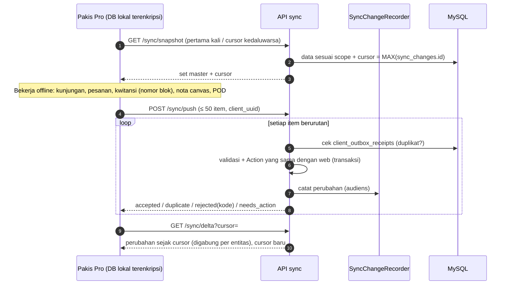
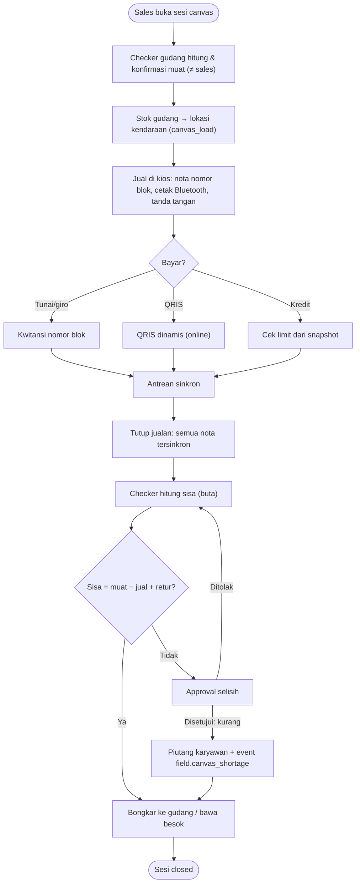

# 17 — Paket C: Lapangan & Mitra (siap eksekusi)

Revisi 16 Nov 2026 (repo): PF-3 sisi C — `PeriodGuard` (dibuat T-077, Paket A) wajib di setiap Action C pemancar event akuntansi; kontrak payload event `14` §7 (§11.2).

**Rentang:** T-114–T-140 · FR-C01–FR-C45 · BR-240–BR-279 · SEC-141–SEC-160 · OQ-128 dst.
**Kontrak:** `14-ROADMAP-LENGKAP.md` (ADR-109, ADR-111, ADR-112, ADR-113), `15-PAKET-A-MASTER-GUDANG.md` (**15**), `16-PAKET-B-PENJUALAN-UANG.md` (**16**). Paket ini **tidak mengubah aturan bisnis** pesanan, piutang, kwitansi, dan stok dari A/B; ia menambah kanal (mobile offline, Mitra) dan kontrol lapangan. Bila kanal mobile butuh perilaku berbeda, aturannya ditulis eksplisit di sini (mis. BR-104 offline).
**Modul konsep v1.4:** MOB-01 (Pakis Pro mode Sales, Canvas, Driver, Gudang, Owner), MOB-02 (Pakis Mitra), FLD-01..04, SAL-01 (kanal sales & mitra), SAL-04, MKT-01, GAR-02, AUD-02, CORE-04 (WhatsApp & push), FIN-01 (QRIS).

## 0. Penyelarasan (cek sebelum T-114)

| # | Asumsi | Cek |
|---|---|---|
| S-1 | Paket A & B selesai, pilot B berjalan. `IdempotencyGuard`, `ReceivableLedger`, `CollectorCashStatus`, `PeriodGuard`, `PublicLinkService`, antrean pesan tersedia | Repo |
| S-2 | Pakis Pro (Fase 0) memakai `drift` + SQLCipher, `dio`, `riverpod`, `go_router`, token Sanctum terikat perangkat (ADR-008), deteksi `isMocked` (BR-065) | `mobile-pro/` |
| S-3 | Fase 0 punya `OtpChannel` (lupa password via WhatsApp, BR-013) dan Paket A punya `WhatsAppChannel` (driver `log`). T-126 membuat **satu** driver WhatsApp nyata yang dipakai keduanya | `app/Domain/Notification`, `app/Support/Channels` |
| S-4 | Dependency Flutter baru dibatasi tabel §0.1 dan dicatat di `03` §5 oleh task yang menambahkannya | `03` §5 |
| S-5 | Pakis Mitra = aplikasi Flutter **terpisah** `mobile-mitra/` (ADR-109) dengan paket Dart bersama `mobile-shared/` (ADR-116) | — |
| S-6 | Lokasi ponsel hanya direkam saat aksi kunjungan/antar/canvas (BR-143 konsep); **tidak ada** pelacakan latar belakang di Paket C | — |

### 0.1 Dependency baru Paket C

| Paket | Dipakai | Task | Catatan |
|---|---|---|---|
| `mobile_scanner` (Flutter) | Scan barcode di mode gudang, canvas, POD | T-124 | Kamera, tanpa layanan cloud |
| `flutter_map` (Flutter) | Peta rute kunjungan & antar (tile dari `map.tile_url`) | T-116 | Navigasi belokan-per-belokan dibuka di aplikasi peta ponsel lewat `url_launcher` |
| `url_launcher` (Flutter) | Buka navigasi & telepon | T-116 | |
| `qr_flutter` (Flutter) | Tampilkan QRIS & QR aktivasi | T-128 | |
| `firebase_messaging` (Flutter) + kredensial FCM HTTP v1 di env server | Push | T-127 | OQ-005. Payload tanpa data pribadi (SEC-153) |
| Paket printer ESC/POS Bluetooth (Flutter) | Nota canvas | T-121 | **Dipilih lewat spike** di awal T-121 dari kandidat yang dicek langsung di pub.dev (mis. `flutter_blue_plus` + generator ESC/POS). Diuji dengan printer yang dipakai Pakis (OQ-129). Nama final dicatat di `03` §5 |

Dependency lain → berhenti dan tanyakan (`CLAUDE.md` §5).

### 0.2 ADR baru

| ADR | Keputusan | Alasan | Konsekuensi |
|---|---|---|---|
| ADR-116 | Monorepo menambah `mobile-mitra/` dan paket Dart lokal `mobile-shared/` (API client, model kontrak, tema, komponen daftar, format id-ID). Keduanya memakai `path:` dependency | Dua aplikasi Flutter memakai kontrak & komponen sama; menghindari salin-tempel | CI mobile dijalankan untuk ketiga folder; perubahan `mobile-shared` memicu test kedua aplikasi |
| ADR-117 | **Perubahan untuk sinkron dicatat eksplisit** oleh Action lewat `SyncChangeRecorder` ke `sync_changes` (bukan observer model) | Sejalan aturan "logika tidak di observer"; audiens perubahan (kios/pegawai/lokasi stok) hanya diketahui Action | Setiap Action yang mengubah entitas tersinkron wajib memanggil recorder (arch test) |
| ADR-118 | **Penjualan canvas = dokumen jual langsung**: satu transaksi server membuat pesanan (`channel = canvas`, `approved`), surat jalan dari lokasi stok kendaraan, bukti terima, dan faktur; stok keluar langsung dari kendaraan (tanpa TRANSIT) | Barang diserahkan di tempat; aturan faktur & piutang B tetap satu jalur | Laporan B otomatis mencakup canvas; nota canvas = faktur bernomor blok |
| ADR-119 | **Blok nomor generik** `number_blocks` untuk dokumen offline (kwitansi, nota canvas) — menggantikan nama `receipt_number_blocks` di ADR-112 | Satu mekanisme untuk semua dokumen offline | Pola nomor offline = pola server biasa; urutan diambil dari `NumberGenerator` per blok |

## 1. Ruang Lingkup

**Termasuk:** mesin sinkron offline (server & Pakis Pro); mode Sales (rencana & check-in kunjungan, pesanan offline, tagih & kwitansi offline, plafon & setoran, harga pesaing); mode Canvas (muat, jual & nota Bluetooth, terima bayar, rekonsiliasi); mode Driver (antar, navigasi, POD foto + tanda tangan, selisih, COD); mode Gudang (scan terima, ambil berpanduan rak, opname, terima mutasi); mode Owner (ringkasan & persetujuan); WhatsApp nyata, push, QRIS; red flag & investigasi; target & insentif sales (perhitungan, bukan payroll); promosi & demplot; servis & klaim garansi; rotasi area & cuti wajib; Pakis Mitra (akun kios, katalog harga khusus, pesan, tagihan & bayar, retur & keluhan, garansi, promo & poin).

**Di luar lingkup:** pelacakan GPS kendaraan & trip/BBM (D), payroll & pembayaran insentif (E), jurnal & klaim prinsipal sebagai piutang (F), member petani & poin petani (F, POS-02), prediksi & AI (G), iOS (OQ-006).

## 2. Kebutuhan Fungsional

| ID | Kebutuhan | Aturan |
|---|---|---|
| FR-C01 | Snapshot master (penuh) dan delta berversi per perangkat, difilter audiens pengguna (kios scope, lokasi stok, pegawai). | BR-240, ADR-111, ADR-117 |
| FR-C02 | Kirim antrean klien (batch) idempoten per item dengan hasil per item `accepted`/`duplicate`/`rejected`/`needs_action`. | BR-241 |
| FR-C03 | Penanganan konflik: server menang, alasan dikembalikan per item, notifikasi pengguna. | BR-241 |
| FR-C04 | Status sinkron per perangkat (cursor, antrean tertunda, versi aplikasi, selisih jam) terlihat admin; hapus data jarak jauh saat perangkat dicabut. | BR-242 |
| FR-C05 | Pakis Pro: DB lokal terenkripsi, antrean dengan backoff, indikator & tombol sinkron, pembersihan data lama, pemilihan mode sesuai role. | BR-242, BR-243 |
| FR-C06 | Rencana kunjungan harian/mingguan per sales (oleh sales atau supervisor), urutan, tujuan (pesan/tagih/kunjungan/canvas). | BR-244 |
| FR-C07 | Peta & daftar kunjungan hari ini, navigasi ke aplikasi peta. | BR-244 |
| FR-C08 | Check-in/out kunjungan: GPS (akurasi, jarak ke titik kios), foto toko dari kamera, tolak lokasi palsu, kunjungan di luar radius ditandai dengan alasan. | BR-245, BR-246 |
| FR-C09 | Hasil kunjungan (pesan, tagih, tidak pesan + alasan), catatan kios, usulan titik koordinat kios baru (disetujui Admin Penjualan). | BR-246 |
| FR-C10 | Pesanan dari Pakis Pro (offline), harga & promo dihitung di perangkat dari snapshot, terkunci ≤ 24 jam. | BR-104, BR-247 |
| FR-C11 | Info kios offline: limit, paparan (snapshot), tunggakan, riwayat beli, stok tersedia per gudang (snapshot terakhir). | BR-247 |
| FR-C12 | Daftar tagih offline: faktur terbuka kios dalam scope (snapshot), urut jatuh tempo. | BR-248 |
| FR-C13 | Kwitansi offline dari blok nomor server; tampil/cetak di tempat; dikirim saat online. | BR-127, BR-248, BR-249, ADR-112, ADR-119 |
| FR-C14 | Terima giro di lapangan dengan foto. | BR-216 |
| FR-C15 | Status uang di tangan & batas setor di aplikasi; ajukan setoran dari aplikasi; blokir offline memakai status terakhir + batas lokal. | BR-129, BR-250 |
| FR-C16 | Canvas: sesi harian, muat stok gudang → kendaraan dihitung checker gudang. | BR-111, BR-251 |
| FR-C17 | Canvas: jual dari stok kendaraan (offline), nota bernomor blok, cetak printer Bluetooth, tanda tangan kios. | BR-252, ADR-118 |
| FR-C18 | Canvas: terima tunai/giro/QRIS di tempat (kwitansi), retur barang dari kios ke kendaraan. | BR-252 |
| FR-C19 | Canvas: rekonsiliasi akhir hari oleh checker ≠ sales, selisih → approval → piutang karyawan, bongkar sisa / bawa ke hari berikutnya. | BR-111, BR-133, BR-253 |
| FR-C20 | Catat harga & promo pesaing saat kunjungan (foto opsional), laporan per area. | BR-254 |
| FR-C21 | Mode driver: rute hari ini, urutan, navigasi, status per surat jalan. | BR-255 |
| FR-C22 | POD di aplikasi: foto, tanda tangan penerima di layar, qty diterima/ditolak, lokasi; offline. | BR-107, BR-209, BR-255 |
| FR-C23 | COD/tagih saat antar oleh driver (kwitansi blok). | BR-255 |
| FR-C24 | Mode gudang: scan terima barang (batch, ED, seri) untuk penerimaan Paket A. | BR-256 |
| FR-C25 | Ambil berpanduan rak untuk surat jalan & mutasi, scan verifikasi. | BR-256 |
| FR-C26 | Hitung opname per rak dari HP (hitung buta). | BR-256 |
| FR-C27 | Terima mutasi & muat/bongkar canvas dari HP. | BR-256 |
| FR-C28 | Mode Owner: omzet, margin, stok kritis, piutang jatuh tempo, kontrol uang, red flag terbuka. | BR-257 |
| FR-C29 | Persetujuan dari HP (semua jenis approval), dengan konfirmasi ulang PIN/biometrik untuk nominal besar. | BR-257 |
| FR-C30 | Driver WhatsApp Business nyata untuk OTP, kwitansi, faktur, konfirmasi saldo, status kirim, garansi; status terkirim/dibaca via webhook. | BR-258 |
| FR-C31 | Push notification Pakis Pro & Pakis Mitra. | BR-259 |
| FR-C32 | QRIS dinamis untuk tagih lapangan, Mitra, dan POS. | BR-260 |
| FR-C33 | Mesin red flag berbasis aturan (indikator konsep §18.5) + dasbor + tinjauan manusia. | BR-261, BR-262 |
| FR-C34 | Kasus investigasi: bekukan hak transaksi pegawai, paket bukti bertanda waktu, konfirmasi saldo area, pemulihan saldo kios yang terbukti bayar. | BR-133, BR-263, BR-264 |
| FR-C35 | Target per sales/area/prinsipal/produk per periode. | BR-265 |
| FR-C36 | Perhitungan insentif dari periode tertutup, penyesuaian periode berikutnya, kunci hasil untuk payroll (E). | BR-118, BR-266 |
| FR-C37 | Promosi & demplot: rencana, persetujuan sebelum pelaksanaan, realisasi berfoto berlokasi & daftar hadir, produk keluar sebagai biaya promosi. | BR-148, BR-267 |
| FR-C38 | Tiket servis alat: terima, periksa, perbaiki/klaim prinsipal/servis berbayar, suku cadang, kabar status ke pelanggan. | BR-145, BR-268 |
| FR-C39 | Rotasi area tagih & cuti wajib sales, konfirmasi ulang tagihan saat pergantian. | BR-134, BR-269 |
| FR-C40 | Pakis Mitra: akun kios (pemilik & staf), aktivasi OTP/kode aktivasi, perangkat, keluar & cabut. | BR-270, ADR-109 |
| FR-C41 | Mitra: katalog harga khusus kios, cari per tanaman/hama/bahan aktif, keranjang, pesan ulang satu ketuk, status pesanan & kiriman. | BR-112, BR-271 |
| FR-C42 | Mitra: tagihan, sisa limit, bayar VA/QRIS, unduh faktur & kwitansi, konfirmasi saldo & jawabannya. | BR-131, BR-272 |
| FR-C43 | Mitra: ajukan retur & keluhan berfoto, status garansi & servis, promo aktif, poin kios. | BR-273 |
| FR-C44 | Keamanan API Mitra: isolasi antar kios, rate limit, tanpa HPP/margin/data pegawai. | SEC-141–SEC-160 |
| FR-C45 | Distribusi & pembaruan aplikasi (APK bertanda tangan, versi minimum per aplikasi, gerbang update). | BR-243 |

## 3. Kebutuhan Non-Fungsional

| ID | Target |
|---|---|
| NFR-C01 | Pengguna: 40 sales/canvas, 15 driver, 10 staf gudang, 5 owner/manajer di Pakis Pro; hingga 3.000 kios, ±1.000 akun Mitra aktif |
| NFR-C02 | Snapshot awal sales (500 kios, 3.000 produk, harga, promo, faktur terbuka) ≤ 15 MB terkompresi, unduh ≤ 60 s di 3G/4G lemah; delta harian ≤ 500 KB |
| NFR-C03 | Pakis Pro berjalan offline penuh 24 jam (sales/canvas) dengan ≥ 300 transaksi antrean; ponsel Android kelas menengah (RAM 3 GB, minSdk 26) |
| NFR-C04 | Sinkron 300 item antrean < 60 s; API push batch p95 < 3 s per 50 item |
| NFR-C05 | Mitra: katalog & cari p95 < 800 ms; pesan p95 < 2 s |
| NFR-C06 | Red flag harian selesai < 10 menit untuk data 1 tahun |
| NFR-C07 | Ukuran APK Pakis Pro ≤ 60 MB, Mitra ≤ 40 MB |

## 4. Database

Konvensi **15** §4 dan **16** §4 berlaku.

### 4.1 Referensi, penomoran, perubahan tabel lama

Grup `reference_items` baru: `visit_no_order_reason` (stok di kios masih ada, harga, pemilik tidak ada, toko tutup, sudah order ke pesaing, lainnya), `visit_outside_radius_reason` (titik kios salah, kios pindah, bertemu di tempat lain, lainnya), `promo_activity_type` (demplot, pertemuan petani, pameran, kunjungan lapang, lainnya), `service_complaint_type`, `service_resolution_type`, `case_category` (tagihan tidak disetor, lapping, kwitansi palsu, retur fiktif, selisih canvas, BBM, kas kecil, lainnya).

Sequence baru: `canvas_session`, `promo_activity`, `service_ticket`, `warranty_claim` (`KLG-{YY}{MM}-{SEQ:4}`), `investigation_case`, `incentive_period` (`INS-{YYYY}{MM}`, manual), `visit_plan` tidak bernomor.

```sql
ALTER TABLE sales_orders
  ADD COLUMN canvas_session_id BIGINT UNSIGNED NULL,
  ADD COLUMN visit_id BIGINT UNSIGNED NULL,
  ADD COLUMN client_device_id BIGINT UNSIGNED NULL,          -- devices (Fase 0)
  ADD COLUMN client_priced_at DATETIME NULL,                 -- waktu harga dihitung di perangkat
  ADD COLUMN price_check_status ENUM('not_applicable','kept','repriced_pending','repriced_confirmed') NOT NULL DEFAULT 'not_applicable',
  ADD KEY so_canvas_idx (canvas_session_id),
  ADD KEY so_visit_idx (visit_id);
ALTER TABLE payments
  ADD COLUMN visit_id BIGINT UNSIGNED NULL,
  ADD COLUMN client_device_id BIGINT UNSIGNED NULL,
  ADD COLUMN client_recorded_at DATETIME NULL,
  MODIFY method ENUM('cash','transfer','va','giro','deposit_offset','qris','restoration') NOT NULL;   -- restoration: BR-264
ALTER TABLE receipts
  ADD COLUMN number_block_id BIGINT UNSIGNED NULL,
  ADD COLUMN client_issued_at DATETIME NULL,                 -- waktu di perangkat (offline)
  ADD COLUMN printed_on_device BOOLEAN NOT NULL DEFAULT FALSE;
ALTER TABLE invoices
  ADD COLUMN number_block_id BIGINT UNSIGNED NULL;           -- nota canvas (ADR-118)
ALTER TABLE sales_returns
  ADD COLUMN request_channel ENUM('office','sales','canvas','mitra') NOT NULL DEFAULT 'office',
  ADD COLUMN customer_user_id BIGINT UNSIGNED NULL;
ALTER TABLE customer_inquiries
  MODIFY channel ENUM('receipt_link','balance_link','invoice_link','office_phone','mitra','walk_in','whatsapp_reply') NOT NULL,
  ADD COLUMN customer_user_id BIGINT UNSIGNED NULL;
ALTER TABLE customers
  ADD COLUMN whatsapp_opt_in_at TIMESTAMP NULL,              -- persetujuan menerima pesan (BR-258)
  ADD COLUMN whatsapp_opt_out_at TIMESTAMP NULL,
  ADD COLUMN coordinates_verified_at TIMESTAMP NULL;
ALTER TABLE outbound_messages
  MODIFY status ENUM('queued','sending','sent','delivered','read','failed','cancelled') NOT NULL DEFAULT 'queued',
  ADD COLUMN delivered_at TIMESTAMP NULL,
  ADD COLUMN read_at TIMESTAMP NULL,
  ADD KEY om_provider_msg_idx (provider_message_id);
```

### 4.2 Sinkron & blok nomor (T-114)

```sql
CREATE TABLE sync_changes (                     -- feed perubahan; id = versi global (ADR-117)
  id BIGINT UNSIGNED PRIMARY KEY AUTO_INCREMENT,
  entity VARCHAR(40) NOT NULL,                    -- 'customer','product','price_item','promotion','invoice_open',…
  entity_id BIGINT UNSIGNED NOT NULL,
  op ENUM('upsert','delete') NOT NULL,
  audience_type ENUM('all','employee','customer','stock_location','sales_area') NOT NULL,
  audience_id BIGINT UNSIGNED NULL,
  changed_at TIMESTAMP(3) NOT NULL,
  KEY sc_audience_idx (audience_type, audience_id, id),
  KEY sc_entity_idx (entity, entity_id, id)
);
CREATE TABLE sync_device_states (
  device_id BIGINT UNSIGNED PRIMARY KEY,          -- devices (Fase 0) atau customer_devices (Mitra, kolom app)
  app ENUM('pro','mitra') NOT NULL,
  principal_type ENUM('user','customer_user') NOT NULL,
  principal_id BIGINT UNSIGNED NOT NULL,
  last_cursor BIGINT UNSIGNED NOT NULL DEFAULT 0,
  last_snapshot_at TIMESTAMP NULL,
  last_sync_at TIMESTAMP NULL,
  pending_items INT UNSIGNED NOT NULL DEFAULT 0,  -- dilaporkan klien
  oldest_pending_at DATETIME NULL,
  app_version VARCHAR(20) NULL,
  clock_skew_seconds INT NULL,
  wipe_requested_at TIMESTAMP NULL, wipe_confirmed_at TIMESTAMP NULL,
  updated_at TIMESTAMP NULL,
  KEY sds_principal_idx (principal_type, principal_id),
  KEY sds_pending_idx (pending_items, oldest_pending_at)
);
CREATE TABLE client_outbox_receipts (           -- jejak setiap item antrean yang diterima server
  id BIGINT UNSIGNED PRIMARY KEY AUTO_INCREMENT,
  client_uuid CHAR(36) NOT NULL,
  device_id BIGINT UNSIGNED NOT NULL,
  app ENUM('pro','mitra') NOT NULL,
  item_type VARCHAR(40) NOT NULL,                 -- 'visit_checkin','sales_order','receipt','canvas_sale','pod',…
  payload_hash CHAR(64) NOT NULL,
  client_created_at DATETIME NOT NULL,
  result ENUM('accepted','duplicate','rejected','needs_action') NOT NULL,
  error_code VARCHAR(60) NULL,
  server_ref_type VARCHAR(60) NULL, server_ref_id BIGINT UNSIGNED NULL,
  received_at TIMESTAMP(3) NOT NULL,
  UNIQUE KEY cor_client_unique (client_uuid),
  KEY cor_device_idx (device_id, received_at),
  KEY cor_result_idx (result, received_at)
);
CREATE TABLE number_blocks (                    -- ADR-112/119
  id BIGINT UNSIGNED PRIMARY KEY AUTO_INCREMENT,
  device_id BIGINT UNSIGNED NOT NULL,
  user_id BIGINT UNSIGNED NOT NULL,
  doc_type ENUM('receipt','invoice') NOT NULL,    -- invoice = nota canvas
  sequence_code VARCHAR(40) NOT NULL,             -- document_sequences.code
  period_key VARCHAR(10) NOT NULL,                -- '2611' (periode reset pola)
  seq_start INT UNSIGNED NOT NULL,
  seq_end INT UNSIGNED NOT NULL,
  numbers_preview JSON NOT NULL,                  -- nomor jadi, untuk ditampilkan klien
  used_count INT UNSIGNED NOT NULL DEFAULT 0,
  status ENUM('active','exhausted','expired','returned','revoked') NOT NULL DEFAULT 'active',
  allocated_at TIMESTAMP NOT NULL,
  expires_at TIMESTAMP NOT NULL,                  -- akhir periode atau sync.number_block_ttl_days
  closed_at TIMESTAMP NULL,
  KEY nb_device_status_idx (device_id, status),
  KEY nb_expiry_idx (status, expires_at),
  CONSTRAINT nb_range_chk CHECK (seq_end >= seq_start)
);
CREATE TABLE number_block_usages (              -- setiap nomor blok tercatat: dipakai atau dibatalkan tak terpakai
  number_block_id BIGINT UNSIGNED NOT NULL,
  seq INT UNSIGNED NOT NULL,
  number VARCHAR(30) NOT NULL,
  status ENUM('used','void_unused') NOT NULL,
  ref_type VARCHAR(60) NULL, ref_id BIGINT UNSIGNED NULL,
  recorded_at TIMESTAMP NOT NULL,
  PRIMARY KEY (number_block_id, seq),
  UNIQUE KEY nbu_number_unique (number)
);
```
`NumberGenerator` (Fase 0) diperluas: `reserveBlock(code, size)` mengunci counter periode berjalan dan menaikkannya sebesar `size` sekaligus. Nomor di blok mengikuti pola yang sama dengan nomor online, sehingga satu deret nomor per periode tanpa bentrok.

### 4.3 Kunjungan & pesaing (T-116, T-117, T-122)

```sql
CREATE TABLE visit_plans (
  id BIGINT UNSIGNED PRIMARY KEY AUTO_INCREMENT,
  employee_id BIGINT UNSIGNED NOT NULL,
  plan_date DATE NOT NULL,
  status ENUM('draft','published','closed') NOT NULL DEFAULT 'draft',
  published_by BIGINT UNSIGNED NULL, published_at TIMESTAMP NULL,
  [audit],
  UNIQUE KEY vp_employee_date_unique (employee_id, plan_date)
);
CREATE TABLE visit_plan_items (
  id BIGINT UNSIGNED PRIMARY KEY AUTO_INCREMENT,
  visit_plan_id BIGINT UNSIGNED NOT NULL,
  customer_id BIGINT UNSIGNED NOT NULL,
  sequence SMALLINT UNSIGNED NOT NULL,
  purposes JSON NOT NULL,                         -- ["order","collect","visit","canvas"]
  planned_time TIME NULL,
  note VARCHAR(255) NULL,
  UNIQUE KEY vpi_plan_customer_unique (visit_plan_id, customer_id),
  CONSTRAINT vpi_plan_fk FOREIGN KEY (visit_plan_id) REFERENCES visit_plans(id) ON DELETE CASCADE,
  CONSTRAINT vpi_customer_fk FOREIGN KEY (customer_id) REFERENCES customers(id)
);
CREATE TABLE visits (
  id BIGINT UNSIGNED PRIMARY KEY AUTO_INCREMENT,
  client_uuid CHAR(36) NOT NULL,
  employee_id BIGINT UNSIGNED NOT NULL,
  customer_id BIGINT UNSIGNED NOT NULL,
  visit_plan_item_id BIGINT UNSIGNED NULL,        -- NULL = kunjungan di luar rencana
  device_id BIGINT UNSIGNED NOT NULL,
  checkin_at DATETIME NOT NULL,                   -- waktu server bila online; perangkat bila offline
  checkin_is_offline BOOLEAN NOT NULL DEFAULT FALSE,
  checkin_latitude DECIMAL(10,7) NOT NULL, checkin_longitude DECIMAL(10,7) NOT NULL,
  checkin_accuracy_m DECIMAL(8,2) NOT NULL,
  distance_to_customer_m DECIMAL(10,2) NULL,      -- NULL bila kios belum punya titik
  outside_radius BOOLEAN NOT NULL DEFAULT FALSE,
  outside_radius_reason_id BIGINT UNSIGNED NULL,
  photo_path VARCHAR(255) NOT NULL,
  photo_sha256 CHAR(64) NOT NULL,
  checkout_at DATETIME NULL,
  checkout_latitude DECIMAL(10,7) NULL, checkout_longitude DECIMAL(10,7) NULL,
  outcome ENUM('ordered','collected','ordered_and_collected','no_order','store_closed','other') NULL,
  no_order_reason_id BIGINT UNSIGNED NULL,
  notes VARCHAR(1000) NULL,
  clock_skew_seconds INT NULL,
  flags JSON NULL,                                -- {"outside_radius":true,"clock_skew":true,"short_duration":true}
  created_at TIMESTAMP NULL, updated_at TIMESTAMP NULL,
  UNIQUE KEY visits_client_unique (client_uuid),
  KEY visits_employee_time_idx (employee_id, checkin_at),
  KEY visits_customer_time_idx (customer_id, checkin_at),
  CONSTRAINT visits_customer_fk FOREIGN KEY (customer_id) REFERENCES customers(id),
  CONSTRAINT visits_reason_chk CHECK (outside_radius = FALSE OR outside_radius_reason_id IS NOT NULL)
);
CREATE TABLE customer_location_proposals (      -- usulan titik kios dari lapangan (BR-246)
  id BIGINT UNSIGNED PRIMARY KEY AUTO_INCREMENT,
  customer_id BIGINT UNSIGNED NOT NULL,
  visit_id BIGINT UNSIGNED NOT NULL,
  proposed_by_employee_id BIGINT UNSIGNED NOT NULL,
  latitude DECIMAL(10,7) NOT NULL, longitude DECIMAL(10,7) NOT NULL, accuracy_m DECIMAL(8,2) NOT NULL,
  previous_latitude DECIMAL(10,7) NULL, previous_longitude DECIMAL(10,7) NULL,
  status ENUM('pending','approved','rejected') NOT NULL DEFAULT 'pending',
  decided_by BIGINT UNSIGNED NULL, decided_at TIMESTAMP NULL, note VARCHAR(255) NULL,
  created_at TIMESTAMP NULL,
  KEY clp_status_idx (status, created_at),
  CONSTRAINT clp_customer_fk FOREIGN KEY (customer_id) REFERENCES customers(id)
);
CREATE TABLE competitor_prices (
  id BIGINT UNSIGNED PRIMARY KEY AUTO_INCREMENT,
  client_uuid CHAR(36) NOT NULL,
  visit_id BIGINT UNSIGNED NULL,
  customer_id BIGINT UNSIGNED NOT NULL,
  employee_id BIGINT UNSIGNED NOT NULL,
  competitor_brand VARCHAR(100) NOT NULL,
  competitor_product VARCHAR(150) NOT NULL,
  active_ingredient VARCHAR(255) NULL,
  comparable_product_id BIGINT UNSIGNED NULL,     -- produk Pakis sepadan
  package_size VARCHAR(40) NULL,
  price DECIMAL(18,2) NULL,                       -- harga jual kios ke petani / harga beli kios (lihat price_type)
  price_type ENUM('shelf_price','purchase_price','unknown') NOT NULL DEFAULT 'shelf_price',
  promo_note VARCHAR(255) NULL,
  photo_path VARCHAR(255) NULL,
  recorded_at DATETIME NOT NULL,
  created_at TIMESTAMP NULL,
  UNIQUE KEY cp_client_unique (client_uuid),
  KEY cp_product_time_idx (comparable_product_id, recorded_at),
  KEY cp_customer_idx (customer_id, recorded_at)
);
```

### 4.4 Canvas (T-121)

```sql
CREATE TABLE canvas_sessions (
  id BIGINT UNSIGNED PRIMARY KEY AUTO_INCREMENT,
  number VARCHAR(30) NOT NULL,
  employee_id BIGINT UNSIGNED NOT NULL,           -- sales canvas
  vehicle_id BIGINT UNSIGNED NOT NULL,
  stock_location_id BIGINT UNSIGNED NOT NULL,     -- lokasi stok vehicle (15 §4.3)
  source_stock_location_id BIGINT UNSIGNED NOT NULL,   -- gudang muat/bongkar
  session_date DATE NOT NULL,
  status ENUM('loading','active','reconciling','pending_approval','closed','cancelled') NOT NULL DEFAULT 'loading',
  load_checked_by BIGINT UNSIGNED NULL, loaded_at TIMESTAMP NULL,         -- checker gudang
  reconcile_checked_by BIGINT UNSIGNED NULL, reconciled_at TIMESTAMP NULL,
  carry_over BOOLEAN NOT NULL DEFAULT FALSE,      -- sisa dibawa ke sesi berikutnya (BR-253)
  variance_value DECIMAL(18,2) NULL,
  approval_request_id BIGINT UNSIGNED NULL,
  employee_receivable_id BIGINT UNSIGNED NULL,
  note VARCHAR(255) NULL,
  open_key BIGINT UNSIGNED GENERATED ALWAYS AS (IF(status IN ('loading','active','reconciling','pending_approval'), vehicle_id, NULL)) STORED,
  [audit],
  UNIQUE KEY cs_number_unique (number),
  UNIQUE KEY cs_one_open_per_vehicle (open_key),
  KEY cs_employee_date_idx (employee_id, session_date),
  CONSTRAINT cs_vehicle_fk FOREIGN KEY (vehicle_id) REFERENCES vehicles(id),
  CONSTRAINT cs_sl_fk FOREIGN KEY (stock_location_id) REFERENCES stock_locations(id)
);
CREATE TABLE canvas_session_lines (             -- per produk (batch dilacak di stock_movements)
  id BIGINT UNSIGNED PRIMARY KEY AUTO_INCREMENT,
  canvas_session_id BIGINT UNSIGNED NOT NULL,
  product_id BIGINT UNSIGNED NOT NULL,
  qty_opening_base DECIMAL(18,3) NOT NULL DEFAULT 0,      -- bawaan sesi sebelumnya (carry over)
  qty_loaded_base DECIMAL(18,3) NOT NULL DEFAULT 0,
  qty_sold_base DECIMAL(18,3) NOT NULL DEFAULT 0,         -- dari nota tersinkron
  qty_returned_in_base DECIMAL(18,3) NOT NULL DEFAULT 0,  -- retur kios masuk kendaraan
  qty_counted_base DECIMAL(18,3) NULL,                    -- hitung checker
  qty_expected_base DECIMAL(18,3) GENERATED ALWAYS AS (qty_opening_base + qty_loaded_base - qty_sold_base + qty_returned_in_base) STORED,
  qty_unloaded_base DECIMAL(18,3) NULL,
  unit_cost DECIMAL(18,4) NULL,                           -- avg_cost saat rekonsiliasi
  UNIQUE KEY csl_session_product_unique (canvas_session_id, product_id),
  CONSTRAINT csl_session_fk FOREIGN KEY (canvas_session_id) REFERENCES canvas_sessions(id) ON DELETE CASCADE,
  CONSTRAINT csl_product_fk FOREIGN KEY (product_id) REFERENCES products(id)
);
```
Muat & bongkar memakai `StockLedger::move()` dengan tipe `canvas_load` / `canvas_unload` (sudah ada di ENUM Paket A). Penjualan canvas: ADR-118. Retur kios ke kendaraan: `sales_returns` dengan `request_channel = canvas`, `return_stock_location_id` = lokasi kendaraan, diperiksa checker saat rekonsiliasi.

### 4.5 QRIS, push (T-127, T-128)

```sql
CREATE TABLE qris_requests (
  id BIGINT UNSIGNED PRIMARY KEY AUTO_INCREMENT,
  reference CHAR(26) NOT NULL,                    -- ULID, dikirim ke penyedia
  provider VARCHAR(40) NOT NULL,
  purpose ENUM('field_collection','mitra_invoice','pos_sale','canvas_sale') NOT NULL,
  customer_id BIGINT UNSIGNED NULL,
  related_type VARCHAR(60) NULL, related_id BIGINT UNSIGNED NULL,
  amount DECIMAL(18,2) NOT NULL,
  qr_payload TEXT NOT NULL,                       -- string QRIS dari penyedia
  bank_account_id BIGINT UNSIGNED NOT NULL,       -- rekening penampung resmi
  status ENUM('pending','paid','expired','cancelled') NOT NULL DEFAULT 'pending',
  expires_at TIMESTAMP NOT NULL,
  provider_ref VARCHAR(120) NULL,
  payment_id BIGINT UNSIGNED NULL,
  requested_by_type ENUM('user','customer_user','pos_device') NOT NULL,
  requested_by_id BIGINT UNSIGNED NOT NULL,
  created_at TIMESTAMP NULL, updated_at TIMESTAMP NULL,
  UNIQUE KEY qris_reference_unique (reference),
  KEY qris_status_exp_idx (status, expires_at),
  CONSTRAINT qris_amount_chk CHECK (amount > 0)
);
CREATE TABLE push_tokens (
  id BIGINT UNSIGNED PRIMARY KEY AUTO_INCREMENT,
  principal_type ENUM('user','customer_user') NOT NULL,
  principal_id BIGINT UNSIGNED NOT NULL,
  device_ref VARCHAR(64) NOT NULL,                -- device_uid
  app ENUM('pro','mitra') NOT NULL,
  token_enc TEXT NOT NULL,                        -- token FCM terenkripsi (Crypt)
  token_hash CHAR(64) NOT NULL,
  last_seen_at TIMESTAMP NULL, revoked_at TIMESTAMP NULL,
  created_at TIMESTAMP NULL,
  UNIQUE KEY pt_token_unique (token_hash),
  KEY pt_principal_idx (principal_type, principal_id, revoked_at)
);
```

### 4.6 Red flag & investigasi (T-129, T-130)

```sql
CREATE TABLE red_flag_rules (
  id BIGINT UNSIGNED PRIMARY KEY AUTO_INCREMENT,
  code VARCHAR(60) NOT NULL,                      -- tetap, dipetakan ke kelas Rule (§8.2 BR-261)
  name VARCHAR(150) NOT NULL,
  description TEXT NOT NULL,                      -- "mengapa patut dicurigai" (konsep §18.5)
  subject_type ENUM('employee','customer','vehicle') NOT NULL,
  params JSON NOT NULL,                           -- ambang, divalidasi skema per code
  severity ENUM('low','medium','high') NOT NULL,
  is_active BOOLEAN NOT NULL DEFAULT TRUE,
  [audit],
  UNIQUE KEY rfr_code_unique (code)
);
CREATE TABLE red_flags (
  id BIGINT UNSIGNED PRIMARY KEY AUTO_INCREMENT,
  rule_code VARCHAR(60) NOT NULL,
  subject_type ENUM('employee','customer','vehicle') NOT NULL,
  subject_id BIGINT UNSIGNED NOT NULL,
  period_start DATE NOT NULL, period_end DATE NOT NULL,
  severity ENUM('low','medium','high') NOT NULL,
  metric_value DECIMAL(18,4) NULL,
  baseline_value DECIMAL(18,4) NULL,
  evidence JSON NOT NULL,                         -- id dokumen pendukung, bukan salinan data pribadi
  status ENUM('open','reviewed','dismissed','escalated') NOT NULL DEFAULT 'open',
  reviewed_by BIGINT UNSIGNED NULL, reviewed_at TIMESTAMP NULL, review_note VARCHAR(500) NULL,
  investigation_case_id BIGINT UNSIGNED NULL,
  dedup_key VARCHAR(120) NOT NULL,                -- rule+subject+periode
  created_at TIMESTAMP NULL, updated_at TIMESTAMP NULL,
  UNIQUE KEY rf_dedup_unique (dedup_key),
  KEY rf_status_idx (status, severity, created_at),
  KEY rf_subject_idx (subject_type, subject_id, created_at)
);
CREATE TABLE investigation_cases (
  id BIGINT UNSIGNED PRIMARY KEY AUTO_INCREMENT,
  number VARCHAR(30) NOT NULL,
  title VARCHAR(200) NOT NULL,
  category_id BIGINT UNSIGNED NOT NULL,           -- reference_items(case_category)
  subject_employee_id BIGINT UNSIGNED NULL,
  status ENUM('open','investigating','resolved','closed') NOT NULL DEFAULT 'open',
  summary TEXT NULL,
  outcome TEXT NULL,
  loss_amount DECIMAL(18,2) NULL,
  opened_by BIGINT UNSIGNED NOT NULL, opened_at TIMESTAMP NOT NULL,
  closed_by BIGINT UNSIGNED NULL, closed_at TIMESTAMP NULL,
  [audit],
  UNIQUE KEY ic_number_unique (number),
  KEY ic_status_idx (status, opened_at),
  KEY ic_subject_idx (subject_employee_id)
);
CREATE TABLE case_evidence (                    -- append-only
  id BIGINT UNSIGNED PRIMARY KEY AUTO_INCREMENT,
  investigation_case_id BIGINT UNSIGNED NOT NULL,
  evidence_type ENUM('document_ref','red_flag','file','note','evidence_package') NOT NULL,
  ref_type VARCHAR(60) NULL, ref_id BIGINT UNSIGNED NULL,
  file_path VARCHAR(255) NULL, file_sha256 CHAR(64) NULL,
  note TEXT NULL,
  collected_by BIGINT UNSIGNED NOT NULL, collected_at TIMESTAMP(3) NOT NULL,
  KEY ce_case_idx (investigation_case_id, collected_at),
  CONSTRAINT ce_case_fk FOREIGN KEY (investigation_case_id) REFERENCES investigation_cases(id)
);
CREATE TABLE transaction_freezes (
  id BIGINT UNSIGNED PRIMARY KEY AUTO_INCREMENT,
  employee_id BIGINT UNSIGNED NOT NULL,
  freeze_cash_receipts BOOLEAN NOT NULL DEFAULT TRUE,
  freeze_credit_orders BOOLEAN NOT NULL DEFAULT TRUE,
  freeze_sales_returns BOOLEAN NOT NULL DEFAULT TRUE,
  freeze_canvas BOOLEAN NOT NULL DEFAULT TRUE,
  investigation_case_id BIGINT UNSIGNED NULL,
  reason VARCHAR(255) NOT NULL,
  frozen_by BIGINT UNSIGNED NOT NULL, frozen_at TIMESTAMP NOT NULL,
  lifted_by BIGINT UNSIGNED NULL, lifted_at TIMESTAMP NULL, lift_approval_request_id BIGINT UNSIGNED NULL,
  active_key BIGINT UNSIGNED GENERATED ALWAYS AS (IF(lifted_at IS NULL, employee_id, NULL)) STORED,
  UNIQUE KEY tf_one_active_unique (active_key)
);
```

### 4.7 Target & insentif (T-131)

```sql
CREATE TABLE incentive_periods (
  id BIGINT UNSIGNED PRIMARY KEY AUTO_INCREMENT,
  code VARCHAR(20) NOT NULL,                      -- INS-202611
  period_start DATE NOT NULL, period_end DATE NOT NULL,
  status ENUM('open','calculated','pending_approval','locked') NOT NULL DEFAULT 'open',
  calculated_at TIMESTAMP NULL, locked_at TIMESTAMP NULL, approval_request_id BIGINT UNSIGNED NULL,
  [audit],
  UNIQUE KEY ip_code_unique (code)
);
CREATE TABLE sales_targets (
  id BIGINT UNSIGNED PRIMARY KEY AUTO_INCREMENT,
  incentive_period_id BIGINT UNSIGNED NOT NULL,
  scope_type ENUM('employee','sales_area','principal','product_category','product') NOT NULL,
  scope_id BIGINT UNSIGNED NOT NULL,
  employee_id BIGINT UNSIGNED NULL,               -- target per sales untuk scope prinsipal/produk
  metric ENUM('net_sales','collection','new_active_customers','qty_base','visit_compliance') NOT NULL,
  target_value DECIMAL(18,2) NOT NULL,
  [audit],
  UNIQUE KEY st_unique (incentive_period_id, scope_type, scope_id, employee_id, metric)
);
CREATE TABLE incentive_schemes (
  id BIGINT UNSIGNED PRIMARY KEY AUTO_INCREMENT,
  name VARCHAR(150) NOT NULL,
  applies_to_role VARCHAR(60) NOT NULL,           -- 'sales' (driver di Paket D)
  metric ENUM('net_sales','collection','new_active_customers','qty_base','visit_compliance') NOT NULL,
  basis ENUM('achievement_pct','absolute') NOT NULL,
  tiers JSON NOT NULL,                            -- [{"min":"80","max":"100","rate_pct":"0.5"},{"min":"100","amount":"500000"}]
  cap_amount DECIMAL(18,2) NULL,
  gates JSON NULL,                                -- {"max_overdue_ratio_pct":"20"} syarat kelayakan
  effective_from DATE NOT NULL, effective_to DATE NULL,
  is_active BOOLEAN NOT NULL DEFAULT TRUE,
  [audit]
);
CREATE TABLE incentive_results (
  id BIGINT UNSIGNED PRIMARY KEY AUTO_INCREMENT,
  incentive_period_id BIGINT UNSIGNED NOT NULL,
  employee_id BIGINT UNSIGNED NOT NULL,
  incentive_scheme_id BIGINT UNSIGNED NOT NULL,
  metric_value DECIMAL(18,2) NOT NULL,
  target_value DECIMAL(18,2) NULL,
  achievement_pct DECIMAL(9,4) NULL,
  gross_amount DECIMAL(18,2) NOT NULL,
  adjustment_amount DECIMAL(18,2) NOT NULL DEFAULT 0,    -- dari periode sebelumnya (BR-266)
  final_amount DECIMAL(18,2) NOT NULL,
  calculation_detail JSON NOT NULL,               -- angka & dokumen sumber ringkas
  status ENUM('draft','locked','sent_to_payroll') NOT NULL DEFAULT 'draft',
  created_at TIMESTAMP NULL, updated_at TIMESTAMP NULL,
  UNIQUE KEY ir_unique (incentive_period_id, employee_id, incentive_scheme_id)
);
CREATE TABLE incentive_adjustments (
  id BIGINT UNSIGNED PRIMARY KEY AUTO_INCREMENT,
  employee_id BIGINT UNSIGNED NOT NULL,
  origin_period_id BIGINT UNSIGNED NOT NULL,
  applied_period_id BIGINT UNSIGNED NULL,
  reason ENUM('sales_return','bad_debt','invoice_void','manual') NOT NULL,
  source_type VARCHAR(60) NULL, source_id BIGINT UNSIGNED NULL,
  amount DECIMAL(18,2) NOT NULL,                  -- negatif = potongan
  note VARCHAR(255) NULL,
  [audit],
  KEY ia_employee_pending_idx (employee_id, applied_period_id)
);
```

### 4.8 Promosi & demplot (T-132)

```sql
CREATE TABLE promo_activities (
  id BIGINT UNSIGNED PRIMARY KEY AUTO_INCREMENT,
  number VARCHAR(30) NOT NULL,
  type_id BIGINT UNSIGNED NOT NULL,               -- reference_items(promo_activity_type)
  title VARCHAR(200) NOT NULL,
  responsible_employee_id BIGINT UNSIGNED NOT NULL,
  sales_area_id BIGINT UNSIGNED NULL,
  village_code CHAR(13) NULL,
  planned_latitude DECIMAL(10,7) NULL, planned_longitude DECIMAL(10,7) NULL,
  planned_date DATE NOT NULL,
  planned_attendees INT UNSIGNED NULL,
  budget_amount DECIMAL(18,2) NOT NULL DEFAULT 0, -- biaya non-produk (konsumsi, sewa)
  funded_by ENUM('company','principal','shared') NOT NULL,
  principal_id BIGINT UNSIGNED NULL,
  principal_share_pct DECIMAL(7,4) NULL,
  issue_stock_location_id BIGINT UNSIGNED NOT NULL,
  status ENUM('planned','pending_approval','approved','realized','closed','rejected','cancelled') NOT NULL DEFAULT 'planned',
  approval_request_id BIGINT UNSIGNED NULL,
  realized_at DATETIME NULL,
  realized_latitude DECIMAL(10,7) NULL, realized_longitude DECIMAL(10,7) NULL,
  actual_attendees INT UNSIGNED NULL,
  actual_cost DECIMAL(18,2) NULL,
  result_note TEXT NULL,
  [audit],
  UNIQUE KEY pa_number_unique (number),
  KEY pa_status_date_idx (status, planned_date),
  KEY pa_principal_idx (principal_id, planned_date),
  CONSTRAINT pa_funding_chk CHECK (funded_by = 'company' OR principal_id IS NOT NULL)
);
CREATE TABLE promo_activity_products (
  id BIGINT UNSIGNED PRIMARY KEY AUTO_INCREMENT,
  promo_activity_id BIGINT UNSIGNED NOT NULL,
  product_id BIGINT UNSIGNED NOT NULL,
  qty_planned_base DECIMAL(18,3) NOT NULL,
  qty_issued_base DECIMAL(18,3) NOT NULL DEFAULT 0,
  qty_used_base DECIMAL(18,3) NULL,               -- dilaporkan saat realisasi
  qty_returned_base DECIMAL(18,3) NOT NULL DEFAULT 0,
  UNIQUE KEY pap_unique (promo_activity_id, product_id),
  CONSTRAINT pap_activity_fk FOREIGN KEY (promo_activity_id) REFERENCES promo_activities(id) ON DELETE CASCADE
);
CREATE TABLE promo_activity_attendees (         -- minimisasi data (SEC-155)
  id BIGINT UNSIGNED PRIMARY KEY AUTO_INCREMENT,
  promo_activity_id BIGINT UNSIGNED NOT NULL,
  name VARCHAR(100) NOT NULL,
  village_name VARCHAR(100) NULL,
  phone VARCHAR(20) NULL,                         -- hanya bila peserta setuju dihubungi
  consent_contact BOOLEAN NOT NULL DEFAULT FALSE,
  customer_id BIGINT UNSIGNED NULL,               -- bila peserta adalah kios
  CONSTRAINT paa_activity_fk FOREIGN KEY (promo_activity_id) REFERENCES promo_activities(id) ON DELETE CASCADE,
  CONSTRAINT paa_phone_chk CHECK (phone IS NULL OR consent_contact = TRUE)
);
CREATE TABLE promo_activity_photos (
  id BIGINT UNSIGNED PRIMARY KEY AUTO_INCREMENT,
  promo_activity_id BIGINT UNSIGNED NOT NULL,
  photo_path VARCHAR(255) NOT NULL, photo_sha256 CHAR(64) NOT NULL,
  latitude DECIMAL(10,7) NOT NULL, longitude DECIMAL(10,7) NOT NULL, accuracy_m DECIMAL(8,2) NOT NULL,
  taken_at DATETIME NOT NULL,
  kind ENUM('activity','attendance_sheet','product_usage','other') NOT NULL,
  CONSTRAINT pph_activity_fk FOREIGN KEY (promo_activity_id) REFERENCES promo_activities(id) ON DELETE CASCADE
);
```

### 4.9 Servis & klaim garansi (T-133)

```sql
CREATE TABLE service_tickets (
  id BIGINT UNSIGNED PRIMARY KEY AUTO_INCREMENT,
  number VARCHAR(30) NOT NULL,
  serial_number_id BIGINT UNSIGNED NULL,          -- NULL = alat tanpa seri / bukan dari Pakis
  product_id BIGINT UNSIGNED NULL,
  warranty_card_id BIGINT UNSIGNED NULL,
  customer_id BIGINT UNSIGNED NULL,
  requester_name VARCHAR(100) NOT NULL,
  requester_phone VARCHAR(20) NULL,
  intake_channel ENUM('store','office','sales','mitra') NOT NULL,
  intake_stock_location_id BIGINT UNSIGNED NOT NULL,
  complaint_type_id BIGINT UNSIGNED NOT NULL,
  complaint TEXT NOT NULL,
  photo_paths JSON NULL,
  is_under_warranty BOOLEAN NOT NULL,             -- dihitung dari kartu garansi saat diterima
  status ENUM('open','inspecting','waiting_customer_approval','repairing','claimed_to_principal','ready','closed','cancelled') NOT NULL DEFAULT 'open',
  diagnosis TEXT NULL,
  resolution_type_id BIGINT UNSIGNED NULL,
  estimated_cost DECIMAL(18,2) NULL,
  customer_approved_at TIMESTAMP NULL, customer_approval_channel VARCHAR(30) NULL,
  charge_invoice_id BIGINT UNSIGNED NULL,         -- invoices.invoice_type = 'charge' (16)
  handed_back_at TIMESTAMP NULL, handed_back_to VARCHAR(100) NULL,
  [audit],
  UNIQUE KEY stk_number_unique (number),
  KEY stk_status_idx (status, created_at),
  KEY stk_serial_idx (serial_number_id)
);
CREATE TABLE service_ticket_parts (
  id BIGINT UNSIGNED PRIMARY KEY AUTO_INCREMENT,
  service_ticket_id BIGINT UNSIGNED NOT NULL,
  product_id BIGINT UNSIGNED NOT NULL,            -- suku cadang (produk kategori tool/other)
  qty_base DECIMAL(18,3) NOT NULL,
  unit_cost DECIMAL(18,4) NULL,
  charged_price DECIMAL(18,2) NOT NULL DEFAULT 0, -- 0 bila garansi
  stock_movement_ref BIGINT UNSIGNED NULL,
  CONSTRAINT stp_ticket_fk FOREIGN KEY (service_ticket_id) REFERENCES service_tickets(id)
);
CREATE TABLE service_ticket_events (            -- riwayat status yang dikabarkan ke pelanggan
  id BIGINT UNSIGNED PRIMARY KEY AUTO_INCREMENT,
  service_ticket_id BIGINT UNSIGNED NOT NULL,
  from_status VARCHAR(40) NULL, to_status VARCHAR(40) NOT NULL,
  note VARCHAR(500) NULL,
  notified_customer BOOLEAN NOT NULL DEFAULT FALSE,
  user_id BIGINT UNSIGNED NULL, created_at TIMESTAMP NULL,
  KEY ste_ticket_idx (service_ticket_id, created_at)
);
CREATE TABLE warranty_claims (
  id BIGINT UNSIGNED PRIMARY KEY AUTO_INCREMENT,
  number VARCHAR(30) NOT NULL,
  service_ticket_id BIGINT UNSIGNED NOT NULL,
  principal_id BIGINT UNSIGNED NOT NULL,
  principal_claim_ref VARCHAR(60) NULL,
  submitted_at TIMESTAMP NULL,
  status ENUM('draft','submitted','approved','rejected','replaced','credited') NOT NULL DEFAULT 'draft',
  claim_amount DECIMAL(18,2) NULL,
  decision_note VARCHAR(500) NULL,
  [audit],
  UNIQUE KEY wcl_number_unique (number),
  KEY wcl_principal_status_idx (principal_id, status)
);
```

### 4.10 Rotasi area & cuti wajib (T-134)

```sql
CREATE TABLE collection_rotations (
  id BIGINT UNSIGNED PRIMARY KEY AUTO_INCREMENT,
  type ENUM('rotation','leave_cover') NOT NULL,
  sales_area_id BIGINT UNSIGNED NOT NULL,
  from_employee_id BIGINT UNSIGNED NOT NULL,
  to_employee_id BIGINT UNSIGNED NOT NULL,
  start_date DATE NOT NULL, end_date DATE NULL,   -- NULL = permanen (rotation)
  balance_confirmation_batch_id BIGINT UNSIGNED NULL,   -- konfirmasi ulang (BR-269)
  status ENUM('planned','active','completed','cancelled') NOT NULL DEFAULT 'planned',
  reason VARCHAR(255) NULL,
  [audit],
  KEY cr_area_dates_idx (sales_area_id, start_date),
  KEY cr_status_idx (status, start_date),
  CONSTRAINT cr_diff_chk CHECK (from_employee_id <> to_employee_id)
);
```
Rotasi memakai `customer_assignments` Paket A (BR-167) untuk mengalihkan kios; `leave_cover` mengalihkan sementara dan mengembalikan otomatis di `end_date + 1`. Data cuti dibaca dari modul cuti Fase HR (T-049) bila sudah ada; bila belum, cuti wajib hanya dilaporkan dari `leave_cover` yang tercatat (§8 BR-269).

### 4.11 Pakis Mitra (T-135–T-138)

```sql
CREATE TABLE customer_users (
  id BIGINT UNSIGNED PRIMARY KEY AUTO_INCREMENT,
  customer_id BIGINT UNSIGNED NOT NULL,
  name VARCHAR(100) NOT NULL,
  phone VARCHAR(20) NOT NULL,                     -- login (62…)
  role ENUM('owner','staff') NOT NULL,
  can_order BOOLEAN NOT NULL DEFAULT TRUE,
  can_pay BOOLEAN NOT NULL DEFAULT TRUE,
  can_view_finance BOOLEAN NOT NULL DEFAULT FALSE,   -- staf: default tidak melihat tagihan
  status ENUM('invited','active','suspended','removed') NOT NULL DEFAULT 'invited',
  last_login_at TIMESTAMP NULL,
  failed_otp_count TINYINT UNSIGNED NOT NULL DEFAULT 0, locked_until TIMESTAMP NULL,
  [audit],
  UNIQUE KEY cu_phone_unique (phone),             -- satu nomor satu akun Mitra
  KEY cu_customer_idx (customer_id, status),
  CONSTRAINT cu_customer_fk FOREIGN KEY (customer_id) REFERENCES customers(id)
);
CREATE TABLE customer_devices (
  id BIGINT UNSIGNED PRIMARY KEY AUTO_INCREMENT,
  customer_user_id BIGINT UNSIGNED NOT NULL,
  device_uid VARCHAR(64) NOT NULL,
  platform ENUM('android','ios') NOT NULL,
  model VARCHAR(100) NULL, app_version VARCHAR(20) NULL,
  status ENUM('active','revoked') NOT NULL DEFAULT 'active',
  last_seen_at TIMESTAMP NULL,
  created_at TIMESTAMP NULL, revoked_at TIMESTAMP NULL,
  UNIQUE KEY cd_user_device_unique (customer_user_id, device_uid),
  CONSTRAINT cd_user_fk FOREIGN KEY (customer_user_id) REFERENCES customer_users(id)
);
CREATE TABLE mitra_activation_codes (           -- jalur aktivasi bila OTP WhatsApp belum aktif
  id BIGINT UNSIGNED PRIMARY KEY AUTO_INCREMENT,
  customer_user_id BIGINT UNSIGNED NOT NULL,
  code_hash VARCHAR(255) NOT NULL,                -- 8 karakter, ditampilkan sekali ke Admin Penjualan
  expires_at TIMESTAMP NOT NULL,
  used_at TIMESTAMP NULL,
  issued_by BIGINT UNSIGNED NOT NULL,
  created_at TIMESTAMP NULL,
  KEY mac_user_idx (customer_user_id, used_at)
);
CREATE TABLE customer_point_entries (           -- poin kios, append-only (BR-273)
  id BIGINT UNSIGNED PRIMARY KEY AUTO_INCREMENT,
  customer_id BIGINT UNSIGNED NOT NULL,
  points INT NOT NULL,                            -- + akrual, − tukar/kedaluwarsa/koreksi
  entry_type ENUM('earn','redeem','expire','reversal','manual') NOT NULL,
  source_type VARCHAR(60) NOT NULL, source_id BIGINT UNSIGNED NOT NULL,
  balance_after INT NOT NULL,
  earned_on DATE NOT NULL,
  expires_on DATE NULL,
  note VARCHAR(255) NULL,
  created_by BIGINT UNSIGNED NULL, created_at TIMESTAMP NULL,
  UNIQUE KEY cpe_source_unique (entry_type, source_type, source_id),
  KEY cpe_customer_idx (customer_id, id),
  CONSTRAINT cpe_balance_chk CHECK (balance_after >= 0)
);
```
Token Mitra memakai Sanctum (`personal_access_tokens` polimorfik, `tokenable_type = CustomerUser`) dengan guard `mitra` dan ability `mitra:*` (ADR-109). OTP Mitra memakai mekanisme OTP Fase 0 (hash di cache, BR-013) dengan kanal WhatsApp nyata dari T-126.

### 4.12 Index ↔ query penting

| Index | Query |
|---|---|
| `sc_audience_idx` | Delta sinkron per audiens sejak cursor |
| `cor_client_unique` | Idempotensi semua item antrean |
| `nb_device_status_idx`, `nb_expiry_idx` | Blok aktif perangkat, blok kedaluwarsa (red flag) |
| `nbu_number_unique` | Satu nomor blok hanya satu dokumen |
| `visits_employee_time_idx`, `visits_customer_time_idx` | Rekap kunjungan per sales; riwayat kunjungan kios (konsep §14) |
| `cs_one_open_per_vehicle` | Satu sesi canvas terbuka per kendaraan |
| `rf_dedup_unique`, `rf_status_idx` | Red flag tidak dobel; antrean tinjauan |
| `tf_one_active_unique` | Satu pembekuan aktif per pegawai |
| `ir_unique` | Satu hasil insentif per pegawai per skema per periode |
| `cu_phone_unique` | Satu nomor satu akun Mitra |
| `cpe_source_unique` | Poin tidak terakru dua kali dari sumber yang sama |
| `qris_status_exp_idx` | Kedaluwarsa QRIS |

## 5. Kontrak API & Route

Format respons, error, dan paging mengikuti `05` §2–§3. Semua endpoint mobile memakai token perangkat (Fase 0, ADR-008) + permission + DataScope yang **sama** dengan web. Endpoint daftar memakai `ListingSpec` yang sama dengan web (kunci listing sama).

### 5.1 Sinkron (Pakis Pro & Mitra)

| Nama | Metode | Path | Catatan |
|---|---|---|---|
| `api.v1.sync.snapshot` | GET | `/api/v1/sync/snapshot?sets=` | Snapshot per set (`customers`, `products`, `prices`, `promotions`, `open_invoices`, `stock_availability`, `visit_plan`, `deliveries`, `canvas`, `settings`, `references`, `bank_accounts`). Respons gzip, bertahap per set (`next_page_token`), diakhiri `cursor` = `MAX(sync_changes.id)` saat snapshot dimulai |
| `api.v1.sync.delta` | GET | `/api/v1/sync/delta?cursor=&limit=` | Perubahan sejak cursor untuk audiens pengguna; entitas digabung (versi terakhir per entitas); `has_more`. Cursor lebih lama dari `sync.max_delta_age_days` → `410 SNAPSHOT_REQUIRED` |
| `api.v1.sync.push` | POST | `/api/v1/sync/push` | Batch ≤ `sync.max_batch_items` (default 50) item `{client_uuid, item_type, client_created_at, payload}`; respons per item (§8 BR-241). Urutan item dalam batch dipertahankan |
| `api.v1.sync.status` | POST | `/api/v1/sync/status` | Klien melaporkan `pending_items`, `oldest_pending_at`, `app_version`, `device_time`; respons berisi `wipe_requested` |
| `api.v1.sync.stock-availability` | GET | `/api/v1/sync/stok?product_ids=&stock_location_ids=` | Qty tersedia terkini (online saja), tidak lewat feed |
| `api.v1.number-blocks.request` | POST | `/api/v1/nomor-blok` | Minta blok `receipt`/`invoice` (BR-249) |
| `api.v1.number-blocks.report` | POST | `/api/v1/nomor-blok/{block}/lapor` | Lapor nomor tak terpakai (`void_unused`) saat blok ditutup |
| `mitra.v1.sync.*` | | `/api/mitra/v1/sync/...` | Sama, set terbatas: `catalog`, `my_prices`, `promotions`, `my_invoices`, `my_orders` |

**Tipe item antrean Pakis Pro:** `visit_checkin`, `visit_checkout`, `competitor_price`, `customer_location_proposal`, `sales_order`, `receipt` (membawa pembayaran tunai/giro + nomor blok), `deposit_submit`, `canvas_sale` (pesanan + nota bernomor blok + pembayaran opsional), `canvas_return`, `pod`, `delivery_failure`, `gr_line_scan`, `pick_confirm`, `opname_count`, `transfer_receive`, `petty_cash_expense`, `promo_realization`, `approval_decision` (hanya online — ditolak bila offline, BR-257).

### 5.2 Pakis Pro — endpoint per mode (online)

| Nama | Metode | Path | Permission |
|---|---|---|---|
| `api.v1.visit-plans.index`/`show`/`store`/`publish` | | `/api/v1/rencana-kunjungan/...` | `visits.plan` |
| `api.v1.visits.index`/`show` | GET | `/api/v1/kunjungan/...` | `visits.view` |
| `api.v1.customers.index`/`show` | GET | `/api/v1/kios/...` | `customers.view` (scope) — profil, kredit ringkas, riwayat beli 6 bulan |
| `api.v1.sales-orders.*` | | `/api/v1/pesanan/...` | **16** permission; `price-preview` online |
| `api.v1.collections.index` | GET | `/api/v1/tagih` | `receipts.issue` |
| `api.v1.collector-status.me` | GET | `/api/v1/tagih/status-saya` | `receipts.issue` |
| `api.v1.cash-deposits.*` | | `/api/v1/setoran/...` | **16** |
| `api.v1.canvas-sessions.index`/`show`/`store` | | `/api/v1/canvas/...` | `canvas.operate` |
| `api.v1.canvas-sessions.load-check` / `reconcile` | POST | `/api/v1/canvas/{session}/cek-muat` · `/rekonsiliasi` | `canvas.check` (checker ≠ sales) |
| `api.v1.deliveries.mine` | GET | `/api/v1/antar` | `deliveries.record_pod` |
| `api.v1.warehouse.receipts.*` | | `/api/v1/gudang/penerimaan/...` | **15** `goods_receipts.*` |
| `api.v1.warehouse.picks.*` | | `/api/v1/gudang/ambil/...` | `deliveries.manage` / `stock_transfers.create` |
| `api.v1.warehouse.opnames.*` | | `/api/v1/gudang/opname/...` | `stock_opnames.manage` |
| `api.v1.warehouse.transfers.receive` | POST | `/api/v1/gudang/mutasi/{transfer}/terima` | `stock_transfers.receive` |
| `api.v1.lookup.barcode` | GET | `/api/v1/barcode/{code}` | `products.view` |
| `api.v1.owner.summary` | GET | `/api/v1/ringkasan` | `sales_reports.view` (+ bagian margin hanya `margin_reports.view`) |
| `api.v1.approvals.index`/`show`/`approve`/`reject` | | `/api/v1/persetujuan/...` | **15** `approvals.view` + langkah aktif; nominal ≥ `approval.reauth_amount` butuh `X-Reauth` (PIN aplikasi/biometrik + password sekali per 15 menit) |
| `api.v1.promo-activities.*` | | `/api/v1/promosi/...` | `promo_activities.*` |
| `api.v1.incentives.mine` | GET | `/api/v1/insentif-saya` | `incentives.view_own` — capaian & perkiraan insentif berjalan |
| `api.v1.push-tokens.store`/`destroy` | | `/api/v1/push-token` | auth |
| `api.v1.qris.create`/`show` | | `/api/v1/qris` | `receipts.issue` |

### 5.3 Pakis Mitra API (`/api/mitra/v1`, guard `mitra`)

| Nama | Metode | Path | Hak (kolom `customer_users`) | Catatan |
|---|---|---|---|---|
| `mitra.v1.auth.otp.request` | POST | `/auth/otp` | publik | Selalu respons generik; rate limit nomor & IP |
| `mitra.v1.auth.otp.verify` | POST | `/auth/otp/verifikasi` | publik | Token + `device_uid` |
| `mitra.v1.auth.activate` | POST | `/auth/aktivasi` | publik | Kode aktivasi (fallback) |
| `mitra.v1.auth.logout` | POST | `/auth/keluar` | auth | Cabut token perangkat |
| `mitra.v1.me` | GET | `/saya` | auth | Profil kios ringkas, hak pengguna |
| `mitra.v1.users.index`/`store`/`update`/`destroy` | | `/pengguna/...` | `role = owner` | Kelola staf kios |
| `mitra.v1.catalog.index`/`show` | GET | `/katalog/...` | auth | Harga khusus kios (BR-271), tanpa produk terbatas bila kios tidak memenuhi syarat |
| `mitra.v1.catalog.filters` | GET | `/katalog/filter` | auth | Tanaman, OPT, prinsipal, kategori |
| `mitra.v1.orders.index`/`show` | GET | `/pesanan/...` | `can_order` | Hanya kios sendiri |
| `mitra.v1.orders.preview` | POST | `/pesanan/hitung` | `can_order` | Harga + promo + estimasi kredit |
| `mitra.v1.orders.store` | POST | `/pesanan` | `can_order` | `idempotency_key` wajib |
| `mitra.v1.orders.cancel` | POST | `/pesanan/{order}/batal` | `can_order` | Hanya sebelum `approved` |
| `mitra.v1.orders.reorder` | POST | `/pesanan/{order}/ulang` | `can_order` | Membuat draft dari pesanan lama dengan harga hari ini |
| `mitra.v1.deliveries.index`/`show` | GET | `/kiriman/...` | auth | Status & perkiraan tiba |
| `mitra.v1.invoices.index`/`show`/`pdf` | GET | `/tagihan/...` | `can_view_finance` | |
| `mitra.v1.statement` | GET | `/tagihan/ringkasan` | `can_view_finance` | Total piutang, jatuh tempo, sisa limit, titipan |
| `mitra.v1.payments.va` | GET | `/bayar/va` | `can_pay` | VA kios |
| `mitra.v1.payments.qris` | POST | `/bayar/qris` | `can_pay` | QRIS untuk faktur terpilih / nominal |
| `mitra.v1.receipts.index`/`pdf` | GET | `/kwitansi/...` | `can_view_finance` | |
| `mitra.v1.balance-confirmations.index`/`respond` | | `/konfirmasi-saldo/...` | `role = owner` | Jawab sesuai/tidak sesuai |
| `mitra.v1.returns.index`/`store` | | `/retur/...` | `can_order` | Foto wajib, pilih faktur & batch |
| `mitra.v1.inquiries.index`/`store` | | `/keluhan/...` | auth | Masuk `customer_inquiries` (Finance), foto opsional |
| `mitra.v1.warranty.index`/`show` | GET | `/garansi/...` | auth | Kartu garansi & tiket servis kios |
| `mitra.v1.service-tickets.store` | POST | `/garansi/servis` | auth | Ajukan servis dari kartu garansi |
| `mitra.v1.promotions.index` | GET | `/promo` | auth | Promo aktif untuk kios |
| `mitra.v1.points.index` | GET | `/poin` | auth | Saldo & riwayat poin |
| `mitra.v1.push-tokens.store` | POST | `/push-token` | auth | |

### 5.4 Web admin (tambahan)

| Nama | Path | Permission | Catatan |
|---|---|---|---|
| `admin.visit-plans.*` | `/lapangan/rencana` | `visits.plan` | Papan rencana mingguan per sales (supervisor) |
| `admin.visits.index`/`show` | `/lapangan/kunjungan` | `visits.view` | Peta & daftar, foto, flag |
| `admin.location-proposals.index`/`decide` | `/lapangan/usulan-titik` | `customers.manage` | BR-246 |
| `admin.competitor-prices.index` | `/lapangan/harga-pesaing` | `competitor_prices.view` | |
| `admin.canvas-sessions.index`/`show` | `/canvas` | `canvas.view` | |
| `admin.sync-devices.index`/`wipe` | `/sistem/sinkron` | `devices.manage` (Fase 0) | Status sinkron, minta hapus data |
| `admin.number-blocks.index`/`revoke` | `/sistem/blok-nomor` | `cash_control_reports.view` / `devices.manage` | |
| `admin.red-flags.index`/`show`/`review`/`escalate` | `/pengendalian/red-flag` | `red_flags.view` / `.review` | |
| `admin.red-flag-rules.index`/`update` | `/pengendalian/aturan` | `red_flags.configure` | Ambang (konfirmasi password) |
| `admin.investigations.*` | `/pengendalian/kasus` | `investigations.manage` | Termasuk `freeze`, `evidence-package`, `restore-payment` |
| `admin.freezes.index`/`lift` | `/pengendalian/pembekuan` | `investigations.manage` | Lepas → approval `transaction_freeze_lift` |
| `admin.incentive-periods.*` | `/insentif/periode` | `incentives.view` / `.calculate` / `.configure` | |
| `admin.sales-targets.*` | `/insentif/target` | `incentives.configure` | Impor target Excel |
| `admin.incentive-schemes.*` | `/insentif/skema` | `incentives.configure` | |
| `admin.promo-activities.*` | `/promosi` | `promo_activities.*` | |
| `admin.service-tickets.*` | `/servis` | `service_tickets.*` | |
| `admin.warranty-claims.*` | `/servis/klaim` | `service_tickets.manage` | |
| `admin.collection-rotations.*` | `/lapangan/rotasi` | `rotations.manage` | |
| `admin.mitra-users.*` | `/mitra/pengguna` | `mitra_users.manage` | Undang, kode aktivasi, tangguhkan, cabut perangkat |
| `admin.customer-points.*` | `/mitra/poin` | `customer_points.manage` | Koreksi manual, penukaran |
| `admin.whatsapp.webhook` | `POST /api/v1/webhooks/whatsapp/{provider}` | signature | Status kirim/dibaca, balasan kios → pengaduan `whatsapp_reply` |

## 6. Otorisasi

### 6.1 Role & prinsipal baru

Paket C **tidak menambah role staf**. Fungsi checker canvas dipegang `kepala_gudang`/`staf_gudang`, investigasi dipegang Owner (bisa diberikan ke `auditor` lewat role kustom, konsep §15.2).

Prinsipal baru: **pengguna Mitra** (`customer_users`, guard `mitra`, ADR-109). Hak ditentukan kolom `role` (`owner`/`staff`) dan flag `can_order`, `can_pay`, `can_view_finance` — bukan Spatie. Setiap request Mitra di-scope ke `customer_id` milik token; tidak ada parameter yang bisa mengubah kios (SEC-141).

| Hak Mitra | `owner` | `staff` (default) |
|---|---|---|
| Lihat katalog & promo | ✅ | ✅ |
| Buat & batalkan pesanan | ✅ | ✅ (`can_order`) |
| Lihat tagihan, kwitansi, limit | ✅ | ❌ (bisa diaktifkan owner) |
| Bayar VA/QRIS | ✅ | ✅ (`can_pay`) |
| Jawab konfirmasi saldo | ✅ | ❌ |
| Kelola pengguna kios | ✅ | ❌ |
| Retur, keluhan, servis | ✅ | ✅ |

### 6.2 Scope

| Resource | Dimensi |
|---|---|
| Kunjungan, rencana, harga pesaing | Pegawai (`employee_id`): `self` milik sendiri, `team` bawahan, `all` |
| Sesi canvas | Pegawai (sales) **atau** lokasi stok asal (checker gudang) |
| Red flag pegawai | `all` saja; Finance (🔸) hanya aturan kategori uang (`money_*`) |
| Insentif | `self` (`incentives.view_own`), `team`, `all` |
| Promosi | Pegawai penanggung jawab / area |
| Data sinkron | Gabungan scope pengguna (kios, lokasi stok, pegawai) saat delta diminta; perubahan scope → tombstone (BR-240) |
| Mitra | `customer_id` token, selalu |

### 6.3 Permission baru (27)

| Modul | Permission |
|---|---|
| Lapangan | `visits.view`, `visits.plan`, `visits.checkin`, `competitor_prices.view`, `competitor_prices.create` |
| Canvas | `canvas.view`, `canvas.operate`, `canvas.check`, `canvas.approve_variance` |
| Pengendalian | `red_flags.view`, `red_flags.review`, `red_flags.configure`, `investigations.manage` |
| Insentif | `incentives.view`, `incentives.view_own`, `incentives.calculate`, `incentives.configure`, `incentives.approve` |
| Promosi | `promo_activities.view`, `promo_activities.manage`, `promo_activities.approve`, `promo_activities.approve_high` |
| Servis | `service_tickets.view`, `service_tickets.manage` |
| Rotasi | `rotations.manage` |
| Mitra | `mitra_users.manage`, `customer_points.manage` |

Mode Pakis Pro tidak punya permission sendiri: mode tampil bila pengguna punya permission intinya (Sales: `visits.checkin` atau `sales_orders.create` atau `receipts.issue`; Canvas: `canvas.operate`; Driver: `deliveries.record_pod`; Gudang: `goods_receipts.create` atau `stock_opnames.manage` atau `canvas.check`; Owner: `sales_reports.view` + `approvals.view`).

### 6.4 Matriks kewenangan (default seeder)

Simbol & kolom sama dengan **16** §6.4. `super_admin` = semua. Role Fase 0 lain tidak mendapat permission Paket C.

| Permission | OWN | ADM | SPV | APJ | KGD | SGD | PUR | SLS | DRV | KTK | KSR | FIN | AUD |
|---|---|---|---|---|---|---|---|---|---|---|---|---|---|
| `visits.view` | ✅ | ❌ | 🔸 | ✅ | ❌ | ❌ | ❌ | 🔸 | ❌ | ❌ | ❌ | ❌ | ✅ |
| `visits.plan` | ❌ | ❌ | 🔸 | ❌ | ❌ | ❌ | ❌ | 🔸 | ❌ | ❌ | ❌ | ❌ | ❌ |
| `visits.checkin` | ❌ | ❌ | 🔸 | ❌ | ❌ | ❌ | ❌ | 🔸 | ❌ | ❌ | ❌ | ❌ | ❌ |
| `competitor_prices.view` | ✅ | ❌ | 🔸 | ✅ | ❌ | ❌ | ✅ | 🔸 | ❌ | ❌ | ❌ | ❌ | ✅ |
| `competitor_prices.create` | ❌ | ❌ | 🔸 | ❌ | ❌ | ❌ | ❌ | 🔸 | ❌ | ❌ | ❌ | ❌ | ❌ |
| `canvas.view` | ✅ | ❌ | 🔸 | ❌ | 🔸 | 🔸 | ❌ | 🔸 | ❌ | ❌ | ❌ | ✅ | ✅ |
| `canvas.operate` | ❌ | ❌ | ❌ | ❌ | ❌ | ❌ | ❌ | 🔸 | ❌ | ❌ | ❌ | ❌ | ❌ |
| `canvas.check` | ❌ | ❌ | ❌ | ❌ | 🔸 | 🔸 | ❌ | ❌ | ❌ | ❌ | ❌ | ❌ | ❌ |
| `canvas.approve_variance` | ✅ | ❌ | ❌ | ❌ | 🔸 | ❌ | ❌ | ❌ | ❌ | ❌ | ❌ | ✅ | ❌ |
| `red_flags.view` | ✅ | ❌ | ❌ | ❌ | ❌ | ❌ | ❌ | ❌ | ❌ | ❌ | ❌ | 🔸 | ✅ |
| `red_flags.review` | ✅ | ❌ | ❌ | ❌ | ❌ | ❌ | ❌ | ❌ | ❌ | ❌ | ❌ | 🔸 | ❌ |
| `red_flags.configure` | ✅ | ❌ | ❌ | ❌ | ❌ | ❌ | ❌ | ❌ | ❌ | ❌ | ❌ | ❌ | ❌ |
| `investigations.manage` | ✅ | ❌ | ❌ | ❌ | ❌ | ❌ | ❌ | ❌ | ❌ | ❌ | ❌ | ❌ | ❌ |
| `incentives.view` | ✅ | ❌ | 🔸 | ❌ | ❌ | ❌ | ❌ | ❌ | ❌ | ❌ | ❌ | ✅ | ✅ |
| `incentives.view_own` | ❌ | ❌ | ❌ | ❌ | ❌ | ❌ | ❌ | 🔸 | ❌ | ❌ | ❌ | ❌ | ❌ |
| `incentives.calculate` | ❌ | ❌ | ❌ | ❌ | ❌ | ❌ | ❌ | ❌ | ❌ | ❌ | ❌ | ✅ | ❌ |
| `incentives.configure` | ✅ | ❌ | 🔸 | ❌ | ❌ | ❌ | ❌ | ❌ | ❌ | ❌ | ❌ | ❌ | ❌ |
| `incentives.approve` | ✅ | ❌ | ❌ | ❌ | ❌ | ❌ | ❌ | ❌ | ❌ | ❌ | ❌ | ❌ | ❌ |
| `promo_activities.view` | ✅ | ❌ | 🔸 | ✅ | ❌ | ❌ | ✅ | 🔸 | ❌ | ❌ | ❌ | ✅ | ✅ |
| `promo_activities.manage` | ❌ | ❌ | 🔸 | ❌ | ❌ | ❌ | ❌ | 🔸 | ❌ | ❌ | ❌ | ❌ | ❌ |
| `promo_activities.approve` | ✅ | ❌ | 🔸 | ❌ | ❌ | ❌ | ❌ | ❌ | ❌ | ❌ | ❌ | ❌ | ❌ |
| `promo_activities.approve_high` | ✅ | ❌ | ❌ | ❌ | ❌ | ❌ | ❌ | ❌ | ❌ | ❌ | ❌ | ❌ | ❌ |
| `service_tickets.view` | ✅ | ❌ | ❌ | ✅ | ❌ | ❌ | ✅ | ❌ | ❌ | 🔸 | 🔸 | ❌ | ✅ |
| `service_tickets.manage` | ❌ | ❌ | ❌ | ✅ | ❌ | ❌ | ✅ | ❌ | ❌ | 🔸 | ❌ | ❌ | ❌ |
| `rotations.manage` | ✅ | ❌ | ❌ | ✅ | ❌ | ❌ | ❌ | ❌ | ❌ | ❌ | ❌ | ❌ | ❌ |
| `mitra_users.manage` | ❌ | ❌ | ❌ | ✅ | ❌ | ❌ | ❌ | ❌ | ❌ | ❌ | ❌ | ❌ | ❌ |
| `customer_points.manage` | ❌ | ❌ | ❌ | ✅ | ❌ | ❌ | ❌ | ❌ | ❌ | ❌ | ❌ | ✅ | ❌ |

### 6.5 Jenis dokumen approval baru

| `document_type` | Dipicu | Nominal | Rantai default |
|---|---|---|---|
| `canvas_variance` | Rekonsiliasi canvas ada selisih | nilai selisih (HPP) | `canvas.approve_variance` (kepala gudang lokasi) · ≥ Rp 500 rb: + FIN |
| `canvas_credit_exception` | Nota canvas kredit yang ternyata melewati limit/tunggakan saat sinkron (barang sudah diserahkan) | nilai pengecualian | Pencatatan pasca-kejadian: `sales_orders.approve_exception_finance` (FIN) memutuskan **tindak lanjut**, tidak membatalkan nota |
| `promo_activity` | Rencana kegiatan diajukan | anggaran + nilai produk (HPP) | < Rp 2 jt: `promo_activities.approve` (SPV) · ≥ Rp 2 jt: + `promo_activities.approve_high` |
| `promo_activity_overuse` | Produk dipakai melebihi rencana | nilai kelebihan | `promo_activities.approve_high` |
| `incentive_period_lock` | Kunci hasil insentif | Σ insentif | `incentives.approve` |
| `service_paid_estimate` | — (persetujuan pelanggan, bukan internal) | — | Dicatat di tiket, bukan mesin approval |

### 6.6 Transisi status

| Objek | Dari → Ke | Aksi / pelaku |
|---|---|---|
| Rencana kunjungan | `draft` → `published` → `closed` | Supervisor/sales terbitkan; job menutup pukul 23:59 |
| Usulan titik kios | `pending` → `approved`/`rejected` | `customers.manage` (≠ pengusul) |
| Sesi canvas | `loading` → `active` | Checker konfirmasi muat (≠ sales) |
| Sesi canvas | `active` → `reconciling` | Sales tutup jualan (semua nota tersinkron) |
| Sesi canvas | `reconciling` → `closed` | Checker hitung, selisih 0 |
| Sesi canvas | `reconciling` → `pending_approval` → `closed` | Selisih → approval `canvas_variance` |
| Blok nomor | `active` → `exhausted`/`expired`/`returned`/`revoked` | Sistem / perangkat lapor / admin cabut |
| Red flag | `open` → `reviewed`/`dismissed`/`escalated` | `red_flags.review` (alasan wajib) |
| Kasus | `open` → `investigating` → `resolved` → `closed` | `investigations.manage` |
| Periode insentif | `open` → `calculated` → `pending_approval` → `locked` | Finance hitung, Owner setujui |
| Kegiatan promosi | `planned` → `pending_approval` → `approved` → `realized` → `closed` | Ajukan / approval / realisasi (foto + hadir) / tutup setelah sisa produk kembali |
| Tiket servis | `open` → `inspecting` → (`waiting_customer_approval`) → `repairing`/`claimed_to_principal` → `ready` → `closed` | `service_tickets.manage`; pelanggan menyetujui biaya bila di luar garansi |
| Pengguna Mitra | `invited` → `active` → `suspended`/`removed` | Aktivasi OTP/kode; tangguhkan oleh `mitra_users.manage` atau owner kios |

### 6.7 Diagram

**Sinkron offline Pakis Pro** (ADR-111/117).



**Canvas satu hari** (BR-251–BR-253).



## 7. UI

### 7.1 Pakis Pro — struktur & mode

```
mobile-pro/lib/
├── core/sync/            # SnapshotLoader, DeltaApplier, OutboxQueue, SyncScheduler, ConflictInbox
├── core/numbering/       # NumberBlockStore (blok aktif, nomor berikut, lapor tak terpakai)
├── core/printing/        # EscPosPrinter (abstraksi; implementasi dari spike T-121)
├── core/location/        # LocationGuard (akurasi, isMocked, jarak haversine)
├── features/home/        # pemilih mode sesuai permission
├── features/visits/      # rencana, peta, check-in/out, hasil, pesaing
├── features/orders/      # pesanan offline, info kios
├── features/collection/  # tagih, kwitansi, giro, QRIS, status uang, setoran
├── features/canvas/      # sesi, muat, jual, nota, retur, tutup
├── features/delivery/    # rute, POD, gagal, COD
├── features/warehouse/   # terima, ambil, opname, mutasi, cek canvas
├── features/owner/       # ringkasan, persetujuan, red flag
├── features/promo/       # kegiatan promosi (realisasi)
└── features/petty_cash/  # ajukan kas kecil (memakai endpoint 16)
```

| Layar | Isi pokok | Offline |
|---|---|---|
| Beranda | Kartu mode, status sinkron (antrean, terakhir sinkron, peringatan > 12 jam), status uang di tangan (penagih) | ✅ |
| Kunjungan hari ini | Daftar & peta urut rencana, jarak, tujuan, tombol navigasi | ✅ |
| Check-in | Kamera wajib (tanpa galeri), lokasi + akurasi, jarak ke kios, alasan bila di luar radius | ✅ |
| Kios | Limit, paparan (snapshot + waktu), tunggakan, titipan, riwayat beli, catatan | ✅ (data snapshot ditandai waktunya) |
| Pesanan | Sama dengan editor web: produk, satuan, qty, harga & promo dari mesin lokal (fixture sama dengan server), ringkasan pengecualian yang **mungkin** muncul | ✅ |
| Tagih | Faktur terbuka, input nominal, metode, alokasi perkiraan, kwitansi (nomor blok) → tampil & cetak | ✅ (tunai/giro), QRIS online |
| Status & setoran | Uang di tangan vs plafon, kwitansi tertua, buat setoran | Lihat ✅ / setor online |
| Canvas | Stok kendaraan, jual, nota & cetak, retur, tutup jualan | ✅ |
| Antar | Rute, urutan, navigasi, POD (foto + tanda tangan layar + qty), gagal, COD | ✅ |
| Gudang | Scan terima, ambil berpanduan rak, opname, terima mutasi, cek muat/bongkar canvas | Opname & ambil ✅, terima barang online |
| Owner | Angka kunci hari ini, persetujuan, red flag terbuka | ❌ (online saja) |
| Konflik | Kotak masuk item `rejected`/`needs_action` dengan penjelasan & tindakan | ✅ |

Tanda tangan penerima dibuat dengan `CustomPainter` → PNG (tanpa dependency).

### 7.2 Pakis Mitra — layar

Beranda (promo, ringkasan tagihan bila berhak, pesan ulang cepat) · Katalog (cari, filter tanaman/OPT/bahan aktif/prinsipal, detail produk dengan izin edar & penggunaan label) · Keranjang & checkout (estimasi total, metode tunai/kredit, catatan, tanggal kirim diinginkan) · Pesanan & kiriman · Tagihan (faktur, sisa limit, VA, QRIS, unduh PDF) · Kwitansi · Konfirmasi saldo · Retur & keluhan · Garansi & servis · Poin · Akun (pengguna kios, perangkat, keluar). Bahasa awam, huruf besar, kontras tinggi; mode terang/gelap.

### 7.3 Katalog listing baru

| Kunci | Route (web & API) | Pencarian | Filter | Sort default | Scope |
|---|---|---|---|---|---|
| `visit_plans` | `admin.visit-plans.index`, `api.v1.visit-plans.index` | nama sales | `plan_date` (rentang), `employee_id`, `status` | `plan_date` desc | Pegawai |
| `visits` | `admin.visits.index`, `api.v1.visits.index` | nama kios, nama sales | `employee_id`, `customer_id`, `checkin_at` (rentang), `outcome`, `outside_radius`, `has_flags`, `planned` | `checkin_at` desc | Pegawai |
| `location_proposals` | `admin.location-proposals.index` | nama kios | `status`, `sales_area_id` | `created_at` asc | Pelanggan |
| `competitor_prices` | `admin.competitor-prices.index` | merek, produk, bahan aktif | `sales_area_id`, `comparable_product_id`, `recorded_at` (rentang) | `recorded_at` desc | Pegawai |
| `canvas_sessions` | `admin.canvas-sessions.index`, `api.v1.canvas-sessions.index` | nomor, nama sales, plat | `status`, `session_date` (rentang), `employee_id`, `vehicle_id`, `has_variance` | `session_date` desc | Pegawai/lokasi stok |
| `sync_devices` | `admin.sync-devices.index` | nama pengguna, model | `app`, `pending_min`, `last_sync_before`, `app_version` | `oldest_pending_at` asc | — |
| `number_blocks` | `admin.number-blocks.index` | nama pengguna | `doc_type`, `status`, `period_key` | `allocated_at` desc | — |
| `red_flags` | `admin.red-flags.index` | nama subjek | `rule_code`, `severity`, `status`, `subject_type`, `period` | `severity` desc, `created_at` desc | Red flag |
| `red_flag_rules` | `admin.red-flag-rules.index` | kode, nama | `subject_type`, `is_active` | `code` | — |
| `investigation_cases` | `admin.investigations.index` | nomor, judul, nama subjek | `status`, `category_id`, `opened_at` (rentang) | `opened_at` desc | — |
| `transaction_freezes` | `admin.freezes.index` | nama pegawai | `active` (ya/tidak) | `frozen_at` desc | — |
| `incentive_periods` | `admin.incentive-periods.index` | kode | `status` | `period_start` desc | — |
| `sales_targets` | `admin.sales-targets.index` | nama sales/area | `incentive_period_id` (wajib), `scope_type`, `metric` | `scope_type` | Pegawai |
| `incentive_schemes` | `admin.incentive-schemes.index` | nama | `metric`, `is_active` | `name` | — |
| `incentive_results` | `admin.incentive-periods.show` (tab), `api.v1.incentives.mine` | nama pegawai | `incentive_period_id` (wajib), `status` | `final_amount` desc | Pegawai |
| `promo_activities` | `admin.promo-activities.index`, `api.v1.promo-activities.index` | nomor, judul | `status`, `type_id`, `funded_by`, `principal_id`, `planned_date` (rentang) | `planned_date` desc | Pegawai/area |
| `service_tickets` | `admin.service-tickets.index` | nomor, nomor seri, nama pemohon | `status`, `is_under_warranty`, `intake_stock_location_id`, `created_at` (rentang) | `created_at` desc | Lokasi stok |
| `warranty_claims` | `admin.warranty-claims.index` | nomor, ref prinsipal | `status`, `principal_id` | `created_at` desc | — |
| `collection_rotations` | `admin.collection-rotations.index` | nama sales, area | `type`, `status`, `start_date` (rentang) | `start_date` desc | — |
| `mitra_users` | `admin.mitra-users.index` | nama, HP (exact), nama kios | `status`, `role`, `sales_area_id` | `created_at` desc | Pelanggan |
| `customer_points` | `admin.customer-points.index` | nama kios | `entry_type`, `earned_on` (rentang) | `id` desc | Pelanggan |
| `mitra_catalog` | `mitra.v1.catalog.index` | nama, bahan aktif, merek | `crop_id`, `pest_id`, `principal_id`, `category_id`, `on_promo` | `name` | Kios token |
| `mitra_orders` | `mitra.v1.orders.index` | nomor | `status`, `order_date` (rentang) | `created_at` desc | Kios token |
| `mitra_invoices` | `mitra.v1.invoices.index` | nomor | `status`, `overdue` | `due_date` asc | Kios token |
| `mitra_receipts` | `mitra.v1.receipts.index` | nomor | `issued_at` (rentang) | `issued_at` desc | Kios token |
| `mitra_returns` | `mitra.v1.returns.index` | nomor | `status` | `created_at` desc | Kios token |
| `mitra_inquiries` | `mitra.v1.inquiries.index` | nomor | `status` | `created_at` desc | Kios token |
| `mitra_warranty` | `mitra.v1.warranty.index` | nomor seri | `status` | `sold_on` desc | Kios token |
| `mitra_points` | `mitra.v1.points.index` | — | `entry_type` | `id` desc | Kios token |

Total listing setelah Paket C: 98 + 29 = **127**. `ListingContractTest` diperluas ke prefix `mitra.v1.` (T-139). Endpoint API daftar yang memakai kunci listing B (mis. `api.v1.collections.index` = `collections`) tidak dihitung ulang.

## 8. Aturan Bisnis

### 8.1 Aturan konsep yang diimplementasikan di Paket C

| ID | Aturan | Implementasi |
|---|---|---|
| BR-104 | Pesanan offline ≤ 24 jam memakai harga saat dibuat; lebih → hitung ulang & konfirmasi | BR-247 |
| BR-111 | Stok canvas = lokasi; rekonsiliasi akhir hari; selisih → approval | BR-251–BR-253 |
| BR-118 | Insentif dari periode tertutup; koreksi ke periode berikutnya | BR-266 (perhitungan); pembayaran di Paket E |
| BR-127 | Kwitansi offline dari blok nomor per perangkat | BR-248, BR-249 |
| BR-128 | WhatsApp kwitansi + "Tidak sesuai" (kanal nyata) | BR-258 |
| BR-129 | Plafon tunai di lapangan | BR-250 |
| BR-133 | Selisih canvas → piutang karyawan + alert | BR-253 |
| BR-134 | Cuti wajib & rotasi area tagih | BR-269 |
| BR-143 (bagian lapangan) | Lokasi ponsel sales/driver hanya direkam saat aktivitas (kunjungan, antar, canvas) | Titik diambil hanya saat aksi check-in/out, POD, nota canvas, foto promosi. Tidak ada pelacakan latar. Pelacakan kendaraan: Paket D |
| BR-145 | Garansi & servis berbayar di luar masa garansi dengan persetujuan pelanggan | BR-268 |
| BR-148 | Promosi disetujui sebelum dilaksanakan; realisasi berfoto berlokasi & daftar hadir; produk tidak melebihi rencana tanpa persetujuan | BR-267 |

### 8.2 Aturan baru

| ID | Aturan |
|---|---|
| **BR-240** | **Snapshot & delta.** Set data dan audiens: kios & ringkasan kredit (`customer`, audiens = kios dalam scope pengguna), faktur terbuka (`customer`), produk/satuan/barcode/izin aktif (`all`), item harga versi terbit yang berlaku hari ini & besok (`all`; price list `store` tidak dikirim ke Pro), promo aktif kanal `sales`/`canvas`/`mitra` sesuai aplikasi (`all`), rencana kunjungan & surat jalan (`employee`), stok kendaraan & sesi canvas (`stock_location`), setting `is_public`/`mobile` & referensi (`all`), rekening resmi (`all`). Setiap Action yang mengubah entitas tersinkron memanggil `SyncChangeRecorder::record(entity, id, op, audience…)` di transaksi yang sama (ADR-117, arch test). Perubahan scope (kios dialihkan, pegawai mutasi) merekam `delete` untuk audiens lama dan `upsert` untuk audiens baru. Delta menggabungkan perubahan per entitas dan hanya mengirim versi terbaru; entitas yang sudah tidak terlihat pengguna dikirim sebagai `delete` (tombstone). Cursor > `sync.max_delta_age_days` → snapshot ulang. `stock_availability` di snapshot adalah angka saat snapshot dan selalu ditampilkan beserta waktunya; ketersediaan pasti hanya saat online |
| **BR-241** | **Push antrean.** Item diproses berurutan sesuai urutan klien; setiap item = satu transaksi (kegagalan satu item tidak membatalkan item lain, kecuali item bergantung pada `depends_on` yang ditolak → `rejected` `DEPENDENCY_REJECTED`). `client_uuid` sudah ada: payload hash sama → `duplicate` (+ ref dokumen), hash beda → `rejected` `IDEMPOTENCY_CONFLICT`. Validasi memakai Action web yang sama (tidak ada jalur bisnis khusus mobile kecuali aturan offline di dokumen ini). Server menang: konflik (kios di luar scope, dokumen sudah berubah, stok habis) → `rejected` dengan kode atau `needs_action` (mis. pesanan perlu konfirmasi harga) — tidak pernah diam-diam diubah. Item `rejected` tetap tersimpan di perangkat sampai pengguna menutupnya dari kotak Konflik; uang & barang yang sudah berpindah di dunia nyata **tidak boleh** ditolak tanpa jejak: kwitansi, nota canvas, dan POD selalu diterima dan ditandai (`flags`) bila melanggar aturan, lalu diproses lewat red flag/approval (BR-250, BR-252, BR-255). Waktu dokumen offline = `client_created_at`, diterima bila ≤ `sync.offline_max_hours` dan tidak lebih dari `attendance.max_clock_skew_minutes` di masa depan; lebih lama → tetap diterima untuk kwitansi/nota/POD dengan flag `late_sync`, ditolak untuk pesanan & kunjungan (`OFFLINE_TOO_OLD`) |
| **BR-242** | **Status perangkat.** Klien melaporkan status setiap sinkron dan saat aplikasi dibuka. Antrean tertunda > `sync.pending_alert_hours` → notifikasi ke pengguna & atasan; bila berisi kwitansi/nota → juga Finance. Perangkat dicabut (Fase 0) atau pegawai offboarding → `wipe_requested_at`; aplikasi menghapus DB lokal setelah **mengirim** antrean yang tersisa (bila online) dan mengonfirmasi; token ditolak setelahnya. Antrean berisi kwitansi tidak pernah dihapus tanpa terkirim kecuali admin memaksa dengan alasan (tercatat, red flag `receipt_queue_wiped`) |
| **BR-243** | **Aplikasi & data lokal.** DB lokal SQLCipher (kunci di Keystore). Data snapshot dibersihkan: faktur & kios di luar scope saat delta, dokumen terkirim > `sync.local_retention_days` (default 14). Gerbang versi: `mobile.pro_min_version` / `mobile.mitra_min_version` (Fase 0 pola gerbang). Logout menghapus token; data lokal tetap terenkripsi sampai pengguna lain login (lalu dihapus). Mode yang tampil = permission pengguna (§6.3) |
| **BR-244** | **Rencana kunjungan.** Satu rencana per sales per tanggal. Dibuat sales (draft) atau supervisor; diterbitkan oleh supervisor atau sales sendiri bila `field.sales_can_publish_plan`. Kios hanya dari scope sales. Tujuan wajib ≥ 1. Kunjungan di luar rencana boleh dan ditandai `planned = false`. Kepatuhan rencana = kunjungan terencana yang check-in / total terencana (metrik `visit_compliance`) |
| **BR-245** | **Check-in.** Wajib: foto dari kamera (bukan galeri), lokasi dengan akurasi ≤ `field.checkin_max_accuracy_m`. `isMocked = true` → ditolak `LOCATION_MOCKED` (tidak disimpan sebagai kunjungan), `security_events` + red flag `visit_mock_location` (online & offline — klien menyimpan percobaan dan mengirimnya sebagai item `mock_attempt`). Jarak > `field.checkin_radius_m` + min(akurasi, 50) dari titik kios terverifikasi → kunjungan **diterima** dengan `outside_radius = true` + alasan wajib (pengecualian lapangan nyata: bertemu pemilik di pasar), dihitung oleh red flag `visit_outside_radius_frequent`. Kios tanpa titik → jarak NULL, sales diminta mengusulkan titik (BR-246). Satu kunjungan terbuka per sales; check-in baru menutup otomatis yang lama dengan `checkout_at = NULL` + flag `no_checkout`. Durasi < `field.min_visit_minutes` → flag `short_duration` |
| **BR-246** | **Hasil kunjungan & titik kios.** Check-out mencatat hasil; `no_order` wajib alasan. Pesanan/kwitansi yang dibuat saat kunjungan terbuka otomatis tertaut `visit_id`. Usulan titik kios dari check-in (akurasi ≤ 30 m) → `customer_location_proposals` → diputuskan Admin Penjualan (≠ pengusul); disetujui → koordinat kios diperbarui + `coordinates_verified_at`, riwayat lama tersimpan di audit. Sales tidak bisa mengubah titik kios langsung. Foto toko dengan hash sama dengan foto kunjungan lain → flag `duplicate_photo` |
| **BR-247** | **Pesanan offline.** Perangkat menghitung harga & promo dengan mesin Dart yang lulus fixture yang sama dengan server (**15** T-076, **16** BR-200); `client_priced_at` & versi price list disimpan. Saat sinkron: bila `received_at − client_priced_at ≤ sales.price_lock_hours` **dan** versi price list/promo yang dipakai memang berlaku pada `client_priced_at` → harga perangkat dipertahankan (`price_check_status = kept`), server tetap menghitung ulang untuk verifikasi; selisih karena bug klien → `rejected` `PRICE_MISMATCH` (tidak pernah memakai harga klien yang tidak bisa dibuktikan). Lebih dari batas → server menghitung ulang, pesanan disimpan `draft` dengan `repriced_pending` dan `needs_action`; sales mengonfirmasi (atau membatalkan) dari aplikasi. Cek kredit, produk terbatas, izin, blokir penagih (**16** BR-202) dijalankan server saat sinkron; perangkat hanya menampilkan peringatan dari snapshot. Reservasi stok terjadi saat disetujui di server (**16** BR-206) — aplikasi menampilkan "stok belum dijamin" pada pesanan offline |
| **BR-248** | **Tagih offline.** Faktur yang bisa ditagih = faktur terbuka kios dalam snapshot. Kwitansi offline memakai nomor berikut dari blok aktif; isi kwitansi (nomor, kios, nominal, terbilang, metode, waktu perangkat, penagih) tidak bisa diubah setelah disimpan lokal. Alokasi pada kwitansi offline adalah **perkiraan** (tertua dari snapshot); alokasi resmi dibuat server saat sinkron (**16** BR-213) dan pesan kwitansi ke kios dikirim setelah sinkron dengan alokasi resmi. Nominal boleh melebihi sisa faktur (kelebihan → titipan). Cetak kwitansi via printer Bluetooth opsional; tampilan layar selalu tersedia dengan QR tautan publik **setelah** sinkron |
| **BR-249** | **Blok nomor.** Perangkat penagih/canvas meminta blok saat online bila sisa nomor < `sync.number_block_low_watermark`; ukuran `sync.number_block_size` (default 30); maksimal `sync.number_block_max_active` blok aktif per perangkat per jenis. Blok berlaku sampai akhir periode pola nomor atau `sync.number_block_ttl_days`, mana lebih dulu. Nomor dipakai berurutan; setiap nomor tercatat `used` saat dokumennya diterima, atau `void_unused` saat blok ditutup (perangkat melaporkan). Blok kedaluwarsa dengan nomor yang tidak pernah dilaporkan setelah `sync.number_block_return_days` → red flag `money_receipt_void_or_gap` (high). Pencabutan blok (perangkat hilang) oleh admin: nomor sisa ditandai `void_unused` dengan alasan; dokumen yang tiba kemudian dengan nomor tersebut tetap diterima + flag `revoked_block` (uang nyata tidak ditolak, BR-241) |
| **BR-250** | **Plafon di lapangan.** Perangkat menyimpan status penagih terakhir (plafon, uang di tangan, kwitansi tertua) dan menghitung lokal: uang di tangan = status server + kwitansi tunai lokal belum tersinkron. Melewati plafon atau batas setor → aplikasi menolak kwitansi tunai baru dan pesanan kredit baru (offline pun). Server memeriksa ulang pada waktu `client_issued_at`; kwitansi yang ternyata terbit saat diblokir tetap diterima (uang sudah diterima) dengan flag `issued_while_blocked` → red flag high + notifikasi Finance & Owner |
| **BR-251** | **Muat canvas.** Satu sesi terbuka per kendaraan & per sales. Sales menyusun daftar muat; checker gudang (≠ sales) menghitung & mengonfirmasi per produk/batch (scan) → `canvas_load` FEFO dari gudang asal ke lokasi kendaraan. Sisa sesi sebelumnya yang dibawa (`carry_over`) menjadi `qty_opening_base` dan hanya boleh bila sesi sebelumnya sudah direkonsiliasi checker. Produk terbatas hanya boleh dimuat bila ada pesanan/kios memenuhi syarat dalam rencana hari itu (`field.canvas_allow_restricted`, default `false`) |
| **BR-252** | **Jual canvas.** Nota = faktur bernomor blok `invoice` (ADR-118). Harga & promo kanal `canvas` dihitung perangkat (BR-247 berlaku untuk verifikasi, tetapi **tidak** ada hitung ulang: barang sudah diserahkan — selisih ditandai dan masuk red flag, faktur memakai harga terbukti terakhir yang sah ≤ batas jam; bila tidak ada versi sah, harga server dipakai dan selisihnya dicatat sebagai flag `price_mismatch` untuk tinjauan Finance). Stok dikurangi dari lokasi kendaraan (FEFO di dalam kendaraan) saat sinkron; stok kendaraan menurut sistem kurang → stok tidak minus: qty yang tidak bisa dikurangi dicatat sebagai `qty_sold_base` tetap dan langsung menjadi selisih yang diselesaikan saat rekonsiliasi. Tanda tangan kios di layar wajib untuk nota kredit. Pembayaran di tempat: tunai/giro → kwitansi blok (BR-248), QRIS → online. Kredit: diizinkan bila snapshot menunjukkan paparan + nota ≤ limit, kios `active`, tidak ada tunggakan > toleransi; server menemukan pelanggaran → nota tetap sah + approval `canvas_credit_exception` (tindak lanjut Finance) + red flag. Retur dari kios ke kendaraan: dicatat di aplikasi dengan batch & foto (`sales_returns.request_channel = canvas`), barang masuk lokasi kendaraan sebagai milik retur (diperiksa checker saat rekonsiliasi), nota kredit setelah approval & pemeriksaan (**16** BR-212) |
| **BR-253** | **Rekonsiliasi canvas.** Sales menutup jualan hanya setelah semua item sesi tersinkron (bila belum: `SESSION_HAS_PENDING_SYNC`). Checker (≠ sales) menghitung buta per produk (`qty_counted_base`). Selisih = hitung − ekspektasi. Nilai selisih (HPP) ≠ 0 → approval `canvas_variance`; disetujui: kurang → piutang karyawan sales (**16** BR-222) + event `field.canvas_shortage`; lebih → `adjustment_in` di kendaraan dengan alasan. Setelah closed: sisa dibongkar (`canvas_unload` ke gudang, rak pilihan) atau dibawa ke sesi berikutnya bila `canvas.carry_over_allowed` dan ED ≥ `canvas.carry_over_min_shelf_days`. Retur dari kios yang ditemukan rusak → bin karantina saat bongkar |
| **BR-254** | **Harga pesaing.** Dicatat saat kunjungan (boleh tanpa kunjungan bila `field.competitor_without_visit`). Wajib merek & produk; harga opsional dengan jenis (`shelf_price`/`purchase_price`). Data tidak pernah ditampilkan ke Mitra. Laporan: median harga per produk pesaing per area per bulan, dibandingkan harga Pakis untuk produk sepadan |
| **BR-255** | **Mode driver.** Rute & surat jalan dari **16** (`on_route`). POD di aplikasi = item `pod` (`input_mode = driver_app`): foto wajib, tanda tangan penerima di layar wajib (kecuali `delivery.pod_signature_required = false`), nama penerima, qty, lokasi saat simpan. Diterima server meski offline > batas (flag `late_sync`). COD/tagih saat antar memakai kwitansi blok milik driver (driver = penagih; berlaku plafon & setoran B). Gagal kirim wajib alasan + foto lokasi. Navigasi membuka aplikasi peta ponsel ke titik kios |
| **BR-256** | **Mode gudang.** Aturan Paket A tidak berubah. Terima barang: scan barcode → produk & satuan; batch & ED diketik/scan; seri di-scan; online saja (posting butuh validasi PO). Ambil berpanduan rak: daftar urut kode rak, scan rak & produk, batch berbeda → konfirmasi FEFO override. Opname: lembar hitung per rak bisa offline; hitungan dikirim sebagai item `opname_count` dan ditolak bila opname sudah tidak `counting`. Blind count tetap ditegakkan server (respons tidak memuat qty sistem) |
| **BR-257** | **Mode owner & persetujuan mobile.** Ringkasan memakai angka yang sama dengan dasbor web (**16** §7.4). Persetujuan hanya online (tidak ada keputusan approval offline). Nominal ≥ `approval.reauth_amount` membutuhkan reauth (PIN aplikasi/biometrik perangkat + password akun tidak lebih dari 15 menit sebelumnya). Notifikasi push "menunggu persetujuan" tidak memuat nominal atau nama kios (SEC-153) |
| **BR-258** | **WhatsApp nyata.** Satu driver WhatsApp Business (penyedia OQ-124) melayani `OtpChannel` (Fase 0), `WhatsAppChannel` (A/B), dan Mitra OTP. Pesan bisnis yang dimulai Pakis memakai **template yang disetujui penyedia** (`message_templates.provider_template_name`); pesan bebas hanya dalam jendela layanan yang diizinkan penyedia setelah kios membalas. Pesan transaksi (kwitansi, faktur, konfirmasi saldo) dikirim ke kios yang belum `opt_out`; pesan promosi hanya ke kios `opt_in` (persetujuan dicatat saat aktivasi/verifikasi) — UU PDP. Balasan kios "STOP" → `opt_out` (transaksi tetap dikirim lewat kanal lain: Mitra/surat). Balasan lain → `customer_inquiries` kanal `whatsapp_reply` ke Finance. Status `delivered`/`read`/`failed` dari webhook bertanda tangan. Kegagalan beruntun penyedia → circuit breaker (`messages.circuit_breaker_failures`), antrean ditahan, Finance diberi tahu |
| **BR-259** | **Push.** Token disimpan terenkripsi per perangkat; dicabut saat logout/cabut perangkat. Isi push hanya judul umum + id tautan dalam aplikasi ("Ada persetujuan baru", "Pesanan Anda dikirim"); detail diambil aplikasi setelah membuka (butuh token). Kanal: persetujuan, konflik sinkron, setoran jatuh tempo, status pesanan/kiriman (Mitra), konfirmasi saldo (Mitra) |
| **BR-260** | **QRIS.** QRIS dinamis dibuat lewat `PaymentGateway::createQris(amount, reference, expires)`; nominal tetap; berlaku `qris.expiry_minutes`. Pembayaran masuk lewat webhook (**16** BR-217) → payment `qris` → alokasi (faktur terpilih untuk Mitra/tagih, tertua bila tidak ada) → kwitansi **tidak** diterbitkan (nontunai) tetapi bukti bayar & pesan ke kios dikirim. Untuk POS: struk lunas setelah webhook diterima (online wajib). Dana QRIS tidak menambah uang di tangan penagih |
| **BR-261** | **Katalog aturan red flag** (kode tetap, ambang di `params`, dihitung per periode bergulir `fraud.window_days` kecuali disebut): `money_aging_up_visited` — kios dengan ≥ `min_visits` kunjungan tagih dan saldo lewat jatuh tempo naik ≥ `growth_pct` (subjek: sales PJ); `money_cash_ratio_high` — porsi tunai sales > median rekan × (1 + `deviation_pct`); `money_collect_visit_no_receipt` — kunjungan bertujuan tagih/hasil `collected` tanpa kwitansi/pembayaran kios itu pada hari yang sama ≥ `count`; `money_payment_after_visit_lag` — pembayaran tunai kios tercatat ≥ `lag_days` setelah kunjungan tagih tanpa kwitansi saat kunjungan; `money_late_deposit` — setoran terlambat ≥ `count` atau rata-rata uang di tangan ≥ `limit_pct` plafon; `money_receipt_void_or_gap` — kwitansi batal ≥ `count`, nomor blok tak kembali, atau kwitansi `issued_while_blocked`; `customer_phone_changes` — perubahan HP kios di satu area ≥ `count`; `sales_return_discount_high` — rasio retur atau diskon manual per sales/kios > median × (1 + `deviation_pct`); `new_customers_no_payment` — kios baru dari satu sales ≥ `count` tanpa pembayaran setelah `days`; `balance_dispute` — kios menjawab "tidak sesuai" (langsung, high); `visit_mock_location` (langsung, high); `visit_outside_radius_frequent` — ≥ `pct` kunjungan di luar radius; `canvas_variance_repeated` — selisih canvas ≥ `count` sesi; `petty_cash_rising` — biaya kas kecil lokasi > rata-rata 3 bulan × (1 + `deviation_pct`); `petty_cash_duplicate_attempt` — percobaan foto nota ganda; `promo_overuse` — pemakaian produk promosi > rencana. Aturan BBM ditambah Paket D. Setiap aturan = kelas `RedFlagRule` dengan query terindeks dan test kasus positif/negatif |
| **BR-262** | **Proses red flag.** Job harian (`fraud:evaluate`) + pemicu langsung untuk aturan seketika. Satu flag per aturan+subjek+periode (`dedup_key`). Flag `high` → notifikasi Owner seketika. **Tidak ada tindakan otomatis terhadap pegawai** dari red flag (konsep §18.5): manusia meninjau (`reviewed`/`dismissed` dengan alasan, atau `escalated` ke kasus). Pegawai subjek tidak bisa melihat flag dirinya. Bukti di flag berupa referensi dokumen, bukan salinan data. Retensi flag 3 tahun |
| **BR-263** | **Investigasi.** Kasus dibuka Owner (dari flag atau manual). Bekukan hak transaksi pegawai (pilihan: terima tunai, pesanan kredit, retur, canvas) **tanpa menghapus data** — ditegakkan di Action (`TransactionFreezeCheck`), berlaku segera termasuk sinkron offline (item dari perangkat yang dibuat **sebelum** pembekuan tetap diterima + flag; setelahnya ditolak `EMPLOYEE_FROZEN`). Paket bukti: ekspor ZIP berisi PDF/JSON dokumen terkait (kwitansi, kunjungan, lokasi, foto, setoran, audit log) + manifest SHA-256 + waktu server pembuatan, tersimpan sebagai `case_evidence` (append-only). Konfirmasi saldo ad hoc ke semua kios area pegawai dikirim dari kantor (**16** BR-223). Pembekuan dilepas Owner dengan alasan + konfirmasi password. Akses kasus hanya `investigations.manage` |
| **BR-264** | **Pemulihan saldo kios.** Bila terbukti kios sudah membayar tetapi uang tidak masuk (mis. kwitansi palsu/manual dari sales), Owner mencatat `payments.method = restoration` atas nama kios (dengan bukti di kasus) → alokasi ke faktur kios (kios tidak dirugikan) dan **piutang karyawan** sebesar nilai yang sama untuk pegawai terkait (**16** BR-222). Event `receivable.restoration` (D `employee_receivable` · K `receivable`). Penyelesaian lewat potongan gaji hanya sesuai perjanjian kerja & batas potongan yang berlaku (Paket E); dokumen pribadi pegawai tidak boleh ditahan (konsep §18.6) |
| **BR-265** | **Target.** Per periode insentif (bulanan default), per sales/area/prinsipal/kategori/produk dan metrik: `net_sales` (faktur − nota kredit, tanggal faktur), `collection` (alokasi pembayaran bertanggal dalam periode, tidak termasuk `restoration` & titipan), `new_active_customers` (kios aktif baru dengan ≥ 1 faktur lunas), `qty_base`, `visit_compliance` (BR-244). Target bisa diimpor Excel. Supervisor hanya menetapkan target timnya |
| **BR-266** | **Insentif.** Dihitung Finance setelah periode berakhir **dan** `accounting.lock_date` ≥ akhir periode (periode tertutup, BR-118). Skema berlaku per role pada tanggal periode; tier berdasarkan capaian %; gerbang (mis. rasio tunggakan > X% → insentif koleksi 0); batas maksimum. Rincian perhitungan disimpan (dokumen sumber). Retur/nota kredit/faktur batal/piutang dihapus yang menyentuh periode terkunci → `incentive_adjustments` untuk periode berikutnya (tidak mengubah hasil terkunci). Hasil dikunci lewat approval Owner → status `locked` → dibaca payroll Paket E (`sent_to_payroll`). Sales melihat capaian berjalan (perkiraan, ditandai "belum final") |
| **BR-267** | **Promosi & demplot.** Diajukan dengan rencana produk (qty), anggaran, lokasi, tanggal, sumber dana; disetujui sebelum tanggal pelaksanaan (`PROMO_NOT_APPROVED` untuk pengeluaran produk tanpa approval). Produk keluar dari gudang tipe `promo_issue` sebesar rencana (bisa bertahap) → event `marketing.promo_goods_issued`. Realisasi: ≥ `promo.min_photos` foto berlokasi (dalam `promo.location_tolerance_m` dari lokasi rencana atau alasan), foto daftar hadir atau input peserta, qty terpakai; sisa produk dikembalikan ke gudang (`adjustment_in` tipe kembali promo dengan biaya asal) sebelum `closed`. Pemakaian > rencana → approval `promo_activity_overuse` sebelum realisasi bisa ditutup. Data peserta minimal (nama, desa; HP hanya dengan persetujuan). Klaim biaya ke prinsipal (porsi `principal_share_pct`) dicatat sebagai bahan Paket F |
| **BR-268** | **Servis & klaim garansi.** Tiket dibuat dari nomor seri (cek kartu garansi otomatis) atau tanpa seri. Status setiap perubahan dikabarkan ke pemohon (WhatsApp/Mitra). Di luar garansi: estimasi biaya wajib disetujui pelanggan (dicatat waktu & kanal) sebelum perbaikan; biaya → faktur `charge` (**16**). Suku cadang dari stok keluar (`adjustment_out` alasan servis / ditagihkan). Dalam garansi & kerusakan pabrik → klaim prinsipal (`warranty_claims`), unit pengganti dari prinsipal diterima lewat penerimaan barang tanpa PO (bila diizinkan) atau mutasi. Serah kembali wajib tanda terima |
| **BR-269** | **Rotasi & cuti wajib.** Rotasi area tagih terjadwal tiap `field.rotation_interval_months` (pengingat, bukan otomatis). Setiap rotasi atau `leave_cover`: kios area dialihkan lewat penugasan (**15** BR-167) dan **konfirmasi saldo ad hoc** dikirim ke seluruh kios area pada hari pertama pengganti (BR-131). Cuti wajib: laporan sales yang belum mengambil cuti ≥ `field.mandatory_leave_consecutive_days` hari berturut-turut dalam 12 bulan (sumber: modul cuti Fase HR bila ada; jika belum, catatan `leave_cover`), pengingat ke Owner & HRD 60 hari sebelum ulang tahun kerja |
| **BR-270** | **Akun Mitra.** Diundang Admin Penjualan dari kios **terverifikasi** (**15** BR-165); pengguna `owner` pertama = `customers.owner_phone`. Aktivasi: OTP WhatsApp ke nomor itu, atau kode aktivasi 8 karakter (berlaku 72 jam, sekali pakai) yang diserahkan kantor/supervisor bila WA belum aktif. Satu nomor satu akun; maksimum `mitra.max_devices_per_user` perangkat aktif. Owner kios bisa menambah staf (nomor diverifikasi OTP). Ganti `owner_phone` kios (**15** BR-166) menangguhkan akun owner lama otomatis. Kios `inactive`/`merged` → semua akun ditangguhkan |
| **BR-271** | **Katalog & pesanan Mitra.** Harga = `PriceResolver` untuk kios itu (tier/area/default) — tidak ada harga kios lain, HPP, atau stok angka pasti (hanya "tersedia/terbatas/kosong" dari ambang `mitra.stock_badge_thresholds`). Produk terbatas disembunyikan kecuali kios memenuhi syarat **dan** setting `mitra.allow_restricted_order = true` (default `false`, konsep BR-12 "tidak dijual bebas online"). Pesanan Mitra = `sales_orders.channel = mitra`, tanpa diskon manual, melewati cek **16** BR-202 (pengecualian → approval biasa; kios melihat status "menunggu konfirmasi"). Pesan ulang membuat draft dengan harga hari ini. Pembatalan hanya sebelum `approved`. Kios tidak bisa memilih gudang asal |
| **BR-272** | **Keuangan di Mitra.** Hanya owner atau staf `can_view_finance`. Menampilkan faktur, sisa, jatuh tempo, sisa limit (limit − paparan), titipan, VA, QRIS, PDF faktur & kwitansi, konfirmasi saldo dengan jawaban (sama dengan tautan publik). Rekening resmi + peringatan BR-132 di layar bayar. Tidak menampilkan nama/nomor pegawai selain nama depan sales PJ dan WhatsApp kantor |
| **BR-273** | **Retur, keluhan, poin.** Retur dari Mitra = `sales_returns.request_channel = mitra` (aturan **16** BR-212, foto wajib). Keluhan → `customer_inquiries` (Finance/Admin Penjualan sesuai tipe). Poin kios: akrual saat faktur **lunas** (`mitra.points_per_amount`, mis. 1 poin per Rp 100.000 neto, dibulatkan ke bawah), dibalik bila nota kredit/faktur batal; kedaluwarsa `mitra.points_expiry_months`; penukaran dicatat manual oleh Admin Penjualan/Finance (`redeem`) — katalog hadiah di luar Paket C (OQ-133) |

## 9. Setting Baru

| Kunci | Tipe | Default | Validasi | Task |
|---|---|---|---|---|
| `sync.max_delta_age_days` | int | `30` | 7–90 | T-114 |
| `sync.max_batch_items` | int | `50` | 10–200 | T-114 |
| `sync.offline_max_hours` | int | `72` | 12–168 | T-114 |
| `sync.pending_alert_hours` | int | `12` | 1–72 | T-114 |
| `sync.local_retention_days` | int | `14` | 3–60; **mobile** | T-115 |
| `sync.number_block_size` | int | `30` | 5–200 | T-119 |
| `sync.number_block_low_watermark` | int | `10` | 1–50 | T-119 |
| `sync.number_block_max_active` | int | `2` | 1–5 | T-119 |
| `sync.number_block_ttl_days` | int | `14` | 1–31 | T-119 |
| `sync.number_block_return_days` | int | `3` | 1–14 | T-119 |
| `mobile.pro_min_version` | string | dari Fase 0 | semver; **publik** | T-115 |
| `mobile.mitra_min_version` | string | `1.0.0` | semver; **publik** | T-135 |
| `mobile.block_rooted` | bool | `true` | **mobile**; bila Fase 0 sudah punya kunci serupa, pakai yang ada | T-115 |
| `field.checkin_radius_m` | int | `100` | 10–2000; **mobile** | T-117 |
| `field.checkin_max_accuracy_m` | int | `50` | 5–200; **mobile** | T-117 |
| `field.min_visit_minutes` | int | `3` | 0–60 | T-117 |
| `field.sales_can_publish_plan` | bool | `true` | — | T-116 |
| `field.competitor_without_visit` | bool | `false` | — | T-122 |
| `field.canvas_allow_restricted` | bool | `false` | — | T-121 |
| `field.rotation_interval_months` | int | `12` | 1–36 | T-134 |
| `field.mandatory_leave_consecutive_days` | int | `5` (contoh, OQ-136) | 1–14 | T-134 |
| `canvas.carry_over_allowed` | bool | `false` | — | T-121 |
| `canvas.carry_over_min_shelf_days` | int | `90` | 0–365 | T-121 |
| `delivery.pod_signature_required` | bool | `true` | **mobile** | T-123 |
| `messages.circuit_breaker_failures` | int | `10` | 3–100 | T-126 |
| `whatsapp.provider` | enum | `log` | sesuai driver terpasang; kredensial di env | T-126 |
| `qris.expiry_minutes` | int | `15` | 5–60 | T-128 |
| `qris.verify_above_amount` | money | `5000000` | ≥ 0 | T-128 |
| `fraud.window_days` | int | `30` | 7–90 | T-129 |
| `fraud.notify_high_immediately` | bool | `true` | — | T-129 |
| `promo.min_photos` | int | `3` | 1–10 | T-132 |
| `promo.location_tolerance_m` | int | `500` | 50–5000 | T-132 |
| `mitra.max_devices_per_user` | int | `2` | 1–5 | T-135 |
| `mitra.allow_restricted_order` | bool | `false` | Ubah hanya Owner + konfirmasi password (BR-112) | T-136 |
| `mitra.stock_badge_thresholds` | json | `{"limited": 10}` (satuan jual default) | — | T-136 |
| `mitra.points_per_amount` | money | `100000` | ≥ 1000; 0 = poin nonaktif | T-138 |
| `mitra.points_expiry_months` | int | `12` | 1–36 | T-138 |

Ambang red flag tidak disimpan di setting, tetapi di `red_flag_rules.params` (dinamis per aturan, divalidasi skema per kode).

## 10. Keamanan Tambahan

### 10.1 Ancaman spesifik Paket C

| ID | Ancaman | Mitigasi (SEC) |
|---|---|---|
| TC-01 | Kios A membaca/mengubah data kios B lewat API Mitra (IDOR) | Scope token ke `customer_id`, tidak ada parameter kios, test IDOR antar kios untuk setiap route Mitra (SEC-141) |
| TC-02 | Ponsel sales hilang/dicuri: data kios & kwitansi bocor | SQLCipher, kunci Keystore, PIN aplikasi, hapus jarak jauh, retensi lokal pendek (SEC-143) |
| TC-03 | Kwitansi offline dipalsukan (nomor dibuat sendiri) | Nomor hanya dari blok server, usage per nomor, blok kedaluwarsa → red flag (SEC-145) |
| TC-04 | Lokasi palsu untuk kunjungan fiktif | `isMocked`, deteksi emulator/root, foto kamera + hash, flag di luar radius (SEC-146) |
| TC-05 | Manipulasi harga di perangkat (APK dimodifikasi) | Server memverifikasi harga dari versi price list yang terbukti; harga klien tidak pernah dipercaya tanpa bukti (SEC-147) |
| TC-06 | Replay item antrean | `client_uuid` unik + hash payload (SEC-142) |
| TC-07 | Pengambilalihan akun Mitra lewat OTP | Rate limit OTP per nomor/IP, kunci setelah gagal, kode aktivasi sekali pakai, nomor = `owner_phone` terverifikasi (SEC-148) |
| TC-08 | Bocor HPP/margin/stok angka/data pegawai ke kios | Resource Mitra khusus dengan allowlist field, test snapshot respons (SEC-149) |
| TC-09 | Webhook WhatsApp/QRIS palsu | Signature, id unik, verifikasi status ke penyedia untuk QRIS bernilai besar (SEC-150) |
| TC-10 | Red flag disalahgunakan untuk menekan pegawai / bocor ke subjek | Hanya Owner (+ Finance terbatas), tanpa tindakan otomatis, alasan wajib, audit akses (SEC-151) |
| TC-11 | Paket bukti investigasi diubah | Manifest SHA-256, `case_evidence` append-only, disk privat (SEC-152) |
| TC-12 | Data pribadi di push/notifikasi layar kunci | Isi push generik (SEC-153) |
| TC-13 | Kwitansi dibuat saat dibekukan/diblokir lewat perangkat offline | Pembekuan disinkron ke perangkat; server menandai/menolak sesuai waktu (SEC-154) |

### 10.2 Kontrol

| ID | Kontrol | Verifikasi |
|---|---|---|
| SEC-141 | Guard `mitra` terpisah; middleware menyetel `CurrentCustomer` dari token; semua query Mitra lewat `MitraScope` (global scope pada model yang punya `customer_id` ketika guard `mitra` aktif); route Mitra tidak menerima `customer_id`. Token user staf ditolak di `/api/mitra` dan sebaliknya. | `MitraIdorTest` otomatis: untuk setiap route `mitra.v1.*` dengan parameter id, buat data kios lain → 404 |
| SEC-142 | Item antrean: `client_uuid` unik global, `payload_hash` SHA-256 dari JSON kanonik; batch ≤ batas; ukuran payload ≤ 256 KB per item (foto dikirim terpisah lewat endpoint unggah bertoken item). | Test replay & konflik |
| SEC-143 | Pakis Pro & Mitra: DB lokal terenkripsi (SQLCipher, kunci di Android Keystore lewat `flutter_secure_storage`); PIN aplikasi untuk membuka mode keuangan (tagih, canvas, setoran) setelah 5 menit idle; `FLAG_SECURE` di layar kwitansi/tagihan (cegah tangkapan layar oleh aplikasi lain); hapus jarak jauh (BR-242); tidak ada token/rahasia di log aplikasi; sertifikat TLS standar sistem (pinning dipertimbangkan setelah domain final, OQ-134). | Uji manual terdokumentasi + test unit penyimpanan |
| SEC-144 | Sinkron: delta & snapshot hanya entitas dalam scope saat ini (DataScope dimensi sama dengan web); perubahan scope menghasilkan tombstone; test bahwa sales A tidak pernah menerima kios sales B lewat snapshot maupun delta. | Test |
| SEC-145 | Blok nomor: dialokasikan hanya ke perangkat terdaftar aktif milik pengguna dengan `receipts.issue`/`canvas.operate`; nomor di luar blok perangkat → `rejected` `NUMBER_NOT_IN_BLOCK` + red flag; setiap nomor `used` sekali (unik). | Test |
| SEC-146 | Kunjungan/POD/foto promosi: `isMocked` ditolak; aplikasi menolak jalan di emulator & perangkat root bila `mobile.block_rooted`; foto hanya dari kamera (paket `camera`, tanpa galeri); server menyimpan hash & mendeteksi duplikat. | Test server + uji manual |
| SEC-147 | Harga dari perangkat hanya diterima bila bisa direproduksi server dari versi price list/promo yang berlaku pada `client_priced_at` (BR-247/252). | Test kasus harga dimanipulasi |
| SEC-148 | OTP Mitra: 6 digit, hash, 5 menit, maks 5 percobaan, kirim maks 3/jam per nomor & 20/jam per IP, respons generik; akun terkunci 30 menit setelah 10 gagal; kode aktivasi 8 karakter tanpa karakter ambigu, hash, 72 jam, sekali pakai. | Test throttling |
| SEC-149 | Resource Mitra memakai allowlist field (tidak memakai resource admin); test snapshot memastikan tidak ada `cost`, `avg_cost`, `cogs`, `qty_on_hand`, `margin`, data pegawai selain `sales_first_name`, ID internal lain kios. | Test snapshot JSON |
| SEC-150 | Webhook WhatsApp & QRIS: signature per penyedia, `webhook_receipts` unik, QRIS ≥ `qris.verify_above_amount` diverifikasi ulang via API status penyedia sebelum alokasi. | Test |
| SEC-151 | Red flag & kasus: izin khusus, subjek tidak bisa melihat flag dirinya (test), setiap akses detail flag/kasus tercatat `sensitive_data_viewed`, alasan wajib saat `dismissed`. | Test |
| SEC-152 | Paket bukti: ZIP dibuat job, manifest SHA-256 tiap berkas + hash ZIP disimpan di `case_evidence`; unduh lewat signed URL 5 menit; trigger append-only `case_evidence`. | Test |
| SEC-153 | Push & notifikasi lokal tanpa nominal, nama kios, atau data pribadi; token FCM terenkripsi; kredensial FCM hanya di env. | Test payload |
| SEC-154 | Pembekuan (BR-263) & blokir penagih (BR-250) disinkron ke perangkat (set `employee_status`); server memakai `client_created_at` vs `frozen_at` untuk menentukan terima+flag atau tolak. | Test |
| SEC-155 | Minimisasi data peserta promosi & pembeli garansi: HP hanya dengan persetujuan (CHECK DB), tidak diekspor tanpa `exports.mass`, retensi 2 tahun lalu dianonimkan (job). | Test |
| SEC-156 | API mobile rate limit: push 30/menit/perangkat, snapshot 6/jam/perangkat, Mitra katalog 120/menit/pengguna, pesan Mitra 20/menit. | Test |
| SEC-157 | APK ditandatangani keystore rilis (Fase 0 SEC-067) — Pakis Pro & Mitra memakai keystore **berbeda**; `applicationId` berbeda; versi minimum ditegakkan server. | Checklist rilis |
| SEC-158 | Tanda tangan POD & nota kredit canvas disimpan sebagai PNG di disk privat dengan hash; tidak bisa diganti setelah diterima. | Test |
| SEC-159 | Audit: terbit/cabut blok nomor, hapus jarak jauh, ubah aturan red flag, buka/tutup kasus, bekukan/lepas, pemulihan saldo, kunci insentif, undang/tangguhkan pengguna Mitra, opt-in/opt-out WhatsApp. | Test data-driven |
| SEC-160 | Dependency mobile: `flutter pub outdated` & audit lisensi di CI untuk ketiga folder Flutter; paket baru hanya dari tabel §0.1. | CI |

Checklist rilis Paket C (tambahan): `MitraIdorTest` hijau · test sinkron scope (SEC-144) hijau · uji offline 24 jam di 3 ponsel lapangan (sales, canvas, driver) tanpa data ganda · rekonsiliasi canvas 5 hari pilot tanpa selisih tak terjelaskan · blok nomor: 0 nomor tak terlaporkan di pilot · APK Pro & Mitra bertanda tangan rilis · 29 listing baru lulus kontrak.

## 11. Job, Event & Kode Galat

### 11.1 Job

| Job | Jadwal | Isi | Task |
|---|---|---|---|
| `sync:prune-changes` | 03:20 | Hapus `sync_changes` > `sync.max_delta_age_days` + 7 hari | T-114 |
| `sync:stale-devices` | tiap jam | BR-242 | T-114 |
| `number-blocks:expire` | 00:10 | Tutup blok kedaluwarsa, red flag nomor tak kembali | T-119 |
| `visit-plans:close` | 23:59 | BR-244 | T-116 |
| `canvas:open-sessions-alert` | 20:00 | Sesi belum direkonsiliasi hari itu → kepala gudang & supervisor | T-121 |
| `fraud:evaluate` | 02:30 | BR-262 | T-129 |
| `cases:build-evidence-package` | queue | BR-263 | T-130 |
| `incentives:accrue-adjustments` | 02:45 | Retur/batal/hapus yang menyentuh periode terkunci → penyesuaian | T-131 |
| `promo:due-realization` | 08:00 | Kegiatan lewat tanggal belum direalisasi | T-132 |
| `service:status-reminders` | 09:00 | Tiket `ready` belum diambil > 7 hari, klaim prinsipal > 30 hari | T-133 |
| `rotations:apply` | 00:06 | Mulai/akhiri `leave_cover` & rotasi, kirim konfirmasi saldo ad hoc | T-134 |
| `leave:mandatory-report` | Senin 07:00 | BR-269 | T-134 |
| `qris:expire` | tiap 5 menit | QRIS lewat waktu | T-128 |
| `mitra:points-expire` | 01:10 | BR-273 | T-138 |
| `privacy:anonymize-attendees` | bulanan | SEC-155 | T-132 |

### 11.2 Event akuntansi tambahan

| Kode | Dipancarkan | Baris |
|---|---|---|
| `field.canvas_shortage` | Selisih kurang canvas disetujui | D `employee_receivable` · K `inventory` (`14` §7) |
| `inventory.adjusted` | Selisih lebih canvas | sesuai **15** |
| `marketing.promo_goods_issued` | Produk promosi keluar | D `promotion_expense` · K `inventory` (`14` §7) |
| `marketing.promo_goods_returned` | Sisa produk promosi kembali | D `inventory` · K `promotion_expense` |
| `service.parts_used` | Suku cadang dipakai servis garansi | D `warranty_expense` · K `inventory` |
| `receivable.restoration` | Pemulihan saldo kios (BR-264) | D `employee_receivable` · K `receivable` |
| `sales.invoice_issued` | Nota canvas | sama dengan **16** (tanpa TRANSIT) |
| `receivable.payment_received` | QRIS | D `bank` (rekening penampung) · K `receivable` |

Aturan kontrak payload `14` §7 berlaku (kualifier lengkap sejak event pertama, mis. `bank_account_id` rekening penampung QRIS di baris `bank`, `stock_location_id` & `product_id` di baris `inventory` seperti **15** §11.4; event terpancar tidak diubah). Setiap Action C yang memancarkan event di tabel ini — canvas (T-121), QRIS (T-128), pemulihan saldo (T-130), promosi & demplot (T-132), servis (T-133) — memanggil `PeriodGuard::assertOpen()` dengan tanggal bisnis dokumen sebelum `AccountingOutbox::record()` (dibuat T-077, `PeriodGuardArchTest` berlaku untuk semua domain). Mutasi `adjustment_in`/`adjustment_out` yang ditulis Action C untuk sisa promosi kembali, suku cadang servis, dan selisih kurang canvas memakai event C di tabel ini dan **tidak** memancarkan `inventory.adjusted`; `inventory.adjusted` di Paket C hanya untuk selisih lebih canvas (tabel kasus **15** §11.4). Kasus dobel lain (PC-12(b)/(c), diputuskan 16 Nov 2026): **(b)** pembayaran `payments.method = restoration` (BR-264) **hanya** memancarkan `receivable.restoration` dan **tidak** memancarkan `receivable.payment_received`; **(c)** suku cadang servis **berbayar** dijual lewat faktur Paket B (baris produk suku cadang, `16` BR-210), sehingga persediaan & HPP berkurang lewat `sales.invoice_issued`; `service.parts_used` hanya untuk suku cadang servis **garansi**. Test kontrak per kasus di T-130 & T-133.

### 11.3 Kode galat baru

| Kode | HTTP | Arti |
|---|---|---|
| `SNAPSHOT_REQUIRED` | 410 | Cursor kedaluwarsa |
| `DEPENDENCY_REJECTED` | 422 | Item bergantung pada item yang ditolak |
| `OFFLINE_TOO_OLD` | 422 | Pesanan/kunjungan offline melewati batas |
| `PRICE_MISMATCH` | 422 | Harga klien tidak bisa dibuktikan server |
| `LOCATION_MOCKED` | 422 | Lokasi palsu |
| `LOCATION_LOW_ACCURACY` | 422 | Akurasi buruk |
| `VISIT_PHOTO_REQUIRED` | 422 | Foto kamera wajib |
| `NUMBER_NOT_IN_BLOCK` | 422 | Nomor bukan dari blok perangkat |
| `NUMBER_BLOCK_LIMIT` | 409 | Blok aktif sudah maksimum |
| `SESSION_HAS_PENDING_SYNC` | 409 | Tutup canvas sebelum semua nota tersinkron |
| `CANVAS_SESSION_OPEN` | 409 | Kendaraan/sales masih punya sesi terbuka |
| `CHECKER_SAME_PERSON` | 403 | Checker = sales canvas |
| `EMPLOYEE_FROZEN` | 423 | Hak transaksi pegawai dibekukan |
| `PROMO_NOT_APPROVED` | 422 | Pengeluaran produk promosi sebelum disetujui |
| `PROMO_OVERUSE_UNAPPROVED` | 409 | Tutup kegiatan dengan pemakaian berlebih tanpa approval |
| `SERVICE_ESTIMATE_NOT_APPROVED` | 409 | Perbaikan berbayar tanpa persetujuan pelanggan |
| `INCENTIVE_PERIOD_NOT_CLOSED` | 409 | Hitung insentif sebelum periode terkunci |
| `MITRA_ACCOUNT_LOCKED` | 423 | Akun Mitra terkunci sementara |
| `MITRA_NOT_ALLOWED` | 403 | Hak pengguna kios tidak cukup |
| `QRIS_EXPIRED` | 410 | QRIS kedaluwarsa |
| `REAUTH_REQUIRED` | 401 | Persetujuan nominal besar butuh reauth |

## 12. Pengujian

### 12.1 Test otomatis wajib

| Kelompok | Isi minimum | Task |
|---|---|---|
| Sinkron server | Snapshot bertahap, delta digabung, tombstone saat kios dialihkan, cursor kedaluwarsa → 410, scope (SEC-144), push berurutan, duplikat, konflik, dependensi, batas waktu offline | T-114 |
| Sinkron klien | Antrean bertahan restart, backoff, item ditolak masuk kotak Konflik, hapus jarak jauh mengirim antrean dulu (test integrasi Flutter dengan server palsu) | T-115 |
| Mesin harga Dart | Fixture `promotion_cases.json` + kasus BR-200 identik dengan PHP | T-118 |
| Kunjungan | Mock ditolak + security event, akurasi, radius → flag + alasan, kunjungan terbuka ditutup, usulan titik ≠ pengusul | T-117 |
| Pesanan offline | ≤ 24 jam harga dipertahankan; > 24 jam `needs_action`; harga dimanipulasi → `PRICE_MISMATCH` | T-118 |
| Blok nomor | Alokasi berurutan tanpa bentrok dengan nomor online (uji paralel), nomor di luar blok ditolak, laporan tak terpakai, kedaluwarsa → red flag | T-119 |
| Kwitansi offline | Diterima walau terbit saat diblokir (flag), alokasi resmi server, pesan setelah sinkron | T-119, T-120 |
| Canvas | Muat oleh checker ≠ sales, nota offline → faktur + stok kendaraan, kekurangan stok sistem → selisih, rekonsiliasi & piutang karyawan, carry over | T-121 |
| Driver | POD offline diterima `late_sync`, tanda tangan wajib, COD → kwitansi driver | T-123 |
| Gudang | Opname offline ditolak bila opname ditutup, blind tetap | T-124 |
| Approval mobile | Reauth nominal besar, keputusan offline ditolak | T-125 |
| WhatsApp | Template, opt-out, balasan → pengaduan, signature webhook, circuit breaker | T-126 |
| QRIS | Dibuat, dibayar (webhook), kedaluwarsa, verifikasi ulang nominal besar | T-128 |
| Red flag | Setiap aturan: kasus positif & negatif, dedup, subjek tidak bisa melihat | T-129 |
| Investigasi | Pembekuan di Action & sinkron, paket bukti dengan manifest valid, pemulihan saldo seimbang | T-130 |
| Insentif | Tier, gerbang, batas, periode belum tertutup ditolak, penyesuaian periode berikut, hasil terkunci tidak berubah | T-131 |
| Promosi | Tanpa approval tidak bisa keluar produk, realisasi foto berlokasi, pemakaian berlebih, sisa kembali | T-132 |
| Servis | Garansi otomatis dari seri, estimasi wajib disetujui, klaim prinsipal | T-133 |
| Mitra | `MitraIdorTest` semua route, snapshot respons tanpa field terlarang, OTP throttle, kode aktivasi, staf tanpa hak keuangan, produk terbatas tersembunyi | T-135–T-139 |
| Listing | `ListingContractTest` diperluas ke `mitra.v1.` + 29 listing baru | per task, T-139 |

### 12.2 Skenario UAT Paket C

| ID | Skenario | Hasil diharapkan |
|---|---|---|
| UAT-C01 | Sales unduh data pagi, mode pesawat seharian, 10 kunjungan, 6 pesanan, 4 kwitansi, lalu online | Semua tersinkron sekali, kios menerima pesan kwitansi setelah sinkron |
| UAT-C02 | Sales mencoba aplikasi lokasi palsu | Check-in ditolak, Owner menerima red flag |
| UAT-C03 | Check-in 500 m dari titik kios dengan alasan "bertemu di pasar" | Kunjungan tersimpan dengan flag |
| UAT-C04 | Pesanan offline dikirim 30 jam kemudian setelah harga naik | Sales diminta konfirmasi harga baru |
| UAT-C05 | Sales mencapai plafon saat offline | Aplikasi menolak kwitansi tunai berikut |
| UAT-C06 | Ponsel penagih "hilang": admin cabut perangkat & blok | Nomor sisa `void_unused`, data lokal terhapus saat ponsel online |
| UAT-C07 | Canvas sehari: muat 20 dus, jual 15 nota (cetak Bluetooth), retur 1, sisa dihitung checker kurang 1 botol | Approval selisih → piutang karyawan sales |
| UAT-C08 | Driver antar 8 kios tanpa sinyal, 1 kios menolak 2 dus, 1 COD | POD & faktur benar, kwitansi COD, barang ditolak kembali ke gudang |
| UAT-C09 | Staf gudang terima barang dengan scan, ambil berpanduan rak, opname rak dari HP | Sesuai Paket A |
| UAT-C10 | Owner menyetujui pesanan pengecualian Rp 30 jt dari HP | Diminta reauth, keputusan tercatat |
| UAT-C11 | Kwitansi WhatsApp nyata ke nomor uji kios, kios membalas "STOP" | Opt-out tercatat; pesan transaksi berikut lewat kanal lain |
| UAT-C12 | Kios bayar QRIS dari Mitra | Faktur terpilih lunas, bukti bayar terkirim |
| UAT-C13 | Data uji lapping (pembayaran tercatat 5 hari setelah kunjungan tagih) | Red flag muncul, Owner eskalasi ke kasus |
| UAT-C14 | Owner bekukan sales, unduh paket bukti, pulihkan saldo kios | Sales tidak bisa terima tunai (online & offline setelah sinkron), saldo kios pulih, piutang karyawan tercatat |
| UAT-C15 | Hitung insentif bulan lalu setelah tanggal kunci, ada retur bulan ini atas faktur bulan lalu | Hasil terkunci tetap, penyesuaian di periode berikut |
| UAT-C16 | Demplot: ajukan, setujui, keluarkan produk, realisasi foto & daftar hadir, kembalikan sisa | Biaya promosi tercatat, sisa kembali |
| UAT-C17 | Sprayer rusak dalam garansi → klaim prinsipal; rusak di luar garansi → estimasi disetujui pelanggan | Status dikabarkan, faktur biaya untuk servis berbayar |
| UAT-C18 | Rotasi area: sales A → B | Kios dialihkan, konfirmasi saldo ad hoc terkirim ke semua kios area |
| UAT-C19 | Kios aktivasi Mitra dengan kode aktivasi, tambah staf | Staf bisa pesan, tidak melihat tagihan |
| UAT-C20 | Kios pesan dari Mitra melewati limit | "Menunggu konfirmasi", supervisor menyetujui |
| UAT-C21 | Kios ajukan retur & keluhan dari Mitra | Retur ke alur B, keluhan ke Finance |
| UAT-C22 | Kios A mencoba membuka faktur kios B (ubah ID) | 404 |
| UAT-C23 | Periksa respons katalog Mitra | Tanpa HPP, stok angka, produk terbatas |
| UAT-C24 | Pilot 2 minggu: 1 area sales, 1 canvas, 2 driver, 1 gudang, 30 kios Mitra | Tanpa insiden P0, rekonsiliasi harian 0 selisih tak terjelaskan |

## 13. Pertanyaan Terbuka Paket C

| ID | Pertanyaan | Dampak | Default sementara |
|---|---|---|---|
| OQ-004 / OQ-124 | Penyedia WhatsApp Business & nomor resmi | T-126 | Driver `log` + kirim manual |
| OQ-005 | Push: FCM boleh dipakai (kebijakan data)? | T-127 | FCM dengan payload generik |
| OQ-102 | Penyedia QRIS (sama dengan VA?) | T-128 | Driver `fake` |
| OQ-128 | Ukuran blok nomor & masa berlaku sesuai pola kerja sales | BR-249 | 30 nomor, 14 hari |
| OQ-129 | Model printer Bluetooth canvas & lebar kertas | T-121 | Spike dengan 1 printer yang dipakai Pakis |
| OQ-130 | Canvas boleh kredit? Batasnya? | BR-252 | Boleh dalam limit snapshot |
| OQ-131 | Skema insentif sales nyata (metrik, tier, gerbang) | T-131 | Contoh 2 skema |
| OQ-132 | Sumber dana & prosedur klaim demplot ke prinsipal | T-132 | Dicatat, klaim di Paket F |
| OQ-133 | Program poin kios: hadiah & cara tukar | BR-273 | Akrual & tampil saja |
| OQ-134 | Domain API final (untuk certificate pinning) | SEC-143 | Tanpa pinning |
| OQ-135 | Mitra di iOS? | Distribusi | Android dulu (APK & Play Store) |
| OQ-136 | Jumlah hari cuti berturut-turut wajib & frekuensi rotasi | BR-269 | 5 hari, 12 bulan |
| OQ-137 | Distribusi APK: Play Store (akun Pakis) atau unduhan langsung | T-139 | Play Store internal testing → produksi |

## 14. Traceability

| Kebutuhan | Task | Test / UAT |
|---|---|---|
| FR-C01–FR-C04, BR-240, BR-241, BR-242, ADR-111, ADR-117, SEC-142, SEC-144 | T-114 | Sinkron server |
| FR-C05, FR-C45 (gerbang versi), BR-243, SEC-143, SEC-146 (klien) | T-115 | Sinkron klien, UAT-C01, UAT-C06 |
| FR-C06, FR-C07, BR-244 | T-116 | Rencana kunjungan |
| FR-C08, FR-C09, BR-245, BR-246, SEC-146 | T-117 | Kunjungan, UAT-C02, UAT-C03 |
| FR-C10, FR-C11, BR-104, BR-247, SEC-147 | T-118 | Pesanan offline, UAT-C04 |
| FR-C12–FR-C14, BR-127, BR-248, BR-249, ADR-112, ADR-119, SEC-145 | T-119 | Blok nomor, kwitansi offline, UAT-C06 |
| FR-C15, BR-129, BR-250, SEC-154 (blokir) | T-120 | UAT-C05 |
| FR-C16–FR-C19, BR-111, BR-133, BR-251–BR-253, ADR-118, SEC-158 | T-121 | Canvas, UAT-C07 |
| FR-C20, BR-254 | T-122 | Harga pesaing |
| FR-C21–FR-C23, BR-255 | T-123 | Driver, UAT-C08 |
| FR-C24–FR-C27, BR-256 | T-124 | Gudang, UAT-C09 |
| FR-C28, FR-C29, BR-257 | T-125 | Approval mobile, UAT-C10 |
| FR-C30, BR-128, BR-258, SEC-150 (WA) | T-126 | WhatsApp, UAT-C11 |
| FR-C31, BR-259, SEC-153 | T-127 | Push |
| FR-C32, BR-260, SEC-150 (QRIS) | T-128 | QRIS, UAT-C12 |
| FR-C33, BR-261, BR-262, SEC-151 | T-129 | Red flag, UAT-C13 |
| FR-C34, BR-263, BR-264, SEC-152, SEC-154 | T-130 | Investigasi, UAT-C14 |
| FR-C35, FR-C36, BR-118, BR-265, BR-266 | T-131 | Insentif, UAT-C15 |
| FR-C37, BR-148, BR-267, SEC-155 | T-132 | Promosi, UAT-C16 |
| FR-C38, BR-145, BR-268 | T-133 | Servis, UAT-C17 |
| FR-C39, BR-134, BR-269 | T-134 | UAT-C18 |
| FR-C40, BR-270, SEC-148, ADR-109, ADR-116 | T-135 | Akun Mitra, UAT-C19 |
| FR-C41, BR-112, BR-271 | T-136 | Katalog & pesan Mitra, UAT-C20, UAT-C23 |
| FR-C42, BR-131, BR-272 | T-137 | Keuangan Mitra, UAT-C12 |
| FR-C43, BR-273 | T-138 | UAT-C21 |
| FR-C44, FR-C45, SEC-141, SEC-149, SEC-156, SEC-157 | T-139 | `MitraIdorTest`, UAT-C22, UAT-C23 |
| NFR-C01–NFR-C07, SEC-159, SEC-160 | T-140 | Uji beban, uji perangkat, UAT-C24 |
