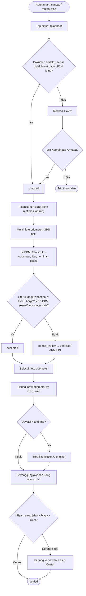

# 18 — Paket D: Armada & BBM (siap eksekusi)

> Revisi 16 Nov 2026 (repo): menerapkan PD-1, PF-1–PF-3 (sisi D/F), PF-5, PF-10–PF-12 dari `12`.

**Rentang:** T-141–T-153 · FR-D01–FR-D26 · BR-280–BR-299 · SEC-161–SEC-170 · OQ-138 dst.
**Kontrak:** `14` (ADR-107, ADR-113), **15** (`vehicles`, `stock_locations` kendaraan), **16** (rute & surat jalan, piutang karyawan, kas kecil, rekening resmi `bank_accounts`, `PeriodGuard` T-096), **17** (sinkron offline, mode driver, red flag). Paket ini menambah kelayakan kendaraan, trip, uang jalan, BBM, GPS, geofence, dan servis; aturan A–C tidak berubah.
**Modul konsep v1.4:** FLT-01 Kendaraan & Dokumen, FLT-02 Pelacakan GPS, FLT-03 Trip & Uang Jalan, FLT-04 BBM, FLT-05 Servis & Perawatan. FLT-06 (skor driver) ada di Paket G; data mentahnya disiapkan di sini.

## 0. Penyelarasan (cek sebelum T-141)

| # | Asumsi | Cek |
|---|---|---|
| S-1 | Paket C selesai: mesin sinkron, mode driver, red flag engine, push tersedia | Repo |
| S-2 | `vehicles` (A) masih minimal; kolom ditambah di T-141, kolom lama tidak diubah | Migration A |
| S-3 | `geolocator` (Fase 0) mendukung layanan latar Android dengan notifikasi tetap (foreground service) untuk pelacakan saat trip/kunjungan aktif. Bila versi yang terkunci tidak mendukung → berhenti dan tanyakan (bukan menambah paket) | `mobile-pro/pubspec.lock` |
| S-4 | Penyedia GPS tracker belum diputuskan (OQ-105). T-149 membangun kontrak `GpsProvider` + driver `phone` dan satu driver tracker sesuai keputusan (Traccar atau API vendor) | `14` §12 |
| S-5 | `gps_positions` dipartisi per bulan (`14` §6.6). MariaDB/MySQL partisi RANGE pada kolom waktu mewajibkan kolom partisi ada di setiap unique key (termasuk PK) — DDL §4.6 mengikuti itu. Repo memakai driver Laravel **`mariadb`** (`.env.example`, `phpunit.xml`, CI `mariadb:11.8.9`), yang berbeda dari driver `mysql`; pengecekan driver wajib `in ['mysql','mariadb']` (PD-1) | `.env.example`, `phpunit.xml`, CI |
| S-6 | Tidak ada dependency aplikasi baru di Paket D (backend maupun Flutter). Uji beban k6 di T-153 bukan dependency aplikasi, tetapi alatnya **menunggu OQ-144b** (ikut PA-4) | `03` §5 |
| S-7 | Paket B tersedia untuk sisi uang: `bank_accounts` (rekening resmi, **16** §4.2), `PeriodGuard` + `accounting.lock_date` (**16** T-096, BR-229), kas kecil (**16** T-105); `suppliers` (**15** T-072). Dokumen D yang dibayar lewat bank menyimpan `bank_account_id`, dan payload event `fleet.*` sudah lengkap (kualifier rekening, `refs.supplier_id`) sejak event pertama agar backfill Paket F tidak perlu memperbaiki event lama (PF-1, PF-2) | Repo |

### 0.1 ADR baru

| ADR | Keputusan | Alasan | Konsekuensi |
|---|---|---|---|
| ADR-120 | **Trip sebagai pusat biaya armada**: setiap pemakaian kendaraan untuk tugas (antar, canvas, mutasi, servis, lain) = satu `trips`; BBM, uang jalan, GPS, km dihubungkan ke trip | Konsep §9: "setiap liter BBM dan kilometer terhubung ke trip nyata" | Kendaraan bergerak tanpa trip = alert; BBM tanpa trip butuh alasan |
| ADR-121 | **Posisi GPS satu tabel** `gps_positions` untuk tracker kendaraan dan ponsel (kolom `source`, `subject_type`), detail disimpan `fleet.gps_detail_retention_days` lalu diringkas per trip/hari | Satu jalur perhitungan jarak & geofence; tabel paling cepat tumbuh harus mudah dipangkas | Partisi bulanan + `DROP PARTITION` untuk retensi (cepat, tanpa DELETE besar) |
| ADR-122 | **Alert armada ≠ red flag**: alert operasional (ngebut, di luar jam, berhenti lama, dokumen) ditangani Koordinator Armada; pola kecurangan (km/l, odometer vs GPS, BBM) masuk mesin red flag Paket C | Pemisahan operasi harian dan pengendalian kecurangan | Alert berulang tertentu menjadi input aturan red flag |

## 1. Ruang Lingkup

**Termasuk:** data kendaraan lengkap & pemegang, dokumen & pengingat, P2H & kelayakan trip, trip (antar/canvas/mutasi/lainnya) dengan odometer & serah terima, uang jalan & biaya trip dengan pertanggungjawaban, harga BBM berversi, pengisian BBM dengan cek wajar, km/liter, red flag BBM & odometer, GPS ponsel saat trip/kunjungan, adapter GPS tracker, geofence & alert, servis & perawatan & ban, laporan biaya armada.

**Di luar lingkup:** skor driver & insentif driver (G/E — data disiapkan), sensor level BBM (opsional, OQ-141), kartu BBM korporat terintegrasi (OQ-140, dicatat manual), jurnal (F).

## 2. Kebutuhan Fungsional

| ID | Kebutuhan | Aturan |
|---|---|---|
| FR-D01 | Data kendaraan: merek, tahun, kapasitas muat & tangki, jenis BBM, target km/liter, kepemilikan, boleh dibawa pulang, status, odometer terakhir. | BR-137, BR-280 |
| FR-D02 | Pemegang/driver tetap per kendaraan dengan riwayat. | BR-280 |
| FR-D03 | Dokumen kendaraan (STNK, pajak, KIR, asuransi, lain) dengan berkas, masa berlaku, pengingat. | BR-135, BR-281 |
| FR-D04 | Template P2H dinamis per jenis kendaraan; cek harian dari Pakis Pro dengan foto untuk item gagal. | BR-282 |
| FR-D05 | Kelayakan trip otomatis (dokumen, servis, P2H) dan pengecualian dengan persetujuan Koordinator Armada. | BR-135, BR-283 |
| FR-D06 | Trip dibuat dari rute antar, sesi canvas, mutasi, atau manual (servis/lain); driver & helper. | BR-284, ADR-120 |
| FR-D07 | Mulai/selesai trip dengan foto odometer; jarak odometer; offline. | BR-284 |
| FR-D08 | Serah terima kendaraan antar pengemudi (odometer, BBM, kondisi, foto). | BR-285 |
| FR-D09 | Aturan estimasi uang jalan dinamis (per jenis kendaraan, per km, per hari). | BR-286 |
| FR-D10 | Pemberian uang jalan per trip oleh Finance. | BR-141, BR-286 |
| FR-D11 | Biaya trip (tol, parkir, bongkar muat, makan) dengan foto bukti; pertanggungjawaban H+1; sisa disetor; selisih → piutang karyawan. | BR-133, BR-141, BR-287 |
| FR-D12 | Harga BBM berversi per jenis. | BR-136, BR-288 |
| FR-D13 | Pengisian BBM: foto struk & odometer dari kamera, liter, nominal, SPBU, lokasi, metode bayar; cek wajar saat itu juga. | BR-136, BR-137, BR-289 |
| FR-D14 | Verifikasi pengisian yang tidak wajar oleh Koordinator Armada/Finance. | BR-289 |
| FR-D15 | Km/liter per pengisian, per trip, per bulan per kendaraan & per driver. | BR-138, BR-290 |
| FR-D16 | Red flag BBM & odometer (deviasi km/l, odometer vs GPS, nominal tidak cocok, liter > tangki, pengisian berdekatan, SPBU di luar rute). | BR-138, BR-139, BR-291 |
| FR-D17 | Rekam GPS ponsel driver/sales hanya saat trip/kunjungan aktif. | BR-143, BR-292 |
| FR-D18 | Adapter GPS tracker (vendor API / Traccar), pemetaan perangkat–kendaraan. | BR-293, OQ-105 |
| FR-D19 | Tampilan posisi terkini & riwayat rute per trip (diagram `LocationDiagram`, tanpa tile pihak luar, PA-20). | BR-293 |
| FR-D20 | Geofence gudang/toko/kios (otomatis dari titik), kejadian masuk/keluar, tiba di kios. | BR-294 |
| FR-D21 | Alert: ngebut, berhenti lama di luar geofence, bergerak tanpa trip / di luar jam operasional. | BR-140, BR-295 |
| FR-D22 | Jadwal servis per km/waktu, pengingat. | BR-142, BR-296 |
| FR-D23 | Perintah servis dengan estimasi, persetujuan di atas batas, biaya aktual, foto suku cadang lama, waktu tidak beroperasi. | BR-142, BR-296 |
| FR-D24 | Catatan ban per posisi. | BR-297 |
| FR-D25 | Laporan armada: biaya per km, per pengiriman, % terhadap omzet, km/l, kepatuhan P2H, dokumen, servis. | BR-298 |
| FR-D26 | Data mentah skor driver (ketepatan kirim, km/l, kelengkapan POD, alert ngebut) per periode untuk Paket G/E. | BR-299 |

## 3. Kebutuhan Non-Fungsional

| ID | Target |
|---|---|
| NFR-D01 | 30 kendaraan (truk, pikap, motor), 40 pengemudi/sales bermotor |
| NFR-D02 | GPS tracker interval 30–60 s saat bergerak → ±50 ribu posisi/kendaraan/bulan; total ≤ 2 juta/bulan. Insert batch ≤ 200 ms per 500 posisi |
| NFR-D03 | Tampilan posisi terkini ≤ 2 s; riwayat rute 1 trip ≤ 1 s (polyline disederhanakan) |
| NFR-D04 | GPS ponsel: interval `fleet.phone_gps_interval_seconds` (default 60), konsumsi baterai wajar (diuji 8 jam trip), berhenti otomatis saat trip/kunjungan selesai |
| NFR-D05 | Retensi detail GPS 90 hari (setting) dengan pemangkasan partisi < 1 menit |

## 4. Database

### 4.1 Referensi, penomoran, ALTER

Grup `reference_items` baru: `fuel_type` (mis. solar, pertalite, pertamax, dexlite — nama mengikuti produk yang dijual SPBU; diisi Pakis), `vehicle_document_type` (STNK, pajak tahunan, pajak 5 tahunan, KIR, asuransi, izin lain — meta `blocks_trip`), `p2h_item` (meta `critical`, `vehicle_types`), `trip_expense_category` (tol, parkir, bongkar muat, makan, retribusi, lainnya), `maintenance_item` (ganti oli, filter, rem, aki, ban, servis berkala, lainnya), `fleet_alert_type` dikunci di ENUM.

Sequence baru: `trip` (`TRP-{YY}{MM}-{SEQ:4}`), `fuel_log` (`BBM-{YY}{MM}-{SEQ:5}`), `maintenance_order` (`SVK-{YY}{MM}-{SEQ:4}`) — sudah di `14` §8.

```sql
ALTER TABLE vehicles
  ADD COLUMN brand VARCHAR(60) NULL,
  ADD COLUMN model VARCHAR(60) NULL,
  ADD COLUMN manufacture_year SMALLINT UNSIGNED NULL,
  ADD COLUMN color VARCHAR(30) NULL,
  ADD COLUMN chassis_no VARCHAR(40) NULL,
  ADD COLUMN engine_no VARCHAR(40) NULL,
  ADD COLUMN ownership ENUM('owned','rented','employee_owned') NOT NULL DEFAULT 'owned',
  ADD COLUMN payload_capacity_kg DECIMAL(10,2) NULL,
  ADD COLUMN tank_capacity_l DECIMAL(8,2) NULL,                 -- wajib untuk kendaraan ber-BBM yang dicatat
  ADD COLUMN fuel_type_id BIGINT UNSIGNED NULL,                 -- reference_items(fuel_type), BR-137
  ADD COLUMN target_km_per_l DECIMAL(7,2) NULL,
  ADD COLUMN requires_kir BOOLEAN NOT NULL DEFAULT FALSE,       -- mobil barang wajib uji berkala
  ADD COLUMN take_home_allowed BOOLEAN NOT NULL DEFAULT FALSE,  -- BR-140 pengecualian
  ADD COLUMN p2h_required BOOLEAN NOT NULL DEFAULT TRUE,
  ADD COLUMN speed_limit_kmh SMALLINT UNSIGNED NULL,            -- NULL = setting per jenis
  ADD COLUMN current_odometer_km DECIMAL(10,1) NULL,            -- terakhir terverifikasi (foto)
  ADD COLUMN odometer_updated_at TIMESTAMP NULL,
  ADD COLUMN fleet_status ENUM('active','in_maintenance','inactive','sold') NOT NULL DEFAULT 'active',
  ADD COLUMN acquired_on DATE NULL;
ALTER TABLE customers ADD COLUMN geofence_radius_m SMALLINT UNSIGNED NULL;   -- NULL = fleet.customer_geofence_radius_m
ALTER TABLE deliveries
  ADD COLUMN trip_id BIGINT UNSIGNED NULL,
  ADD COLUMN arrived_at TIMESTAMP NULL,            -- dari geofence (BR-294)
  ADD COLUMN departed_at TIMESTAMP NULL,
  ADD KEY del_trip_idx (trip_id);
```

### 4.2 Pemegang & dokumen (T-141, T-142)

```sql
CREATE TABLE vehicle_assignments (
  id BIGINT UNSIGNED PRIMARY KEY AUTO_INCREMENT,
  vehicle_id BIGINT UNSIGNED NOT NULL,
  employee_id BIGINT UNSIGNED NOT NULL,
  role ENUM('primary_driver','holder') NOT NULL,   -- holder = pemegang motor dinas sales
  start_date DATE NOT NULL, end_date DATE NULL,
  reason VARCHAR(255) NULL,
  active_key VARCHAR(40) GENERATED ALWAYS AS (IF(end_date IS NULL, CONCAT(vehicle_id,'#',role), NULL)) STORED,
  [audit],
  UNIQUE KEY va_one_active_role_unique (active_key),
  KEY va_employee_idx (employee_id, end_date),
  CONSTRAINT vasg_vehicle_fk FOREIGN KEY (vehicle_id) REFERENCES vehicles(id)
);
CREATE TABLE vehicle_documents (
  id BIGINT UNSIGNED PRIMARY KEY AUTO_INCREMENT,
  vehicle_id BIGINT UNSIGNED NOT NULL,
  document_type_id BIGINT UNSIGNED NOT NULL,       -- reference_items(vehicle_document_type)
  document_no VARCHAR(60) NULL,
  issued_on DATE NULL,
  valid_until DATE NOT NULL,
  file_path VARCHAR(255) NULL,                     -- disk privat
  status ENUM('active','superseded','revoked') NOT NULL DEFAULT 'active',
  note VARCHAR(255) NULL,
  [audit],
  KEY vd_vehicle_type_idx (vehicle_id, document_type_id, status),
  KEY vd_valid_idx (status, valid_until),          -- konsep §14: pengingat dokumen akan habis
  CONSTRAINT vd_vehicle_fk FOREIGN KEY (vehicle_id) REFERENCES vehicles(id)
);
```

### 4.3 P2H & trip (T-143, T-144)

```sql
CREATE TABLE vehicle_daily_checks (
  id BIGINT UNSIGNED PRIMARY KEY AUTO_INCREMENT,
  client_uuid CHAR(36) NOT NULL,
  vehicle_id BIGINT UNSIGNED NOT NULL,
  check_date DATE NOT NULL,
  checked_by_employee_id BIGINT UNSIGNED NOT NULL,
  checked_at DATETIME NOT NULL,
  odometer_km DECIMAL(10,1) NOT NULL,
  odometer_photo_path VARCHAR(255) NOT NULL,
  items JSON NOT NULL,                             -- [{"item_id":12,"result":"ok|not_ok|na","note":"…","photo_path":"…"}]
  result ENUM('pass','pass_with_notes','fail') NOT NULL,   -- fail bila ada item critical not_ok
  notes VARCHAR(500) NULL,
  latitude DECIMAL(10,7) NULL, longitude DECIMAL(10,7) NULL,
  created_at TIMESTAMP NULL,
  UNIQUE KEY vdc_client_unique (client_uuid),
  KEY vdc_vehicle_date_idx (vehicle_id, check_date),
  CONSTRAINT vdc_vehicle_fk FOREIGN KEY (vehicle_id) REFERENCES vehicles(id)
);
CREATE TABLE trips (
  id BIGINT UNSIGNED PRIMARY KEY AUTO_INCREMENT,
  number VARCHAR(30) NOT NULL,
  trip_type ENUM('delivery','canvas','transfer','service','other') NOT NULL,
  vehicle_id BIGINT UNSIGNED NOT NULL,
  driver_employee_id BIGINT UNSIGNED NOT NULL,
  helper_employee_ids JSON NULL,
  delivery_route_id BIGINT UNSIGNED NULL,
  canvas_session_id BIGINT UNSIGNED NULL,
  stock_transfer_id BIGINT UNSIGNED NULL,
  maintenance_order_id BIGINT UNSIGNED NULL,
  purpose VARCHAR(255) NULL,                       -- wajib untuk 'other'
  planned_date DATE NOT NULL,
  planned_distance_km DECIMAL(8,1) NULL,           -- estimasi (rute) untuk uang jalan
  status ENUM('planned','checked','blocked','in_progress','completed','settled','cancelled') NOT NULL DEFAULT 'planned',
  eligibility JSON NULL,                           -- hasil cek BR-283 saat 'checked'/'blocked'
  daily_check_id BIGINT UNSIGNED NULL,
  override_approval_request_id BIGINT UNSIGNED NULL,
  start_client_uuid CHAR(36) NULL, end_client_uuid CHAR(36) NULL,
  started_at DATETIME NULL, start_odometer_km DECIMAL(10,1) NULL, start_odometer_photo_path VARCHAR(255) NULL,
  ended_at DATETIME NULL, end_odometer_km DECIMAL(10,1) NULL, end_odometer_photo_path VARCHAR(255) NULL,
  distance_odo_km DECIMAL(10,1) GENERATED ALWAYS AS (end_odometer_km - start_odometer_km) STORED,
  distance_gps_km DECIMAL(10,1) NULL,              -- dari ringkasan GPS
  fuel_liters DECIMAL(8,2) NULL,                   -- dialokasikan dari pengisian (BR-290)
  km_per_liter DECIMAL(7,2) NULL,
  settled_at TIMESTAMP NULL,
  [audit],
  UNIQUE KEY trip_number_unique (number),
  UNIQUE KEY trip_route_unique (delivery_route_id),
  UNIQUE KEY trip_start_client_unique (start_client_uuid),
  UNIQUE KEY trip_end_client_unique (end_client_uuid),
  active_key BIGINT UNSIGNED GENERATED ALWAYS AS (IF(status = 'in_progress', vehicle_id, NULL)) STORED,
  UNIQUE KEY trip_one_active_per_vehicle (active_key),
  KEY trip_vehicle_started_idx (vehicle_id, started_at),     -- konsep §14
  KEY trip_driver_started_idx (driver_employee_id, started_at),
  KEY trip_status_date_idx (status, planned_date),
  CONSTRAINT trip_vehicle_fk FOREIGN KEY (vehicle_id) REFERENCES vehicles(id),
  CONSTRAINT trip_odo_chk CHECK (end_odometer_km IS NULL OR end_odometer_km >= start_odometer_km),
  CONSTRAINT trip_other_chk CHECK (trip_type <> 'other' OR purpose IS NOT NULL)
);
CREATE TABLE vehicle_handovers (
  id BIGINT UNSIGNED PRIMARY KEY AUTO_INCREMENT,
  client_uuid CHAR(36) NOT NULL,
  vehicle_id BIGINT UNSIGNED NOT NULL,
  trip_id BIGINT UNSIGNED NULL,
  from_employee_id BIGINT UNSIGNED NOT NULL,
  to_employee_id BIGINT UNSIGNED NOT NULL,
  handed_at DATETIME NOT NULL,
  odometer_km DECIMAL(10,1) NOT NULL,
  odometer_photo_path VARCHAR(255) NOT NULL,
  fuel_level ENUM('empty','quarter','half','three_quarter','full') NOT NULL,
  condition_note VARCHAR(500) NULL,
  photo_paths JSON NULL,
  acknowledged_at TIMESTAMP NULL,                  -- penerima mengonfirmasi di aplikasinya
  created_at TIMESTAMP NULL,
  UNIQUE KEY vh_client_unique (client_uuid),
  KEY vh_vehicle_time_idx (vehicle_id, handed_at),
  CONSTRAINT vh_diff_chk CHECK (from_employee_id <> to_employee_id)
);
```

### 4.4 Uang jalan & biaya trip (T-145)

```sql
CREATE TABLE trip_allowance_rules (
  id BIGINT UNSIGNED PRIMARY KEY AUTO_INCREMENT,
  vehicle_type ENUM('truck','pickup','van','motorcycle','other') NOT NULL,
  trip_type ENUM('delivery','canvas','transfer','service','other') NOT NULL,
  base_amount DECIMAL(18,2) NOT NULL DEFAULT 0,
  per_km_amount DECIMAL(18,2) NOT NULL DEFAULT 0,
  meal_per_person_amount DECIMAL(18,2) NOT NULL DEFAULT 0,
  include_toll_estimate BOOLEAN NOT NULL DEFAULT FALSE,
  effective_from DATE NOT NULL,
  is_active BOOLEAN NOT NULL DEFAULT TRUE,
  [audit],
  UNIQUE KEY tar_unique (vehicle_type, trip_type, effective_from)
);
CREATE TABLE trip_allowances (
  id BIGINT UNSIGNED PRIMARY KEY AUTO_INCREMENT,
  trip_id BIGINT UNSIGNED NOT NULL,
  employee_id BIGINT UNSIGNED NOT NULL,            -- penerima & penanggung jawab (driver)
  estimated_amount DECIMAL(18,2) NOT NULL,
  estimate_detail JSON NOT NULL,                   -- rumus & angka (BR-286)
  issued_amount DECIMAL(18,2) NOT NULL,
  issue_method ENUM('cash_head_office','transfer') NOT NULL,
  bank_account_id BIGINT UNSIGNED NULL,            -- rekening resmi sumber transfer (16 bank_accounts); wajib bila transfer (PF-1)
  issued_by BIGINT UNSIGNED NOT NULL, issued_at TIMESTAMP NOT NULL,
  expenses_total DECIMAL(18,2) NOT NULL DEFAULT 0,
  fuel_paid_from_allowance DECIMAL(18,2) NOT NULL DEFAULT 0,
  returned_amount DECIMAL(18,2) NULL,              -- sisa disetor kembali
  variance_amount DECIMAL(18,2) NULL,              -- issued − expenses − bbm − returned (positif = kurang setor)
  status ENUM('issued','submitted','settled','variance','closed') NOT NULL DEFAULT 'issued',
  submitted_at TIMESTAMP NULL,
  settled_by BIGINT UNSIGNED NULL, settled_at TIMESTAMP NULL,
  employee_receivable_id BIGINT UNSIGNED NULL,
  due_at TIMESTAMP NOT NULL,                       -- batas pertanggungjawaban (BR-141)
  created_at TIMESTAMP NULL, updated_at TIMESTAMP NULL,
  UNIQUE KEY tal_trip_unique (trip_id),
  KEY tal_status_due_idx (status, due_at),
  KEY tal_employee_idx (employee_id, status),
  CONSTRAINT tal_trip_fk FOREIGN KEY (trip_id) REFERENCES trips(id),
  CONSTRAINT tal_bank_fk FOREIGN KEY (bank_account_id) REFERENCES bank_accounts(id),
  CONSTRAINT tal_bank_chk CHECK ((issue_method = 'transfer') = (bank_account_id IS NOT NULL)),
  CONSTRAINT tal_amount_chk CHECK (issued_amount >= 0)
);
CREATE TABLE trip_expenses (
  id BIGINT UNSIGNED PRIMARY KEY AUTO_INCREMENT,
  client_uuid CHAR(36) NOT NULL,
  trip_allowance_id BIGINT UNSIGNED NOT NULL,
  category_id BIGINT UNSIGNED NOT NULL,            -- reference_items(trip_expense_category)
  amount DECIMAL(18,2) NOT NULL,
  spent_at DATETIME NOT NULL,
  receipt_photo_path VARCHAR(255) NULL,            -- wajib kecuali kategori bermeta no_receipt (mis. parkir liar ≤ batas)
  receipt_sha256 CHAR(64) NULL,
  latitude DECIMAL(10,7) NULL, longitude DECIMAL(10,7) NULL,
  status ENUM('submitted','accepted','rejected') NOT NULL DEFAULT 'submitted',
  reviewer_note VARCHAR(255) NULL,
  created_at TIMESTAMP NULL, updated_at TIMESTAMP NULL,
  UNIQUE KEY te_client_unique (client_uuid),
  KEY te_allowance_idx (trip_allowance_id),
  CONSTRAINT te_allowance_fk FOREIGN KEY (trip_allowance_id) REFERENCES trip_allowances(id),
  CONSTRAINT te_amount_chk CHECK (amount > 0)
);
```

### 4.5 Harga BBM & pengisian (T-146)

```sql
CREATE TABLE fuel_prices (
  id BIGINT UNSIGNED PRIMARY KEY AUTO_INCREMENT,
  fuel_type_id BIGINT UNSIGNED NOT NULL,
  price_per_liter DECIMAL(18,2) NOT NULL,
  effective_from DATETIME NOT NULL,
  source_note VARCHAR(255) NOT NULL,               -- pengumuman harga resmi yang dirujuk
  [audit],
  UNIQUE KEY fp_type_from_unique (fuel_type_id, effective_from)
);
CREATE TABLE fuel_logs (
  id BIGINT UNSIGNED PRIMARY KEY AUTO_INCREMENT,
  number VARCHAR(30) NOT NULL,
  client_uuid CHAR(36) NOT NULL,
  vehicle_id BIGINT UNSIGNED NOT NULL,
  trip_id BIGINT UNSIGNED NULL,
  no_trip_reason VARCHAR(255) NULL,                -- wajib bila trip_id NULL
  filled_by_employee_id BIGINT UNSIGNED NOT NULL,
  filled_at DATETIME NOT NULL,
  odometer_km DECIMAL(10,1) NOT NULL,
  odometer_photo_path VARCHAR(255) NOT NULL,
  receipt_photo_path VARCHAR(255) NOT NULL,
  receipt_sha256 CHAR(64) NOT NULL,
  fuel_type_id BIGINT UNSIGNED NOT NULL,
  liters DECIMAL(8,3) NOT NULL,
  amount DECIMAL(18,2) NOT NULL,
  is_full_tank BOOLEAN NOT NULL DEFAULT TRUE,      -- km/l akurat dihitung antar pengisian penuh
  station_name VARCHAR(150) NULL,
  latitude DECIMAL(10,7) NOT NULL, longitude DECIMAL(10,7) NOT NULL, accuracy_m DECIMAL(8,2) NULL,
  payment_method ENUM('trip_allowance','petty_cash','fleet_card','voucher','company_transfer') NOT NULL,
  bank_account_id BIGINT UNSIGNED NULL,            -- rekening resmi (16 bank_accounts); wajib bila company_transfer (PF-1)
  petty_cash_expense_id BIGINT UNSIGNED NULL,      -- petty_cash: dokumen kas kecil B yang memancarkan event biaya (PF-5)
  fuel_price_id BIGINT UNSIGNED NULL,              -- harga berlaku saat filled_at
  expected_amount DECIMAL(18,2) NULL,              -- liters × harga berlaku
  km_since_last_full DECIMAL(10,1) NULL,
  km_per_liter DECIMAL(7,2) NULL,
  checks JSON NOT NULL,                            -- hasil BR-289 per pemeriksaan
  accounting_date DATE NULL,                       -- business_date event; = tanggal lokal filled_at, atau hari pertama setelah lock date (§11.2)
  flags JSON NULL,                                 -- mis. {"period_shifted": true} bila tanggal akuntansi digeser
  status ENUM('accepted','needs_review','approved','rejected') NOT NULL,
  reviewed_by BIGINT UNSIGNED NULL, reviewed_at TIMESTAMP NULL, review_note VARCHAR(500) NULL,
  approval_request_id BIGINT UNSIGNED NULL,        -- jenis BBM berbeda (BR-137)
  created_at TIMESTAMP NULL, updated_at TIMESTAMP NULL,
  UNIQUE KEY fl_number_unique (number),
  UNIQUE KEY fl_client_unique (client_uuid),
  KEY fl_vehicle_filled_idx (vehicle_id, filled_at),          -- konsep §14
  KEY fl_status_filled_idx (status, filled_at),
  KEY fl_trip_idx (trip_id),
  CONSTRAINT fl_vehicle_fk FOREIGN KEY (vehicle_id) REFERENCES vehicles(id),
  CONSTRAINT fl_bank_fk FOREIGN KEY (bank_account_id) REFERENCES bank_accounts(id),
  CONSTRAINT fl_pce_fk FOREIGN KEY (petty_cash_expense_id) REFERENCES petty_cash_expenses(id),
  CONSTRAINT fl_bank_chk CHECK ((payment_method = 'company_transfer') = (bank_account_id IS NOT NULL)),
  CONSTRAINT fl_amount_chk CHECK (liters > 0 AND amount > 0),
  CONSTRAINT fl_trip_chk CHECK (trip_id IS NOT NULL OR no_trip_reason IS NOT NULL)
);
```

### 4.6 GPS & geofence (T-148–T-150)

```sql
CREATE TABLE gps_devices (
  id BIGINT UNSIGNED PRIMARY KEY AUTO_INCREMENT,
  provider VARCHAR(40) NOT NULL,                   -- driver GpsProvider
  external_id VARCHAR(80) NOT NULL,                -- id perangkat di penyedia (bukan IMEI mentah bila tidak perlu)
  vehicle_id BIGINT UNSIGNED NULL,
  status ENUM('active','inactive','faulty') NOT NULL DEFAULT 'active',
  last_position_at TIMESTAMP NULL,
  [audit],
  UNIQUE KEY gd_provider_ext_unique (provider, external_id),
  UNIQUE KEY gd_vehicle_unique (vehicle_id)
);
CREATE TABLE gps_positions (                     -- ADR-121; partisi per bulan pada recorded_at
  id BIGINT UNSIGNED NOT NULL AUTO_INCREMENT,
  recorded_at DATETIME(3) NOT NULL,
  subject_type ENUM('vehicle','employee') NOT NULL,
  subject_id BIGINT UNSIGNED NOT NULL,
  source ENUM('tracker','phone') NOT NULL,
  trip_id BIGINT UNSIGNED NULL,
  visit_id BIGINT UNSIGNED NULL,
  latitude DECIMAL(10,7) NOT NULL, longitude DECIMAL(10,7) NOT NULL,
  speed_kmh DECIMAL(6,1) NULL, heading SMALLINT UNSIGNED NULL,
  accuracy_m DECIMAL(8,2) NULL,
  ignition BOOLEAN NULL,
  is_mocked BOOLEAN NOT NULL DEFAULT FALSE,
  received_at TIMESTAMP NOT NULL,
  PRIMARY KEY (id, recorded_at),
  KEY gp_subject_time_idx (subject_type, subject_id, recorded_at),   -- konsep §14
  KEY gp_trip_idx (trip_id, recorded_at)
)
PARTITION BY RANGE COLUMNS (recorded_at) (
  PARTITION p_YYYYMM VALUES LESS THAN ('YYYY-MM-01')   -- dibentuk dinamis oleh migration: bulan berjalan + 3 bulan ke depan
);
-- Job `gps:maintain-partitions` (harian) menambah partisi 3 bulan ke depan dan DROP partisi yang seluruhnya lebih tua dari retensi (BR-292).
-- Klausa PARTITION dibuat bila DB::getDriverName() in ['mysql','mariadb'] (PD-1): repo memakai driver `mariadb`
-- (.env.example, phpunit.xml, CI mariadb:11.8.9), jadi cek `=== 'mysql'` akan diam-diam tidak pernah mempartisi.
-- Driver lain (mis. SQLite) melewati klausa itu. Test partisi & DROP PARTITION berjalan di MariaDB (DB test & CI), bukan SQLite.
CREATE TABLE trip_gps_summaries (
  trip_id BIGINT UNSIGNED PRIMARY KEY,
  point_count INT UNSIGNED NOT NULL,
  distance_km DECIMAL(10,1) NOT NULL,
  moving_minutes INT UNSIGNED NOT NULL,
  stopped_minutes INT UNSIGNED NOT NULL,
  max_speed_kmh DECIMAL(6,1) NULL,
  overspeed_count INT UNSIGNED NOT NULL DEFAULT 0,
  gap_minutes INT UNSIGNED NOT NULL DEFAULT 0,     -- celah data (perangkat mati/sinyal)
  simplified_path JSON NOT NULL,                   -- polyline disederhanakan (Douglas–Peucker)
  computed_at TIMESTAMP NOT NULL
);
CREATE TABLE gps_daily_summaries (               -- ringkasan setelah detail dipangkas
  subject_type ENUM('vehicle','employee') NOT NULL,
  subject_id BIGINT UNSIGNED NOT NULL,
  summary_date DATE NOT NULL,
  distance_km DECIMAL(10,1) NOT NULL,
  moving_minutes INT UNSIGNED NOT NULL,
  after_hours_minutes INT UNSIGNED NOT NULL DEFAULT 0,
  without_trip_km DECIMAL(10,1) NOT NULL DEFAULT 0,
  PRIMARY KEY (subject_type, subject_id, summary_date)
);
CREATE TABLE geofences (
  id BIGINT UNSIGNED PRIMARY KEY AUTO_INCREMENT,
  name VARCHAR(150) NOT NULL,
  kind ENUM('warehouse','store','customer','spbu','custom') NOT NULL,
  ref_type VARCHAR(60) NULL, ref_id BIGINT UNSIGNED NULL,   -- location / customer
  center_latitude DECIMAL(10,7) NOT NULL, center_longitude DECIMAL(10,7) NOT NULL,
  radius_m SMALLINT UNSIGNED NOT NULL,
  is_active BOOLEAN NOT NULL DEFAULT TRUE,
  [audit],
  UNIQUE KEY gf_ref_unique (kind, ref_type, ref_id),
  KEY gf_lat_lng_idx (center_latitude, center_longitude)    -- prefilter kotak sebelum haversine
);
CREATE TABLE geofence_events (
  id BIGINT UNSIGNED PRIMARY KEY AUTO_INCREMENT,
  geofence_id BIGINT UNSIGNED NOT NULL,
  subject_type ENUM('vehicle','employee') NOT NULL, subject_id BIGINT UNSIGNED NOT NULL,
  trip_id BIGINT UNSIGNED NULL,
  event ENUM('enter','exit') NOT NULL,
  occurred_at DATETIME NOT NULL,
  KEY ge_subject_time_idx (subject_type, subject_id, occurred_at),
  KEY ge_trip_idx (trip_id, occurred_at)
);
CREATE TABLE fleet_alerts (                      -- ADR-122
  id BIGINT UNSIGNED PRIMARY KEY AUTO_INCREMENT,
  alert_type ENUM('overspeed','long_stop','after_hours_movement','moving_without_trip','document_expiring','document_expired','service_due','service_overdue','gps_gap','p2h_failed','trip_blocked') NOT NULL,
  vehicle_id BIGINT UNSIGNED NULL,
  employee_id BIGINT UNSIGNED NULL,
  trip_id BIGINT UNSIGNED NULL,
  occurred_at DATETIME NOT NULL,
  details JSON NOT NULL,
  severity ENUM('info','warning','critical') NOT NULL,
  status ENUM('open','acknowledged','resolved','dismissed') NOT NULL DEFAULT 'open',
  handled_by BIGINT UNSIGNED NULL, handled_at TIMESTAMP NULL, handling_note VARCHAR(500) NULL,
  dedup_key VARCHAR(120) NOT NULL,
  created_at TIMESTAMP NULL,
  UNIQUE KEY fa_dedup_unique (dedup_key),
  KEY fa_status_idx (status, severity, occurred_at),
  KEY fa_vehicle_idx (vehicle_id, occurred_at)
);
```

### 4.7 Servis, perawatan & ban (T-151)

```sql
CREATE TABLE maintenance_schedules (
  id BIGINT UNSIGNED PRIMARY KEY AUTO_INCREMENT,
  vehicle_id BIGINT UNSIGNED NOT NULL,
  item_id BIGINT UNSIGNED NOT NULL,                -- reference_items(maintenance_item)
  interval_km INT UNSIGNED NULL,
  interval_days SMALLINT UNSIGNED NULL,
  last_done_km DECIMAL(10,1) NULL, last_done_on DATE NULL,
  next_due_km DECIMAL(10,1) NULL, next_due_on DATE NULL,
  blocks_trip_when_overdue_km INT UNSIGNED NULL,   -- lewat X km dari due → trip diblokir (BR-283)
  is_active BOOLEAN NOT NULL DEFAULT TRUE,
  [audit],
  UNIQUE KEY ms_vehicle_item_unique (vehicle_id, item_id),
  KEY ms_due_idx (is_active, next_due_on),
  CONSTRAINT ms_interval_chk CHECK (interval_km IS NOT NULL OR interval_days IS NOT NULL)
);
CREATE TABLE maintenance_orders (
  id BIGINT UNSIGNED PRIMARY KEY AUTO_INCREMENT,
  number VARCHAR(30) NOT NULL,
  vehicle_id BIGINT UNSIGNED NOT NULL,
  order_type ENUM('scheduled','repair','tire','accident','inspection') NOT NULL,
  reported_issue TEXT NULL,
  supplier_id BIGINT UNSIGNED NULL,                -- suppliers (15); NULL bila bengkel bukan supplier terdaftar (PF-2)
  workshop_name VARCHAR(150) NULL,                 -- tetap: nama bengkel (wajib bila supplier_id NULL)
  estimated_cost DECIMAL(18,2) NOT NULL,
  status ENUM('planned','pending_approval','approved','in_service','done','rejected','cancelled') NOT NULL DEFAULT 'planned',
  approval_request_id BIGINT UNSIGNED NULL,
  odometer_km DECIMAL(10,1) NULL,
  service_started_at DATETIME NULL, service_finished_at DATETIME NULL,
  downtime_hours DECIMAL(8,1) GENERATED ALWAYS AS (TIMESTAMPDIFF(MINUTE, service_started_at, service_finished_at) / 60) STORED,
  actual_cost DECIMAL(18,2) NULL,
  invoice_photo_path VARCHAR(255) NULL,
  payment_method ENUM('petty_cash','company_transfer','payable') NULL,   -- payable = hutang bengkel (Paket F)
  bank_account_id BIGINT UNSIGNED NULL,            -- company_transfer: rekening resmi sumber (16 bank_accounts) (PF-1)
  petty_cash_expense_id BIGINT UNSIGNED NULL,      -- petty_cash: dokumen kas kecil B yang memancarkan event biaya (PF-5)
  [audit],
  UNIQUE KEY mo_number_unique (number),
  KEY mo_vehicle_status_idx (vehicle_id, status),
  KEY mo_status_idx (status, created_at),
  KEY mo_supplier_idx (supplier_id, status),
  CONSTRAINT mo_vehicle_fk FOREIGN KEY (vehicle_id) REFERENCES vehicles(id),
  CONSTRAINT mo_supplier_fk FOREIGN KEY (supplier_id) REFERENCES suppliers(id),
  CONSTRAINT mo_bank_fk FOREIGN KEY (bank_account_id) REFERENCES bank_accounts(id),
  CONSTRAINT mo_pce_fk FOREIGN KEY (petty_cash_expense_id) REFERENCES petty_cash_expenses(id),
  CONSTRAINT mo_workshop_chk CHECK (supplier_id IS NOT NULL OR workshop_name IS NOT NULL),
  CONSTRAINT mo_bank_chk CHECK (payment_method IS NULL OR (payment_method = 'company_transfer') = (bank_account_id IS NOT NULL)),
  CONSTRAINT mo_payable_chk CHECK (payment_method IS NULL OR payment_method <> 'payable' OR supplier_id IS NOT NULL)   -- hutang wajib ber-supplier (sub-buku F)
);
-- Kolom supplier_id/bank_account_id/petty_cash_expense_id dibuat sejak T-151 (bukan ALTER di Paket F), karena event
-- fleet.maintenance_approved append-only dan dipakai backfill F (PF-1, PF-2).
CREATE TABLE maintenance_order_items (
  id BIGINT UNSIGNED PRIMARY KEY AUTO_INCREMENT,
  maintenance_order_id BIGINT UNSIGNED NOT NULL,
  item_id BIGINT UNSIGNED NULL,                    -- reference_items(maintenance_item); memperbarui jadwal
  description VARCHAR(255) NOT NULL,
  kind ENUM('part','labor','other') NOT NULL,
  qty DECIMAL(10,2) NOT NULL DEFAULT 1,
  unit_cost DECIMAL(18,2) NOT NULL,
  old_part_photo_path VARCHAR(255) NULL,           -- wajib untuk kind = part (BR-142)
  CONSTRAINT moi_order_fk FOREIGN KEY (maintenance_order_id) REFERENCES maintenance_orders(id) ON DELETE CASCADE,
  CONSTRAINT moi_photo_chk CHECK (kind <> 'part' OR old_part_photo_path IS NOT NULL)
);
CREATE TABLE vehicle_tires (
  id BIGINT UNSIGNED PRIMARY KEY AUTO_INCREMENT,
  vehicle_id BIGINT UNSIGNED NOT NULL,
  position_code VARCHAR(10) NOT NULL,              -- FL, FR, RLO, RLI, …, SPARE
  brand VARCHAR(60) NULL, size VARCHAR(30) NULL, tire_serial VARCHAR(60) NULL,
  installed_on DATE NOT NULL, installed_odometer_km DECIMAL(10,1) NOT NULL,
  removed_on DATE NULL, removed_odometer_km DECIMAL(10,1) NULL,
  removal_reason VARCHAR(255) NULL,
  maintenance_order_id BIGINT UNSIGNED NULL,
  active_key VARCHAR(40) GENERATED ALWAYS AS (IF(removed_on IS NULL, CONCAT(vehicle_id,'#',position_code), NULL)) STORED,
  [audit],
  UNIQUE KEY vt_one_per_position (active_key)
);
```

### 4.8 Index ↔ query penting

| Index | Query |
|---|---|
| `vd_valid_idx` | Pengingat & blokir dokumen habis |
| `vdc_vehicle_date_idx` | P2H hari ini per kendaraan (kelayakan) |
| `trip_vehicle_started_idx`, `trip_driver_started_idx` | Riwayat trip & km/l per kendaraan/driver (konsep §14) |
| `trip_one_active_per_vehicle` | Satu trip berjalan per kendaraan |
| `tal_status_due_idx` | Uang jalan lewat batas pertanggungjawaban |
| `fl_vehicle_filled_idx`, `fl_status_filled_idx` | Konsumsi BBM per kendaraan; antrean verifikasi (konsep §14) |
| `gp_subject_time_idx` + partisi | Rute & posisi terakhir; tabel paling cepat tumbuh |
| `gf_lat_lng_idx` | Prefilter geofence kandidat per posisi |
| `fa_dedup_unique`, `fa_status_idx` | Alert tidak dobel; antrean Koordinator Armada |
| `ms_due_idx` | Servis jatuh tempo |

## 5. Route & API

### 5.1 Web admin

| Nama | Path | Permission | Catatan |
|---|---|---|---|
| `admin.vehicles.*` (diperluas) | `/kendaraan/...` | `vehicles.view` / `.manage` (A) | Tab: data, pemegang, dokumen, P2H, trip, BBM, servis, ban, GPS |
| `admin.vehicle-assignments.store`/`end` | `/kendaraan/{vehicle}/pemegang` | `vehicles.manage` | |
| `admin.vehicle-documents.index`/`store`/`update` | `/kendaraan/dokumen` | `vehicle_documents.view` / `.manage` | Default filter "habis ≤ nilai terbesar `fleet.document_reminder_days`" |
| `admin.p2h-templates.index`/`update` | `/armada/p2h/template` | `vehicles.manage` | Item P2H per jenis kendaraan (referensi `p2h_item`) |
| `admin.daily-checks.index`/`show` | `/armada/p2h` | `vehicle_checks.view` | |
| `admin.trips.index`/`create`/`store`/`show` | `/armada/trip/...` | `trips.view` / `.manage` | Trip manual (`service`/`other`); trip antar/canvas/mutasi dibuat otomatis |
| `admin.trips.check` | POST `/armada/trip/{trip}/cek-kelayakan` | `trips.manage` | Jalankan BR-283 |
| `admin.trips.override` | POST `/armada/trip/{trip}/izin` | `trips.manage` | → approval `trip_eligibility_override` |
| `admin.trips.cancel` | POST `/armada/trip/{trip}/batal` | `trips.manage` | Hanya sebelum `in_progress` |
| `admin.trips.route` | GET `/armada/trip/{trip}/rute` | `gps.view` | Rute + geofence + alert sebagai `LocationDiagram` (PA-20, §7.2) |
| `admin.trip-allowance-rules.*` | `/armada/aturan-uang-jalan` | `trip_allowances.configure` | |
| `admin.trip-allowances.index`/`issue`/`settle` | `/armada/uang-jalan` | `trip_allowances.view` / `.issue` / `.settle` | Issue: Finance; settle: Finance ≠ penerima |
| `admin.fuel-prices.*` | `/armada/harga-bbm` | `fuel_prices.manage` | Konfirmasi password |
| `admin.fuel-logs.index`/`show`/`review` | `/armada/bbm` | `fuel_logs.view` / `.verify` | Antrean `needs_review` |
| `admin.gps.live` | GET `/armada/peta` | `gps.view` | Posisi terkini (polling `fleet.live_poll_seconds`) sebagai `LocationDiagram` + daftar, tanpa tile (PA-20) |
| `admin.gps-devices.*` | `/armada/perangkat-gps` | `gps.manage_devices` | |
| `admin.geofences.*` | `/armada/geofence` | `geofences.manage` | Gudang/toko otomatis dari lokasi, kios dari titik terverifikasi |
| `admin.fleet-alerts.index`/`acknowledge`/`resolve`/`dismiss` | `/armada/alert` | `fleet_alerts.handle` | Alasan wajib untuk `dismiss` |
| `admin.maintenance-schedules.*` | `/armada/jadwal-servis` | `maintenance.manage` | |
| `admin.maintenance-orders.*` | `/armada/servis/...` | `maintenance.view` / `.manage` | Ajukan → approval `maintenance_order` |
| `admin.vehicle-tires.*` | `/kendaraan/{vehicle}/ban` | `maintenance.manage` | |
| `admin.fleet-reports.*` | `/laporan/armada/...` | `fleet_reports.view` | Biaya/km, biaya/pengiriman, % omzet, km/l, kepatuhan |

### 5.2 API Pakis Pro (mode driver & armada)

| Nama | Metode | Path | Permission | Offline |
|---|---|---|---|---|
| `api.v1.fleet.my-vehicle` | GET | `/api/v1/armada/kendaraan-saya` | `trips.execute` | Snapshot set `fleet` |
| `api.v1.fleet.trips.mine` | GET | `/api/v1/armada/trip-saya` | `trips.execute` | Snapshot |
| `api.v1.gps.positions` | POST | `/api/v1/gps/posisi` | `trips.execute` atau `visits.checkin` | Batch ≤ `fleet.gps_batch_max_points` titik; hanya saat trip/kunjungan aktif (BR-292) |
| Item sinkron | — | — | — | `daily_check`, `trip_start`, `trip_end`, `vehicle_handover`, `handover_ack`, `fuel_log`, `trip_expense`, `allowance_submit` |
| `api.v1.webhooks.gps` | POST | `/api/v1/webhooks/gps/{provider}` | Signature/IP allowlist | Penerimaan posisi tracker (BR-293) |

## 6. Otorisasi

### 6.1 Role baru

| Kode | Nama | `data_scope` | `mfa_required` | Catatan |
|---|---|---|---|---|
| `koordinator_armada` | Koordinator Armada / Kepala Ekspedisi | `all` (kendaraan) | ✅ | Juga mendapat `vehicles.view`, `vehicles.manage` (A), `deliveries.view` (B), `approvals.view` |

`driver` (B) dan `sales` (B) mendapat permission eksekusi Paket D dengan scope `self` (kendaraan yang ditugaskan / trip miliknya).

### 6.2 Scope

| Resource | `all` | `location` | `team` | `self` |
|---|---|---|---|---|
| Kendaraan, dokumen, servis, GPS kendaraan | Semua | Kendaraan dengan `home_location_id` di lokasi pengguna (kepala gudang) | Kendaraan pemegang = bawahan (supervisor: motor sales area) | Kendaraan yang ditugaskan |
| Trip, BBM, uang jalan | Semua | Trip kendaraan lokasi | Trip bawahan | Trip/BBM/uang jalan sendiri |
| Posisi ponsel pegawai | Owner & ARM saja, hanya dalam trip/kunjungan | — | Supervisor: posisi kunjungan bawahan saat kunjungan aktif | — |

### 6.3 Permission baru (25)

| Modul | Permission |
|---|---|
| Dokumen & P2H | `vehicle_documents.view`, `vehicle_documents.manage`, `vehicle_checks.view`, `vehicle_checks.perform` |
| Trip | `trips.view`, `trips.manage`, `trips.execute`, `trips.override_approve` |
| Uang jalan | `trip_allowances.view`, `trip_allowances.configure`, `trip_allowances.issue`, `trip_allowances.settle` |
| BBM | `fuel_logs.view`, `fuel_logs.submit`, `fuel_logs.verify`, `fuel_prices.manage` |
| GPS | `gps.view`, `gps.manage_devices`, `geofences.manage`, `fleet_alerts.handle` |
| Servis | `maintenance.view`, `maintenance.manage`, `maintenance.approve`, `maintenance.approve_high` |
| Laporan | `fleet_reports.view` |

### 6.4 Matriks kewenangan (default seeder)

✅ penuh · 🔸 dalam scope / milik sendiri / di bawah ambang · ❌ tidak. Kolom: OWN · ADM · SPV · KGD · SGD · SLS · DRV · FIN · ARM `koordinator_armada` · AUD. Role lain tidak mendapat permission Paket D. `super_admin` = semua. **Owner memegang semua izin dan terkunci** (BR-031, keputusan PA-10 berlaku global), jadi kolom OWN ✅ penuh. Pemisahan tugas ditegakkan maker-checker mesin approval (BR-153(4): pembuat/pengaju tidak pernah memutuskan) + audit, **termasuk untuk Owner** (mis. Owner yang mengajukan servis tidak bisa menyetujuinya; Owner yang mengisi BBM tidak bisa memverifikasinya).

| Permission | OWN | ADM | SPV | KGD | SGD | SLS | DRV | FIN | ARM | AUD |
|---|---|---|---|---|---|---|---|---|---|---|
| `vehicle_documents.view` | ✅ | ❌ | ❌ | 🔸 | ❌ | ❌ | ❌ | ✅ | ✅ | ✅ |
| `vehicle_documents.manage` | ✅ | ❌ | ❌ | ❌ | ❌ | ❌ | ❌ | ❌ | ✅ | ❌ |
| `vehicle_checks.view` | ✅ | ❌ | ❌ | 🔸 | ❌ | ❌ | ❌ | ❌ | ✅ | ✅ |
| `vehicle_checks.perform` | ✅ | ❌ | ❌ | ❌ | ❌ | 🔸 | 🔸 | ❌ | ✅ | ❌ |
| `trips.view` | ✅ | ❌ | 🔸 | 🔸 | ❌ | 🔸 | 🔸 | ✅ | ✅ | ✅ |
| `trips.manage` | ✅ | ❌ | ❌ | 🔸 | ❌ | ❌ | ❌ | ❌ | ✅ | ❌ |
| `trips.execute` | ✅ | ❌ | ❌ | ❌ | ❌ | 🔸 | 🔸 | ❌ | ❌ | ❌ |
| `trips.override_approve` | ✅ | ❌ | ❌ | ❌ | ❌ | ❌ | ❌ | ❌ | ✅ | ❌ |
| `trip_allowances.view` | ✅ | ❌ | ❌ | ❌ | ❌ | ❌ | 🔸 | ✅ | ✅ | ✅ |
| `trip_allowances.configure` | ✅ | ❌ | ❌ | ❌ | ❌ | ❌ | ❌ | ❌ | ✅ | ❌ |
| `trip_allowances.issue` | ✅ | ❌ | ❌ | ❌ | ❌ | ❌ | ❌ | ✅ | ❌ | ❌ |
| `trip_allowances.settle` | ✅ | ❌ | ❌ | ❌ | ❌ | ❌ | ❌ | ✅ | ❌ | ❌ |
| `fuel_logs.view` | ✅ | ❌ | ❌ | ❌ | ❌ | 🔸 | 🔸 | ✅ | ✅ | ✅ |
| `fuel_logs.submit` | ✅ | ❌ | ❌ | ❌ | ❌ | 🔸 | 🔸 | ❌ | ✅ | ❌ |
| `fuel_logs.verify` | ✅ | ❌ | ❌ | ❌ | ❌ | ❌ | ❌ | 🔸 | ✅ | ❌ |
| `fuel_prices.manage` | ✅ | ❌ | ❌ | ❌ | ❌ | ❌ | ❌ | ✅ | ✅ | ❌ |
| `gps.view` | ✅ | ❌ | 🔸 | 🔸 | ❌ | ❌ | ❌ | ❌ | ✅ | ✅ |
| `gps.manage_devices` | ✅ | ❌ | ❌ | ❌ | ❌ | ❌ | ❌ | ❌ | ✅ | ❌ |
| `geofences.manage` | ✅ | ❌ | ❌ | ❌ | ❌ | ❌ | ❌ | ❌ | ✅ | ❌ |
| `fleet_alerts.handle` | ✅ | ❌ | ❌ | ❌ | ❌ | ❌ | ❌ | ❌ | ✅ | ❌ |
| `maintenance.view` | ✅ | ❌ | ❌ | 🔸 | ❌ | ❌ | ❌ | ✅ | ✅ | ✅ |
| `maintenance.manage` | ✅ | ❌ | ❌ | ❌ | ❌ | ❌ | ❌ | ❌ | ✅ | ❌ |
| `maintenance.approve` | ✅ | ❌ | ❌ | ❌ | ❌ | ❌ | ❌ | 🔸 | ❌ | ❌ |
| `maintenance.approve_high` | ✅ | ❌ | ❌ | ❌ | ❌ | ❌ | ❌ | ❌ | ❌ | ❌ |
| `fleet_reports.view` | ✅ | ❌ | ❌ | ❌ | ❌ | ❌ | ❌ | ✅ | ✅ | ✅ |

### 6.5 Jenis dokumen approval baru

| `document_type` | Dipicu | Nominal | Rantai default |
|---|---|---|---|
| `trip_eligibility_override` | Trip `blocked` diminta tetap jalan | — | `trips.override_approve` (Koordinator Armada; bila pengaju = ARM → Owner) |
| `fuel_type_exception` | Isi jenis BBM berbeda dari ketetapan kendaraan (BR-137) | `amount` | `fuel_logs.verify` |
| `maintenance_order` | Perintah servis | `estimated_cost` | < `fleet.maintenance_approval_threshold` (contoh Rp 1 jt): tanpa approval · ≥ ambang: `maintenance.approve` (FIN) · ≥ `fleet.maintenance_high_approval_threshold` (contoh Rp 5 jt): + `maintenance.approve_high` |
| `trip_allowance_variance` | Pertanggungjawaban uang jalan dengan selisih yang diajukan sebagai wajar | `ABS(variance)` | `trip_allowances.settle` (≠ penerima) · ≥ `fleet.allowance_variance_owner_threshold` (contoh Rp 200 rb): + Owner |

### 6.6 Transisi status

| Objek | Dari → Ke | Aksi / pelaku |
|---|---|---|
| Trip | `planned` → `checked` | Cek kelayakan lulus (otomatis saat driver membuka trip / `admin.trips.check`) |
| Trip | `planned` → `blocked` | Cek kelayakan gagal |
| Trip | `blocked` → `checked` | Approval `trip_eligibility_override` atau penyebab hilang |
| Trip | `checked` → `in_progress` | Driver mulai (foto odometer) |
| Trip | `in_progress` → `completed` | Driver selesai (foto odometer); rute antar `completed` saat semua surat jalan final |
| Trip | `completed` → `settled` | Uang jalan `settled`/`closed` (atau trip tanpa uang jalan) & BBM terverifikasi |
| Trip | `planned`/`checked`/`blocked` → `cancelled` | `trips.manage` |
| Uang jalan | `issued` → `submitted` → `settled`/`variance` → `closed` | Driver ajukan → Finance cocokkan → selisih: approval atau piutang karyawan |
| Pengisian BBM | (baru) → `accepted`/`needs_review` | Cek otomatis (BR-289) |
| Pengisian BBM | `needs_review` → `approved`/`rejected` | `fuel_logs.verify` (≠ pengisi) |
| Perintah servis | `planned` → `pending_approval` → `approved` → `in_service` → `done` | ARM; approval sesuai nominal |
| Alert | `open` → `acknowledged` → `resolved`/`dismissed` | `fleet_alerts.handle` |

### 6.7 Diagram — trip & BBM dengan titik pemeriksaan (konsep Gambar 9.1)



## 7. UI & Listing

### 7.1 Pakis Pro — mode Driver/Armada (tambahan **17** §7.1)

`mobile-pro/lib/features/fleet/` : `my_vehicle` (status kelayakan, dokumen, servis jatuh tempo) · `daily_check` (daftar item P2H dinamis, foto wajib untuk item `not_ok`, foto odometer) · `trip_start`/`trip_end` (kamera odometer, ringkasan trip) · `fuel_log` (kamera struk & odometer, liter, nominal, SPBU, metode bayar; hasil cek wajar ditampilkan langsung, tetap tersimpan walau `needs_review`) · `trip_expenses` (biaya + foto) · `allowance_settlement` (ringkasan uang jalan: diberi, biaya, BBM, sisa yang harus disetor) · `handover` (serah & konfirmasi terima). Semua bisa offline kecuali pertanggungjawaban akhir. Saat trip/kunjungan aktif tampil notifikasi tetap "Lokasi dicatat selama trip" (BR-292).

### 7.2 Web

**Tampilan lokasi (keputusan PA-20, berlaku juga untuk D):** tanpa tile peta pihak luar, tanpa library peta, tanpa mengubah CSP, tanpa setting `map.tile_url`. Posisi, rute trip (`simplified_path`), dan geofence digambar dengan `LocationDiagram` (diagram SVG yang sudah ada, `resources/js/components/pakis/location-diagram.tsx`); tombol "Buka di peta" membuka tab baru **hanya bila diklik**, sehingga koordinat tidak terkirim otomatis ke server peta pihak luar. Peta interaktif baru dipertimbangkan bila ada server tile sendiri (OQ-120).

Papan armada (posisi terkini per kendaraan sebagai `LocationDiagram` + daftar, status trip, alert terbuka) · detail trip (rute disederhanakan, geofence, kejadian tiba/berangkat kios, BBM, biaya) · antrean verifikasi BBM (foto struk & odometer berdampingan, angka hasil cek, riwayat km/l kendaraan) · papan dokumen & servis jatuh tempo · laporan armada.

### 7.3 Katalog listing baru

| Kunci | Route | Pencarian | Filter | Sort default | Scope |
|---|---|---|---|---|---|
| `vehicle_documents` | `admin.vehicle-documents.index` | plat, nomor dokumen | `document_type_id`, `status`, `valid_until` (rentang), `expiring_days` | `valid_until` asc | Kendaraan |
| `daily_checks` | `admin.daily-checks.index` | plat, nama pemeriksa | `vehicle_id`, `result`, `check_date` (rentang) | `check_date` desc | Kendaraan |
| `trips` | `admin.trips.index`, `api.v1.fleet.trips.mine` | nomor, plat, nama driver | `status`, `trip_type`, `vehicle_id`, `driver_employee_id`, `planned_date` (rentang), `has_flags` | `planned_date` desc | Trip |
| `trip_allowance_rules` | `admin.trip-allowance-rules.index` | — | `vehicle_type`, `trip_type`, `is_active` | `effective_from` desc | — |
| `trip_allowances` | `admin.trip-allowances.index` | nomor trip, nama driver | `status`, `overdue` (ya), `employee_id`, `issued_at` (rentang) | `due_at` asc | Trip |
| `fuel_prices` | `admin.fuel-prices.index` | — | `fuel_type_id` | `effective_from` desc | — |
| `fuel_logs` | `admin.fuel-logs.index` | nomor, plat, SPBU | `status`, `vehicle_id`, `filled_by_employee_id`, `fuel_type_id`, `payment_method`, `filled_at` (rentang), `has_trip` | `filled_at` desc | Trip |
| `gps_devices` | `admin.gps-devices.index` | id eksternal, plat | `provider`, `status`, `stale` (posisi > `fleet.gps_device_stale_minutes`) | `last_position_at` asc | — |
| `geofences` | `admin.geofences.index` | nama | `kind`, `is_active` | `name` | — |
| `fleet_alerts` | `admin.fleet-alerts.index` | plat, nama | `alert_type`, `severity`, `status`, `vehicle_id`, `occurred_at` (rentang) | `occurred_at` desc | Kendaraan |
| `maintenance_schedules` | `admin.maintenance-schedules.index` | plat | `vehicle_id`, `item_id`, `due` (overdue/≤ `fleet.service_reminder_days` hari/≤ `fleet.service_reminder_km` km) | `next_due_on` asc | Kendaraan |
| `maintenance_orders` | `admin.maintenance-orders.index` | nomor, plat, bengkel | `status`, `order_type`, `vehicle_id`, `supplier_id`, `payment_method`, `created_at` (rentang) | `created_at` desc | Kendaraan |
| `vehicle_tires` | `admin.vehicle-tires.index` | plat, seri ban | `vehicle_id`, `active` | `installed_on` desc | Kendaraan |
| `fleet_cost_report` | `admin.fleet-reports.cost` | plat | `period` (wajib), `vehicle_type`, `vehicle_id` | `cost_per_km` desc | — |
| `fleet_efficiency_report` | `admin.fleet-reports.efficiency` | plat, nama driver | `period` (wajib), `vehicle_type`, `group_by` (kendaraan/driver) | `kpl_deviation_pct` desc | — |

Total listing setelah Paket D: listing paket sebelumnya + 15 (angka total tidak ditulis tetap, pola PA-5; sumber hitungan = `tests/Fixtures/listing_catalog.php`).

## 8. Aturan Bisnis

### 8.1 Aturan konsep yang diimplementasikan

| ID | Aturan (konsep §9.5) | Implementasi |
|---|---|---|
| BR-135 | Trip hanya bila kendaraan layak; pengecualian disetujui Koordinator Armada & tercatat | BR-283 |
| BR-136 | BBM: foto struk & odometer dari kamera + lokasi; liter ≤ tangki; nominal = liter × harga berlaku ± toleransi | BR-288, BR-289 |
| BR-137 | Jenis BBM per kendaraan ditetapkan Pakis; jenis lain butuh persetujuan | BR-280, BR-289 |
| BR-138 | Km/liter per trip & bulan; deviasi > ambang (default 20%) → red flag | BR-290, BR-291 |
| BR-139 | Selisih odometer vs GPS > ambang (default 10%) → red flag | BR-291 |
| BR-140 | Bergerak tanpa trip / di luar jam operasional → alert, kecuali boleh dibawa pulang | BR-295 |
| BR-141 | Uang jalan & biaya trip dipertanggungjawabkan ≤ H+1; selisih → piutang karyawan | BR-287 |
| BR-142 | Servis per km/waktu mana lebih dulu; biaya di atas batas → approval; suku cadang difoto | BR-296 |
| BR-143 | GPS kendaraan saat jam operasional & trip; ponsel hanya saat trip/kunjungan | BR-292, BR-293 |

### 8.2 Aturan baru

| ID | Aturan |
|---|---|
| **BR-280** | **Data kendaraan.** Kendaraan ber-BBM yang dicatat wajib `fuel_type_id` dan `tank_capacity_l` sebelum bisa dipakai trip. Jenis BBM ditetapkan Pakis sesuai ketentuan yang berlaku untuk kendaraannya (konsep catatan BBM bersubsidi) dan diubah hanya oleh `vehicles.manage` dengan alasan (audit). Satu `primary_driver` & satu `holder` aktif per kendaraan. `current_odometer_km` hanya diperbarui dari foto odometer terverifikasi (P2H, trip, BBM, handover, servis) dan tidak boleh mundur (`ODOMETER_DECREASED` → item diterima dengan flag & alert, BR-241) |
| **BR-281** | **Dokumen.** Dokumen aktif terbaru per jenis menentukan masa berlaku; dokumen baru menjadikan yang lama `superseded`. Pengingat ke ARM (dan pemegang) pada `fleet.document_reminder_days` (default 30, 14, 7, 0) lewat `reminder_logs`. Jenis bermeta `blocks_trip` (STNK, pajak, KIR untuk `requires_kir`, asuransi bila `fleet.insurance_blocks_trip`) yang habis → kelayakan gagal. Masa uji KIR diisi dari dokumen yang terbit, bukan dihitung sistem (periode uji mengikuti ketentuan yang berlaku) |
| **BR-282** | **P2H.** Template item per jenis kendaraan (referensi `p2h_item`, meta `critical` & `vehicle_types`). Satu P2H per kendaraan per tanggal sebelum trip pertama (P2H ulang boleh; yang terbaru berlaku). Item `not_ok` wajib catatan + foto. Hasil `fail` bila ada item kritis `not_ok` → alert `p2h_failed` ke ARM, kendaraan tidak layak hari itu sampai P2H ulang `pass` (setelah perbaikan) atau override. Kendaraan `p2h_required = false` (mis. motor sales) dikecualikan |
| **BR-283** | **Kelayakan trip.** Dicek saat trip akan dimulai (dan saat ARM menekan cek): (1) dokumen `blocks_trip` berlaku pada tanggal trip, (2) tidak ada jadwal servis dengan `blocks_trip_when_overdue_km` terlampaui (odometer terakhir − `next_due_km` ≥ nilai itu) atau `next_due_on` lewat > `fleet.service_overdue_block_days`, (3) P2H hari itu `pass`/`pass_with_notes` (bila wajib), (4) kendaraan `fleet_status = active`, (5) driver aktif & tidak dibekukan (**17** BR-263) & punya SIM tercatat bila `fleet.require_driver_license_record` (data SIM dari HR, hanya nomor & masa berlaku). Gagal → `blocked` + `eligibility` berisi alasan. Pengecualian: approval `trip_eligibility_override` dengan alasan; tercatat & masuk laporan kepatuhan. Pemeriksaan dijalankan juga di perangkat dari snapshot agar driver tahu sebelum berangkat; server memutuskan saat item `trip_start` diterima — trip yang dimulai offline padahal `blocked` tetap tercatat (perjalanan nyata) dengan flag `started_while_blocked` + alert critical |
| **BR-284** | **Trip.** Trip otomatis: rute antar **16** (saat rute dibuat, satu trip per rute; kendaraan & driver rute = trip), sesi canvas **17** (saat sesi dibuka), mutasi **15** dengan `vehicle_id`. Trip manual: `service`/`other` dengan tujuan. Satu trip `in_progress` per kendaraan & per driver. Mulai: foto odometer ≥ odometer terakhir; selesai: foto odometer ≥ awal. Jarak odometer = akhir − awal. Trip antar `completed` hanya bila semua surat jalan rute final (**16** BR-209) dan trip sudah diakhiri driver. GPS ponsel/tracker diaktifkan selama `in_progress`. Trip > `fleet.max_trip_hours` tanpa diakhiri → alert |
| **BR-285** | **Serah terima.** Ganti pengemudi di tengah hari: pemberi mengisi handover (odometer foto, level BBM, kondisi); penerima mengonfirmasi di aplikasinya (`acknowledged_at`). Sebelum dikonfirmasi, trip baru tidak bisa dimulai penerima. Uang jalan tetap milik penerima awal sampai dipertanggungjawabkan |
| **BR-286** | **Estimasi uang jalan.** Aturan aktif terbaru per jenis kendaraan & trip: `base + per_km × planned_distance_km + meal_per_person × (1 + jumlah helper)`; `planned_distance_km` dari estimasi rute (jarak garis lurus antar titik × `fleet.route_distance_factor`, default 1,3, sampai ada perhitungan rute jalan, OQ-142). Finance boleh mengubah nominal yang diberikan dengan alasan; rincian disimpan. Satu uang jalan per trip. Pemberian lewat `transfer` wajib memilih rekening resmi sumber (`bank_account_id`, **16** `bank_accounts`); tunai dari `cash_head_office`. Pemberian memancarkan `fleet.trip_allowance_issued` setelah `PeriodGuard::assertOpen(issued_at lokal)` (§11.2) |
| **BR-287** | **Pertanggungjawaban.** Batas = akhir hari kerja ke-`fleet.trip_settlement_days` (default 1) setelah trip `completed`. Driver mengajukan biaya (foto bukti, kecuali kategori bermeta `no_receipt` ≤ `fleet.no_receipt_max_amount`) dan BBM yang dibayar dari uang jalan otomatis ikut. Sisa = diberikan − biaya diterima − BBM; sisa disetor ke kasir pusat (dicatat Finance). Finance (≠ penerima) memverifikasi tiap biaya (`accepted`/`rejected`). Selisih kurang setor → `variance`: diajukan wajar (approval `trip_allowance_variance`) atau menjadi piutang karyawan (**16** BR-222, event `fleet.trip_allowance_shortage`, alert Owner). Lewat batas tanpa pengajuan → alert ke Finance & ARM; driver dengan uang jalan lewat batas tidak bisa menerima uang jalan trip berikutnya (`ALLOWANCE_OVERDUE`). Penyelesaian (`settled`) dan selisih (`variance` → piutang karyawan) memanggil `PeriodGuard` sebelum memancarkan `fleet.trip_allowance_settled`/`fleet.trip_allowance_shortage` (§11.2) |
| **BR-288** | **Harga BBM.** Tabel berversi per jenis dengan `effective_from` (tanggal & jam) dan sumber pengumuman. Harga berlaku untuk pengisian = versi terakhir dengan `effective_from ≤ filled_at`. Hanya `fuel_prices.manage` + konfirmasi password; tidak berlaku surut kecuali Owner dengan alasan (pengisian yang sudah diperiksa dicek ulang dan hasilnya dicatat) |
| **BR-289** | **Cek wajar pengisian** (saat item diterima, hasil per cek di `checks`): (a) foto struk & odometer ada dan berasal dari kamera (hash unik, `DUPLICATE_ATTACHMENT` bila struk sama); (b) `liters ≤ tank_capacity_l × (1 + fleet.tank_tolerance_pct)`; (c) `|amount − liters × harga| ≤ expected × fleet.fuel_amount_tolerance_pct` (default 2%); (d) jenis BBM = jenis kendaraan, kalau tidak → approval `fuel_type_exception`; (e) odometer ≥ pengisian & trip sebelumnya; (f) jarak sejak pengisian penuh terakhir ≥ `fleet.min_km_between_fills` kecuali alasan; (g) lokasi pengisian ≤ `fleet.station_route_max_km` dari rute/trip berjalan (bila ada GPS trip); (h) ada trip berjalan atau alasan tanpa trip. Semua lulus → `accepted`; ada yang gagal → `needs_review` (tetap tersimpan, BR-241) → diverifikasi `fuel_logs.verify` (≠ pengisi) → `approved`/`rejected`. `rejected` dengan pembayaran dari uang jalan/kas kecil → nilai menjadi biaya yang ditolak di pertanggungjawaban (BR-287). Metode `company_transfer` wajib `bank_account_id` (rekening resmi). Pengisian offline bertanggal ≤ `accounting.lock_date` tetap diterima; `accounting_date` digeser ke hari pertama setelah tanggal kunci + `flags.period_shifted` + audit (§11.2, pola **16** BR-210). Satu jalur jurnal per metode bayar (PF-5, §11.2): `trip_allowance` → lewat `fleet.trip_allowance_settled`; `petty_cash` → dokumen kas kecil B (`petty_cash_expense_id`, event `cash.petty_expense_approved`), `fleet.fuel_approved` **tidak** dipancarkan; `fleet_card`/`voucher`/`company_transfer` → `fleet.fuel_approved` |
| **BR-290** | **Km/liter.** Per pengisian **penuh**: `km_since_last_full / liters` (liter = Σ pengisian sejak penuh terakhir, termasuk tidak penuh). Per trip: liter dialokasikan proporsional jarak trip di antara dua pengisian penuh. Per bulan per kendaraan & per driver (driver = pengemudi trip yang menempuh jarak itu). Pembanding: `target_km_per_l` kendaraan; bila kosong, median kendaraan sejenis (jenis + BBM) `fleet.kpl_peer_months` bulan terakhir (default 3) |
| **BR-291** | **Red flag armada** (aturan baru di mesin **17** BR-261, subjek kendaraan atau pegawai): `fuel_kpl_deviation` — km/l bulanan < pembanding × (1 − `fleet.kpl_deviation_pct`) (default 20%); `fuel_odometer_gps_mismatch` — `|distance_odo − distance_gps| / distance_gps > fleet.odo_gps_deviation_pct` (default 10%) per trip dengan cakupan GPS ≥ `fleet.gps_min_coverage_pct` (default 80%) (celah data besar tidak menuduh, dicatat `gps_gap`); `fuel_amount_mismatch` (seketika, cek c gagal dan disetujui berulang); `fuel_over_tank` (cek b); `fuel_frequent_short_distance` (cek f berulang); `fuel_station_off_route` (cek g berulang); `vehicle_moving_without_trip` — `without_trip_km` harian > ambang berulang; `trip_allowance_unsettled` — uang jalan lewat batas berulang; `trip_started_while_blocked`. Tanpa tindakan otomatis terhadap pegawai (**17** BR-262) |
| **BR-292** | **GPS ponsel & privasi.** Pakis Pro merekam posisi **hanya** saat trip `in_progress` (driver/canvas) atau kunjungan sales terbuka (check-in s.d. check-out, maksimal `fleet.visit_tracking_max_minutes`), dengan notifikasi tetap Android yang terlihat; berhenti otomatis saat trip selesai/kunjungan ditutup atau di luar `fleet.operating_hours` untuk sales. Interval `fleet.phone_gps_interval_seconds`, titik `isMocked` ditandai (bukan dibuang) dan memicu red flag. Posisi dikirim batch; server menolak titik di luar jendela trip/kunjungan (`GPS_OUTSIDE_ACTIVITY`) — titik itu tidak disimpan. Detail disimpan `fleet.gps_detail_retention_days` (default 90), lalu hanya ringkasan harian/trip. Pegawai dapat melihat riwayat lokasi dirinya (hak subjek data, UU PDP) di aplikasi. Teks pemberitahuan pelacakan trip/kunjungan + tinjauan hukum **menunggu OQ-144a** (PD-2); fitur boleh dibangun & diuji dengan data dummy, tetapi tidak dipakai di produksi sebelum OQ-144a dijawab |
| **BR-293** | **GPS tracker.** Kontrak `GpsProvider`: `ingest(payload)` (push dari penyedia lewat webhook) dan/atau `poll(since)` (tarik berkala), memetakan `external_id` → kendaraan. Titik disimpan dengan `source = tracker`, ditautkan ke trip `in_progress` kendaraan bila ada. Perekaman tracker berlangsung sepanjang kendaraan aktif (alat terpasang di kendaraan perusahaan, bukan perangkat pribadi), dipakai untuk BR-295. Bila kendaraan punya tracker aktif, GPS ponsel driver untuk trip itu dimatikan (hemat baterai) kecuali tracker > `fleet.tracker_silence_fallback_minutes` (default 15) tanpa data. Ringkasan trip (jarak dengan Haversine antar titik valid, penyaring lompatan > `fleet.max_jump_kmh`, waktu bergerak/berhenti, polyline Douglas–Peucker toleransi `fleet.route_simplify_tolerance_m` (default 10 m), maks `fleet.route_max_points` titik) dihitung saat trip selesai |
| **BR-294** | **Geofence.** Otomatis: lokasi gudang/toko (radius `fleet.location_geofence_radius_m`), kios dengan titik terverifikasi (radius `customers.geofence_radius_m` ?? `fleet.customer_geofence_radius_m`). Masuk = titik pertama di dalam setelah ≥ `fleet.geofence_hysteresis_points` titik di luar; keluar = `fleet.geofence_hysteresis_points` titik berturut di luar (histeresis, default 2). Masuk geofence kios yang ada di rute trip → `deliveries.arrived_at`; keluar → `departed_at`. POD dengan lokasi jauh dari geofence kios tetap diterima, dibandingkan di laporan |
| **BR-295** | **Alert armada.** `overspeed`: kecepatan > batas kendaraan/jenis selama ≥ `fleet.overspeed_min_seconds` (default 60 s); `long_stop`: berhenti ≥ `fleet.long_stop_minutes` di luar geofence apa pun saat trip; `after_hours_movement`: bergerak di luar `fleet.operating_hours` (kecuali `take_home_allowed` dengan jarak ≤ `fleet.take_home_max_km` dari geofence rumah/pemegang bila diatur); `moving_without_trip`: kendaraan bergerak > `fleet.moving_without_trip_min_km` (default 1 km) tanpa trip `in_progress`; `gps_gap`: tracker diam > `fleet.gps_gap_minutes` (default 60) saat trip; dokumen & servis dari BR-281/BR-296. Dedup per kendaraan+jenis+jam. Push ke ARM untuk `critical` (SEC-153: tanpa data pribadi) |
| **BR-296** | **Servis.** Jadwal per kendaraan per item: jatuh tempo = mana lebih dulu antara `last_done_km + interval_km` dan `last_done_on + interval_days`. Pengingat ≤ `fleet.service_reminder_km` km / ≤ `fleet.service_reminder_days` hari sebelum (default 500 km / 7 hari). Perintah servis: estimasi wajib; ≥ ambang → approval; status `in_service` membuat kendaraan `in_maintenance` (tidak bisa trip); selesai: biaya aktual, foto nota, item & foto suku cadang lama (CHECK); item dengan `item_id` memperbarui jadwal. Biaya aktual > estimasi × (1 + `fleet.maintenance_overrun_pct`) → catatan wajib + notifikasi penyetuju. Bengkel dipilih dari `suppliers` (**15**, `supplier_id`) atau diketik (`workshop_name`) bila bukan supplier terdaftar. Pembayaran (satu jalur jurnal per metode, PF-5): (a) `company_transfer` → `bank_account_id` rekening resmi wajib, event `fleet.maintenance_approved` K `bank`; (b) `payable` (hutang bengkel, F) → `supplier_id` wajib, event `fleet.maintenance_approved` K `payable` dengan `refs.supplier_id`; Paket F kelak hanya membuat faktur `expense` tanpa event baru (**20** BR-331); (c) `petty_cash` → dibayar lewat dokumen kas kecil B (**16** `petty_cash_expenses`, alur kas kecil biasa, nominal = `actual_cost`) yang memancarkan `cash.petty_expense_approved`; perintah servis menautkan `petty_cash_expense_id` dan `fleet.maintenance_approved` **tidak** dipancarkan (tidak pernah mengkredit `petty_cash`). `FinishService` memanggil `PeriodGuard` sebelum memancarkan event (§11.2) |
| **BR-297** | **Ban.** Satu ban aktif per posisi; pemasangan/pelepasan mencatat odometer; umur ban (km) dihitung; ban dilepas < `fleet.min_tire_km` → catatan wajib (indikasi tukar ban) |
| **BR-298** | **Laporan biaya armada.** Biaya per kendaraan per periode = BBM disetujui + biaya trip diterima + servis selesai (+ penyusutan bila Paket F aktif). Per km = biaya / km odometer; per pengiriman = biaya trip antar / jumlah surat jalan `delivered`/`partially_delivered`; % terhadap omzet = biaya armada / omzet neto (**16** ringkasan) per periode. Kepatuhan: % trip dengan P2H, % override, % uang jalan tepat waktu, dokumen habis |
| **BR-299** | **Data skor driver** (disiapkan untuk G/E, tanpa skor final di D): per driver per bulan — % surat jalan terkirim pada tanggal rencana, km/l vs pembanding, jumlah alert overspeed per 100 km, % POD lengkap (foto + tanda tangan), uang jalan tepat waktu. Disimpan via ringkasan (query terdokumentasi), bukan tabel skor |

## 9. Setting Baru

| Kunci | Tipe | Default | Validasi | Task |
|---|---|---|---|---|
| `fleet.document_reminder_days` | int[] | `[30,14,7,0]` | menurun | T-142 |
| `fleet.insurance_blocks_trip` | bool | `false` | — | T-142 |
| `fleet.service_overdue_block_days` | int | `30` | 0–180 | T-143 |
| `fleet.require_driver_license_record` | bool | `false` | — | T-143 |
| `fleet.max_trip_hours` | int | `16` | 4–72 | T-144 |
| `fleet.route_distance_factor` | decimal | `1.3` | 1–3 | T-145 |
| `fleet.trip_settlement_days` | int | `1` | 0–7 (hari kerja) | T-145 |
| `fleet.no_receipt_max_amount` | money | `20000` (contoh) | ≥ 0 | T-145 |
| `fleet.tank_tolerance_pct` | decimal | `0` | 0–10 | T-146 |
| `fleet.fuel_amount_tolerance_pct` | decimal | `2` | 0–20 | T-146 |
| `fleet.min_km_between_fills` | int | `30` | 0–500 | T-146 |
| `fleet.station_route_max_km` | int | `5` | 1–50 | T-146 |
| `fleet.kpl_deviation_pct` | decimal | `20` | 5–80 | T-147 |
| `fleet.odo_gps_deviation_pct` | decimal | `10` | 2–50 | T-147 |
| `fleet.phone_gps_interval_seconds` | int | `60` | 15–300; **mobile** | T-148 |
| `fleet.visit_tracking_max_minutes` | int | `90` | 10–480; **mobile** | T-148 |
| `fleet.gps_detail_retention_days` | int | `90` | 30–365 | T-148 |
| `fleet.operating_hours` | json | `{"start":"06:00","end":"21:00"}` | HH:MM | T-150 |
| `fleet.max_jump_kmh` | int | `150` | 80–300 | T-149 |
| `fleet.location_geofence_radius_m` | int | `150` | 30–2000 | T-150 |
| `fleet.customer_geofence_radius_m` | int | `75` | 20–1000 | T-150 |
| `fleet.long_stop_minutes` | int | `45` | 10–240 | T-150 |
| `fleet.speed_limit_by_type` | json | `{"truck":80,"pickup":90,"van":90,"motorcycle":80}` (contoh) | km/jam | T-150 |
| `fleet.take_home_max_km` | int | `0` | 0–100 | T-150 |
| `fleet.maintenance_approval_threshold` | money | `1000000` (contoh) | ≥ 0 | T-151 |
| `fleet.maintenance_overrun_pct` | decimal | `10` | 0–100 | T-151 |
| `fleet.min_tire_km` | int | `20000` (contoh) | ≥ 0 | T-151 |

Kunci tambahan revisi 16 Nov 2026: angka bisnis yang sebelumnya tertulis sebagai konstanta (`CLAUDE.md` §3). Tipe mengikuti PA-19; **rentang validasi = usulan** (ditinjau saat task, dicatat di `08` §2):

| Kunci | Tipe | Default | Validasi (usulan) | Task |
|---|---|---|---|---|
| `fleet.maintenance_high_approval_threshold` | money | `5000000` (contoh) | ≥ `fleet.maintenance_approval_threshold` | T-151 |
| `fleet.allowance_variance_owner_threshold` | money | `200000` (contoh) | ≥ 0 | T-145 |
| `fleet.kpl_peer_months` | int | `3` | 1–12 | T-147 |
| `fleet.gps_min_coverage_pct` | decimal | `80` | 50–100 | T-147 |
| `fleet.gps_batch_max_points` | int | `500` | 50–1000; **mobile** | T-148 |
| `fleet.phone_gps_batches_per_minute` | int | `30` | 5–120 | T-148 |
| `fleet.tracker_silence_fallback_minutes` | int | `15` | 5–120 | T-149 |
| `fleet.route_simplify_tolerance_m` | int | `10` | 1–100 | T-149 |
| `fleet.route_max_points` | int | `500` | 100–2000 | T-149 |
| `fleet.gps_webhook_rate_per_minute` | int | `1200` | 60–6000 | T-149 |
| `fleet.gps_device_stale_minutes` | int | `60` | 10–1440 | T-149 |
| `fleet.live_poll_seconds` | int | `30` | 10–300 | T-149 |
| `fleet.geofence_hysteresis_points` | int | `2` | 1–10 | T-150 |
| `fleet.overspeed_min_seconds` | int | `60` | 10–600 | T-150 |
| `fleet.moving_without_trip_min_km` | decimal | `1` | 0,1–20 | T-150 |
| `fleet.gps_gap_minutes` | int | `60` | 10–480 | T-150 |
| `fleet.service_reminder_km` | int | `500` | 0–5000 | T-151 |
| `fleet.service_reminder_days` | int | `7` | 0–60 | T-151 |

## 10. Keamanan Tambahan

### 10.1 Ancaman

| ID | Ancaman | Mitigasi |
|---|---|---|
| TD-01 | Struk BBM palsu / dinaikkan | Foto kamera + hash, cek nominal vs harga berlaku, verifikasi orang lain, red flag (SEC-161) |
| TD-02 | Odometer dimanipulasi / foto lama dipakai ulang | Hash foto, odometer tidak boleh mundur, banding GPS (SEC-161, BR-291) |
| TD-03 | GPS dimatikan / ponsel ditinggal | Celah GPS tercatat, tracker kendaraan, perbandingan jarak (BR-293) |
| TD-04 | Pemantauan lokasi berlebihan terhadap pegawai (pelanggaran privasi) | Rekam hanya saat trip/kunjungan, notifikasi tetap, retensi 90 hari, akses terbatas & tercatat, hak lihat diri sendiri (SEC-162, SEC-163) |
| TD-05 | Webhook posisi palsu dari luar | Signature/allowlist, pemetaan perangkat terdaftar (SEC-164) |
| TD-06 | Override kelayakan disalahgunakan | Approval orang lain, laporan override, alert critical bila dimulai saat blocked (SEC-165) |
| TD-07 | Uang jalan tidak dipertanggungjawabkan | Batas H+1, blokir uang jalan berikutnya, piutang karyawan (BR-287) |

### 10.2 Kontrol

| ID | Kontrol | Verifikasi |
|---|---|---|
| SEC-161 | Foto odometer/struk/suku cadang: validator unggahan bersama `app/Support/Upload/` (PA-22, diekstrak di T-070 Paket A), SHA-256 unik per jenis (struk BBM, struk biaya), duplikat → `DUPLICATE_ATTACHMENT`; aplikasi memakai kamera langsung (paket `camera`, tanpa galeri). | Test |
| SEC-162 | Endpoint posisi menerima titik hanya untuk subjek = pengguna token (ponsel) dalam jendela aktivitas aktif; titik di luar jendela dibuang (`GPS_OUTSIDE_ACTIVITY`) dan tidak disimpan. | Test |
| SEC-163 | Akses data lokasi pegawai: hanya `gps.view` dengan scope (§6.2); setiap tampilan riwayat lokasi pegawai/trip tercatat `sensitive_data_viewed`; ekspor lokasi detail dilarang (hanya ringkasan); retensi ditegakkan job partisi; pegawai bisa melihat riwayat dirinya. Pemberitahuan pemrosesan lokasi dicantumkan di kebijakan privasi aplikasi & persetujuan saat mode trip pertama kali (isi teks & dasar hukum **menunggu OQ-144a**). | Test + checklist PDP |
| SEC-164 | Webhook GPS: signature/secret per penyedia (env) dan/atau allowlist IP; `external_id` harus terdaftar aktif; batas laju `fleet.gps_webhook_rate_per_minute` req/menit/penyedia (default 1.200); payload tidak disimpan mentah di log. | Test |
| SEC-165 | Override kelayakan, perubahan jenis BBM kendaraan, perubahan harga BBM, perubahan aturan uang jalan & ambang armada: audit + konfirmasi password + pemberitahuan ke Owner. | Test |
| SEC-166 | Verifikator BBM ≠ pengisi; penyelesai uang jalan ≠ penerima; penyetuju servis ≠ pengaju (mesin approval). | Test maker-checker |
| SEC-167 | Dokumen kendaraan (STNK, asuransi) di disk privat, signed URL 5 menit; nomor rangka/mesin hanya untuk `vehicles.manage`. | Test |
| SEC-168 | Rate limit posisi ponsel: `fleet.phone_gps_batches_per_minute` batch/menit/perangkat (default 30), ≤ `fleet.gps_batch_max_points` titik/batch (default 500). | Test |
| SEC-169 | Audit: buat/ubah kendaraan & dokumen, override, verifikasi BBM, pemberian & penyelesaian uang jalan, perintah servis, dismiss alert, pergeseran tanggal akuntansi item offline (`fleet.period_shifted`, §11.2). | Test data-driven |
| SEC-170 | Background location Android: izin diminta dengan penjelasan (Bahasa Indonesia) sesuai kebijakan toko aplikasi; aplikasi berfungsi tanpa izin latar (perekaman hanya saat layar aktif) dan mencatat bila izin ditolak. | Uji manual terdokumentasi |

Checklist rilis Paket D: uji 8 jam trip dengan GPS ponsel (baterai & akurasi), uji tracker nyata ≥ 3 kendaraan 1 minggu, retensi partisi diuji di staging (MariaDB), maker-checker BBM & uang jalan diuji, 15 listing lulus kontrak, `PeriodGuardArchTest` mencakup domain `Fleet`, test kontrak event §11.2 (rekening, supplier, kasus tanpa event) hijau, OQ-144a terjawab sebelum GPS ponsel dipakai di produksi.

## 11. Job, Event & Kode Galat

### 11.1 Job

| Job | Jadwal | Isi | Task |
|---|---|---|---|
| `fleet:document-reminders` | 06:30 | BR-281 | T-142 |
| `fleet:service-due` | 06:40 | BR-296 pengingat & alert | T-151 |
| `fleet:allowance-overdue` | tiap jam | BR-287 | T-145 |
| `gps:poll-providers` | tiap menit | Driver tracker mode tarik | T-149 |
| `gps:evaluate-alerts` | tiap 2 menit | BR-294, BR-295 dari titik baru | T-150 |
| `gps:summarize-trips` | saat trip selesai + 03:30 | Ringkasan trip & harian | T-149 |
| `gps:maintain-partitions` | 03:40 | Tambah/DROP partisi (ADR-121) | T-148 |
| `fleet:monthly-kpl` | tanggal 1, 04:00 | BR-290 bulanan + red flag BR-291 | T-147 |

### 11.2 Event akuntansi

Aturan umum event armada:
- **`PeriodGuard` (PF-3).** Setiap Action domain `Fleet` yang memancarkan event di bawah (`IssueAllowance`, `SettleAllowance`, penerimaan/verifikasi BBM `RecordFuelLog`/`ReviewFuelLog`, `FinishService`) memanggil `PeriodGuard` (**16** T-096, BR-229) di transaksi yang sama. Aksi web/online bertanggal ≤ `accounting.lock_date` ditolak `PERIOD_LOCKED` (422, kode **16**, bukan kode baru).
- **Item offline vs tanggal kunci (pola **16** BR-210).** Item sinkron D yang menghasilkan event akuntansi (pengisian BBM `fuel_log`, dan item beruang lain yang kelak memancarkan event dari sinkron) bertanggal ≤ `accounting.lock_date` **tetap diterima** (perjalanan & uang nyata, **17** BR-241): tanggal bisnis akuntansinya (`accounting_date` = `business_date` event) digeser ke **hari pertama setelah tanggal kunci**, tanggal asli (`filled_at`/`spent_at`) tetap tersimpan, item ditandai `flags.period_shifted = true`, dan pergeseran dicatat audit (`fleet.period_shifted`, nilai tanggal asli & tanggal akuntansi). `PeriodGuard` dipanggil terhadap tanggal hasil geser, bukan menolak item. `tests/Arch/PeriodGuardArchTest.php` diperluas: kelas di `app/Domain/Fleet` yang memanggil `AccountingOutbox` juga wajib memanggil `PeriodGuard`.
- **Kualifier rekening (PF-1).** Setiap baris peran `bank` membawa `bank_account_id` dokumen sumber (kualifier `bank_account`, pola "sub-peran per `bank_account_id`" **16** §11.2), dan `refs.bank_account_id` diisi — sejak event pertama, karena event append-only dan Paket F mewajibkan kualifier rekening tanpa pemetaan default (**20** BR-321). Peran `fleet_card_clearing` terdaftar di katalog peran **20** §4.2.1.
- **Refs.** `refs` memuat `vehicle_id`, `trip_id` (bila ada), `employee_id` penerima (uang jalan), `maintenance_order_id`, dan `supplier_id` (servis; wajib untuk K `payable`, PF-2).

| Kode | Dipancarkan | Baris |
|---|---|---|
| `fleet.trip_allowance_issued` | Uang jalan diberikan | D `trip_advance` · K `cash_head_office` (tunai) / `bank` (`transfer`, baris membawa `bank_account_id`) |
| `fleet.trip_allowance_settled` | Pertanggungjawaban diterima | D `travel_expense` (biaya diterima) · D `fuel_expense` (BBM dari uang jalan) · D `cash_head_office` (sisa disetor) · K `trip_advance` |
| `fleet.trip_allowance_shortage` | Selisih → piutang karyawan | D `employee_receivable` · K `trip_advance` |
| `fleet.fuel_approved` | BBM `accepted`/`approved` yang dibayar `fleet_card`/`voucher`/`company_transfer` | D `fuel_expense` · K `bank` (`company_transfer`, baris membawa `bank_account_id`) / `fleet_card_clearing` (`fleet_card`/`voucher`; OQ-140) |
| `fleet.maintenance_approved` | Servis selesai dibayar `company_transfer` atau `payable` | D `vehicle_maintenance_expense` · K `bank` (baris membawa `bank_account_id`) / `payable` (`refs.supplier_id` wajib). Tidak pernah K `petty_cash` |

**Kasus yang sengaja tidak memancarkan event armada (cegah jurnal dobel, PF-5).** Masing-masing punya test kontrak (§12.1):

| Kasus | Satu-satunya event yang dipancarkan | Event yang **tidak** dipancarkan |
|---|---|---|
| Servis dibayar kas kecil | `cash.petty_expense_approved` dari dokumen kas kecil B (**16**) yang ditautkan `maintenance_orders.petty_cash_expense_id` | `fleet.maintenance_approved` |
| BBM dibayar kas kecil | `cash.petty_expense_approved` dari dokumen kas kecil B (`fuel_logs.petty_cash_expense_id`) | `fleet.fuel_approved` |
| BBM dibayar dari uang jalan | `fleet.trip_allowance_settled` (D `fuel_expense`) | `fleet.fuel_approved` |
| Servis berhutang (`payable`) | `fleet.maintenance_approved` (K `payable`) | `purchase.invoice_posted` saat Paket F membuat faktur `expense` dari perintah servis (**20** BR-331) |

### 11.3 Kode galat baru

`TRIP_NOT_ELIGIBLE` (422), `TRIP_ALREADY_ACTIVE` (409), `ODOMETER_DECREASED` (422, flag untuk item offline), `ODOMETER_PHOTO_REQUIRED` (422), `HANDOVER_NOT_ACKNOWLEDGED` (409), `ALLOWANCE_OVERDUE` (423), `ALLOWANCE_ALREADY_ISSUED` (409), `FUEL_TYPE_NOT_ASSIGNED` (422), `VEHICLE_IN_MAINTENANCE` (409), `GPS_OUTSIDE_ACTIVITY` (422), `GPS_DEVICE_UNKNOWN` (422), `MAINTENANCE_PART_PHOTO_REQUIRED` (422), `TIRE_POSITION_OCCUPIED` (409). Dipakai ulang tanpa kode baru: `PERIOD_LOCKED` (422, **16**) dari `PeriodGuard`.

## 12. Pengujian

### 12.1 Test otomatis wajib

| Kelompok | Isi | Task |
|---|---|---|
| Dokumen & kelayakan | Dokumen habis → blocked; KIR hanya `requires_kir`; servis lewat batas; P2H fail; driver dibekukan; override; trip offline saat blocked → flag | T-142, T-143 |
| Trip | Trip otomatis dari rute/canvas/mutasi; satu aktif per kendaraan & driver; odometer tidak mundur; trip antar selesai hanya bila surat jalan final | T-144 |
| Uang jalan | Estimasi rumus, pemberian, biaya, sisa, verifikator ≠ penerima, variance → approval/piutang karyawan, blokir lewat batas | T-145 |
| BBM | Cek a–h (tabel kasus), harga berlaku per jam, jenis BBM berbeda → approval, foto duplikat, verifikasi ≠ pengisi | T-146 |
| Km/l & red flag | Alokasi liter antar pengisian penuh, pembanding sejenis, deviasi, odometer vs GPS dengan celah data | T-147 |
| GPS ponsel | Titik di luar jendela ditolak, mock ditandai, retensi; partisi & `DROP PARTITION` diuji di **MariaDB** (DB test & CI `DB_CONNECTION=mariadb`), termasuk cek driver `in ['mysql','mariadb']` | T-148 |
| Tracker | Driver `fake` push & poll, pemetaan perangkat, lompatan disaring, ringkasan & polyline | T-149 |
| Geofence & alert | Histeresis masuk/keluar, tiba kios → `arrived_at`, overspeed ≥ `fleet.overspeed_min_seconds`, berhenti lama, di luar jam, tanpa trip, dedup | T-150 |
| Servis & ban | Jatuh tempo km vs hari, approval nominal, CHECK foto suku cadang, jadwal diperbarui, ban per posisi | T-151 |
| Laporan | Biaya/km, per pengiriman, % omzet (rekonsiliasi dengan data uji) | T-152 |
| Event & periode | Payload `fleet.*` seimbang; baris `bank` selalu membawa `bank_account_id` (transfer tanpa rekening ditolak, CHECK DB); `fleet.maintenance_approved` K `payable` selalu membawa `refs.supplier_id`; aksi web bertanggal ≤ lock date → `PERIOD_LOCKED`; item BBM offline bertanggal ≤ lock date diterima dengan `accounting_date` = hari pertama setelah tanggal kunci, `flags.period_shifted`, audit, `filled_at` asli utuh; `PeriodGuardArchTest` mencakup `Fleet` | T-145, T-146, T-151 |
| Kasus tanpa event (PF-5) | Servis kas kecil → hanya `cash.petty_expense_approved`, tanpa `fleet.maintenance_approved`; BBM kas kecil → tanpa `fleet.fuel_approved`; BBM dari uang jalan → hanya lewat `fleet.trip_allowance_settled` | T-146, T-151 |
| Otorisasi | Matriks 25 permission × 10 role, IDOR kendaraan/trip/BBM | T-141, T-153 |

### 12.2 UAT Paket D

| ID | Skenario | Hasil diharapkan |
|---|---|---|
| UAT-D01 | STNK truk habis kemarin, driver mau berangkat | Trip `blocked`; ARM memberi izin dengan alasan; tercatat di laporan |
| UAT-D02 | P2H rem tidak berfungsi (kritis) | Kendaraan tidak layak hari itu, alert ke ARM |
| UAT-D03 | Rute antar 5 kios: trip, foto odometer awal/akhir, GPS ponsel | Jarak odometer & GPS tampil, tiba di kios tercatat dari geofence |
| UAT-D04 | Uang jalan Rp 300 rb, biaya tol & parkir, BBM Rp 150 rb dari uang jalan, sisa disetor Rp 50 rb padahal seharusnya Rp 80 rb | Variance Rp 30 rb → piutang karyawan (atau approval wajar) |
| UAT-D05 | Isi BBM 90 L pada tangki 70 L | `needs_review`, verifikasi ARM, red flag `fuel_over_tank` |
| UAT-D06 | Nominal struk 8% di atas liter × harga | `needs_review` |
| UAT-D07 | Odometer trip 120 km, GPS 80 km | Red flag `fuel_odometer_gps_mismatch` |
| UAT-D08 | Truk bergerak jam 23:00 tanpa trip | Alert critical ke ARM |
| UAT-D09 | Ganti oli jatuh tempo, servis > ambang | Approval FIN, foto suku cadang lama wajib, jadwal diperbarui, kendaraan `in_maintenance` selama servis |
| UAT-D10 | Laporan biaya armada bulan uji | Biaya/km & per pengiriman sesuai perhitungan manual |
| UAT-D11 | Sales membuka riwayat lokasinya sendiri | Hanya data saat kunjungan, ≤ 90 hari |
| UAT-D12 | Supervisor mencoba melihat posisi sales di luar jam kunjungan | Tidak ada data (tidak direkam) |

## 13. Pertanyaan Terbuka Paket D

| ID | Pertanyaan | Dampak | Default |
|---|---|---|---|
| OQ-105 | GPS tracker: vendor (API) atau Traccar sendiri; jumlah kendaraan bertracker | T-149 | Driver `phone` + `fake` |
| OQ-138 | Daftar kendaraan, jenis BBM yang ditetapkan, kapasitas tangki, target km/l | Seed & BR-280 | Diisi saat cutover |
| OQ-139 | Aturan uang jalan nyata (per jenis kendaraan/rute) | BR-286 | Contoh |
| OQ-140 | Pembayaran BBM: tunai dari uang jalan, kartu korporat, atau voucher? | BR-289, event | Uang jalan & kas kecil |
| OQ-141 | Sensor level BBM untuk truk (opsional) | Deteksi penyedotan | Tidak di Paket D |
| OQ-142 | Estimasi jarak rute jalan (layanan routing) vs faktor garis lurus | BR-286 | Faktor 1,3 |
| OQ-143 | Kebijakan kendaraan boleh dibawa pulang & jam operasional | BR-295 | 06:00–21:00, tidak dibawa pulang |
| OQ-144 | Data SIM driver dari HR (nomor & masa berlaku) — perlu? | BR-283 | Tidak wajib |
| OQ-144a | (PD-2, `12`) Teks pemberitahuan pelacakan GPS ponsel saat trip/kunjungan (BR-292) dan tinjauan hukumnya, satu paket dengan OQ-009. Perekaman ini memperluas janji `09` §PDP "lokasi hanya saat menekan tombol presensi". Opsi: (a) pemberitahuan terpisah + persetujuan di aplikasi sebelum mode trip pertama, `09` §PDP diperbarui di T-148; (b) penasihat hukum menetapkan dasar pemrosesan lain (mis. kepentingan sah + pemberitahuan tertulis). Penanggung jawab: Owner Pakis + penasihat hukum | T-148, T-153 (go-live GPS ponsel), SEC-163; juga cakupan KPI G (PG-5) | Dibangun & diuji dengan data dummy; **tidak** dipakai di produksi sebelum dijawab |
| OQ-144b | (PD-3, ikut PA-4) Alat uji beban k6 untuk `tests/load/gps_ingest.js` belum ada di `03` §5. Opsi: (a) setujui k6 sebagai alat CI/dev (bukan dependency aplikasi) dan catat versinya di `03` §5; (b) ganti dengan skrip artisan (mis. `gps:stress`). Penanggung jawab: Mas | T-153 (uji beban NFR-D02) | Menunggu PA-4; sementara uji ingest lewat test Pest dengan data sintetis |

## 14. Traceability

| Kebutuhan | Task | Test / UAT |
|---|---|---|
| FR-D01, FR-D02, BR-137, BR-280 | T-141 | Kendaraan, matriks |
| FR-D03, BR-135, BR-281, SEC-167 | T-142 | Dokumen, UAT-D01 |
| FR-D04, FR-D05, BR-282, BR-283, SEC-165 | T-143 | Kelayakan, UAT-D01, UAT-D02 |
| FR-D06–FR-D08, BR-284, BR-285, ADR-120 | T-144 | Trip, UAT-D03 |
| FR-D09–FR-D11, BR-141, BR-133, BR-286, BR-287, SEC-166 | T-145 | Uang jalan, UAT-D04 |
| FR-D12–FR-D14, BR-136, BR-288, BR-289, SEC-161 | T-146 | BBM, UAT-D05, UAT-D06 |
| FR-D15, FR-D16, BR-138, BR-139, BR-290, BR-291 | T-147 | Km/l & red flag, UAT-D07 |
| FR-D17, BR-143, BR-292, SEC-162, SEC-163, SEC-168, SEC-170, ADR-121 | T-148 | GPS ponsel, UAT-D11, UAT-D12 |
| FR-D18, FR-D19, BR-293, SEC-164 | T-149 | Tracker |
| FR-D20, FR-D21, BR-140, BR-294, BR-295, ADR-122 | T-150 | Geofence & alert, UAT-D08 |
| FR-D22–FR-D24, BR-142, BR-296, BR-297 | T-151 | Servis & ban, UAT-D09 |
| FR-D25, FR-D26, BR-298, BR-299 | T-152 | Laporan, UAT-D10 |
| NFR-D01–NFR-D05, SEC-169 | T-153 | Uji beban GPS (OQ-144b), audit, checklist |
| §11.2 (PeriodGuard PF-3, kualifier rekening PF-1, `refs.supplier_id` PF-2, kasus tanpa event PF-5) | T-145, T-146, T-151 | Event & periode, kasus tanpa event |
