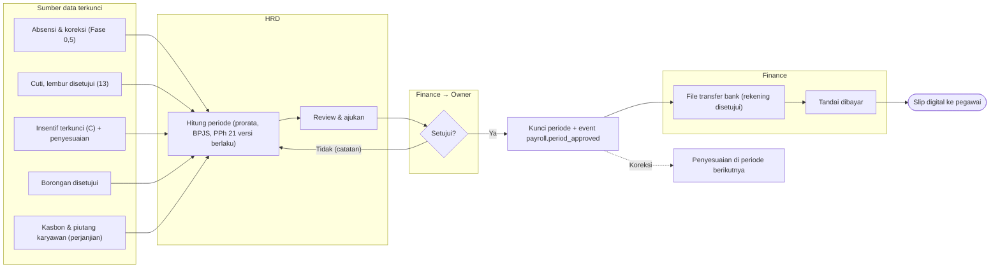

# 19 — Paket E: SDM Lanjut & Payroll (siap eksekusi, pelengkap `13-FASE-HR.md`)

**Rentang:** T-049–T-066 (sudah di `TASKS.md`, sumber `13-FASE-HR.md`) + T-154–T-158 + T-063A, T-064A (pola sufiks seperti T-036A) · FR-E01–FR-E20 · BR-300–BR-319 · SEC-171–SEC-175 · OQ-145 dst.
**Sifat dokumen:** `13-FASE-HR.md` tetap **sumber kebenaran** riwayat kepegawaian, cuti, lembur, kasbon, struktur gaji, payroll, slip, dan penilaian. Dokumen ini **tidak** mendefinisikan ulang tabel `13`. Isinya: (1) addendum kriteria agar T-049–T-066 tersambung dengan Paket A–D, (2) cakupan konsep v1.4 yang tidak terlihat di T-063–T-065 (pekerja harian & borongan, uang per kehadiran, THR, batas potongan, alur persetujuan payroll), dan (3) task integrasi T-154–T-158.
**Modul konsep v1.4:** HR-04, HR-05, HR-06, HR-08 (lanjut). HR-07 (KPI otomatis) di Paket G.

## 0. Penyelarasan (wajib sebelum T-154 / T-063A / T-064A)

`13-FASE-HR.md` tidak ikut di paket ini. Agent **wajib** membaca `13` dan mencocokkan butir berikut; setiap butir yang sudah dicakup `13` **memakai `13`** dan bagian dokumen ini yang bertabrakan dicoret di log `12` — bukan dibangun dua kali.

| # | Butir | Bila `13` sudah mencakup | Bila belum |
|---|---|---|---|
| S-1 | Pekerja harian & borongan bongkar muat (konsep HR-05) | Pakai `13`; T-063A dibatalkan | T-063A memakai §4.4 |
| S-2 | Uang makan/transport per kehadiran (konsep HR-05) | Pakai `13` | T-063A memakai §4.4 |
| S-3 | THR, aturan BPJS/PTKP/PPh 21 berversi dengan tanggal berlaku (BR-120) | Pakai `13` | T-064A memakai §8.2 BR-306–BR-307 |
| S-4 | Batas total potongan & penggeseran cicilan (BR-119) | Pakai `13` (T-062) | T-064A |
| S-5 | Alur payroll: hitung HRD → review → persetujuan Finance/Owner, pembuat ≠ penyetuju, kunci & penyesuaian periode berikut (BR-121) | Pakai `13` | T-064A memakai mesin approval **15** |
| S-6 | Tipe uang payroll (OQ-111): `13`/T-063 menulis "integer rupiah" | — | **Keputusan paket ini:** kolom `DECIMAL(18,2)` (ADR-101), nilai dibulatkan ke rupiah penuh oleh aturan payroll; perubahan dicatat di `13` & `12`. Bila T-063 sudah diimplementasikan dengan integer, migrasi ubah tipe tanpa kehilangan data |
| S-7 | Library PDF untuk CV (T-058) & slip (T-065) = keputusan ADR-114/OQ-109 yang sama dengan Paket B | — | T-058 menunggu OQ-109 |
| S-8 | Nama halaman mengikuti konvensi repo (kebab-case; **15** §0 S-3) | — | — |
| S-9 | Dependency baru: tidak ada selain library PDF (OQ-109) | — | — |

### 0.1 Addendum kriteria untuk task Fase HR (tambahkan ke `TASKS.md` saat Paket E dimulai)

| Task | Kriteria tambahan (integrasi A–D) |
|---|---|
| T-049 | Permission Paket E (§6.3) ikut ditambahkan ke katalog & matriks; `hr.modules` punya modul `piece_work`, `onboarding`, `offboarding_clearance` |
| T-050 | Jenis dokumen pegawai `sim` (SIM) dengan masa berlaku → dipakai kelayakan trip **18** BR-283 bila `fleet.require_driver_license_record` |
| T-059 | Perubahan rekening bank pegawai lewat pengajuan + persetujuan kedua (BR-302), bukan edit langsung |
| T-060 | Cuti yang disetujui untuk pegawai ber-role `sales` memicu saran `leave_cover` **17** BR-269 (notifikasi ke Admin Penjualan) dan menjadi sumber laporan cuti wajib |
| T-061 | Lembur driver/canvas memakai log absensi; trip **18** yang melewati jam kerja menjadi bukti pendukung pengajuan, bukan pengganti persetujuan |
| T-062 | Kasbon & **piutang karyawan 16** (`employee_receivables`) adalah dua hal berbeda: kasbon = pinjaman diajukan pegawai; piutang karyawan = selisih uang/stok. Keduanya dipotong lewat `payroll_external_inputs` (BR-301) dan sama-sama tunduk batas potongan (BR-305) |
| T-063 | Kolom nominal `DECIMAL(18,2)` (S-6); kode komponen untuk insentif (`INC_SALES`, `INC_DRIVER`), potongan piutang karyawan (`DED_EMP_RECV`), borongan (`PIECE_WORK`), uang kehadiran (`ATT_ALLOWANCE`), THR (`THR`) tersedia sebagai referensi komponen |
| T-064 | Menarik baris `payroll_external_inputs` berstatus `ready` untuk periode itu; menerapkan prorata (BR-304) & batas potongan (BR-305); memancarkan event `payroll.period_approved` (**14** §7) saat disetujui; `PeriodGuard` (**16** BR-229) untuk tanggal pembayaran |
| T-065 | Slip & ekspor transfer bank memakai library PDF ADR-114; file transfer hanya untuk rekening yang **sudah disetujui** (BR-302); ekspor tercatat `mass_export` |
| T-066 | Penilaian manual tetap di `13`; KPI otomatis dari data operasional menyusul di Paket G (HR-07) |

## 1. Ruang Lingkup

**Termasuk (dokumen ini):** kontrak input payroll dari modul lain (insentif sales & driver, potongan piutang karyawan dengan dasar tertulis, borongan, uang kehadiran), insentif driver (metrik dari **18**), pekerja harian & borongan bongkar muat, THR & aturan pajak/BPJS berversi (bila `13` belum), batas potongan, alur persetujuan payroll, onboarding dengan persetujuan kedua, perubahan rekening dengan persetujuan kedua, clearance offboarding lintas modul (setoran, kwitansi, stok canvas, uang jalan, kas kecil, kendaraan, perangkat, blok nomor, kasbon), prorata masuk/keluar/mutasi, jurnal gaji (event).

**Di luar lingkup:** tabel & layar riwayat kepegawaian (`13`), penilaian kinerja manual (`13`), KPI otomatis (G), pelaporan pajak ke sistem DJP (F/OQ-101), BPJS online (manual ekspor).

## 2. Kebutuhan Fungsional

| ID | Kebutuhan | Aturan |
|---|---|---|
| FR-E01 | Antrean input payroll per periode dari modul lain dengan status, sumber, dan alasan penundaan. | BR-300, BR-301 |
| FR-E02 | Insentif sales terkunci (**17** T-131) masuk payroll periode berikutnya; penyesuaian retur/piutang batal sebagai baris penyesuaian. | BR-118, BR-300 |
| FR-E03 | Insentif driver: skema dengan metrik ketepatan kirim, kelengkapan POD, km/l (data **18** BR-299). | BR-303 |
| FR-E04 | Potongan piutang karyawan hanya dengan perjanjian tertulis (unggah dokumen bertanda tangan), cicilan per periode. | BR-119, BR-301 |
| FR-E05 | Batas total potongan per pembayaran; kelebihan cicilan digeser otomatis. | BR-119, BR-305 |
| FR-E06 | Prorata masuk/keluar/mutasi/perubahan struktur gaji di tengah periode (hari kalender atau hari kerja). | BR-124, BR-304 |
| FR-E07 | Pekerja harian & borongan bongkar muat: tarif berversi per kegiatan, catatan kegiatan per hari & tim, persetujuan kepala gudang/toko, masuk payroll. | BR-308, BR-309 |
| FR-E08 | Uang makan/transport per kehadiran dari status absensi. | BR-310 |
| FR-E09 | THR sebagai jenis periode payroll tersendiri, aturan masa kerja berversi. | BR-307 |
| FR-E10 | Aturan BPJS, PTKP, PPh 21 berversi dengan tanggal berlaku; periode memakai versi yang berlaku. | BR-120, BR-306 |
| FR-E11 | Alur payroll: hitung (HRD) → review → persetujuan Finance/Owner (maker-checker) → bayar → kunci; koreksi lewat penyesuaian periode berikutnya. | BR-121, BR-311 |
| FR-E12 | Event jurnal gaji saat payroll disetujui. | BR-113, BR-312 |
| FR-E13 | Onboarding: template checklist per role (akun, perangkat, seragam, kendaraan, SIM, pelatihan, dokumen), status per item. | BR-313 |
| FR-E14 | Pegawai baru membutuhkan persetujuan kedua sebelum akun aktif & masuk payroll; pegawai diberi tahu. | BR-122, BR-302 |
| FR-E15 | Perubahan rekening bank pegawai lewat pengajuan + persetujuan kedua + notifikasi ke pegawai. | BR-122, BR-302 |
| FR-E16 | Clearance offboarding otomatis lintas modul sebelum hari terakhir. | BR-123, BR-314 |
| FR-E17 | Register barang yang dipegang pegawai (HP dinas, kunci, laptop, seragam, alat) dengan serah terima. | BR-315 |
| FR-E18 | Penyelesaian clearance: selisih sah diselesaikan sesuai perjanjian kerja & batas potongan; tidak menahan dokumen pribadi. | BR-123, BR-316 |
| FR-E19 | Akses dicabut pada hari terakhir kerja secara otomatis (melanjutkan Fase 0 offboarding). | BR-123, BR-314 |
| FR-E20 | Laporan biaya tenaga kerja per lokasi/role, termasuk insentif & borongan. | BR-317 |

## 3. Kebutuhan Non-Fungsional

| ID | Target |
|---|---|
| NFR-E01 | 150 pegawai tetap + 50 pekerja harian/borongan; satu periode payroll dihitung < 60 s |
| NFR-E02 | Hitung ulang periode idempoten (hasil sama, tanpa baris ganda) |
| NFR-E03 | Contoh perhitungan resmi (BPJS, PPh 21, THR, lembur) dari konsultan pajak Pakis lolos sebagai test fixture sebelum payroll pertama |

## 4. Database (tambahan atas `13`)

Nama tabel periode & slip payroll mengikuti `13` dan dirujuk di bawah sebagai `<payroll_periods>` dan `<payslips>`. Konvensi uang ADR-101.

### 4.1 Input payroll lintas modul (T-154)

```sql
CREATE TABLE payroll_external_inputs (
  id BIGINT UNSIGNED PRIMARY KEY AUTO_INCREMENT,
  employee_id BIGINT UNSIGNED NOT NULL,
  target_period_id BIGINT UNSIGNED NULL,          -- <payroll_periods>; NULL = periode terbuka berikutnya
  component_code VARCHAR(40) NOT NULL,            -- referensi komponen gaji (13)
  direction ENUM('earning','deduction') NOT NULL,
  amount DECIMAL(18,2) NOT NULL,
  quantity DECIMAL(10,2) NULL,                    -- mis. jumlah hari kehadiran, ton borongan
  source_type VARCHAR(60) NOT NULL,               -- 'incentive_result','incentive_adjustment','employee_receivable_installment','piece_work_entry','attendance_allowance','loan_installment'
  source_id BIGINT UNSIGNED NOT NULL,
  status ENUM('ready','included','deferred','cancelled') NOT NULL DEFAULT 'ready',
  included_in_payslip_id BIGINT UNSIGNED NULL,    -- <payslips>
  deferred_reason VARCHAR(255) NULL,              -- mis. batas potongan (BR-305)
  description VARCHAR(255) NOT NULL,              -- tampil di slip
  [audit],
  UNIQUE KEY pei_source_unique (source_type, source_id, component_code),
  KEY pei_employee_status_idx (employee_id, status),
  KEY pei_period_idx (target_period_id, status),
  CONSTRAINT pei_amount_chk CHECK (amount > 0)
);
CREATE TABLE employee_receivable_deduction_agreements (   -- dasar tertulis potongan (BR-119, konsep HR-06)
  id BIGINT UNSIGNED PRIMARY KEY AUTO_INCREMENT,
  employee_receivable_id BIGINT UNSIGNED NOT NULL,          -- 16
  employee_id BIGINT UNSIGNED NOT NULL,
  installment_amount DECIMAL(18,2) NOT NULL,
  start_period_id BIGINT UNSIGNED NOT NULL,
  signed_document_path VARCHAR(255) NOT NULL,               -- pernyataan bertanda tangan pegawai (disk privat)
  signed_document_sha256 CHAR(64) NOT NULL,
  signed_on DATE NOT NULL,
  status ENUM('pending_approval','active','completed','cancelled') NOT NULL DEFAULT 'pending_approval',
  approval_request_id BIGINT UNSIGNED NULL,
  [audit],
  active_key BIGINT UNSIGNED GENERATED ALWAYS AS (IF(status IN ('pending_approval','active'), employee_receivable_id, NULL)) STORED,
  UNIQUE KEY erda_one_open_unique (active_key),
  KEY erda_employee_idx (employee_id, status),
  CONSTRAINT erda_amount_chk CHECK (installment_amount > 0)
);
```

### 4.2 Onboarding & persetujuan kedua (T-155)

```sql
CREATE TABLE onboarding_templates (
  id BIGINT UNSIGNED PRIMARY KEY AUTO_INCREMENT,
  name VARCHAR(120) NOT NULL,
  role_name VARCHAR(60) NULL,                     -- NULL = semua
  items JSON NOT NULL,                            -- [{"code":"device","label":"Aktivasi Pakis Pro","owner":"hrd|it|fleet|warehouse","required":true}]
  is_active BOOLEAN NOT NULL DEFAULT TRUE,
  [audit]
);
CREATE TABLE employee_activation_requests (
  id BIGINT UNSIGNED PRIMARY KEY AUTO_INCREMENT,
  employee_id BIGINT UNSIGNED NOT NULL,
  requested_by BIGINT UNSIGNED NOT NULL,
  approval_request_id BIGINT UNSIGNED NULL,
  status ENUM('pending','approved','rejected') NOT NULL DEFAULT 'pending',
  payroll_eligible_from DATE NULL,                -- diisi saat disetujui
  decided_at TIMESTAMP NULL,
  created_at TIMESTAMP NULL, updated_at TIMESTAMP NULL,
  UNIQUE KEY ear_employee_unique (employee_id)
);
CREATE TABLE onboarding_checklists (
  id BIGINT UNSIGNED PRIMARY KEY AUTO_INCREMENT,
  employee_id BIGINT UNSIGNED NOT NULL,
  onboarding_template_id BIGINT UNSIGNED NOT NULL,
  items JSON NOT NULL,                            -- salinan item + status done/na + oleh siapa & kapan
  status ENUM('open','completed') NOT NULL DEFAULT 'open',
  completed_at TIMESTAMP NULL,
  [audit],
  UNIQUE KEY oc_employee_unique (employee_id)
);
CREATE TABLE employee_bank_account_changes (    -- BR-302
  id BIGINT UNSIGNED PRIMARY KEY AUTO_INCREMENT,
  employee_id BIGINT UNSIGNED NOT NULL,
  bank_name VARCHAR(60) NOT NULL,
  account_no_enc TEXT NOT NULL,                   -- Crypt; tampil termasking
  account_no_last4 CHAR(4) NOT NULL,
  account_holder VARCHAR(150) NOT NULL,
  holder_name_matches BOOLEAN NOT NULL,           -- nama pemilik = nama pegawai (normalisasi)
  supporting_document_path VARCHAR(255) NULL,     -- foto buku tabungan
  requested_by BIGINT UNSIGNED NOT NULL,          -- HRD atau pegawai sendiri (Pakis Pro)
  status ENUM('pending_approval','approved','rejected','cancelled') NOT NULL DEFAULT 'pending_approval',
  approval_request_id BIGINT UNSIGNED NULL,
  effective_from_period_id BIGINT UNSIGNED NULL,
  employee_notified_at TIMESTAMP NULL,
  created_at TIMESTAMP NULL, updated_at TIMESTAMP NULL,
  KEY ebac_employee_idx (employee_id, status)
);
```
Data rekening aktif tetap di tabel administrasi `13` (T-059); perubahan hanya diterapkan oleh Action persetujuan.

### 4.3 Clearance offboarding & barang yang dipegang (T-156)

```sql
CREATE TABLE employee_held_items (
  id BIGINT UNSIGNED PRIMARY KEY AUTO_INCREMENT,
  employee_id BIGINT UNSIGNED NOT NULL,
  item_type ENUM('phone','laptop','key','uniform','tool','sim_card','other') NOT NULL,
  description VARCHAR(150) NOT NULL,
  serial_or_code VARCHAR(80) NULL,
  issued_on DATE NOT NULL, issued_by BIGINT UNSIGNED NOT NULL,
  issue_photo_path VARCHAR(255) NULL,
  returned_on DATE NULL, received_by BIGINT UNSIGNED NULL,
  return_condition ENUM('good','damaged','lost') NULL,
  return_note VARCHAR(255) NULL,
  [audit],
  KEY ehi_employee_open_idx (employee_id, returned_on)
);
CREATE TABLE offboarding_clearances (
  id BIGINT UNSIGNED PRIMARY KEY AUTO_INCREMENT,
  employee_id BIGINT UNSIGNED NOT NULL,
  last_working_date DATE NOT NULL,
  reason_type VARCHAR(40) NOT NULL,               -- mengikuti offboarding Fase 0 (T-026)
  status ENUM('open','blocked','cleared','cleared_with_settlement','waived') NOT NULL DEFAULT 'open',
  checks JSON NOT NULL,                           -- hasil BR-314 per sumber, diperbarui setiap evaluasi
  last_evaluated_at TIMESTAMP NULL,
  settlement_note TEXT NULL,
  waiver_approval_request_id BIGINT UNSIGNED NULL,
  cleared_by BIGINT UNSIGNED NULL, cleared_at TIMESTAMP NULL,
  [audit],
  UNIQUE KEY ofc_employee_open_unique (employee_id, last_working_date),
  KEY ofc_status_date_idx (status, last_working_date)
);
```

### 4.4 Pekerja harian, borongan & uang kehadiran (T-063A — bila `13` belum mencakup)

```sql
CREATE TABLE piece_work_rates (
  id BIGINT UNSIGNED PRIMARY KEY AUTO_INCREMENT,
  activity_code VARCHAR(40) NOT NULL,             -- 'unload_sack','load_carton','unload_ton', …
  activity_name VARCHAR(150) NOT NULL,
  unit_label VARCHAR(20) NOT NULL,                -- 'karung','dus','ton','hari'
  rate DECIMAL(18,2) NOT NULL,
  location_id BIGINT UNSIGNED NULL,               -- NULL = semua lokasi
  effective_from DATE NOT NULL,
  is_active BOOLEAN NOT NULL DEFAULT TRUE,
  [audit],
  UNIQUE KEY pwr_unique (activity_code, location_id, effective_from)
);
CREATE TABLE piece_work_entries (
  id BIGINT UNSIGNED PRIMARY KEY AUTO_INCREMENT,
  client_uuid CHAR(36) NOT NULL,
  work_date DATE NOT NULL,
  location_id BIGINT UNSIGNED NOT NULL,
  activity_code VARCHAR(40) NOT NULL,
  piece_work_rate_id BIGINT UNSIGNED NOT NULL,    -- tarif berlaku pada work_date (snapshot)
  quantity DECIMAL(10,2) NOT NULL,
  total_amount DECIMAL(18,2) NOT NULL,
  source_type VARCHAR(60) NULL, source_id BIGINT UNSIGNED NULL,   -- mis. goods_receipt, delivery_route (bukti volume)
  photo_path VARCHAR(255) NULL,
  recorded_by BIGINT UNSIGNED NOT NULL,
  status ENUM('submitted','approved','rejected','paid') NOT NULL DEFAULT 'submitted',
  approved_by BIGINT UNSIGNED NULL, approved_at TIMESTAMP NULL,
  [audit],
  UNIQUE KEY pwe_client_unique (client_uuid),
  KEY pwe_location_date_idx (location_id, work_date, status),
  CONSTRAINT pwe_qty_chk CHECK (quantity > 0)
);
CREATE TABLE piece_work_entry_members (
  piece_work_entry_id BIGINT UNSIGNED NOT NULL,
  employee_id BIGINT UNSIGNED NOT NULL,           -- pekerja harian/borongan dicatat sebagai pegawai berstatus kerja harian (13)
  share_pct DECIMAL(7,4) NOT NULL,                -- Σ = 100 per entri
  amount DECIMAL(18,2) NOT NULL,
  PRIMARY KEY (piece_work_entry_id, employee_id),
  CONSTRAINT pwem_entry_fk FOREIGN KEY (piece_work_entry_id) REFERENCES piece_work_entries(id) ON DELETE CASCADE
);
CREATE TABLE attendance_allowance_rules (       -- uang makan/transport per kehadiran
  id BIGINT UNSIGNED PRIMARY KEY AUTO_INCREMENT,
  component_code VARCHAR(40) NOT NULL,
  role_name VARCHAR(60) NULL, location_id BIGINT UNSIGNED NULL,
  amount_per_day DECIMAL(18,2) NOT NULL,
  counted_statuses JSON NOT NULL,                 -- status harian Fase 0 yang dihitung, mis. ["present","late","field_duty"]
  min_worked_minutes SMALLINT UNSIGNED NULL,
  effective_from DATE NOT NULL,
  is_active BOOLEAN NOT NULL DEFAULT TRUE,
  [audit]
);
```

### 4.5 THR, aturan berversi, persetujuan (T-064A — bila `13` belum mencakup)

```sql
-- Tambahan pada tabel periode payroll 13 (nama mengikuti 13):
--   period_type ENUM('regular','thr','adjustment') NOT NULL DEFAULT 'regular'
--   approval_request_id BIGINT UNSIGNED NULL, locked_at TIMESTAMP NULL, paid_at TIMESTAMP NULL
CREATE TABLE payroll_rule_versions (            -- BR-120 / BR-306
  id BIGINT UNSIGNED PRIMARY KEY AUTO_INCREMENT,
  rule_set ENUM('bpjs','ptkp','pph21','thr','overtime','deduction_limit','proration') NOT NULL,
  effective_from DATE NOT NULL,
  parameters JSON NOT NULL,                       -- tarif, batas upah, tabel tarif efektif, dll. (skema divalidasi per rule_set)
  legal_basis VARCHAR(255) NOT NULL,              -- rujukan aturan, diisi bersama konsultan pajak
  validated_by VARCHAR(150) NULL,                 -- nama konsultan/penanggung jawab
  validated_on DATE NULL,
  status ENUM('draft','active','retired') NOT NULL DEFAULT 'draft',
  [audit],
  UNIQUE KEY prv_unique (rule_set, effective_from)
);
```

### 4.6 Index ↔ query

| Index | Query |
|---|---|
| `pei_employee_status_idx`, `pei_period_idx` | Input siap per pegawai/periode saat hitung payroll |
| `pei_source_unique` | Input dari sumber yang sama tidak dobel |
| `erda_employee_idx` | Cicilan potongan aktif |
| `ofc_status_date_idx` | Clearance mendekati hari terakhir |
| `pwe_location_date_idx` | Rekap borongan per lokasi & hari, antrean persetujuan |
| `prv_unique` | Versi aturan berlaku pada periode |

## 5. Route

| Nama | Path | Permission | Catatan |
|---|---|---|---|
| `admin.payroll-inputs.index` | `/payroll/input` | `payroll_inputs.view` | Per periode: siap/termasuk/ditunda, sumber |
| `admin.deduction-agreements.index`/`store`/`show` | `/payroll/perjanjian-potongan` | `deduction_agreements.manage` | Unggah pernyataan bertanda tangan → approval |
| `admin.onboarding-templates.*` | `/sdm/onboarding/template` | `onboarding.manage` | |
| `admin.onboarding.index`/`show`/`update-item` | `/sdm/onboarding` | `onboarding.manage` (+ pemilik item) | |
| `admin.employee-activations.index`/`request` | `/sdm/aktivasi` | `onboarding.manage` | → approval `employee_activation` |
| `admin.bank-account-changes.index`/`store` | `/sdm/perubahan-rekening` | `employees.bank_account.request` | Pegawai juga lewat Pakis Pro (profil) |
| `admin.held-items.*` | `/sdm/barang-dipegang` | `held_items.manage` | |
| `admin.offboarding-clearances.index`/`show`/`evaluate`/`clear`/`waive` | `/sdm/clearance` | `offboarding.clearance` / waive → approval `offboarding_clearance_waiver` | |
| `admin.piece-work-rates.*` | `/payroll/tarif-borongan` | `piece_work.rates_manage` | |
| `admin.piece-work-entries.index`/`store`/`approve`/`reject` | `/payroll/borongan` | `piece_work.record` / `piece_work.approve` | Input juga dari Pakis Pro (mode gudang) |
| `admin.attendance-allowance-rules.*` | `/payroll/uang-kehadiran` | `payroll_rules.manage` | |
| `admin.payroll-rule-versions.*` | `/payroll/aturan` | `payroll_rules.manage` | Aktivasi versi butuh konfirmasi password & isian validasi konsultan |
| `admin.labor-cost-report` | `/laporan/biaya-tenaga-kerja` | `labor_reports.view` | |
| `api.v1.profile.bank-account-change` | `POST /api/v1/profil/rekening` | auth (diri sendiri) | Pakis Pro |
| Item sinkron `piece_work_entry` | — | `piece_work.record` | Offline dari gudang |

## 6. Otorisasi

### 6.1 Role

Tidak ada role baru. `hrd` (Fase 0) menyiapkan; `finance` & `owner` menyetujui (konsep §8.3: pembuat dan penyetuju payroll selalu orang berbeda). Kepala gudang/toko mencatat & menyetujui borongan di lokasinya (pencatat ≠ penyetuju).

### 6.2 Permission baru (15)

| Modul | Permission |
|---|---|
| Payroll | `payroll_inputs.view`, `payroll_rules.manage`, `deduction_agreements.manage`, `deduction_agreements.approve`, `piece_work.record`, `piece_work.approve`, `piece_work.rates_manage` |
| Masuk-keluar | `onboarding.manage`, `employees.activate_approve`, `employees.bank_account.request`, `employees.bank_account.approve`, `held_items.manage`, `offboarding.clearance`, `offboarding.waive_approve` |
| Laporan | `labor_reports.view` |

Permission payroll inti (`payroll.view`, `payroll.process`, dsb.) tetap dari `13`. `employees.bank_account.approve` disebut di `14` §10.2.

### 6.3 Matriks kewenangan (default seeder)

Kolom: OWN · ADM · HRD · FIN · KGD `kepala_gudang` · KTK `kepala_toko` · SPV · ARM · PGW `pegawai` (🔸 = milik sendiri) · AUD. Konsep §15.2: `pegawai.rekening.approve` OWN ✓, FIN terbatas; HRD menyiapkan, bukan menyetujui.

| Permission | OWN | ADM | HRD | FIN | KGD | KTK | SPV | ARM | PGW | AUD |
|---|---|---|---|---|---|---|---|---|---|---|
| `payroll_inputs.view` | ✅ | ❌ | ✅ | ✅ | ❌ | ❌ | ❌ | ❌ | ❌ | ✅ |
| `payroll_rules.manage` | ❌ | ❌ | ✅ | ❌ | ❌ | ❌ | ❌ | ❌ | ❌ | ❌ |
| `deduction_agreements.manage` | ❌ | ❌ | ✅ | ✅ | ❌ | ❌ | ❌ | ❌ | ❌ | ❌ |
| `deduction_agreements.approve` | ✅ | ❌ | ❌ | ❌ | ❌ | ❌ | ❌ | ❌ | ❌ | ❌ |
| `piece_work.record` | ❌ | ❌ | ✅ | ❌ | 🔸 | 🔸 | ❌ | ❌ | ❌ | ❌ |
| `piece_work.approve` | ❌ | ❌ | ✅ | ❌ | 🔸 | 🔸 | ❌ | ❌ | ❌ | ❌ |
| `piece_work.rates_manage` | ✅ | ❌ | ✅ | ❌ | ❌ | ❌ | ❌ | ❌ | ❌ | ❌ |
| `onboarding.manage` | ❌ | ❌ | ✅ | ❌ | ❌ | ❌ | ❌ | ❌ | ❌ | ❌ |
| `employees.activate_approve` | ✅ | ❌ | ❌ | ✅ | ❌ | ❌ | ❌ | ❌ | ❌ | ❌ |
| `employees.bank_account.request` | ❌ | ❌ | ✅ | ❌ | ❌ | ❌ | ❌ | ❌ | 🔸 | ❌ |
| `employees.bank_account.approve` | ✅ | ❌ | ❌ | ✅ | ❌ | ❌ | ❌ | ❌ | ❌ | ❌ |
| `held_items.manage` | ❌ | ❌ | ✅ | ❌ | 🔸 | 🔸 | ❌ | ✅ | ❌ | ❌ |
| `offboarding.clearance` | ❌ | ❌ | ✅ | ✅ | ❌ | ❌ | ❌ | ❌ | ❌ | ❌ |
| `offboarding.waive_approve` | ✅ | ❌ | ❌ | ❌ | ❌ | ❌ | ❌ | ❌ | ❌ | ❌ |
| `labor_reports.view` | ✅ | ❌ | ✅ | ✅ | ❌ | ❌ | ❌ | ❌ | ❌ | ✅ |

### 6.4 Jenis dokumen approval baru

| `document_type` | Dipicu | Nominal | Rantai default |
|---|---|---|---|
| `employee_activation` | Pegawai baru diajukan aktif | gaji pokok | `employees.activate_approve` (FIN atau OWN, ≠ pengaju HRD) |
| `employee_bank_account_change` | Perubahan rekening | — | `employees.bank_account.approve` (≠ pengaju); bila nama pemilik ≠ nama pegawai: + Owner |
| `employee_receivable_deduction` | Perjanjian potongan piutang karyawan | cicilan | `deduction_agreements.approve` |
| `offboarding_clearance_waiver` | Pegawai keluar dengan clearance belum lengkap | nilai terbuka | `offboarding.waive_approve` |
| `payroll_period` (bila `13` belum) | Payroll periode diajukan HRD | total neto | `payroll.approve` (`13`) FIN · ≥ ambang `payroll.owner_approval_threshold`: + Owner |
| `piece_work_entry` | Tidak memakai mesin approval: persetujuan langsung oleh `piece_work.approve` (≠ pencatat) | — | — |

### 6.5 Transisi

| Objek | Dari → Ke | Aksi |
|---|---|---|
| Input payroll | `ready` → `included` | Payroll periode dihitung & disetujui |
| Input payroll | `ready` → `deferred` → `ready` (periode berikut) | Batas potongan / pegawai belum aktif |
| Aktivasi pegawai | `pending` → `approved`/`rejected` | Approval; disetujui → akun aktif, `payroll_eligible_from` |
| Perubahan rekening | `pending_approval` → `approved`/`rejected` | Approval; disetujui → rekening aktif berubah mulai periode berikutnya yang belum dihitung, pegawai diberi tahu |
| Clearance | `open` → `blocked`/`cleared`/`cleared_with_settlement`/`waived` | Evaluasi otomatis + HRD/Finance; `waived` lewat approval |
| Borongan | `submitted` → `approved`/`rejected` → `paid` | Penyetuju lokasi; `paid` saat masuk slip |

### 6.6 Diagram — alur payroll bulanan (konsep Gambar 8.1)



## 7. UI & Listing

Sub-tab pegawai (`13`) ditambah: **Onboarding**, **Barang dipegang**, **Clearance** (saat ada). Layar Pakis Pro: profil → ajukan perubahan rekening; mode gudang → catat borongan (tim, kegiatan, jumlah, foto).

| Kunci | Route | Pencarian | Filter | Sort default | Scope |
|---|---|---|---|---|---|
| `payroll_external_inputs` | `admin.payroll-inputs.index` | nama/nomor pegawai | `target_period_id`, `status`, `source_type`, `component_code` | `employee.name` | Pegawai |
| `deduction_agreements` | `admin.deduction-agreements.index` | nama pegawai | `status` | `created_at` desc | — |
| `onboarding_checklists` | `admin.onboarding.index` | nama pegawai | `status`, `location_id`, `role` | `created_at` desc | Pegawai |
| `employee_activations` | `admin.employee-activations.index` | nama pegawai | `status` | `created_at` desc | — |
| `bank_account_changes` | `admin.bank-account-changes.index` | nama pegawai | `status`, `holder_name_matches` | `created_at` desc | Pegawai |
| `held_items` | `admin.held-items.index` | nama pegawai, kode | `item_type`, `open` (ya/tidak), `location_id` | `issued_on` desc | Pegawai |
| `offboarding_clearances` | `admin.offboarding-clearances.index` | nama pegawai | `status`, `last_working_date` (rentang) | `last_working_date` asc | — |
| `piece_work_rates` | `admin.piece-work-rates.index` | kode, nama kegiatan | `location_id`, `is_active` | `activity_code` | — |
| `piece_work_entries` | `admin.piece-work-entries.index` | kegiatan, nama pekerja | `status`, `location_id`, `work_date` (rentang) | `work_date` desc | Lokasi |
| `attendance_allowance_rules` | `admin.attendance-allowance-rules.index` | kode komponen | `is_active`, `role_name` | `effective_from` desc | — |
| `payroll_rule_versions` | `admin.payroll-rule-versions.index` | — | `rule_set`, `status` | `effective_from` desc | — |
| `labor_cost_report` | `admin.labor-cost-report` | — | `period` (wajib), `location_id`, `role` | `total` desc | — |

Total listing setelah Paket E (tanpa listing `13`): 142 + 12 = **154**.

## 8. Aturan Bisnis

### 8.1 Pemetaan aturan konsep HRIS

| ID | Aturan (konsep §8.4) | Implementasi |
|---|---|---|
| BR-115 | Absensi sah (perangkat, radius, tanpa lokasi palsu) | Fase 0,5 (BR-064–BR-069), selesai |
| BR-116 | Koreksi lewat pengajuan & persetujuan atasan | Fase 0,5 (T-040/T-041), selesai |
| BR-117 | Lembur dibayar bila disetujui & tercatat di absensi; rumus dari pengaturan | `13` T-061 (rumus default mengacu ketentuan yang berlaku, divalidasi konsultan) |
| BR-118 | Insentif dari periode tertutup; koreksi ke periode berikutnya | **17** BR-266 + BR-300 |
| BR-119 | Batas total potongan; kelebihan cicilan digeser | `13` T-062 + BR-301, BR-305 |
| BR-120 | Tarif BPJS, PTKP, PPh 21 berversi | `13` T-064 + BR-306 |
| BR-121 | Payroll disetujui terkunci; koreksi periode berikutnya | `13` T-064 + BR-311 |
| BR-122 | Pegawai baru & perubahan rekening: persetujuan kedua + notifikasi pegawai | BR-302 |
| BR-123 | Keluar: akses dicabut hari terakhir; aset, setoran, stok canvas, kasbon dicek | Fase 0 T-026 + BR-314–BR-316 |
| BR-124 | Prorata masuk/keluar/mutasi | BR-304 |

### 8.2 Aturan baru

| ID | Aturan |
|---|---|
| **BR-300** | **Input payroll lintas modul.** Modul lain tidak menulis ke tabel payroll `13`; mereka membuat `payroll_external_inputs` lewat `PayrollInputProvider` saat sumbernya final: hasil insentif `locked` (**17** BR-266) & penyesuaiannya; cicilan perjanjian potongan aktif (BR-301), per periode; borongan `approved` (BR-308); uang kehadiran dihitung saat periode dihitung (BR-310). Satu sumber satu baris (unik). Saat payroll dihitung, baris `ready` untuk pegawai yang `payroll_eligible` dimasukkan ke slip → `included`; tidak eligible/terkena batas → `deferred` dengan alasan dan dicoba lagi periode berikut. Sumber dibatalkan sebelum masuk slip → `cancelled`; setelah masuk slip, koreksi = baris penyesuaian baru di periode berikut (BR-311) |
| **BR-301** | **Potongan piutang karyawan.** Piutang karyawan (**16** BR-222) hanya dipotong dari gaji bila ada `employee_receivable_deduction_agreements` aktif: pernyataan tertulis bertanda tangan pegawai (unggah, hash disimpan), nominal cicilan, mulai periode, disetujui Owner. Setiap periode satu baris input `DED_EMP_RECV` sebesar `MIN(cicilan, sisa piutang)`; saat payroll dikunci, pelunasan dicatat sebagai `employee_receivable_settlements.method = payroll_deduction`. Tanpa perjanjian → piutang tetap terbuka dan muncul di clearance (BR-314); potongan "diam-diam" tidak mungkin dibuat dari modul lain |
| **BR-302** | **Persetujuan kedua.** (a) Pegawai baru yang dibuat HRD berstatus menunggu aktivasi bila `hr.require_activation_approval`: akun login tidak aktif dan pegawai tidak masuk payroll sampai approval `employee_activation` (≠ pembuat). (b) Perubahan rekening hanya lewat `employee_bank_account_changes`: nama pemilik dibandingkan nama pegawai (normalisasi huruf, gelar dibuang); tidak cocok → langkah tambahan Owner. Disetujui → rekening aktif diganti mulai periode payroll berikutnya yang belum dihitung, notifikasi ke pegawai lewat kanal yang **tidak** bisa diubah pengaju (in-app + WhatsApp ke nomor HP pegawai yang sudah ada sebelum perubahan). File transfer bank hanya memuat rekening yang disetujui; rekening yang berubah < `payroll.bank_change_cooloff_days` sebelum tanggal bayar ditandai di ringkasan persetujuan payroll |
| **BR-303** | **Insentif driver.** Skema **17** (`incentive_schemes.applies_to_role = 'driver'`) dengan metrik baru: `delivery_on_time_pct` (surat jalan `delivered` pada tanggal rencana / total), `pod_completeness_pct` (POD dengan foto + tanda tangan + lokasi), `kpl_achievement_pct` (km/l vs pembanding **18** BR-290), gerbang `overspeed_per_100km`. Data dari periode tertutup, rincian disimpan; hasil terkunci → BR-300 |
| **BR-304** | **Prorata.** Periode dipecah menjadi segmen menurut tanggal masuk, keluar, mutasi (penugasan Fase 0), dan perubahan struktur gaji (`13`). Komponen tetap diprorata: basis `payroll.proration_basis` (`calendar_days` atau `working_days` dari jadwal kerja Fase 0) × nilai per segmen. Komponen berbasis kehadiran tidak diprorata (sudah menurut hari). Pembulatan ke rupiah penuh per komponen per segmen (half-up), selisih tidak dipindahkan. Pegawai yang masuk setelah `payroll.cutoff_day` boleh dibayar di periode berikutnya bila setting `payroll.late_joiner_next_period = true` |
| **BR-305** | **Batas potongan.** Komponen yang dihitung sebagai "potongan upah" ditentukan di aturan berversi `deduction_limit` (daftar kode komponen + persentase + basis), diisi sesuai ketentuan pengupahan yang berlaku dan divalidasi konsultan. Bila total melewati batas: potongan dikurangi dengan urutan prioritas aturan (default: kasbon terlama → piutang karyawan terlama → lain-lain), sisa cicilan `deferred` ke periode berikutnya, dan slip menampilkan catatan. Pajak & iuran wajib pegawai tidak pernah ditunda |
| **BR-306** | **Aturan berversi.** BPJS (tarif, batas upah), PTKP, PPh 21 (termasuk tabel tarif efektif bila dipakai), lembur, THR, batas potongan, dan prorata disimpan di `payroll_rule_versions`. Versi berlaku = `effective_from ≤ akhir periode` terbaru dengan status `active`. Aktivasi versi wajib `legal_basis`, `validated_by`, `validated_on`, konfirmasi password; versi aktif tidak bisa diubah (buat versi baru). Fixture contoh perhitungan dari konsultan pajak disimpan di `tests/Fixtures/payroll/` dan wajib lolos sebelum versi dipakai periode nyata (konsep: skema tarif bisa berubah — mesin berversi) |
| **BR-307** | **THR.** Periode `period_type = thr` terpisah dari gaji bulanan. Kelayakan & besaran (masa kerja, proporsional, komponen dasar) dari versi aturan `thr`; tanggal hari raya per pegawai/agama diisi HRD per tahun (data keagamaan hanya dipakai untuk jadwal THR, akses `payroll.view`). Pengingat ke HRD `payroll.thr_reminder_days` sebelum batas bayar yang diisi di parameter aturan. PPh 21 THR mengikuti versi aturan pajak yang berlaku |
| **BR-308** | **Borongan & harian.** Tarif berversi per kegiatan (& per lokasi). Kepala gudang/toko (atau HRD) mencatat kegiatan per hari: kegiatan, jumlah, anggota tim & bagian (Σ 100%), bukti opsional (penerimaan barang, rute antar, foto). Penyetuju ≠ pencatat. Disetujui → input payroll per anggota (`PIECE_WORK`). Upah harian = kegiatan dengan satuan `hari` |
| **BR-309** | **Pekerja harian/borongan** dicatat sebagai pegawai dengan status kerja harian/borongan (`13`) dengan data minimum (nama, NIK sesuai aturan `13`, rekening/tunai), tidak wajib memakai Pakis Pro, tidak punya struktur gaji tetap kecuali diatur. Pembayaran tunai mingguan (bila diatur) memakai periode payroll khusus `adjustment` atau kas kecil dengan bukti — keputusan OQ-146 |
| **BR-310** | **Uang kehadiran.** Per hari status absensi dalam `counted_statuses` (Fase 0) dan durasi kerja ≥ `min_worked_minutes`, sesuai aturan berlaku pada hari itu (role/lokasi). Dihitung saat payroll periode dihitung dari data absensi yang sudah dikunci (`attendance:resolve-day`). Cuti tidak dihitung kecuali status cuti dimasukkan ke daftar |
| **BR-311** | **Tata kelola payroll.** HRD menghitung (boleh berulang, idempoten) → mengajukan (snapshot total) → approval `payroll_period` (FIN, Owner di atas ambang; pembuat ≠ penyetuju) → `locked` → file transfer & tandai dibayar (Finance) → slip terbit. Setelah `locked`, tidak ada hitung ulang; kesalahan dikoreksi dengan baris penyesuaian di periode berikutnya (atau periode `adjustment` bila mendesak) dengan alasan tercatat. Ringkasan persetujuan menampilkan: total per komponen, selisih vs periode lalu per pegawai > `payroll.variance_alert_pct`, pegawai baru/keluar, rekening berubah (BR-302), input tertunda |
| **BR-312** | **Event jurnal gaji.** Saat `locked`: `payroll.period_approved` (D `salary_expense`, `incentive_expense`, `piece_work_expense`, `bpjs_employer_expense` · K `salary_payable`, `bpjs_payable`, `pph21_payable`, `employee_receivable` (potongan piutang karyawan), `employee_loan_receivable` (kasbon)); saat dibayar: `payroll.paid` (D `salary_payable` · K `bank`). Payload seimbang (**16** SEC-123 / outbox) |
| **BR-313** | **Onboarding.** Saat pegawai dibuat, checklist dibentuk dari template role (fallback template umum). Item punya pemilik (HRD, IT/admin sistem, armada, gudang). Item bertanda `required_before_activation` (mis. data rekening disetujui, dokumen identitas) harus selesai sebelum approval aktivasi bisa diputuskan. Item perangkat/kendaraan/barang membuat catatan di Fase 0 (perangkat), **18** (`vehicle_assignments`), atau `employee_held_items` |
| **BR-314** | **Clearance offboarding.** Dibuat saat offboarding dijadwalkan (Fase 0 T-026) atau `last_working_date` diisi; dievaluasi otomatis harian & saat dibuka. Pemeriksaan (sumber): kwitansi tunai belum terverifikasi & giro belum diserahkan (**16**), setoran `variance`/`rejected` belum selesai (**16**), piutang karyawan terbuka (**16**), kasbon terbuka (`13`), uang jalan terbuka (**18**), sesi canvas terbuka/stok kendaraan ≠ 0 (**17**), penugasan kendaraan aktif (**18**), barang dipegang belum kembali (BR-315), pemegang dana kas kecil (**16**), shift POS terbuka (**16**), blok nomor aktif & antrean perangkat tertunda (**17**), kios masih ditugaskan (**15**), approval di mana pegawai satu-satunya penyetuju/delegasi aktif (**15**). Hasil per sumber di `checks` (jumlah & nilai). Item terbuka H-`offboarding.clearance_lead_days` → notifikasi HRD, atasan, Finance. **Clearance tidak pernah menunda pencabutan akses** (hari terakhir tetap dicabut, BR-123); clearance memengaruhi penyelesaian akhir |
| **BR-315** | **Barang yang dipegang.** Pemberian & pengembalian dicatat dengan foto opsional; kondisi kembali `damaged`/`lost` → catatan, dan bila ada nilai yang disepakati sesuai perjanjian kerja, menjadi piutang karyawan dengan dasar tertulis (BR-301) |
| **BR-316** | **Penyelesaian akhir.** Nilai terbuka yang sah diselesaikan: dari pembayaran akhir dalam batas potongan & dengan perjanjian (BR-301, BR-305), atau tunai, atau tetap sebagai piutang karyawan. Dokumen pribadi pegawai tidak boleh ditahan (konsep §18.6). `waived` (pegawai keluar dengan item terbuka yang direlakan/dikejar terpisah) hanya lewat approval Owner dengan alasan. Status akhir & ringkasan masuk arsip pegawai |
| **BR-317** | **Biaya tenaga kerja.** Per periode per lokasi & role: gaji tetap, lembur, insentif, borongan, uang kehadiran, iuran pemberi kerja; dibandingkan omzet neto (**16**) per lokasi. Hanya `labor_reports.view`; angka per pegawai tidak tampil di laporan ini (agregat ≥ 3 orang per sel, kecil digabung) |

## 9. Setting Baru

| Kunci | Tipe | Default | Task |
|---|---|---|---|
| `hr.require_activation_approval` | bool | `true` | T-155 |
| `payroll.proration_basis` | enum | `calendar_days` (`calendar_days`/`working_days`) | T-157 |
| `payroll.cutoff_day` | int | `25` | T-157 |
| `payroll.late_joiner_next_period` | bool | `false` | T-157 |
| `payroll.owner_approval_threshold` | money | contoh `250000000` | T-064A |
| `payroll.variance_alert_pct` | decimal | `20` | T-064A |
| `payroll.bank_change_cooloff_days` | int | `3` | T-155 |
| `payroll.thr_reminder_days` | int | `30` | T-064A |
| `offboarding.clearance_lead_days` | int | `7` | T-156 |

Parameter tarif, batas, dan rumus **tidak** disimpan di setting, melainkan di `payroll_rule_versions` (BR-306).

## 10. Keamanan Tambahan

| ID | Kontrol | Verifikasi |
|---|---|---|
| SEC-171 | Data gaji, slip, input payroll, perjanjian potongan: hanya pemegang izin; angka per pegawai tidak pernah muncul di laporan agregat, notifikasi push, atau log; setiap buka slip/perjanjian orang lain tercatat `sensitive_data_viewed`. | Test |
| SEC-172 | Rekening pegawai terenkripsi (`13` T-059) dan perubahan hanya lewat alur BR-302 (tidak ada route ubah langsung); notifikasi ke kanal lama pegawai; file transfer ditandatangani hash & tercatat `mass_export`. | Test |
| SEC-173 | Maker-checker: pembuat pegawai ≠ penyetuju aktivasi; pengaju rekening ≠ penyetuju; penghitung payroll ≠ penyetuju; pencatat borongan ≠ penyetuju. | Test per alur |
| SEC-174 | Pernyataan potongan & dokumen clearance di disk privat, hash tersimpan, signed URL 5 menit. Data keagamaan untuk jadwal THR hanya dipakai untuk itu (minimisasi, UU PDP). | Test |
| SEC-175 | Aktivasi versi aturan payroll, ubah tarif borongan, ubah template onboarding, waiver clearance: audit + konfirmasi password. | Test |

## 11. Job, Event & Kode Galat

| Job | Jadwal | Isi | Task |
|---|---|---|---|
| `payroll:collect-inputs` | 01:50 harian + saat hitung | BR-300 (penyesuaian insentif, cicilan) | T-154 |
| `offboarding:evaluate-clearances` | 07:10 | BR-314 | T-156 |
| `payroll:thr-reminder` | 08:00 | BR-307 | T-064A |

Event akuntansi: `payroll.period_approved` (`14` §7, rincian BR-312), **baru** `payroll.paid` (D `salary_payable` · K `bank`).

Kode galat: `EMPLOYEE_NOT_ACTIVATED` (409), `DEDUCTION_AGREEMENT_REQUIRED` (422), `BANK_ACCOUNT_CHANGE_PENDING` (409), `PAYROLL_PERIOD_LOCKED` (409), `PAYROLL_RULE_NOT_VALIDATED` (422), `PIECE_WORK_SHARES_INVALID` (422), `CLEARANCE_WAIVER_REQUIRED` (409).

## 12. Pengujian & UAT

| Kelompok | Isi | Task |
|---|---|---|
| Input payroll | Insentif terkunci → input; penyesuaian retur → periode berikut; sumber batal sebelum/sesudah masuk slip | T-154 |
| Potongan | Tanpa perjanjian tidak terpotong; cicilan ≤ sisa; batas potongan menggeser cicilan; pelunasan tercatat di piutang karyawan | T-154, T-157 |
| Aktivasi & rekening | Akun tidak aktif sebelum approval; nama pemilik tidak cocok → Owner; notifikasi ke nomor lama; file transfer hanya rekening disetujui | T-155 |
| Clearance | Setiap sumber (14) memunculkan item; akses tetap dicabut hari terakhir; waiver butuh Owner | T-156 |
| Prorata | Masuk tgl 10, keluar tgl 20, mutasi tgl 15, perubahan gaji tgl 1 — kalender vs hari kerja (test tabel) | T-157 |
| Borongan & kehadiran | Bagian Σ 100%, tarif berlaku per tanggal, uang kehadiran per status | T-063A |
| Aturan & THR | Versi berlaku per periode; fixture konsultan lolos; THR proporsional; payroll terkunci tidak berubah | T-064A, T-158 |
| Event | `payroll.period_approved` & `payroll.paid` seimbang | T-064A |

| ID | Skenario UAT | Hasil diharapkan |
|---|---|---|
| UAT-E01 | HRD menambah pegawai baru | Akun belum aktif sampai Finance menyetujui; pegawai menerima pemberitahuan |
| UAT-E02 | Pegawai mengganti rekening dari Pakis Pro dengan nama pemilik berbeda | Butuh Finance + Owner; notifikasi ke nomor lama |
| UAT-E03 | Payroll bulan uji dengan 3 sales (insentif), 2 driver (insentif driver), 5 buruh borongan | Slip memuat semua komponen; fixture konsultan cocok |
| UAT-E04 | Sales punya piutang karyawan Rp 1,5 jt dengan perjanjian cicilan Rp 500 rb | Terpotong Rp 500 rb/bulan dalam batas potongan |
| UAT-E05 | Kasbon + cicilan piutang melewati batas | Sebagian digeser ke bulan berikut, tercatat di slip |
| UAT-E06 | Sales mengundurkan diri: masih punya kwitansi belum disetor, stok canvas, motor dinas, HP | Clearance memuat semua item; akses dicabut hari terakhir; penyelesaian sesuai perjanjian |
| UAT-E07 | Payroll disetujui lalu ditemukan salah lembur | Tidak bisa diubah; koreksi di periode berikutnya |
| UAT-E08 | THR tahun uji | Periode THR terpisah, proporsional sesuai masa kerja, pengingat terkirim |

## 13. Pertanyaan Terbuka Paket E

| ID | Pertanyaan | Dampak | Default |
|---|---|---|---|
| OQ-111 | Tipe uang payroll | S-6 | `DECIMAL(18,2)` dibulatkan rupiah |
| OQ-145 | Konsultan pajak Pakis & jadwal validasi fixture BPJS/PPh 21/THR | BR-306, T-158 | Payroll nyata menunggu validasi |
| OQ-146 | Pembayaran buruh harian/borongan: mingguan tunai atau bulanan transfer | BR-309 | Bulanan lewat payroll |
| OQ-147 | Skema insentif driver nyata | BR-303 | Contoh 1 skema |
| OQ-148 | Basis prorata (hari kalender/kerja) & tanggal cutoff | BR-304 | Hari kalender, tgl 25 |
| OQ-149 | Daftar komponen yang dihitung sebagai potongan upah & persentase batas | BR-305 | Diisi bersama konsultan |
| OQ-150 | Barang yang dipegang pegawai yang perlu dicatat | BR-315 | HP, kunci, seragam, alat |

## 14. Traceability

| Kebutuhan | Task | Test / UAT |
|---|---|---|
| FR-E01, FR-E02, FR-E04, BR-118, BR-300, BR-301 | T-154 | Input & potongan, UAT-E04 |
| FR-E03, BR-303 | T-154 | Insentif driver, UAT-E03 |
| FR-E13–FR-E15, BR-122, BR-302, BR-313, SEC-172, SEC-173 | T-155 | UAT-E01, UAT-E02 |
| FR-E16–FR-E19, BR-123, BR-314–BR-316, SEC-174 | T-156 | Clearance, UAT-E06 |
| FR-E05, FR-E06, BR-119, BR-124, BR-304, BR-305 | T-157 | Prorata & batas, UAT-E05 |
| FR-E07, FR-E08, BR-308–BR-310 | T-063A | Borongan & kehadiran, UAT-E03 |
| FR-E09–FR-E12, BR-120, BR-121, BR-306, BR-307, BR-311, BR-312, SEC-175 | T-064A | Aturan, THR, event, UAT-E07, UAT-E08 |
| FR-E20, BR-317, SEC-171, NFR-E01–NFR-E03 | T-158 | Laporan, fixture konsultan, UAT-E03 |
