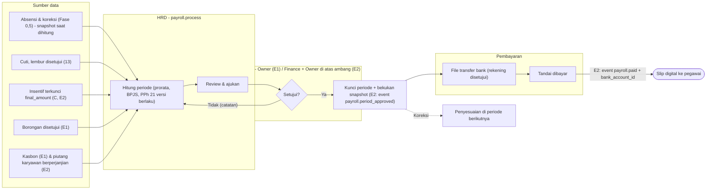

# 19 — Paket E: SDM Lanjut & Payroll (siap eksekusi, pelengkap `13-FASE-HR.md`)

**Revisi 16 Nov 2026 (repo):** menerapkan PE-1–PE-11 + sisi payroll PF-1/PF-2 dari `12`.
**Rentang:** T-049–T-066 (sudah di `TASKS.md`, sumber `13-FASE-HR.md`) + T-154–T-158 + T-063A, T-064A, T-158A (pola sufiks seperti T-036A) · FR-E01–FR-E20 · BR-300–BR-319 · SEC-171–SEC-175 · OQ-145 dst.
**Sifat dokumen:** `13-FASE-HR.md` tetap **sumber kebenaran** riwayat kepegawaian, cuti, lembur, kasbon, struktur gaji, payroll, slip, dan penilaian. Dokumen ini **tidak** mendefinisikan ulang tabel `13`. Isinya: (1) addendum kriteria untuk T-049–T-066, (2) cakupan konsep v1.4 yang tidak terlihat di T-063–T-065 (pekerja harian & borongan, uang per kehadiran, THR, batas potongan, alur persetujuan payroll), dan (3) task pelengkap & integrasi T-063A, T-064A, T-154–T-158A.
**Dua jalur (PE-1, keputusan Mas 16 Nov 2026):**
- **E1** — ikut **Fase HR setelah Paket A**: T-063A, T-064A (tanpa event akuntansi), T-155 (persetujuan kedua oleh Owner), T-157, T-158A (validasi konsultan pajak & UAT payroll). Hanya memakai Fase 0, Fase 0,5, Paket A (mesin approval T-067), dan `13`. Payroll nyata pertama menunggu fixture konsultan (BR-306). Addendum E1: §0.1.
- **E2** — **setelah Paket D**: T-154, T-156, event `payroll.period_approved`/`payroll.paid`/`payroll.loan_disbursed`, T-158 (sisa hardening & UAT), dan addendum lintas modul §0.2 yang diterapkan saat task B/C/D pemiliknya atau di task E2.
**Modul konsep v1.4:** HR-04, HR-05, HR-06, HR-08 (lanjut). HR-07 (KPI otomatis) di Paket G.

## 0. Penyelarasan (wajib sebelum T-063A / T-064A / T-154)

`13-FASE-HR.md` tidak ikut di paket ini. Agent **wajib** membaca `13`. Pemeriksaan 16 Nov 2026 (`12` PE-3) sudah mencocokkan S-1–S-5: **S-1, S-2, S-3, S-5 tidak dicakup `13`; S-4 hanya sebagian** (batas % kasbon, T-062). Karena itu T-063A dan T-064A **wajib**, bukan bersyarat. Bila Fase HR dimulai dan `13` ternyata berubah, butir yang sudah dicakup `13` memakai `13` dan bagian dokumen ini yang bertabrakan dicatat di `12`, bukan dibangun dua kali.

| # | Butir | Hasil pemeriksaan (`12` PE-3) | Dikerjakan |
|---|---|---|---|
| S-1 | Pekerja harian & borongan bongkar muat (konsep HR-05) | Tidak dicakup `13` | T-063A memakai §4.4 |
| S-2 | Uang makan/transport per kehadiran (konsep HR-05) | Tidak dicakup `13` | T-063A memakai §4.4 |
| S-3 | THR, aturan BPJS/PTKP/PPh 21 berversi dengan tanggal berlaku (BR-120) | Tidak dicakup `13` (`13`/T-064 menaruh tarif di Pengaturan) | Tabel aturan berversi dipakai **sejak T-064** (addendum §0.1); layar kelola, aktivasi, THR di T-064A (BR-306–BR-307) |
| S-4 | Batas total potongan & penggeseran cicilan (BR-119) | Sebagian (`13` T-062: batas % kasbon dari setting) | Batas pindah ke aturan berversi `deduction_limit` (addendum T-062); penggeseran di T-157 (BR-305) |
| S-5 | Alur payroll: hitung & ajukan HRD → persetujuan, pembuat ≠ penyetuju, kunci saat disetujui, penyesuaian periode berikut (BR-121) | Tidak dicakup `13` (`13`: `payroll.process` HRD = hitung, **kunci**, rilis slip) | T-064A memakai mesin approval **15** T-067 (`payroll.approve`, PE-2) |
| S-6 | Tipe uang payroll (OQ-111): `13`/T-063 menulis "integer rupiah" | — | **Keputusan Mas 16 Nov 2026 (OQ-111):** kolom `DECIMAL(18,2)` (ADR-101), nilai dibulatkan ke rupiah penuh oleh aturan payroll. Teks "integer rupiah" di `13` & T-063 diperbarui saat Fase HR dimulai. Bila T-063 sudah diimplementasikan dengan integer, migrasi ubah tipe tanpa kehilangan data |
| S-7 | Library PDF untuk CV (T-058) & slip (T-065) = keputusan ADR-114/OQ-109 yang sama dengan Paket B | — | T-058 menunggu OQ-109 |
| S-8 | Nama halaman mengikuti konvensi repo (kebab-case; **15** §0 S-3): halaman SDM di `pages/employees/…`, payroll di `pages/payroll/…` (bukan `pages/hr/*`) | — | — |
| S-9 | Dependency baru: tidak ada selain library PDF (OQ-109) | — | — |

### 0.1 Addendum E1 untuk task Fase HR (ditambahkan ke `TASKS.md` saat Fase HR dimulai)

Addendum di bawah hanya memakai Fase 0, Fase 0,5, Paket A, dan `13`, sehingga Fase HR bisa dikerjakan tepat setelah Paket A tanpa menunggu B–D. Izin Paket E **ditambahkan per task** yang memakainya (kolom "Task" di §6.2), mengikuti aturan Fase HR di `TASKS.md` (setiap task memindahkan bagiannya beserta test katalog/matriks), bukan sekaligus di T-049.

| Task | Kriteria tambahan |
|---|---|
| T-013 / T-024 | Lihat T-155 (BR-302(a), PE-5): pegawai baru tetap dibuat lewat alur Fase 0 (`CreateEmployee`, `employees.status = active`); bila `hr.require_activation_approval = true`, akun login pegawai itu dibuat/dibiarkan **nonaktif** dan tidak bisa diaktifkan sampai pengajuan aktivasi disetujui. Tidak ada status pegawai baru dan CHECK `employees_inactive_chk` tidak berubah |
| T-049 | `hr.modules` punya modul `piece_work`, `onboarding`, `offboarding_clearance`. Izin Paket E **tidak** ditambahkan di sini |
| T-050 | Jenis dokumen pegawai `sim` (SIM) dengan masa berlaku. Pemakaiannya untuk kelayakan trip ada di §0.2 |
| T-059 | Perubahan rekening bank pegawai lewat pengajuan + persetujuan kedua (BR-302, T-155), bukan edit langsung |
| T-061 | Jam lembur aktual dari log absensi (tetap). **Upah lembur tidak dihitung dari Pengaturan**: rumusnya di aturan berversi `overtime` (`payroll_rule_versions`) dan dihitung T-064 (PE-3) |
| T-062 | Cicilan kasbon dipotong lewat `payroll_external_inputs` (`source_type = 'loan_installment'`) dan tunduk batas potongan (BR-305). **Batas % kasbon tidak dari setting**, melainkan dari aturan berversi `deduction_limit`; karena tabelnya dibuat T-064, kriteria batas T-062 diuji di T-064/T-157 (PE-3). Piutang karyawan **16** & event pencairan kasbon ada di §0.2 |
| T-063 | Kolom nominal `DECIMAL(18,2)` (S-6, OQ-111) menggantikan "integer rupiah"; kode komponen untuk insentif (`INC_SALES`, `INC_DRIVER`), potongan piutang karyawan (`DED_EMP_RECV`), borongan (`PIECE_WORK`), uang kehadiran (`ATT_ALLOWANCE`), THR (`THR`) tersedia sebagai referensi komponen (kode E2 boleh ada lebih dulu, belum dipakai) |
| T-064 | (1) Membuat `payroll_rule_versions` (§4.5) + resolver versi berlaku: tarif BPJS, batas upah, PTKP, PPh 21, lembur, batas potongan, prorata **dibaca dari aturan berversi, bukan Pengaturan** (PE-3); layar kelola & aktivasi versi di T-064A. (2) Membuat `payroll_external_inputs` (§4.1) sebagai **kontrak yang awalnya kosong** dan menarik baris `ready` untuk periode itu (diisi kasbon T-062, T-063A, lalu T-154 di E2). (3) Menyimpan **snapshot kehadiran** per pegawai saat periode dihitung, dibekukan saat periode dikunci (§4.5 `payroll_attendance_snapshots`, PE-9). (4) **Arti `payroll.process` berubah** (PE-2): hitung, ajukan, rilis slip, **tanpa kunci**; periode terkunci saat disetujui lewat T-064A (`payroll.approve`). Status `locked` menolak hitung ulang dengan `PAYROLL_PERIOD_LOCKED`. (5) T-064A dikerjakan **berurutan langsung setelah T-064** (nomor tidak digabung karena T-064 milik `TASKS.md`). Tanpa event akuntansi dan tanpa `PeriodGuard` (§0.2) |
| T-065 | Slip & ekspor transfer bank memakai library PDF ADR-114; file transfer hanya untuk rekening yang **sudah disetujui** (BR-302); ekspor tercatat `mass_export`. Rekening sumber resmi pembayar ada di §0.2 |
| T-066 | Penilaian manual tetap di `13`; KPI otomatis dari data operasional menyusul di Paket G (HR-07) |

### 0.2 Addendum lintas modul E2 (diterapkan saat task B/C/D pemiliknya / E2)

Butir ini **tidak** menjadi kriteria task Fase HR, agar Fase HR tidak menunggu paket yang datang sesudahnya. Task pemilik menerapkannya ketika paketnya dikerjakan (modul HR sudah ada saat itu), atau task E2 bila bagiannya milik Paket E.

| Asal | Kriteria | Diterapkan di |
|---|---|---|
| T-050 | Dokumen `sim` dengan masa berlaku dipakai kelayakan trip **18** BR-283 bila `fleet.require_driver_license_record` | T-143 (D) |
| T-060 | Cuti yang disetujui untuk pegawai ber-role `sales` memicu saran `leave_cover` **17** BR-269 (notifikasi ke Admin Penjualan) dan menjadi sumber laporan cuti wajib (**17** sudah membaca modul cuti Fase HR bila ada) | T-134 (C) |
| T-061 | Lembur driver/canvas: trip **18** yang melewati jam kerja menjadi bukti pendukung pengajuan, bukan pengganti persetujuan | T-144 (D) |
| T-062 | Kasbon & **piutang karyawan 16** (`employee_receivables`) adalah dua hal berbeda: kasbon = pinjaman diajukan pegawai; piutang karyawan = selisih uang/stok. Piutang karyawan dipotong lewat `payroll_external_inputs` dengan perjanjian (BR-301) dan tunduk batas potongan yang sama (BR-305). Pencairan kasbon mencatat metode & rekening sumber dan memancarkan `payroll.loan_disbursed` (BR-312, PE-10a) | T-154 (E2) |
| T-064 | Event `payroll.period_approved` (agregat per lokasi × komponen, PF-2) saat periode disetujui dan `payroll.paid` (membawa `bank_account_id`, PF-1) saat dibayar, lewat outbox **16** T-096; `PeriodGuard` (**16** BR-229) untuk tanggal pembayaran (`PERIOD_LOCKED`) | T-154 (E2) |
| T-065 | File transfer & tandai dibayar memakai rekening resmi pembayar (`bank_accounts` **16**), disimpan di periode payroll (`paid_from_bank_account_id`, PF-1) | T-154 (E2) |
| T-026 | Offboarding pegawai yang punya clearance belum selesai ditolak `CLEARANCE_WAIVER_REQUIRED` kecuali waiver disetujui (BR-314, PE-4). Aturan tanggal BR-053 tetap | T-156 (E2) |
| T-155 | Item onboarding kendaraan & barang membuat catatan di **18** (`vehicle_assignments`) dan `employee_held_items` (BR-313) | T-156 (E2) |
| §6.3 | Sel matriks role Paket B/D (`finance`, `kepala_toko`, `auditor`, `koordinator_armada`) untuk izin E, termasuk `payroll.approve` untuk Finance, lewat migrasi data idempoten pola PA-11 | T-154 (E2) |

## 1. Ruang Lingkup

**Termasuk (dokumen ini):** kontrak input payroll dari modul lain (insentif sales & driver, potongan piutang karyawan dengan dasar tertulis, borongan, uang kehadiran), insentif driver (metrik dari **18**), pekerja harian & borongan bongkar muat, THR & aturan pajak/BPJS berversi (bila `13` belum), batas potongan, alur persetujuan payroll, onboarding dengan persetujuan kedua, perubahan rekening dengan persetujuan kedua, clearance offboarding lintas modul (setoran, kwitansi, stok canvas, uang jalan, kas kecil, kendaraan, perangkat, blok nomor, kasbon), prorata masuk/keluar/mutasi, jurnal gaji (event). Pembagian E1/E2 lihat kepala dokumen; insentif, piutang karyawan, clearance lintas modul, laporan biaya tenaga kerja, dan event gaji = E2.

**Di luar lingkup:** tabel & layar riwayat kepegawaian (`13`), penilaian kinerja manual (`13`), KPI otomatis (G), pelaporan pajak ke sistem DJP (F/OQ-101), BPJS online (manual ekspor).

## 2. Kebutuhan Fungsional

| ID | Kebutuhan | Aturan |
|---|---|---|
| FR-E01 | Antrean input payroll per periode dari modul lain dengan status, sumber, dan alasan penundaan. | BR-300, BR-301 |
| FR-E02 | Insentif sales terkunci (**17** T-131) masuk payroll periode berikutnya sebesar `incentive_results.final_amount`, yang sudah memuat penyesuaian retur/piutang batal (**17** BR-266); tidak ada input penyesuaian terpisah. | BR-118, BR-300 |
| FR-E03 | Insentif driver: skema dengan metrik ketepatan kirim, kelengkapan POD, km/l (data **18** BR-299). | BR-303 |
| FR-E04 | Potongan piutang karyawan hanya dengan perjanjian tertulis (unggah dokumen bertanda tangan), cicilan per periode. | BR-119, BR-301 |
| FR-E05 | Batas total potongan per pembayaran; kelebihan cicilan digeser otomatis. | BR-119, BR-305 |
| FR-E06 | Prorata masuk/keluar/mutasi/perubahan struktur gaji di tengah periode (hari kalender atau hari kerja). | BR-124, BR-304 |
| FR-E07 | Pekerja harian & borongan bongkar muat: tarif berversi per kegiatan, catatan kegiatan per hari & tim, persetujuan kepala gudang/toko, masuk payroll. | BR-308, BR-309 |
| FR-E08 | Uang makan/transport per kehadiran dari status absensi. | BR-310 |
| FR-E09 | THR sebagai jenis periode payroll tersendiri, aturan masa kerja berversi. | BR-307 |
| FR-E10 | Aturan BPJS, PTKP, PPh 21 berversi dengan tanggal berlaku; periode memakai versi yang berlaku. | BR-120, BR-306 |
| FR-E11 | Alur payroll: hitung & ajukan (HRD) → persetujuan lewat mesin approval (`payroll.approve`: Owner; Finance setelah Paket B; maker-checker) → periode terkunci saat disetujui → bayar; koreksi lewat penyesuaian periode berikutnya. | BR-121, BR-311 |
| FR-E12 | Event jurnal gaji saat payroll disetujui & dibayar, dan saat kasbon dicairkan (E2). | BR-113, BR-312 |
| FR-E13 | Onboarding: template checklist per role (akun, perangkat, seragam, kendaraan, SIM, pelatihan, dokumen), status per item. | BR-313 |
| FR-E14 | Pegawai baru membutuhkan persetujuan kedua sebelum akun aktif & masuk payroll; pegawai diberi tahu. | BR-122, BR-302 |
| FR-E15 | Perubahan rekening bank pegawai lewat pengajuan + persetujuan kedua + notifikasi ke pegawai. | BR-122, BR-302 |
| FR-E16 | Clearance offboarding lintas modul berupa checklist yang dievaluasi otomatis dan diselesaikan **sebelum** offboarding (T-026) dijalankan. | BR-123, BR-314 |
| FR-E17 | Register barang yang dipegang pegawai (HP dinas, kunci, laptop, seragam, alat) dengan serah terima. | BR-315 |
| FR-E18 | Penyelesaian clearance: selisih sah diselesaikan sesuai perjanjian kerja & batas potongan; tidak menahan dokumen pribadi. | BR-123, BR-316 |
| FR-E19 | Akses dicabut saat offboarding Fase 0 (T-026) dijalankan, dengan tanggal keluar ≤ hari ini (BR-053). Tidak ada offboarding terjadwal (PE-4); pencabutan mendesak tetap bisa lewat nonaktifkan akun (T-020) tanpa menunggu clearance. | BR-123, BR-314 |
| FR-E20 | Laporan biaya tenaga kerja per lokasi/role, termasuk insentif & borongan. | BR-317 |

## 3. Kebutuhan Non-Fungsional

| ID | Target |
|---|---|
| NFR-E01 | 150 pegawai tetap + 50 pekerja harian/borongan; satu periode payroll dihitung < 60 s |
| NFR-E02 | Hitung ulang periode idempoten (hasil sama, tanpa baris ganda) |
| NFR-E03 | Contoh perhitungan resmi (BPJS, PPh 21, THR, lembur) dari konsultan pajak Pakis lolos sebagai test fixture sebelum payroll pertama |

## 4. Database (tambahan atas `13`)

Nama tabel periode & slip payroll mengikuti `13` dan dirujuk di bawah sebagai `<payroll_periods>` dan `<payslips>`. Konvensi uang ADR-101 (OQ-111: `DECIMAL(18,2)`, dibulatkan ke rupiah penuh). Tidak ada perubahan skema Fase 0 (`employees`, `users`) di paket ini.

### 4.1 Input payroll lintas modul (`payroll_external_inputs` dibuat T-064; perjanjian potongan T-154)

`payroll_external_inputs` dibuat **T-064 (E1)** sebagai kontrak yang awalnya kosong. Pengisinya: kasbon (T-062), borongan & uang kehadiran (T-063A) di E1; insentif & piutang karyawan (T-154) di E2.

```sql
CREATE TABLE payroll_external_inputs (
  id BIGINT UNSIGNED PRIMARY KEY AUTO_INCREMENT,
  employee_id BIGINT UNSIGNED NOT NULL,
  target_period_id BIGINT UNSIGNED NULL,          -- <payroll_periods>; NULL = periode terbuka berikutnya (hanya sumber sekali jadi)
  component_code VARCHAR(40) NOT NULL,            -- referensi komponen gaji (13)
  direction ENUM('earning','deduction') NOT NULL,
  amount DECIMAL(18,2) NOT NULL,
  included_amount DECIMAL(18,2) NULL,             -- bagian yang benar-benar masuk slip (< amount bila terkena batas potongan, BR-305)
  quantity DECIMAL(10,2) NULL,                    -- mis. jumlah hari kehadiran, ton borongan
  source_type VARCHAR(60) NOT NULL,               -- 'incentive_result','employee_receivable_installment','piece_work_entry','attendance_allowance','loan_installment'
  source_id BIGINT UNSIGNED NOT NULL,
  status ENUM('ready','included','deferred','cancelled') NOT NULL DEFAULT 'ready',
  included_in_payslip_id BIGINT UNSIGNED NULL,    -- <payslips>
  deferred_reason VARCHAR(255) NULL,              -- mis. batas potongan (BR-305), pegawai belum aktif
  description VARCHAR(255) NOT NULL,              -- tampil di slip
  [audit],
  period_key BIGINT UNSIGNED GENERATED ALWAYS AS (IFNULL(target_period_id, 0)) STORED,
  UNIQUE KEY pei_source_unique (source_type, source_id, component_code, employee_id, period_key),
  KEY pei_employee_status_idx (employee_id, status),
  KEY pei_period_idx (target_period_id, status),
  CONSTRAINT pei_amount_chk CHECK (amount > 0),
  CONSTRAINT pei_included_chk CHECK (included_amount IS NULL OR (included_amount >= 0 AND included_amount <= amount))
);
```
Kunci unik memuat **pegawai & periode** (PE-6): satu perjanjian potongan / satu kasbon menghasilkan satu baris cicilan **per periode**, dan satu aturan uang kehadiran menghasilkan satu baris **per pegawai per periode**. Sumber berulang (cicilan, uang kehadiran) wajib mengisi `target_period_id`; `NULL` hanya untuk sumber sekali jadi (hasil insentif, entri borongan) dan diisi saat baris masuk periode.

```sql
CREATE TABLE employee_receivable_deduction_agreements (   -- dasar tertulis potongan (BR-119, konsep HR-06); T-154 (E2)
  id BIGINT UNSIGNED PRIMARY KEY AUTO_INCREMENT,
  employee_receivable_id BIGINT UNSIGNED NOT NULL,          -- 16
  employee_id BIGINT UNSIGNED NOT NULL,
  installment_amount DECIMAL(18,2) NOT NULL,
  start_period_id BIGINT UNSIGNED NOT NULL,
  signed_document_path VARCHAR(255) NOT NULL,               -- pernyataan bertanda tangan pegawai (disk privat)
  signed_document_sha256 CHAR(64) NOT NULL,
  signed_on DATE NOT NULL,
  status ENUM('pending_approval','active','completed','cancelled') NOT NULL DEFAULT 'pending_approval',
  approval_request_id BIGINT UNSIGNED NULL,
  [audit],
  active_key BIGINT UNSIGNED GENERATED ALWAYS AS (IF(status IN ('pending_approval','active'), employee_receivable_id, NULL)) STORED,
  UNIQUE KEY erda_one_open_unique (active_key),
  KEY erda_employee_idx (employee_id, status),
  CONSTRAINT erda_amount_chk CHECK (installment_amount > 0)
);
```

### 4.2 Onboarding & persetujuan kedua (T-155, E1)

Status "menunggu aktivasi" **tidak** disimpan di `employees.status` (hanya `active`/`inactive` + CHECK `employees_inactive_chk`, Fase 0). Pegawai baru tetap dibuat lewat alur Fase 0 (T-024) dengan status `active`; status onboarding & aktivasi disimpan di `employee_activation_requests` dan `onboarding_checklists`, dan **akun login** (T-013/T-020) baru diaktifkan setelah persetujuan kedua (BR-302(a), PE-5). Unik hanya untuk baris `pending`/`open` (kolom generated, pola repo), agar pengajuan ulang setelah ditolak dan pegawai yang diaktifkan kembali tetap bisa diajukan.

```sql
CREATE TABLE onboarding_templates (
  id BIGINT UNSIGNED PRIMARY KEY AUTO_INCREMENT,
  name VARCHAR(120) NOT NULL,
  role_name VARCHAR(60) NULL,                     -- NULL = semua
  items JSON NOT NULL,                            -- [{"code":"device","label":"Aktivasi Pakis Pro","owner":"hrd|it|fleet|warehouse","required":true}]
  is_active BOOLEAN NOT NULL DEFAULT TRUE,
  [audit]
);
CREATE TABLE employee_activation_requests (
  id BIGINT UNSIGNED PRIMARY KEY AUTO_INCREMENT,
  employee_id BIGINT UNSIGNED NOT NULL,
  requested_by BIGINT UNSIGNED NOT NULL,
  approval_request_id BIGINT UNSIGNED NULL,
  status ENUM('pending','approved','rejected') NOT NULL DEFAULT 'pending',
  payroll_eligible_from DATE NULL,                -- diisi saat disetujui
  decided_at TIMESTAMP NULL,
  created_at TIMESTAMP NULL, updated_at TIMESTAMP NULL,
  pending_key BIGINT UNSIGNED GENERATED ALWAYS AS (IF(status = 'pending', employee_id, NULL)) STORED,
  UNIQUE KEY ear_one_pending_unique (pending_key),
  KEY ear_employee_idx (employee_id, status)
);
CREATE TABLE onboarding_checklists (
  id BIGINT UNSIGNED PRIMARY KEY AUTO_INCREMENT,
  employee_id BIGINT UNSIGNED NOT NULL,
  onboarding_template_id BIGINT UNSIGNED NOT NULL,
  items JSON NOT NULL,                            -- salinan item + status done/na + oleh siapa & kapan
  status ENUM('open','completed') NOT NULL DEFAULT 'open',
  completed_at TIMESTAMP NULL,
  [audit],
  open_key BIGINT UNSIGNED GENERATED ALWAYS AS (IF(status = 'open', employee_id, NULL)) STORED,
  UNIQUE KEY oc_one_open_unique (open_key),
  KEY oc_employee_idx (employee_id, status)
);
CREATE TABLE employee_bank_account_changes (    -- BR-302
  id BIGINT UNSIGNED PRIMARY KEY AUTO_INCREMENT,
  employee_id BIGINT UNSIGNED NOT NULL,
  bank_name VARCHAR(60) NOT NULL,
  account_no_enc TEXT NOT NULL,                   -- Crypt; tampil termasking
  account_no_last4 CHAR(4) NOT NULL,
  account_holder VARCHAR(150) NOT NULL,
  holder_name_matches BOOLEAN NOT NULL,           -- nama pemilik = nama pegawai (normalisasi)
  supporting_document_path VARCHAR(255) NULL,     -- foto buku tabungan
  requested_by BIGINT UNSIGNED NOT NULL,          -- HRD atau pegawai sendiri (Pakis Pro)
  status ENUM('pending_approval','approved','rejected','cancelled') NOT NULL DEFAULT 'pending_approval',
  approval_request_id BIGINT UNSIGNED NULL,
  effective_from_period_id BIGINT UNSIGNED NULL,
  employee_notified_at TIMESTAMP NULL,
  created_at TIMESTAMP NULL, updated_at TIMESTAMP NULL,
  KEY ebac_employee_idx (employee_id, status)
);
```
Data rekening aktif tetap di tabel administrasi `13` (T-059); perubahan hanya diterapkan oleh Action persetujuan.

**Addendum Fase 0 yang dibutuhkan T-155 (tanpa perubahan skema):**
- **T-024 (`CreateEmployee`)**: bila `hr.require_activation_approval = true`, dalam transaksi yang sama membuat `onboarding_checklists` (BR-313) dan `employee_activation_requests` (`pending` saat HRD mengajukan). Pegawai tetap `active` di `employees`, tetapi tidak `payroll_eligible` sebelum disetujui.
- **T-013 / T-020 (akun & login)**: akun yang ditautkan ke pegawai tanpa aktivasi `approved` dibuat/dibiarkan `is_active = false`; mengaktifkan akun itu (`ToggleUser`) ditolak `EMPLOYEE_NOT_ACTIVATED`. Login tetap mengikuti BR-010 (akun nonaktif → `INVALID_CREDENTIALS` yang sama, SEC-001), jadi kode `EMPLOYEE_NOT_ACTIVATED` **tidak pernah** dikembalikan oleh endpoint login. Persetujuan aktivasi mengaktifkan akun dalam transaksi persetujuan.
- Pegawai yang sudah ada sebelum T-155 dianggap sudah diaktifkan (tidak dibuatkan pengajuan).

### 4.3 Clearance offboarding & barang yang dipegang (T-156, E2)

```sql
CREATE TABLE employee_held_items (
  id BIGINT UNSIGNED PRIMARY KEY AUTO_INCREMENT,
  employee_id BIGINT UNSIGNED NOT NULL,
  item_type ENUM('phone','laptop','key','uniform','tool','sim_card','other') NOT NULL,
  description VARCHAR(150) NOT NULL,
  serial_or_code VARCHAR(80) NULL,
  issued_on DATE NOT NULL, issued_by BIGINT UNSIGNED NOT NULL,
  issue_photo_path VARCHAR(255) NULL,
  returned_on DATE NULL, received_by BIGINT UNSIGNED NULL,
  return_condition ENUM('good','damaged','lost') NULL,
  return_note VARCHAR(255) NULL,
  [audit],
  KEY ehi_employee_open_idx (employee_id, returned_on)
);
CREATE TABLE offboarding_clearances (
  id BIGINT UNSIGNED PRIMARY KEY AUTO_INCREMENT,
  employee_id BIGINT UNSIGNED NOT NULL,
  exit_date DATE NOT NULL,                        -- rencana tanggal keluar = nilai awal form offboarding T-026 (yang tetap menolak > hari ini, BR-053)
  exit_reason_id BIGINT UNSIGNED NOT NULL,        -- reference_items(offboarding_reason), sama dengan employees.exit_reason_id
  status ENUM('open','blocked','cleared','cleared_with_settlement','waived') NOT NULL DEFAULT 'open',
  checks JSON NOT NULL,                           -- hasil BR-314 per sumber, diperbarui setiap evaluasi
  last_evaluated_at TIMESTAMP NULL,
  settlement_note TEXT NULL,
  waiver_approval_request_id BIGINT UNSIGNED NULL,
  cleared_by BIGINT UNSIGNED NULL, cleared_at TIMESTAMP NULL,
  [audit],
  open_key BIGINT UNSIGNED GENERATED ALWAYS AS (IF(status IN ('open','blocked'), employee_id, NULL)) STORED,
  UNIQUE KEY ofc_one_open_unique (open_key),
  KEY ofc_status_date_idx (status, exit_date),
  CONSTRAINT ofc_exit_reason_fk FOREIGN KEY (exit_reason_id) REFERENCES reference_items(id)
);
```
Tidak ada offboarding terjadwal (PE-4): clearance adalah checklist yang diselesaikan **sebelum** HRD menjalankan offboarding T-026. Kolom mengikuti `employees.exit_date` & `employees.exit_reason_id` (tidak ada `last_working_date` atau `reason_type` teks).

### 4.4 Pekerja harian, borongan & uang kehadiran (T-063A, E1 — wajib, S-1/S-2)

```sql
CREATE TABLE piece_work_rates (
  id BIGINT UNSIGNED PRIMARY KEY AUTO_INCREMENT,
  activity_code VARCHAR(40) NOT NULL,             -- 'unload_sack','load_carton','unload_ton', …
  activity_name VARCHAR(150) NOT NULL,
  unit_label VARCHAR(20) NOT NULL,                -- 'karung','dus','ton','hari'
  rate DECIMAL(18,2) NOT NULL,
  location_id BIGINT UNSIGNED NULL,               -- NULL = semua lokasi
  effective_from DATE NOT NULL,
  is_active BOOLEAN NOT NULL DEFAULT TRUE,
  [audit],
  UNIQUE KEY pwr_unique (activity_code, location_id, effective_from)
);
CREATE TABLE piece_work_entries (
  id BIGINT UNSIGNED PRIMARY KEY AUTO_INCREMENT,
  client_uuid CHAR(36) NOT NULL,
  work_date DATE NOT NULL,
  location_id BIGINT UNSIGNED NOT NULL,
  activity_code VARCHAR(40) NOT NULL,
  piece_work_rate_id BIGINT UNSIGNED NOT NULL,    -- tarif berlaku pada work_date (snapshot)
  quantity DECIMAL(10,2) NOT NULL,
  total_amount DECIMAL(18,2) NOT NULL,
  source_type VARCHAR(60) NULL, source_id BIGINT UNSIGNED NULL,   -- mis. goods_receipt, delivery_route (bukti volume)
  photo_path VARCHAR(255) NULL,
  recorded_by BIGINT UNSIGNED NOT NULL,
  status ENUM('submitted','approved','rejected','paid') NOT NULL DEFAULT 'submitted',
  approved_by BIGINT UNSIGNED NULL, approved_at TIMESTAMP NULL,
  [audit],
  UNIQUE KEY pwe_client_unique (client_uuid),
  KEY pwe_location_date_idx (location_id, work_date, status),
  CONSTRAINT pwe_qty_chk CHECK (quantity > 0)
);
CREATE TABLE piece_work_entry_members (
  piece_work_entry_id BIGINT UNSIGNED NOT NULL,
  employee_id BIGINT UNSIGNED NOT NULL,           -- pekerja harian/borongan dicatat sebagai pegawai berstatus kerja harian (13)
  share_pct DECIMAL(7,4) NOT NULL,                -- Σ = 100 per entri
  amount DECIMAL(18,2) NOT NULL,
  PRIMARY KEY (piece_work_entry_id, employee_id),
  CONSTRAINT pwem_entry_fk FOREIGN KEY (piece_work_entry_id) REFERENCES piece_work_entries(id) ON DELETE CASCADE
);
CREATE TABLE attendance_allowance_rules (       -- uang makan/transport per kehadiran
  id BIGINT UNSIGNED PRIMARY KEY AUTO_INCREMENT,
  component_code VARCHAR(40) NOT NULL,
  role_name VARCHAR(60) NULL, location_id BIGINT UNSIGNED NULL,
  amount_per_day DECIMAL(18,2) NOT NULL,
  counted_statuses JSON NOT NULL,                 -- subset attendance_days.status (04/BR-068), mis. ["present","late","early_leave"]; tugas luar kota (BR-071) tercatat present/late, tidak ada status 'field_duty'; 'leave' (T-060) hanya bila dimasukkan
  min_worked_minutes SMALLINT UNSIGNED NULL,
  effective_from DATE NOT NULL,
  is_active BOOLEAN NOT NULL DEFAULT TRUE,
  [audit]
);
```

### 4.5 Aturan berversi & snapshot kehadiran (T-064), THR & persetujuan (T-064A), pembayaran (E2)

```sql
-- Tambahan pada tabel periode payroll 13 (nama mengikuti 13):
--   T-064A (E1): period_type ENUM('regular','thr','adjustment') NOT NULL DEFAULT 'regular'
--                approval_request_id BIGINT UNSIGNED NULL, submitted_by BIGINT UNSIGNED NULL,
--                locked_at TIMESTAMP NULL, paid_at TIMESTAMP NULL
--   T-154 (E2):  paid_from_bank_account_id BIGINT UNSIGNED NULL  -- FK bank_accounts (16); wajib saat ditandai dibayar sejak E2 (PF-1)
-- Tambahan pada tabel kasbon 13 (T-154, E2; PE-10a):
--   disbursed_at TIMESTAMP NULL, disbursement_method ENUM('bank','cash') NULL,
--   disbursed_from_bank_account_id BIGINT UNSIGNED NULL     -- FK bank_accounts (16); wajib bila 'bank'
CREATE TABLE payroll_rule_versions (            -- BR-120 / BR-306; dibuat T-064 (addendum §0.1), dikelola T-064A
  id BIGINT UNSIGNED PRIMARY KEY AUTO_INCREMENT,
  rule_set ENUM('bpjs','ptkp','pph21','thr','overtime','deduction_limit','proration') NOT NULL,
  effective_from DATE NOT NULL,
  parameters JSON NOT NULL,                       -- tarif, batas upah, tabel tarif efektif, dll. (skema divalidasi per rule_set)
  legal_basis VARCHAR(255) NOT NULL,              -- rujukan aturan, diisi bersama konsultan pajak
  validated_by VARCHAR(150) NULL,                 -- nama konsultan/penanggung jawab
  validated_on DATE NULL,
  status ENUM('draft','active','retired') NOT NULL DEFAULT 'draft',
  [audit],
  UNIQUE KEY prv_unique (rule_set, effective_from)
);
CREATE TABLE payroll_attendance_snapshots (     -- PE-9; dibuat T-064 (addendum §0.1)
  payroll_period_id BIGINT UNSIGNED NOT NULL,     -- <payroll_periods>
  employee_id BIGINT UNSIGNED NOT NULL,
  work_date DATE NOT NULL,
  status VARCHAR(20) NOT NULL,                    -- salinan attendance_days.status saat dihitung
  worked_minutes SMALLINT UNSIGNED NULL,
  is_corrected BOOLEAN NOT NULL DEFAULT FALSE,
  captured_at TIMESTAMP NOT NULL,
  PRIMARY KEY (payroll_period_id, employee_id, work_date)
);
CREATE TABLE thr_date_exceptions (              -- PE-8; T-064A. Tanpa agama / label hari raya (SEC-012)
  id BIGINT UNSIGNED PRIMARY KEY AUTO_INCREMENT,
  employee_id BIGINT UNSIGNED NOT NULL,
  thr_year SMALLINT UNSIGNED NOT NULL,
  thr_date DATE NOT NULL,                         -- menggantikan payroll.thr_company_date untuk pegawai ini
  [audit],
  UNIQUE KEY tde_unique (employee_id, thr_year)
);
```
Snapshot kehadiran ditulis ulang setiap kali periode dihitung dan **dibekukan saat periode dikunci** (disetujui). Hitung payroll tidak mengandalkan "data absensi dikunci": `attendance:resolve-day` tidak mengunci, status lampau bisa dihitung ulang saat jadwal berubah (OQ-021), dan koreksi masih bisa masuk. Perubahan absensi setelah periode dikunci tidak mengubah slip, melainkan menjadi penyesuaian periode berikutnya (BR-311).

### 4.6 Index ↔ query

| Index | Query |
|---|---|
| `pei_employee_status_idx`, `pei_period_idx` | Input siap per pegawai/periode saat hitung payroll |
| `pei_source_unique` | Input dari sumber yang sama tidak dobel per pegawai per periode (PE-6) |
| `erda_employee_idx` | Cicilan potongan aktif |
| `ear_one_pending_unique`, `oc_one_open_unique`, `ofc_one_open_unique` | Satu pengajuan aktivasi `pending`, satu checklist `open`, satu clearance terbuka per pegawai; pengajuan ulang & rehire tetap bisa |
| `ofc_status_date_idx` | Clearance mendekati rencana tanggal keluar |
| `pwe_location_date_idx` | Rekap borongan per lokasi & hari, antrean persetujuan |
| `prv_unique` | Versi aturan berlaku pada periode |
| PK `payroll_attendance_snapshots` | Dasar kehadiran per pegawai per periode |
| `tde_unique` | Tanggal THR pengecualian per pegawai per tahun |

## 5. Route

| Nama | Path | Permission | Catatan | Task |
|---|---|---|---|---|
| `admin.payroll-inputs.index` | `/payroll/input` | `payroll_inputs.view` | Per periode: siap/termasuk/ditunda, sumber | T-064A |
| `admin.payroll-rule-versions.*` | `/payroll/aturan` | `payroll_rules.manage` | Aktivasi versi butuh konfirmasi password & isian validasi konsultan | T-064A |
| `admin.thr-date-exceptions.index`/`store`/`update`/`destroy` | `/payroll/thr/pengecualian-tanggal` | `payroll.process` | Tanggal THR per pegawai yang berbeda dari tanggal perusahaan (PE-8); tanpa isian agama | T-064A |
| `admin.piece-work-rates.*` | `/payroll/tarif-borongan` | `piece_work.rates_manage` | | T-063A |
| `admin.piece-work-entries.index`/`store`/`approve`/`reject` | `/payroll/borongan` | `piece_work.record` / `piece_work.approve` | Input web (E1). Input Pakis Pro mode gudang butuh mesin sinkron & mode gudang Paket C (T-114/T-124), lihat catatan T-063A | T-063A |
| `admin.attendance-allowance-rules.*` | `/payroll/uang-kehadiran` | `payroll_rules.manage` | | T-063A |
| `admin.onboarding-templates.*` | `/sdm/onboarding/template` | `onboarding.manage` | | T-155 |
| `admin.onboarding.index`/`show`/`update-item` | `/sdm/onboarding` | `onboarding.manage` (+ pemilik item) | | T-155 |
| `admin.employee-activations.index`/`request` | `/sdm/aktivasi` | `onboarding.manage` | → approval `employee_activation` | T-155 |
| `admin.bank-account-changes.index`/`store` | `/sdm/perubahan-rekening` | `employees.bank_account.request` | Pegawai juga lewat Pakis Pro | T-155 |
| `api.v1.me.bank-account` | `POST /api/v1/me/rekening` | token + `employees.bank_account.request` (diri sendiri) | Pakis Pro (pola `api.v1.me.*`); izin masuk `MobileAccess::PERMISSIONS` (PC-3) + test SEC-020 | T-155 |
| `admin.deduction-agreements.index`/`store`/`show` | `/payroll/perjanjian-potongan` | `deduction_agreements.manage` | Unggah pernyataan bertanda tangan → approval | T-154 |
| `admin.held-items.*` | `/sdm/barang-dipegang` | `held_items.manage` | | T-156 |
| `admin.offboarding-clearances.index`/`show`/`store`/`evaluate`/`clear`/`waive` | `/sdm/clearance` | `offboarding.clearance` / waive → approval `offboarding_clearance_waiver` | `store` = HRD membuka clearance sebelum offboarding (PE-4) | T-156 |
| `admin.labor-cost-report` | `/laporan/biaya-tenaga-kerja` | `labor_reports.view` | | T-158 |
| Item sinkron `piece_work_entry` | — | `piece_work.record` | Offline dari gudang; butuh mesin sinkron Paket C (T-114) | lihat T-063A |

Persetujuan periode payroll memakai route mesin approval Paket A (T-067); route periode payroll lain mengikuti `13`.

## 6. Otorisasi

### 6.1 Role

Tidak ada role baru. `hrd` (Fase 0) menghitung & mengajukan; `owner` menyetujui di E1; `finance` (Paket B) ikut menyetujui setelah Paket B (konsep §8.3: pembuat dan penyetuju payroll selalu orang berbeda, ditegakkan maker-checker mesin approval BR-153(4)). Kepala gudang (A) — dan kepala toko setelah B — mencatat & menyetujui borongan di lokasinya (pencatat ≠ penyetuju).

### 6.2 Permission baru (16)

Izin ditambahkan ke `PermissionCatalog`/`RoleCatalog`, `06` §3–§4, dan test matriks **oleh task yang memakainya** (PE-11), bukan sekaligus di T-049.

| Modul | Permission | Task |
|---|---|---|
| Payroll | `payroll.approve` (PE-2: menyetujui periode payroll lewat mesin approval; periode terkunci saat disetujui) | T-064A |
| Payroll | `payroll_inputs.view`, `payroll_rules.manage` | T-064A |
| Payroll | `piece_work.record`, `piece_work.approve`, `piece_work.rates_manage` | T-063A |
| Payroll | `deduction_agreements.manage`, `deduction_agreements.approve` | T-154 (E2) |
| Masuk-keluar | `onboarding.manage`, `employees.activate_approve`, `employees.bank_account.request`, `employees.bank_account.approve` | T-155 |
| Masuk-keluar | `held_items.manage`, `offboarding.clearance`, `offboarding.waive_approve` | T-156 (E2) |
| Laporan | `labor_reports.view` | T-158 (E2) |

Permission payroll inti (`payroll.view`, `payroll.process`, `payslips.view_own`) tetap dari `13`. **Addendum T-064 (PE-2):** arti `payroll.process` menjadi "hitung, ajukan, rilis slip" (tanpa "kunci"); kunci terjadi saat persetujuan `payroll.approve`. `employees.bank_account.approve` disebut di `14` §10.2. Izin yang dipakai Pakis Pro (`employees.bank_account.request`; `piece_work.record` bila input mobile dibangun) ditambahkan ke `MobileAccess::PERMISSIONS` oleh task pemiliknya + test SEC-020 (pola PC-3).

### 6.3 Matriks kewenangan (default seeder)

Kolom: OWN · ADM · HRD · FIN · KGD `kepala_gudang` · KTK `kepala_toko` · SPV · ARM · PGW `pegawai` (🔸 = milik sendiri / lokasi sendiri) · AUD. Konsep §15.2: `pegawai.rekening.approve` OWN ✓, FIN terbatas; HRD menyiapkan, bukan menyetujui.

- **E1:** role yang ada saat Fase HR = Fase 0 + Paket A (OWN, ADM, HRD, KGD, SPV, PGW). Sel kolom **FIN, KTK, ARM, AUD** (role Paket B/D) belum bisa dipasang dan baru dipasang di **E2 (T-154)** lewat migrasi data idempoten yang hanya menambah sel (pola PA-11).
- `administrator` & `hrd` memakai **daftar izin eksplisit** sejak T-067 (PA-11): setiap izin E default ❌ untuk semua role selain `owner`/`super_admin`, kecuali tercantum di tabel ini (test).
- Di repo, Owner selalu memegang semua izin dan terkunci (BR-031, `06` §2; PA-10). Sel ❌ di kolom OWN berarti "tidak dipakai Owner sehari-hari", bukan izin dicabut. Pemisahan tugas ditegakkan maker-checker (SEC-173).

| Permission | OWN | ADM | HRD | FIN | KGD | KTK | SPV | ARM | PGW | AUD |
|---|---|---|---|---|---|---|---|---|---|---|
| `payroll.approve` | ✅ | ❌ | ❌ | ✅ (E2) | ❌ | ❌ | ❌ | ❌ | ❌ | ❌ |
| `payroll_inputs.view` | ✅ | ❌ | ✅ | ✅ | ❌ | ❌ | ❌ | ❌ | ❌ | ✅ |
| `payroll_rules.manage` | ❌ | ❌ | ✅ | ❌ | ❌ | ❌ | ❌ | ❌ | ❌ | ❌ |
| `deduction_agreements.manage` | ❌ | ❌ | ✅ | ✅ | ❌ | ❌ | ❌ | ❌ | ❌ | ❌ |
| `deduction_agreements.approve` | ✅ | ❌ | ❌ | ❌ | ❌ | ❌ | ❌ | ❌ | ❌ | ❌ |
| `piece_work.record` | ❌ | ❌ | ✅ | ❌ | 🔸 | 🔸 | ❌ | ❌ | ❌ | ❌ |
| `piece_work.approve` | ❌ | ❌ | ✅ | ❌ | 🔸 | 🔸 | ❌ | ❌ | ❌ | ❌ |
| `piece_work.rates_manage` | ✅ | ❌ | ✅ | ❌ | ❌ | ❌ | ❌ | ❌ | ❌ | ❌ |
| `onboarding.manage` | ❌ | ❌ | ✅ | ❌ | ❌ | ❌ | ❌ | ❌ | ❌ | ❌ |
| `employees.activate_approve` | ✅ | ❌ | ❌ | ✅ | ❌ | ❌ | ❌ | ❌ | ❌ | ❌ |
| `employees.bank_account.request` | ❌ | ❌ | ✅ | ❌ | ❌ | ❌ | ❌ | ❌ | 🔸 | ❌ |
| `employees.bank_account.approve` | ✅ | ❌ | ❌ | ✅ | ❌ | ❌ | ❌ | ❌ | ❌ | ❌ |
| `held_items.manage` | ❌ | ❌ | ✅ | ❌ | 🔸 | 🔸 | ❌ | ✅ | ❌ | ❌ |
| `offboarding.clearance` | ❌ | ❌ | ✅ | ✅ | ❌ | ❌ | ❌ | ❌ | ❌ | ❌ |
| `offboarding.waive_approve` | ✅ | ❌ | ❌ | ❌ | ❌ | ❌ | ❌ | ❌ | ❌ | ❌ |
| `labor_reports.view` | ✅ | ❌ | ✅ | ✅ | ❌ | ❌ | ❌ | ❌ | ❌ | ✅ |

### 6.4 Jenis dokumen approval baru

| `document_type` | Dipicu | Nominal | Rantai default |
|---|---|---|---|
| `employee_activation` | Pegawai baru diajukan aktif | gaji pokok | `employees.activate_approve` (≠ pengaju HRD): E1 Owner; setelah E2 FIN atau OWN |
| `employee_bank_account_change` | Perubahan rekening | — | `employees.bank_account.approve` (≠ pengaju): E1 Owner; setelah E2 FIN, dan bila nama pemilik ≠ nama pegawai: + Owner |
| `employee_receivable_deduction` (E2) | Perjanjian potongan piutang karyawan | cicilan | `deduction_agreements.approve` |
| `offboarding_clearance_waiver` (E2) | Pegawai keluar dengan clearance belum lengkap | nilai terbuka | `offboarding.waive_approve` |
| `payroll_period` | Payroll periode diajukan HRD (`payroll.process`) | total neto | `payroll.approve` (PE-2, izin baru Paket E, bukan dari `13`): E1 Owner · setelah E2 FIN, dan ≥ ambang `payroll.owner_approval_threshold`: + Owner. Pengaju ≠ penyetuju |
| `piece_work_entry` | Tidak memakai mesin approval: persetujuan langsung oleh `piece_work.approve` (≠ pencatat) | — | — |

### 6.5 Transisi

| Objek | Dari → Ke | Aksi |
|---|---|---|
| Input payroll | `ready` → `included` | Payroll periode dihitung & disetujui (`included_amount` = bagian yang masuk slip) |
| Input payroll | `ready` → `deferred` | Sumber berulang (cicilan): bagian yang terkena batas potongan tidak dipindah; jadwal cicilan memanjang karena baris periode berikut dihitung dari sisa (BR-305) |
| Input payroll | `ready` → `deferred` → `ready` (periode berikut) | Sumber sekali jadi (insentif, borongan) untuk pegawai yang belum aktif/eligible: `target_period_id` dipindah ke periode berikut |
| Periode payroll (`13` + T-064A) | `draft`/dihitung → diajukan → `locked` (disetujui) → dibayar | Hitung ulang hanya sebelum `locked`; ditolak → kembali dihitung HRD |
| Aktivasi pegawai | `pending` → `approved`/`rejected` | Approval; disetujui → akun aktif, `payroll_eligible_from`; ditolak → akun tetap nonaktif, HRD boleh mengajukan ulang atau menjalankan offboarding |
| Perubahan rekening | `pending_approval` → `approved`/`rejected` | Approval; disetujui → rekening aktif berubah mulai periode berikutnya yang belum dihitung, pegawai diberi tahu |
| Clearance | `open` → `blocked`/`cleared`/`cleared_with_settlement`/`waived` | Evaluasi otomatis + HRD/Finance; `waived` lewat approval |
| Borongan | `submitted` → `approved`/`rejected` → `paid` | Penyetuju lokasi; `paid` saat masuk slip |

### 6.6 Diagram — alur payroll bulanan (konsep Gambar 8.1)



## 7. UI & Listing

Sub-tab pegawai (`13`) ditambah: **Onboarding** (E1), **Barang dipegang** & **Clearance** (E2, saat ada). Halaman SDM di `resources/js/pages/employees/…` dan payroll di `pages/payroll/…`, kebab-case (S-8; bukan `pages/hr/*`). Layar Pakis Pro: profil → ajukan perubahan rekening (E1); mode gudang → catat borongan (tim, kegiatan, jumlah, foto) setelah mode gudang Paket C ada (lihat T-063A).

| Kunci | Route | Pencarian | Filter | Sort default | Scope | Task |
|---|---|---|---|---|---|---|
| `payroll_external_inputs` | `admin.payroll-inputs.index` | nama/nomor pegawai | `target_period_id`, `status`, `source_type`, `component_code` | `employee.name` | Pegawai | T-064A |
| `payroll_rule_versions` | `admin.payroll-rule-versions.index` | — | `rule_set`, `status` | `effective_from` desc | — | T-064A |
| `thr_date_exceptions` | `admin.thr-date-exceptions.index` | nama/nomor pegawai | `thr_year` | `thr_date` asc | Pegawai | T-064A |
| `piece_work_rates` | `admin.piece-work-rates.index` | kode, nama kegiatan | `location_id`, `is_active` | `activity_code` | — | T-063A |
| `piece_work_entries` | `admin.piece-work-entries.index` | kegiatan, nama pekerja | `status`, `location_id`, `work_date` (rentang) | `work_date` desc | Lokasi | T-063A |
| `attendance_allowance_rules` | `admin.attendance-allowance-rules.index` | kode komponen | `is_active`, `role_name` | `effective_from` desc | — | T-063A |
| `onboarding_checklists` | `admin.onboarding.index` | nama pegawai | `status`, `location_id`, `role` | `created_at` desc | Pegawai | T-155 |
| `employee_activations` | `admin.employee-activations.index` | nama pegawai | `status` | `created_at` desc | — | T-155 |
| `bank_account_changes` | `admin.bank-account-changes.index` | nama pegawai | `status`, `holder_name_matches` | `created_at` desc | Pegawai | T-155 |
| `deduction_agreements` | `admin.deduction-agreements.index` | nama pegawai | `status` | `created_at` desc | — | T-154 |
| `held_items` | `admin.held-items.index` | nama pegawai, kode | `item_type`, `open` (ya/tidak), `location_id` | `issued_on` desc | Pegawai | T-156 |
| `offboarding_clearances` | `admin.offboarding-clearances.index` | nama pegawai | `status`, `exit_date` (rentang) | `exit_date` asc | — | T-156 |
| `labor_cost_report` | `admin.labor-cost-report` | — | `period` (wajib), `location_id`, `role` | `total` desc | — | T-158 |

Paket E menambah **13 kunci listing** (tanpa listing `13`). Total katalog tidak ditulis sebagai angka tetap (PA-5): `07` §3.4 dan `tests/Fixtures/listing_catalog.php` menjadi sumbernya, ditambah oleh task pemilik listing.

## 8. Aturan Bisnis

### 8.1 Pemetaan aturan konsep HRIS

| ID | Aturan (konsep §8.4) | Implementasi |
|---|---|---|
| BR-115 | Absensi sah (perangkat, radius, tanpa lokasi palsu) | Fase 0,5 (BR-064–BR-069), selesai |
| BR-116 | Koreksi lewat pengajuan & persetujuan atasan | Fase 0,5 (T-040/T-041), selesai |
| BR-117 | Lembur dibayar bila disetujui & tercatat di absensi; rumus dari pengaturan | `13` T-061 (jam) + T-064 (upah dari aturan berversi `overtime`, PE-3; rumus default mengacu ketentuan yang berlaku, divalidasi konsultan) |
| BR-118 | Insentif dari periode tertutup; koreksi ke periode berikutnya | **17** BR-266 (penyesuaian dilipat ke `final_amount`) + BR-300 |
| BR-119 | Batas total potongan; kelebihan cicilan digeser | `13` T-062 + T-157 + BR-301, BR-305 |
| BR-120 | Tarif BPJS, PTKP, PPh 21 berversi | `13` T-064 (aturan berversi sejak T-064) + T-064A + BR-306 |
| BR-121 | Payroll disetujui terkunci; koreksi periode berikutnya | `13` T-064 + T-064A + BR-311 |
| BR-122 | Pegawai baru & perubahan rekening: persetujuan kedua + notifikasi pegawai | BR-302 |
| BR-123 | Keluar: akses dicabut; aset, setoran, stok canvas, kasbon dicek | Fase 0 T-026 (akses dicabut saat offboarding dijalankan, tanggal keluar ≤ hari ini, BR-053) + checklist clearance sebelum offboarding BR-314–BR-316 (PE-4) |
| BR-124 | Prorata masuk/keluar/mutasi | BR-304 |

### 8.2 Aturan baru

| ID | Aturan |
|---|---|
| **BR-300** | **Input payroll lintas modul.** Modul lain tidak menulis ke tabel payroll `13`; mereka membuat `payroll_external_inputs` (dibuat T-064) lewat `PayrollInputProvider` saat sumbernya final. E1: cicilan kasbon (T-062), borongan `approved` (BR-308), uang kehadiran dihitung saat periode dihitung (BR-310). E2: hasil insentif `locked` (**17** BR-266) sebesar `final_amount` — penyesuaian retur/piutang **sudah dilipat** ke `final_amount` oleh **17**, jadi tidak ada sumber `incentive_adjustment` terpisah (PE-7) — dan saat input dibuat status hasil insentif diisi `sent_to_payroll` dalam transaksi yang sama; cicilan perjanjian potongan aktif (BR-301). Unik per sumber × komponen × pegawai × periode (PE-6); sumber berulang mengisi `target_period_id`. Saat payroll dihitung, baris `ready` untuk pegawai yang `payroll_eligible` dimasukkan ke slip → `included`. Sumber sekali jadi untuk pegawai belum eligible → `deferred` dengan alasan dan dipindah ke periode berikut; potongan berulang yang terkena batas diatur BR-305. Sumber dibatalkan sebelum masuk slip → `cancelled`; setelah masuk slip, koreksi = baris penyesuaian baru di periode berikut (BR-311) |
| **BR-301** | **Potongan piutang karyawan (E2).** Piutang karyawan (**16** BR-222) hanya dipotong dari gaji bila ada `employee_receivable_deduction_agreements` aktif: pernyataan tertulis bertanda tangan pegawai (unggah, hash disimpan), nominal cicilan, mulai periode, disetujui Owner. Setiap periode satu baris input `DED_EMP_RECV` sebesar `MIN(cicilan, sisa piutang)`; saat periode payroll dikunci (disetujui), pelunasan sebesar `included_amount` dicatat sebagai `employee_receivable_settlements.method = payroll_deduction`. Pelunasan lewat potongan gaji **tidak** memancarkan `cash.employee_receivable_settled` (**16**); kredit `employee_receivable` hanya lewat `payroll.period_approved` (BR-312, PE-10b). Tanpa perjanjian → piutang tetap terbuka dan muncul di clearance (BR-314); potongan "diam-diam" tidak mungkin dibuat dari modul lain |
| **BR-302** | **Persetujuan kedua.** (a) **Aktivasi pegawai baru (PE-5).** Bila `hr.require_activation_approval`, pegawai baru tetap dibuat lewat alur Fase 0 (T-024, `employees.status = active`; tidak ada status pegawai baru), tetapi status onboarding disimpan di `employee_activation_requests`/`onboarding_checklists`: akun login tetap nonaktif dan pegawai tidak masuk payroll sampai approval `employee_activation` (≠ pembuat/pengaju). Disetujui → akun diaktifkan dan `payroll_eligible_from` diisi dalam satu transaksi. Addendum T-024/T-013 di §4.2. (b) **Perubahan rekening** hanya lewat `employee_bank_account_changes`: nama pemilik dibandingkan nama pegawai (normalisasi huruf, gelar dibuang); tidak cocok → langkah tambahan Owner. Pengajuan **ditolak** bila HP atau email akun pegawai (`users.phone`/`users.email`, bisa diubah lewat `PUT /api/v1/me` atau profil web) berubah dalam `hr.bank_change_after_contact_change_days` hari terakhir, karena pemberitahuan dikirim ke kontak itu (PE-11). Disetujui → rekening aktif diganti mulai periode payroll berikutnya yang belum dihitung, dan pegawai diberi tahu lewat lonceng in-app + kanal `notification.on_bank_account_changed` (default `[]`; WhatsApp masih `log`, OQ-004) ke kontak yang tercatat **sebelum** pengajuan. File transfer bank hanya memuat rekening yang disetujui; rekening yang berubah < `payroll.bank_change_cooloff_days` sebelum tanggal bayar ditandai di ringkasan persetujuan payroll |
| **BR-303** | **Insentif driver (E2).** Skema **17** (`incentive_schemes.applies_to_role = 'driver'`) dengan metrik baru: `delivery_on_time_pct` (surat jalan `delivered` pada tanggal rencana / total), `pod_completeness_pct` (POD dengan foto + tanda tangan + lokasi), `kpl_achievement_pct` (km/l vs pembanding **18** BR-290), gerbang `overspeed_per_100km`. Metrik baru butuh **ALTER ENUM `incentive_schemes.metric`** milik **17** (menambah `delivery_on_time_pct`, `pod_completeness_pct`, `kpl_achievement_pct`; PE-7), dikerjakan T-154. Data dari periode tertutup, rincian disimpan; hasil terkunci → BR-300 |
| **BR-304** | **Prorata.** Periode dipecah menjadi segmen menurut tanggal masuk, keluar, mutasi (penugasan Fase 0), dan perubahan struktur gaji (`13`). Komponen tetap diprorata: basis `payroll.proration_basis` (`calendar_days` atau `working_days` dari jadwal kerja Fase 0) × nilai per segmen. Komponen berbasis kehadiran tidak diprorata (sudah menurut hari). Pembulatan ke rupiah penuh per komponen per segmen (half-up), selisih tidak dipindahkan. Pegawai yang masuk setelah `payroll.cutoff_day` boleh dibayar di periode berikutnya bila setting `payroll.late_joiner_next_period = true` |
| **BR-305** | **Batas potongan.** Komponen yang dihitung sebagai "potongan upah" ditentukan di aturan berversi `deduction_limit` (daftar kode komponen + persentase + basis), diisi sesuai ketentuan pengupahan yang berlaku dan divalidasi konsultan. Bila total melewati batas: potongan dikurangi dengan urutan prioritas aturan (default: kasbon terlama → piutang karyawan terlama → lain-lain); baris yang terpotong sebagian `included` dengan `included_amount` < `amount`, baris yang tidak terpotong sama sekali `deferred` dengan alasan, dan slip menampilkan catatan. Sisa tidak dipindah sebagai baris baru (kunci unik per periode, PE-6): baris cicilan periode berikut dihitung lagi dari sisa pinjaman/piutang, sehingga jadwal cicilan memanjang. Pajak & iuran wajib pegawai tidak pernah ditunda |
| **BR-306** | **Aturan berversi.** BPJS (tarif, batas upah), PTKP, PPh 21 (termasuk tabel tarif efektif bila dipakai), lembur, THR, batas potongan, dan prorata disimpan di `payroll_rule_versions` dan **dipakai sejak T-064** (bukan Pengaturan; PE-3). Versi berlaku = `effective_from ≤ akhir periode` terbaru dengan status `active`. Aktivasi versi wajib `legal_basis`, `validated_by`, `validated_on`, konfirmasi password; versi aktif tidak bisa diubah (buat versi baru). Fixture contoh perhitungan dari konsultan pajak disimpan di `tests/Fixtures/payroll/` dan wajib lolos sebelum versi dipakai periode nyata (konsep: skema tarif bisa berubah — mesin berversi) |
| **BR-307** | **THR (PE-8, default sementara menunggu tinjauan hukum OQ-009).** Periode `period_type = thr` terpisah dari gaji bulanan. Kelayakan & besaran (masa kerja, proporsional, komponen dasar) dari versi aturan `thr`. Tanggal acuan THR = `payroll.thr_company_date` (berlaku untuk seluruh perusahaan), dengan **pengecualian tanggal per pegawai** di `thr_date_exceptions` (diisi HRD, `payroll.process`). Sistem **tidak menyimpan agama atau label hari raya keagamaan** per pegawai, dan form pengecualian tidak menyediakan isian itu (SEC-012 tetap). Pengingat ke HRD `payroll.thr_reminder_days` sebelum batas bayar (dihitung dari tanggal acuan + parameter aturan `thr`). PPh 21 THR mengikuti versi aturan pajak yang berlaku. Bila penasihat hukum mewajibkan THR per hari raya keagamaan pegawai, SEC-012 diubah lewat keputusan tertulis lebih dulu (`12`) |
| **BR-308** | **Borongan & harian.** Tarif berversi per kegiatan (& per lokasi). Kepala gudang/toko (atau HRD) mencatat kegiatan per hari: kegiatan, jumlah, anggota tim & bagian (Σ 100%), bukti opsional (penerimaan barang, rute antar, foto). Penyetuju ≠ pencatat. Disetujui → input payroll per anggota (`PIECE_WORK`). Upah harian = kegiatan dengan satuan `hari` |
| **BR-309** | **Pekerja harian/borongan** dicatat sebagai pegawai dengan status kerja harian/borongan (`13`) dengan data minimum (nama, NIK sesuai aturan `13`, rekening/tunai), tidak wajib memakai Pakis Pro, tidak punya struktur gaji tetap kecuali diatur. Pembayaran tunai mingguan (bila diatur) memakai periode payroll khusus `adjustment` atau kas kecil dengan bukti — keputusan OQ-146 |
| **BR-310** | **Uang kehadiran.** Per hari status absensi dalam `counted_statuses` (subset `attendance_days.status`, `04`/BR-068: `present`, `late`, `early_leave`, `no_checkout`, …; tidak ada status `field_duty` — hari tugas luar kota BR-071 tercatat `present`/`late`) dan durasi kerja ≥ `min_worked_minutes`, sesuai aturan berlaku pada hari itu (role/lokasi). Dihitung saat payroll periode dihitung dari **snapshot kehadiran** periode itu (`payroll_attendance_snapshots`, PE-9), bukan dari anggapan "data absensi sudah dikunci": resolver tidak mengunci dan koreksi masih bisa masuk. Snapshot dibekukan saat periode dikunci; perubahan absensi sesudahnya → penyesuaian periode berikutnya. Cuti (`leave`, T-060) tidak dihitung kecuali dimasukkan ke daftar |
| **BR-311** | **Tata kelola payroll (PE-2).** HRD menghitung (`payroll.process`, boleh berulang, idempoten) → mengajukan (snapshot total) → approval `payroll_period` lewat mesin approval **15** T-067 (`payroll.approve`: E1 Owner; setelah Paket B Finance, dan Owner di atas `payroll.owner_approval_threshold`; pengaju ≠ penyetuju, BR-153(4)) → **periode terkunci saat disetujui** (`locked`, snapshot kehadiran dibekukan) → file transfer & tandai dibayar → slip terbit. Tandai dibayar di E1 oleh pemegang `payroll.process` (default sementara, belum ada role Finance; angka sudah terkunci); pemisahan ke Finance ditetapkan bersama matriks E2. Setelah `locked`, tidak ada hitung ulang (`PAYROLL_PERIOD_LOCKED`); kesalahan dikoreksi dengan baris penyesuaian di periode berikutnya (atau periode `adjustment` bila mendesak) dengan alasan tercatat. Ringkasan persetujuan menampilkan: total per komponen, selisih vs periode lalu per pegawai > `payroll.variance_alert_pct`, pegawai baru/keluar, rekening berubah (BR-302), input tertunda |
| **BR-312** | **Event jurnal gaji (E2, T-154).** Dipancarkan lewat outbox **16** T-096 sejak E2; payload seimbang (BR-113). (1) Saat periode disetujui (`locked`): `payroll.period_approved` (D `salary_expense`, `incentive_expense`, `piece_work_expense`, `bpjs_employer_expense` · K `salary_payable`, `bpjs_payable`, `pph21_payable`, `employee_receivable` (potongan piutang karyawan), `employee_loan_receivable` (cicilan kasbon)); payload **agregat per lokasi × komponen**, tanpa `employee_id` atau angka per pegawai (PF-2, SEC-171) sejak event pertama. (2) Saat dibayar: `payroll.paid` (D `salary_payable` · K `bank`); baris `bank` membawa `bank_account_id` rekening resmi pembayar (`paid_from_bank_account_id`, PF-1) sejak event pertama; tanggal bayar dijaga `PeriodGuard` (**16** BR-229, `PERIOD_LOCKED`). (3) **Baru** — saat kasbon dicairkan: `payroll.loan_disbursed` (D `employee_loan_receivable` · K `bank` dengan `bank_account_id` / `cash_head_office`; PE-10a). (4) Pelunasan piutang karyawan lewat potongan gaji **tidak** memancarkan `cash.employee_receivable_settled` (PE-10b). Periode/kasbon E1 yang disetujui atau dicairkan sebelum E2 tidak punya event; perlakuannya (saldo awal F atau event susulan) belum diputuskan dan dicatat untuk `12` |
| **BR-313** | **Onboarding.** Saat pegawai dibuat (T-024 + addendum §4.2), checklist dibentuk dari template role (fallback template umum). Item punya pemilik (HRD, IT/admin sistem, armada, gudang). Item bertanda `required_before_activation` (mis. data rekening disetujui, dokumen identitas) harus selesai sebelum approval aktivasi bisa diputuskan. E1: item perangkat membuat catatan di Fase 0 (perangkat); item lain cukup ditandai selesai. E2 (T-156): item kendaraan/barang membuat catatan di **18** (`vehicle_assignments`) atau `employee_held_items` |
| **BR-314** | **Clearance offboarding (E2, PE-4).** Tidak ada offboarding terjadwal: T-026/BR-053 tetap (tanggal keluar ≤ hari ini). Clearance adalah **checklist yang diselesaikan sebelum offboarding dijalankan**: HRD membukanya saat pegawai akan keluar (rencana `exit_date` & `exit_reason_id`, menjadi nilai awal form T-026); dievaluasi otomatis harian & saat dibuka. Offboarding T-026 untuk pegawai dengan clearance `open`/`blocked` ditolak `CLEARANCE_WAIVER_REQUIRED` sampai clearance `cleared`/`cleared_with_settlement` atau waiver disetujui (addendum T-026, §0.2). Pencabutan akses mendesak tetap bisa lewat nonaktifkan akun (T-020) tanpa menunggu clearance. Pemeriksaan (sumber): kwitansi tunai belum terverifikasi & giro belum diserahkan (**16**), setoran `variance`/`rejected` belum selesai (**16**), piutang karyawan terbuka (**16**), kasbon terbuka (`13`), uang jalan terbuka (**18**), sesi canvas terbuka/stok kendaraan ≠ 0 (**17**), penugasan kendaraan aktif (**18**), barang dipegang belum kembali (BR-315), pemegang dana kas kecil (**16**), shift POS terbuka (**16**), blok nomor aktif & antrean perangkat tertunda (**17**), kios masih ditugaskan (**15**), approval di mana pegawai satu-satunya penyetuju/delegasi aktif (**15**). Hasil per sumber di `checks` (jumlah & nilai). Item terbuka H-`offboarding.clearance_lead_days` sebelum rencana `exit_date` → notifikasi HRD, atasan, Finance (lonceng + kanal `notification.on_clearance_due`) |
| **BR-315** | **Barang yang dipegang.** Pemberian & pengembalian dicatat dengan foto opsional; kondisi kembali `damaged`/`lost` → catatan, dan bila ada nilai yang disepakati sesuai perjanjian kerja, menjadi piutang karyawan dengan dasar tertulis (BR-301) |
| **BR-316** | **Penyelesaian akhir.** Nilai terbuka yang sah diselesaikan: dari pembayaran akhir dalam batas potongan & dengan perjanjian (BR-301, BR-305), atau tunai, atau tetap sebagai piutang karyawan. Dokumen pribadi pegawai tidak boleh ditahan (konsep §18.6). `waived` (pegawai keluar dengan item terbuka yang direlakan/dikejar terpisah) hanya lewat approval Owner dengan alasan. Status akhir & ringkasan masuk arsip pegawai |
| **BR-317** | **Biaya tenaga kerja.** Per periode per lokasi & role: gaji tetap, lembur, insentif, borongan, uang kehadiran, iuran pemberi kerja; dibandingkan omzet neto (**16**) per lokasi. Hanya `labor_reports.view`; angka per pegawai tidak tampil di laporan ini (agregat ≥ `payroll.labor_report_min_cell_size` orang per sel, sel lebih kecil digabung) |

## 9. Setting Baru

Setiap kunci ditambahkan ke `SettingRegistry` + `08` §2 + test registri oleh task di kolom "Task". Grup `payroll` dan `offboarding` belum ada di `SettingRegistry::GROUPS` dan ditambahkan task pertama yang memakainya; grup `hr` dibuat T-049. Tipe `money` dan `decimal` tersedia sejak T-067 (PA-19). Tipe **`date`** belum ada di `SettingType` dan ditambahkan T-064A dengan pola yang sama (definisi + `08` §2 + test registri).

| Kunci | Tipe | Default | Task |
|---|---|---|---|
| `hr.require_activation_approval` | bool | `true` | T-155 |
| `hr.bank_change_after_contact_change_days` | int | `7` (usulan) — pengajuan rekening ditolak bila HP/email akun berubah dalam N hari terakhir (BR-302b) | T-155 |
| `payroll.proration_basis` | enum | `calendar_days` (`calendar_days`/`working_days`) | T-157 |
| `payroll.cutoff_day` | int | `25` | T-157 |
| `payroll.late_joiner_next_period` | bool | `false` | T-157 |
| `payroll.owner_approval_threshold` | money | contoh `250000000`; dipakai setelah rantai berisi Finance (E2) | T-154 |
| `payroll.variance_alert_pct` | decimal | `20` | T-064A |
| `payroll.bank_change_cooloff_days` | int | `3` | T-155 |
| `payroll.thr_company_date` | date | kosong (periode THR tidak bisa dibuat sebelum diisi) — tanggal acuan THR seluruh perusahaan (PE-8) | T-064A |
| `payroll.thr_reminder_days` | int | `30` | T-064A |
| `payroll.labor_report_min_cell_size` | int | `3` — jumlah orang minimum per sel laporan biaya tenaga kerja (BR-317) | T-158 |
| `offboarding.clearance_lead_days` | int | `7` | T-156 |
| `notification.on_employee_activated` | multi enum | `[]` (lonceng in-app saja) | T-155 |
| `notification.on_bank_account_changed` | multi enum | `[]` | T-155 |
| `notification.on_thr_reminder` | multi enum | `[]` | T-064A |
| `notification.on_clearance_due` | multi enum | `[]` | T-156 |

Kunci `notification.on_<jenis>` mengikuti pola PA-18/T-029: tiap task pemilik menambah case `NotificationKind` + kunci registri + `08` §2.5 (subset `email`, `telegram`, `whatsapp`). Kanal pemberitahuan tidak dipatok di aturan bisnis. Notifikasi permintaan/keputusan approval memakai jenis notifikasi mesin approval Paket A.

Parameter tarif, batas, dan rumus **tidak** disimpan di setting, melainkan di `payroll_rule_versions` (BR-306), termasuk batas % kasbon dan rumus lembur yang di `13` semula di Pengaturan (PE-3).

## 10. Keamanan Tambahan

| ID | Kontrol | Verifikasi |
|---|---|---|
| SEC-171 | Data gaji, slip, input payroll, perjanjian potongan: hanya pemegang izin; angka per pegawai tidak pernah muncul di laporan agregat, payload event akuntansi (agregat per lokasi, PF-2), notifikasi push, atau log; setiap buka slip/perjanjian orang lain tercatat `sensitive_data_viewed`. | Test |
| SEC-172 | Rekening pegawai terenkripsi (`13` T-059) dan perubahan hanya lewat alur BR-302 (tidak ada route ubah langsung); pengajuan ditolak dalam masa tunggu setelah HP/email akun berubah (`hr.bank_change_after_contact_change_days`); pemberitahuan ke kontak yang tercatat sebelum pengajuan; file transfer ditandatangani hash & tercatat `mass_export`. | Test |
| SEC-173 | Maker-checker: pembuat pegawai ≠ penyetuju aktivasi; pengaju rekening ≠ penyetuju; pengaju periode payroll ≠ penyetuju (`payroll.approve`, mesin approval BR-153(4)); pencatat borongan ≠ penyetuju. | Test per alur |
| SEC-174 | Pernyataan potongan & dokumen clearance di disk privat, hash tersimpan, signed URL 5 menit. THR tidak memakai data agama: tidak ada kolom/isian agama atau label hari raya keagamaan per pegawai (SEC-012, PE-8). | Test (skema & form tanpa agama) |
| SEC-175 | Aktivasi versi aturan payroll, ubah tarif borongan, ubah template onboarding, waiver clearance: audit + konfirmasi password. | Test |

## 11. Job, Event & Kode Galat

| Job | Jadwal | Isi | Task |
|---|---|---|---|
| `payroll:collect-inputs` | 01:50 harian + saat hitung | BR-300 (hasil insentif `locked`, cicilan) | T-154 |
| `offboarding:evaluate-clearances` | 07:10 | BR-314 | T-156 |
| `payroll:thr-reminder` | 08:00 | BR-307 | T-064A |

Zona jadwal mengikuti `general.timezone` (`DisplayTime::timezone()`), pola `routes/console.php`.

**Event akuntansi (E2, T-154; BR-312):** `payroll.period_approved` (`14` §7; payload agregat per lokasi × komponen, PF-2), `payroll.paid` (D `salary_payable` · K `bank` + `bank_account_id`, PF-1), dan **baru** `payroll.loan_disbursed` (D `employee_loan_receivable` · K `bank` + `bank_account_id` / `cash_head_office`, PE-10a). Pelunasan piutang karyawan lewat potongan gaji tidak memancarkan `cash.employee_receivable_settled` (PE-10b). E1 tidak memancarkan event akuntansi.

**Kode galat.** Tiap task menambah kodenya sendiri ke `05` §2.3 + `App\Support\Api\ErrorCode` (test kontrak dua arah). Kode khusus web masuk **sub-tabel khusus web** `05` §2.3 (PA-17); kode yang dipakai API Pakis Pro masuk tabel utama + `mobile-pro/lib/core/api/api_error.dart` (dikerjakan bersama sesi mobile).

| Kode | HTTP | Arti | Tabel `05` §2.3 | Task |
|---|---|---|---|---|
| `EMPLOYEE_NOT_ACTIVATED` | 409 | Mengaktifkan akun / memasukkan ke payroll pegawai yang aktivasinya belum disetujui. **Tidak pernah** dikembalikan endpoint login (login tetap `INVALID_CREDENTIALS`, SEC-001) | Khusus web | T-155 |
| `BANK_ACCOUNT_CHANGE_PENDING` | 409 | Masih ada pengajuan rekening `pending_approval` untuk pegawai ini | Utama + `api_error.dart` (`api.v1.me.bank-account`) | T-155 |
| `PAYROLL_PERIOD_LOCKED` | 409 | **Status** periode payroll sudah `locked` (disetujui): hitung ulang/ubah ditolak. Berbeda dari `PERIOD_LOCKED` (422, **16**) yang berarti **tanggal** dokumen ≤ `accounting.lock_date`; tanggal bayar payroll di E2 memakai `PERIOD_LOCKED` | Khusus web | T-064 |
| `PAYROLL_RULE_NOT_VALIDATED` | 422 | Aktivasi versi aturan tanpa `legal_basis`/`validated_by`/`validated_on` | Khusus web | T-064A |
| `PIECE_WORK_SHARES_INVALID` | 422 | Σ bagian anggota borongan ≠ 100% | Khusus web (pindah ke utama + `api_error.dart` bila input Pakis Pro dibangun) | T-063A |
| `DEDUCTION_AGREEMENT_REQUIRED` | 422 | Potongan piutang karyawan tanpa perjanjian aktif | Khusus web | T-154 |
| `CLEARANCE_WAIVER_REQUIRED` | 409 | Offboarding / penutupan clearance dengan item terbuka tanpa waiver disetujui | Khusus web | T-156 |

## 12. Pengujian & UAT

| Kelompok | Isi | Task |
|---|---|---|
| Kontrak input & snapshot | Tabel input kosong tidak mengubah hasil payroll `13`; cicilan kasbon per periode unik per pegawai × periode (PE-6); snapshot kehadiran dibekukan saat dikunci, koreksi absensi sesudahnya tidak mengubah slip | T-064 (addendum), T-158A |
| Input payroll E2 | Insentif `locked` → input sebesar `final_amount` + status `sent_to_payroll`; tidak ada input penyesuaian terpisah (PE-7); sumber batal sebelum/sesudah masuk slip | T-154 |
| Potongan | Tanpa perjanjian tidak terpotong; cicilan ≤ sisa; batas potongan → `included_amount`/`deferred`, jadwal memanjang; pelunasan tercatat di piutang karyawan tanpa `cash.employee_receivable_settled` | T-157 (kasbon), T-154 (piutang) |
| Aktivasi & rekening | Pegawai baru `active` di `employees` tetapi akun nonaktif sebelum approval (tanpa status pegawai baru, CHECK Fase 0 utuh); login tetap `INVALID_CREDENTIALS`; pengajuan ulang setelah ditolak bisa; nama pemilik tidak cocok → Owner; pengajuan rekening ditolak dalam masa tunggu setelah ganti HP/email; file transfer hanya rekening disetujui; izin mobile di token (SEC-020) | T-155 |
| Clearance | Setiap sumber (14) memunculkan item; offboarding dengan clearance terbuka ditolak `CLEARANCE_WAIVER_REQUIRED`; nonaktifkan akun mendesak tetap bisa; waiver butuh Owner | T-156 |
| Prorata | Masuk tgl 10, keluar tgl 20, mutasi tgl 15, perubahan gaji tgl 1 — kalender vs hari kerja (test tabel) | T-157 |
| Borongan & kehadiran | Bagian Σ 100%, tarif berlaku per tanggal, uang kehadiran hanya dari status yang ada di `attendance_days` (tanpa `field_duty`) | T-063A |
| Aturan & THR | Versi berlaku per periode; fixture konsultan lolos; THR dari tanggal perusahaan + pengecualian per pegawai, tanpa kolom/isian agama; payroll terkunci tidak berubah; pengaju = penyetuju → ditolak | T-064A, T-158A |
| Event (E2) | `payroll.period_approved` agregat per lokasi tanpa `employee_id`, `payroll.paid` dengan `bank_account_id`, `payroll.loan_disbursed` seimbang; tanggal bayar di periode terkunci → `PERIOD_LOCKED` | T-154 |

| ID | Skenario UAT | Hasil diharapkan | Jalur |
|---|---|---|---|
| UAT-E01 | HRD menambah pegawai baru | Akun belum aktif sampai Owner menyetujui (Finance setelah E2); pegawai menerima pemberitahuan | E1 |
| UAT-E02 | Pegawai mengganti rekening dari Pakis Pro dengan nama pemilik berbeda | E1: Owner menyetujui; E2: Finance + Owner. Pemberitahuan ke kontak yang tercatat sebelum pengajuan; ditolak bila HP baru diganti | E1 + E2 |
| UAT-E03 | Payroll bulan uji: E1 dengan 5 buruh borongan + uang kehadiran; E2 ditambah 3 sales (insentif) & 2 driver (insentif driver) | Slip memuat semua komponen; fixture konsultan cocok | E1 + E2 |
| UAT-E04 | Sales punya piutang karyawan Rp 1,5 jt dengan perjanjian cicilan Rp 500 rb | Terpotong Rp 500 rb/bulan dalam batas potongan | E2 |
| UAT-E05 | E1: kasbon melewati batas; E2: kasbon + cicilan piutang melewati batas | Sebagian ditunda (jadwal memanjang), tercatat di slip | E1 + E2 |
| UAT-E06 | Sales mengundurkan diri: masih punya kwitansi belum disetor, stok canvas, motor dinas, HP | Clearance memuat semua item; offboarding ditolak sampai selesai/waiver; akses dicabut saat offboarding dijalankan (tanggal keluar ≤ hari ini); penyelesaian sesuai perjanjian | E2 |
| UAT-E07 | Payroll disetujui lalu ditemukan salah lembur | Tidak bisa diubah; koreksi di periode berikutnya | E1 |
| UAT-E08 | THR tahun uji | Periode THR terpisah, proporsional sesuai masa kerja, tanggal perusahaan + pengecualian, pengingat terkirim | E1 |

## 13. Pertanyaan Terbuka Paket E

| ID | Pertanyaan | Dampak | Default |
|---|---|---|---|
| OQ-111 | Tipe uang payroll | S-6 | **Terjawab 16 Nov 2026 (Mas):** `DECIMAL(18,2)` dibulatkan ke rupiah penuh |
| OQ-145 | Konsultan pajak Pakis & jadwal validasi fixture BPJS/PPh 21/THR | BR-306, T-158 | Payroll nyata menunggu validasi |
| OQ-146 | Pembayaran buruh harian/borongan: mingguan tunai atau bulanan transfer | BR-309 | Bulanan lewat payroll |
| OQ-147 | Skema insentif driver nyata | BR-303 | Contoh 1 skema |
| OQ-148 | Basis prorata (hari kalender/kerja) & tanggal cutoff | BR-304 | Hari kalender, tgl 25 |
| OQ-149 | Daftar komponen yang dihitung sebagai potongan upah & persentase batas | BR-305 | Diisi bersama konsultan |
| OQ-150 | Barang yang dipegang pegawai yang perlu dicatat | BR-315 | HP, kunci, seragam, alat |

## 14. Traceability

| Kebutuhan | Task | Jalur | Test / UAT |
|---|---|---|---|
| FR-E01 (kontrak), BR-300 (kasbon), BR-306 (tabel aturan), BR-310 (snapshot) | T-064 (addendum §0.1) | E1 | Kontrak input & snapshot |
| FR-E07, FR-E08, BR-308–BR-310 | T-063A | E1 | Borongan & kehadiran, UAT-E03 |
| FR-E09–FR-E11, BR-120, BR-121, BR-306, BR-307, BR-311, SEC-174 (THR), SEC-175 | T-064A | E1 | Aturan, THR, UAT-E07, UAT-E08 |
| FR-E13–FR-E15, BR-122, BR-302, BR-313 (E1), SEC-172, SEC-173 | T-155 | E1 | UAT-E01, UAT-E02 |
| FR-E05, FR-E06, BR-119, BR-124, BR-304, BR-305 | T-157 | E1 | Prorata & batas, UAT-E05 |
| SEC-171, SEC-173, NFR-E01–NFR-E03 (E1) | T-158A | E1 | Fixture konsultan, UAT E1 |
| FR-E01–FR-E04, FR-E12, BR-118, BR-300, BR-301, BR-303, BR-312 | T-154 | E2 | Input & potongan, event, UAT-E03, UAT-E04 |
| FR-E16–FR-E19, BR-123, BR-313 (E2), BR-314–BR-316, SEC-174 | T-156 | E2 | Clearance, UAT-E06 |
| FR-E20, BR-317, SEC-171 | T-158 | E2 | Laporan, UAT E2 |

## 15. Checklist Exit Gate Paket E

Dirujuk header `TASKS_PAKET_E.md`. Bagian E1 dicentang di T-158A, bagian E2 di T-158.

**E1 (Fase HR + E1, setelah Paket A)**
- [ ] §0 S-1–S-9 tetap sesuai `13` saat Fase HR dimulai; addendum §0.1 sudah masuk `TASKS.md`; `13`/T-063 diperbarui ke `DECIMAL(18,2)` (OQ-111)
- [ ] Izin E1 (`payroll.approve`, `payroll_inputs.view`, `payroll_rules.manage`, `piece_work.*`, izin T-155) ada di katalog, `06`, matriks, dan test "izin baru default ❌" (PA-11); izin mobile di `MobileAccess::PERMISSIONS` + SEC-020
- [ ] Kunci setting & `notification.on_<jenis>` E1 di `SettingRegistry` = `08` §2 (test registri); tipe `date` tersedia
- [ ] Kode galat E1 di `05` §2.3 + `ErrorCode` (+ `api_error.dart` untuk `BANK_ACCOUNT_CHANGE_PENDING`)
- [ ] Listing E1 terdaftar di `07` §3.4 + `listing_catalog.php`; `ListingContractTest` hijau
- [ ] Tidak ada perubahan skema `employees`/`users`; CHECK `employees_inactive_chk` utuh (test PE-5)
- [ ] Tidak ada kolom/isian agama (test PE-8)
- [ ] Fixture konsultan (BPJS, PPh 21, THR, lembur) lolos; dokumen validasi ditandatangani konsultan disimpan (BR-306, OQ-145)
- [ ] UAT E1 (E01, E02 bagian E1, E03 bagian E1, E05 bagian E1, E07, E08) lulus; payroll paralel 1 bulan tanpa selisih yang tidak terjelaskan

**E2 (setelah Paket D)**
- [ ] Addendum §0.2 diterapkan di task pemiliknya (T-134, T-143, T-144) dan task E2
- [ ] Sel matriks FIN/KTK/ARM/AUD terpasang lewat migrasi data idempoten (PA-11)
- [ ] Event `payroll.period_approved` (agregat per lokasi), `payroll.paid` (`bank_account_id`), `payroll.loan_disbursed` ada di `14` §7 & katalog peran `20`, seimbang, test kontrak outbox hijau; tidak ada `cash.employee_receivable_settled` dari potongan gaji
- [ ] ALTER ENUM `incentive_schemes.metric` (**17**) tercatat di migrasi T-154
- [ ] UAT E2 (E02 bagian E2, E03, E04, E05 bagian E2, E06) lulus; test IDOR & audit route E2 hijau
