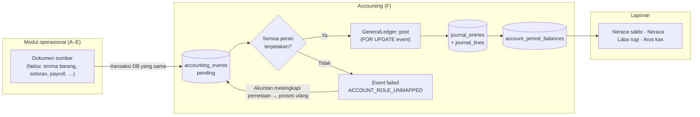
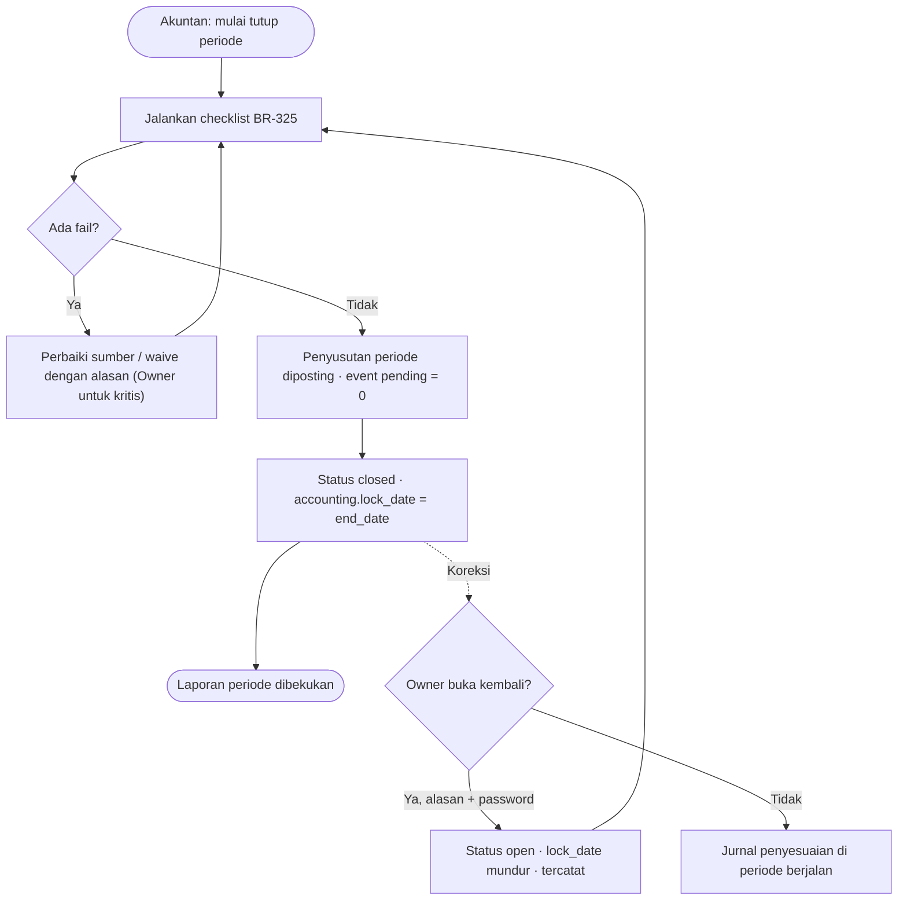
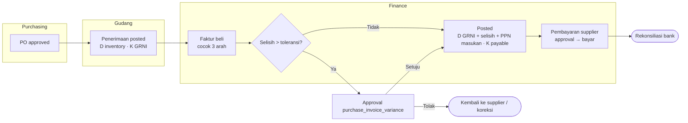

# 20 — Paket F: Keuangan & Prinsipal (siap eksekusi)

**Rentang:** T-159–T-178 · FR-F01–FR-F32 · BR-320–BR-359 · SEC-176–SEC-190 · OQ-151 dst.
**Kontrak:** `14` (ADR-104 outbox, ADR-115 tanggal kunci, §7 katalog event), **15**–**19**. Paket ini **mengonsumsi** `accounting_events` yang sudah ditulis sejak Paket A (termasuk backfill), menambah buku besar, bank, hutang, pajak, prinsipal, konsinyasi, aset, saran pembelian, dan member petani.
**Modul konsep v1.4:** FIN-02, FIN-03, FIN-05, PRC-02, PRC-03, SAL-06, INV-06, POS-02.

## 0. Penyelarasan (cek sebelum T-159)

| # | Asumsi | Cek |
|---|---|---|
| S-1 | OQ-106 sudah dijawab: modul F menjadi **pembukuan utama** atau hanya **ekspor jurnal** ke software lama. Bila ekspor saja: kerjakan T-159, T-160, T-172 (+ T-166–T-171, T-173–T-176 tetap berguna); T-161, T-163–T-164 opsional | `12` |
| S-2 | OQ-101 (PKP) sudah dijawab sebelum T-170/T-171. Format unggah faktur pajak **diverifikasi terhadap ketentuan & sistem DJP yang berlaku saat task dikerjakan**; dokumen ini tidak menetapkan skema file | `12` |
| S-3 | Semua event sejak Paket A berstatus `pending` dan seimbang (test kontrak **16** T-096) | `accounting_events` |
| S-4 | Bagan akun (CoA) contoh di §4.1 adalah **template**; akuntan Pakis menetapkan versi final sebelum backfill (OQ-151) | — |
| S-5 | Tidak ada dependency baru. Ekspor memakai OpenSpout; PDF laporan memakai library ADR-114 | `03` §5 |
| S-6 | Nama berkas frontend mengikuti konvensi repo (**15** §0 S-3) | — |

### 0.1 ADR baru

| ADR | Keputusan | Alasan | Konsekuensi |
|---|---|---|---|
| ADR-123 | **Buku besar double-entry imutabel**: `journal_entries` + `journal_lines`, posting hanya oleh `GeneralLedger`; koreksi = jurnal pembalik | BR-113 konsep; audit | Tidak ada UPDATE/DELETE baris jurnal (trigger) |
| ADR-124 | **Posting berbasis peran akun**: event membawa peran (`receivable`, `inventory`, …) + kualifier (rekening bank, kategori biaya, lokasi); `account_mappings` menerjemahkan ke akun | CoA bisa diubah akuntan tanpa mengubah kode/event; backfill mungkin | Peran tanpa pemetaan → event `failed`, diperbaiki pemetaan lalu diproses ulang |
| ADR-125 | **Dimensi analitik di baris jurnal** (lokasi, area, kios, supplier, pegawai, kendaraan) sebagai kolom terindeks, bukan sub-akun | Laporan per lokasi/area tanpa ledakan jumlah akun | Baris gaji disimpan agregat per lokasi (tanpa pegawai) demi privasi |

## 1. Ruang Lingkup

**Termasuk:** CoA & pemetaan peran, mesin posting & backfill, jurnal manual & pembalik, periode & tutup buku, impor mutasi bank & rekonsiliasi, neraca/laba rugi/arus kas/neraca saldo, HPP & margin, faktur pembelian & hutang dagang, pembayaran supplier, program prinsipal & klaim, PPN keluaran/masukan & ekspor data faktur pajak, ekspor jurnal ke software luar, konsinyasi, aset tetap & penyusutan, saran pembelian, member petani & poin, jurnal gaji.

**Di luar lingkup:** pelaporan SPT, e-Bupot, penyusutan fiskal (komersial saja; OQ-158), multi-mata uang, konsolidasi multi-perusahaan.

## 2. Kebutuhan Fungsional

| ID | Kebutuhan | Aturan |
|---|---|---|
| FR-F01 | Bagan akun bertingkat dengan tipe, saldo normal, kategori arus kas; template awal distributor. | BR-320 |
| FR-F02 | Pemetaan peran akun (+ kualifier) per event; validasi kelengkapan sebelum posting. | BR-321, ADR-124 |
| FR-F03 | Mesin posting outbox → jurnal (berkala & manual), idempoten; event gagal bisa diproses ulang. | BR-322 |
| FR-F04 | Backfill seluruh event sejak go-live A–E; saldo awal GL. | BR-323 |
| FR-F05 | Jurnal manual dengan lampiran & persetujuan; jurnal pembalik. | BR-324 |
| FR-F06 | Periode akuntansi bulanan, checklist tutup buku, tutup/buka kembali. | BR-325, ADR-115 |
| FR-F07 | Rekening bank terhubung akun GL; impor mutasi (CSV per bank). | BR-326, OQ-103 |
| FR-F08 | Rekonsiliasi bank: cocok otomatis & manual ke pembayaran, setoran, pembayaran supplier, jurnal; selisih & biaya bank. | BR-327 |
| FR-F09 | Neraca saldo, neraca, laba rugi (per lokasi/area), arus kas (metode tidak langsung), buku besar per akun, kartu piutang/hutang. | BR-328 |
| FR-F10 | Laporan HPP & margin per produk/kios/sales/area/prinsipal. | BR-114, BR-329 |
| FR-F11 | Faktur pembelian dari penerimaan barang (pencocokan 3 arah PO–terima–faktur), selisih harga. | BR-330 |
| FR-F12 | Hutang dagang: jatuh tempo, aging hutang, nota debit (retur ke prinsipal). | BR-331 |
| FR-F13 | Pembayaran supplier dengan persetujuan, alokasi ke faktur, giro keluar. | BR-332 |
| FR-F14 | Program prinsipal: target beli/jual, rebate per unit/bertingkat, potongan, dukungan promo; progres berjalan. | BR-333 |
| FR-F15 | Klaim ke prinsipal (rebate, promo dana prinsipal, demplot, garansi) dengan bukti; status pencairan; penyelesaian tunai/potong hutang/nota kredit prinsipal. | BR-334 |
| FR-F16 | PPN keluaran per faktur penjualan & PPN masukan per faktur pembelian (bila PKP). | BR-335 |
| FR-F17 | Ekspor data faktur pajak sesuai format sistem DJP yang berlaku; status unggah & nomor faktur pajak. | BR-336 |
| FR-F18 | Rekap PPN bulanan (keluaran, masukan, kurang/lebih bayar) sebagai bahan pelaporan. | BR-336 |
| FR-F19 | Ekspor jurnal ke software akuntansi luar (pemetaan akun eksternal). | BR-337 |
| FR-F20 | Konsinyasi: lokasi stok titipan per kios, kirim titip, laporan terjual, tagihan dari terjual, hitung & retur sisa. | BR-338 |
| FR-F21 | Kategori aset & masa manfaat, register aset (termasuk kendaraan D), penyusutan otomatis bulanan. | BR-339 |
| FR-F22 | Mutasi lokasi aset, penghapusan/penjualan aset dengan laba/rugi. | BR-340 |
| FR-F23 | Saran pembelian: reorder point, stok minimum per musim, dengan lost sales & stok dalam pesanan. | BR-341 |
| FR-F24 | Faktor musim per kategori/produk per bulan (diatur Pakis, diperbarui dari data). | BR-341 |
| FR-F25 | Saran → draft PO (keputusan Purchasing). | BR-341 |
| FR-F26 | Member petani (data minimal + persetujuan), riwayat beli di POS. | BR-342 |
| FR-F27 | Poin member petani: akrual, tukar, kedaluwarsa. | BR-343 |
| FR-F28 | Jurnal gaji dari payroll (agregat per lokasi). | BR-344 |
| FR-F29 | Biaya bank & bunga dari mutasi menjadi jurnal setelah dikonfirmasi. | BR-327 |
| FR-F30 | Tanggal kunci otomatis saat periode ditutup. | BR-325 |
| FR-F31 | Saldo awal hutang dagang (impor). | BR-345 |
| FR-F32 | Laporan prinsipal internal: pembelian, penjualan, klaim per prinsipal. | BR-333 |

## 3. Kebutuhan Non-Fungsional

| ID | Target |
|---|---|
| NFR-F01 | Posting 10.000 event < 5 menit; backfill 1 juta event < 2 jam (batch, dapat dilanjutkan) |
| NFR-F02 | Neraca saldo bulanan < 3 s (saldo per akun per periode di tabel ringkasan) |
| NFR-F03 | Tutup buku bulanan selesai < 1 hari kerja akuntan (checklist otomatis) |
| NFR-F04 | Saran pembelian 3.000 SKU × 10 lokasi < 5 menit |
| NFR-F05 | Ekspor faktur pajak 5.000 faktur/bulan < 2 menit (antrean) |
| NFR-F06 | Seluruh nilai uang `DECIMAL(18,2)`, kuantitas `DECIMAL(18,3)`, biaya per unit `DECIMAL(18,4)`; aritmetika memakai `brick/math` (sudah dipakai A–E), pembulatan half-up di titik yang ditentukan BR |
| NFR-F07 | Laporan keuangan dapat direproduksi: angka periode tertutup tidak berubah walau CoA/pemetaan diubah sesudahnya (jurnal imutabel, ADR-123) |

## 4. Database

Konvensi `04` §1 + **14** §6.1. `[audit]` = `created_by`, `updated_by`, `created_at`, `updated_at`; `[soft]` = `deleted_at`. Uang `DECIMAL(18,2)`.

### 4.1 Penomoran, referensi, ALTER (T-159)

Kode `document_sequences` baru (format default, dapat diubah lewat setting **14** §8):

| Kode | Contoh | Reset |
|---|---|---|
| `journal_entry` | `JU/2027/03/000123` | bulanan |
| `purchase_invoice` | `FB/2027/03/00045` | bulanan |
| `supplier_payment` | `BYS/2027/03/00012` | bulanan |
| `supplier_debit_note` | `ND/2027/00007` | tahunan |
| `principal_claim` | `KLM/2027/00031` | tahunan |
| `consignment` | `KSG/2027/0004` | tahunan |
| `consignment_report` | `LKS/2027/03/0019` | bulanan |
| `fixed_asset` | `AST-000123` | tidak |
| `asset_disposal` | `HPS-AST/2027/0003` | tahunan |
| `farmer_member` | `MBR-0001234` | tidak |

`reference_items` grup baru: `asset_location_reason`, `journal_manual_reason`, `bank_fee_type`, `claim_rejection_reason`.

```sql
-- Konsinyasi memakai lokasi stok tipe baru; stok titipan tetap milik Pakis (BR-338)
ALTER TABLE stock_locations
  MODIFY COLUMN type ENUM('warehouse','store','vehicle','in_transit','consignment') NOT NULL,
  ADD COLUMN customer_id BIGINT UNSIGNED NULL AFTER vehicle_id,
  ADD UNIQUE KEY stock_locations_customer_unique (customer_id),
  ADD CONSTRAINT sl_customer_fk FOREIGN KEY (customer_id) REFERENCES customers(id),
  DROP CHECK sl_type_chk,
  ADD CONSTRAINT sl_type_chk CHECK (
    (type IN ('warehouse','store') AND location_id IS NOT NULL AND vehicle_id IS NULL AND customer_id IS NULL) OR
    (type = 'vehicle' AND vehicle_id IS NOT NULL AND customer_id IS NULL) OR
    (type = 'in_transit' AND location_id IS NULL AND vehicle_id IS NULL AND customer_id IS NULL) OR
    (type = 'consignment' AND customer_id IS NOT NULL AND vehicle_id IS NULL));
-- type 'consignment': is_sellable = FALSE untuk pesanan biasa (stok titipan tidak dialokasikan ke SO lain)

ALTER TABLE bank_accounts
  MODIFY COLUMN purpose ENUM('collection','operational','va_settlement','payroll','payment') NOT NULL DEFAULT 'collection',
  ADD COLUMN gl_account_id BIGINT UNSIGNED NULL,                 -- wajib sebelum posting (BR-321)
  ADD COLUMN statement_parser VARCHAR(40) NULL,                  -- kode parser BankStatementParser (OQ-103)
  ADD COLUMN currency CHAR(3) NOT NULL DEFAULT 'IDR',
  ADD CONSTRAINT ba_gl_fk FOREIGN KEY (gl_account_id) REFERENCES chart_of_accounts(id);

ALTER TABLE invoices
  MODIFY COLUMN invoice_type ENUM('sales','opening_balance','charge','consignment') NOT NULL DEFAULT 'sales',
  ADD COLUMN consignment_report_id BIGINT UNSIGNED NULL AFTER delivery_id,
  ADD CONSTRAINT inv_consignment_fk FOREIGN KEY (consignment_report_id) REFERENCES consignment_reports(id),
  DROP CHECK inv_source_chk,
  ADD CONSTRAINT inv_source_chk CHECK (
    ((invoice_type = 'sales') = (delivery_id IS NOT NULL)) AND
    ((invoice_type = 'consignment') = (consignment_report_id IS NOT NULL)));
ALTER TABLE invoices
  ADD COLUMN active_consignment_key BIGINT UNSIGNED GENERATED ALWAYS AS (IF(status <> 'void', consignment_report_id, NULL)) STORED,
  ADD UNIQUE KEY inv_one_active_per_consignment (active_consignment_key);

ALTER TABLE pos_sales
  ADD COLUMN farmer_member_id BIGINT UNSIGNED NULL,
  ADD KEY possale_member_idx (farmer_member_id, sold_at),
  ADD CONSTRAINT possale_member_fk FOREIGN KEY (farmer_member_id) REFERENCES farmer_members(id);

ALTER TABLE pos_sale_payments
  MODIFY COLUMN method ENUM('cash','transfer','debit_card','qris','points') NOT NULL;   -- points: tukar poin member (BR-343)

-- Daftar lengkap = nilai terakhir di migration repo (B T-090, + nilai C bila ada) ditambah 'consignment_sale'
ALTER TABLE stock_movements MODIFY movement_type ENUM('opening_balance','receipt','purchase_return','transfer_out','transfer_in',
  'adjustment_in','adjustment_out','disposal','bin_move_out','bin_move_in',
  'sale','sales_return','pos_sale','pos_return','canvas_load','canvas_unload','promo_issue',
  'delivery_dispatch_out','delivery_dispatch_in','delivery_return_out','delivery_return_in',
  'consignment_sale') NOT NULL;   -- T-173

ALTER TABLE suppliers
  ADD COLUMN is_pkp BOOLEAN NOT NULL DEFAULT FALSE,              -- menentukan PPN masukan dapat dikreditkan (BR-335)
  ADD COLUMN payable_hold BOOLEAN NOT NULL DEFAULT FALSE,        -- tahan pembayaran (sengketa)
  ADD COLUMN payable_hold_reason VARCHAR(255) NULL;
```

Urutan migration: `chart_of_accounts` → `fiscal_periods` → ALTER `bank_accounts` → tabel jurnal → tabel lain → ALTER yang menunjuk tabel baru (`invoices`, `pos_sales`).

### 4.2 Bagan akun, pemetaan, periode, jurnal (T-159–T-161)

```sql
CREATE TABLE chart_of_accounts (
  id BIGINT UNSIGNED PRIMARY KEY AUTO_INCREMENT,
  code VARCHAR(20) NOT NULL,                      -- mis. 1-1301
  name VARCHAR(150) NOT NULL,
  parent_id BIGINT UNSIGNED NULL,
  account_type ENUM('asset','liability','equity','revenue','cogs','expense','other_income','other_expense') NOT NULL,
  normal_balance ENUM('debit','credit') NOT NULL,
  is_postable BOOLEAN NOT NULL DEFAULT TRUE,      -- akun induk = FALSE; jurnal hanya ke akun postable
  cash_flow_category ENUM('operating','investing','financing','cash','none') NOT NULL DEFAULT 'operating',
  is_cash_equivalent BOOLEAN NOT NULL DEFAULT FALSE,  -- kas & bank (laporan arus kas)
  requires_dimension ENUM('none','stock_location','customer','supplier','employee','vehicle','fixed_asset') NOT NULL DEFAULT 'none',
  is_system BOOLEAN NOT NULL DEFAULT FALSE,       -- dipakai pemetaan wajib; tidak bisa dinonaktifkan selama dipetakan
  is_active BOOLEAN NOT NULL DEFAULT TRUE,
  description VARCHAR(255) NULL,
  [audit],
  UNIQUE KEY coa_code_unique (code),
  KEY coa_parent_idx (parent_id),
  KEY coa_type_idx (account_type, is_active),
  CONSTRAINT coa_parent_fk FOREIGN KEY (parent_id) REFERENCES chart_of_accounts(id)
);
-- Tanpa soft delete: akun yang pernah dipakai jurnal tidak bisa dihapus, hanya dinonaktifkan (BR-320)

CREATE TABLE account_mappings (
  id BIGINT UNSIGNED PRIMARY KEY AUTO_INCREMENT,
  account_role VARCHAR(60) NOT NULL,              -- 'receivable', 'inventory', 'expense', 'bank', …  (§4.2.1)
  qualifier_type ENUM('none','bank_account','expense_category','stock_location_type','stock_location','tax_code','asset_category','payroll_component') NOT NULL DEFAULT 'none',
  qualifier_value VARCHAR(60) NOT NULL DEFAULT '*',   -- '*' = default peran; selain itu id/kode kualifier
  account_id BIGINT UNSIGNED NOT NULL,
  effective_from DATE NOT NULL,                   -- pemetaan baru tidak mengubah jurnal lama (NFR-F07)
  is_active BOOLEAN NOT NULL DEFAULT TRUE,
  note VARCHAR(255) NULL,
  [audit],
  UNIQUE KEY am_unique (account_role, qualifier_type, qualifier_value, effective_from),
  KEY am_lookup_idx (account_role, qualifier_type, qualifier_value, is_active, effective_from),
  CONSTRAINT am_account_fk FOREIGN KEY (account_id) REFERENCES chart_of_accounts(id)
);

CREATE TABLE fiscal_periods (
  id BIGINT UNSIGNED PRIMARY KEY AUTO_INCREMENT,
  fiscal_year SMALLINT UNSIGNED NOT NULL,
  period_no TINYINT UNSIGNED NOT NULL,            -- 1–12 (bulan ke-n sejak accounting.fiscal_year_start_month)
  start_date DATE NOT NULL,
  end_date DATE NOT NULL,
  status ENUM('open','closing','closed') NOT NULL DEFAULT 'open',
  closing_started_at TIMESTAMP NULL, closing_started_by BIGINT UNSIGNED NULL,
  closed_at TIMESTAMP NULL, closed_by BIGINT UNSIGNED NULL,
  reopened_count TINYINT UNSIGNED NOT NULL DEFAULT 0,
  last_reopen_reason VARCHAR(500) NULL,
  [audit],
  UNIQUE KEY fp_year_period_unique (fiscal_year, period_no),
  UNIQUE KEY fp_start_unique (start_date),
  KEY fp_range_idx (start_date, end_date),
  CONSTRAINT fp_range_chk CHECK (end_date >= start_date AND period_no BETWEEN 1 AND 12)
);

CREATE TABLE fiscal_period_checks (               -- checklist tutup buku (BR-325)
  id BIGINT UNSIGNED PRIMARY KEY AUTO_INCREMENT,
  fiscal_period_id BIGINT UNSIGNED NOT NULL,
  check_code VARCHAR(60) NOT NULL,                -- §8.2 BR-325 daftar kode
  result ENUM('pass','warn','fail','waived') NOT NULL,
  detail JSON NULL,                               -- jumlah & nilai per sumber, tautan listing
  checked_at TIMESTAMP NOT NULL,
  waived_by BIGINT UNSIGNED NULL, waive_reason VARCHAR(500) NULL,
  UNIQUE KEY fpc_unique (fiscal_period_id, check_code),
  CONSTRAINT fpc_period_fk FOREIGN KEY (fiscal_period_id) REFERENCES fiscal_periods(id) ON DELETE CASCADE,
  CONSTRAINT fpc_waive_chk CHECK (result <> 'waived' OR (waived_by IS NOT NULL AND waive_reason IS NOT NULL))
);

CREATE TABLE journal_entries (
  id BIGINT UNSIGNED PRIMARY KEY AUTO_INCREMENT,
  number VARCHAR(30) NOT NULL,                    -- NumberGenerator('journal_entry')
  entry_date DATE NOT NULL,                       -- = business_date event / tanggal jurnal manual
  fiscal_period_id BIGINT UNSIGNED NOT NULL,
  entry_type ENUM('auto','manual','reversal','opening','closing','adjustment') NOT NULL,
  source_type VARCHAR(60) NULL,                   -- auto: source event; manual: NULL
  source_id BIGINT UNSIGNED NULL,
  accounting_event_id BIGINT UNSIGNED NULL,
  reverses_entry_id BIGINT UNSIGNED NULL,         -- untuk reversal
  reversed_by_entry_id BIGINT UNSIGNED NULL,      -- satu-satunya kolom yang boleh diisi setelah posting (trigger)
  description VARCHAR(500) NOT NULL,
  total_debit DECIMAL(18,2) NOT NULL,
  total_credit DECIMAL(18,2) NOT NULL,
  status ENUM('draft','pending_approval','posted','rejected') NOT NULL DEFAULT 'posted',  -- auto langsung posted
  approval_request_id BIGINT UNSIGNED NULL,
  posted_at TIMESTAMP NULL, posted_by BIGINT UNSIGNED NULL,   -- auto: user sistem
  [audit],
  UNIQUE KEY je_number_unique (number),
  UNIQUE KEY je_event_unique (accounting_event_id),            -- satu event → satu jurnal (idempoten)
  UNIQUE KEY je_reverses_unique (reverses_entry_id),           -- satu jurnal hanya dibalik sekali
  KEY je_period_status_idx (fiscal_period_id, status),
  KEY je_date_idx (entry_date),
  KEY je_source_idx (source_type, source_id),
  CONSTRAINT je_period_fk FOREIGN KEY (fiscal_period_id) REFERENCES fiscal_periods(id),
  CONSTRAINT je_event_fk FOREIGN KEY (accounting_event_id) REFERENCES accounting_events(id),
  CONSTRAINT je_reverses_fk FOREIGN KEY (reverses_entry_id) REFERENCES journal_entries(id),
  CONSTRAINT je_balanced_chk CHECK (status <> 'posted' OR (total_debit = total_credit AND total_debit > 0)),   -- draft boleh belum seimbang
  CONSTRAINT je_auto_chk CHECK (entry_type <> 'auto' OR accounting_event_id IS NOT NULL),
  CONSTRAINT je_reversal_chk CHECK ((entry_type = 'reversal') = (reverses_entry_id IS NOT NULL))
);

CREATE TABLE journal_lines (
  id BIGINT UNSIGNED PRIMARY KEY AUTO_INCREMENT,
  journal_entry_id BIGINT UNSIGNED NOT NULL,
  line_no SMALLINT UNSIGNED NOT NULL,
  account_id BIGINT UNSIGNED NOT NULL,
  account_role VARCHAR(60) NULL,                  -- peran asal (auto) untuk jejak pemetaan
  debit DECIMAL(18,2) NOT NULL DEFAULT 0,
  credit DECIMAL(18,2) NOT NULL DEFAULT 0,
  memo VARCHAR(255) NULL,
  -- dimensi analitik (ADR-125)
  location_id BIGINT UNSIGNED NULL,               -- lokasi organisasi (laba rugi per cabang/toko)
  stock_location_id BIGINT UNSIGNED NULL,
  sales_area_id BIGINT UNSIGNED NULL,
  customer_id BIGINT UNSIGNED NULL,
  supplier_id BIGINT UNSIGNED NULL,
  principal_id BIGINT UNSIGNED NULL,
  employee_id BIGINT UNSIGNED NULL,               -- TIDAK diisi untuk baris gaji (BR-344)
  vehicle_id BIGINT UNSIGNED NULL,
  fixed_asset_id BIGINT UNSIGNED NULL,
  bank_account_id BIGINT UNSIGNED NULL,
  entry_date DATE NOT NULL,                       -- denormalisasi untuk laporan cepat
  fiscal_period_id BIGINT UNSIGNED NOT NULL,      -- denormalisasi
  UNIQUE KEY jl_entry_line_unique (journal_entry_id, line_no),
  KEY jl_account_period_idx (account_id, fiscal_period_id),
  KEY jl_account_date_idx (account_id, entry_date),
  KEY jl_customer_idx (customer_id, entry_date),
  KEY jl_supplier_idx (supplier_id, entry_date),
  KEY jl_location_period_idx (location_id, fiscal_period_id),
  KEY jl_area_period_idx (sales_area_id, fiscal_period_id),
  KEY jl_principal_period_idx (principal_id, fiscal_period_id),
  KEY jl_bank_date_idx (bank_account_id, entry_date),
  CONSTRAINT jl_entry_fk FOREIGN KEY (journal_entry_id) REFERENCES journal_entries(id),
  CONSTRAINT jl_account_fk FOREIGN KEY (account_id) REFERENCES chart_of_accounts(id),
  CONSTRAINT jl_period_fk FOREIGN KEY (fiscal_period_id) REFERENCES fiscal_periods(id),
  CONSTRAINT jl_amount_chk CHECK (debit >= 0 AND credit >= 0 AND (debit = 0) <> (credit = 0))
);
-- Trigger: journal_lines append-only (BEFORE UPDATE/DELETE → SIGNAL). journal_entries: UPDATE hanya pada
-- status draft/pending_approval/rejected, atau kolom reversed_by_entry_id saat posted. DELETE ditolak setelah posted.

CREATE TABLE journal_entry_attachments (
  id BIGINT UNSIGNED PRIMARY KEY AUTO_INCREMENT,
  journal_entry_id BIGINT UNSIGNED NOT NULL,
  file_path VARCHAR(255) NOT NULL,                -- storage privat (SEC-181)
  original_name VARCHAR(200) NOT NULL,
  mime_type VARCHAR(100) NOT NULL,
  size_bytes INT UNSIGNED NOT NULL,
  sha256 CHAR(64) NOT NULL,
  uploaded_by BIGINT UNSIGNED NOT NULL, created_at TIMESTAMP NULL,
  KEY jea_entry_idx (journal_entry_id),
  CONSTRAINT jea_entry_fk FOREIGN KEY (journal_entry_id) REFERENCES journal_entries(id)
);

CREATE TABLE account_period_balances (           -- ringkasan untuk neraca saldo cepat (NFR-F02)
  account_id BIGINT UNSIGNED NOT NULL,
  fiscal_period_id BIGINT UNSIGNED NOT NULL,
  location_id BIGINT UNSIGNED NOT NULL DEFAULT 0, -- 0 = tanpa lokasi
  debit_total DECIMAL(18,2) NOT NULL DEFAULT 0,
  credit_total DECIMAL(18,2) NOT NULL DEFAULT 0,
  updated_at TIMESTAMP NULL,
  PRIMARY KEY (account_id, fiscal_period_id, location_id),
  KEY apb_period_idx (fiscal_period_id)
);
-- Diperbarui GeneralLedger di transaksi posting yang sama (upsert + increment). Dapat dibangun ulang dari
-- journal_lines oleh `accounting:rebuild-balances` (hasil harus identik; dipakai test BR-328).
```

#### 4.2.1 Katalog peran akun (`AccountRoleCatalog`)

Sumber tunggal di kode (`app/Domain/Accounting/AccountRoleCatalog.php`), dibaca test kontrak event dan halaman pemetaan. Peran tanpa pemetaan aktif → posting event gagal `ACCOUNT_ROLE_UNMAPPED` (BR-321).

| Peran | Tipe akun yang diizinkan | Kualifier | Dipakai event |
|---|---|---|---|
| `bank` | asset (kas setara) | `bank_account` (wajib per rekening) | B, D, E, F |
| `cash_head_office`, `cash_in_transit`, `cash_store`, `petty_cash`, `trip_advance` | asset | `stock_location` (toko) untuk `cash_store` | B, D |
| `receivable`, `customer_deposit` | asset / liability | — | B, F |
| `employee_receivable`, `employee_loan_receivable` | asset | — | B, C, D, E |
| `inventory` | asset | `stock_location_type` (opsional) | A, B, C, F |
| `goods_received_not_invoiced` | liability | — | A, F |
| `payable` | liability | — | D, F |
| `vat_output`, `vat_input` | liability / asset | `tax_code` | B, F |
| `principal_receivable` | asset | — | F |
| `salary_payable`, `bpjs_payable`, `pph21_payable` | liability | — | E |
| `opening_balance_equity` | equity | — | A, B, F |
| `fixed_asset`, `accumulated_depreciation` | asset (kontra) | `asset_category` | F |
| `sales_revenue`, `sales_return`, `other_income`, `rebate_income`, `purchase_discount`, `asset_disposal_gain` | revenue / other_income | — | B, F |
| `cogs`, `inventory_variance`, `inventory_loss`, `purchase_price_variance` | cogs / expense | — | A, B, F |
| `expense` | expense | `expense_category` (wajib) | B (kas kecil) |
| `promotion_expense`, `warranty_expense`, `fuel_expense`, `travel_expense`, `vehicle_maintenance_expense`, `depreciation_expense`, `bank_fee_expense`, `cash_over_short`, `other_expense`, `asset_disposal_loss` | expense / other_expense | `asset_category` untuk `depreciation_expense` | B–F |
| `salary_expense`, `incentive_expense`, `piece_work_expense`, `bpjs_employer_expense` | expense | `payroll_component` (opsional) | E |
| `consignment_commission_expense` | expense | — | F |
| `interest_income` | other_income | — | F |
| `outgoing_giro` | liability | `bank_account` | F (giro keluar belum cair) |
| `loyalty_liability` | liability | — | F (poin member) |
| `retained_earnings` | equity | — | F (tutup tahun) |
| `marketplace_fee_expense` | expense | — | G (potongan marketplace, **21** BR-379) |

### 4.3 Mutasi bank & rekonsiliasi (T-162, T-163)

```sql
CREATE TABLE bank_statements (
  id BIGINT UNSIGNED PRIMARY KEY AUTO_INCREMENT,
  bank_account_id BIGINT UNSIGNED NOT NULL,
  period_start DATE NOT NULL,
  period_end DATE NOT NULL,
  opening_balance DECIMAL(18,2) NOT NULL,
  closing_balance DECIMAL(18,2) NOT NULL,
  source ENUM('file_import','manual') NOT NULL,
  parser_code VARCHAR(40) NULL,
  file_path VARCHAR(255) NULL, file_sha256 CHAR(64) NULL,
  line_count INT UNSIGNED NOT NULL DEFAULT 0,
  status ENUM('imported','reconciling','reconciled') NOT NULL DEFAULT 'imported',
  reconciled_at TIMESTAMP NULL, reconciled_by BIGINT UNSIGNED NULL,
  [audit],
  UNIQUE KEY bs_file_unique (bank_account_id, file_sha256),          -- file yang sama tidak diimpor dua kali
  KEY bs_account_period_idx (bank_account_id, period_start),
  CONSTRAINT bs_account_fk FOREIGN KEY (bank_account_id) REFERENCES bank_accounts(id),
  CONSTRAINT bs_range_chk CHECK (period_end >= period_start)
);

CREATE TABLE bank_statement_lines (
  id BIGINT UNSIGNED PRIMARY KEY AUTO_INCREMENT,
  bank_statement_id BIGINT UNSIGNED NOT NULL,
  bank_account_id BIGINT UNSIGNED NOT NULL,       -- denormalisasi
  line_no INT UNSIGNED NOT NULL,
  transaction_date DATE NOT NULL,
  value_date DATE NULL,
  description VARCHAR(500) NOT NULL,
  reference VARCHAR(100) NULL,
  amount DECIMAL(18,2) NOT NULL,                  -- + masuk, − keluar
  running_balance DECIMAL(18,2) NULL,
  line_hash CHAR(64) NOT NULL,                    -- sha256(rekening|tanggal|deskripsi|nominal|saldo|urutan_dalam_tanggal)
  match_status ENUM('unmatched','suggested','matched','ignored') NOT NULL DEFAULT 'unmatched',
  matched_amount DECIMAL(18,2) NOT NULL DEFAULT 0,
  ignore_reason VARCHAR(255) NULL,
  UNIQUE KEY bsl_hash_unique (bank_account_id, line_hash),           -- tumpang tindih periode tidak menggandakan baris
  KEY bsl_statement_idx (bank_statement_id, line_no),
  KEY bsl_match_idx (bank_account_id, match_status, transaction_date),
  KEY bsl_amount_idx (bank_account_id, amount, transaction_date),
  CONSTRAINT bsl_statement_fk FOREIGN KEY (bank_statement_id) REFERENCES bank_statements(id),
  CONSTRAINT bsl_amount_chk CHECK (amount <> 0)
);

CREATE TABLE bank_reconciliation_matches (
  id BIGINT UNSIGNED PRIMARY KEY AUTO_INCREMENT,
  bank_statement_line_id BIGINT UNSIGNED NOT NULL,
  match_type ENUM('payment','cash_deposit','supplier_payment','giro','petty_replenishment','payroll_payment','journal_line','bank_fee','interest','unidentified_payment') NOT NULL,
  target_type VARCHAR(60) NOT NULL,               -- morph ke dokumen sumber
  target_id BIGINT UNSIGNED NOT NULL,
  amount DECIMAL(18,2) NOT NULL,                  -- tanda sama dengan baris mutasi
  method ENUM('auto','manual') NOT NULL,
  rule_code VARCHAR(40) NULL,                     -- aturan cocok otomatis (BR-327)
  journal_entry_id BIGINT UNSIGNED NULL,          -- untuk bank_fee/interest: jurnal yang dibentuk saat konfirmasi
  status ENUM('active','unmatched') NOT NULL DEFAULT 'active',
  unmatched_at TIMESTAMP NULL, unmatched_by BIGINT UNSIGNED NULL, unmatch_reason VARCHAR(255) NULL,
  [audit],
  active_target_key VARCHAR(80) GENERATED ALWAYS AS (IF(status = 'active', CONCAT(target_type, ':', target_id), NULL)) STORED,
  UNIQUE KEY brm_target_active_unique (active_target_key),          -- satu dokumen hanya dicocokkan ke satu baris aktif
  KEY brm_line_idx (bank_statement_line_id, status),
  CONSTRAINT brm_line_fk FOREIGN KEY (bank_statement_line_id) REFERENCES bank_statement_lines(id),
  CONSTRAINT brm_journal_fk FOREIGN KEY (journal_entry_id) REFERENCES journal_entries(id),
  CONSTRAINT brm_amount_chk CHECK (amount <> 0)
);
```

Pencocokan satu-ke-banyak (satu baris mutasi = beberapa pembayaran VA) dan banyak-ke-satu (setoran dipecah dua transfer) didukung lewat banyak baris `bank_reconciliation_matches`; `matched_amount` baris mutasi = Σ match aktif dan tidak boleh melampaui `|amount|` (BR-327).

### 4.4 Faktur pembelian, hutang dagang, pembayaran supplier (T-166, T-167)

```sql
CREATE TABLE purchase_invoices (
  id BIGINT UNSIGNED PRIMARY KEY AUTO_INCREMENT,
  number VARCHAR(30) NOT NULL,                    -- nomor internal
  supplier_id BIGINT UNSIGNED NOT NULL,
  invoice_type ENUM('purchase','opening_balance','expense') NOT NULL DEFAULT 'purchase',  -- expense: tagihan non-stok (servis D, jasa)
  supplier_invoice_no VARCHAR(60) NOT NULL,       -- nomor faktur dari supplier
  supplier_invoice_date DATE NOT NULL,
  received_date DATE NOT NULL,                    -- tanggal dokumen diterima Pakis
  accounting_date DATE NOT NULL,                  -- tanggal posting (PeriodGuard)
  due_date DATE NOT NULL,
  purchase_order_id BIGINT UNSIGNED NULL,
  subtotal DECIMAL(18,2) NOT NULL,
  discount_total DECIMAL(18,2) NOT NULL DEFAULT 0,
  tax_base DECIMAL(18,2) NOT NULL DEFAULT 0,
  tax_total DECIMAL(18,2) NOT NULL DEFAULT 0,
  tax_creditable BOOLEAN NOT NULL DEFAULT FALSE,  -- PPN masukan dapat dikreditkan (BR-335)
  grand_total DECIMAL(18,2) NOT NULL,
  paid_amount DECIMAL(18,2) NOT NULL DEFAULT 0,
  debited_amount DECIMAL(18,2) NOT NULL DEFAULT 0,   -- Σ nota debit & kompensasi klaim teralokasi
  balance DECIMAL(18,2) GENERATED ALWAYS AS (grand_total - paid_amount - debited_amount) STORED,
  price_variance_total DECIMAL(18,2) NOT NULL DEFAULT 0,  -- selisih vs nilai penerimaan (BR-330)
  match_status ENUM('matched','variance_pending','variance_approved','not_applicable') NOT NULL DEFAULT 'matched',
  status ENUM('draft','pending_approval','posted','partially_paid','paid','void') NOT NULL DEFAULT 'draft',
  approval_request_id BIGINT UNSIGNED NULL,
  file_path VARCHAR(255) NULL,                    -- scan faktur supplier
  maintenance_order_id BIGINT UNSIGNED NULL,      -- invoice_type expense dari servis (18)
  legacy_reference VARCHAR(60) NULL,
  void_reason VARCHAR(255) NULL, voided_at TIMESTAMP NULL,
  [audit],
  UNIQUE KEY pi_number_unique (number),
  active_supplier_doc_key VARCHAR(120) GENERATED ALWAYS AS (IF(status <> 'void', CONCAT(supplier_id, '|', supplier_invoice_no), NULL)) STORED,
  UNIQUE KEY pi_supplier_doc_unique (active_supplier_doc_key),     -- faktur supplier tidak tercatat dua kali (BR-330)
  KEY pi_supplier_status_due_idx (supplier_id, status, due_date),
  KEY pi_status_due_idx (status, due_date),
  KEY pi_accounting_date_idx (accounting_date),
  CONSTRAINT pi_supplier_fk FOREIGN KEY (supplier_id) REFERENCES suppliers(id),
  CONSTRAINT pi_po_fk FOREIGN KEY (purchase_order_id) REFERENCES purchase_orders(id),
  CONSTRAINT pi_amount_chk CHECK (grand_total >= 0 AND paid_amount >= 0 AND debited_amount >= 0
    AND paid_amount + debited_amount <= grand_total)
);

CREATE TABLE purchase_invoice_lines (
  id BIGINT UNSIGNED PRIMARY KEY AUTO_INCREMENT,
  purchase_invoice_id BIGINT UNSIGNED NOT NULL,
  goods_receipt_line_id BIGINT UNSIGNED NULL,     -- wajib untuk invoice_type purchase
  product_id BIGINT UNSIGNED NULL,
  description VARCHAR(255) NOT NULL,
  qty_base DECIMAL(18,3) NOT NULL DEFAULT 0,
  unit_price DECIMAL(18,4) NOT NULL DEFAULT 0,    -- harga di faktur per satuan dasar, sebelum PPN
  receipt_unit_cost DECIMAL(18,4) NULL,           -- unit_cost dari penerimaan (snapshot)
  discount_amount DECIMAL(18,2) NOT NULL DEFAULT 0,
  line_total DECIMAL(18,2) NOT NULL,              -- neto sebelum PPN
  price_variance DECIMAL(18,2) NOT NULL DEFAULT 0,-- line_total − qty × receipt_unit_cost
  expense_account_role VARCHAR(60) NULL,          -- invoice_type expense: mis. 'vehicle_maintenance_expense'
  KEY pil_invoice_idx (purchase_invoice_id),
  KEY pil_grl_idx (goods_receipt_line_id),
  CONSTRAINT pil_invoice_fk FOREIGN KEY (purchase_invoice_id) REFERENCES purchase_invoices(id),
  CONSTRAINT pil_grl_fk FOREIGN KEY (goods_receipt_line_id) REFERENCES goods_receipt_lines(id),
  CONSTRAINT pil_qty_chk CHECK (qty_base >= 0 AND unit_price >= 0)
);
-- Σ qty_base per goods_receipt_line_id pada faktur non-void ≤ qty_received_base (dicek di Action dengan
-- FOR UPDATE pada goods_receipt_lines; kolom bantu di bawah)
ALTER TABLE goods_receipt_lines
  ADD COLUMN qty_invoiced_base DECIMAL(18,3) NOT NULL DEFAULT 0,
  ADD COLUMN qty_returned_base DECIMAL(18,3) NOT NULL DEFAULT 0,   -- diisi saat retur beli yang menunjuk penerimaan ini dikirim (BR-331)
  ADD CONSTRAINT grl_invoiced_chk CHECK (qty_invoiced_base >= 0 AND qty_returned_base >= 0
    AND qty_invoiced_base <= qty_received_base AND qty_returned_base <= qty_received_base);
-- Sisa yang boleh difakturkan = GREATEST(0, qty_received_base − qty_returned_base − qty_invoiced_base)

CREATE TABLE supplier_debit_notes (               -- retur ke prinsipal (A) & koreksi harga → mengurangi hutang
  id BIGINT UNSIGNED PRIMARY KEY AUTO_INCREMENT,
  number VARCHAR(30) NOT NULL,
  supplier_id BIGINT UNSIGNED NOT NULL,
  source_type ENUM('purchase_return','price_correction','principal_claim') NOT NULL,
  purchase_return_id BIGINT UNSIGNED NULL,
  principal_claim_id BIGINT UNSIGNED NULL,
  note_date DATE NOT NULL,
  amount DECIMAL(18,2) NOT NULL,
  tax_amount DECIMAL(18,2) NOT NULL DEFAULT 0,
  allocated_amount DECIMAL(18,2) NOT NULL DEFAULT 0,
  status ENUM('open','partially_allocated','allocated','void') NOT NULL DEFAULT 'open',
  supplier_reference VARCHAR(60) NULL,            -- nomor nota kredit dari supplier/prinsipal
  [audit],
  UNIQUE KEY sdn_number_unique (number),
  UNIQUE KEY sdn_return_unique (purchase_return_id),
  KEY sdn_supplier_status_idx (supplier_id, status),
  CONSTRAINT sdn_supplier_fk FOREIGN KEY (supplier_id) REFERENCES suppliers(id),
  CONSTRAINT sdn_return_fk FOREIGN KEY (purchase_return_id) REFERENCES purchase_returns(id),
  CONSTRAINT sdn_amount_chk CHECK (amount > 0 AND allocated_amount >= 0 AND allocated_amount <= amount + tax_amount)
);

CREATE TABLE supplier_payments (
  id BIGINT UNSIGNED PRIMARY KEY AUTO_INCREMENT,
  number VARCHAR(30) NOT NULL,
  supplier_id BIGINT UNSIGNED NOT NULL,
  payment_date DATE NOT NULL,
  method ENUM('transfer','giro','cash','offset') NOT NULL,   -- offset = kompensasi nota debit/klaim tanpa kas
  bank_account_id BIGINT UNSIGNED NULL,           -- rekening Pakis sumber dana (transfer/giro)
  giro_no VARCHAR(40) NULL, giro_due_date DATE NULL,
  amount DECIMAL(18,2) NOT NULL,
  bank_fee DECIMAL(18,2) NOT NULL DEFAULT 0,
  status ENUM('draft','pending_approval','approved','paid','cleared','rejected','void') NOT NULL DEFAULT 'draft',
  -- approved = boleh dibayar; paid = transfer dikirim/giro diserahkan; cleared = giro keluar cair
  approval_request_id BIGINT UNSIGNED NULL,
  paid_at TIMESTAMP NULL, paid_by BIGINT UNSIGNED NULL,
  proof_path VARCHAR(255) NULL,                   -- bukti transfer
  beneficiary_snapshot JSON NOT NULL,             -- nama bank, 4 digit akhir rekening, nama pemilik saat diajukan
  void_reason VARCHAR(255) NULL,
  [audit],
  UNIQUE KEY sp_number_unique (number),
  KEY sp_supplier_date_idx (supplier_id, payment_date),
  KEY sp_status_idx (status, payment_date),
  CONSTRAINT sp_supplier_fk FOREIGN KEY (supplier_id) REFERENCES suppliers(id),
  CONSTRAINT sp_bank_fk FOREIGN KEY (bank_account_id) REFERENCES bank_accounts(id),
  CONSTRAINT sp_amount_chk CHECK (amount > 0 AND bank_fee >= 0),
  CONSTRAINT sp_bank_chk CHECK (method NOT IN ('transfer','giro') OR bank_account_id IS NOT NULL),
  CONSTRAINT sp_giro_chk CHECK (method <> 'giro' OR (giro_no IS NOT NULL AND giro_due_date IS NOT NULL))
);

CREATE TABLE supplier_payment_allocations (       -- append-only seperti payment_allocations (16 SEC-115)
  id BIGINT UNSIGNED PRIMARY KEY AUTO_INCREMENT,
  supplier_payment_id BIGINT UNSIGNED NULL,
  supplier_debit_note_id BIGINT UNSIGNED NULL,
  purchase_invoice_id BIGINT UNSIGNED NOT NULL,
  amount DECIMAL(18,2) NOT NULL,                  -- negatif = pembalikan alokasi
  reverses_allocation_id BIGINT UNSIGNED NULL,
  created_by BIGINT UNSIGNED NOT NULL, created_at TIMESTAMP NULL,
  KEY spa_invoice_idx (purchase_invoice_id),
  KEY spa_payment_idx (supplier_payment_id),
  KEY spa_note_idx (supplier_debit_note_id),
  CONSTRAINT spa_payment_fk FOREIGN KEY (supplier_payment_id) REFERENCES supplier_payments(id),
  CONSTRAINT spa_note_fk FOREIGN KEY (supplier_debit_note_id) REFERENCES supplier_debit_notes(id),
  CONSTRAINT spa_invoice_fk FOREIGN KEY (purchase_invoice_id) REFERENCES purchase_invoices(id),
  CONSTRAINT spa_source_chk CHECK ((supplier_payment_id IS NULL) <> (supplier_debit_note_id IS NULL)),
  CONSTRAINT spa_amount_chk CHECK (amount <> 0)
);
```

```sql
CREATE TABLE supplier_bank_account_changes (      -- SEC-179: rekening supplier tidak diubah langsung
  id BIGINT UNSIGNED PRIMARY KEY AUTO_INCREMENT,
  supplier_id BIGINT UNSIGNED NOT NULL,
  new_bank_name VARCHAR(60) NOT NULL,
  new_account_no_enc TEXT NOT NULL,
  new_account_last4 CHAR(4) NOT NULL,
  new_account_name VARCHAR(150) NOT NULL,
  evidence_path VARCHAR(255) NOT NULL,            -- surat resmi supplier/prinsipal berkop & bertanda tangan
  callback_phone_source ENUM('existing_master','contract','principal_office') NOT NULL,
  callback_done_at TIMESTAMP NULL, callback_by BIGINT UNSIGNED NULL, callback_note VARCHAR(255) NULL,
  status ENUM('pending_callback','pending_approval','approved','rejected','cancelled') NOT NULL DEFAULT 'pending_callback',
  approval_request_id BIGINT UNSIGNED NULL,
  applied_at TIMESTAMP NULL,
  [audit],
  active_supplier_key BIGINT UNSIGNED GENERATED ALWAYS AS (IF(status IN ('pending_callback','pending_approval'), supplier_id, NULL)) STORED,
  UNIQUE KEY sbac_one_pending (active_supplier_key),
  KEY sbac_supplier_idx (supplier_id, created_at),
  CONSTRAINT sbac_supplier_fk FOREIGN KEY (supplier_id) REFERENCES suppliers(id)
);
-- Setelah T-167, UpdateSupplier (A) menolak perubahan kolom bank_* langsung (SUPPLIER_BANK_CHANGE_PENDING / pakai alur ini)
```

`PayableLedger` adalah satu-satunya penulis `paid_amount`/`debited_amount` faktur pembelian dan alokasi (pola `ReceivableLedger`, **16** ADR-109), dengan `FOR UPDATE` pada faktur dan dokumen sumber.

### 4.5 Program & klaim prinsipal (T-168, T-169)

```sql
CREATE TABLE principal_programs (
  id BIGINT UNSIGNED PRIMARY KEY AUTO_INCREMENT,
  code VARCHAR(30) NOT NULL,
  principal_id BIGINT UNSIGNED NOT NULL,
  name VARCHAR(200) NOT NULL,
  program_type ENUM('purchase_target','sell_out_target','unit_rebate','off_invoice_discount','promo_support','display_support') NOT NULL,
  -- purchase_target: rebate dari capaian beli; sell_out_target: dari capaian jual ke kios;
  -- unit_rebate: per unit terjual/dibeli; off_invoice_discount: potongan langsung di faktur beli (hanya dicatat);
  -- promo_support: dana prinsipal untuk kegiatan promosi/demplot (17); display_support: sewa display kios
  basis ENUM('purchase_qty','purchase_value','sales_qty','sales_value','activity_cost','fixed') NOT NULL,
  period_start DATE NOT NULL,
  period_end DATE NOT NULL,
  claim_deadline DATE NULL,                       -- batas pengajuan klaim ke prinsipal
  settlement_method ENUM('cash','payable_offset','credit_note','goods') NOT NULL DEFAULT 'payable_offset',
  budget_cap DECIMAL(18,2) NULL,                  -- batas total dana program (bila ada)
  agreement_file_path VARCHAR(255) NULL,          -- surat program dari prinsipal
  agreement_reference VARCHAR(100) NULL,
  status ENUM('draft','active','ended','claimed','closed','cancelled') NOT NULL DEFAULT 'draft',
  accrue_monthly BOOLEAN NOT NULL DEFAULT TRUE,   -- akrual estimasi rebate per bulan (BR-333)
  note TEXT NULL,
  [audit],
  UNIQUE KEY pp_code_unique (code),
  KEY pp_principal_period_idx (principal_id, period_start, period_end),
  KEY pp_status_idx (status, period_end),
  CONSTRAINT pp_principal_fk FOREIGN KEY (principal_id) REFERENCES principals(id),
  CONSTRAINT pp_range_chk CHECK (period_end >= period_start)
);

CREATE TABLE principal_program_scopes (           -- produk/kategori/area yang dihitung
  id BIGINT UNSIGNED PRIMARY KEY AUTO_INCREMENT,
  principal_program_id BIGINT UNSIGNED NOT NULL,
  scope_type ENUM('product','product_category','sales_area','customer') NOT NULL,
  scope_id BIGINT UNSIGNED NOT NULL,
  is_exclusion BOOLEAN NOT NULL DEFAULT FALSE,
  UNIQUE KEY pps_unique (principal_program_id, scope_type, scope_id),
  CONSTRAINT pps_program_fk FOREIGN KEY (principal_program_id) REFERENCES principal_programs(id) ON DELETE CASCADE
);
-- Tanpa baris scope product/product_category = semua produk milik principal_id

CREATE TABLE principal_program_tiers (
  id BIGINT UNSIGNED PRIMARY KEY AUTO_INCREMENT,
  principal_program_id BIGINT UNSIGNED NOT NULL,
  threshold DECIMAL(18,3) NOT NULL,               -- dalam satuan basis (qty dasar / rupiah)
  reward_type ENUM('pct_of_basis','amount_per_unit','fixed_amount') NOT NULL,
  reward_value DECIMAL(18,4) NOT NULL,
  is_retroactive BOOLEAN NOT NULL DEFAULT TRUE,   -- tier tercapai berlaku untuk seluruh basis, bukan hanya kelebihan
  UNIQUE KEY ppt_unique (principal_program_id, threshold),
  CONSTRAINT ppt_program_fk FOREIGN KEY (principal_program_id) REFERENCES principal_programs(id) ON DELETE CASCADE,
  CONSTRAINT ppt_value_chk CHECK (threshold >= 0 AND reward_value >= 0)
);

CREATE TABLE principal_program_progress (         -- snapshot harian capaian (job; bukan sumber kebenaran)
  id BIGINT UNSIGNED PRIMARY KEY AUTO_INCREMENT,
  principal_program_id BIGINT UNSIGNED NOT NULL,
  as_of_date DATE NOT NULL,
  basis_value DECIMAL(18,3) NOT NULL,
  achieved_tier_id BIGINT UNSIGNED NULL,
  next_tier_id BIGINT UNSIGNED NULL,
  estimated_reward DECIMAL(18,2) NOT NULL DEFAULT 0,
  accrued_to_date DECIMAL(18,2) NOT NULL DEFAULT 0,
  computed_at TIMESTAMP NOT NULL,
  UNIQUE KEY ppp_unique (principal_program_id, as_of_date),
  CONSTRAINT ppp_program_fk FOREIGN KEY (principal_program_id) REFERENCES principal_programs(id)
);

CREATE TABLE principal_claims (
  id BIGINT UNSIGNED PRIMARY KEY AUTO_INCREMENT,
  number VARCHAR(30) NOT NULL,
  principal_id BIGINT UNSIGNED NOT NULL,
  claim_type ENUM('program_rebate','promo_activity','warranty','price_protection','other') NOT NULL,
  principal_program_id BIGINT UNSIGNED NULL,
  claim_period_start DATE NULL, claim_period_end DATE NULL,
  claimed_amount DECIMAL(18,2) NOT NULL,
  approved_amount DECIMAL(18,2) NULL,             -- dari jawaban prinsipal
  settled_amount DECIMAL(18,2) NOT NULL DEFAULT 0,
  status ENUM('draft','pending_internal_approval','submitted','approved_by_principal','partially_approved','rejected_by_principal','settled','partially_settled','written_off','cancelled') NOT NULL DEFAULT 'draft',
  internal_approval_request_id BIGINT UNSIGNED NULL,
  submitted_at TIMESTAMP NULL,
  principal_reference VARCHAR(100) NULL,          -- nomor klaim/persetujuan dari prinsipal
  principal_decided_at DATE NULL,
  rejection_reason_id BIGINT UNSIGNED NULL,       -- reference_items(claim_rejection_reason)
  write_off_approval_request_id BIGINT UNSIGNED NULL,
  evidence_summary JSON NULL,                     -- jumlah dokumen pendukung per jenis
  [audit],
  UNIQUE KEY pcl_number_unique (number),
  KEY pcl_principal_status_idx (principal_id, status),
  KEY pcl_program_idx (principal_program_id),
  CONSTRAINT pcl_principal_fk FOREIGN KEY (principal_id) REFERENCES principals(id),
  CONSTRAINT pcl_program_fk FOREIGN KEY (principal_program_id) REFERENCES principal_programs(id),
  CONSTRAINT pcl_amount_chk CHECK (claimed_amount > 0 AND (approved_amount IS NULL OR approved_amount >= 0)
    AND settled_amount >= 0 AND (approved_amount IS NULL OR settled_amount <= approved_amount)),
  CONSTRAINT pcl_program_chk CHECK (claim_type <> 'program_rebate' OR principal_program_id IS NOT NULL)
);

CREATE TABLE principal_claim_lines (              -- dasar klaim: dokumen sumber
  id BIGINT UNSIGNED PRIMARY KEY AUTO_INCREMENT,
  principal_claim_id BIGINT UNSIGNED NOT NULL,
  source_type ENUM('promo_activity','warranty_claim','goods_receipt','invoice','program_period','manual') NOT NULL,
  source_id BIGINT UNSIGNED NULL,
  description VARCHAR(255) NOT NULL,
  basis_value DECIMAL(18,3) NULL,
  amount DECIMAL(18,2) NOT NULL,
  evidence_paths JSON NULL,                       -- foto, daftar hadir, berita acara (storage privat)
  KEY pcll_claim_idx (principal_claim_id),
  active_source_key VARCHAR(80) GENERATED ALWAYS AS (IF(source_type IN ('promo_activity','warranty_claim'), CONCAT(source_type, ':', source_id), NULL)) STORED,
  KEY pcll_source_idx (active_source_key),
  CONSTRAINT pcll_claim_fk FOREIGN KEY (principal_claim_id) REFERENCES principal_claims(id) ON DELETE CASCADE,
  CONSTRAINT pcll_amount_chk CHECK (amount > 0)
);
-- Satu kegiatan promosi/klaim garansi hanya boleh ada di satu klaim aktif (dicek di Action karena status
-- ada di tabel induk; test BR-334)

CREATE TABLE principal_claim_settlements (
  id BIGINT UNSIGNED PRIMARY KEY AUTO_INCREMENT,
  principal_claim_id BIGINT UNSIGNED NOT NULL,
  method ENUM('cash','payable_offset','credit_note','goods') NOT NULL,
  settled_on DATE NOT NULL,
  amount DECIMAL(18,2) NOT NULL,
  bank_account_id BIGINT UNSIGNED NULL,           -- cash
  supplier_debit_note_id BIGINT UNSIGNED NULL,    -- payable_offset / credit_note → nota debit ke hutang
  goods_receipt_id BIGINT UNSIGNED NULL,          -- goods: penerimaan barang pengganti (unit_cost = harga beli yang disepakati); menutup GRNI (BR-334)
  reference VARCHAR(100) NULL,
  [audit],
  KEY pcs_claim_idx (principal_claim_id),
  CONSTRAINT pcs_claim_fk FOREIGN KEY (principal_claim_id) REFERENCES principal_claims(id),
  CONSTRAINT pcs_amount_chk CHECK (amount > 0)
);
```

### 4.6 PPN & faktur pajak (T-170, T-171) — aktif hanya bila `tax.is_pkp = true`

```sql
CREATE TABLE customer_tax_profiles (              -- identitas pajak pembeli (hanya kios yang memintanya / wajib)
  id BIGINT UNSIGNED PRIMARY KEY AUTO_INCREMENT,
  customer_id BIGINT UNSIGNED NOT NULL,
  buyer_id_type ENUM('npwp','nik','other') NOT NULL,
  buyer_id_enc TEXT NOT NULL,                     -- terenkripsi (SEC-178); NIK tidak pernah plaintext
  buyer_id_hash CHAR(64) NOT NULL,                -- HMAC untuk pencarian/unik
  buyer_id_last4 CHAR(4) NOT NULL,                -- tampilan masking
  tax_name VARCHAR(150) NOT NULL,                 -- nama sesuai identitas pajak
  tax_address TEXT NOT NULL,
  is_default BOOLEAN NOT NULL DEFAULT TRUE,
  verified_at TIMESTAMP NULL, verified_by BIGINT UNSIGNED NULL,
  [audit], [soft],
  KEY ctp_customer_idx (customer_id),
  KEY ctp_hash_idx (buyer_id_hash),
  CONSTRAINT ctp_customer_fk FOREIGN KEY (customer_id) REFERENCES customers(id)
);

CREATE TABLE tax_invoices (
  id BIGINT UNSIGNED PRIMARY KEY AUTO_INCREMENT,
  direction ENUM('output','input') NOT NULL,      -- keluaran / masukan
  source_type ENUM('invoice','credit_note','purchase_invoice','supplier_debit_note','pos_daily') NOT NULL,
  source_id BIGINT UNSIGNED NOT NULL,             -- pos_daily: id pos_shift ringkasan harian per toko (OQ-153)
  transaction_date DATE NOT NULL,
  tax_period CHAR(7) NOT NULL,                    -- 'YYYY-MM'
  counterparty_type ENUM('customer','supplier','retail') NOT NULL,
  counterparty_id BIGINT UNSIGNED NULL,
  customer_tax_profile_id BIGINT UNSIGNED NULL,
  counterparty_snapshot JSON NOT NULL,            -- nama, alamat, identitas (masking di JSON; nilai penuh diambil saat ekspor)
  tax_base DECIMAL(18,2) NOT NULL,
  other_tax_base DECIMAL(18,2) NULL,              -- bila ketentuan memakai DPP nilai lain (tax_rates.dpp_factor)
  tax_amount DECIMAL(18,2) NOT NULL,
  tax_rate_id BIGINT UNSIGNED NOT NULL,
  transaction_code VARCHAR(10) NULL,              -- kode transaksi sesuai ketentuan DJP (diisi dari setting; OQ-101)
  tax_invoice_number VARCHAR(40) NULL,            -- nomor faktur pajak dari sistem DJP (diisi setelah unggah/approve)
  status ENUM('draft','ready','exported','uploaded','approved','rejected','replaced','cancelled','not_required') NOT NULL DEFAULT 'draft',
  replaces_tax_invoice_id BIGINT UNSIGNED NULL,   -- faktur pengganti
  tax_export_id BIGINT UNSIGNED NULL,             -- batch terakhir
  supplier_tax_invoice_number VARCHAR(40) NULL,   -- masukan: nomor faktur pajak dari supplier
  is_creditable BOOLEAN NOT NULL DEFAULT TRUE,    -- masukan
  credited_in_period CHAR(7) NULL,                -- masukan: masa pengkreditan
  status_note VARCHAR(500) NULL,
  [audit],
  active_source_key VARCHAR(80) GENERATED ALWAYS AS (IF(status NOT IN ('replaced','cancelled'), CONCAT(source_type, ':', source_id), NULL)) STORED,
  UNIQUE KEY ti_active_source_unique (active_source_key),           -- satu faktur pajak aktif per dokumen
  KEY ti_period_dir_status_idx (tax_period, direction, status),
  KEY ti_counterparty_idx (counterparty_type, counterparty_id, transaction_date),
  KEY ti_number_idx (tax_invoice_number),
  CONSTRAINT ti_rate_fk FOREIGN KEY (tax_rate_id) REFERENCES tax_rates(id),
  CONSTRAINT ti_profile_fk FOREIGN KEY (customer_tax_profile_id) REFERENCES customer_tax_profiles(id),
  CONSTRAINT ti_replaces_fk FOREIGN KEY (replaces_tax_invoice_id) REFERENCES tax_invoices(id),
  CONSTRAINT ti_amount_chk CHECK (tax_base >= 0 AND tax_amount >= 0)
);

CREATE TABLE tax_exports (
  id BIGINT UNSIGNED PRIMARY KEY AUTO_INCREMENT,
  direction ENUM('output','input') NOT NULL,
  tax_period CHAR(7) NOT NULL,
  format_code VARCHAR(40) NOT NULL,               -- kode formatter TaxExportFormatter (versi format DJP yang berlaku)
  format_version VARCHAR(20) NOT NULL,
  item_count INT UNSIGNED NOT NULL,
  total_tax_base DECIMAL(18,2) NOT NULL,
  total_tax_amount DECIMAL(18,2) NOT NULL,
  file_path VARCHAR(255) NULL,                    -- storage privat; dihapus setelah tax.export_file_retention_days
  file_sha256 CHAR(64) NULL,
  status ENUM('queued','generated','downloaded','uploaded','result_imported','failed','expired') NOT NULL DEFAULT 'queued',
  downloaded_at TIMESTAMP NULL, downloaded_by BIGINT UNSIGNED NULL,
  result_file_path VARCHAR(255) NULL,             -- file hasil dari sistem DJP (nomor faktur pajak), bila tersedia
  error VARCHAR(500) NULL,
  [audit],
  KEY tex_period_idx (tax_period, direction)
);

CREATE TABLE tax_export_items (
  tax_export_id BIGINT UNSIGNED NOT NULL,
  tax_invoice_id BIGINT UNSIGNED NOT NULL,
  PRIMARY KEY (tax_export_id, tax_invoice_id),
  KEY tei_invoice_idx (tax_invoice_id),
  CONSTRAINT tei_export_fk FOREIGN KEY (tax_export_id) REFERENCES tax_exports(id),
  CONSTRAINT tei_invoice_fk FOREIGN KEY (tax_invoice_id) REFERENCES tax_invoices(id)
);
```

**Format file tidak ditetapkan di dokumen ini.** `TaxExportFormatter` adalah adapter (ADR-113) dengan satu implementasi per format resmi yang berlaku saat T-171 dikerjakan; struktur kolom diambil dari dokumentasi/contoh resmi DJP yang diverifikasi bersama konsultan pajak Pakis (OQ-101, OQ-145). Test memakai **fixture contoh resmi** yang disimpan di repo, bukan struktur karangan.

### 4.7 Ekspor jurnal ke software akuntansi luar (T-172)

```sql
CREATE TABLE external_account_mappings (
  id BIGINT UNSIGNED PRIMARY KEY AUTO_INCREMENT,
  target_system VARCHAR(40) NOT NULL,             -- kode adapter (OQ-106), mis. 'generic_csv'
  account_id BIGINT UNSIGNED NOT NULL,
  external_code VARCHAR(40) NOT NULL,
  external_name VARCHAR(150) NULL,
  [audit],
  UNIQUE KEY eam_unique (target_system, account_id),
  CONSTRAINT eam_account_fk FOREIGN KEY (account_id) REFERENCES chart_of_accounts(id)
);

CREATE TABLE accounting_exports (
  id BIGINT UNSIGNED PRIMARY KEY AUTO_INCREMENT,
  target_system VARCHAR(40) NOT NULL,
  date_from DATE NOT NULL, date_to DATE NOT NULL,
  granularity ENUM('entry','daily_summary') NOT NULL DEFAULT 'entry',
  entry_count INT UNSIGNED NOT NULL DEFAULT 0,
  file_path VARCHAR(255) NULL, file_sha256 CHAR(64) NULL,
  status ENUM('queued','generated','failed','expired') NOT NULL DEFAULT 'queued',
  error VARCHAR(500) NULL,
  [audit],
  KEY aex_range_idx (target_system, date_from)
);

CREATE TABLE accounting_export_entries (          -- mencegah jurnal yang sama diekspor dua kali tanpa sengaja
  accounting_export_id BIGINT UNSIGNED NOT NULL,
  journal_entry_id BIGINT UNSIGNED NOT NULL,
  target_system VARCHAR(40) NOT NULL,
  is_reexport BOOLEAN NOT NULL DEFAULT FALSE,
  PRIMARY KEY (accounting_export_id, journal_entry_id),
  KEY aee_entry_idx (target_system, journal_entry_id),
  CONSTRAINT aee_export_fk FOREIGN KEY (accounting_export_id) REFERENCES accounting_exports(id),
  CONSTRAINT aee_entry_fk FOREIGN KEY (journal_entry_id) REFERENCES journal_entries(id)
);
```

### 4.8 Konsinyasi (T-173)

```sql
CREATE TABLE consignments (                       -- perjanjian titip jual per kios
  id BIGINT UNSIGNED PRIMARY KEY AUTO_INCREMENT,
  number VARCHAR(30) NOT NULL,
  customer_id BIGINT UNSIGNED NOT NULL,
  stock_location_id BIGINT UNSIGNED NOT NULL,     -- lokasi stok tipe consignment milik kios ini
  source_stock_location_id BIGINT UNSIGNED NOT NULL,  -- gudang pemasok titipan
  price_list_id BIGINT UNSIGNED NULL,             -- harga tagih ke kios; NULL = price list kios
  report_cycle ENUM('weekly','biweekly','monthly') NOT NULL DEFAULT 'monthly',
  payment_term_days SMALLINT UNSIGNED NOT NULL DEFAULT 14,   -- jatuh tempo tagihan dari laporan terjual
  max_value DECIMAL(18,2) NOT NULL,               -- plafon nilai titipan (harga pokok) — risiko stok di kios
  commission_pct DECIMAL(7,4) NOT NULL DEFAULT 0, -- bila kios dibayar komisi, bukan selisih harga (OQ-154)
  start_date DATE NOT NULL,
  end_date DATE NULL,
  agreement_file_path VARCHAR(255) NULL,          -- perjanjian bertanda tangan
  status ENUM('draft','pending_approval','active','suspended','ending','closed','cancelled') NOT NULL DEFAULT 'draft',
  approval_request_id BIGINT UNSIGNED NULL,
  last_report_date DATE NULL,
  next_report_due DATE NULL,
  [audit],
  UNIQUE KEY ksg_number_unique (number),
  active_customer_key BIGINT UNSIGNED GENERATED ALWAYS AS (IF(status IN ('active','suspended','ending'), customer_id, NULL)) STORED,
  UNIQUE KEY ksg_one_active_per_customer (active_customer_key),
  KEY ksg_status_due_idx (status, next_report_due),
  CONSTRAINT ksg_customer_fk FOREIGN KEY (customer_id) REFERENCES customers(id),
  CONSTRAINT ksg_sl_fk FOREIGN KEY (stock_location_id) REFERENCES stock_locations(id),
  CONSTRAINT ksg_src_fk FOREIGN KEY (source_stock_location_id) REFERENCES stock_locations(id),
  CONSTRAINT ksg_value_chk CHECK (max_value > 0 AND commission_pct BETWEEN 0 AND 100)
);

CREATE TABLE consignment_lines (                  -- produk yang boleh dititipkan & batas qty
  id BIGINT UNSIGNED PRIMARY KEY AUTO_INCREMENT,
  consignment_id BIGINT UNSIGNED NOT NULL,
  product_id BIGINT UNSIGNED NOT NULL,
  max_qty_base DECIMAL(18,3) NOT NULL,
  UNIQUE KEY ksgl_unique (consignment_id, product_id),
  CONSTRAINT ksgl_consignment_fk FOREIGN KEY (consignment_id) REFERENCES consignments(id) ON DELETE CASCADE,
  CONSTRAINT ksgl_qty_chk CHECK (max_qty_base > 0)
);
-- Kirim titipan & tarik sisa memakai stock_transfers (A) dengan transfer_purpose baru (ALTER di bawah)

ALTER TABLE stock_transfers
  ADD COLUMN transfer_purpose ENUM('internal','consignment_out','consignment_return') NOT NULL DEFAULT 'internal',
  ADD COLUMN consignment_id BIGINT UNSIGNED NULL,
  ADD KEY st_consignment_idx (consignment_id),
  ADD CONSTRAINT st_consignment_fk FOREIGN KEY (consignment_id) REFERENCES consignments(id);

CREATE TABLE consignment_reports (
  id BIGINT UNSIGNED PRIMARY KEY AUTO_INCREMENT,
  number VARCHAR(30) NOT NULL,
  consignment_id BIGINT UNSIGNED NOT NULL,
  report_type ENUM('sales_report','stock_count','closing') NOT NULL,
  period_start DATE NOT NULL,
  period_end DATE NOT NULL,
  reported_via ENUM('sales_visit','mitra','admin') NOT NULL,
  reported_by_user_id BIGINT UNSIGNED NULL,
  customer_user_id BIGINT UNSIGNED NULL,          -- bila dilaporkan lewat Pakis Mitra
  visit_id BIGINT UNSIGNED NULL,                  -- bila dihitung saat kunjungan (17)
  counted_latitude DECIMAL(10,7) NULL, counted_longitude DECIMAL(10,7) NULL,
  photo_paths JSON NULL,
  status ENUM('draft','submitted','customer_confirmed','pending_variance_approval','posted','rejected') NOT NULL DEFAULT 'draft',
  approval_request_id BIGINT UNSIGNED NULL,
  sold_value DECIMAL(18,2) NOT NULL DEFAULT 0,
  variance_value DECIMAL(18,2) NOT NULL DEFAULT 0, -- nilai pokok selisih hitung (hilang/rusak)
  posted_at TIMESTAMP NULL,
  [audit],
  UNIQUE KEY ksr_number_unique (number),
  KEY ksr_consignment_period_idx (consignment_id, period_end),
  KEY ksr_status_idx (status),
  CONSTRAINT ksr_consignment_fk FOREIGN KEY (consignment_id) REFERENCES consignments(id),
  CONSTRAINT ksr_range_chk CHECK (period_end >= period_start)
);

CREATE TABLE consignment_report_lines (
  id BIGINT UNSIGNED PRIMARY KEY AUTO_INCREMENT,
  consignment_report_id BIGINT UNSIGNED NOT NULL,
  product_id BIGINT UNSIGNED NOT NULL,
  stock_batch_id BIGINT UNSIGNED NULL,            -- FEFO dipilih sistem bila kios tidak tahu batch
  qty_system_base DECIMAL(18,3) NOT NULL,         -- stok titipan menurut sistem saat laporan dibuat
  qty_sold_base DECIMAL(18,3) NOT NULL DEFAULT 0, -- dilaporkan terjual
  qty_counted_base DECIMAL(18,3) NULL,            -- hasil hitung fisik (stock_count/closing)
  qty_variance_base DECIMAL(18,3) GENERATED ALWAYS AS (IF(qty_counted_base IS NULL, 0, qty_counted_base - (qty_system_base - qty_sold_base))) STORED,
  unit_price DECIMAL(18,2) NOT NULL,              -- harga tagih per satuan dasar (snapshot price list)
  unit_cost DECIMAL(18,4) NOT NULL,               -- HPP saat posting
  KEY ksrl_report_idx (consignment_report_id),
  CONSTRAINT ksrl_report_fk FOREIGN KEY (consignment_report_id) REFERENCES consignment_reports(id) ON DELETE CASCADE,
  CONSTRAINT ksrl_qty_chk CHECK (qty_sold_base >= 0 AND qty_sold_base <= qty_system_base AND (qty_counted_base IS NULL OR qty_counted_base >= 0))
);
```

### 4.9 Aset tetap (T-174)

```sql
CREATE TABLE asset_categories (
  id BIGINT UNSIGNED PRIMARY KEY AUTO_INCREMENT,
  code VARCHAR(20) NOT NULL,
  name VARCHAR(100) NOT NULL,                     -- Bangunan gudang, Kendaraan, Forklift, Peralatan, Komputer, …
  depreciation_method ENUM('straight_line','declining_balance','none') NOT NULL DEFAULT 'straight_line',
  default_useful_life_months SMALLINT UNSIGNED NOT NULL,   -- kebijakan akuntansi Pakis (komersial); OQ-158
  declining_rate_pct DECIMAL(7,4) NULL,
  default_residual_pct DECIMAL(7,4) NOT NULL DEFAULT 0,
  capitalization_threshold DECIMAL(18,2) NOT NULL DEFAULT 0, -- di bawah nilai ini dibiayakan (setting per kategori)
  is_active BOOLEAN NOT NULL DEFAULT TRUE,
  [audit],
  UNIQUE KEY acat_code_unique (code),
  CONSTRAINT acat_rate_chk CHECK (depreciation_method <> 'declining_balance' OR declining_rate_pct IS NOT NULL)
);
-- Tanah: kategori dengan depreciation_method = 'none'

CREATE TABLE fixed_assets (
  id BIGINT UNSIGNED PRIMARY KEY AUTO_INCREMENT,
  code VARCHAR(20) NOT NULL,                      -- NumberGenerator('fixed_asset'); dicetak di label aset
  name VARCHAR(150) NOT NULL,
  asset_category_id BIGINT UNSIGNED NOT NULL,
  location_id BIGINT UNSIGNED NOT NULL,           -- lokasi organisasi (gudang/toko/kantor)
  custodian_employee_id BIGINT UNSIGNED NULL,     -- pemegang (opsional)
  vehicle_id BIGINT UNSIGNED NULL,                -- tautan ke kendaraan (A/D) bila aset kendaraan
  serial_or_identifier VARCHAR(100) NULL,
  acquisition_date DATE NOT NULL,
  acquisition_cost DECIMAL(18,2) NOT NULL,
  purchase_invoice_id BIGINT UNSIGNED NULL,       -- sumber perolehan
  residual_value DECIMAL(18,2) NOT NULL DEFAULT 0,
  useful_life_months SMALLINT UNSIGNED NOT NULL,
  depreciation_method ENUM('straight_line','declining_balance','none') NOT NULL,
  depreciation_start DATE NOT NULL,               -- awal bulan berikut perolehan (setting asset.depreciation_start_rule)
  opening_accumulated_depreciation DECIMAL(18,2) NOT NULL DEFAULT 0,  -- aset lama saat go-live
  accumulated_depreciation DECIMAL(18,2) NOT NULL DEFAULT 0,          -- termasuk opening; diubah hanya AssetDepreciator
  book_value DECIMAL(18,2) GENERATED ALWAYS AS (acquisition_cost - accumulated_depreciation) STORED,
  last_depreciated_period CHAR(7) NULL,
  status ENUM('draft','active','fully_depreciated','disposed') NOT NULL DEFAULT 'draft',
  is_opening BOOLEAN NOT NULL DEFAULT FALSE,
  photo_path VARCHAR(255) NULL,
  note TEXT NULL,
  [audit], [soft],
  UNIQUE KEY fa_code_unique (code),
  UNIQUE KEY fa_vehicle_unique (vehicle_id),
  KEY fa_category_status_idx (asset_category_id, status),
  KEY fa_location_idx (location_id, status),
  CONSTRAINT fa_category_fk FOREIGN KEY (asset_category_id) REFERENCES asset_categories(id),
  CONSTRAINT fa_location_fk FOREIGN KEY (location_id) REFERENCES locations(id),
  CONSTRAINT fa_vehicle_fk FOREIGN KEY (vehicle_id) REFERENCES vehicles(id),
  CONSTRAINT fa_pi_fk FOREIGN KEY (purchase_invoice_id) REFERENCES purchase_invoices(id),
  CONSTRAINT fa_amount_chk CHECK (acquisition_cost > 0 AND residual_value >= 0 AND residual_value < acquisition_cost
    AND accumulated_depreciation >= 0 AND accumulated_depreciation <= acquisition_cost - residual_value)
);

CREATE TABLE asset_depreciations (
  id BIGINT UNSIGNED PRIMARY KEY AUTO_INCREMENT,
  fixed_asset_id BIGINT UNSIGNED NOT NULL,
  period CHAR(7) NOT NULL,                        -- 'YYYY-MM'
  amount DECIMAL(18,2) NOT NULL,
  accumulated_after DECIMAL(18,2) NOT NULL,
  book_value_after DECIMAL(18,2) NOT NULL,
  depreciation_run_id BIGINT UNSIGNED NULL,
  created_at TIMESTAMP NULL,
  UNIQUE KEY ad_asset_period_unique (fixed_asset_id, period),       -- idempoten (BR-339)
  KEY ad_period_idx (period),
  CONSTRAINT ad_asset_fk FOREIGN KEY (fixed_asset_id) REFERENCES fixed_assets(id),
  CONSTRAINT ad_amount_chk CHECK (amount >= 0)
);

CREATE TABLE asset_transfers (
  id BIGINT UNSIGNED PRIMARY KEY AUTO_INCREMENT,
  fixed_asset_id BIGINT UNSIGNED NOT NULL,
  from_location_id BIGINT UNSIGNED NOT NULL,
  to_location_id BIGINT UNSIGNED NOT NULL,
  from_custodian_employee_id BIGINT UNSIGNED NULL,
  to_custodian_employee_id BIGINT UNSIGNED NULL,
  transfer_date DATE NOT NULL,
  reason_id BIGINT UNSIGNED NOT NULL,             -- reference_items(asset_location_reason)
  received_by BIGINT UNSIGNED NULL, received_at TIMESTAMP NULL,
  [audit],
  KEY at_asset_date_idx (fixed_asset_id, transfer_date),
  CONSTRAINT at_asset_fk FOREIGN KEY (fixed_asset_id) REFERENCES fixed_assets(id),
  CONSTRAINT at_loc_chk CHECK (from_location_id <> to_location_id OR
    NOT (from_custodian_employee_id <=> to_custodian_employee_id))
);

CREATE TABLE asset_disposals (
  id BIGINT UNSIGNED PRIMARY KEY AUTO_INCREMENT,
  number VARCHAR(30) NOT NULL,
  fixed_asset_id BIGINT UNSIGNED NOT NULL,
  disposal_type ENUM('sale','write_off','loss','trade_in') NOT NULL,
  disposal_date DATE NOT NULL,
  proceeds DECIMAL(18,2) NOT NULL DEFAULT 0,
  proceeds_bank_account_id BIGINT UNSIGNED NULL,
  book_value_at_disposal DECIMAL(18,2) NULL,      -- diisi saat posting (setelah penyusutan s.d. bulan pelepasan)
  gain_loss DECIMAL(18,2) NULL,
  buyer_name VARCHAR(150) NULL,
  evidence_paths JSON NULL,                       -- berita acara, foto, kuitansi
  status ENUM('draft','pending_approval','posted','rejected','cancelled') NOT NULL DEFAULT 'draft',
  approval_request_id BIGINT UNSIGNED NULL,
  posted_at TIMESTAMP NULL,
  [audit],
  UNIQUE KEY adisp_number_unique (number),
  active_asset_key BIGINT UNSIGNED GENERATED ALWAYS AS (IF(status IN ('draft','pending_approval','posted'), fixed_asset_id, NULL)) STORED,
  UNIQUE KEY adisp_one_active_unique (active_asset_key),
  CONSTRAINT adisp_asset_fk FOREIGN KEY (fixed_asset_id) REFERENCES fixed_assets(id),
  CONSTRAINT adisp_proceeds_chk CHECK (proceeds >= 0 AND (disposal_type IN ('write_off','loss') OR proceeds > 0 OR disposal_type = 'trade_in'))
);
```

### 4.10 Saran pembelian (T-175)

```sql
CREATE TABLE seasonal_factors (                   -- pengali permintaan per bulan (BR-341)
  id BIGINT UNSIGNED PRIMARY KEY AUTO_INCREMENT,
  scope_type ENUM('product_category','product') NOT NULL,
  scope_id BIGINT UNSIGNED NOT NULL,
  sales_area_id BIGINT UNSIGNED NULL,             -- NULL = semua area
  month TINYINT UNSIGNED NOT NULL,                -- 1–12
  factor DECIMAL(6,3) NOT NULL,                   -- 1.000 = normal
  source ENUM('manual','computed') NOT NULL DEFAULT 'manual',
  computed_from_years TINYINT UNSIGNED NULL,
  [audit],
  UNIQUE KEY sf_unique (scope_type, scope_id, sales_area_id, month),
  CONSTRAINT sf_month_chk CHECK (month BETWEEN 1 AND 12 AND factor >= 0 AND factor <= 10)
);
-- Catatan: sales_area_id NULL pada UNIQUE tidak mencegah duplikat di MySQL; Action memakai
-- upsert dengan kunci normalisasi (sales_area_id → 0) di kolom bantu:
ALTER TABLE seasonal_factors
  ADD COLUMN area_key BIGINT UNSIGNED GENERATED ALWAYS AS (IFNULL(sales_area_id, 0)) STORED,
  DROP INDEX sf_unique,
  ADD UNIQUE KEY sf_unique (scope_type, scope_id, area_key, month);

CREATE TABLE purchase_suggestion_runs (
  id BIGINT UNSIGNED PRIMARY KEY AUTO_INCREMENT,
  run_date DATE NOT NULL,
  stock_location_id BIGINT UNSIGNED NULL,         -- NULL = semua gudang
  principal_id BIGINT UNSIGNED NULL,
  params JSON NOT NULL,                           -- window hari, safety days, horizon — snapshot setting
  item_count INT UNSIGNED NOT NULL DEFAULT 0,
  status ENUM('running','completed','failed') NOT NULL DEFAULT 'running',
  started_at TIMESTAMP NOT NULL, finished_at TIMESTAMP NULL,
  triggered_by BIGINT UNSIGNED NULL,              -- NULL = jadwal
  KEY psr_date_idx (run_date)
);

CREATE TABLE purchase_suggestion_items (
  id BIGINT UNSIGNED PRIMARY KEY AUTO_INCREMENT,
  purchase_suggestion_run_id BIGINT UNSIGNED NOT NULL,
  product_id BIGINT UNSIGNED NOT NULL,
  stock_location_id BIGINT UNSIGNED NOT NULL,
  supplier_id BIGINT UNSIGNED NULL,               -- supplier preferred
  avg_daily_demand_base DECIMAL(18,3) NOT NULL,   -- (terjual + lost sales tervalidasi) / hari dalam window
  lost_sales_base DECIMAL(18,3) NOT NULL DEFAULT 0,
  seasonal_factor DECIMAL(6,3) NOT NULL DEFAULT 1,
  lead_time_days SMALLINT UNSIGNED NOT NULL,
  safety_days SMALLINT UNSIGNED NOT NULL,
  on_hand_base DECIMAL(18,3) NOT NULL,            -- tersedia jual (tanpa karantina/rusak/ED dekat)
  on_order_base DECIMAL(18,3) NOT NULL,           -- PO approved/partially_received belum diterima
  reserved_base DECIMAL(18,3) NOT NULL,
  min_qty_base DECIMAL(18,3) NOT NULL,            -- product_stock_levels
  reorder_point_base DECIMAL(18,3) NOT NULL,
  suggested_qty_base DECIMAL(18,3) NOT NULL,
  suggested_qty_purchase_unit DECIMAL(18,3) NOT NULL,   -- dibulatkan ke kelipatan satuan beli
  purchase_unit_id BIGINT UNSIGNED NULL,
  reason_codes JSON NOT NULL,                     -- ['below_reorder_point','lost_sales','season_peak','below_min']
  status ENUM('open','accepted','adjusted','dismissed') NOT NULL DEFAULT 'open',
  purchase_order_id BIGINT UNSIGNED NULL,
  decided_by BIGINT UNSIGNED NULL, decided_at TIMESTAMP NULL, dismiss_reason VARCHAR(255) NULL,
  UNIQUE KEY psi_unique (purchase_suggestion_run_id, product_id, stock_location_id),
  KEY psi_status_idx (status, stock_location_id),
  KEY psi_supplier_idx (supplier_id, status),
  CONSTRAINT psi_run_fk FOREIGN KEY (purchase_suggestion_run_id) REFERENCES purchase_suggestion_runs(id),
  CONSTRAINT psi_po_fk FOREIGN KEY (purchase_order_id) REFERENCES purchase_orders(id)
);
```

### 4.11 Member petani & poin (T-176)

```sql
CREATE TABLE farmer_members (
  id BIGINT UNSIGNED PRIMARY KEY AUTO_INCREMENT,
  number VARCHAR(20) NOT NULL,                    -- NumberGenerator('farmer_member'); dicetak di kartu/QR
  name VARCHAR(100) NOT NULL,
  phone_enc TEXT NOT NULL,                        -- terenkripsi (SEC-185)
  phone_hash CHAR(64) NOT NULL,                   -- HMAC nomor ternormalisasi 62…; pencarian di kasir
  phone_last4 CHAR(4) NOT NULL,
  village_code CHAR(13) NULL,                     -- desa (bukan alamat lengkap) — minimisasi
  main_crops JSON NULL,                           -- id reference_items(crop), maks 5
  home_stock_location_id BIGINT UNSIGNED NOT NULL,-- toko tempat mendaftar
  consent_membership_at TIMESTAMP NOT NULL,       -- persetujuan data untuk keanggotaan & poin (wajib)
  consent_promo_at TIMESTAMP NULL,                -- persetujuan menerima promosi (opsional, terpisah)
  consent_promo_withdrawn_at TIMESTAMP NULL,
  consent_text_version VARCHAR(20) NOT NULL,
  points_balance INT NOT NULL DEFAULT 0,          -- cache; ditulis hanya LoyaltyLedger
  status ENUM('active','blocked','closed') NOT NULL DEFAULT 'active',
  closed_at TIMESTAMP NULL,                       -- permintaan hapus → data dianonimkan (BR-342)
  [audit],
  UNIQUE KEY fm_number_unique (number),
  UNIQUE KEY fm_phone_unique (phone_hash),
  KEY fm_store_idx (home_stock_location_id, status),
  CONSTRAINT fm_store_fk FOREIGN KEY (home_stock_location_id) REFERENCES stock_locations(id),
  CONSTRAINT fm_points_chk CHECK (points_balance >= 0)
);

CREATE TABLE loyalty_points (                     -- buku poin, append-only
  id BIGINT UNSIGNED PRIMARY KEY AUTO_INCREMENT,
  farmer_member_id BIGINT UNSIGNED NOT NULL,
  entry_type ENUM('earn','redeem','expire','reverse','adjust') NOT NULL,
  points INT NOT NULL,                            -- + earn/adjust(+), − redeem/expire/reverse
  pos_sale_id BIGINT UNSIGNED NULL,
  pos_return_id BIGINT UNSIGNED NULL,
  earned_on DATE NULL,
  expires_on DATE NULL,                           -- untuk earn
  remaining_points INT NULL,                      -- earn: sisa yang belum dipakai/kedaluwarsa (satu-satunya kolom mutable, trigger)
  redeem_value DECIMAL(18,2) NULL,                -- redeem: nilai potongan rupiah di struk
  reason VARCHAR(255) NULL,                       -- adjust: wajib
  approved_by BIGINT UNSIGNED NULL,               -- adjust: wajib
  created_by BIGINT UNSIGNED NULL, created_at TIMESTAMP NULL,
  UNIQUE KEY lp_sale_earn_unique (pos_sale_id, entry_type),          -- satu earn & satu redeem per struk
  KEY lp_member_idx (farmer_member_id, created_at),
  KEY lp_expiry_idx (entry_type, expires_on, remaining_points),
  CONSTRAINT lp_member_fk FOREIGN KEY (farmer_member_id) REFERENCES farmer_members(id),
  CONSTRAINT lp_sale_fk FOREIGN KEY (pos_sale_id) REFERENCES pos_sales(id),
  CONSTRAINT lp_sign_chk CHECK ((entry_type = 'earn' AND points > 0) OR (entry_type IN ('redeem','expire','reverse') AND points < 0) OR entry_type = 'adjust'),
  CONSTRAINT lp_adjust_chk CHECK (entry_type <> 'adjust' OR (reason IS NOT NULL AND approved_by IS NOT NULL))
);
```

### 4.12 Index ↔ query penting

| Query | Index |
|---|---|
| Event `pending` untuk diposting, urut tanggal | `aev_status_date_idx (status, business_date)` (A) |
| Pemetaan aktif per peran & kualifier pada tanggal X | `am_lookup_idx` |
| Neraca saldo periode | `account_period_balances` PK + `apb_period_idx` |
| Buku besar per akun & rentang tanggal | `jl_account_date_idx` |
| Laba rugi per lokasi / area / prinsipal | `jl_location_period_idx`, `jl_area_period_idx`, `jl_principal_period_idx` |
| Kartu hutang per supplier | `jl_supplier_idx`, `pi_supplier_status_due_idx` |
| Aging hutang | `pi_status_due_idx` |
| Baris mutasi belum cocok per rekening | `bsl_match_idx` |
| Kandidat cocok otomatis (nominal & tanggal) | `bsl_amount_idx` + index nominal dokumen sumber (B) |
| Faktur pajak per masa & arah | `ti_period_dir_status_idx` |
| Konsinyasi jatuh tempo laporan | `ksg_status_due_idx` |
| Aset per kategori untuk penyusutan | `fa_category_status_idx` |
| Saran pembelian terbuka per gudang | `psi_status_idx` |
| Cari member di kasir (nomor HP) | `fm_phone_unique (phone_hash)` |
| Poin akan kedaluwarsa | `lp_expiry_idx` |

## 5. Route & API

### 5.1 Web admin

| Nama | Path | Permission | Catatan |
|---|---|---|---|
| `admin.accounts.index`/`store`/`update`/`deactivate` | `/akuntansi/akun` | `accounts.view` / `.manage` | Pohon akun; impor template awal (T-159) |
| `admin.account-mappings.index`/`store`/`update` | `/akuntansi/pemetaan-akun` | `accounts.view` / `.manage` | Tampilkan peran tanpa pemetaan (merah) |
| `admin.accounting-events.index`/`show` | `/akuntansi/event` | `accounting_events.manage` | Filter `failed`/`pending` |
| `admin.accounting-events.retry` | POST `/akuntansi/event/proses-ulang` | `accounting_events.manage` | Batch, idempoten |
| `admin.accounting-events.backfill` | POST `/akuntansi/event/backfill` | `accounting_events.manage` | Konfirmasi password; job berantai (BR-323) |
| `admin.journals.index`/`show` | `/akuntansi/jurnal` | `journals.view` | |
| `admin.journals.create`/`store`/`submit` | `/akuntansi/jurnal/manual` | `journals.create_manual` | → approval `manual_journal` |
| `admin.journals.reverse` | POST `/akuntansi/jurnal/{entry}/balik` | `journals.reverse` | → approval `journal_reversal` |
| `admin.journals.attachments.store`/`show` | `/akuntansi/jurnal/{entry}/lampiran` | `journals.create_manual` / `journals.view` | Unduh via signed URL 5 menit |
| `admin.ledger.show` | GET `/akuntansi/buku-besar` | `journals.view` | Per akun + dimensi |
| `admin.fiscal-periods.index`/`show` | `/akuntansi/periode` | `periods.view` | Checklist tutup buku |
| `admin.fiscal-periods.start-closing`/`close` | POST `/akuntansi/periode/{period}/tutup` | `periods.close` | MFA ulang; menggeser `accounting.lock_date` |
| `admin.fiscal-periods.reopen` | POST `/akuntansi/periode/{period}/buka` | `periods.reopen` | Owner + alasan + konfirmasi password |
| `admin.accounting-exports.*` | `/akuntansi/ekspor` | `accounting_exports.generate` | + `exports.mass` |
| `admin.external-account-mappings.*` | `/akuntansi/ekspor/pemetaan` | `accounting_exports.generate` | |
| `admin.bank-statements.index`/`create`/`store`/`show` | `/bank/mutasi` | `bank_statements.import` / `bank_reconciliation.view` | Unggah CSV per rekening |
| `admin.bank-reconciliation.show` | GET `/bank/rekonsiliasi/{statement}` | `bank_reconciliation.view` | Dua panel: mutasi ↔ dokumen sistem |
| `admin.bank-reconciliation.auto`/`match`/`unmatch`/`ignore`/`fee` | POST `/bank/rekonsiliasi/{statement}/...` | `bank_reconciliation.manage` | `fee` = biaya bank/bunga → jurnal |
| `admin.bank-reconciliation.complete` | POST `/bank/rekonsiliasi/{statement}/selesai` | `bank_reconciliation.manage` | BR-327 syarat selesai |
| `admin.financial-reports.trial-balance` | GET `/laporan/keuangan/neraca-saldo` | `reports.financial.view` | |
| `admin.financial-reports.balance-sheet` | GET `/laporan/keuangan/neraca` | `reports.financial.view` | |
| `admin.financial-reports.income-statement` | GET `/laporan/keuangan/laba-rugi` | `reports.financial.view` | `group_by` lokasi/area/prinsipal |
| `admin.financial-reports.cash-flow` | GET `/laporan/keuangan/arus-kas` | `reports.financial.view` | Metode tidak langsung |
| `admin.financial-reports.export` | POST `/laporan/keuangan/{report}/ekspor` | `reports.financial.view` + `exports.mass` | XLSX/PDF |
| `admin.margin-reports.cogs` | GET `/laporan/hpp-margin` | `margin_reports.view` (B) | Per produk/kios/sales/area/prinsipal |
| `admin.purchase-invoices.index`/`create`/`store`/`show`/`submit`/`void` | `/hutang/faktur-beli` | `purchase_invoices.view` / `.manage` | Pilih penerimaan belum difakturkan |
| `admin.purchase-invoices.approve-variance` | POST `/hutang/faktur-beli/{pi}/setujui-selisih` | `purchase_invoices.approve_variance` | Via mesin approval |
| `admin.payables.aging` | GET `/hutang/umur` | `purchase_invoices.view` | |
| `admin.payables.opening.*` | `/hutang/saldo-awal` | `payables.import_opening` | Hanya saat `payables.opening_balance_open` |
| `admin.supplier-debit-notes.index`/`show` | `/hutang/nota-debit` | `purchase_invoices.view` | Dibuat otomatis dari retur/klaim |
| `admin.supplier-bank-changes.index`/`store`/`callback` | `/pemasok/{supplier}/perubahan-rekening` | `suppliers.manage` (A) | Callback dicatat oleh orang ≠ pengaju |
| `admin.supplier-payments.index`/`create`/`store`/`submit`/`show` | `/hutang/pembayaran` | `supplier_payments.view` / `.manage` | → approval `supplier_payment` |
| `admin.supplier-payments.execute` | POST `/hutang/pembayaran/{sp}/bayar` | `supplier_payments.execute` | Unggah bukti; ≠ penyetuju |
| `admin.supplier-payments.bank-file` | POST `/hutang/pembayaran/file-bank` | `supplier_payments.execute` + `exports.mass` | Hanya `approved`; tercatat |
| `admin.principal-programs.*` | `/prinsipal/program` | `principal_programs.view` / `.manage` | Progres & akrual |
| `admin.principal-claims.*` | `/prinsipal/klaim` | `principal_claims.manage` | Kumpulkan dasar klaim otomatis |
| `admin.principal-claims.decision` | POST `/prinsipal/klaim/{claim}/keputusan` | `principal_claims.manage` | Catat jawaban prinsipal |
| `admin.principal-claims.settle` | POST `/prinsipal/klaim/{claim}/penyelesaian` | `principal_claims.manage` | |
| `admin.principal-claims.write-off` | POST `/prinsipal/klaim/{claim}/hapus` | `principal_claims.manage` | → approval `principal_claim_write_off` |
| `admin.principal-reports.index` | GET `/laporan/prinsipal` | `principal_programs.view` | FR-F32 |
| `admin.tax-invoices.index`/`show`/`prepare`/`cancel`/`replace` | `/pajak/faktur` | `tax_invoices.view` / `.manage` | Hanya bila `tax.is_pkp` |
| `admin.tax-exports.index`/`store`/`download`/`import-result` | `/pajak/ekspor` | `tax_exports.generate` + `exports.mass` | MFA ulang saat unduh |
| `admin.tax-reports.vat-recap` | GET `/pajak/rekap-ppn` | `tax_invoices.view` | |
| `admin.customer-tax-profiles.*` | `/pelanggan/{customer}/identitas-pajak` | `customer_tax_profiles.manage` | Lihat penuh: `.view_full` (tercatat) |
| `admin.consignments.*` | `/konsinyasi` | `consignments.view` / `.manage` | → approval `consignment_agreement` |
| `admin.consignments.ship`/`withdraw` | POST `/konsinyasi/{ksg}/kirim` · `/tarik` | `consignments.manage` | Membuat `stock_transfers` |
| `admin.consignment-reports.*` | `/konsinyasi/{ksg}/laporan` | `consignment_reports.submit` / `.post` | |
| `admin.asset-categories.*` | `/aset/kategori` | `assets.manage` | |
| `admin.fixed-assets.*` | `/aset` | `assets.view` / `.manage` | Label QR aset (PDF) |
| `admin.fixed-assets.transfer` | POST `/aset/{asset}/mutasi` | `assets.transfer` | |
| `admin.asset-disposals.*` | `/aset/penghapusan` | `assets.dispose` | → approval `asset_disposal` |
| `admin.asset-depreciation.run`/`preview` | `/aset/penyusutan` | `asset_depreciation.run` | Pratinjau sebelum posting |
| `admin.purchase-suggestions.index`/`run`/`decide`/`to-po` | `/pembelian/saran` | `purchase_suggestions.view` / `.manage` | `to-po` butuh `purchase_orders.create` (A) |
| `admin.seasonal-factors.*` | `/pembelian/faktor-musim` | `seasonal_factors.manage` | Tombol "hitung dari data" |
| `admin.farmer-members.index`/`show`/`update`/`close` | `/toko/member` | `members.view` / `.manage` | Kontak termasking |
| `admin.loyalty.adjust` | POST `/toko/member/{member}/poin` | `loyalty.adjust` | Alasan wajib; ≠ kasir transaksi |
| `admin.loyalty.settings` | `/toko/poin/pengaturan` | `loyalty.configure` | |

### 5.2 API POS (PWA toko, tambahan **16** §5)

| Nama | Metode | Path | Permission | Offline |
|---|---|---|---|---|
| `api.v1.pos.members.lookup` | POST | `/api/v1/pos/member/cari` | `pos.sell` | Tidak (butuh server); kasir tetap bisa jual tanpa member |
| `api.v1.pos.members.register` | POST | `/api/v1/pos/member` | `members.manage` atau `pos.sell` + setting `members.cashier_can_register` | Antre (`member_register`) |
| Item sinkron POS (tambahan) | — | — | — | `pos_sale.member_number`, `pos_sale.points_redeemed` (divalidasi ulang di server, BR-343) |

### 5.3 API Pakis Pro & Mitra (konsinyasi)

| Nama | Metode | Path | Permission | Offline |
|---|---|---|---|---|
| `api.v1.consignments.mine` | GET | `/api/v1/konsinyasi/saya` | `consignment_reports.submit` | Snapshot set `field` |
| Item sinkron | — | — | — | `consignment_count` (hitung saat kunjungan, foto + lokasi) |
| `mitra.v1.consignment.show` | GET | `/mitra/v1/konsinyasi` | guard `mitra` | Stok titipan kios sendiri |
| `mitra.v1.consignment.report` | POST | `/mitra/v1/konsinyasi/laporan` | guard `mitra` | Laporan terjual; perlu konfirmasi sales/admin |

## 6. Otorisasi

### 6.1 Role baru

| Kode | Nama | `data_scope` | MFA | Catatan |
|---|---|---|---|---|
| `akuntan` | Akuntan | all (jurnal, laporan, pajak, aset) | ✅ | Bukan penyetuju pembayaran; tidak menerima/menyetor uang. Bila Pakis memakai konsultan luar, akun berbatas waktu (`users.expires_at` Fase 0) |

Role `finance` tetap untuk kas, piutang, hutang operasional. Pemisahan: **pembuat pembayaran supplier (FIN) ≠ penyetuju (OWN/FIN lain) ≠ pengeksekusi bila berbeda orang**; **pembuat jurnal manual ≠ penyetuju** (BR-153 klausul 11).

### 6.2 Scope

| Role | Dimensi |
|---|---|
| SPV | Program prinsipal & konsinyasi kios di area tim |
| KGD | Aset & saran pembelian di lokasi stok/lokasi yang ditugaskan |
| SLS | Konsinyasi kios yang ditugaskan (lihat & lapor hitung) |
| KSR (kepala toko) | Member terdaftar di toko yang ditugaskan; kasir melihat member hanya lewat pencarian di POS |
| ARM | Aset bertautan kendaraan |
| FIN 🔸 `reports.financial.view` | Laba rugi & arus kas saja; neraca & laba per lokasi butuh setting `reports.finance_can_view_balance_sheet` |
| FIN 🔸 `journals.create_manual` | Hanya jenis jurnal di allowlist `accounting.finance_manual_journal_types` (default: reklasifikasi kas & bank) |
| FIN 🔸 `supplier_payments.approve` / `purchase_invoices.approve_variance` | Di bawah ambang approval (`approval_rules`); bukan dokumen yang ia buat |
| ACC 🔸 `journals.approve` | Bukan jurnal yang ia buat; nilai ≤ ambang `accounting.manual_journal_owner_threshold` |
| APJ 🔸 `customer_tax_profiles.manage` | Buat & ubah; tidak melihat identitas penuh setelah tersimpan |

### 6.3 Permission baru (49)

| Modul | Permission |
|---|---|
| Akuntansi | `accounts.view`, `accounts.manage`, `accounting_events.manage`, `journals.view`, `journals.create_manual`, `journals.approve`, `journals.reverse`, `periods.view`, `periods.close`, `periods.reopen`, `accounting_exports.generate` |
| Bank | `bank_statements.import`, `bank_reconciliation.view`, `bank_reconciliation.manage` |
| Laporan | `reports.financial.view` |
| Hutang | `purchase_invoices.view`, `purchase_invoices.manage`, `purchase_invoices.approve_variance`, `payables.import_opening`, `supplier_payments.view`, `supplier_payments.manage`, `supplier_payments.approve`, `supplier_payments.execute` |
| Prinsipal | `principal_programs.view`, `principal_programs.manage`, `principal_claims.manage`, `principal_claims.approve_writeoff` |
| Pajak | `tax_invoices.view`, `tax_invoices.manage`, `tax_exports.generate`, `customer_tax_profiles.manage`, `customer_tax_profiles.view_full` |
| Konsinyasi | `consignments.view`, `consignments.manage`, `consignment_reports.submit`, `consignment_reports.post` |
| Aset | `assets.view`, `assets.manage`, `assets.transfer`, `assets.dispose`, `asset_depreciation.run` |
| Saran pembelian | `purchase_suggestions.view`, `purchase_suggestions.manage`, `seasonal_factors.manage` |
| Member | `members.view`, `members.manage`, `members.view_contact`, `loyalty.adjust`, `loyalty.configure` |

Dipakai ulang dari paket sebelumnya (tidak dihitung): `tax.manage` (tarif PPN, **16**), `accounting.lock` (**16**, kini dikelola lewat tutup periode — BR-325), `margin_reports.view` (**16**, laporan HPP & margin T-165), `bank_accounts.manage` (**16**), `purchase_orders.create` (**15**, PO dari saran), `pos.sell` (**16**, pakai member & tukar poin), `exports.mass` (**16**).

### 6.4 Matriks kewenangan (default seeder)

✅ penuh · 🔸 dalam scope / di bawah ambang / bukan dokumen sendiri · ❌ tidak. Kolom: OWN · ADM · SPV · APJ · KGD (kepala gudang) · PUR · SLS · KSR (🔸 = **kepala toko** saja kecuali disebut) · FIN · ACC `akuntan` · ARM · AUD. Role lain tidak mendapat permission Paket F. `super_admin` = semua.

| Permission | OWN | ADM | SPV | APJ | KGD | PUR | SLS | KSR | FIN | ACC | ARM | AUD |
|---|---|---|---|---|---|---|---|---|---|---|---|---|
| `accounts.view` | ✅ | ❌ | ❌ | ❌ | ❌ | ❌ | ❌ | ❌ | ✅ | ✅ | ❌ | ✅ |
| `accounts.manage` | ❌ | ❌ | ❌ | ❌ | ❌ | ❌ | ❌ | ❌ | ❌ | ✅ | ❌ | ❌ |
| `accounting_events.manage` | ❌ | ❌ | ❌ | ❌ | ❌ | ❌ | ❌ | ❌ | ❌ | ✅ | ❌ | ❌ |
| `journals.view` | ✅ | ❌ | ❌ | ❌ | ❌ | ❌ | ❌ | ❌ | ✅ | ✅ | ❌ | ✅ |
| `journals.create_manual` | ❌ | ❌ | ❌ | ❌ | ❌ | ❌ | ❌ | ❌ | 🔸 | ✅ | ❌ | ❌ |
| `journals.approve` | ✅ | ❌ | ❌ | ❌ | ❌ | ❌ | ❌ | ❌ | ❌ | 🔸 | ❌ | ❌ |
| `journals.reverse` | ❌ | ❌ | ❌ | ❌ | ❌ | ❌ | ❌ | ❌ | ❌ | ✅ | ❌ | ❌ |
| `periods.view` | ✅ | ❌ | ❌ | ❌ | ❌ | ❌ | ❌ | ❌ | ✅ | ✅ | ❌ | ✅ |
| `periods.close` | ❌ | ❌ | ❌ | ❌ | ❌ | ❌ | ❌ | ❌ | ❌ | ✅ | ❌ | ❌ |
| `periods.reopen` | ✅ | ❌ | ❌ | ❌ | ❌ | ❌ | ❌ | ❌ | ❌ | ❌ | ❌ | ❌ |
| `accounting_exports.generate` | ❌ | ❌ | ❌ | ❌ | ❌ | ❌ | ❌ | ❌ | ❌ | ✅ | ❌ | ❌ |
| `bank_statements.import` | ❌ | ❌ | ❌ | ❌ | ❌ | ❌ | ❌ | ❌ | ✅ | ✅ | ❌ | ❌ |
| `bank_reconciliation.view` | ✅ | ❌ | ❌ | ❌ | ❌ | ❌ | ❌ | ❌ | ✅ | ✅ | ❌ | ✅ |
| `bank_reconciliation.manage` | ❌ | ❌ | ❌ | ❌ | ❌ | ❌ | ❌ | ❌ | ✅ | ✅ | ❌ | ❌ |
| `reports.financial.view` | ✅ | ❌ | ❌ | ❌ | ❌ | ❌ | ❌ | ❌ | 🔸 | ✅ | ❌ | ✅ |
| `purchase_invoices.view` | ✅ | ❌ | ❌ | ❌ | ❌ | ✅ | ❌ | ❌ | ✅ | ✅ | ❌ | ✅ |
| `purchase_invoices.manage` | ❌ | ❌ | ❌ | ❌ | ❌ | 🔸 | ❌ | ❌ | ✅ | ✅ | ❌ | ❌ |
| `purchase_invoices.approve_variance` | ✅ | ❌ | ❌ | ❌ | ❌ | ❌ | ❌ | ❌ | 🔸 | ❌ | ❌ | ❌ |
| `payables.import_opening` | ❌ | ❌ | ❌ | ❌ | ❌ | ❌ | ❌ | ❌ | ❌ | ✅ | ❌ | ❌ |
| `supplier_payments.view` | ✅ | ❌ | ❌ | ❌ | ❌ | ✅ | ❌ | ❌ | ✅ | ✅ | ❌ | ✅ |
| `supplier_payments.manage` | ❌ | ❌ | ❌ | ❌ | ❌ | ❌ | ❌ | ❌ | ✅ | ❌ | ❌ | ❌ |
| `supplier_payments.approve` | ✅ | ❌ | ❌ | ❌ | ❌ | ❌ | ❌ | ❌ | 🔸 | ❌ | ❌ | ❌ |
| `supplier_payments.execute` | ❌ | ❌ | ❌ | ❌ | ❌ | ❌ | ❌ | ❌ | ✅ | ❌ | ❌ | ❌ |
| `principal_programs.view` | ✅ | ❌ | 🔸 | ❌ | ❌ | ✅ | ❌ | ❌ | ✅ | ✅ | ❌ | ✅ |
| `principal_programs.manage` | ❌ | ❌ | ❌ | ❌ | ❌ | ✅ | ❌ | ❌ | ❌ | ❌ | ❌ | ❌ |
| `principal_claims.manage` | ❌ | ❌ | ❌ | ❌ | ❌ | ✅ | ❌ | ❌ | ✅ | ❌ | ❌ | ❌ |
| `principal_claims.approve_writeoff` | ✅ | ❌ | ❌ | ❌ | ❌ | ❌ | ❌ | ❌ | ❌ | ❌ | ❌ | ❌ |
| `tax_invoices.view` | ✅ | ❌ | ❌ | ❌ | ❌ | ❌ | ❌ | ❌ | ✅ | ✅ | ❌ | ✅ |
| `tax_invoices.manage` | ❌ | ❌ | ❌ | ❌ | ❌ | ❌ | ❌ | ❌ | ❌ | ✅ | ❌ | ❌ |
| `tax_exports.generate` | ❌ | ❌ | ❌ | ❌ | ❌ | ❌ | ❌ | ❌ | ❌ | ✅ | ❌ | ❌ |
| `customer_tax_profiles.manage` | ❌ | ❌ | ❌ | 🔸 | ❌ | ❌ | ❌ | ❌ | ❌ | ✅ | ❌ | ❌ |
| `customer_tax_profiles.view_full` | ❌ | ❌ | ❌ | ❌ | ❌ | ❌ | ❌ | ❌ | ❌ | ✅ | ❌ | ❌ |
| `consignments.view` | ✅ | ❌ | 🔸 | ✅ | 🔸 | ❌ | 🔸 | ❌ | ✅ | ✅ | ❌ | ✅ |
| `consignments.manage` | ❌ | ❌ | ❌ | ✅ | ❌ | ❌ | ❌ | ❌ | ❌ | ❌ | ❌ | ❌ |
| `consignment_reports.submit` | ❌ | ❌ | ❌ | ✅ | ❌ | ❌ | 🔸 | ❌ | ❌ | ❌ | ❌ | ❌ |
| `consignment_reports.post` | ❌ | ❌ | ❌ | ✅ | ❌ | ❌ | ❌ | ❌ | ✅ | ❌ | ❌ | ❌ |
| `assets.view` | ✅ | ❌ | ❌ | ❌ | 🔸 | ❌ | ❌ | ❌ | ✅ | ✅ | 🔸 | ✅ |
| `assets.manage` | ❌ | ❌ | ❌ | ❌ | ❌ | ❌ | ❌ | ❌ | ❌ | ✅ | ❌ | ❌ |
| `assets.transfer` | ❌ | ❌ | ❌ | ❌ | 🔸 | ❌ | ❌ | ❌ | ❌ | ✅ | 🔸 | ❌ |
| `assets.dispose` | ❌ | ❌ | ❌ | ❌ | ❌ | ❌ | ❌ | ❌ | ❌ | ✅ | ❌ | ❌ |
| `asset_depreciation.run` | ❌ | ❌ | ❌ | ❌ | ❌ | ❌ | ❌ | ❌ | ❌ | ✅ | ❌ | ❌ |
| `purchase_suggestions.view` | ✅ | ❌ | ❌ | ❌ | 🔸 | ✅ | ❌ | ❌ | ❌ | ❌ | ❌ | ❌ |
| `purchase_suggestions.manage` | ❌ | ❌ | ❌ | ❌ | ❌ | ✅ | ❌ | ❌ | ❌ | ❌ | ❌ | ❌ |
| `seasonal_factors.manage` | ❌ | ❌ | ❌ | ❌ | ❌ | ✅ | ❌ | ❌ | ❌ | ❌ | ❌ | ❌ |
| `members.view` | ✅ | ❌ | ❌ | ❌ | ❌ | ❌ | ❌ | 🔸 | ❌ | ❌ | ❌ | ✅ |
| `members.manage` | ❌ | ❌ | ❌ | ❌ | ❌ | ❌ | ❌ | 🔸 | ❌ | ❌ | ❌ | ❌ |
| `members.view_contact` | ❌ | ❌ | ❌ | ❌ | ❌ | ❌ | ❌ | 🔸 | ❌ | ❌ | ❌ | ❌ |
| `loyalty.adjust` | ✅ | ❌ | ❌ | ❌ | ❌ | ❌ | ❌ | 🔸 | ❌ | ❌ | ❌ | ❌ |
| `loyalty.configure` | ✅ | ❌ | ❌ | ❌ | ❌ | ❌ | ❌ | ❌ | ❌ | ❌ | ❌ | ❌ |

### 6.5 Jenis dokumen approval baru (mesin **15** BR-153)

| `document_type` | Pemicu | Default langkah | Catatan |
|---|---|---|---|
| `manual_journal` | Jurnal manual diajukan | 1: `akuntan` (≠ pembuat); 2: `owner` bila total > `accounting.manual_journal_owner_threshold` | Lampiran wajib (BR-324) |
| `journal_reversal` | Pembalikan jurnal | `owner` | Jurnal auto hanya dibalik lewat dokumen sumber (BR-324) |
| `purchase_invoice_variance` | Selisih harga/qty faktur beli > toleransi | 1: `finance`; 2: `owner` bila > ambang | BR-330 |
| `supplier_payment` | Pembayaran supplier diajukan | 1: `finance` (≠ pembuat) ≤ ambang; 2: `owner` > ambang | BR-332 |
| `principal_claim_write_off` | Klaim tidak tertagih dihapus | `owner` | BR-334 |
| `consignment_agreement` | Perjanjian konsinyasi baru / naik plafon | 1: `supervisor` area; 2: `owner` bila plafon > ambang | BR-338 |
| `consignment_variance` | Selisih hitung titipan > toleransi | 1: `supervisor`; 2: `finance` | BR-338 |
| `asset_disposal` | Penghapusan/penjualan aset | `owner` | BR-340 |
| `supplier_bank_change` | Pengajuan rekening supplier baru setelah panggilan balik | `owner` (≠ pengaju & ≠ pelaku panggilan balik) | SEC-179 |
| `loyalty_adjustment` | Penyesuaian poin > `loyalty.adjust_approval_points` | `owner` | BR-343 |

### 6.6 Transisi status

| Dokumen | Transisi | Pelaku |
|---|---|---|
| `accounting_events` | `pending` → `posted` / `failed` → (perbaikan pemetaan) → `pending` → `posted`; `skipped` hanya untuk event tanpa baris (`lines: []`) | Mesin posting; retry `accounting_events.manage` |
| `journal_entries` (manual) | `draft` → `pending_approval` → `posted` / `rejected`; `posted` → (dibalik) tetap `posted` + `reversed_by_entry_id` | ACC/FIN; penyetuju; ACC + approval |
| `fiscal_periods` | `open` → `closing` → `closed`; `closing` → `open` (batal tutup, ACC); `closed` → `open` (Owner, alasan) | ACC / OWN |
| `bank_statements` | `imported` → `reconciling` → `reconciled` | FIN/ACC |
| `purchase_invoices` | `draft` → (`pending_approval` bila selisih) → `posted` → `partially_paid` → `paid`; `posted` → `void` (belum dibayar, periode terbuka) | FIN/ACC; penyetuju |
| `supplier_payments` | `draft` → `pending_approval` → `approved` → `paid` → (`cleared` untuk giro); `approved` → `void`; `pending_approval` → `rejected` | FIN; penyetuju; FIN eksekutor |
| `principal_programs` | `draft` → `active` → `ended` (otomatis `period_end`) → `claimed` → `closed`; `draft`/`active` → `cancelled` | PUR |
| `principal_claims` | `draft` → (`pending_internal_approval` bila setting) → `submitted` → `approved_by_principal` / `partially_approved` / `rejected_by_principal` → `partially_settled` → `settled`; terbuka → `written_off` (approval) | PUR/FIN; OWN |
| `tax_invoices` | `draft` → `ready` → `exported` → `uploaded` → `approved` / `rejected`; `approved` → `replaced` (faktur pengganti) / `cancelled` | ACC |
| `consignments` | `draft` → `pending_approval` → `active` ↔ `suspended` → `ending` → `closed` | APJ; penyetuju |
| `consignment_reports` | `draft` → `submitted` → `customer_confirmed` → (`pending_variance_approval`) → `posted`; `submitted` → `rejected` | SLS/Mitra; kios; APJ/FIN |
| `fixed_assets` | `draft` → `active` → `fully_depreciated` → `disposed`; `active` → `disposed` | ACC |
| `asset_disposals` | `draft` → `pending_approval` → `posted` / `rejected` | ACC; OWN |
| `purchase_suggestion_items` | `open` → `accepted` / `adjusted` (→ PO draft) / `dismissed` | PUR |
| `farmer_members` | `active` ↔ `blocked`; → `closed` (anonimisasi) | KSR kepala toko |

### 6.7 Diagram — dari transaksi ke laporan keuangan



Dokumen sumber tidak pernah menulis jurnal langsung. Satu event menghasilkan tepat satu jurnal (`je_event_unique`); event gagal tidak menghentikan operasional.





## 7. UI & Listing

### 7.1 Halaman web (berkas mengikuti konvensi repo: `resources/js/pages/<area>/<halaman>.tsx`, kebab-case)

| Area | Halaman | Komponen utama |
|---|---|---|
| `accounting/` | `accounts/index`, `account-mappings/index`, `events/index`, `journals/index`, `journals/show`, `journals/create`, `ledger/show`, `periods/index`, `periods/show`, `exports/index` | Pohon akun dapat dilipat; form jurnal dengan total D/K langsung & tombol ajukan nonaktif sampai seimbang; checklist tutup buku (kartu per pemeriksaan: lulus/peringatan/gagal + tautan ke listing sumber) |
| `bank/` | `statements/index`, `statements/create`, `reconciliation/show` | Rekonsiliasi dua panel: kiri baris mutasi, kanan kandidat dokumen (skor kecocokan); pintasan keyboard cocokkan/abaikan; ringkasan "saldo bank vs saldo buku" di atas |
| `financial-reports/` | `trial-balance`, `balance-sheet`, `income-statement`, `cash-flow` | Pemilih periode & pembanding (bulan lalu / tahun lalu); drill-down angka → buku besar → jurnal → dokumen sumber |
| `payables/` | `purchase-invoices/index`, `purchase-invoices/create`, `purchase-invoices/show`, `aging`, `payments/index`, `payments/create`, `payments/show`, `debit-notes/index`, `opening/index` | Form faktur beli: pilih penerimaan belum difakturkan → baris terisi; kolom selisih berwarna; peringatan jatuh tempo; daftar pembayaran per jatuh tempo minggu ini |
| `principals/` | `programs/index`, `programs/show`, `claims/index`, `claims/show`, `reports/index` | Bar progres capaian tier (angka + "kurang Rp…/qty untuk tier berikut"); klaim dengan daftar bukti per baris |
| `tax/` | `invoices/index`, `exports/index`, `vat-recap` | Hanya tampil bila `tax.is_pkp`; status unggah per faktur |
| `consignments/` | `index`, `show`, `reports/show` | Stok titipan per kios (qty & nilai pokok vs plafon), jadwal laporan, riwayat tagihan |
| `assets/` | `index`, `show`, `categories/index`, `disposals/index`, `depreciation/index` | Jadwal penyusutan per aset (tabel bulan); label QR |
| `purchasing/` | `suggestions/index`, `seasonal-factors/index` | Tabel saran per gudang dengan alasan (chip), qty bisa diubah sebelum jadi PO; grafik kecil permintaan 12 bulan |
| `store/` | `members/index`, `members/show`, `loyalty/settings` | Nomor HP termasking `08xx-xxxx-1234`; tombol "lihat" hanya `members.view_contact` (tercatat) |

**POS (PWA, tambahan 16 §7):** tombol "Member" di layar jual → cari nomor HP/nomor member → nama depan + saldo poin; opsi "Tukar poin" dengan nilai maksimum yang diizinkan; struk mencetak poin didapat & saldo. Pendaftaran cepat: nama, HP, desa, centang persetujuan keanggotaan (wajib) & promosi (opsional, terpisah).

**Pakis Pro (sales):** di detail kunjungan kios konsinyasi muncul kartu "Hitung titipan" (daftar produk + qty sistem, input qty fisik, foto rak) → sinkron → kios mengonfirmasi lewat Mitra/tautan bertoken (**16** `public_links`).

### 7.2 Katalog listing baru

| Kunci | Route | Pencarian | Filter | Sort default | Scope |
|---|---|---|---|---|---|
| `accounts` | `admin.accounts.index` | kode, nama | `account_type`, `is_active`, `is_postable` | `code` | — |
| `account_mappings` | `admin.account-mappings.index` | peran | `account_role`, `qualifier_type`, `unmapped` (ya) | `account_role` | — |
| `accounting_events` | `admin.accounting-events.index` | kode event, sumber | `status`, `event_code`, `business_date` (rentang) | `business_date` asc | — |
| `journal_entries` | `admin.journals.index` | nomor, deskripsi | `entry_type`, `status`, `fiscal_period_id`, `entry_date` (rentang), `source_type` | `entry_date` desc | — |
| `ledger_lines` | `admin.ledger.show` | memo | `account_id` (wajib), `entry_date` (rentang), `location_id`, `customer_id`, `supplier_id`, `principal_id` | `entry_date` asc | — |
| `fiscal_periods` | `admin.fiscal-periods.index` | — | `fiscal_year`, `status` | `start_date` desc | — |
| `bank_statements` | `admin.bank-statements.index` | — | `bank_account_id`, `status`, `period_start` (rentang) | `period_start` desc | — |
| `bank_statement_lines` | `admin.bank-reconciliation.show` | deskripsi, referensi | `match_status`, `amount` (rentang), `transaction_date` (rentang), `direction` | `transaction_date` asc | — |
| `purchase_invoices` | `admin.purchase-invoices.index` | nomor, nomor faktur supplier | `supplier_id`, `status`, `match_status`, `invoice_type`, `due_date` (rentang), `overdue` | `due_date` asc | — |
| `uninvoiced_receipts` | `admin.purchase-invoices.create` | nomor penerimaan | `supplier_id`, `received_at` (rentang) | `received_at` asc | — |
| `payables_aging` | `admin.payables.aging` | nama supplier | `principal_id`, `bucket` | `overdue_amount` desc | — |
| `supplier_debit_notes` | `admin.supplier-debit-notes.index` | nomor | `supplier_id`, `status`, `source_type` | `note_date` desc | — |
| `supplier_payments` | `admin.supplier-payments.index` | nomor, nama supplier | `status`, `method`, `supplier_id`, `payment_date` (rentang) | `payment_date` desc | — |
| `principal_programs` | `admin.principal-programs.index` | kode, nama | `principal_id`, `program_type`, `status`, `period_end` (rentang) | `period_end` asc | Area (SPV) |
| `principal_claims` | `admin.principal-claims.index` | nomor, ref prinsipal | `principal_id`, `claim_type`, `status`, `aging_days` | `created_at` desc | — |
| `tax_invoices` | `admin.tax-invoices.index` | nomor faktur pajak, nomor dokumen | `direction`, `tax_period`, `status`, `counterparty_type` | `transaction_date` desc | — |
| `tax_exports` | `admin.tax-exports.index` | — | `direction`, `tax_period`, `status` | `created_at` desc | — |
| `accounting_exports` | `admin.accounting-exports.index` | — | `target_system`, `status` | `created_at` desc | — |
| `consignments` | `admin.consignments.index` | nomor, nama kios | `status`, `sales_area_id`, `report_overdue` | `next_report_due` asc | Area/kios |
| `consignment_reports` | `admin.consignment-reports.index` | nomor | `consignment_id`, `report_type`, `status`, `period_end` (rentang) | `period_end` desc | Area/kios |
| `fixed_assets` | `admin.fixed-assets.index` | kode, nama, nomor seri | `asset_category_id`, `location_id`, `status`, `vehicle_linked` | `code` | Lokasi |
| `asset_depreciations` | `admin.asset-depreciation.preview` | kode aset | `period` (wajib), `asset_category_id` | `fixed_asset_id` | — |
| `asset_disposals` | `admin.asset-disposals.index` | nomor, kode aset | `disposal_type`, `status` | `disposal_date` desc | — |
| `purchase_suggestions` | `admin.purchase-suggestions.index` | nama/SKU produk | `stock_location_id`, `supplier_id`, `principal_id`, `status`, `reason` | `suggested_value` desc | Lokasi stok |
| `seasonal_factors` | `admin.seasonal-factors.index` | nama kategori/produk | `scope_type`, `sales_area_id`, `source` | `scope_id` | — |
| `farmer_members` | `admin.farmer-members.index` | nomor member, nama, 4 digit HP | `home_stock_location_id`, `status`, `has_promo_consent` | `created_at` desc | Toko |
| `loyalty_points` | `admin.farmer-members.show` | — | `entry_type`, `created_at` (rentang) | `created_at` desc | Toko |

Total listing setelah Paket F: 154 + 27 = **181**. Semua listing didaftarkan di `tests/Fixtures/listing_catalog.php` dan diuji `ListingContractTest`.

## 8. Aturan Bisnis

### 8.1 Aturan konsep yang diimplementasikan

| BR | Isi (konsep v1.4) | Implementasi Paket F |
|---|---|---|
| BR-113 | Jurnal seimbang, tidak diedit, koreksi lewat pembalik | ADR-123; `je_balanced_chk`; trigger append-only; BR-322, BR-324 |
| BR-114 | HPP moving average per produk | Laporan HPP & margin memakai `unit_cost` yang tercatat saat barang keluar (A/B), bukan dihitung ulang (BR-329) |
| BR-148 (sebagian) & konsep §10.3 | Biaya promosi yang ditanggung prinsipal langsung menjadi klaim | Kegiatan `funded_by` `principal`/`shared` yang `closed` otomatis menjadi kandidat baris klaim (BR-334) |
| BR-112 | Pestisida terbatas tidak dijual bebas online | Tidak berubah; konsinyasi produk terbatas hanya ke kios `restricted_buyer_eligible` (BR-338) |
| Konsep FIN-02 | Jurnal otomatis dari semua transaksi, rekonsiliasi bank, laba rugi, neraca, HPP | BR-320–BR-329 |
| Konsep FIN-03 | PPN keluaran/masukan, data untuk e-Faktur bila PKP | BR-335, BR-336 (format diverifikasi, §4.6) |
| Konsep FIN-05 | Penyusutan otomatis, mutasi & penghapusan aset | BR-339, BR-340 |
| Konsep PRC-02 / PRC-03 | Program prinsipal, klaim; faktur pembelian, jatuh tempo, pembayaran | BR-330–BR-334 |
| Konsep SAL-06 | Titip jual, laporan terjual, tagihan dari yang terjual, retur sisa | BR-338 |
| Konsep INV-06 | Reorder point, stok minimum per musim, saran PO | BR-341 |
| Konsep POS-02 | Data petani minimal, riwayat beli, poin | BR-342, BR-343 |
| Konsep §12 UU 27/2022 | Data member petani minimal, persetujuan promosi | BR-342, SEC-185 |

### 8.2 Aturan baru

| ID | Aturan |
|---|---|
| **BR-320** | **Bagan akun.** Kode unik, hierarki maks 5 tingkat; jurnal hanya ke akun `is_postable = true` dan `is_active = true`. `account_type` menentukan `normal_balance` default (asset/cogs/expense/other_expense = debit; lainnya kredit) dan posisi di laporan; mengubah `account_type` atau `parent_id` akun yang sudah punya baris jurnal **ditolak** (`ACCOUNT_HAS_ENTRIES`) — buat akun baru lalu reklasifikasi via jurnal manual. Akun yang dipakai pemetaan aktif atau rekening bank tidak bisa dinonaktifkan. Template awal (seeder `ChartOfAccountsTemplateSeeder`) berisi akun minimal untuk seluruh peran §4.2.1 dengan kode contoh; **bukan** CoA final (OQ-151). `requires_dimension` memaksa baris jurnal manual mengisi dimensi itu |
| **BR-321** | **Pemetaan peran akun.** Setiap peran di `AccountRoleCatalog` wajib punya pemetaan default (`qualifier_value = '*'`) aktif sebelum mesin posting dijalankan; halaman pemetaan menampilkan peran yang kosong & jumlah event yang tertahan. Resolusi untuk satu baris event pada tanggal D: (1) pemetaan dengan kualifier persis yang `effective_from ≤ D` terbaru; (2) bila tidak ada, default peran; (3) bila tidak ada → event `failed` `ACCOUNT_ROLE_UNMAPPED`. Tipe akun hasil harus termasuk tipe yang diizinkan peran (§4.2.1), dicek saat menyimpan pemetaan. Peran `bank` **wajib** kualifier `bank_account` (tanpa default) agar saldo per rekening benar; `bank_accounts.gl_account_id` diisi otomatis dari pemetaan ini. Perubahan pemetaan hanya berlaku untuk event yang **belum** diposting; jurnal lama tidak berubah (NFR-F07) |
| **BR-322** | **Mesin posting.** `accounting:post-events` (setiap 5 menit, batch `accounting.posting_batch_size`, default 500) mengambil event `pending` urut `business_date, id` dengan `FOR UPDATE SKIP LOCKED`. Per event: validasi payload (Σ debit = Σ kredit, nilai ≥ 0 dua desimal, peran dikenal; peran berformat `expense:{kode}` diurai jadi peran `expense` + kualifier `expense_category`); tentukan periode dari `business_date` — bila periode `closed`, jurnal memakai **hari pertama periode terbuka berikutnya** dan `description` mencatat tanggal asli (dokumen sumber sudah dijaga `PeriodGuard`, ini hanya pengaman); bentuk `journal_entries` (`auto`) + `journal_lines` dengan dimensi dari `refs` payload (lokasi, kios, area, supplier, prinsipal, kendaraan, rekening); update `account_period_balances`; set event `posted` + `journal_entry_id`. Semua dalam satu transaksi per event; gagal → `failed` + `error`, lanjut event berikutnya. Event dengan `lines: []` → `skipped`. Event `revision` > 1 (pembalik) diposting sebagai jurnal `auto` biasa dengan baris kebalikan dari payload-nya sendiri (bukan membalik jurnal lama secara otomatis), sehingga jejaknya tetap satu-ke-satu dengan event. Idempotensi: `je_event_unique` |
| **BR-323** | **Backfill & saldo awal GL.** Prasyarat: CoA & pemetaan lengkap (BR-321), periode fiskal dibuat sejak `accounting.go_live_date` (setting, = tanggal mulai A). (1) **Saldo awal GL** per `accounting.go_live_date − 1`: impor neraca saldo dari pembukuan lama (akun, debit, kredit) → satu jurnal `opening` per lokasi; Σ D = Σ K wajib; akun piutang, stok, hutang dibandingkan dengan sub-buku (Σ saldo awal piutang B, nilai stok saldo awal A, saldo awal hutang BR-345) dan selisih ditampilkan sebelum konfirmasi — bila event `*.opening_balance` dari A/B sudah membentuk saldo itu, impor **mengecualikan** akun tersebut agar tidak dobel (peran `opening_balance_equity` menampung lawannya). (2) **Backfill**: memproses seluruh event `pending` sejak go-live dengan mesin BR-322 (job berantai per bulan, dapat dilanjutkan; periode lama dibuka sementara untuk backfill dan ditutup kembali otomatis). Laporan backfill: jumlah event per status, daftar `failed` per penyebab, neraca saldo per bulan. Exit gate Paket F: `failed = 0`, neraca seimbang tiap bulan, saldo akun piutang/stok/hutang = sub-buku (toleransi 0) |
| **BR-324** | **Jurnal manual & pembalik.** Jurnal manual: ≥ 2 baris, seimbang, akun postable, dimensi wajib terisi, `reason` (`reference_items(journal_manual_reason)`), lampiran ≥ 1 bila nilai > `accounting.manual_journal_attachment_threshold`. Tanggal dalam periode `open`. Peran akun yang dikelola sub-buku (`receivable`, `payable`, `inventory`, `customer_deposit`, `employee_receivable`, `bank` untuk rekening yang direkonsiliasi, `fixed_asset`, `accumulated_depreciation`) **tidak boleh** dipakai di jurnal manual kecuali jenis `adjustment` oleh ACC dengan approval Owner — sehingga sub-buku dan GL tidak menyimpang diam-diam. Pengajuan → approval `manual_journal`; disetujui → `posted`. Pembalik: hanya jurnal `manual`/`opening`/`adjustment`; jurnal `auto` dibetulkan lewat dokumen sumbernya (batal/retur/nota) agar sub-buku ikut terkoreksi (`JOURNAL_AUTO_NOT_REVERSIBLE`). Pembalik bertanggal hari ini (atau tanggal lain di periode terbuka), mengisi `reversed_by_entry_id` jurnal asal |
| **BR-325** | **Periode & tutup buku.** Periode bulanan dibuat otomatis 12 bulan ke depan (`fiscal_year_start_month`). Mulai tutup (`closing`) menjalankan checklist; kode pemeriksaan: `events_pending_zero` (fail), `events_failed_zero` (fail), `depreciation_posted` (fail bila ada aset aktif), `bank_reconciled` (warn; fail bila setting `accounting.require_bank_reconciliation`), `deposits_verified` (setoran **16** belum diverifikasi; warn), `pos_shifts_closed` (fail), `canvas_sessions_closed` (**17**; fail), `trip_allowances_settled` (**18**; warn), `payroll_locked` (**19**; warn bila periode gaji belum `locked`), `subledger_receivable_match`, `subledger_payable_match`, `subledger_inventory_match` (fail bila selisih ≠ 0), `tax_invoices_ready` (warn, bila PKP), `suspense_zero` (akun penampung `unidentified_payments` dsb.; warn). `warn` boleh diteruskan; `fail` hanya bisa di-`waive` oleh Owner dengan alasan (dicatat). Tutup → `closed`, `accounting.lock_date` = `end_date` (hanya maju), laporan periode itu dibekukan. Buka kembali: Owner + alasan + konfirmasi password, `lock_date` mundur ke hari sebelum periode, notifikasi ke ACC/FIN/Owner, `reopened_count + 1`; periode sesudahnya yang `closed` ikut dibuka. Tutup tahun: jurnal `closing` memindahkan saldo akun laba rugi ke laba ditahan (peran `retained_earnings`, ditambah ke katalog) saat periode 12 ditutup |
| **BR-326** | **Impor mutasi bank.** Parser per bank (`BankStatementParser`, adapter ADR-113, satu kelas per format CSV yang **benar-benar** diterima dari bank Pakis; contoh file anonim di fixture — OQ-103). Validasi: rekening cocok (nomor di file, bila ada), `opening_balance` = `closing_balance` mutasi sebelumnya untuk rekening itu (bila ada; selisih → peringatan, bukan tolak), Σ amount = closing − opening (tolak bila tidak cocok: `STATEMENT_TOTAL_MISMATCH`), baris dengan hash sama dilewati (laporan "x baris sudah pernah diimpor"). File diperlakukan input tidak tepercaya: ukuran ≤ 5 MB, hanya CSV/XLSX, tanpa evaluasi formula. Input manual (rekening tanpa ekspor) hanya untuk rekening ber-`statement_parser` kosong |
| **BR-327** | **Rekonsiliasi.** Cocok otomatis (`bank:auto-match`, setelah impor) dengan aturan berurutan, berhenti di aturan pertama yang menghasilkan **tepat satu** kandidat: (R1) VA/transfer dengan `external_id`/referensi sama; (R2) nominal sama & tanggal ±`bank.match_date_window_days` (default 3) & rekening sama untuk pembayaran B, setoran ke bank, pembayaran supplier, pembayaran gaji, isi ulang kas kecil, giro cair; (R3) kombinasi ≤ 5 dokumen dengan Σ = nominal dari tanggal yang sama (mis. beberapa VA dalam satu baris). Lebih dari satu kandidat → `suggested` (manusia memilih). Manual: pilih satu/lebih dokumen; Σ match ≤ |amount|. Baris tanpa dokumen: (a) biaya administrasi/bunga/pajak bunga → tombol `fee` membentuk jurnal (D `bank_fee_expense` · K `bank` atau D `bank` · K `interest_income`) ≤ `bank.fee_auto_limit` tanpa approval, di atas itu jurnal manual; (b) dana masuk tak dikenal → membuat `unidentified_payments` (**16**) bukan jurnal; (c) `ignored` dengan alasan (mis. transfer antar rekening sendiri yang dicocokkan di sisi lain). Selesai rekonsiliasi: semua baris `matched`/`ignored` dan saldo buku akun bank per `period_end` = `closing_balance` (bila tidak sama: daftar dokumen sistem tanpa pasangan di periode itu ditampilkan). Batal cocok (`unmatch`) diizinkan selama periode GL terbuka, dicatat |
| **BR-328** | **Laporan keuangan.** Sumber: `journal_lines` / `account_period_balances` saja (tidak pernah dari tabel operasional). Neraca saldo per periode/rentang; neraca per tanggal (laba tahun berjalan dihitung, belum ditutup); laba rugi per rentang dengan `group_by` lokasi/area/prinsipal (baris tanpa dimensi tampil "Tidak dialokasikan"); arus kas metode tidak langsung dari perubahan saldo akun per `cash_flow_category` + laba bersih, dengan rekonsiliasi ke perubahan akun `is_cash_equivalent` (selisih ≠ 0 → peringatan "kategori arus kas akun X belum tepat"). Setiap angka dapat ditelusuri ke buku besar → jurnal → dokumen sumber. `account_period_balances` harus sama dengan agregasi `journal_lines` (job mingguan `accounting:verify-balances`, selisih → alert ke ACC). Ekspor XLSX/PDF tercatat `mass_export` |
| **BR-329** | **HPP & margin.** Dari baris faktur (`invoice_lines`: neto, `unit_cost` saat serah), shift POS (`pos_sale_lines`), nota kredit (pengurang), laporan konsinyasi; dikelompokkan per produk/kios/sales/area/prinsipal/bulan. Margin kotor = neto − HPP; % = margin / neto. Diskon promo yang didanai prinsipal ditampilkan terpisah ("margin setelah dukungan prinsipal") dari klaim `approved` terkait. Angka harus cocok dengan akun `sales_revenue − sales_return` dan `cogs` di GL per bulan (test rekonsiliasi; selisih menandakan event hilang) |
| **BR-330** | **Faktur pembelian (pencocokan 3 arah).** Faktur `purchase` dibuat dari baris penerimaan `posted` supplier yang sama yang masih punya sisa fakturkan (§4.4); qty per baris ≤ sisa (dikunci `FOR UPDATE`). Harga faktur dibandingkan `receipt_unit_cost`: selisih per baris & total; dalam toleransi `purchasing.invoice_price_tolerance_pct` (default 0,5%) **dan** `..._amount` (default Rp10.000) → `matched`, selisih dibukukan ke `purchase_price_variance`; di luar toleransi → `variance_pending` → approval `purchase_invoice_variance`. Selisih tidak mengubah HPP rata-rata produk (stok sudah keluar sebagian; konsisten & sederhana) kecuali setting `purchasing.variance_to_inventory = true` (OQ-116 landed cost terkait). Nomor faktur supplier unik per supplier (faktur `void` dikecualikan). `accounting_date` dalam periode terbuka; `due_date` default `supplier_invoice_date + suppliers.payment_term_days` (dapat diubah dengan alasan). PPN masukan dicatat bila `tax.is_pkp` dan `suppliers.is_pkp` dan ada nomor faktur pajak supplier (BR-335). Posting → event `purchase.invoice_posted`. Void: hanya `paid_amount = 0` & `debited_amount = 0` & periode terbuka → event pembalik, `qty_invoiced_base` dikembalikan |
| **BR-331** | **Hutang dagang & nota debit.** Saldo hutang per supplier = Σ `balance` faktur `posted`/`partially_paid` − nota debit terbuka; aging per jatuh tempo (0, 1–30, 31–60, 61–90, > 90 hari lewat). Retur ke prinsipal (A) yang dikirim: `qty_returned_base` penerimaan sumber naik; bila qty retur > sisa yang belum difakturkan → `supplier_debit_notes` (`purchase_return`) senilai kelebihan × `receipt_unit_cost` (+ PPN bila faktur asal ber-PPN) dan event `purchase.debit_note_issued` (D `payable` · K `goods_received_not_invoiced` (+ K `vat_input`)); nota dialokasikan ke faktur terbuka supplier itu (otomatis ke faktur asal bila masih terbuka, jika tidak ke tertua) oleh `PayableLedger`. Tagihan servis kendaraan berjangka (**18** `fleet.maintenance_approved` dengan K `payable`) otomatis membuat `purchase_invoices` `expense` bertaut `maintenance_order_id` **tanpa** event baru (jurnal sudah dari event armada; `refs.supplier_id` wajib di payload D — ditambahkan di T-166) agar sub-buku hutang lengkap. `payable_hold` supplier menahan pengajuan pembayaran (`SUPPLIER_ON_HOLD`) |
| **BR-332** | **Pembayaran supplier.** Pengajuan memilih faktur jatuh tempo (default: jatuh tempo ≤ hari ini + `payables.payment_lookahead_days`) dan/atau nota debit untuk dikompensasi; nominal = Σ alokasi kas; `offset` (tanpa kas) untuk kompensasi nota debit/klaim tanpa transfer. Rekening tujuan diambil dari `suppliers` saat pengajuan (`beneficiary_snapshot`: bank, 4 digit akhir, nama) — perubahan rekening supplier setelah pengajuan **membatalkan** approval dan butuh pengajuan ulang (SEC-179). Approval `supplier_payment` (pembuat ≠ penyetuju; nilai > ambang → Owner). Eksekusi oleh FIN (boleh sama dengan pembuat, tidak boleh sama dengan penyetuju): unggah bukti transfer → `paid` → event `purchase.payment_made` (D `payable` · K `bank`; biaya transfer D `bank_fee_expense` · K `bank`); giro → `paid` (D `payable` · K `outgoing_giro`) lalu `cleared` saat cair dari rekonsiliasi (D `outgoing_giro` · K `bank`). File transfer massal (format bank, adapter) hanya untuk pembayaran `approved`, tercatat `mass_export`. Void: sebelum `paid` bebas (alasan); setelah `paid` hanya bila dana kembali (pembalik + rekonsiliasi) |
| **BR-333** | **Program prinsipal.** Capaian dihitung harian (`principal:compute-progress`) dari: `purchase_*` = penerimaan `posted` dikurangi retur beli, nilai = qty × `receipt_unit_cost`; `sales_*` = baris faktur & POS dikurangi nota kredit, nilai neto; hanya produk dalam scope & milik `principal_id` dan tanggal dalam periode program. Tier: tier tertinggi yang `threshold ≤ basis`; `is_retroactive` → imbalan atas seluruh basis, jika tidak hanya atas kelebihan di atas threshold tier itu; dibatasi `budget_cap`. `off_invoice_discount` hanya dicatat sebagai informasi (sudah mengurangi harga beli). Akrual (bila `accrue_monthly` dan program `active`): akhir bulan, estimasi imbalan kumulatif − akrual sebelumnya → event `principal.rebate_accrued` (D `principal_receivable` · K `rebate_income`, selisih negatif dibalik) — estimasi memakai tier yang **sudah** tercapai saja (konservatif). Saat klaim disetujui prinsipal, selisih antara nilai disetujui dan akrual dibukukan (event `principal.claim_approved` hanya untuk selisihnya). Laporan prinsipal internal (FR-F32) dari sumber yang sama |
| **BR-334** | **Klaim prinsipal.** Sumber baris: (a) program berakhir → baris `program_period` senilai imbalan final; (b) kegiatan promosi **17** `closed` dengan `funded_by` `principal`/`shared` → `actual_cost × principal_share_pct` (shared) atau `actual_cost` (principal) + nilai produk promosi dari prinsipal bila perjanjian menyatakan, bukti = foto berlokasi + daftar hadir dari kegiatan; (c) klaim garansi **17** `warranty_claims` yang disetujui prinsipal dengan `claim_amount`; (d) manual dengan bukti. Satu sumber hanya ada di satu klaim yang tidak `cancelled`/`written_off` (`CLAIM_SOURCE_ALREADY_CLAIMED`). Pengajuan: `submitted` (+ PDF ringkasan & lampiran untuk prinsipal). Keputusan prinsipal: `approved_amount` (≤ `claimed_amount`) + referensi + tanggal → event `principal.claim_approved` (D `principal_receivable` · K `rebate_income` untuk program/klaim harga; K `promotion_expense` untuk promo — memulihkan biaya; K `warranty_expense` untuk garansi; dikurangi akrual BR-333). Penyelesaian: `cash` (rekonsiliasi bank: D `bank` · K `principal_receivable`), `payable_offset`/`credit_note` (membuat `supplier_debit_notes` `principal_claim` → D `payable` · K `principal_receivable`), `goods` (penerimaan barang pengganti diposting dengan `unit_cost` sesuai harga beli yang disepakati: D `inventory` · K `goods_received_not_invoiced`; penyelesaian menutup GRNI: D `goods_received_not_invoiced` · K `principal_receivable`, dan `qty_invoiced_base` baris penerimaan diisi penuh agar tidak ditagih supplier). Event `principal.claim_settled`. Klaim lewat `principal.claim_followup_days` tanpa keputusan → pengingat ke PUR/FIN. Hapus (sisa tidak tertagih) → approval Owner → event `principal.claim_written_off` (D `other_expense` · K `principal_receivable` untuk bagian yang sudah diakui) |
| **BR-335** | **PPN.** Hanya bila `tax.is_pkp = true` (dari tanggal `tax.pkp_effective_date`). Keluaran: setiap `invoices` `sales`/`consignment`/`charge` dengan `tax_total > 0` → `tax_invoices` `output` `draft` saat terbit; nota kredit atas faktur ber-PPN → `output` dengan nilai negatif ditangani sebagai dokumen retur sesuai ketentuan yang berlaku (status `draft`, ditinjau ACC; OQ-101). Faktur yang di-`void` → faktur pajaknya `cancelled` bila belum diunggah, atau butuh pembatalan di sistem DJP bila sudah (status catatan). Identitas pembeli dari `customer_tax_profiles` default; kios tanpa profil memakai mode yang ditetapkan konsultan pajak (OQ-101). Penjualan POS ke konsumen akhir: mode `tax.pos_output_mode` (`per_receipt`/`daily_summary`/`none`) — default `none` sampai OQ-153 dijawab. Masukan: `purchase_invoices` dengan PPN & nomor faktur pajak supplier → `tax_invoices` `input`; `is_creditable` default true; `credited_in_period` default masa faktur, dapat digeser ACC dalam batas ketentuan (setting `tax.input_credit_max_months_late`, nilai diverifikasi). Tarif dari `tax_rates` berlaku pada tanggal transaksi; perubahan tarif tidak mengubah faktur lama |
| **BR-336** | **Ekspor & rekap PPN.** ACC memilih masa & arah → faktur `ready` (validasi lengkap: identitas pembeli/penjual, DPP, PPN, tanggal, kode transaksi) diekspor oleh `TaxExportFormatter` aktif ke file; faktur tidak valid ditampilkan per alasan, tidak ikut. Status `exported`; setelah ACC menandai `uploaded` dan mengimpor hasil (nomor faktur pajak) atau mengisi manual → `approved`. Faktur `approved` tidak dapat diubah; koreksi → faktur pengganti (`replaced`) sesuai mekanisme sistem DJP yang berlaku. File ekspor berisi identitas pajak penuh → hanya bisa diunduh dua kali dalam 24 jam pertama oleh pembuat (MFA ulang), lalu kedaluwarsa (`tax.export_file_retention_days`, default 7) dan dihapus. Rekap PPN bulanan: Σ keluaran, Σ masukan dapat dikreditkan, selisih (kurang/lebih bayar) — **bahan** untuk konsultan, bukan SPT. Dicocokkan dengan saldo akun `vat_output`/`vat_input` per masa |
| **BR-337** | **Ekspor jurnal luar.** Adapter `AccountingExportAdapter` per sistem tujuan (OQ-106); default `generic_csv` (kolom: tanggal, nomor jurnal, kode akun eksternal, nama akun, debit, kredit, memo, dimensi utama). Semua akun dalam rentang wajib punya `external_account_mappings` (`EXTERNAL_MAPPING_MISSING` daftar akun). Jurnal yang sudah pernah diekspor ke sistem yang sama ditandai dan **dikecualikan** kecuali ACC memilih "ekspor ulang" (dicatat `is_reexport`). Mode `daily_summary` menggabungkan jurnal `auto` per hari per akun per lokasi. Bila modul F dipakai hanya untuk ekspor (S-1), periode tetap ditutup di F agar data yang sudah diekspor tidak berubah |
| **BR-338** | **Konsinyasi.** Perjanjian per kios (satu aktif), approval `consignment_agreement`; kios wajib `active` & terverifikasi; produk terbatas hanya bila kios `restricted_buyer_eligible`. Sistem membuat lokasi stok `consignment` milik kios (kode `KSG-{kode kios}`). Kirim titipan = `stock_transfers` `consignment_out` dari gudang sumber ke lokasi itu (alur A: pick FEFO, surat jalan, diterima kios via bukti terima) — **tanpa** jurnal (stok tetap milik Pakis). Plafon: nilai pokok stok di lokasi titipan + yang sedang dikirim ≤ `max_value` & qty per produk ≤ `max_qty_base` (`CONSIGNMENT_LIMIT_EXCEEDED`). Laporan terjual (siklus `report_cycle`; lewat jatuh tempo → pengingat ke sales & APJ, H+`consignment.overdue_suspend_days` → `suspended`: tidak ada kiriman baru): qty terjual per produk ≤ stok sistem; dikonfirmasi kios (Mitra / tautan bertoken); diposting → stok dikurangi (`stock_movements` tipe `consignment_sale`, FEFO bila batch tidak disebut) dan **faktur `consignment`** terbit (harga dari price list perjanjian/kios saat periode laporan, jatuh tempo = tanggal posting + `payment_term_days`) → event `sales.invoice_issued` biasa (piutang & HPP); bila `commission_pct > 0`, komisi dicatat sebagai potongan faktur (OQ-154). Hitung fisik (`stock_count`/`closing`, minimal setiap `consignment.count_every_days`): selisih kurang = dianggap terjual bila kios mengakui (masuk faktur) atau hilang/rusak → approval `consignment_variance` → kios menanggung (faktur) atau Pakis (event `inventory.written_off`); selisih lebih → penyesuaian stok (`inventory.adjusted`). Tarik sisa / penutupan = `stock_transfers` `consignment_return`; lokasi titipan harus 0 sebelum perjanjian `closed`. Batch karantina/ED dekat di lokasi titipan muncul di daftar tarik (BR-102 tetap berlaku) |
| **BR-339** | **Penyusutan.** Aset `active` dengan metode ≠ `none` disusutkan bulanan oleh `assets:depreciate` (tanggal 1 untuk bulan sebelumnya, atau manual ACC per periode; pratinjau dulu). Garis lurus: `(cost − residual) / useful_life_months`; saldo menurun: `book_value × rate / 12`, beralih ke garis lurus bila lebih besar, tidak di bawah residual. Mulai `depreciation_start` (setting `asset.depreciation_start_rule`: `next_month` default / `same_month`); bulan terakhir mengambil sisa agar `accumulated = cost − residual` tepat; lalu `fully_depreciated`. Pembulatan half-up 2 desimal per aset per bulan. Idempoten (`ad_asset_period_unique`). Satu event per run per periode: `asset.depreciated` dengan baris per kategori & lokasi (D `depreciation_expense` · K `accumulated_depreciation`, kualifier `asset_category`, dimensi `location_id`). Aset `is_opening` mulai dengan `opening_accumulated_depreciation` (masuk saldo awal GL, BR-323). Perolehan: dari faktur beli `expense`/manual ber-akun aset (event `asset.acquired`: D `fixed_asset` · K `payable`/`bank`/`goods_received_not_invoiced`) atau saldo awal; di bawah `capitalization_threshold` kategori → ditolak sebagai aset (`ASSET_BELOW_THRESHOLD`) dan dibiayakan. Kendaraan **18** ber-`ownership = owned` diingatkan bila belum bertaut aset |
| **BR-340** | **Mutasi & penghapusan aset.** Mutasi lokasi/pemegang: tercatat, diterima penerima (konfirmasi), mengubah `location_id`; penyusutan bulan mutasi dibebankan ke lokasi baru (sederhana, didokumentasikan). Penghapusan (`sale`/`write_off`/`loss`/`trade_in`): approval `asset_disposal` (bukti wajib: berita acara/foto/kuitansi); saat posting, penyusutan disusulkan s.d. bulan pelepasan, lalu event `asset.disposed` (D `accumulated_depreciation`, D `bank` (hasil jual), D/K `asset_disposal_loss`/`asset_disposal_gain` · K `fixed_asset`). Kendaraan terkait → `vehicles.fleet_status = 'sold'`/`inactive` dan penugasan diakhiri (**18**) |
| **BR-341** | **Saran pembelian.** Harian (`purchasing:suggest`, 04:00) per produk aktif × gudang (`warehouse`): permintaan harian = (qty keluar penjualan & POS & konsinyasi terjual + `lost_sales` tervalidasi **16**) dalam `purchasing.suggestion_window_days` (default 90) / hari aktif stok; × faktor musim bulan target (produk > kategori > 1,0; area dari gudang). Titik pesan ulang = permintaan × (lead time supplier preferred, default `purchasing.default_lead_time_days`) × faktor + permintaan × `purchasing.default_safety_days`, minimal `product_stock_levels.min_qty_base`. Tersedia = stok tersedia jual (tanpa karantina/rusak/ED < batas jual) + PO terbuka belum diterima − reservasi. Saran bila tersedia < titik pesan ulang: qty = (titik pesan ulang + permintaan × `purchasing.order_cover_days`) − tersedia, dibatasi `max_qty_base` bila ada, dibulatkan **ke atas** ke kelipatan satuan beli. Alasan (chip) disimpan. Faktor musim "hitung dari data": rata-rata permintaan bulan m ÷ rata-rata bulanan, dari ≥ 1 tahun data (`computed_from_years`), dibatasi 0,2–5; manual menimpa computed. Saran → PO `draft` dikelompokkan per supplier (A, approval PO tetap). Saran tidak pernah membuat PO otomatis |
| **BR-342** | **Member petani.** Data minimal: nama, nomor HP, desa, tanaman utama (opsional). **Tanpa** NIK/alamat lengkap/foto. Persetujuan keanggotaan wajib (teks versi `consent_text_version` dari setting) dicatat waktu & kasir; persetujuan promosi terpisah & opsional, dapat ditarik kapan saja (kasir/kepala toko) — pesan promosi WA/SMS hanya ke `consent_promo_at IS NOT NULL AND withdrawn IS NULL`. Satu nomor HP = satu member (`MEMBER_PHONE_EXISTS`, pesan tidak menyebut nama pemilik). Riwayat beli = `pos_sales` ber-`farmer_member_id` (tampil di POS: 5 transaksi terakhir tanpa harga pokok). Permintaan hapus → `closed`: nama → "Anonim", HP dihapus (hash & enc dikosongkan → nilai acak), desa tetap untuk statistik; poin hangus; riwayat transaksi tetap (tanpa identitas). Member tidak aktif > `members.inactive_anonymize_months` (default 36) dianonimkan otomatis |
| **BR-343** | **Poin.** Aturan di setting: `loyalty.earn_amount_per_point` (Rp per 1 poin, dari total bayar setelah diskon, tanpa produk dikecualikan — kategori di `loyalty.excluded_category_ids`, default pestisida terbatas), `loyalty.point_value` (Rp per poin saat tukar), `loyalty.min_redeem_points`, `loyalty.max_redeem_pct` (maks % total struk), `loyalty.expiry_months`. Akrual saat struk tersinkron & valid (offline: poin dihitung ulang di server; bila beda dengan yang dicetak, server menang dan struk berikut menampilkan saldo benar). Tukar: hanya online (cek saldo realtime, `FOR UPDATE` member), menjadi potongan pembayaran struk (`pos_sale_payments` metode `points`, event `pos.shift_closed` memakai peran `loyalty_liability`); pemakaian FIFO dari earn tertua (`remaining_points`). Retur struk → poin earn struk itu dibalik proporsional (`reverse`); bila poin sudah terpakai sehingga saldo < 0 → saldo dibatasi 0 dan selisih dicatat (tidak menagih petani). Kedaluwarsa bulanan (`loyalty:expire`). Penyesuaian manual: alasan + approval bila > ambang; kasir yang melayani transaksi itu tidak boleh menyesuaikan. Akuntansi: liabilitas poin diakui saat akrual sebesar poin × `point_value` (event `loyalty.points_earned`: D `promotion_expense` · K `loyalty_liability`; tukar mengurangi liabilitas; kedaluwarsa: D `loyalty_liability` · K `other_income`) — kebijakan dikonfirmasi akuntan (OQ-156) |
| **BR-344** | **Jurnal gaji.** Event `payroll.period_approved` & `payroll.paid` (**19** BR-312) diposting dengan dimensi `location_id` dari penempatan pegawai; payload dari E harus **agregat per lokasi × komponen** (tanpa `employee_id`) — T-177 menambahkan test bahwa payload tidak memuat id pegawai/nama dan bahwa baris `journal_lines` gaji tidak berdimensi `employee_id`. Rincian per pegawai tetap hanya di modul payroll (akses `13`). Potongan piutang karyawan/kasbon tetap baris per peran (agregat); sub-buku piutang karyawan (**16**) yang menyimpan rincian per pegawai |
| **BR-345** | **Saldo awal hutang.** Selama `payables.opening_balance_open = true`: impor per supplier daftar faktur lama yang belum lunas (nomor supplier, tanggal, jatuh tempo, sisa) → `purchase_invoices` `opening_balance` + event `payable.opening_balance` (D `opening_balance_equity` · K `payable`). Total per supplier ditampilkan untuk dicocokkan sebelum konfirmasi; setelah ditutup (Owner, konfirmasi password) impor ditolak `OPENING_BALANCE_CLOSED` |

## 9. Setting Baru

Semua lewat `SettingRegistry` (**15** §9). Nilai uang contoh harus ditetapkan Pakis.

| Kunci | Tipe | Default | Validasi | Task |
|---|---|---|---|---|
| `accounting.go_live_date` | date | kosong | Wajib sebelum backfill; tidak bisa diubah setelah ada jurnal | T-159 |
| `accounting.fiscal_year_start_month` | int | `1` | 1–12; terkunci setelah periode pertama dibuat | T-159 |
| `accounting.cost_method` | enum | `moving_average` | Terkunci (BR-114); hanya informasi | T-159 |
| `accounting.posting_batch_size` | int | `500` | 50–5.000 | T-160 |
| `accounting.manual_journal_attachment_threshold` | money | `1000000` (contoh) | ≥ 0 | T-161 |
| `accounting.manual_journal_owner_threshold` | money | `25000000` (contoh) | ≥ 0 | T-161 |
| `accounting.finance_manual_journal_types` | string[] | `["cash_bank_reclass"]` | Kode `journal_manual_reason` | T-161 |
| `accounting.require_bank_reconciliation` | bool | `false` | — | T-161 |
| `bank.match_date_window_days` | int | `3` | 0–14 | T-163 |
| `bank.fee_auto_limit` | money | `50000` (contoh) | ≥ 0 | T-163 |
| `reports.finance_can_view_balance_sheet` | bool | `false` | — | T-164 |
| `purchasing.invoice_price_tolerance_pct` | decimal | `0.5` | 0–10 | T-166 |
| `purchasing.invoice_price_tolerance_amount` | money | `10000` (contoh) | ≥ 0 | T-166 |
| `purchasing.variance_to_inventory` | bool | `false` | — (OQ-116) | T-166 |
| `payables.opening_balance_open` | bool | `true` | Hanya bisa dimatikan; Owner + password | T-166 |
| `payables.payment_lookahead_days` | int | `7` | 0–60 | T-167 |
| `principal.claim_followup_days` | int | `30` | 7–180 | T-169 |
| `principal.claim_requires_internal_approval` | bool | `false` | — | T-169 |
| `tax.pkp_effective_date` | date | kosong | Wajib bila `tax.is_pkp` (B) = true | T-170 |
| `tax.pos_output_mode` | enum | `none` | `per_receipt`/`daily_summary`/`none` (OQ-153) | T-170 |
| `tax.default_transaction_code` | string | kosong | Diisi sesuai ketentuan (OQ-101) | T-170 |
| `tax.input_credit_max_months_late` | int | kosong | Diisi setelah verifikasi konsultan | T-170 |
| `tax.export_file_retention_days` | int | `7` | 1–30 | T-171 |
| `tax.export_formatter` | string | kosong | Kode formatter terpasang | T-171 |
| `accounting.export_target_system` | string | `generic_csv` | Kode adapter terpasang | T-172 |
| `consignment.count_every_days` | int | `30` | 7–90 | T-173 |
| `consignment.overdue_suspend_days` | int | `14` | 1–60 | T-173 |
| `consignment.variance_tolerance_value` | money | `100000` (contoh) | ≥ 0 | T-173 |
| `asset.depreciation_start_rule` | enum | `next_month` | `next_month`/`same_month` | T-174 |
| `purchasing.suggestion_window_days` | int | `90` | 30–365 | T-175 |
| `purchasing.default_lead_time_days` | int | `7` | 1–90 | T-175 |
| `purchasing.default_safety_days` | int | `7` | 0–60 | T-175 |
| `purchasing.order_cover_days` | int | `14` | 0–120 | T-175 |
| `members.enabled` | bool | `false` | — | T-176 |
| `members.cashier_can_register` | bool | `true` | — | T-176 |
| `members.consent_text` | text (berversi) | contoh teks Bahasa Indonesia sederhana | Perubahan menaikkan `consent_text_version` | T-176 |
| `members.inactive_anonymize_months` | int | `36` | 12–120 | T-176 |
| `loyalty.earn_amount_per_point` | money | `10000` (contoh) | > 0 | T-176 |
| `loyalty.point_value` | money | `100` (contoh) | > 0 | T-176 |
| `loyalty.min_redeem_points` | int | `100` | ≥ 1 | T-176 |
| `loyalty.max_redeem_pct` | decimal | `20` | 0–100 | T-176 |
| `loyalty.expiry_months` | int | `12` | 1–60 | T-176 |
| `loyalty.excluded_category_ids` | int[] | kategori pestisida terbatas | id kategori aktif | T-176 |
| `loyalty.adjust_approval_points` | int | `500` | ≥ 0 | T-176 |

`tax.vat_rate_versioned` di **14** §9 **tidak dibuat**: tarif berversi sudah ada di tabel `tax_rates` (**16**); **14** diperbarui.

## 10. Keamanan Tambahan

### 10.1 Ancaman (STRIDE ringkas)

| Ancaman | Aset | Contoh | Kontrol |
|---|---|---|---|
| Pembayaran ke rekening supplier palsu | Kas | Orang dalam mengganti rekening supplier lalu mengajukan pembayaran | SEC-179 |
| Faktur pembelian ganda / fiktif | Hutang | Faktur supplier dicatat dua kali atau tanpa barang diterima | BR-330 (unik per supplier, wajib dari penerimaan), SEC-180 |
| Jurnal manual menutupi selisih | Integritas laporan | Selisih kas "dihapus" lewat jurnal ke akun beban | BR-324 (sub-buku terlarang, maker-checker, lampiran), SEC-176 |
| Mengubah laporan periode lalu | Integritas | Buka periode diam-diam untuk menggeser angka | BR-325, SEC-177 |
| Klaim prinsipal fiktif / ganda | Pendapatan, hubungan prinsipal | Demplot sama diklaim dua kali; foto dipakai ulang | BR-334, SEC-183 |
| Kebocoran identitas pajak pelanggan | Data pribadi (NIK/NPWP) | File ekspor faktur pajak tersebar | SEC-178, SEC-182 |
| Stok titipan hilang di kios | Persediaan | Barang titipan dijual tanpa dilaporkan | BR-338 (plafon, hitung fisik berkala, foto berlokasi), SEC-184 |
| Penghapusan aset untuk dibawa pulang | Aset | Aset "rusak" dihapus lalu dipakai pribadi | BR-340 (approval Owner, bukti), SEC-186 |
| Penyalahgunaan poin member | Kas toko | Kasir mendaftarkan nomor sendiri & mengumpulkan poin dari struk pembeli lain | SEC-185, red flag (**17**) aturan baru `member_points_cashier_pattern` |
| Data member untuk promosi tanpa persetujuan | Data pribadi | Daftar HP petani diekspor untuk pihak lain | SEC-185, BR-342 |
| Injeksi lewat file impor bank / CSV ekspor | Server, Excel pengguna | Formula di file CSV | SEC-181, SEC-187 |

### 10.2 Kontrol

| ID | Kontrol | Verifikasi |
|---|---|---|
| SEC-176 | `GeneralLedger` satu-satunya kelas yang menulis `journal_entries`/`journal_lines`/`account_period_balances` (arch test); trigger append-only `journal_lines`; trigger `journal_entries` hanya mengizinkan kolom yang disebut §4.2; jurnal manual: pembuat ≠ penyetuju (BR-153 (11)); peran sub-buku ditolak di jurnal manual kecuali `adjustment` + Owner | Arch test + test trigger + test approval |
| SEC-177 | Tutup/buka periode: MFA ulang (tutup) & konfirmasi password + alasan (buka, Owner saja); setiap perubahan → `security_events` + notifikasi semua Owner & ACC; `accounting.lock_date` hanya diubah lewat `FiscalPeriodService` (arch test: tidak ada penulisan setting itu di tempat lain) | Test |
| SEC-178 | Identitas pajak pembeli (`buyer_id_enc`) dienkripsi kunci aplikasi terpisah `TAX_ID_ENCRYPTION_KEY` (bukan `APP_KEY`), HMAC pencarian dengan `TAX_ID_HASH_KEY`; tampilan masking 4 digit akhir; lihat penuh hanya `customer_tax_profiles.view_full` + tercatat di `audit_logs` (`sensitive_view`); tidak pernah di log/notifikasi/respons API Mitra | Test + log scan |
| SEC-179 | Perubahan rekening supplier (`suppliers.bank_*`) memakai alur dua orang: pengaju (PUR/FIN) → penyetuju (Owner) + verifikasi panggilan balik dicatat (siapa, nomor yang ditelepon dari data lama/kontrak, waktu); selama menunggu, pembayaran ke supplier itu diblokir (`SUPPLIER_BANK_CHANGE_PENDING`); pengajuan pembayaran menyimpan `beneficiary_snapshot` dan approval batal bila rekening berubah; notifikasi ke semua Owner & FIN | Test |
| SEC-180 | Faktur beli hanya dari penerimaan `posted` (kecuali `expense`/`opening_balance`); tidak ada route ubah nilai setelah `posted`; pembayaran hanya untuk faktur `posted`; eksekutor ≠ penyetuju; file transfer massal hanya pembayaran `approved` & tercatat `mass_export` | Test |
| SEC-181 | Unggahan (mutasi bank, lampiran jurnal, bukti pembayaran, bukti klaim, berita acara aset) di storage privat, validasi MIME isi, batas ukuran (5 MB mutasi, 10 MB lampiran), nama acak; akses signed URL 5 menit + cek otorisasi; parser CSV tidak mengevaluasi formula, baris > 10.000 ditolak | Test |
| SEC-182 | Ekspor faktur pajak & jurnal: `exports.mass` + permission modul; MFA ulang saat unduh file pajak; file kedaluwarsa & dihapus (BR-336); unduhan tercatat (`mass_export`, jumlah baris, hash file) | Test |
| SEC-183 | Klaim: satu sumber satu klaim aktif; foto bukti promosi memakai hash file dari **17** — foto dengan hash sama di dua kegiatan berbeda ditandai (`duplicate_evidence`) dan klaim tidak bisa diajukan sampai ditinjau | Test |
| SEC-184 | Laporan konsinyasi dari Mitra wajib konfirmasi sisi Pakis (sales/APJ) sebelum posting, dan laporan sales wajib konfirmasi kios; hitung fisik wajib foto dari kamera langsung + lokasi dalam radius kios (**17** BR terkait check-in); kios hanya melihat lokasi titipannya (test IDOR antar kios) | Test IDOR |
| SEC-185 | Nomor HP member terenkripsi (`MEMBER_PHONE_ENCRYPTION_KEY` terpisah) + HMAC; tampil termasking; tidak ada ekspor daftar kontak member (listing tanpa kolom HP lengkap; ekspor massal member dinonaktifkan); pesan promosi hanya lewat `outbound_messages` ke member ber-consent; kasir tidak dapat menyesuaikan poin transaksi yang ia layani; pendaftaran member dengan nomor HP pegawai (dicocokkan HMAC ke `employees`) ditandai | Test |
| SEC-186 | Penghapusan aset & write-off klaim: approval Owner, bukti wajib, tercatat; aset `disposed` tidak bisa diaktifkan lagi | Test |
| SEC-187 | Semua ekspor XLSX/CSV Paket F memakai sanitasi formula (**15** SEC) — nilai diawali `=`,`+`,`-`,`@` di-escape | Test |
| SEC-188 | Akun `akuntan` konsultan luar: masa berlaku (`users.expires_at`), MFA wajib, tanpa akses modul operasional selain baca dokumen sumber dari drill-down; sesi idle 15 menit | Test |
| SEC-189 | Payload event & baris jurnal gaji tanpa identitas pegawai (BR-344); laporan keuangan tidak menampilkan gaji per orang | Test |
| SEC-190 | Respons API Mitra (konsinyasi) tidak memuat HPP/`unit_cost`; harga hanya harga tagih kios | Test kontrak API |

### 10.3 Checklist rilis Paket F (tambahan checklist umum)

- [ ] CoA final & pemetaan seluruh peran disetujui akuntan Pakis (tanda tangan BA)
- [ ] Backfill selesai: event `failed = 0`, neraca seimbang tiap bulan, sub-buku = GL
- [ ] Uji tutup buku bulanan (UAT-F06) dan buka kembali oleh Owner berhasil & tercatat
- [ ] Kunci `TAX_ID_*`, `MEMBER_PHONE_*` terpasang per lingkungan, berbeda dari `APP_KEY`, tercatat di brankas rahasia
- [ ] Parser mutasi diuji dengan file anonim nyata dari bank Pakis
- [ ] Formatter faktur pajak diverifikasi konsultan pajak terhadap format resmi yang berlaku (bila PKP)
- [ ] Alur perubahan rekening supplier diuji (pembayaran terblokir selama menunggu)

## 11. Job, Event & Kode Galat

### 11.1 Job

| Job | Jadwal | Aturan | Task |
|---|---|---|---|
| `accounting:post-events` | setiap 5 menit | BR-322 | T-160 |
| `accounting:backfill` | manual (berantai per bulan) | BR-323 | T-160 |
| `accounting:rebuild-balances` | manual | §4.2 | T-160 |
| `accounting:verify-balances` | Minggu 02:00 | BR-328 | T-164 |
| `accounting:create-periods` | tanggal 1, 00:30 | BR-325 | T-161 |
| `bank:auto-match` | setelah impor + 06:00 harian | BR-327 | T-163 |
| `principal:compute-progress` | 02:30 harian | BR-333 | T-168 |
| `principal:accrue` | hari terakhir bulan 23:00 | BR-333 | T-168 |
| `principal:claim-followup` | 08:00 harian | BR-334 | T-169 |
| `tax:prepare-invoices` | setiap 15 menit (bila PKP) | BR-335 | T-170 |
| `tax:purge-exports` | 03:00 harian | BR-336 | T-171 |
| `consignment:reminders` | 07:00 harian | BR-338 | T-173 |
| `assets:depreciate` | tanggal 1, 01:00 | BR-339 | T-174 |
| `purchasing:suggest` | 04:00 harian | BR-341 | T-175 |
| `loyalty:expire` | tanggal 1, 01:30 | BR-343 | T-176 |
| `members:anonymize-inactive` | tanggal 1, 02:00 | BR-342 | T-176 |

### 11.2 Event akuntansi Paket F (menambah **14** §7)

| Kode | Dipancarkan | Baris (peran akun) |
|---|---|---|
| `purchase.invoice_posted` | Faktur beli posted (BR-330) | D `goods_received_not_invoiced` = Σ qty × `receipt_unit_cost` · D/K `purchase_price_variance` = selisih · D `vat_input` = PPN dapat dikreditkan (PPN tidak dapat dikreditkan ikut ke GRNI/variance) · K `payable` = `grand_total`. Tipe `expense`: D peran beban baris · D `vat_input` · K `payable` |
| `purchase.invoice_voided` | Void faktur beli | Kebalikan (revision 2) |
| `purchase.debit_note_issued` | Nota debit retur/koreksi | D `payable` · K `goods_received_not_invoiced` (+ K `vat_input`) |
| `purchase.payment_made` | Pembayaran supplier `paid` | D `payable` · K `bank` (atau K `outgoing_giro` untuk giro) · D `bank_fee_expense` · K `bank` |
| `purchase.giro_cleared` | Giro keluar cair | D `outgoing_giro` · K `bank` |
| `purchase.payment_voided` | Pembayaran dibatalkan setelah `paid` (dana kembali) | Kebalikan |
| `payable.opening_balance` | Impor saldo awal hutang (BR-345) | D `opening_balance_equity` · K `payable` |
| `principal.rebate_accrued` | Akrual bulanan (BR-333) | D `principal_receivable` · K `rebate_income` (negatif → dibalik) |
| `principal.claim_approved` | Keputusan prinsipal (BR-334) | D `principal_receivable` · K `rebate_income`/`promotion_expense`/`warranty_expense` (selisih terhadap akrual) |
| `principal.claim_settled` | Penyelesaian klaim | D `bank` / `payable` / `goods_received_not_invoiced` · K `principal_receivable` |
| `principal.claim_written_off` | Hapus klaim | D `other_expense` · K `principal_receivable` |
| `asset.acquired` | Aset diaktifkan dari perolehan (BR-339) | D `fixed_asset` · K `payable`/`bank`/`goods_received_not_invoiced` |
| `asset.depreciated` | Run penyusutan | D `depreciation_expense` · K `accumulated_depreciation` (per kategori × lokasi) |
| `asset.disposed` | Pelepasan aset (BR-340) | D `accumulated_depreciation` · D `bank` (hasil) · D `asset_disposal_loss` / K `asset_disposal_gain` · K `fixed_asset` |
| `bank.fee_recorded` | Biaya/bunga dari rekonsiliasi (BR-327) | D `bank_fee_expense` · K `bank` atau D `bank` · K `interest_income` |
| `loyalty.points_earned` | Akrual poin (BR-343) | D `promotion_expense` · K `loyalty_liability` |
| `loyalty.points_expired` | Kedaluwarsa | D `loyalty_liability` · K `other_income` |
| `loyalty.points_reversed` | Poin dibalik karena retur | D `loyalty_liability` · K `promotion_expense` |

Perubahan payload event lama (dikerjakan di task F, test kontrak diperbarui): `pos.shift_closed` + D `loyalty_liability` untuk pembayaran poin (T-176); `fleet.maintenance_approved` + `refs.supplier_id` (T-166); `payroll.period_approved` dipastikan agregat per lokasi (T-177). Event penjualan konsinyasi memakai `sales.invoice_issued` (B) tanpa perubahan. Event penjurnalan jurnal manual/pembalik **tidak** lewat outbox (ditulis langsung `GeneralLedger`, `entry_type` manual/reversal).

### 11.3 Kode galat baru

| Kode | HTTP | Arti |
|---|---|---|
| `ACCOUNT_ROLE_UNMAPPED` | 422 | Peran akun tanpa pemetaan (posting/validasi) |
| `ACCOUNT_HAS_ENTRIES` | 409 | Ubah tipe/induk akun yang sudah dipakai |
| `ACCOUNT_NOT_POSTABLE` | 422 | Akun induk/nonaktif di jurnal |
| `JOURNAL_NOT_BALANCED` | 422 | Σ debit ≠ Σ kredit |
| `JOURNAL_SUBLEDGER_ACCOUNT` | 422 | Akun sub-buku di jurnal manual (BR-324) |
| `JOURNAL_AUTO_NOT_REVERSIBLE` | 409 | Jurnal otomatis dibalik langsung |
| `PERIOD_LOCKED` | 409 | (dari **16**) tanggal ≤ lock date |
| `PERIOD_CLOSE_CHECK_FAILED` | 409 | Ada pemeriksaan `fail` belum di-waive (`details.checks`) |
| `STATEMENT_TOTAL_MISMATCH` | 422 | Σ mutasi ≠ selisih saldo |
| `STATEMENT_PARSER_UNKNOWN` | 422 | Format tidak dikenali parser rekening |
| `MATCH_AMOUNT_EXCEEDED` | 422 | Σ cocok melebihi nominal baris mutasi |
| `INVOICE_QTY_EXCEEDS_RECEIPT` | 409 | Qty faktur > sisa penerimaan |
| `SUPPLIER_INVOICE_DUPLICATE` | 409 | Nomor faktur supplier sudah tercatat |
| `SUPPLIER_ON_HOLD` | 423 | Pembayaran supplier ditahan |
| `SUPPLIER_BANK_CHANGE_PENDING` | 409 | Rekening supplier sedang diverifikasi |
| `BENEFICIARY_CHANGED` | 409 | Rekening berubah setelah pengajuan; ajukan ulang |
| `CLAIM_SOURCE_ALREADY_CLAIMED` | 409 | Sumber sudah ada di klaim aktif |
| `CLAIM_EVIDENCE_DUPLICATE` | 409 | Foto bukti sama dipakai di kegiatan lain |
| `TAX_INVOICE_INCOMPLETE` | 422 | Data faktur pajak belum lengkap (`details.fields`) |
| `TAX_INVOICE_LOCKED` | 409 | Faktur pajak `approved` diubah |
| `EXTERNAL_MAPPING_MISSING` | 422 | Akun tanpa pemetaan eksternal |
| `CONSIGNMENT_LIMIT_EXCEEDED` | 422 | Plafon nilai/qty titipan |
| `CONSIGNMENT_SUSPENDED` | 423 | Laporan terlambat; kiriman ditahan |
| `CONSIGNMENT_NOT_EMPTY` | 409 | Tutup perjanjian dengan stok titipan ≠ 0 |
| `ASSET_BELOW_THRESHOLD` | 422 | Nilai di bawah ambang kapitalisasi |
| `ASSET_ALREADY_DISPOSED` | 409 | Aset sudah dilepas |
| `MEMBER_PHONE_EXISTS` | 409 | Nomor HP sudah terdaftar |
| `POINTS_INSUFFICIENT` | 422 | Saldo poin kurang / melebihi batas tukar |
| `OPENING_BALANCE_CLOSED` | 409 | Impor saldo awal sudah ditutup |

## 12. Pengujian

### 12.1 Test otomatis wajib

| Area | Skenario minimal | Task |
|---|---|---|
| Kontrak event | Setiap kode event A–F punya fixture payload seimbang & semua perannya ada di `AccountRoleCatalog` (test meng-iterasi katalog **14** §7) | T-159, T-160 |
| Posting | Event → tepat satu jurnal; proses ulang tidak menggandakan; peran tanpa pemetaan → `failed`, setelah dipetakan → `posted`; event `lines: []` → `skipped`; event revision 2 membentuk jurnal kebalikan; periode tertutup → tanggal hari pertama periode terbuka | T-160 |
| Backfill | 1 tahun data sintetis (A–E factory) → `failed = 0`, neraca seimbang tiap bulan, sub-buku piutang/stok/hutang = GL | T-160, T-178 |
| Imutabilitas | UPDATE/DELETE `journal_lines` ditolak trigger; UPDATE `journal_entries` posted hanya `reversed_by_entry_id` | T-160 |
| Saldo ringkasan | `account_period_balances` = agregasi `journal_lines` setelah 10.000 posting paralel (2 worker) | T-160 |
| Jurnal manual | Tidak seimbang ditolak; akun sub-buku ditolak; pembuat tidak bisa menyetujui; lampiran wajib di atas ambang; pembalik tidak untuk `auto` | T-161 |
| Periode | Checklist `fail` mencegah tutup; waive butuh Owner; tutup menggeser lock date; buka kembali Owner + password; dokumen B bertanggal periode tertutup ditolak | T-161 |
| Bank | Impor file sama dua kali → 0 baris baru; total tidak cocok ditolak; formula CSV tidak dieksekusi; R1–R3 cocok otomatis; > 1 kandidat → `suggested`; Σ cocok > nominal ditolak; saldo buku = saldo bank saat selesai | T-162, T-163 |
| Laporan | Neraca seimbang (aset = kewajiban + ekuitas + laba berjalan); arus kas merekonsiliasi perubahan kas; drill-down ke dokumen; angka periode tertutup tidak berubah setelah pemetaan diubah | T-164 |
| HPP & margin | Σ margin per bulan = `sales_revenue − sales_return − cogs` GL | T-165 |
| Faktur beli | Qty > sisa ditolak (2 faktur paralel atas penerimaan sama); nomor supplier ganda ditolak; selisih dalam/luar toleransi; void mengembalikan qty; retur setelah faktur → nota debit | T-166 |
| Pembayaran supplier | Pembuat ≠ penyetuju; eksekutor ≠ penyetuju; rekening berubah membatalkan approval; giro `paid` → `cleared` dari rekonsiliasi; supplier hold menolak | T-167 |
| Prinsipal | Tier retroaktif vs tidak; budget cap; akrual konservatif; klaim disetujui sebagian; satu kegiatan tidak masuk dua klaim; foto duplikat ditandai; penyelesaian `goods` menutup GRNI | T-168, T-169 |
| Pajak | Non-PKP → tidak ada `tax_invoices`; PKP → faktur pajak dibuat per faktur; void → cancelled; ekspor hanya `ready`; file kedaluwarsa; identitas tidak muncul di log | T-170, T-171 |
| Ekspor jurnal | Akun tanpa pemetaan ditolak; jurnal sudah diekspor dikecualikan; ekspor ulang tercatat | T-172 |
| Konsinyasi | Plafon nilai & qty; laporan terjual → faktur `consignment` + HPP; satu faktur aktif per laporan; selisih hitung → approval; IDOR antar kios di Mitra; tutup dengan stok ≠ 0 ditolak; produk terbatas ke kios tidak memenuhi syarat ditolak | T-173 |
| Aset | Garis lurus bulan terakhir tepat; saldo menurun beralih ke garis lurus; idempoten per periode; pelepasan dengan laba & rugi; kendaraan `sold` | T-174 |
| Saran pembelian | Lost sales menaikkan permintaan; faktor musim; PO terbuka mengurangi saran; pembulatan ke satuan beli; tidak ada PO otomatis | T-175 |
| Member & poin | Nomor HP unik (hash); tukar offline ditolak; tukar > batas ditolak; retur membalik poin; kedaluwarsa FIFO; anonimisasi; promosi hanya ke ber-consent; kasir tidak bisa menyesuaikan poin transaksinya | T-176 |
| Jurnal gaji | Payload tanpa `employee_id`; baris jurnal gaji tanpa dimensi pegawai; total = rekap payroll | T-177 |
| Otorisasi | Matriks §6.4 (`PermissionMatrixTest`), scope SPV/KGD/SLS/KSR, IDOR per resource | T-159, T-178 |
| Listing | 27 listing baru di `listing_catalog.php` | Semua task |

### 12.2 UAT Paket F

| ID | Skenario UAT | Hasil diharapkan |
|---|---|---|
| UAT-F01 | Akuntan memasang CoA & pemetaan, menjalankan backfill | Semua event terposting; neraca saldo seimbang; selisih sub-buku 0 |
| UAT-F02 | Akuntan membuat jurnal manual reklasifikasi dengan lampiran; Owner menyetujui | Jurnal posted; pembuat tidak bisa menyetujui sendiri |
| UAT-F03 | Finance mengimpor mutasi bank sebulan dan merekonsiliasi | ≥ 80% baris cocok otomatis (data uji); sisanya dicocokkan manual; saldo buku = saldo bank |
| UAT-F04 | Owner membuka laporan laba rugi per lokasi & drill-down ke faktur | Angka sama dengan buku besar; dokumen sumber terbuka |
| UAT-F05 | Finance mencatat faktur beli dengan selisih harga di atas toleransi | Approval selisih; setelah disetujui hutang tercatat & aging benar |
| UAT-F06 | Akuntan menutup buku bulan berjalan | Checklist tampil; setelah perbaikan periode tertutup; faktur bertanggal periode itu ditolak |
| UAT-F07 | Finance mengajukan pembayaran supplier; Owner menyetujui; Finance lain mengeksekusi | Hutang berkurang; baris mutasi cocok di rekonsiliasi |
| UAT-F08 | PUR mengganti rekening supplier | Pembayaran terblokir sampai panggilan balik & persetujuan Owner |
| UAT-F09 | PUR membuat program rebate bertingkat; capaian bulan berjalan tampil | Progres & estimasi benar; akrual akhir bulan tercatat |
| UAT-F10 | Demplot didanai prinsipal selesai → klaim diajukan → disetujui sebagian → dipotong dari hutang | Sisa klaim & hutang benar; demplot yang sama tidak bisa diklaim ulang |
| UAT-F11 | (Bila PKP) Akuntan menyiapkan dan mengekspor faktur pajak bulan berjalan | File dibuat dari formatter terverifikasi; faktur tidak lengkap terdaftar alasannya |
| UAT-F12 | APJ membuat perjanjian konsinyasi; barang dikirim; sales menghitung titipan; kios mengonfirmasi laporan terjual | Faktur konsinyasi terbit; stok titipan berkurang; kios melihat tagihan di Mitra |
| UAT-F13 | Akuntan mendaftarkan forklift & menjalankan penyusutan 3 bulan; lalu menjual kendaraan lama | Jadwal & jurnal benar; laba/rugi pelepasan benar; kendaraan berstatus `sold` |
| UAT-F14 | PUR membuka saran pembelian menjelang musim tanam | Saran memuat alasan (musim, lost sales); PUR mengubah qty lalu membuat PO draft |
| UAT-F15 | Kasir mendaftarkan petani, transaksi dapat poin, transaksi berikut menukar poin | Poin & saldo benar; struk mencetak saldo; nomor HP termasking di admin |
| UAT-F16 | Payroll bulan berjalan disetujui (E) | Jurnal gaji agregat per lokasi; tidak ada nama pegawai di jurnal |

## 13. Pertanyaan Terbuka Paket F

| ID | Pertanyaan | Dampak | Task terblokir | Penanggung jawab |
|---|---|---|---|---|
| OQ-151 | Bagan akun & kebijakan akuntansi final (kode, struktur, akun per lokasi?) | Template hanya contoh | T-160 (backfill) | Akuntan/konsultan Pakis |
| OQ-152 | Masa paralel dengan pembukuan lama berapa bulan, dan siapa sumber kebenaran selama paralel? | Rencana go-live F | T-178 | Owner |
| OQ-153 | Perlakuan PPN penjualan eceran POS ke konsumen akhir (bila PKP) | `tax.pos_output_mode` | T-170 | Konsultan pajak |
| OQ-154 | Skema konsinyasi: selisih harga (kios beli dari Pakis saat terjual) atau komisi? Siapa menanggung barang hilang/rusak? | BR-338 komisi & selisih | T-173 | Owner + Sales |
| OQ-155 | Contoh surat program prinsipal nyata (rebate, target, dukungan promo) per prinsipal utama | Validasi model `principal_program_*` | T-168 | Purchasing |
| OQ-156 | Kebijakan poin member: nilai, kedaluwarsa, kategori dikecualikan, perlakuan akuntansi | Setting `loyalty.*`, BR-343 | T-176 | Owner + Akuntan |
| OQ-157 | Tanggal cut-off saldo awal GL, daftar aset lama (nilai perolehan, akumulasi), saldo hutang lama | BR-323, BR-345, BR-339 | T-160, T-166, T-174 | Akuntan |
| OQ-158 | Perlu penyusutan fiskal terpisah (rekonsiliasi fiskal)? | Di luar lingkup saat ini | — | Konsultan pajak |
| OQ-159 | Ambang approval pembayaran supplier & jurnal manual (nilai Rupiah) | `approval_rules` seeder | T-161, T-167 | Owner |
| OQ-160 | Bank yang dipakai Pakis & ketersediaan file mutasi/file transfer massal per bank | Parser & adapter | T-162, T-167 | Finance |

Terkait dari **14**: OQ-101 (PKP & format), OQ-103 (format mutasi bank), OQ-106 (software akuntansi), OQ-116 (landed cost), OQ-145 (konsultan pajak).

## 14. Traceability

| Kebutuhan | Task | Test / UAT |
|---|---|---|
| FR-F01, FR-F02, BR-320, BR-321, ADR-124 | T-159 | Kontrak event, UAT-F01 |
| FR-F03, FR-F04, BR-322, BR-323, ADR-123, ADR-125, SEC-176 | T-160 | Posting, backfill, imutabilitas, UAT-F01 |
| FR-F05, FR-F06, FR-F30, BR-324, BR-325, SEC-177 | T-161 | Jurnal manual, periode, UAT-F02, UAT-F06 |
| FR-F07, BR-326, SEC-181 | T-162 | Bank (impor) |
| FR-F08, FR-F29, BR-327 | T-163 | Bank (rekonsiliasi), UAT-F03 |
| FR-F09, BR-328, SEC-187 | T-164 | Laporan, UAT-F04 |
| FR-F10, BR-329, BR-114 | T-165 | HPP & margin |
| FR-F11, FR-F12, FR-F31, BR-330, BR-331, BR-345, SEC-180 | T-166 | Faktur beli, UAT-F05 |
| FR-F13, BR-332, SEC-179 | T-167 | Pembayaran supplier, UAT-F07, UAT-F08 |
| FR-F14, FR-F32, BR-333 | T-168 | Prinsipal, UAT-F09 |
| FR-F15, BR-334, BR-148, SEC-183 | T-169 | Prinsipal, UAT-F10 |
| FR-F16, FR-F18, BR-335, SEC-178 | T-170 | Pajak, UAT-F11 |
| FR-F17, BR-336, SEC-182 | T-171 | Pajak, UAT-F11 |
| FR-F19, BR-337 | T-172 | Ekspor jurnal |
| FR-F20, BR-338, SEC-184, SEC-190 | T-173 | Konsinyasi, UAT-F12 |
| FR-F21, FR-F22, BR-339, BR-340, SEC-186 | T-174 | Aset, UAT-F13 |
| FR-F23, FR-F24, FR-F25, BR-341 | T-175 | Saran pembelian, UAT-F14 |
| FR-F26, FR-F27, BR-342, BR-343, SEC-185 | T-176 | Member & poin, UAT-F15 |
| FR-F28, BR-344, SEC-189 | T-177 | Jurnal gaji, UAT-F16 |
| SEC-188, §10.3, NFR-F01–F07 | T-178 | Hardening, UAT-F01–F16 |
